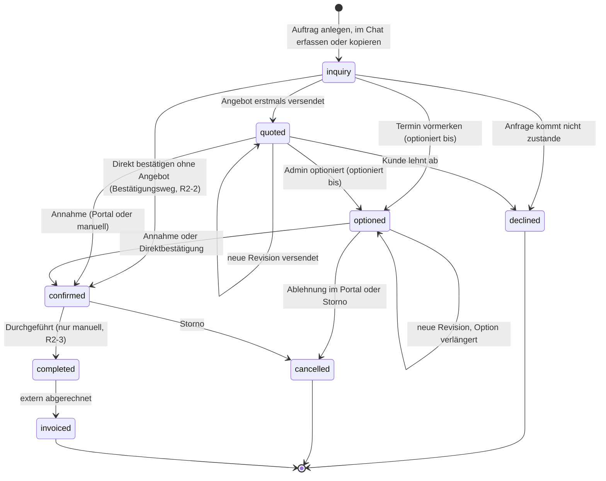
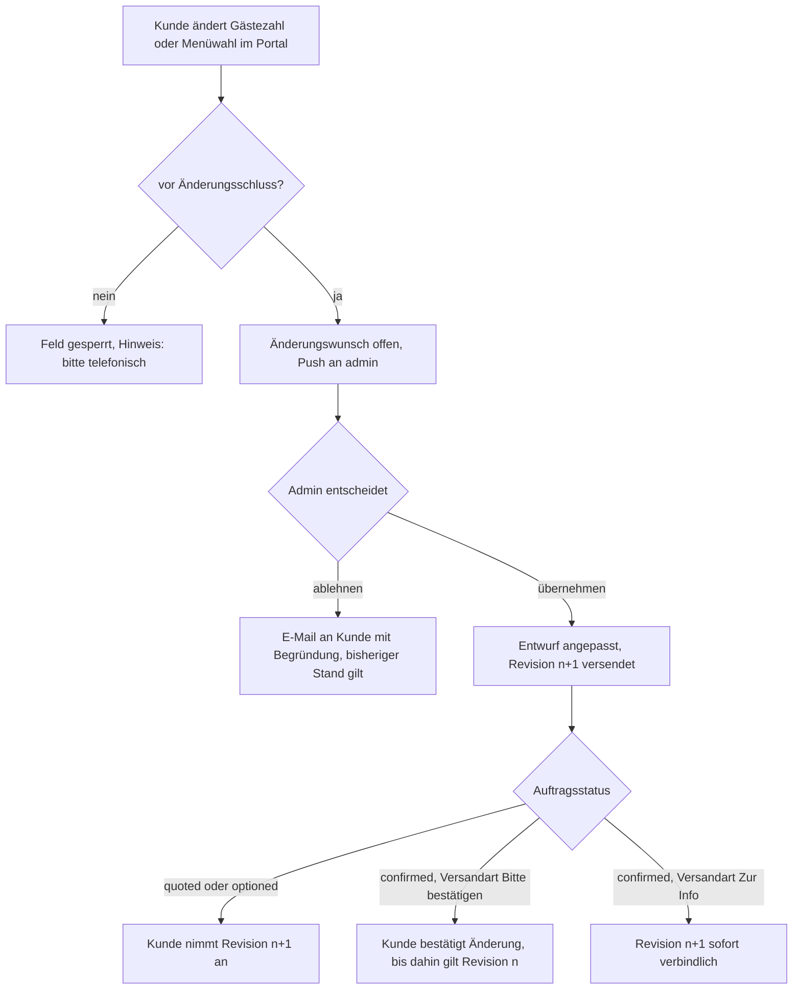
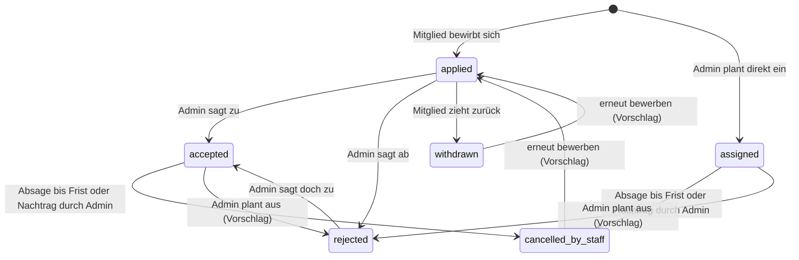
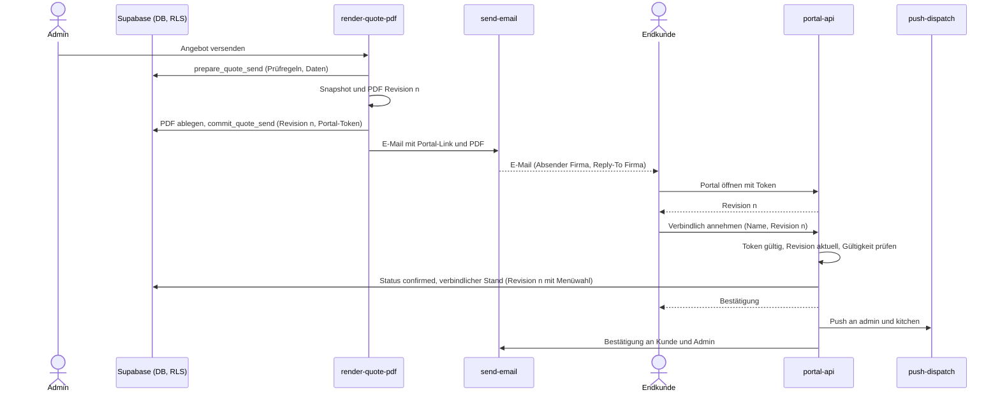
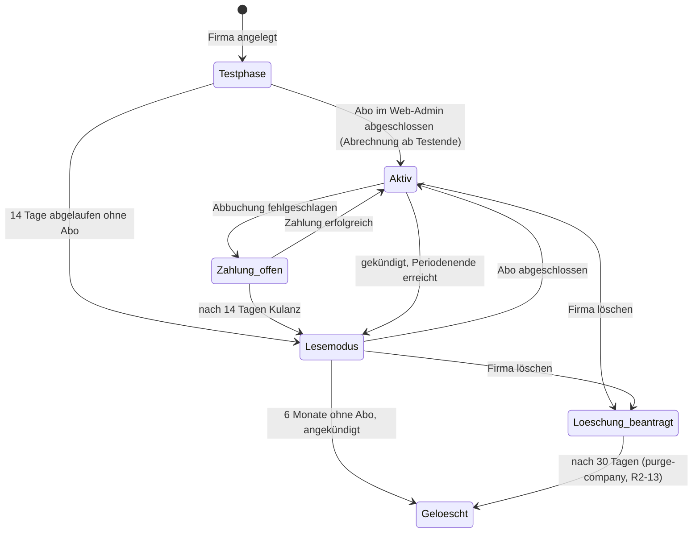

# 01 – Produktspezifikation (MVP)

Stand: 17.10.2026 · Arbeitstitel: catering-app · Grundlage: `docs/00-entscheidungen.md` (verbindlich)

**Lesehilfe**

- Inhalte ohne Markierung setzen das Entscheidungsprotokoll um.
- **[Vorschlag]** markiert eine begründete Empfehlung zu einem dort offenen Punkt. Bis der Gründer sie bestätigt, gilt sie als Arbeitsannahme.
- **entschieden (R2-x)** markiert einen Punkt, den der Gründer in Runde 2 entschieden hat (00 §9, R2-1 bis R2-14). Diese Entscheidungen haben Vorrang vor allen abweichenden Vorschlägen in 01–06.
- Akzeptanzkriterien werden als `US-xx.n` referenziert (n = Nummer in der Kriterienliste der Story).
- Begriffe, Rollen, Status, Tabellen- und Funktionsnamen folgen exakt dem Glossar (Abschnitt 0).

**Inhalt**

0. Glossar (Kurzreferenz)
1. Vision, Wertversprechen, Nicht-Ziele
2. Personas
3. Rollen & Rechte
4. Feature-Katalog, fachliche Regeln, Post-MVP-Backlog
5. User Stories (US-01 bis US-66)
6. Abo-Stufen, Testphase, Lesemodus
7. Erfolgskennzahlen

---

## 0. Glossar (Kurzreferenz)

| Bereich | Schlüssel → Bedeutung |
|---|---|
| Rollen (`member_role`) | `admin` Admin/Inhaber · `kitchen` Küche · `staff` Service/Aushilfe · Endkunde = kein App-Nutzer, Zugriff nur per Portal-Token |
| Auftragsstatus (`event_status`) | `inquiry` Anfrage · `quoted` Angebot versendet · `optioned` Optioniert · `confirmed` Bestätigt · `completed` Durchgeführt · `invoiced` Abgerechnet · `declined` Abgelehnt (Kunde lehnt Angebot ab) · `cancelled` Abgesagt (nach Option/Bestätigung storniert) |
| Positionstypen (`quote_item_type`) | `package` Menüpaket p. P. · `dish` Einzelgericht · `service` Personal · `equipment` Equipment-Miete · `travel` Anfahrt/Pauschale · `beverage` Getränkepauschale · `custom` frei |
| Bewerbungsstatus (`application_status`) | `applied` beworben · `accepted` vom Admin zugesagt · `rejected` vom Admin abgesagt · `withdrawn` Bewerber zieht zurück · `cancelled_by_staff` Absage nach Zusage · `assigned` direkt durch Admin eingeplant |
| Konventionen | Geldbeträge als integer Cent · Zeitpunkte als `timestamptz` · Zeitzone Europe/Berlin · ein Auftrag hat genau ein aktuelles Angebot mit Revisionsnummer (Snapshot beim Versand), keine komplexe Versionsverwaltung |
| Kerntabellen | `companies`, `company_members`, `invitations`, `customers`, `events`, `event_schedule_items`, `event_dietary_requirements`, `quotes`, `quote_items`, `dishes`, `dish_allergens`, `ingredients`, `dish_ingredients`, `menu_packages`, `menu_package_dishes`, `tax_rates`, `qualifications`, `member_qualifications`, `shift_slots`, `shift_applications`, `push_tokens`, `notifications`, `portal_tokens`, `subscriptions` |
| Edge Functions | `portal-api`, `render-quote-pdf`, `send-email`, `push-dispatch`, `stripe-webhook`, `create-checkout-session`, `ical-feed`, `accept-invitation` |
| Expo-Router | `app/(auth)` Anmeldung, Registrierung, Einladung · `app/(app)` Team-App mit rollenabhängigen Tabs · `app/portal/[token]` öffentliches Kundenportal (Web) |
| Angebots-Chat (ergänzend, 03 §3.7) | `intake_questions` Fragenkatalog der Firma (ein Katalog je Firma, Verzweigung über Bedingungen) · `events.occasion` Anlass · `events.intake_answers` Antworten des Chats am Auftrag |
| Ergänzung Edge Functions – entschieden (R2-12, R2-13, R2-14) | `delete-account`: Konto löschen inkl. Widerruf von Sign in with Apple (App-Store-Pflicht, 05 §5.10; freigegeben R2-12); `purge-company`: löscht 30 Tage nach dem Löschantrag alle Daten und Dateien der Firma (intern, Job `billing_lifecycle`; freigegeben R2-13); `export-company`: erzeugt den Datenexport im Hintergrund, legt das ZIP im privaten Bucket `exports` unter `{company_id}/{data_export_id}.zip` ab und löst die E-Mail „Export bereit“ mit signiertem Link (7 Tage gültig) aus (intern, nach `request_data_export()`; R2-14, US-59). Aufnahme ins Glossar |

Sprachregelung im Dokument: **Auftrag** = Datensatz in `events` (Event-Catering oder Business-Lunch; in der Oberfläche auch „Event“). **Mitglied** = Nutzer mit Eintrag in `company_members`. **Slot** = Datensatz in `shift_slots`. **Änderungsschluss** und **Absagefrist** sind Firmeneinstellungen (Abschnitt 4.2.6).

---

## 1. Vision, Wertversprechen, Nicht-Ziele

### 1.1 Vision & Wertversprechen

Die catering-app bündelt für kleine Cateringbetriebe (1–10 Mitarbeiter, Event-Catering und Business-Lunch, DACH) den gesamten Weg eines Auftrags in einer App: Anfrage erfassen, kalkuliertes Angebot mit Allergenkennzeichnung erstellen, als gebrandetes Online-Angebot mit PDF versenden, vom Kunden online annehmen und anpassen lassen, daraus automatisch Produktions- und Einkaufslisten für die Küche ableiten und das Service-Personal über eine Schichtbörse einplanen. Der Inhaber erstellt ein Angebot in Minuten statt Stunden und sieht dabei seine Marge; der Kunde hat jederzeit die gültige Fassung und pflegt Gästezahl, Menüwahl und Allergien selbst; die Küche arbeitet mit exakten Mengen und Sonderessen, ohne Preise zu sehen; Aushilfen finden passende Einsätze ohne WhatsApp-Chaos und haben alle Einsatzinfos auch ohne Netz dabei. Excel, Papier und WhatsApp-Gruppen werden für Angebot, Küchenplanung und Personaleinsatz überflüssig.

### 1.2 Nicht-Ziele des MVP

| # | Das MVP tut NICHT | Ersatz bzw. Umgang im MVP |
|---|---|---|
| N-01 | Rechnungen, Zahlungseingänge, Mahnungen | Rechnung extern; Status `invoiced` wird manuell gesetzt |
| N-02 | Buchhaltungs-Anbindung (lexoffice, sevDesk, DATEV), GoBD, E-Rechnung | kommt mit dem Rechnungsmodul |
| N-03 | Equipment-Bestand, Reservierung, Packlisten, Rücklauf/Bruch | Equipment nur als Angebotsposition `equipment` |
| N-04 | Einkauf bei Lieferanten, Bestellungen, automatische Preispflege | Einkaufsliste ist eine reine Mengenliste zum Teilen |
| N-05 | Volles Rezeptmodul (Zubereitung, Ausbeute, Skalierung) | nur Zutat + Menge pro Person je Gericht |
| N-06 | Verfügbarkeitsplanung, Zeiterfassung, Arbeitszeitdokumentation, Stundensätze/Lohn | Schichtbörse mit Bewerbung und Zusage |
| N-07 | Touren- und Lieferplanung, Fahrer-Rolle | Fahrer = `staff` mit Qualifikation „Fahrer“ **[Vorschlag]** |
| N-08 | Serienaufträge | Business-Lunch = normaler Auftrag; Kopieren für Wiederholungen |
| N-09 | HACCP, Temperatur- und Hygieneprotokolle | – |
| N-10 | Endkunden-Konten, Endkunden-App | Kundenportal im Web per Token-Link |
| N-11 | Online-Zahlung oder Anzahlung durch Endkunden | Anzahlung nur als optionale Angabe im Angebot |
| N-12 | Komplexe Angebotsversionierung (Varianten, Zweige, Vergleich) | ein aktuelles Angebot je Auftrag mit Revisionsnummer |
| N-13 | Feste Regeln für Anzahlung, Fristen, Storno | Freitext bzw. optionale Felder im Angebot |
| N-14 | Bearbeiten ohne Netz, Offline-Warteschlange, Konfliktauflösung | geladene Daten offline lesbar, Änderungen nur online |
| N-15 | Zwei-Wege-Kalendersynchronisation | iCal-Abo-Link, nur lesend |
| N-16 | Mehrsprachigkeit, Fremdwährungen | Oberfläche Deutsch, Beträge in EUR; AT/CH vorbereitet |
| N-17 | Mitgliedschaft eines Nutzers in mehreren Firmen | ein Nutzer gehört genau einer Firma an |
| N-18 | Abo-Kauf oder Kauf-Link in der Mobile-App | Abschluss nur im Web-Admin |
| N-19 | In-App-Chat **[Vorschlag]** | strukturierte Felder, Push, Kommentarfeld im Portal |
| N-20 | Öffentliches Anfrageformular, Lead-Vermittlung **[Vorschlag]** | Anfragen erfasst der Admin selbst |
| N-21 | Auswertungen und Umsatz-Dashboards **[Vorschlag]** | Rohertrag je Angebot, Startübersicht |
| N-22 | Kinderpreise und Kinderportionen als eigene Logik (z. B. Kinderzahl am Auftrag) – entschieden (R2-11) | Paket für Erwachsene mit fester Menge (Anzahl Erwachsene), Kinder als eigene Position (z. B. Paket „Kindermenü“, feste Menge); die Gästezahl bleibt die Gesamtzahl, keine Portion wird doppelt gezählt (02 §2.2) |

---

## 2. Personas

### 2.1 Sabine Krüger (46) – Inhaberin „Krügers Tafelküche“ → Rolle `admin`

- **Betrieb:** Event-Catering (Hochzeiten, Firmenfeiern) und Business-Lunch für Büros im Umkreis; 3 Festangestellte (1 Koch, 1 Küchenhilfe, 1 Teilzeit-Büro), ca. 12 Aushilfen auf Minijob-Basis; 15–25 Aufträge im Monat, Hochsaison Mai–September.
- **Ziele:** schnelle, professionell aussehende Angebote; jederzeit wissen, welche Termine fest, optioniert oder offen sind; Personal ohne Telefonmarathon besetzen; die Marge pro Auftrag kennen; Allergie-Informationen sicher bis in die Küche bringen.
- **Frust heute:** Angebote in Word/Excel dauern 1–2 Stunden, Preise werden aus alten Angeboten kopiert und sind veraltet; Kunden schicken Änderungen per WhatsApp, Telefon und E-Mail, niemand weiß, welche Fassung gilt; Optionen laufen unbemerkt ab; „Wer kann Samstag?“ in der WhatsApp-Gruppe, Zusagen gehen unter; Einkauf nach Bauchgefühl, mal zu viel, mal zu wenig.
- **Geräte & Kontext:** Laptop im Büro, Angebote oft abends; iPhone unterwegs (Kundentermine, Location-Besichtigung, am Event selbst); arbeitet selbst bei Events mit.
- **Folgt daraus:** Angebotserstellung am PC (Web-Admin) mit Kalkulation daneben; mobile Schnellaktionen (Anfrage erfassen, Bewerbungen zusagen, Status setzen); Startübersicht mit offenen Punkten.

### 2.2 Tobias Wendt (34) – Koch/Küchenchef → Rolle `kitchen`

- **Ziele:** wissen, was wann in welcher Menge produziert werden muss, auch über mehrere Aufträge und Tage; Allergiker und Sonderessen zuverlässig berücksichtigen; eine Einkaufsliste, die stimmt.
- **Frust heute:** Produktionszettel am Kühlschrank; Gästezahl-Änderungen erfährt er per Zuruf am Vortag; rechnet Mengen per Hand hoch; Allergene stehen in einem Ordner, der nicht aktuell ist.
- **Geräte & Kontext:** Android-Smartphone, auch in der Küche (kein Küchen-Tablet, entschieden R2-8); nasse oder fettige Hände, wenig Zeit; Kühlraum und Kellerküche ohne zuverlässiges Netz.
- **Folgt daraus:** Tagesansicht „Heute/Morgen“, große Touch-Ziele, Listen ohne Preise, offline lesbar; Gerichte, Zutaten und Allergene pflegt er selbst.

### 2.3 Lena Hoffmann (22) – Studentin, Service-Aushilfe → Rolle `staff`

- **Ziele:** Einsätze finden, die zu Stundenplan und Qualifikation passen; alle Infos an einer Stelle (Adresse, Treffpunkt, Ankunftszeit, Dresscode, Ansprechpartner); faire, transparente Verteilung.
- **Frust heute:** WhatsApp-Gruppe mit 80 Nachrichten, „wer zuerst schreibt, bekommt die Schicht“; Adresse und Zeiten muss sie aus dem Chatverlauf zusammensuchen; kurzfristige Änderungen bekommt sie nicht mit; weiß nicht, bis wann sie absagen darf.
- **Geräte & Kontext:** iPhone, nutzt die App unterwegs und kurz vor dem Einsatz; Locations (Scheune, Schloss, Weinberg) oft ohne Empfang.
- **Folgt daraus:** Schichtbörse nur mit passenden Slots, klare Statusanzeige, Push bei Entscheidung und Änderung, sichtbare Absagefrist, Einsatzinfos offline.

### 2.4 Julia & Murat (29/31) – Brautpaar → Endkunde (Portal)

- **Ziele:** das Angebot verstehen und mit Eltern bzw. Trauzeugen teilen; Menü auswählen; Gästezahl später anpassen; Allergien der Gäste sicher weitergeben; wissen, was verbindlich vereinbart ist.
- **Frust heute:** PDF per E-Mail, jede Rückfrage dauert Tage; drei Angebotsfassungen im Postfach, unklar welche gilt; Allergieliste der Gäste in einer eigenen Excel-Datei.
- **Geräte & Kontext:** Smartphone abends auf dem Sofa, teils Laptop; Einmalkunde, installiert keine App; nicht vom Fach (Begriffe wie „p. P.“ oder „netto“ müssen erklärt sein).
- **Folgt daraus:** mobil optimiertes Portal ohne Login, Bruttopreise für Privatkunden **[Vorschlag]**, klare Hinweise „gültige Fassung“ und „verbindlich angenommen am …“, einfache Erfassung von Sonderessen.

### 2.5 Petra Neumann (52) – Assistenz der Geschäftsführung, Steuerkanzlei → Endkunde (Portal)

- **Ziele:** Business-Lunch für 12–30 Personen 2–4-mal im Monat schnell bestätigen; Nettopreise und korrekte Rechnungsanschrift; vegetarische Gerichte und Allergien der Teilnehmer angeben; interne Bestellnummer oder Kostenstelle auf dem Angebot.
- **Frust heute:** E-Mail-Pingpong für Routinebestellungen; Angebot muss intern zur Freigabe weitergeleitet werden; Teilnehmerzahl ändert sich am Vortag.
- **Geräte & Kontext:** Desktop im Büro (Outlook, Chrome/Edge), Firmen-Proxy, keine App-Installation erlaubt.
- **Folgt daraus:** Portal läuft in allen gängigen Desktop-Browsern, PDF zum Weiterleiten, Feld „Ihre Referenz“ **[Vorschlag]**, wiederkehrende Lunches per Kopie in Sekunden angeboten.

---

## 3. Rollen & Rechte

### 3.1 Rollenübersicht

| Rolle | Schlüssel | Wer | Zugang | Plattform |
|---|---|---|---|---|
| Admin/Inhaber | `admin` | Inhaber, ggf. Büro/Stellvertretung; mehrere Admins möglich **[Vorschlag]**, mindestens einer | Registrierung (Firmengründer) oder Einladung | iOS, Android, Web-Admin (Abo und Export nur Web) |
| Küche | `kitchen` | Koch, Küchenhilfe | nur per Einladung | iOS, Android, Web; **offline lesbar nur in der nativen App**, im Web nur online. Die Küche nutzt deshalb Smartphones mit der nativen App; ein Küchen-Tablet ist im MVP nicht vorgesehen (entschieden R2-8; Tablet-Optimierung nach dem MVP, P-23) |
| Service/Aushilfe | `staff` | Service, Bar, Spüler, Fahrer, Aushilfen | nur per Einladung | iOS, Android |
| Endkunde | – (kein Mitglied) | Brautpaar, Firmenkunde, Privatkunde | Link mit Portal-Token (`portal_tokens`) | Web (`app/portal/[token]`) |

### 3.2 Rechte-Matrix

Legende: **V** = voll (anlegen, ändern, löschen) · **L** = nur lesen · **E** = nur Eigenes bzw. eigene Einsätze · **P** = im Portal, nur der eigene Auftrag · **–** = kein Zugriff (serverseitig gesperrt, nicht nur ausgeblendet)

| Aktion | admin | kitchen | staff | Endkunde (Portal) |
|---|---|---|---|---|
| **Firma, Team, Abo** | | | | |
| Firmendaten, Logo, Akzentfarbe pflegen | V | – | – | – |
| Firmeneinstellungen (Fristen, Standardwerte) und Steuersätze pflegen | V | – | – | – |
| Team einladen, Einladung widerrufen | V | – | – | – |
| Rollen ändern, Mitglieder entfernen | V | – | – | – |
| Teamliste sehen (Name, Rolle, Telefon) | V | L | – | – |
| Qualifikationen definieren und Mitgliedern zuordnen | V | – | – | – |
| Eigene Qualifikationen sehen | V | E | E | – |
| Abo abschließen, wechseln, kündigen (nur Web-Admin) | V | – | – | – |
| Daten der Firma exportieren | V | – | – | – |
| Firma löschen | V | – | – | – |
| Eigenes Profil pflegen, eigenes Konto löschen | E | E | E | – |
| Eigene Daten exportieren (Profil, Download-Link per E-Mail, R2-14) | E | E | E | – |
| Eigenen iCal-Link abrufen oder zurücksetzen | E | E | E | – |
| **Kunden & Aufträge** | | | | |
| Kunden anlegen, bearbeiten, anonymisieren | V | – | – | – |
| Kundenkontaktdaten sehen (E-Mail, Telefon, Rechnungsanschrift) | V | – | – | P¹ |
| Auftrag anlegen, bearbeiten, kopieren | V | – | – | – |
| Anfrage im Angebots-Chat erfassen | V | – | – | – |
| Fragenkatalog pflegen | V | – | – | – |
| Auftrag sehen (Datum, Ort, Gästezahl, Ansprechpartner vor Ort) | V | L² | E³ | P |
| Interne Notiz zum Auftrag | V | – | – | – |
| Hinweise für die Küche | V | L | – | – |
| Hinweise für das Personal (Treffpunkt, Dresscode) | V | L² | E³ | – |
| Status ändern (Option, Bestätigung, Storno, Durchgeführt, Abgerechnet) | V | – | – | P⁴ |
| Zeitplan pflegen | V | – | – | – |
| Zeitplan sehen | V | L² | E³ | – |
| Kalender | V | L² | E | – |
| **Angebote & Preise** | | | | |
| Angebot erstellen und bearbeiten | V | – | – | – |
| Preise, Summen, Steuern sehen | V | – | – | P⁵ |
| Wareneinsatz, Aufschlag, Rohertrag sehen | V | – | – | – |
| Angebot bzw. neue Revision versenden | V | – | – | – |
| Ältere Revisionen (PDF) einsehen | V | – | – | – |
| Angebot im Portal ansehen, PDF laden | V (Vorschau) | – | – | P⁵ |
| Angebot annehmen oder ablehnen | V (manuell erfassen) | – | – | P⁴ |
| Menüwahl und Gästezahl ändern | V (direkt) | – | – | P⁶ (Menüwahl vor der Annahme direkt, sonst als Änderungswunsch, 4.2.3) |
| Änderungswunsch übernehmen oder ablehnen | V | – | – | – |
| **Gerichte & Küche** | | | | |
| Gerichte, Zutaten, Mengen, Allergene, Diätformen sehen | V | L | – | P⁷ |
| Gerichte und Zutaten anlegen, bearbeiten, archivieren (ohne Preise/Kosten) | V | V | – | – |
| Preise von Gerichten und Paketen, Einkaufspreise von Zutaten | V | – | – | P⁵ |
| Menüpakete pflegen | V | L (ohne Preis) | – | – |
| Küchen-Tagesansicht, Produktionsliste | V | L | – | – |
| Einkaufsliste | V (mit Kosten) | L (ohne Kosten) | – | – |
| Sonderessen/Allergien erfassen und bearbeiten | V | V | – | P⁶ |
| Allergikerliste eines Auftrags sehen | V | L | E³ | P (eigene Einträge) |
| **Schichtbörse & Einsätze** | | | | |
| Slots anlegen, bearbeiten, veröffentlichen, schließen | V | – | – | – |
| Veröffentlichte Slots sehen | V (alle) | E⁸ | E⁸ | – |
| Sich bewerben, Bewerbung zurückziehen | – | E | E | – |
| Bewerbungen sehen, zusagen, absagen, ausplanen | V | – | – | – |
| Direkt einplanen | V (auch sich selbst) | – | – | – |
| Nach Zusage absagen (bis Absagefrist) | – | E | E | – |
| Absage nach Frist für ein Mitglied eintragen | V | – | – | – |
| Einsatzinfos sehen | V | E³ | E³ | – |
| Besetzung eines Auftrags sehen | V | L² | E⁹ | – |

¹ Nur die im eigenen Auftrag hinterlegten Daten, Anzeige ohne Bearbeitung **[Vorschlag]**.
² Nur Aufträge ab Status `optioned` (inkl. `completed`, `invoiced` und `cancelled` als gekennzeichnet) **[Vorschlag]**; nie Preise.
³ Nur Aufträge, in denen das Mitglied einen Slot mit Status `accepted` oder `assigned` hat; Zugriff endet sofort bei Absage, Ausplanung oder Storno.
⁴ Nur Annehmen, Ablehnen bzw. „Änderung bestätigen“ der aktuellen Revision.
⁵ Nur die zuletzt versendete Revision des eigenen Auftrags.
⁶ Bis zum Änderungsschluss (Standard Event-Catering 72 h, Business-Lunch 24 h vor Beginn, je Auftrag änderbar) – entschieden (R2-6); Menüwahl vor der Annahme direkt, Gästezahl und alle Änderungen nach der Bestätigung als Änderungswunsch, Sonderessen sofort (R2-1).
⁷ Nur Name, Beschreibung, Allergene und Diätformen der im Angebot enthaltenen Gerichte; keine Zutaten oder Mengen.
⁸ Nur veröffentlichte Slots mit einer Qualifikation, die das Mitglied besitzt.
⁹ Vorname und Qualifikation der übrigen Eingeplanten desselben Auftrags **[Vorschlag]** (hilft bei Fahrgemeinschaften und Übergaben).

### 3.3 Durchsetzungsregeln

1. Alle Rechte gelten serverseitig (Row-Level-Security, Edge Functions). Die Oberfläche blendet zusätzlich aus, ersetzt aber keine Prüfung.
2. `kitchen` erhält Preis-, Kosten- und Margenfelder nicht ausgeliefert (preisfreie Lesepfade), auch nicht in Push-Texten, iCal-Feeds oder im Offline-Cache.
3. `staff` erhält Auftragsdetails erst ab `accepted`/`assigned`. Vor der Zusage sieht er in der Schichtbörse nur Slot-Titel, Datum, Zeiten, PLZ/Ort, Qualifikation, Dresscode, Eventart, Gästezahl und freie Plätze (deckungsgleich mit 02 §5.4 und der View `shift_board`).
4. Endkunden greifen ausschließlich über `portal-api` mit gültigem Token zu, nie direkt auf die Datenbank.
5. Der Lesemodus (Abschnitt 6.4) entzieht allen Rollen die Schreibrechte; ausgenommen sind Datenexport, Firmenlöschung, Abo-Abschluss, Mitglieder entfernen **[Vorschlag]** und das Löschen des eigenen Kontos.
6. Jede Firma hat mindestens einen `admin`. Der letzte Admin kann weder herabgestuft noch entfernt werden und kann sein Konto nicht löschen, solange er letzter Admin ist.
7. Ein Nutzer gehört genau einer Firma an. Der Wechsel erfordert, die bisherige Firma zu verlassen.

### 3.4 Navigation je Rolle **[Vorschlag]**

| Rolle | Tabs in `app/(app)` (Mobile) | Ergänzungen im Web |
|---|---|---|
| `admin` | Start · Aufträge · Kalender · Personal · Mehr (Kunden, Gerichte, Pakete, Team, Einstellungen) | breite Angebots- und Kalkulationsansicht, Abo, Datenexport, Firmenlöschung |
| `kitchen` | Heute · Produktion · Einkauf · Gerichte · Mehr (Kalender, Schichtbörse, Profil) | Druckansicht der Listen |
| `staff` | Einsätze · Schichtbörse · Kalender · Mehr (Profil, Benachrichtigungen) | im Web nutzbar, aber nicht optimiert |

`kitchen` erhält die Schichtbörse, weil Köche bei Events auch vor Ort arbeiten (Qualifikation z. B. „Koch vor Ort“).

---

## 4. Feature-Katalog

**Priorität:** **Must** = blockiert den MVP-Release · **Should** = im MVP geplant, verschiebbar ohne Release-Blockade.

### 4.1 MVP-Features

| ID | Feature | Prio | Umfang im MVP | Abgrenzung (nicht im MVP) | Stories |
|---|---|---|---|---|---|
| F-01 | Registrierung, Login, Onboarding | Must | E-Mail + Passwort, Sign in with Apple, Google; Auswahl „Firma anlegen“ oder „Einladung“; Firmen-Setup in einem Schritt; Start der Testphase; Passwort-Reset | keine 2FA/Passkeys, kein SSO, kein Firmenwechsel | US-01, US-02 |
| F-02 | Firmenprofil, Branding, Einstellungen | Must | Stammdaten, Logo, Akzentfarbe, Standardtexte, Fristen und Standardwerte (4.2.6), Steuersätze (DE vorbelegt, AT/CH vorbereitet) | keine eigene Domain, kein Portal-Design über Logo und Farbe hinaus | US-03, US-04 |
| F-03 | Team, Einladungen, Rollen | Must | Einladung per E-Mail oder Link mit Rolle und Qualifikationen (`accept-invitation`), Rollen ändern, entfernen, Konto löschen | keine individuellen Rechte pro Person, keine Personalakte | US-05 – US-08 |
| F-04 | Kunden | Must | Privat/geschäftlich, Kontakt, Rechnungsanschrift, Notiz, Duplikatwarnung, Auftragshistorie, Anonymisierung | kein CRM (Pipeline, Aufgaben), kein Import | US-09, US-61 |
| F-05 | Aufträge & Status-Workflow | Must | Anlage, Statusübergänge nach 02 §1.1 (Übersicht 4.2.1), Option mit Ablaufdatum, Direktbestätigung (R2-2), Storno, Bestätigungsdialog vor jedem Statuswechsel (R2-4), Statushistorie | keine Serienaufträge, keine Raum-/Ressourcenplanung, keine Rückwärts-Übergänge und keine Funktion „Status korrigieren“ (R2-4), kein automatisches „Durchgeführt“ (R2-3) | US-10 – US-12 |
| F-06 | Auftrag kopieren | Must (Mehrfachkopie: Should) | Kopie mit neuem Datum inkl. Positionen und Zeitplan, optional Slots und Sonderessen | keine verknüpfte Serie | US-13 |
| F-07 | Zeitplan je Auftrag | Must | Einträge Abfahrt, Aufbau, Ausgabe, Abbau, Sonstiges (`event_schedule_items`) | keine Fahrzeug-/Tourenplanung | US-14 |
| F-08 | Kalender | Must | Monat, Woche, Liste; rollengefiltert; Statuskennzeichnung | kein Zwei-Wege-Sync, kein Verschieben per Drag & Drop **[Vorschlag]** | US-15 |
| F-09 | Auftragsliste, Suche, Filter | Should | Filter nach Status, Zeitraum, Art, Kunde; Volltextsuche | keine gespeicherten Filter | US-16 |
| F-10 | Startübersicht (admin) | Should | offene Anfragen, ablaufende Optionen, unbesetzte Slots, offene Änderungswünsche | keine Umsatzberichte | US-17 |
| F-11 | Gerichte mit Allergenen & Diätformen | Must | 14 Pflichtallergene mit Prüfstatus, Diätformen, Kategorie, Preis (nur admin), Archiv, Filter (Should) | keine Zusatzstoffe, keine Nährwerte, kein HACCP | US-18, US-21, US-22 |
| F-12 | Zutaten & Mengen pro Person | Must | Zutatenstamm mit Basiseinheit und Einkaufspreis (nur admin), Menge p. P. je Gericht | kein Rezeptmodul, keine Lieferantenpreise, keine Allergene je Zutat | US-19 |
| F-13 | Menüpakete | Must | Pakete aus Gerichten mit Portionsfaktor **[Vorschlag]**, Preis p. P., abgeleitete Allergene und Diätformen | keine Staffelpreise | US-20 |
| F-14 | Angebot & Kalkulation | Must | alle 7 Positionstypen, pro-Person-Mengen, Kalkulationsart Pauschal oder Wareneinsatz, Rohertrag, Steuern, Rabatt über Rabattfelder (Gesamt in % oder €, Position in %), Anzahlung und Konditionen als Freitext, Gültigkeit, Wahlgruppen; Rechenregeln nach 02 §3 | keine Varianten, keine negativen Positionen, keine Staffelrabatte, keine Personalkostenrechnung | US-23 – US-26 |
| F-15 | Versand, Revision, PDF | Must | Versand per E-Mail (`send-email`), Snapshot mit Revisionsnummer, PDF mit Branding (`render-quote-pdf`), Link kopieren (Should) | kein Öffnungs-Tracking, keine digitale Signatur | US-27 – US-29 |
| F-16 | Kundenportal: ansehen, annehmen, ablehnen | Must | `app/portal/[token]` über `portal-api`; Annahme mit Name, Revision, Zeitstempel | kein Kundenkonto, keine Online-Zahlung, keine Übersicht mehrerer Aufträge | US-30 – US-32 |
| F-17 | Kundenportal: Änderungen | Must | Menüwahl in Wahlgruppen, Gästezahl als Änderungswunsch, Sonderessen/Allergien direkt, Änderungsschluss; Übernahme durch admin per Revision | keine Gästeliste/RSVP, keine Sitzordnung, kein Chat | US-33 – US-36 |
| F-18 | Küche: Tagesansicht & Produktionsliste | Must | Heute/Morgen, Produktionsliste über mehrere Aufträge und Tage, Sonderessen, ohne Preise; für Smartphones (native App) ausgelegt (R2-8) | keine Stationsplanung, keine Etiketten, kein Küchen-Tablet und keine Tablet-Layouts (R2-8, P-23) | US-37, US-38 |
| F-19 | Einkaufsliste | Must | Summe aus Zutaten × Portionen, Puffer (nur Einkauf, Standard 5 %), Teilen als Text, CSV im Web | keine Bestellungen, keine Lieferanten, kein Lagerbestand | US-39 |
| F-20 | Sonderessen & Allergikerliste | Must | Erfassung intern und im Portal (`event_dietary_requirements`), Konfliktprüfung, Ersatzgericht | keine Gästeliste | US-35, US-40 |
| F-21 | Qualifikationen | Must | Qualifikationen definieren und zuordnen (`qualifications`, `member_qualifications`) | keine Zertifikatsverwaltung mit Ablaufdatum | US-41 |
| F-22 | Schichtbörse | Must | Slots, Veröffentlichung, Sichtbarkeit nach Qualifikation, Bewerbung, Zusage/Absage, Schutz vor Überbuchung | keine Verfügbarkeiten, keine automatische Zuteilung, keine Stundensätze | US-42 – US-45 |
| F-23 | Direkt einplanen | Must | Admin plant ohne Bewerbung ein (`assigned`) | – | US-46 |
| F-24 | Absage nach Zusage mit Frist | Must | Frist pro Firma (Standard 48 h), Nachtrag durch admin nach Fristablauf | keine Sanktionen oder Bewertungen | US-47 |
| F-25 | Einsatzinfos & Meine Einsätze | Must | Adresse, Treffpunkt, Dresscode, Ablaufplan, Ansprechpartner, Allergikerliste; offline lesbar | kein Check-in, keine Stempeluhr | US-48, US-49 |
| F-26 | Besetzungsübersicht | Must | Besetzungsgrad je Auftrag und Slot, Filter „unbesetzt“ | – | US-50 |
| F-27 | Push & Benachrichtigungsliste | Must | Expo Notifications über `push-dispatch`, `push_tokens`, `notifications`, Kategorien nach 4.2.5 | keine SMS, kein WhatsApp-Versand | US-51, US-52 |
| F-28 | iCal-Abo | Should | persönlicher ICS-Link je Mitglied über `ical-feed`, nur lesend | kein Schreiben in Fremdkalender | US-53 |
| F-29 | Offline-Lesen | Must | Cache geladener Daten, Offline-Banner, Schreibaktionen gesperrt, Vorladen eigener Einsätze **[Vorschlag]** | keine Offline-Bearbeitung | US-54 |
| F-30 | Testphase, Abo, Lesemodus | Must | 14 Tage ohne Zahlungsdaten, Stripe Checkout (`create-checkout-session`, `stripe-webhook`), Stufengrenzen, Lesemodus | kein In-App-Kauf, keine Gutscheine | US-55 – US-58 |
| F-31 | Datenschutz: Export, Löschung, Rechtstexte | Must | ZIP-Export im Hintergrund mit Download-Link per E-Mail (privater Bucket `exports`, signierter Link 7 Tage gültig, danach automatische Löschung; R2-14), Konto löschen (`delete-account`, R2-12), Firmenlöschung (`purge-company`, R2-13), Anonymisierung von Endkunden, AVV, Datenschutzerklärung | kein Export des Änderungsprotokolls, kein Download direkt im Browser, keine automatischen oder geplanten Exporte | US-59 – US-62 |
| F-32 | Angebots-Chat & Fragenkatalog | Must | geführter Chat ohne KI für die interne Anfrageerfassung (z. B. am Telefon): eine Frage nach der anderen, Antworttypen (Auswahl, Mehrfachauswahl, Zahl, Datum, Uhrzeit, Zeitspanne, Text, Ja/Nein, Kunde), Pflichtfragen, Verzweigung, Antwort ändern, Feldzuordnung zu Auftrag und Angebot, Notiz für Fragen ohne Zuordnung; Fragenkatalog je Firma pflegen, Standardkatalog, Testlauf; danach Angebots-Editor (00 §3) | keine KI, keine automatischen Positionsvorschläge, kein Chat für Endkunden, keine Kataloge je Anlass, keine Offline-Erfassung | US-63 – US-66 |

### 4.2 Fachliche Kernregeln

#### 4.2.1 Auftragsstatus

**Die verbindliche Übergangstabelle steht in 02 §1.1** (Auslöser, Vorbedingungen, Nebenwirkungen). Server (`set_event_status()`) und Oberfläche nutzen genau diese Tabelle; hier steht nur die Übersicht. Entschieden (R2-2, R2-3, R2-4; ersetzt den Vorschlag 06 E-8).

Kurzfassung der Regeln aus 02 §1.1:

- „Optioniert bis“ ist Pflicht, sowohl aus `inquiry` (Termin vor dem Angebot halten) als auch aus `quoted`.
- **Direktbestätigung** (`inquiry`/`optioned` → `confirmed`, auch ganz ohne versendetes Angebot) ist erlaubt – entschieden (R2-2). Sie verlangt den Bestätigungsweg (Telefon, E-Mail, persönlich), z. B. für Stammkunden am Telefon und Business-Lunch-Kopien.
- Eine Anfrage, die nicht zustande kommt, wird `declined` (Grund Pflicht). Löschen gibt es nur für Fehleingaben ohne Versand.
- **Keine Rückwärts-Übergänge** – entschieden (R2-4): kein `completed` → `confirmed`, kein `invoiced` → `completed`, kein `declined` → `quoted`, keine Reaktivierung von `declined` oder `cancelled` und keine Funktion „Status korrigieren“. `declined`, `cancelled` und `invoiced` sind Endzustände; die Wiederaufnahme eines abgelehnten oder stornierten Auftrags läuft über „Auftrag kopieren“ (US-13).
- **Bestätigungsdialog vor jedem Statuswechsel** (R2-4): Jeder Wechsel durch den Admin – einzeln oder als Sammelaktion – zeigt vorher alten und neuen Status, die Folgen (z. B. Benachrichtigung von Küche, Eingeplanten oder Kunde, geschlossene Slots) und den Hinweis „Dieser Schritt kann nicht rückgängig gemacht werden.“; erst die Aktion mit dem Zielstatus als Text (z. B. „Als abgerechnet markieren“) führt ihn aus, „Abbrechen“ ist die Standardschaltfläche (US-11.10, 02 §1.1.1).
- „Durchgeführt“ (`completed`) setzt ausschließlich der Admin; es gibt keinen automatischen Wechsel, auch keinen nächtlichen Job. Die App erinnert am Tag nach dem Event um 09:00 (Job `events_completion`, US-11.5) – entschieden (R2-3).

Weitere Regeln:

- Eine abgelaufene Option ändert den Status nicht automatisch; der Auftrag wird als „Option abgelaufen“ markiert, bis der Admin verlängert, bestätigt oder storniert **[Vorschlag]** (kein ungewollter Terminverlust).
- Im Status `confirmed` gibt es im Portal kein „Ablehnen“; Stornos laufen über den Caterer.
- Jeder Statuswechsel wird mit Zeitpunkt, Auslöser (Mitglied oder Portal) und optionalem Grund protokolliert **[Vorschlag]**.

#### 4.2.2 Angebot, Revision, Kalkulation

- Jeder Auftrag hat genau ein aktuelles Angebot (`quotes`). Es besteht aus einem bearbeitbaren **Entwurf** und dem **Snapshot der zuletzt versendeten Revision**. Das Portal zeigt immer nur den Snapshot.
- Versand erhöht die Revisionsnummer (erste Versendung = Revision 1), speichert den Snapshot und erzeugt das PDF. Ältere Revisionen bleiben für den Admin als PDF einsehbar; es gibt keinen Vergleich und keine Varianten.
- Angebotsnummer je Firma fortlaufend `A-JJJJ-NNNN`, Revision als Zusatz `R2` **[Vorschlag]**.
- Positionen übernehmen beim Hinzufügen Bezeichnung, Beschreibung, Preis und Steuersatz als Kopie aus Gericht oder Paket. Spätere Katalogänderungen wirken nur auf neu hinzugefügte Positionen; eine Aktion „auf aktuelle Katalogpreise aktualisieren“ gleicht bei Bedarf ab.
- **Pro-Person-Positionen:** `package` und `beverage` standardmäßig, `dish` wahlweise. Ihre Menge folgt der Gästezahl des Auftrags.
- **Kalkulationsart** je Angebot **[Vorschlag]**, Standard aus Firmeneinstellung:
  - *Pauschal:* Preise aus Paket bzw. Gericht.
  - *Wareneinsatz + Aufschlag:* Einzelpreis = Wareneinsatz pro Portion × (1 + Aufschlag %), auf das Preisraster von vollen 10 Cent **aufgerundet** (26,32 € → 26,40 €) – entschieden (R2-5) –, damit der Preis nie unter dem kalkulierten Wert liegt. Wareneinsatz pro Portion = Σ (Menge pro Person × Einkaufspreis je Basiseinheit) der Zutaten; bei Paketen zusätzlich × Portionsfaktor je Gericht. Die Menge pro Person ist die Einkaufsmenge der Rohware vor dem Garen (US-19.2) – entschieden (R2-7).
  - Manuell überschriebene Einzelpreise bleiben bei einem Wechsel der Kalkulationsart erhalten und sind gekennzeichnet.
- **Rohertrag** (nur admin) = Nettosumme der `package`-, `dish`- und `beverage`-Positionen − Wareneinsatz der Speisen. Getränke ohne Zutaten zählen mit Wareneinsatz 0 und werden als unvollständig markiert.
- **Steuern und Rundung:** Die Rechenregeln stehen verbindlich in 02 §3 (eine Quelle für App, Portal und PDF). Kurzfassung: Jede Position trägt einen Steuersatz aus `tax_rates` (Standard je Positionstyp); Positionsbetrag = Menge × Einzelpreis, kaufmännisch auf Cent gerundet; die Umsatzsteuer wird **je Steuersatz auf die Summe der Beträge dieses Satzes** gerechnet und kaufmännisch gerundet (wie später auf Rechnungen); gerechnet wird ausschließlich mit Ganzzahlen **[Vorschlag]**.
- **Rabatt** nur über die Rabattfelder: Gesamtrabatt in % oder €, Positionsrabatt in %. Negative Positionen gibt es nicht, weil sie bei gemischten Steuersätzen die Umsatzsteuer falsch verteilen würden.
- **Preisanzeige:** Privatkunde brutto je Position, Geschäftskunde netto je Position, je Angebot umschaltbar **[Vorschlag]**. Gerechnet wird von der angezeigten Seite aus; weicht sie von der Eingabeart der Firma ab, wird der Einzelpreis einmal umgerechnet (02 §3.6). Summen netto, Umsatzsteuer je Satz und brutto werden immer ausgewiesen.
- **Kinder:** keine eigene Kinderzahl und keine Kinderpreise im MVP (N-22) – entschieden (R2-11); Kinder laufen als eigene Angebotsposition mit fester Menge.
- **Wahlgruppen** **[Vorschlag]**: Positionen können zu einer Gruppe „Alternativen“ zusammengefasst werden (z. B. „Menü Klassik oder Mediterran“). In den Summen zählt die gewählte, bis zur Wahl die als Standard markierte Alternative.

#### 4.2.3 Kundenänderungen & Änderungsschluss

| Änderung im Portal | vor Annahme (`quoted`, `optioned`) | nach Bestätigung (`confirmed`) | nach Änderungsschluss |
|---|---|---|---|
| Menüwahl in Wahlgruppe | direkt wirksam, Summen live aktualisiert, keine neue Revision | Änderungswunsch an admin | gesperrt, Hinweis auf Telefon |
| Gästezahl | Änderungswunsch an admin (Schätzung der neuen Summe sichtbar) | Änderungswunsch an admin | gesperrt, Hinweis auf Telefon |
| Sonderessen/Allergien | direkt wirksam (kein Preiseffekt) | direkt wirksam | gesperrt, Hinweis auf Telefon |

Diese Tabelle ist die verbindliche MVP-Regel – entschieden (R2-1; ersetzt den Vorschlag 06 E-10); 02 §4 beschreibt den Ablauf technisch.

- Änderungsschluss: Firmeneinstellung **je Auftragsart**, Standard Event-Catering 72 h, Business-Lunch 24 h vor Beginn – entschieden (R2-6) (Business-Lunch-Teilnehmerzahlen ändern sich oft am Vortag, Persona 2.5). Der Wert wird je Auftrag als „Änderungen bis“ vorbelegt und ist dort änderbar (US-10.8).
- Je Auftrag gibt es höchstens einen offenen Änderungswunsch; eine erneute Änderung ersetzt den offenen Wunsch **[Vorschlag]**.
- Gästezahl wirkt nicht sofort auf den Preis, weil der Admin Personal, Equipment oder Anfahrt anpassen muss.
- Ändert sich die Gästezahl um 20 % oder mehr (nach oben oder unten), weist das Portal mit „bitte anrufen“ auf eine telefonische Abstimmung hin und der Admin sieht den Wunsch als „wichtig“ (US-34.6) – entschieden (R2-1).
- Küchenlisten basieren auf der **verbindlichen Revision** (zuletzt angenommen, im Portal bestätigt bzw. „zur Info“ versendet; gespeichert als `quotes.binding_snapshot`). Offene Änderungswünsche, versendete, aber unbestätigte Revisionen und ungesendete Entwurfsänderungen erscheinen dort als Hinweis (z. B. „Änderung offen: Gästezahl 80 → 95“).

#### 4.2.4 Schichtbörse

- **Veröffentlichen und Einplanen** sind erst ab Auftragsstatus `optioned` möglich; in `inquiry` und `quoted` entstehen Slots nur als Entwurf (02 §5.2).
- **Qualifikation:** Jeder Slot hat genau eine Qualifikation (Pflichtfeld, US-42.1); wer sie nicht hat, sieht den Slot nicht – entschieden (R2-9).

- **Kapazität:** Anzahl `accepted` + `assigned` ≤ Anzahl des Slots. Die Prüfung erfolgt serverseitig in einer Transaktion; bei gleichzeitigen Zusagen gewinnt genau eine.
- **Warteliste:** Ist ein Slot voll, bleiben übrige `applied`-Bewerbungen bestehen und gelten als Warteliste **[Vorschlag]**. Es gibt kein automatisches Nachrücken; der Admin entscheidet.
- **Sichtbarkeit:** veröffentlichte, nicht begonnene Slots mit freiem Platz, deren Qualifikation das Mitglied besitzt. Slots in Aufträgen mit Status vor `confirmed` tragen das Kennzeichen „vorläufig“ **[Vorschlag]**.
- **Absagefrist:** Firmeneinstellung, Standard 48 h vor Slot-Beginn – entschieden (R2-10). Nach Fristablauf ist Absage nur telefonisch über den Admin möglich; der Admin trägt sie als `cancelled_by_staff` mit Vermerk „nach Frist“ ein.
- **Zeitänderung durch Admin:** Verschiebt der Admin Beginn oder Ende eines Slots (oder den Auftrag), werden Eingeplante (und Bewerber) über die Zeitänderung benachrichtigt („Einsatz geändert“ mit neuer Zeit, 02 S12). Ein Sonderabsagerecht gibt es **nicht** – entschieden (R2-10): Es gilt immer die normale Absagefrist, gerechnet vom neuen Slot-Beginn; ist sie dadurch bereits abgelaufen, ist eine Absage nur noch über den Admin möglich (Nachtrag „nach Frist“). Benachrichtigung: `shift_slot_times_changed()` in 03.
- **Slot schließen/Auftrag storniert:** Der Slot wird geschlossen und verschwindet aus der Schichtbörse; Bewerbungen behalten ihren Status und werden als „Einsatz entfällt“ angezeigt **[Vorschlag]** (kein zusätzlicher Status nötig).
- **Ausplanen:** Nimmt der Admin eine Zusage oder Einplanung zurück, wird der Status `rejected` mit Vermerk „ausgeplant“ **[Vorschlag]**.
- Überschneidende Einsätze eines Mitglieds werden beim Zusagen und Einplanen gewarnt, aber nicht blockiert (z. B. Aufbau und Service direkt nacheinander).

#### 4.2.5 Benachrichtigungen

Kanäle: **Push** (Expo Notifications über `push-dispatch`) und **Liste** (`notifications`, in der App) für Mitglieder; **E-Mail** (`send-email`) für Endkunden und System-Mails. Jede Push-Nachricht erscheint auch in der Liste.

| Auslöser | Empfänger | Kanal | abschaltbar |
|---|---|---|---|
| Neue Bewerbung | admin | Push, gebündelt je 15 min **[Vorschlag]** | ja |
| Zusage, Absage, Ausplanung | betroffenes Mitglied | Push | nein |
| Direkt eingeplant | betroffenes Mitglied | Push | nein |
| Absage durch Mitglied (inkl. Nachtrag) | admin | Push | nein |
| Neue passende Slots veröffentlicht | qualifizierte Mitglieder | Push, gebündelt **[Vorschlag]** | ja |
| Einsatz geändert (Zeit, Adresse, Treffpunkt, Ablauf); bei Zeitänderung mit neuer Zeit und der Absagefrist, kein Sonderabsagerecht (R2-10) | eingeplante Mitglieder; bei Zeitänderung auch Bewerber (02 S12) | Push | nein |
| Einsatz entfällt (Slot geschlossen, Auftrag storniert) | Bewerber und Eingeplante | Push | nein |
| Erinnerung 24 h vor Einsatz (Should) | eingeplante Mitglieder | Push | ja |
| Angebot angenommen/abgelehnt, Änderung bestätigt | admin | Push + E-Mail | nein |
| Änderungswunsch des Kunden | admin | Push | nein |
| Sonderessen/Allergien geändert | admin, `kitchen` (ab `optioned`), bei kurzfristiger Änderung auch Eingeplante | Push, gebündelt | ja; kurzfristig (nach Änderungsschluss): nein |
| Neuer bestätigter Auftrag, Storno, verbindliche Gästezahländerung | `kitchen` | Push | ja (Storno und kurzfristige Änderung: nein) |
| Option läuft ab (2 Tage vorher, am Ablauftag) | admin | Push | ja |
| Angebotsgültigkeit abgelaufen | admin | Liste | ja |
| Aufträge als durchgeführt markieren (Folgetag 09:00, Job `events_completion`; kein automatischer Statuswechsel, R2-3) | admin | Push | ja |
| Unbesetzte Slots 72 h vor Beginn (Should) | admin | Push | ja |
| Mitglied ist beigetreten | admin | Push | ja |
| Angebot nicht zugestellt (Should, US-27.6) | admin | Push | nein |
| Bestätigung einer Revision offen (US-36.7) | admin | Push | ja |
| Testphase endet (7, 3, 1 Tage vorher) | admin | E-Mail + Banner im Web-Admin | nein |
| Zahlung fehlgeschlagen | admin | E-Mail + Banner im Web-Admin | nein |
| Datenexport bereit („Export bereit“, signierter Download-Link 7 Tage gültig, R2-14) | anfordernde Person (admin; beim Export der eigenen Daten das Mitglied, US-08.5) | E-Mail | nein |
| Datenexport fehlgeschlagen (US-59.6) | anfordernde Person | E-Mail | nein |
| Angebot versendet / neue Revision | Endkunde | E-Mail mit Portal-Link + PDF | – |
| Annahme bzw. Änderung bestätigt | Endkunde | E-Mail mit PDF | – |
| Änderungswunsch übernommen/abgelehnt | Endkunde | E-Mail | – |
| Storno | Endkunde | E-Mail (optional, Standard an) | – |

E-Mails an Endkunden: Absendername = Firmenname, Reply-To = Kontakt-E-Mail der Firma.

Abo-Hinweise (Testphase, Zahlung, Kündigung) erscheinen nie als Push und in der Mobile-App höchstens als neutraler Listeneintrag ohne Link, ohne Preis und ohne Kaufaufforderung (00 §5, US-56.7; 02 §6.3).

#### 4.2.6 Firmeneinstellungen und Standardwerte

| Einstellung | Standard | Herkunft |
|---|---|---|
| Absagefrist Schichtbörse | 48 h vor Slot-Beginn, pro Firma einstellbar; kein Sonderabsagerecht bei Verschiebung | entschieden (R2-10) |
| Änderungsschluss Kundenportal | Event-Catering 72 h, Business-Lunch 24 h vor Beginn; je Auftrag änderbar | entschieden (R2-6) |
| Angebotsgültigkeit | 14 Tage ab Versand | **[Vorschlag]** |
| Kalkulationsart | Pauschal | **[Vorschlag]** |
| Aufschlag auf Wareneinsatz | 200 % (Preis = Wareneinsatz × 3, Wareneinsatzquote ≈ 33 %) | **[Vorschlag]** |
| Preisraster für den Preisvorschlag | 0,10 €, aufgerundet | entschieden (R2-5) |
| Puffer Einkaufsliste | 5 %, nur auf die Einkaufsliste (die Produktionsliste hat keinen Puffer); Mengen p. P. = Rohware vor dem Garen | entschieden (R2-7) |
| Gültigkeit Portal-Link | bis 60 Tage nach Eventdatum | **[Vorschlag]** |
| Gültigkeit Einladung | 7 Tage | **[Vorschlag]** |
| Option-Erinnerung | 2 Tage vor Ablauf und am Ablauftag | **[Vorschlag]** |
| Erinnerung „Durchgeführt“ | Folgetag nach Eventende, 09:00; `completed` wird nie automatisch gesetzt | entschieden (R2-3) |
| Gültigkeit Export-Link | 7 Tage (signierter Link), danach wird die Exportdatei automatisch gelöscht | entschieden (R2-14) |
| Aufbewahrung Benachrichtigungsliste | 90 Tage | **[Vorschlag]** |
| Löschen von Gastnamen in Sonderessen | 30 Tage nach Eventende | **[Vorschlag]** (Gesundheitsdaten, Datensparsamkeit) |
| Steuersätze DE (vorbelegt) | Speisen 7 %, Getränke 19 %, Personal 19 %, Equipment 19 %, Anfahrt 19 % | **[Vorschlag]**, vom Steuerberater des Pilotbetriebs zu prüfen |
| Steuersätze AT/CH | angelegt, aber nicht aktivierbar | vorbereitet laut 00 |
| Allergen-Kurzcodes | A, B, C, D, E, F, G, H, L, M, N, O, P, R (Schema der österreichischen Allergeninformationsverordnung) mit Legende | **[Vorschlag]**, in DACH verbreitet |
| Diätformen | vegetarisch, vegan, halal, koscher, glutenfrei, laktosefrei | **[Vorschlag]** |

### 4.3 Post-MVP-Backlog

| ID | Thema | Inhalt | Herkunft |
|---|---|---|---|
| P-01 | Rechnungen & Zahlungen | Rechnung und Anzahlungsrechnung aus Angebot, Zahlungsstatus, Mahnwesen | 00 |
| P-02 | Buchhaltungs-Anbindung | lexoffice, sevDesk, DATEV (Auswahl offen) | 00, mit P-01 |
| P-03 | GoBD & E-Rechnung | XRechnung/ZUGFeRD, revisionssichere Ablage | 00, mit P-01 |
| P-04 | Equipment & Mietartikel | Bestand, Reservierung je Auftrag, Packlisten, Rücklauf/Bruch | 00 |
| P-05 | Einkauf & Lieferanten | Bestellungen aus der Einkaufsliste, Lieferantenpreise, Preispflege | 00 |
| P-06 | Volles Rezeptmodul | Zubereitung, Ausbeute, Skalierung | 00 |
| P-07 | Verfügbarkeiten & Zeiterfassung | Verfügbarkeiten des Personals, Zeiterfassung, Arbeitszeitdokumentation | 00 |
| P-08 | Lieferung/Touren | Tourenplanung, Fahrer-Rolle (bewusst nicht ausgewählt; nur bei Nachfrage) | 00 |
| P-09 | Online-Anzahlung im Portal | Zahlung per Stripe durch Endkunden | **[Vorschlag]**, nach P-01 |
| P-10 | Anfrageformular | öffentliches Formular bzw. Website-Widget erzeugt `inquiry` | **[Vorschlag]** |
| P-11 | Angebotsvarianten | Varianten und Revisionsvergleich | **[Vorschlag]** |
| P-12 | Serienaufträge | Business-Lunch im Wochenrhythmus, falls Kopieren nicht ausreicht | **[Vorschlag]** |
| P-13 | Auswertungen | Umsatz, Rohertrag, Annahmequote, Einsatzstunden | **[Vorschlag]** |
| P-14 | AT/CH aktivieren | Steuersätze, CHF, Rechtstexte | 00 (vorbereitet) |
| P-15 | Offline-Bearbeitung, Zwei-Wege-Kalender | Schreib-Warteschlange mit Konfliktlösung; Sync mit Google/Apple | **[Vorschlag]** |
| P-16 | Gästeliste & RSVP | Menüwahl je Gast, Sitzplan (Hochzeiten) | **[Vorschlag]** |
| P-17 | Etiketten & Buffetschilder | Druck mit Allergenkennzeichnung | **[Vorschlag]** |
| P-18 | Allergene je Zutat | automatische Ableitung der Gerichts-Allergene | **[Vorschlag]** |
| P-19 | Staffelpreise | Preis p. P. abhängig von Gästezahl, Mindestmengen | **[Vorschlag]** |
| P-20 | Sicherheit | 2FA/Passkeys, SSO | **[Vorschlag]** |
| P-21 | Import | CSV-Import für Kunden und Gerichte (erleichtert Onboarding) | **[Vorschlag]** |
| P-22 | Mehrsprachigkeit | Englisch für Portal und App | **[Vorschlag]** |
| P-23 | Tablet-Optimierung | eigene Tablet-Layouts (z. B. Küche quer mit 2 Spalten), iPad- bzw. Android-Tablet-Unterstützung im Build, Tablet-Testgeräte und Store-Screenshots; im MVP nutzt die Küche Smartphones (native App) | 00 R2-8 |

---

## 5. User Stories

Aufbau je Story: ID · Titel · Feature · Priorität, dann die Story und nummerierte Akzeptanzkriterien im Format Gegeben/Wenn/Dann. *Randfall* kennzeichnet Grenz- und Fehlerfälle. Beispielzeiten gelten in Europe/Berlin. Ohne Hinweis gilt jede Story für Mobile und Web.

### 5.1 Konto, Firma, Team

#### US-01 · Registrieren und Firma anlegen
`F-01` · **Must**

> Als **Inhaberin** möchte ich mich registrieren und meine Firma in einem Schritt anlegen, damit ich sofort mit der kostenlosen Testphase starten kann.

1. **Gegeben** ein Besucher ohne Konto, **wenn** er sich per E-Mail + Passwort, „Mit Apple anmelden“ oder „Mit Google anmelden“ registriert, **dann** wird ein Konto angelegt und er sieht die Auswahl „Neue Firma anlegen“ / „Ich habe eine Einladung“.
2. **Gegeben** die Auswahl „Neue Firma anlegen“, **wenn** er Firmenname (Pflicht), Land (DE; AT/CH sichtbar, aber deaktiviert mit „bald verfügbar“) und Kontakt-E-Mail (Pflicht) speichert und die AVV akzeptiert, **dann** entsteht ein Eintrag in `companies`, er wird `admin` in `company_members`, die 14-tägige Testphase startet und die DE-Steuersätze werden vorbelegt.
3. **Gegeben** das Onboarding, **wenn** er Logo und Akzentfarbe überspringt, **dann** zeigen Portal und PDF den Firmennamen als Text und die App-Standardfarbe; beides ist unter Einstellungen nachholbar.
4. **Gegeben** eine Registrierung mit Apple und verborgener E-Mail-Adresse, **wenn** das Firmen-Setup erscheint, **dann** ist das Feld Kontakt-E-Mail leer und Pflicht (eine Relay-Adresse taugt nicht als Reply-To).
5. *Randfall:* **Gegeben** eine E-Mail-Adresse mit bestehendem Konto, **wenn** sich jemand damit registriert, **dann** erscheint „Konto existiert bereits – anmelden oder Passwort zurücksetzen“ und es entsteht kein zweites Konto.
6. *Randfall:* **Gegeben** ein Nutzer, der bereits Mitglied einer Firma ist, **dann** wird „Neue Firma anlegen“ nicht angeboten.
7. **Gegeben** eine Registrierung per E-Mail ohne bestätigte Adresse, **dann** kann er alles einrichten, aber erst nach der Bestätigung Angebote versenden und Mitglieder einladen **[Vorschlag]** (Schutz vor Missbrauch des Mailversands).

#### US-02 · Anmelden und angemeldet bleiben
`F-01` · **Must**

> Als **Mitglied** möchte ich mich schnell anmelden und angemeldet bleiben, damit ich die App unterwegs ohne Hürde nutzen kann.

1. **Gegeben** ein bestehendes Konto, **wenn** sich der Nutzer per E-Mail + Passwort, Apple oder Google anmeldet, **dann** landet er in `app/(app)` auf dem ersten Tab seiner Rolle.
2. **Gegeben** iOS, **dann** wird „Mit Apple anmelden“ gleichwertig neben Google angeboten.
3. **Gegeben** „Passwort vergessen“, **wenn** der Nutzer seine E-Mail eingibt, **dann** erhält er einen Reset-Link (1 h gültig **[Vorschlag]**); die Antwort verrät nicht, ob die Adresse existiert.
4. **Gegeben** eine aktive Sitzung, **wenn** die App neu startet, **dann** bleibt der Nutzer angemeldet, bis er sich abmeldet oder sein Zugang entzogen wird.
5. *Randfall:* **Gegeben** ein Konto ohne Firmenmitgliedschaft (entfernt, Firma gelöscht), **wenn** sich der Nutzer anmeldet, **dann** sieht er nur „Neue Firma anlegen“ / „Einladung annehmen“ und keine Firmendaten.
6. *Randfall Offline:* **Gegeben** eine bestehende Sitzung und kein Netz, **wenn** die App startet, **dann** öffnet sie mit den zwischengespeicherten Daten und dem Offline-Banner (US-54); eine Neuanmeldung ohne Netz ist nicht möglich und wird erklärt.
7. **Gegeben** eine Rollenänderung durch den Admin, **wenn** der Nutzer die App das nächste Mal online nutzt, **dann** zeigt sie die Tabs der neuen Rolle.

#### US-03 · Firmendaten und Branding pflegen
`F-02` · **Must**

> Als **Inhaberin** möchte ich Firmendaten, Logo und Akzentfarbe pflegen, damit Angebote, PDFs und Kundenportal meinen Betrieb professionell repräsentieren.

1. **Gegeben** die Einstellungen „Firma“, **dann** sind pflegbar: Firmenname, Anschrift, Telefon, Kontakt-E-Mail (Reply-To), Website, USt-IdNr. oder Steuernummer, Fußzeilentext (z. B. Bankverbindung), Link zur eigenen Datenschutzerklärung.
2. **Gegeben** ein Logo-Upload, **wenn** die Datei PNG oder JPG und höchstens 2 MB groß ist, **dann** wird sie gespeichert und in der Vorschau von Portal und PDF gezeigt; andere Formate werden mit Hinweis abgelehnt (kein SVG, um eingebettete Skripte auszuschließen **[Vorschlag]**).
3. **Gegeben** eine Akzentfarbe (Hex), **wenn** ihr Kontrast zu Weiß unter 3:1 liegt, **dann** erscheint eine Warnung und Text auf Akzentflächen wird automatisch dunkel gesetzt **[Vorschlag]**.
4. **Gegeben** geänderte Branding-Daten, **dann** wirken sie sofort auf das Portal und neu erzeugte PDFs; bereits versendete PDF-Revisionen bleiben unverändert.
5. **Gegeben** die Team-App, **dann** bleibt sie im App-Design; Logo und Akzentfarbe des Caterers erscheinen nur in Portal, PDF und E-Mails.
6. *Randfall:* **Gegeben** ein Mitglied mit Rolle `kitchen` oder `staff`, **dann** fehlt der Menüpunkt und der Server lehnt Schreibzugriffe auf Firmendaten ab.

#### US-04 · Firmeneinstellungen und Steuersätze
`F-02` · **Must**

> Als **Inhaberin** möchte ich Fristen, Standardwerte und Steuersätze festlegen, damit die App nach den Regeln meines Betriebs arbeitet.

1. **Gegeben** eine neue Firma, **dann** sind alle Werte aus 4.2.6 vorbelegt und unter „Einstellungen“ änderbar.
2. **Gegeben** die Steuersätze, **wenn** der Admin einen Satz anlegt (Bezeichnung, Prozentsatz, Standard für Positionstypen), **dann** steht er in Angeboten zur Wahl; je Positionstyp gibt es genau einen Standardsatz.
3. *Randfall:* **Gegeben** ein Steuersatz, der in einem Angebot verwendet wird, **wenn** der Admin den Prozentsatz ändern will, **dann** ist das gesperrt; er legt einen neuen Satz an und deaktiviert den alten. Entwürfe mit deaktiviertem Satz zeigen „Steuersatz veraltet – prüfen“, versendete Revisionen bleiben unverändert.
4. **Gegeben** eine geänderte Absagefrist, **dann** gilt sie sofort für alle künftigen Absagen, auch bei bestehenden Zusagen **[Vorschlag]**; Mitglieder sehen im Einsatz immer die aktuelle Frist.
5. **Gegeben** die Änderungsschlüsse je Auftragsart (Event-Catering, Business-Lunch), **wenn** der Admin sie ändert, **dann** werden neue Aufträge damit vorbelegt; bestehende Aufträge behalten ihr „Änderungen bis“, das der Admin je Auftrag anpasst (US-10.8).
6. **Gegeben** geänderte Standardtexte (Einleitung, Konditionen, Schlusstext), **dann** werden neue Angebote damit vorbelegt; bestehende Entwürfe bleiben unverändert.

#### US-05 · Mitarbeiter einladen
`F-03` · **Must**

> Als **Inhaberin** möchte ich Mitarbeiter mit Rolle und Qualifikationen einladen, damit sie ohne Umweg der richtigen Firma mit den richtigen Rechten beitreten.

1. **Gegeben** „Team → Einladen“, **wenn** der Admin Name, Rolle (`admin`, `kitchen`, `staff`), optional Qualifikationen und eine E-Mail angibt, **dann** entsteht ein Eintrag in `invitations` (7 Tage gültig) und `send-email` versendet den Einladungslink.
2. **Gegeben** eine Einladung, **wenn** der Admin „Link teilen“ wählt, **dann** kann er den Link z. B. per WhatsApp weitergeben; die E-Mail ist dann optional **[Vorschlag]**.
3. **Gegeben** offene Einladungen, **dann** sieht der Admin je Einladung den Status (offen, angenommen, abgelaufen, widerrufen); „Erneut senden“ verlängert um 7 Tage, „Widerrufen“ macht den Link sofort ungültig.
4. *Randfall:* **Gegeben** das Mitgliederlimit der Abo-Stufe ist erreicht (aktive Mitglieder + offene Einladungen), **wenn** der Admin einlädt, **dann** wird das abgelehnt. Der Text hängt von der Plattform ab: in der Mobile-App neutral „Limit der aktuellen Stufe erreicht ({n} Mitglieder). Bitte ein Mitglied entfernen.“ ohne Hinweis auf Kauf oder Stufenwechsel (Store-Regeln, US-56.7); im Web-Admin „Limit von {n} Mitgliedern erreicht – Stufe wechseln oder Mitglied entfernen“ mit Link zur Abo-Seite. In der Testphase gilt das Limit der höchsten Stufe.
5. *Randfall:* **Gegeben** die E-Mail gehört bereits einem Mitglied dieser Firma, **dann** erscheint „bereits Mitglied“ und es entsteht keine Einladung.
6. *Randfall:* **Gegeben** Lesemodus, **dann** ist Einladen gesperrt.

#### US-06 · Einladung annehmen
`F-03` · **Must**

> Als **neue Aushilfe** möchte ich per Link der Firma beitreten, damit ich Schichten und meine Einsätze sehe.

1. **Gegeben** ein gültiger Einladungslink, **wenn** er geöffnet wird, **dann** öffnet sich die App (bzw. die Web-Version unter `app/(auth)`) mit „Einladung von {Firma} als {Rolle}“.
2. **Gegeben** kein Konto, **wenn** die Person sich registriert (E-Mail vorbefüllt, Apple und Google möglich), **dann** verknüpft `accept-invitation` das Konto mit Firma, Rolle und vorgesehenen Qualifikationen; die Einladung ist danach verbraucht. Mit bestehendem Konto genügt die Anmeldung.
3. **Gegeben** eine Anmeldung mit anderer E-Mail als in der Einladung (z. B. Apple „E-Mail verbergen“), **dann** ist der Beitritt trotzdem möglich **[Vorschlag]**; der Admin erhält „{Name} ist beigetreten ({Login-E-Mail})“ und kann das Mitglied bei Bedarf entfernen.
4. *Randfall:* **Gegeben** ein abgelaufener, widerrufener oder verbrauchter Link, **dann** erscheint „Einladung ungültig – bitte bei {Firma} eine neue Einladung anfordern“.
5. *Randfall:* **Gegeben** die Person ist bereits Mitglied einer anderen Firma, **dann** wird der Beitritt abgelehnt mit „Du bist bereits Mitglied bei {Firma A}. Verlasse diese Firma zuerst.“
6. **Gegeben** ein erfolgreicher Beitritt, **dann** fragt die App die Push-Berechtigung mit Erklärung an („Wir benachrichtigen dich über Zusagen und Änderungen an deinen Einsätzen“).

#### US-07 · Team verwalten
`F-03` · **Must**

> Als **Inhaberin** möchte ich Rollen ändern und Mitglieder entfernen, damit nur aktuelle Mitarbeiter mit passenden Rechten Zugriff haben.

1. **Gegeben** die Teamliste, **dann** zeigt sie je Mitglied Name, Rolle, Qualifikationen, Telefon und Beitrittsdatum.
2. **Gegeben** eine Rollenänderung, **dann** gelten die neuen Rechte beim nächsten Datenabruf; Qualifikationen, Bewerbungen und Zusagen bleiben bestehen.
3. **Gegeben** „Mitglied entfernen“, **dann** listet der Bestätigungsdialog alle künftigen Zusagen und Einplanungen; nach Bestätigung verliert das Mitglied sofort den Zugriff, offene Bewerbungen werden `withdrawn`, künftige `accepted`/`assigned` werden `rejected` mit Vermerk „Mitglied entfernt“, die Plätze werden frei, Push-Tokens und iCal-Link werden ungültig.
4. **Gegeben** vergangene Einsätze eines entfernten Mitglieds, **dann** bleibt sein Name in der Historie sichtbar **[Vorschlag]**.
5. *Randfall:* **Gegeben** der letzte `admin`, **wenn** jemand ihn herabstufen oder entfernen will, **dann** wird das abgelehnt mit „Mindestens ein Admin erforderlich“.
6. *Randfall:* **Gegeben** die Admin-Grenze der Stufe ist erreicht (6.1), **wenn** ein Mitglied zum Admin werden soll, **dann** wird das mit Hinweis auf die Grenze abgelehnt.

#### US-08 · Konto löschen oder Firma verlassen
`F-03` · **Must**

> Als **Mitglied** möchte ich mein Konto in der App löschen oder die Firma verlassen können, damit meine Daten nicht länger als nötig gespeichert bleiben.

1. **Gegeben** „Profil → Konto löschen“ (in der App, App-Store-Pflicht; Edge Function `delete-account` inkl. Widerruf von Sign in with Apple, freigegeben R2-12), **wenn** das Mitglied bestätigt, **dann** zeigt der Dialog zuvor alle künftigen Zusagen; danach werden diese `cancelled_by_staff` (nach Fristablauf mit Vermerk „nach Frist“), der Admin wird benachrichtigt, Konto, Profil, Qualifikationszuordnungen und Push-Tokens werden gelöscht und vergangene Einsätze als „ehemaliges Mitglied“ anonymisiert.
2. **Gegeben** „Firma verlassen“ **[Vorschlag]**, **dann** gelten dieselben Folgen für die Firma; das Konto bleibt ohne Firma bestehen (für eine neue Einladung oder eine eigene Firma).
3. *Randfall:* **Gegeben** der letzte `admin`, **dann** sind beide Aktionen gesperrt mit Hinweis „Admin-Rolle übertragen oder Firma löschen (US-60)“.
4. **Gegeben** Lesemodus, **dann** sind beide Aktionen trotzdem möglich.
5. **Gegeben** „Profil → Eigene Daten exportieren“, **dann** entsteht wie in US-59 im Hintergrund ein ZIP mit Profil, Rolle, Qualifikationen, Bewerbungen und Einsätzen des Mitglieds (`request_data_export()` mit Umfang `member`, 02 §10.2), und das Mitglied erhält die E-Mail „Export bereit“ mit dem Download-Link an seine Login-E-Mail (7 Tage gültig, danach automatische Löschung) – entschieden (R2-14). Auch im Lesemodus möglich.

### 5.2 Kunden und Aufträge

#### US-09 · Kunden verwalten
`F-04` · **Must**

> Als **Inhaberin** möchte ich Kunden mit Kontaktdaten anlegen und schnell wiederfinden, damit ich Aufträge ohne Doppelerfassung zuordne.

1. **Gegeben** „Kunde anlegen“, **dann** sind Typ (privat/geschäftlich), Name bzw. Firmenname (Pflicht), Ansprechpartner, E-Mail, Telefon, Rechnungsanschrift und Notiz erfassbar (`customers`); die E-Mail wird erst für den E-Mail-Versand eines Angebots Pflicht.
2. **Gegeben** die Auftragsanlage, **wenn** der Kunde noch nicht existiert, **dann** kann er direkt im Auftragsformular angelegt werden.
3. **Gegeben** die Kundensuche, **wenn** der Admin mindestens 2 Zeichen eingibt, **dann** erscheinen Treffer in Name, Firma, E-Mail und Telefon.
4. **Gegeben** ein Kundendetail, **dann** zeigt es alle Aufträge des Kunden mit Datum und Status sowie die Aktion „Neuer Auftrag“.
5. *Randfall:* **Gegeben** ein neuer Kunde mit einer E-Mail, die schon ein anderer Kunde hat, **dann** erscheint „Möglicher Duplikat: {Kunde}“ mit Link; Speichern bleibt möglich.
6. *Randfall:* **Gegeben** ein Kunde mit Aufträgen, **wenn** der Admin ihn löschen will, **dann** wird stattdessen die Anonymisierung angeboten (US-61); Kunden ohne Aufträge sind löschbar.

#### US-10 · Anfrage erfassen
`F-05` · **Must**

> Als **Inhaberin** möchte ich eine Anfrage in unter 2 Minuten erfassen, damit keine Anfrage verloren geht und ich direkt mit dem Angebot beginnen kann.

1. **Gegeben** „Neuer Auftrag“ (Schnellerfassung; alternativ der Angebots-Chat, US-63), **wenn** Kunde, Art (Event-Catering/Business-Lunch), Datum und Beginn gespeichert werden, **dann** entsteht ein Auftrag mit Status `inquiry`; optional sind Titel, Anlass, Ende, Ort/Adresse, Gästezahl, Ansprechpartner vor Ort (Name, Telefon), interne Notiz, Hinweise Küche und Hinweise Personal (Treffpunkt, Dresscode).
2. **Gegeben** Ende vor Beginn (z. B. 18:00–02:00), **dann** gilt das Ende als Folgetag und wird mit „+1 Tag“ angezeigt.
3. **Gegeben** ein gespeicherter Auftrag, **dann** erscheint er sofort im Kalender als „vorläufig“ und die Aktion „Angebot erstellen“ ist verfügbar.
4. *Randfall:* **Gegeben** am selben Tag gibt es schon Aufträge mit Status `optioned` oder `confirmed`, **dann** zeigt das Formular „Am {Datum} bereits {n} Aufträge“ mit Liste; Speichern bleibt möglich.
5. *Randfall:* **Gegeben** ein Datum in der Vergangenheit, **dann** erscheint eine Warnung; Speichern bleibt möglich (Nacherfassung).
6. **Gegeben** die Gästezahl, **dann** ist nur eine ganze Zahl ≥ 1 zulässig; ohne Gästezahl ist der Versand eines Angebots mit pro-Person-Positionen gesperrt (US-27.3).
7. **Gegeben** das Titelfeld, **dann** weist ein Hinweis darauf hin, dass eingeplantes Personal den Titel sieht.
8. **Gegeben** das Feld „Änderungen bis“, **dann** ist es aus der Firmeneinstellung der Auftragsart vorbelegt (Event-Catering 72 h, Business-Lunch 24 h vor Beginn; entschieden R2-6) und je Auftrag änderbar; leer bedeutet „kein Änderungsschluss“ **[Vorschlag]**.

#### US-11 · Status führen
`F-05` · **Must**

> Als **Inhaberin** möchte ich den Status jedes Auftrags nachvollziehbar führen, damit ich jederzeit weiß, was fest, optioniert oder offen ist.

1. **Gegeben** ein Auftrag, **dann** bietet die Oberfläche nur die nach 02 §1.1 erlaubten Übergänge an; der Server lehnt alle anderen ab.
2. **Gegeben** „Optionieren“ aus `quoted` bzw. „Termin vormerken“ aus `inquiry`, **wenn** der Admin „optioniert bis“ (Pflicht, ≥ heute) speichert, **dann** wird der Status `optioned` und das Portal zeigt – sobald ein Angebot versendet ist – „Termin für Sie reserviert bis {Datum}“.
3. *Randfall Option läuft ab:* **Gegeben** ein Auftrag `optioned` bis 20.10., **dann** erhält der Admin am 18.10. und am 20.10. eine Push-Nachricht; ab 21.10. ist der Auftrag als „Option abgelaufen“ markiert, der Status bleibt `optioned`, bis der Admin verlängert, bestätigt oder storniert.
4. **Gegeben** „Annahme manuell erfassen“ (z. B. telefonische Zusage), **wenn** der Admin bestätigt, **dann** wird der Status `confirmed` mit Vermerk „manuell bestätigt von {Name}“ und es folgen dieselben Benachrichtigungen wie bei einer Portal-Annahme; die Bestätigungs-E-Mail an den Kunden ist abwählbar.
5. **Gegeben** Aufträge `confirmed`, deren Ende gestern lag, **dann** erhält der Admin um 09:00 „{n} Aufträge als durchgeführt markieren?“ (Job `events_completion`) und kann sie nach dem Bestätigungsdialog (US-11.10) gesammelt auf `completed` setzen. Der Status wechselt nie automatisch, auch nicht über Nacht; ohne Aktion des Admins bleibt der Auftrag `confirmed` – entschieden (R2-3).
6. **Gegeben** ein Auftrag `completed`, **wenn** der Admin „Abgerechnet“ wählt, **dann** wird der Status `invoiced`, optional mit externer Rechnungsnummer.
7. **Gegeben** ein Statuswechsel, **dann** zeigt die Auftragshistorie Zeitpunkt, alten und neuen Status, Auslöser und Grund.
8. **Gegeben** „Direkt bestätigen“ an einem Auftrag `inquiry` oder `optioned` (z. B. Stammkunde am Telefon, Business-Lunch), auch ohne versendetes Angebot, **wenn** der Admin den Bestätigungsweg (Telefon, E-Mail, persönlich) angibt, **dann** wird der Status `confirmed` ohne Portal-Annahme – entschieden (R2-2); die Bestätigungs-E-Mail an den Kunden ist abwählbar. Ohne versendetes Angebot gilt für die Küche der aktuelle Stand des Auftrags.
9. **Gegeben** eine Anfrage, die nicht zustande kommt, **wenn** der Admin „Anfrage kommt nicht zustande“ mit Grund wählt, **dann** wird der Status `declined` und der Auftrag verschwindet aus den Standardansichten; „Löschen“ gibt es nur für Fehleingaben ohne versendetes Angebot.
10. **Gegeben** ein beliebiger Statuswechsel durch den Admin (einzeln oder als Sammelaktion), **wenn** er die Aktion wählt, **dann** erscheint zuerst ein Bestätigungsdialog mit altem und neuem Status, den Folgen (z. B. „Küche und 4 Eingeplante werden benachrichtigt“, „3 Slots werden geschlossen“, „E-Mail an den Kunden“) und dem Hinweis „Dieser Schritt kann nicht rückgängig gemacht werden.“; erst die Aktion mit dem Zielstatus als Text (z. B. „Als abgerechnet markieren“) führt den Wechsel aus, „Abbrechen“ (Standard) ändert nichts – entschieden (R2-4).
11. *Randfall:* **Gegeben** ein Auftrag `completed`, `invoiced`, `declined` oder `cancelled`, **dann** bietet die Oberfläche keinen Wechsel zurück an (kein „Korrektur“, kein „Status korrigieren“, kein „Reaktivieren“) und `set_event_status()` lehnt Rückwärts-Übergänge ab (R2-4). Einen abgelehnten oder stornierten Auftrag nimmt der Admin über „Kopieren“ wieder auf (US-13).

#### US-12 · Auftrag stornieren
`F-05` · **Must**

> Als **Inhaberin** möchte ich einen optionierten oder bestätigten Auftrag stornieren, damit Küche und Personal sofort Bescheid wissen.

1. **Gegeben** ein Auftrag `optioned` oder `confirmed`, **wenn** der Admin „Stornieren“ mit optionalem Grund im Bestätigungsdialog (US-11.10) bestätigt, **dann** wird der Status `cancelled`. Die Stornierung ist endgültig; eine Reaktivierung gibt es nicht, die Wiederaufnahme läuft über „Kopieren“ (US-13) – entschieden (R2-4).
2. **Gegeben** die Stornierung, **dann** werden alle Slots geschlossen; Bewerber und Eingeplante erhalten „Einsatz entfällt: {Titel}, {Datum}“ und verlieren den Zugriff auf die Einsatzinfos.
3. **Gegeben** die Stornierung, **dann** erhält `kitchen` eine Push-Nachricht und der Auftrag verschwindet aus Produktions- und Einkaufslisten.
4. **Gegeben** die Stornierung, **dann** zeigt das Portal „Auftrag storniert“; die E-Mail an den Kunden ist vorausgewählt und abwählbar.
5. **Gegeben** Stornobedingungen im Angebot, **dann** berechnet die App keine Stornokosten (nur Freitext).
6. **Gegeben** ein Auftrag `inquiry` oder `quoted`, **dann** heißt die Aktion nicht „Stornieren“, sondern „Anfrage kommt nicht zustande“ bzw. „Ablehnung erfassen“ (`declined`).

#### US-13 · Auftrag kopieren
`F-06` · **Must** (Kriterium 5: Should)

> Als **Inhaberin** möchte ich einen Auftrag mit neuem Datum kopieren, damit wiederkehrende Business-Lunches in Sekunden angeboten sind.

1. **Gegeben** „Kopieren“ an einem beliebigen Auftrag, **wenn** der Admin ein neues Datum wählt, **dann** entsteht ein neuer Auftrag mit Kunde, Art, Ort, Zeiten, Gästezahl, Hinweisen und allen Angebotspositionen als neuer Entwurf (eigene Angebotsnummer, Revision 0, ohne Portal-Token). Startstatus ist `inquiry` (Standard) oder `confirmed` als Direktbestätigung mit Bestätigungsweg (US-11.8, R2-2), z. B. für den wiederkehrenden Business-Lunch eines Stammkunden. Kopieren ist auch der einzige Weg, einen Auftrag `declined` oder `cancelled` wieder aufzunehmen; das Original behält seinen Status (R2-4).
2. **Gegeben** die Kopie, **dann** werden Zeitplaneinträge relativ zum neuen Datum verschoben; Slots (ohne Bewerbungen) und Sonderessen werden nur übernommen, wenn die jeweilige Option angehakt ist (Standard: Slots an, Sonderessen aus).
3. **Gegeben** Positionen mit inzwischen geänderten Katalogpreisen, **dann** werden die Preise 1:1 übernommen und „{n} Katalogpreise haben sich geändert – aktualisieren?“ angeboten.
4. *Randfall:* **Gegeben** ein inzwischen archiviertes Gericht oder Paket im Original, **dann** wird die Position übernommen und als „archiviert“ markiert.
5. **Gegeben** „Auf mehrere Termine kopieren“ (Should), **wenn** der Admin bis zu 10 Daten wählt, **dann** entstehen ebenso viele unabhängige Aufträge (keine Serie); Änderungen an einem wirken nicht auf die anderen.
6. **Gegeben** eine Kopie ohne Änderungen, **wenn** der Admin sie direkt versendet (US-27), **dann** ist ein Business-Lunch-Angebot in unter 1 Minute beim Kunden.

#### US-14 · Zeitplan pflegen
`F-07` · **Must**

> Als **Inhaberin** möchte ich den Ablauf eines Auftrags mit Uhrzeiten pflegen, damit Küche und Personal wissen, wann was passiert.

1. **Gegeben** der Tab „Ablauf“, **wenn** der Admin Einträge mit Typ (Abfahrt, Aufbau, Ausgabe, Abbau, Sonstiges), Beginn, optional Ende und Notiz speichert, **dann** werden sie chronologisch in `event_schedule_items` geführt.
2. **Gegeben** ein Ablauf, **dann** sehen ihn `admin`, `kitchen` (ab `optioned`) und `staff` mit Zusage für den Auftrag; im Portal erscheint er nicht.
3. **Gegeben** ein Auftrag mit Eingeplanten, **wenn** der Admin den Ablauf ändert, **dann** erhalten diese „Ablauf geändert: {Titel}“, höchstens eine Nachricht je 15 Minuten **[Vorschlag]**.
4. **Gegeben** ein leerer Ablauf (Should), **wenn** der Admin ihn öffnet, **dann** kann er einen Standardablauf je Art einfügen (Event: Abfahrt, Aufbau, Ausgabe, Abbau; Business-Lunch: Abfahrt, Lieferung) **[Vorschlag]**.
5. *Randfall:* **Gegeben** ein Eintrag außerhalb von Beginn/Ende des Auftrags (z. B. Abfahrt vor Beginn), **dann** ist das zulässig und wird ohne Warnung angezeigt.

#### US-15 · Kalender
`F-08` · **Must**

> Als **Mitglied** möchte ich meine relevanten Termine im Kalender sehen, damit ich Kapazitäten und Einsätze überblicke.

1. **Gegeben** Rolle `admin`, **dann** zeigt der Kalender alle Aufträge mit Statuskennzeichnung; `inquiry`/`quoted` als „vorläufig“ (gestrichelt), `declined`/`cancelled` nur bei aktivem Filter.
2. **Gegeben** Rolle `kitchen`, **dann** zeigt er Aufträge ab `optioned` ohne Preise; **gegeben** Rolle `staff`, **dann** eigene Einsätze (`accepted`, `assigned`) und per Schalter offene passende Slots.
3. **Gegeben** Mobile, **dann** gibt es Monats- und Listenansicht; **gegeben** Web, **dann** zusätzlich Wochenansicht.
4. **Gegeben** ein Auftrag über Mitternacht, **dann** erscheint er an beiden Tagen, am Folgetag als „Fortsetzung“.
5. **Gegeben** Tippen auf einen Eintrag, **dann** öffnet sich das rollengerechte Detail (Auftrag bzw. Einsatz).
6. *Randfall Offline:* **Gegeben** kein Netz, **dann** ist der zuletzt geladene Zeitraum lesbar, mit „Stand: {Zeitpunkt}“.

#### US-16 · Aufträge suchen und filtern
`F-09` · **Should**

> Als **Inhaberin** möchte ich Aufträge filtern und durchsuchen, damit ich auch bei vielen Aufträgen schnell den richtigen finde.

1. **Gegeben** die Auftragsliste, **dann** ist die Standardansicht „Anstehend“ (Datum ≥ heute, Status `inquiry` bis `confirmed`), sortiert nach Datum.
2. **Gegeben** Filter, **wenn** der Admin Status, Zeitraum, Art oder Kunde wählt, **dann** zeigt die Liste nur passende Aufträge und deren Anzahl.
3. **Gegeben** die Suche, **wenn** der Admin Text eingibt, **dann** werden Titel, Kundenname, Ort und Angebotsnummer durchsucht.
4. **Gegeben** ein gesetzter Filter, **dann** bleibt er auf dem Gerät erhalten, bis er zurückgesetzt wird.

#### US-17 · Startübersicht
`F-10` · **Should**

> Als **Inhaberin** möchte ich beim Öffnen der App sehen, was heute zu tun ist, damit nichts liegen bleibt.

1. **Gegeben** Tab „Start“, **dann** zeigt er: Aufträge heute und morgen, Anfragen ohne versendetes Angebot älter als 24 h, Optionen mit Ablauf in den nächsten 3 Tagen, offene Änderungswünsche, Angebote mit abgelaufener Gültigkeit, unbesetzte Slots der nächsten 7 Tage, offene Bewerbungen.
2. **Gegeben** ein Eintrag, **wenn** der Admin ihn antippt, **dann** öffnet sich die zugehörige Stelle (Auftrag, Angebot, Slot).
3. **Gegeben** keine offenen Punkte, **dann** zeigt die Übersicht „Alles erledigt“ und die nächsten 3 Aufträge.

### 5.3 Gerichte, Zutaten, Pakete

#### US-18 · Gericht mit Allergenen und Diätformen anlegen
`F-11` · **Must**

> Als **Koch** möchte ich Gerichte mit Allergenen und Diätformen pflegen, damit Angebote und Küchenlisten automatisch korrekt gekennzeichnet sind.

1. **Gegeben** „Gericht anlegen“, **dann** sind erfassbar: Name (Pflicht), Beschreibung für das Angebot, Kategorie (Vorspeise, Suppe, Hauptgang, Beilage, Dessert, Fingerfood, Getränk, Sonstiges **[Vorschlag]**), Portionsbezeichnung (z. B. „Portion“, „Stück“) und – nur für `admin` – Preis netto pro Portion und Standard-Steuersatz (`dishes`).
2. **Gegeben** die Allergenliste, **dann** wird jedes der 14 Pflichtallergene mit Ja/Nein beantwortet (`dish_allergens`); erst „Allergene geprüft“ setzt den Status „geprüft“ mit Name und Zeitpunkt. Ein neues Gericht ist „ungeprüft“.
3. **Gegeben** Diätform „vegan“, **dann** wird „vegetarisch“ automatisch gesetzt.
4. *Randfall:* **Gegeben** „vegan“ zusammen mit Eier, Milch, Fisch, Krebstiere oder Weichtiere (ebenso „vegetarisch“ mit Fisch, Krebstiere oder Weichtiere; „glutenfrei“ mit glutenhaltigem Getreide), **dann** erscheint „Widerspruch prüfen“ und Speichern erfordert eine Bestätigung.
5. **Gegeben** Rolle `kitchen`, **dann** sind alle Felder außer Preis und Steuersatz bearbeitbar; Preisfelder werden nicht ausgeliefert.
6. **Gegeben** ein Gericht in Angebot, Portal, PDF oder Küchenliste, **dann** wird die Allergenkennzeichnung immer aus dem Gericht abgeleitet; eine manuelle Kennzeichnung je Angebotsposition gibt es nicht.
7. *Randfall:* **Gegeben** die Allergene eines Gerichts ändern sich, das in künftigen Aufträgen (`quoted` bis `confirmed`) verwendet wird, **dann** erscheint „Betrifft {n} Aufträge“; Portal und Küchenlisten zeigen sofort den neuen Allergenstand (Sicherheit geht vor Snapshot **[Vorschlag]**), versendete PDFs bleiben unverändert und der Admin erhält einen Hinweis zum Neuversand.
8. *Randfall:* **Gegeben** ein bereits vorhandener Gerichtname, **dann** erscheint eine Warnung; Speichern bleibt möglich.

#### US-19 · Zutaten und Mengen pro Person
`F-12` · **Must**

> Als **Koch** möchte ich je Gericht Zutaten mit Menge pro Person hinterlegen, damit Einkaufsliste und Wareneinsatz automatisch berechnet werden.

1. **Gegeben** der Zutatenstamm (`ingredients`), **dann** hat jede Zutat Name, Basiseinheit (g, ml oder Stück), optional Warengruppe **[Vorschlag]** und – nur für `admin` sichtbar und pflegbar – Einkaufspreis je kg, l bzw. Stück.
2. **Gegeben** ein Gericht, **wenn** der Koch eine Zutat mit Menge pro Person in der Basiseinheit hinzufügt (`dish_ingredients`), **dann** wird sie gespeichert; eine neue Zutat ist direkt aus dem Gericht heraus anlegbar. Die Menge pro Person ist die **Einkaufsmenge der Rohware vor dem Garen** (z. B. 180 g rohe Rinderschulter je Portion Schmorbraten) – entschieden (R2-7); das Formular weist darauf hin, weil Wareneinsatz und Einkaufsliste sonst zu niedrig wären.
3. **Gegeben** ein Gericht ohne Zutaten, **dann** ist es in Angeboten voll nutzbar; Einkaufsliste und Wareneinsatz weisen es als „ohne Zutaten“ aus.
4. **Gegeben** Rolle `admin`, **dann** zeigt das Gericht den Wareneinsatz pro Portion live; fehlt bei einer Zutat der Einkaufspreis, steht dort „unvollständig“.
5. *Randfall:* **Gegeben** eine neue Zutat mit ähnlichem Namen wie eine bestehende („Zwiebel“/„Zwiebeln“), **dann** schlägt die App die bestehende vor.
6. *Randfall:* **Gegeben** eine Zutat in Verwendung, **dann** ist sie nicht löschbar, nur archivierbar; archivierte Zutaten zählen in bestehenden Gerichten weiter.
7. **Gegeben** die Mengeneingabe, **dann** sind Werte > 0 mit höchstens einer Nachkommastelle zulässig (z. B. 180 g, 0,5 Stück).

#### US-20 · Menüpakete
`F-13` · **Must**

> Als **Inhaberin** möchte ich Gerichte zu Menüpaketen mit Preis pro Person bündeln, damit ich Standardangebote mit wenigen Klicks erstelle.

1. **Gegeben** „Paket anlegen“, **dann** sind Name, Beschreibung, Preis netto p. P., Steuersatz und Gerichte in Reihenfolge erfassbar (`menu_packages`, `menu_package_dishes`), je Gericht mit Portionsfaktor, Standard 1,0 (z. B. 0,3 bei einem großen Buffet) **[Vorschlag]**.
2. **Gegeben** ein Paket, **dann** sind seine Allergene die Vereinigung der Allergene aller Gerichte; eine Diätform gilt nur, wenn alle Gerichte sie erfüllen; ist ein Gericht ungeprüft, ist das Paket „Allergene ungeprüft“.
3. **Gegeben** Rolle `admin`, **dann** zeigt das Paket Wareneinsatz p. P. = Σ (Wareneinsatz je Portion × Portionsfaktor) und Rohertrag p. P.
4. **Gegeben** Rolle `kitchen`, **dann** sieht er Pakete mit Gerichten und Portionsfaktoren ohne Preis und kann sie nicht ändern.
5. *Randfall:* **Gegeben** ein geändertes Paket, **dann** wirkt die Änderung nicht auf bestehende Angebotspositionen (4.2.2); Entwürfe mit diesem Paket zeigen „Paket geändert – aktualisieren?“.

#### US-21 · Gerichte und Pakete archivieren
`F-11` · **Must**

> Als **Koch oder Inhaberin** möchte ich Gerichte und Pakete archivieren, damit die Auswahl aktuell bleibt, ohne alte Angebote zu verändern.

1. **Gegeben** ein Gericht (`admin`, `kitchen`) oder Paket (`admin`), **wenn** es archiviert wird, **dann** ist es für neue Angebotspositionen nicht mehr wählbar.
2. **Gegeben** bestehende Angebote und Küchenlisten mit dem Element, **dann** bleiben sie unverändert und zeigen „archiviert“.
3. **Gegeben** ein Gericht in einem aktiven Paket, **wenn** es archiviert wird, **dann** erscheint „In {n} Paketen enthalten“ und die Archivierung erfordert eine Bestätigung.
4. **Gegeben** der Filter „Archiv“, **dann** lassen sich Elemente reaktivieren.
5. **Gegeben** ein Element ohne jede Verwendung, **dann** ist es endgültig löschbar.

#### US-22 · Gerichte nach Allergenen und Diätformen filtern
`F-11` · **Should**

> Als **Koch** möchte ich Gerichte nach Allergenen, Diätformen und Kategorie filtern, damit ich schnell passende Alternativen für Sonderessen finde.

1. **Gegeben** die Gerichteliste, **wenn** der Nutzer „ohne {Allergen}“, eine Diätform und/oder eine Kategorie wählt, **dann** erscheinen nur passende, geprüfte Gerichte.
2. **Gegeben** der Filter „ungeprüft“, **dann** erscheinen alle Gerichte ohne geprüfte Allergenangaben.
3. **Gegeben** jede Listenzeile, **dann** zeigt sie Allergen-Kurzcodes und Diätform-Kennzeichen.

### 5.4 Angebote

#### US-23 · Angebot zusammenstellen
`F-14` · **Must**

> Als **Inhaberin** möchte ich ein Angebot aus Paketen, Gerichten und Zusatzpositionen zusammenstellen, damit ich in Minuten ein vollständiges Angebot habe.

1. **Gegeben** ein Auftrag ohne Angebot, **wenn** der Admin „Angebot erstellen“ wählt, **dann** entsteht das Angebot (`quotes`) als Entwurf mit Revision 0, vorbelegt mit Standardtexten und Kalkulationsart.
2. **Gegeben** „Position hinzufügen“, **dann** stehen `package`, `dish`, `service`, `equipment`, `travel`, `beverage` und `custom` zur Wahl (`quote_items`); jede Position hat Bezeichnung, Beschreibung, Menge, Einheit, Einzelpreis netto, Steuersatz (Standard je Typ) und Schalter „pro Person“.
3. **Gegeben** Positionen `package` und `beverage`, **dann** ist „pro Person“ voreingestellt und die Menge entspricht der Gästezahl; **wenn** sich die Gästezahl des Auftrags ändert, **dann** passen sich diese Mengen im Entwurf sofort an.
4. **Gegeben** eine `service`-Position (z. B. 3 Servicekräfte × 6 Std.), **dann** sind Mengen mit bis zu 2 Nachkommastellen und frei wählbare Einheiten („Std.“, „Pauschale“) möglich.
5. **Gegeben** ein Rabatt, **dann** wird er über die Rabattfelder erfasst: Gesamtrabatt in % oder € am Angebot bzw. Positionsrabatt in % (02 §3.6); negative Positionen gibt es nicht. Zwischenüberschriften sind `custom`-Positionen ohne Preis **[Vorschlag]**.
6. **Gegeben** das Feld „Ihre Referenz“ (Bestellnummer/Kostenstelle), **dann** erscheint es in Portal und PDF **[Vorschlag]**.
7. **Gegeben** Positionen, **dann** sind sie per Drag & Drop (Web) bzw. Verschieben-Aktion (Mobile) sortierbar.
8. *Randfall:* **Gegeben** Speichern scheitert (offline oder Lesemodus), **dann** bleiben alle Eingaben im Formular erhalten und ein Hinweis nennt den Grund; nach Wiederherstellung ist Speichern erneut möglich.

#### US-24 · Kalkulation und Rohertrag
`F-14` · **Must**

> Als **Inhaberin** möchte ich zwischen Pauschalpreis pro Person und Wareneinsatz-Kalkulation wählen und meinen Rohertrag sehen, damit meine Preise stimmen.

1. **Gegeben** ein Angebot, **dann** wählt der Admin die Kalkulationsart „Pauschal“ oder „Wareneinsatz + Aufschlag“ (Standard aus Einstellungen), je Angebot **[Vorschlag]**.
2. **Gegeben** „Wareneinsatz + Aufschlag“ mit Aufschlag 200 % und ein Paket mit Wareneinsatz 9,40 € p. P., **dann** ist der Einzelpreis 28,20 € p. P.; **wenn** der Aufschlag auf 180 % sinkt, **dann** wird er 26,40 € (9,40 × 2,8 = 26,32, aufgerundet auf das Preisraster 0,10 €, 02 §3.3; entschieden R2-5).
3. **Gegeben** eine manuell überschriebene Position, **dann** ist sie als „manuell“ markiert und ändert sich bei Moduswechsel oder Aufschlagänderung nicht.
4. **Gegeben** die Kalkulationsleiste (nur `admin`), **dann** zeigt sie Wareneinsatz gesamt, Netto Speisen und Getränke, Rohertrag absolut und in % sowie die Wareneinsatzquote.
5. *Randfall:* **Gegeben** im Modus Wareneinsatz ein Gericht ohne Zutaten oder eine Zutat ohne Einkaufspreis, **dann** wird für diese Position der Katalogpreis verwendet, sie ist als „Wareneinsatz unvollständig“ markiert und die Kennzahlen tragen einen Hinweis.
6. **Gegeben** Portal, PDF, `kitchen`-Ansichten und E-Mails an Endkunden, **dann** enthalten sie keine Kalkulationsdaten.

#### US-25 · Steuern, Summen, Anzahlung
`F-14` · **Must**

> Als **Inhaberin** möchte ich korrekte Summen mit Umsatzsteuer je Satz und optional eine Anzahlung ausweisen, damit das Angebot formal stimmt.

1. **Gegeben** ein Angebot mit 50 Gästen × Paket 30,00 € netto (7 %) und Personal 18 Std. × 35,00 € netto (19 %), **dann** zeigt es: Netto 2.130,00 €, USt 7 % 105,00 €, USt 19 % 119,70 €, Brutto 2.354,70 €.
2. **Gegeben** Kundentyp privat, **dann** zeigen die Positionen Bruttopreise, bei geschäftlich Nettopreise; je Angebot umschaltbar **[Vorschlag]**. Summen erscheinen immer netto, je Steuersatz und brutto.
3. **Gegeben** das optionale Feld Anzahlung, **wenn** der Admin einen Betrag oder Prozentsatz vom Brutto und optional ein Fälligkeitsdatum einträgt, **dann** erscheint es in Portal und PDF; die App wickelt keine Zahlung ab.
4. **Gegeben** alle Beträge, **dann** werden sie als integer Cent gespeichert und nach 02 §3.6 gerundet (Umsatzsteuer je Steuersatz auf die Summe); die Anzeige erfolgt im deutschen Format (1.234,56 €).
5. *Randfall:* **Gegeben** ein Gesamtrabatt als Betrag bei gemischten Steuersätzen, **dann** wird er anteilig auf die Sätze verteilt und mindert deren Umsatzsteuer; übersteigt er die Summe, ist der Versand gesperrt.

#### US-26 · Konditionen und Gültigkeit
`F-14` · **Must**

> Als **Inhaberin** möchte ich Konditionen als Freitext und eine Gültigkeit angeben, damit Anzahlung, Storno und Fristen für den Kunden klar sind, ohne dass ich starre Regeln brauche.

1. **Gegeben** ein Angebot, **dann** sind Einleitung, Konditionen (Zahlung, Anzahlung, Storno) und Schlusstext als Freitext vorbelegt und je Angebot änderbar.
2. **Gegeben** „Gültig bis“, **dann** ist es mit Versanddatum + 14 Tage vorbelegt und änderbar.
3. *Randfall:* **Gegeben** die Gültigkeit ist abgelaufen und der Status ist `quoted`, **dann** ist die Annahme im Portal gesperrt mit „Angebot abgelaufen – bitte kontaktieren Sie {Firma}“ und der Admin erhält eine Listenbenachrichtigung.
4. **Gegeben** ein abgelaufenes Angebot, **wenn** der Admin „Gültigkeit verlängern“ wählt, **dann** ist die Annahme ohne neue Revision wieder möglich; optional wird der Kunde per E-Mail informiert.
5. **Gegeben** ein Auftrag `optioned`, **dann** gilt für die Annahme das spätere Datum von „Gültig bis“ und „optioniert bis“ **[Vorschlag]**.

#### US-27 · Angebot versenden
`F-15` · **Must**

> Als **Inhaberin** möchte ich das Angebot per E-Mail mit Portal-Link und PDF versenden, damit der Kunde es bequem ansehen und annehmen kann.

1. **Gegeben** „Versenden“, **dann** sieht der Admin zuerst eine Vorschau von Portal-Ansicht, PDF und E-Mail-Text (änderbar).
2. **Gegeben** die Bestätigung, **dann** erzeugt `render-quote-pdf` Snapshot und PDF und legt das PDF ab; erst danach werden in einer Transaktion die Revision um 1 erhöht, der Snapshot gespeichert und ein **neuer** Portal-Token in `portal_tokens` erzeugt (je Versand bzw. Link-Kopie ein neuer Token; ältere Links bleiben gültig, bis sie ablaufen oder widerrufen werden, weil nur der Hash gespeichert ist). Anschließend versendet `send-email` die E-Mail mit Link und PDF-Anhang (Absendername = Firma, Reply-To = Kontakt-E-Mail); der Status wechselt von `inquiry` auf `quoted` (02 §2.4).
3. **Gegeben** die Prüfung vor dem Versand, **dann** blockieren: keine Position, fehlende Gästezahl bei pro-Person-Positionen, negative Summe, Kunde ohne E-Mail (außer bei „Link kopieren“), unbestätigte Login-E-Mail des Admins. Warnungen mit Bestätigung: Gerichte mit ungeprüften Allergenen, Wareneinsatz unvollständig, Eventdatum in der Vergangenheit.
4. **Gegeben** „Link kopieren statt E-Mail“ (Should) **[Vorschlag]**, **dann** wirken Revision, Snapshot, PDF und Statuswechsel gleich, nur ohne E-Mail; der Link kann z. B. per WhatsApp geteilt werden.
5. *Randfall:* **Gegeben** ein Doppelklick oder eine wiederholte Anfrage, **dann** entstehen genau ein Versand und genau eine Revision.
6. *Randfall:* **Gegeben** die E-Mail ist unzustellbar (Bounce, Should), **dann** erhält der Admin „Angebot an {E-Mail} nicht zugestellt“ mit Aktion „Link kopieren“.
7. *Randfall:* **Gegeben** die PDF-Erzeugung scheitert, **dann** wird nichts versendet, die Revision nicht erhöht und der Admin erhält eine Fehlermeldung mit „Erneut versuchen“.
8. *Randfall:* **Gegeben** ein Auftrag `declined` oder `cancelled`, **dann** ist „Versenden“ gesperrt mit „Abgelehnte oder stornierte Aufträge lassen sich nicht wieder öffnen – bitte Auftrag kopieren“; eine neue Revision setzt den Auftrag nicht zurück auf `quoted` (R2-4, US-13).

#### US-28 · Angebot nach Versand ändern
`F-15` · **Must**

> Als **Inhaberin** möchte ich ein versendetes Angebot anpassen und neu senden, damit der Kunde immer die gültige Fassung sieht.

1. **Gegeben** ein versendetes Angebot, **wenn** der Admin es bearbeitet, **dann** ändert er nur den Entwurf; das Portal zeigt bis zum Neuversand unverändert die letzte Revision, der Entwurf trägt „Ungesendete Änderungen“.
2. **Gegeben** der Neuversand, **dann** entsteht Revision n+1, das Portal zeigt nur noch diese, die E-Mail nennt „aktualisiertes Angebot (Revision n+1)“; ältere Revisionen sind für den Admin als PDF in der Historie abrufbar.
3. **Gegeben** Status `quoted` oder `optioned`, **dann** bleibt er beim Neuversand erhalten; **gegeben** `confirmed`, **dann** wählt der Admin die Versandart „Bitte bestätigen“ (Standard) oder „Zur Info“ (US-36.3).
4. *Randfall:* **Gegeben** der Kunde hat Revision n im Browser offen und klickt „Annehmen“, nachdem n+1 versendet wurde, **dann** lehnt `portal-api` ab, das Portal zeigt „Das Angebot wurde aktualisiert“ und lädt Revision n+1.
5. **Gegeben** „Änderungen verwerfen“, **dann** wird der Entwurf auf den Stand der letzten Revision zurückgesetzt.

#### US-29 · PDF mit Branding
`F-15` · **Must**

> Als **Inhaberin** möchte ich ein PDF in meinem Erscheinungsbild, damit Kunden es weiterleiten, drucken und ablegen können.

1. **Gegeben** ein Versand, **dann** enthält das PDF (A4): Logo, Akzentfarbe für Überschriften und Linien, Firmenkopf und -fuß, Kunde mit Anschrift, Angebotsnummer und Revision, Datum, Gültig bis, Auftragsdaten (Datum, Ort, Gästezahl), Positionen mit Allergen-Kurzcodes und Diätform-Kennzeichen, Legende, Summen, Anzahlung, Konditionen, Ihre Referenz.
2. **Gegeben** viele Positionen, **dann** bricht das PDF mehrseitig um, mit „Seite x von y“ und wiederholtem Tabellenkopf.
3. **Gegeben** eine Revision, **dann** ist ihr PDF unveränderlich gespeichert; der Dateiname lautet z. B. `Angebot_A-2026-0042_R2.pdf`.
4. **Gegeben** die Erzeugung, **dann** dauert sie im 95. Perzentil unter 5 s.
5. **Gegeben** jedes PDF, **dann** enthält es keine Kalkulationsdaten und keine internen Notizen.
6. **Gegeben** die Stufe „Start“, **dann** enthält die Fußzeile „erstellt mit catering-app“ **[Vorschlag, siehe 6.1]**.

### 5.5 Kundenportal

#### US-30 · Angebot im Portal ansehen
`F-16` · **Must**

> Als **Endkunde** möchte ich das Angebot ohne Konto im Browser ansehen, damit ich es prüfen und mit Partner oder Kollegen teilen kann.

1. **Gegeben** ein gültiger Link `app/portal/[token]`, **dann** lädt das Portal über `portal-api` und zeigt: Logo, Akzentfarbe, Firmenkontakt, Status, Auftragsdaten, aktuelle Revision mit Positionen, Allergenen (Kurzcode, Klartext beim Antippen), Diätformen, Summen, Anzahlung, Konditionen, Gültigkeit und PDF-Download.
2. **Gegeben** Smartphone (ab 360 px Breite) oder Desktop, **dann** ist das Portal in aktuellen Versionen von Safari, Chrome, Firefox und Edge vollständig bedienbar, ohne App-Installation.
3. *Randfall:* **Gegeben** ein unbekannter Token, **dann** zeigt das Portal eine neutrale Seite „Link ungültig“ ohne Firmendaten; **gegeben** ein abgelaufener oder widerrufener Token, **dann** „Link nicht mehr gültig – bitte kontaktieren Sie {Firma}“ mit Kontaktdaten.
4. **Gegeben** jede Portalseite, **dann** ist sie von Suchmaschinen ausgeschlossen (noindex), der Token enthält mindestens 128 Bit Zufall und `portal-api` begrenzt fehlerhafte Aufrufe je IP.
5. **Gegeben** derselbe Kunde hat mehrere Aufträge, **dann** zeigt ein Link nur seinen eigenen Auftrag.
6. **Gegeben** ein Portalaufruf (Should), **dann** sieht der Admin am Angebot „Zuletzt angesehen: {Zeitpunkt}“ **[Vorschlag]**.
7. **Gegeben** jede Portalseite, **dann** verlinkt sie Impressum und Datenschutzerklärung der App sowie, falls gepflegt, die Datenschutzerklärung des Caterers.

#### US-31 · Angebot annehmen
`F-16` · **Must**

> Als **Endkunde** möchte ich das Angebot online verbindlich annehmen, damit mein Termin ohne Papierkram fest gebucht ist.

1. **Gegeben** Status `quoted` oder `optioned` und ein gültiges Angebot, **wenn** der Kunde „Verbindlich annehmen“ wählt, **dann** erscheint ein Dialog mit Name (Pflicht), Checkbox „Ich nehme das Angebot {Nummer} Revision {n} verbindlich an“ (Pflicht) und optionalem Kommentar.
2. **Gegeben** die Bestätigung, **dann** wechselt der Status auf `confirmed`; gespeichert werden Revision, Name, Zeitpunkt und getroffene Menüwahl.
3. **Gegeben** die Annahme, **dann** erhalten Kunde und Admin eine E-Mail mit PDF der angenommenen Revision inkl. Menüwahl; Admin und `kitchen` erhalten eine Push-Nachricht.
4. **Gegeben** Wahlgruppen ohne Auswahl, **dann** ist „Annehmen“ erst nach der Wahl möglich (US-33).
5. *Randfall:* **Gegeben** eine zweite Annahme (anderer Tab, Doppelklick), **dann** ist der Vorgang idempotent und das Portal zeigt „Bereits angenommen am {Zeitpunkt} von {Name}“.
6. *Randfall:* **Gegeben** die Gültigkeit ist abgelaufen oder eine neuere Revision existiert, **dann** wird die Annahme abgelehnt (US-26.3, US-28.4).
7. *Randfall Testphase abgelaufen:* **Gegeben** die Firma ist seit höchstens 30 Tagen im Lesemodus, **dann** ist die Annahme weiterhin möglich und der Admin wird benachrichtigt **[Vorschlag, 6.4]**; danach zeigt das Portal „Bitte kontaktieren Sie {Firma}“.

#### US-32 · Angebot ablehnen
`F-16` · **Must**

> Als **Endkunde** möchte ich ein Angebot ablehnen können, damit der Caterer schnell Klarheit hat.

1. **Gegeben** Status `quoted` oder `optioned`, **wenn** der Kunde „Ablehnen“ wählt, **dann** kann er optional einen Grund (zu teuer, anderer Anbieter, Event findet nicht statt, Sonstiges) und einen Kommentar angeben **[Vorschlag]** und muss die Ablehnung in einem Dialog mit dem Hinweis „Die Ablehnung ist endgültig“ bestätigen (R2-4).
2. **Gegeben** die Ablehnung aus `quoted`, **dann** wird der Status `declined`; aus `optioned` wird er `cancelled` (Option freigegeben).
3. **Gegeben** die Ablehnung, **dann** erhält der Admin eine Push-Nachricht und E-Mail mit Grund; das Portal zeigt „Abgelehnt am {Datum}“ ohne weitere Aktionen.
4. **Gegeben** Status `confirmed`, **dann** gibt es im Portal kein „Ablehnen“, sondern den Hinweis „Für eine Stornierung kontaktieren Sie bitte {Firma}“.
5. **Gegeben** der Kunde meldet sich nach der Ablehnung erneut, **dann** kopiert der Admin den Auftrag (US-13) und versendet daraus ein neues Angebot; der abgelehnte Auftrag bleibt `declined` (keine Reaktivierung, R2-4).

#### US-33 · Menüwahl
`F-17` · **Must** (Kriterium 4: Should)

> Als **Brautpaar** möchten wir zwischen den vom Caterer angebotenen Alternativen wählen, damit das Menü zu unseren Gästen passt.

1. **Gegeben** der Admin fasst im Angebot Positionen zu einer Wahlgruppe zusammen und markiert eine als Standard **[Vorschlag]**, **dann** zeigt das Portal die Gruppe als Auswahl („Bitte wählen: Menü Klassik oder Menü Mediterran“).
2. **Gegeben** Status `quoted` oder `optioned`, **wenn** der Kunde eine Alternative wählt, **dann** wird die Wahl sofort gespeichert (`quotes.portal_selection`) und die Summen aktualisieren sich; es entsteht keine neue Revision, der Snapshot und das PDF der Revision bleiben unverändert. Mit der Annahme wird die Wahl Teil des verbindlichen Stands und des PDFs „angenommen“ (Menüwahl vor der Annahme wirkt direkt, entschieden R2-1).
3. **Gegeben** Status `confirmed` und vor Änderungsschluss, **wenn** der Kunde die Wahl ändert, **dann** entsteht ein Änderungswunsch (US-36) und die bisherige Wahl bleibt verbindlich.
4. **Gegeben** Positionen, die der Admin als „Menge durch Kunden änderbar“ markiert (z. B. Business-Lunch: 12 × Bowl, 8 × Wrap) **[Vorschlag]**, **dann** kann der Kunde die Mengen anpassen; vor Annahme direkt, nach Bestätigung als Änderungswunsch.
5. *Randfall:* **Gegeben** der Änderungsschluss ist erreicht, **dann** ist die Wahl gesperrt mit „Kurzfristige Änderungen bitte telefonisch: {Telefon}“.
6. **Gegeben** jede Alternative, **dann** zeigt sie Beschreibung, Allergene, Diätformen und Preis.

#### US-34 · Gästezahl ändern
`F-17` · **Must**

> Als **Firmenassistenz** möchte ich die Gästezahl anpassen, damit Planung und Preis zur tatsächlichen Teilnehmerzahl passen.

1. **Gegeben** Status `quoted`, `optioned` oder `confirmed` und vor Änderungsschluss, **wenn** der Kunde eine neue Gästezahl (ganze Zahl ≥ 1) und optional einen Kommentar sendet, **dann** entsteht ein Änderungswunsch; das Portal zeigt „Ihr Caterer prüft die Änderung“ und eine unverbindliche Schätzung der neuen Summe (nur pro-Person-Positionen hochgerechnet).
2. **Gegeben** ein offener Änderungswunsch, **wenn** der Kunde erneut ändert, **dann** ersetzt der neue Wunsch den alten **[Vorschlag]**.
3. **Gegeben** ein neuer Änderungswunsch, **dann** erhält der Admin sofort eine Push-Nachricht und Küchenlisten zeigen „Änderung offen: Gästezahl {alt} → {neu}“.
4. *Randfall Kunde ändert Gästezahl nach Bestätigung:* **Gegeben** ein Auftrag `confirmed` mit 80 Gästen, Beginn 24.10., 18:00, Änderungsschluss 72 h, **wenn** der Kunde am 20.10. auf 95 ändert, **dann** entsteht ein Änderungswunsch, der Status bleibt `confirmed` und verbindlich bleiben 80 Gäste, bis der Admin übernimmt und der Kunde die Revision bestätigt (US-36).
5. *Randfall nach Änderungsschluss:* **Gegeben** derselbe Auftrag, **wenn** der Kunde am 22.10. ändern will, **dann** ist das Feld gesperrt mit „Kurzfristige Änderungen bitte telefonisch: {Telefon}“; der Admin kann die Gästezahl selbst ändern und die Revision „Zur Info“ versenden.
6. **Gegeben** eine Änderung der Gästezahl um 20 % oder mehr (nach oben oder unten), **dann** erscheint im Portal „Bei größeren Änderungen bitte kurz anrufen: {Telefon}“ (Senden bleibt möglich; Text wie 02 §4.2 und 04 SC-74), und der Admin erhält den Wunsch als „wichtig“ mit dem Hinweis „Personalbedarf und Equipment prüfen“ – entschieden (R2-1, Schwelle ± 20 %); dieselbe Schwelle gilt in 02 §4.2.

#### US-35 · Allergien und Sonderessen im Portal erfassen
`F-17`, `F-20` · **Must**

> Als **Brautpaar** möchten wir Allergien und Sonderessen unserer Gäste angeben, damit niemand gefährdet wird und jeder passend isst.

1. **Gegeben** Status `quoted`, `optioned` oder `confirmed` und vor Änderungsschluss, **wenn** der Kunde einen Eintrag mit Anzahl (≥ 1), Diätform und/oder Allergenen aus der 14er-Liste, optional Gastname/Tisch und Freitext speichert, **dann** wird er sofort in `event_dietary_requirements` mit Quelle „Kunde“ gespeichert und gilt ohne Änderungswunsch (R2-1).
2. **Gegeben** neue oder geänderte Einträge, **dann** erhalten der Admin und – ab Status `optioned` – `kitchen` eine gebündelte Push-Nachricht „Sonderessen aktualisiert: {Titel}“.
3. *Randfall:* **Gegeben** die Summe der Anzahlen aller Einträge übersteigt die Gästezahl, **dann** wird das Speichern mit Hinweis abgelehnt.
4. *Randfall:* **Gegeben** ein Eintrag mit einem Allergen, das ein Gericht des Angebots enthält, **dann** zeigt das Portal „{Gericht} enthält {Allergen} – Ihr Caterer plant eine Alternative“ und der Eintrag erscheint in der Küche als Konflikt (US-38.4).
5. **Gegeben** das Formular, **dann** erklärt ein Hinweis, dass Gastnamen optional sind und Gesundheitsangaben nur zur Essensplanung genutzt und 30 Tage nach dem Event entfernt werden **[Vorschlag]**.
6. *Randfall:* **Gegeben** der Änderungsschluss ist erreicht, **dann** sind die Einträge nur lesbar, mit Kontakthinweis.
7. **Gegeben** Einträge, die Admin oder Küche angelegt oder geändert haben, **dann** sieht der Kunde sie im Portal ebenfalls.

#### US-36 · Änderungswunsch bearbeiten
`F-17` · **Must**

> Als **Inhaberin** möchte ich Änderungswünsche prüfen und mit einem Klick ins Angebot übernehmen, damit Preis und Planung aktuell und für beide Seiten verbindlich sind.

1. **Gegeben** ein offener Änderungswunsch, **dann** zeigt der Auftrag ein Banner mit Vergleich alt/neu (z. B. „Gästezahl 80 → 95“, „Menü Klassik → Mediterran“) und dem Kommentar des Kunden.
2. **Gegeben** „Übernehmen“, **dann** werden Gästezahl bzw. Wahl in den Entwurf übernommen und pro-Person-Positionen skaliert; der Admin kann weitere Positionen anpassen (z. B. eine Servicekraft mehr), bevor er Revision n+1 versendet.
3. **Gegeben** Status `confirmed`, **dann** wählt der Admin beim Versand „Bitte bestätigen“ (Standard: das Portal zeigt „Änderung bestätigen“, bis dahin bleibt Revision n verbindlich) oder „Zur Info“ (bereits abgestimmt: Revision n+1 ist sofort verbindlich). Der Status bleibt in beiden Fällen `confirmed`.
4. **Gegeben** Status `quoted` oder `optioned`, **dann** muss der Kunde Revision n+1 wie gewohnt annehmen (US-31).
5. **Gegeben** „Ablehnen“ mit Begründung, **dann** erhält der Kunde eine E-Mail, der Wunsch ist geschlossen und das Portal zeigt den bisherigen Stand.
6. **Gegeben** eine bestätigte oder „Zur Info“ versendete Änderung, **dann** aktualisieren sich Produktions- und Einkaufslisten und `kitchen` erhält „Gästezahl geändert: {Titel} {alt} → {neu}“.
7. *Randfall:* **Gegeben** der Kunde bestätigt eine Revision mit „Bitte bestätigen“ nicht innerhalb von 48 h bzw. bis zum Änderungsschluss, **dann** erhält der Admin eine Erinnerung; die App ändert nichts automatisch.

### 5.6 Küche

#### US-37 · Küchen-Tagesansicht
`F-18` · **Must**

> Als **Koch** möchte ich auf einen Blick sehen, welche Aufträge heute und morgen anstehen, damit ich den Tag takten kann.

1. **Gegeben** Tab „Heute“, **dann** zeigt er die Aufträge von heute und morgen (`confirmed`; `optioned` als „vorläufig“) mit Titel, Gästezahl, Abfahrts- und Ausgabezeit aus dem Ablauf, Anzahl Sonderessen und Hinweisen Küche, ohne Preise.
2. **Gegeben** ein Auftrag, **wenn** der Koch ihn öffnet, **dann** sieht er Ort, Ansprechpartner vor Ort, Ablauf, Produktionsliste des Auftrags und Allergikerliste.
3. **Gegeben** ein offener Änderungswunsch oder eine versendete, unbestätigte Revision, **dann** trägt der Auftrag den Hinweis „Änderung offen“.
4. *Randfall:* **Gegeben** eine kurzfristige Änderung an Sonderessen (nach Änderungsschluss), **dann** steht der Auftrag oben mit „kurzfristig geändert“, bis der Koch ihn geöffnet hat (Merker lokal auf dem Gerät **[Vorschlag]**).
5. *Randfall Offline:* **Gegeben** kein Netz, **dann** ist die Ansicht mit dem zuletzt geladenen Stand lesbar (US-54).

#### US-38 · Produktionsliste über mehrere Aufträge und Tage
`F-18` · **Must** (Kriterium 7: Should)

> Als **Koch** möchte ich für einen oder mehrere Tage sehen, welche Gerichte in welcher Menge für welchen Auftrag zu produzieren sind, damit ich effizient vorbereite.

1. **Gegeben** die Produktionsliste, **wenn** der Koch einen Zeitraum wählt (Heute, Morgen, Diese Woche, frei), **dann** umfasst sie alle Aufträge `confirmed` im Zeitraum; `optioned` lässt sich per Schalter einbeziehen (gekennzeichnet „vorläufig“), einzelne Aufträge lassen sich abwählen.
2. **Gegeben** die gewählten Aufträge, **dann** wird je Gericht aggregiert: Portionen = Σ (Gästezahl × Portionsfaktor) für Paketgerichte bzw. Menge der `dish`-Position; Grundlage ist die verbindliche Revision inkl. Menüwahl (4.2.3); die Produktionsliste rechnet **keinen** Puffer auf (R2-7); je Gericht aufklappbar nach Auftrag, gruppiert nach Kategorie, mit Allergen-Kurzcodes.
3. **Gegeben** ein Sonderessen-Eintrag mit Ersatz („ersetzt Gericht X durch Gericht Y“, mehrere Paare je Eintrag möglich **[Vorschlag]**), **dann** wird Y um die Anzahl erhöht und X um die Anzahl reduziert.
4. **Gegeben** ein Sonderessen, dessen Allergen ein Gericht des Auftrags enthält oder dessen Diätform ein Gericht nicht erfüllt, und für dieses Gericht ist kein Ersatz hinterlegt, **dann** ist die Kombination als Konflikt rot markiert („10 × vegan: kein Ersatz für Kartoffelgratin“).
5. **Gegeben** Auftrag A mit 80 Gästen und Auftrag B mit 40 Gästen, beide Paket „Klassik“ (Rinderbraten, Kartoffelgratin, Mousse au Chocolat, je Faktor 1,0), und in B 10 × vegan mit Ersatz Rinderbraten → Gemüse-Curry, **dann** zeigt die Liste: Rinderbraten 110, Gemüse-Curry 10, Kartoffelgratin 120, Mousse au Chocolat 120, sowie in B die Konflikte „10 × vegan: kein Ersatz für Kartoffelgratin, Mousse au Chocolat“.
6. **Gegeben** jede Ansicht für `kitchen`, **dann** enthält sie keine Preise; offene Änderungen erscheinen als Hinweis, nicht als Zahl.
7. **Gegeben** Web (Should), **dann** gibt es eine Druckansicht (A4, schwarz-weiß tauglich).
8. *Randfall Offline:* **Gegeben** kein Netz, **dann** ist die zuletzt geladene Liste lesbar, mit Stand-Hinweis.

#### US-39 · Einkaufsliste
`F-19` · **Must** (Kriterium 7: Should)

> Als **Koch** möchte ich eine aus den Zutaten summierte Einkaufsliste über mehrere Aufträge, damit ich genau so viel einkaufe wie nötig.

1. **Gegeben** Zeitraum und Auftragsauswahl wie in US-38.1, **dann** summiert die Liste je Zutat Σ (Portionen des Gerichts × Menge pro Person) über alle Gerichte inkl. Sonderessen-Ersatz, zuzüglich Puffer (Standard 5 %, in der Liste änderbar; entschieden R2-7). Die Mengen p. P. sind Rohware vor dem Garen (US-19.2).
2. **Gegeben** die Anzeige, **dann** erscheinen Mengen ab 1.000 g in kg und ab 1.000 ml in l, auf eine Nachkommastelle aufgerundet; Stück werden auf ganze Zahlen aufgerundet.
3. **Gegeben** Rinderbraten mit 180 g p. P. und 110 Portionen, **dann** ergibt sich 19.800 g + 5 % = 20.790 g, angezeigt als „20,8 kg“.
4. **Gegeben** Gerichte ohne Zutaten, **dann** stehen sie am Ende unter „Nicht berücksichtigt: {Gericht} ({n} Portionen)“.
5. **Gegeben** die Liste, **dann** ist sie nach Warengruppe und Name sortiert.
6. **Gegeben** „Teilen“, **dann** wird die Liste als Text über das Teilen-Menü des Geräts (z. B. WhatsApp, E-Mail) weitergegeben; im Web zusätzlich als CSV.
7. **Gegeben** Rolle `admin` (Should), **dann** zeigt die Liste geschätzte Einkaufskosten; `kitchen` sieht keine Kosten.
8. **Gegeben** „Abhaken“, **dann** wird der Haken nur lokal auf dem Gerät als Merkhilfe gespeichert, auch offline, ohne Synchronisation **[Vorschlag]**.

#### US-40 · Sonderessen intern erfassen und Allergikerliste
`F-20` · **Must**

> Als **Koch oder Inhaberin** möchte ich Sonderessen auch selbst erfassen und je Auftrag eine Allergikerliste haben, damit alle Informationen an einer Stelle sind und beim Service ankommen.

1. **Gegeben** ein Auftrag, **wenn** `admin` oder `kitchen` einen Eintrag (Anzahl, Diätform/Allergene, Gast/Tisch, Notiz, optional Ersatz je ersetztem Gericht) anlegt oder ändert, **dann** wird er mit Quelle „intern“ gespeichert; Kundeneinträge sind ebenfalls bearbeitbar.
2. **Gegeben** die Allergikerliste, **dann** zeigt sie je Eintrag Anzahl, Diätform, Allergene im Klartext, Gast/Tisch, Ersatzgericht und Konflikte; sichtbar für `admin`, `kitchen` und `staff` mit Zusage für den Auftrag.
3. *Randfall:* **Gegeben** eine Änderung nach dem Änderungsschluss, **dann** wird der Eintrag als „kurzfristig“ markiert und `kitchen` sowie das eingeplante Personal erhalten eine nicht abschaltbare Push-Nachricht.
4. *Randfall:* **Gegeben** die Summe der Anzahlen übersteigt die Gästezahl, **dann** wird das Speichern abgelehnt (wie US-35.3).
5. **Gegeben** 30 Tage nach Eventende, **dann** werden Gastnamen und Tischangaben automatisch entfernt; Anzahl, Diätform und Allergene bleiben erhalten **[Vorschlag]**.

### 5.7 Schichtbörse und Einsätze

#### US-41 · Qualifikationen verwalten
`F-21` · **Must**

> Als **Inhaberin** möchte ich Qualifikationen festlegen und Mitgliedern zuordnen, damit jeder nur passende Schichten sieht.

1. **Gegeben** eine neue Firma, **dann** sind Qualifikationen vorbelegt (Service, Bar, Küche vor Ort, Spülküche, Fahrer, Auf-/Abbau **[Vorschlag]**) und lassen sich anlegen, umbenennen und archivieren (`qualifications`).
2. **Gegeben** ein Mitgliedsprofil oder eine Einladung, **dann** kann der Admin beliebig viele Qualifikationen zuordnen (`member_qualifications`), auch für `kitchen` und `admin`.
3. *Randfall:* **Gegeben** eine Qualifikation, die in Slots verwendet wird, **dann** ist sie nicht löschbar, nur archivierbar; archivierte Qualifikationen sind für neue Slots nicht wählbar.
4. *Randfall:* **Gegeben** einem Mitglied wird eine Qualifikation entzogen, **dann** bleiben bestehende Bewerbungen und Zusagen bestehen; neue Slots dieser Qualifikation sind für ihn unsichtbar; offene Bewerbungen tragen im Slot-Detail den Hinweis „Qualifikation entzogen“.
5. **Gegeben** das eigene Profil, **dann** sieht jedes Mitglied seine Qualifikationen, kann sie aber nicht ändern.

#### US-42 · Slots anlegen und veröffentlichen
`F-22` · **Must**

> Als **Inhaberin** möchte ich je Auftrag Slots mit Qualifikation, Zeit und Anzahl anlegen, damit sich passende Mitarbeiter bewerben können.

1. **Gegeben** Tab „Personal“ eines Auftrags, **wenn** der Admin einen Slot mit genau einer Qualifikation (Pflicht, entschieden R2-9), Beginn und Ende (Pflicht, vorbelegt aus Auftrag bzw. Ablauf), Anzahl (≥ 1) und optional Bezeichnung und Treffpunkt-Hinweis speichert, **dann** entsteht ein Slot (`shift_slots`) als unveröffentlichter Entwurf.
2. **Gegeben** „Veröffentlichen“ (einzeln oder alle Slots des Auftrags) und ein Auftrag mindestens `optioned`, **dann** erscheinen die Slots in der Schichtbörse für qualifizierte Mitglieder und diese erhalten eine gebündelte Push-Nachricht; in `inquiry` und `quoted` ist „Veröffentlichen“ gesperrt mit „Erst optionieren oder bestätigen“.
3. **Gegeben** ein Auftrag vor `confirmed`, **dann** tragen seine Slots „vorläufig“; in Aufträgen `declined` oder `cancelled` lassen sich keine Slots anlegen.
4. **Gegeben** „Duplizieren“, **dann** entsteht eine Kopie des Slots ohne Bewerbungen.
5. *Randfall:* **Gegeben** ein Slot mit 3 Zusagen, **wenn** der Admin die Anzahl auf 2 senkt, **dann** wird das abgelehnt mit „Erst 1 Person ausplanen“.
6. *Randfall:* **Gegeben** ein Slot mit Eingeplanten, **wenn** der Admin Beginn oder Ende ändert, **dann** erhalten diese „Einsatz geändert“ mit der neuen Zeit und der Absagefrist, die sich nach dem neuen Beginn richtet; ein Sonderabsagerecht gibt es nicht (entschieden R2-10, 4.2.4).
7. *Randfall:* **Gegeben** „Slot entfernen“, **dann** wird ein Slot ohne Bewerbungen gelöscht; ein Slot mit Bewerbungen wird nach Bestätigung („{n} Personen betroffen“) geschlossen und die Betroffenen erhalten „Einsatz entfällt“.
8. **Gegeben** die Stufe „Start“, **dann** ist „Veröffentlichen“ nicht verfügbar, Direkt einplanen (US-46) schon **[Vorschlag, 6.1]**; in der Testphase ist alles verfügbar.
9. **Gegeben** offline oder Lesemodus, **dann** sind Anlegen und Ändern gesperrt.

#### US-43 · Schichtbörse ansehen
`F-22` · **Must**

> Als **Aushilfe** möchte ich nur Schichten sehen, für die ich qualifiziert bin, damit ich schnell passende Einsätze finde.

1. **Gegeben** Tab „Schichtbörse“, **dann** listet er veröffentlichte, nicht begonnene Slots mit freiem Platz, deren Qualifikation das Mitglied besitzt, sortiert nach Datum und filterbar nach Zeitraum.
2. **Gegeben** ein Slot, **dann** zeigt er Slot-Titel, Datum, Beginn–Ende, PLZ und Ort, Qualifikation, freie Plätze, Dresscode, Eventart, Gästezahl und ggf. „vorläufig“; keine Kundendaten, keine Preise, keine genaue Adresse, keinen Auftragstitel.
3. **Gegeben** eigene Bewerbungen, **dann** ist der Status je Slot sichtbar (beworben, zugesagt, abgesagt, Warteliste).
4. **Gegeben** ein Slot, der sich mit einer eigenen Zusage überschneidet, **dann** erscheint „Überschneidet sich mit {Einsatz}“.
5. **Gegeben** ein voller Slot, **dann** verschwindet er aus der Liste; eine eigene Bewerbung darauf bleibt unter „Meine Bewerbungen“ als „Warteliste“ sichtbar.
6. **Gegeben** ein Mitglied ohne Qualifikation „Bar“, **wenn** es die Schnittstelle direkt abfragt, **dann** erhält es keinen Bar-Slot (serverseitige Filterung).
7. *Randfall Offline:* **Gegeben** kein Netz, **dann** zeigt die Liste den zuletzt geladenen Stand mit Hinweis, Bewerben ist gesperrt.

#### US-44 · Bewerben und Bewerbung zurückziehen
`F-22` · **Must**

> Als **Aushilfe** möchte ich mich mit einem Tipp auf eine Schicht bewerben und die Bewerbung zurückziehen können, damit ich flexibel bleibe.

1. **Gegeben** ein sichtbarer Slot, **wenn** das Mitglied „Bewerben“ mit optionalem Kommentar wählt, **dann** entsteht eine Bewerbung `applied` (`shift_applications`) und der Admin erhält eine gebündelte Push-Nachricht.
2. **Gegeben** ein Slot, **dann** gibt es je Mitglied höchstens eine Bewerbung.
3. **Gegeben** eine Bewerbung `applied`, **wenn** das Mitglied vor Slot-Beginn „Zurückziehen“ wählt, **dann** wird sie `withdrawn`; erneutes Bewerben setzt sie wieder auf `applied`, solange der Slot offen ist **[Vorschlag]**.
4. *Randfall:* **Gegeben** der Slot ist inzwischen voll, geschlossen oder begonnen, **wenn** das Mitglied sich bewirbt, **dann** erscheint ein Hinweis und es entsteht keine Bewerbung.
5. *Randfall:* **Gegeben** eine Bewerbung `rejected`, **dann** ist eine erneute Bewerbung auf denselben Slot nicht möglich.
6. *Randfall:* **Gegeben** die Qualifikation wurde inzwischen entzogen, **dann** wird die Bewerbung abgelehnt.
7. **Gegeben** offline oder Lesemodus, **dann** sind Bewerben und Zurückziehen gesperrt, mit Hinweis.

#### US-45 · Bewerbungen zusagen oder absagen
`F-22` · **Must**

> Als **Inhaberin** möchte ich Bewerbungen je Slot sehen und zu- oder absagen, damit jede Schicht passend und nie überbucht besetzt ist.

1. **Gegeben** ein Slot-Detail, **dann** zeigt es die Besetzung („2/3“) und je Bewerber Name, Qualifikationen, Kommentar, Bewerbungszeitpunkt, Anzahl Einsätze der letzten 90 Tage **[Vorschlag]** und ggf. eine Überschneidungswarnung.
2. **Gegeben** „Zusagen“, **dann** wird die Bewerbung `accepted` und das Mitglied erhält eine Push-Nachricht mit Link zu den Einsatzinfos; **gegeben** „Absagen“, **dann** wird sie `rejected` und das Mitglied erhält eine neutrale Push-Nachricht.
3. *Randfall Slot überbucht:* **Gegeben** ein Slot mit Anzahl 3 und 3 Einträgen `accepted`/`assigned`, **wenn** der Admin eine vierte Zusage erteilt, **dann** wird sie abgelehnt mit „Slot voll“ und der Aktion „Anzahl auf 4 erhöhen und zusagen“.
4. *Randfall Gleichzeitigkeit:* **Gegeben** zwei Admins sagen gleichzeitig für den letzten Platz zu, **dann** gelingt genau eine Zusage; die andere erhält „Slot inzwischen voll“ und die Bewerbung bleibt `applied`.
5. **Gegeben** ein voller Slot, **dann** bleiben übrige Bewerbungen `applied` (Warteliste); „Übrige absagen“ setzt alle auf `rejected` mit je einer Push-Nachricht.
6. **Gegeben** „Ausplanen“ bei `accepted` oder `assigned`, **dann** wird der Eintrag `rejected` mit Vermerk „ausgeplant“, das Mitglied erhält „Du bist für {Slot} nicht mehr eingeplant“ und der Platz wird frei.
7. *Randfall:* **Gegeben** eine Überschneidung mit einer anderen Zusage des Mitglieds, **dann** erscheint eine Warnung; die Zusage ist nach Bestätigung möglich.
8. *Randfall:* **Gegeben** die Bewerbung wurde inzwischen zurückgezogen, **wenn** der Admin zusagt, **dann** erscheint „Bewerbung zurückgezogen“ und es entsteht keine Zusage.

#### US-46 · Direkt einplanen
`F-23` · **Must**

> Als **Inhaberin** möchte ich Mitarbeiter ohne Bewerbung direkt einplanen, damit ich Stammkräfte schnell fest einteile.

1. **Gegeben** „Einplanen“ an einem Slot, **dann** zeigt die Auswahl qualifizierte Mitglieder zuerst, mit Überschneidungshinweis; Mehrfachauswahl ist bis zur Zahl der freien Plätze möglich.
2. **Gegeben** die Auswahl, **dann** entsteht je Person ein Eintrag `assigned` und sie erhält „Du bist eingeplant: {Titel}, {Datum}, {Zeit}“ mit Einsatzinfos und Absagefrist.
3. **Gegeben** die Person hat sich bereits beworben (`applied`), **dann** wird diese Bewerbung `accepted` statt eines zweiten Eintrags.
4. *Randfall:* **Gegeben** die Person hat die Qualifikation des Slots nicht, **dann** ist das Einplanen nur nach Bestätigung „ohne passende Qualifikation einplanen“ möglich **[Vorschlag]**.
5. *Randfall:* **Gegeben** der Slot ist voll, **dann** gilt dieselbe Kapazitätsprüfung wie in US-45.3 und US-45.4.
6. **Gegeben** ein Admin, **dann** kann er sich selbst einplanen.
7. **Gegeben** ein unveröffentlichter Slot oder die Stufe „Start“, **dann** funktioniert Direkt einplanen ebenfalls, sofern der Auftrag mindestens `optioned` ist.

#### US-47 · Absage nach Zusage mit Frist
`F-24` · **Must**

> Als **Aushilfe** möchte ich eine Zusage bis zur Frist absagen können, damit ich bei Verhinderung fair Bescheid gebe und der Platz neu besetzt wird.

1. **Gegeben** ein Einsatz `accepted` oder `assigned`, **dann** zeigt das Detail „Absage möglich bis {Wochentag, Datum, Uhrzeit}“ (Slot-Beginn minus Absagefrist; Standard 48 h, pro Firma einstellbar, entschieden R2-10).
2. **Gegeben** die Frist läuft noch, **wenn** das Mitglied „Absagen“ mit optionalem Grund bestätigt, **dann** wird der Eintrag `cancelled_by_staff`, der Platz wird frei, der Slot erscheint (falls veröffentlicht) wieder in der Schichtbörse und der Admin erhält „Absage: {Name}, {Slot} – {n} auf der Warteliste“.
3. **Gegeben** ein Slot am Samstag, 24.10., 16:00 und Absagefrist 48 h, **dann** ist die Absage bis Donnerstag, 22.10., 16:00 möglich und ab 16:01 gesperrt.
4. *Randfall Mitarbeiter sagt nach Frist ab:* **Gegeben** die Frist ist abgelaufen, **dann** ist „Absagen“ deaktiviert und es erscheint „Absage nur noch telefonisch: {Admin}, {Telefon}“ mit Anruf-Button; der Admin trägt die Absage ein, der Eintrag wird `cancelled_by_staff` mit Vermerk „nach Frist“ und zählt in Kennzahl K-09.
5. *Randfall Zeitänderung:* **Gegeben** der Admin hat Beginn oder Ende des Slots bzw. den Auftrag verschoben, **dann** erhält das Mitglied „Einsatz geändert“ mit der neuen Zeit; die Absage ist weiterhin nur bis neuer Slot-Beginn minus Absagefrist möglich, danach nur über den Admin wie in US-47.4. Ein Sonderabsagerecht wegen der Verschiebung gibt es nicht – entschieden (R2-10).
6. **Gegeben** eine Absage, **dann** rückt niemand automatisch nach; Wartende bleiben `applied` und der Admin entscheidet.
7. **Gegeben** offline oder Lesemodus, **dann** ist die Absage in der App gesperrt und es erscheint der Hinweis auf telefonische Absage.

#### US-48 · Einsatzinfos
`F-25` · **Must**

> Als **eingeplante Aushilfe** möchte ich alle Einsatzinfos an einem Ort und auch offline haben, damit ich pünktlich, richtig gekleidet und am richtigen Ort bin.

1. **Gegeben** ein Eintrag `accepted` oder `assigned`, **dann** zeigt das Einsatzdetail: Titel, Datum, Slot-Zeit, Adresse (öffnet Apple oder Google Maps), Treffpunkt (Slot-Hinweis vor Auftrags-Treffpunkt), Dresscode, Ablaufplan, Ansprechpartner vor Ort mit Anruf-Button, Hinweise fürs Personal, Allergikerliste, Kolleg:innen am Auftrag (Vorname, Qualifikation **[Vorschlag]**) und Absagefrist.
2. **Gegeben** das Einsatzdetail, **dann** enthält es keine Preise und keine Kundenkontaktdaten außer dem Ansprechpartner vor Ort.
3. **Gegeben** einmal geladene Einsatzinfos, **dann** sind sie offline lesbar; die App lädt die eigenen Einsätze der nächsten 14 Tage beim Start im Hintergrund vor **[Vorschlag]**.
4. *Randfall:* **Gegeben** der Admin ändert Adresse, Zeit, Treffpunkt, Dresscode oder Ablauf, **dann** erhalten Eingeplante „Einsatz geändert“; das Detail hebt geänderte Felder bis zum Öffnen hervor (Should).
5. *Randfall:* **Gegeben** Absage, Ausplanung oder Storno, **dann** sind die Infos sofort nicht mehr abrufbar und werden beim nächsten Online-Abruf aus dem Gerätespeicher entfernt.
6. **Gegeben** 24 h vor Slot-Beginn (Should), **dann** erhält das Mitglied eine Erinnerung mit Ankunftszeit und Adresse.

#### US-49 · Meine Einsätze
`F-25` · **Must** (Kriterium 3: Should)

> Als **Aushilfe** möchte ich meine kommenden und vergangenen Einsätze sowie offene Bewerbungen sehen, damit ich meine Woche planen kann.

1. **Gegeben** Tab „Einsätze“, **dann** zeigt er „Kommend“ (`accepted`, `assigned`, chronologisch), „Bewerbungen“ (`applied`, inkl. Warteliste) und „Vergangen“ (letzte 90 Tage).
2. **Gegeben** jeder Eintrag, **dann** steht der Status in Klartext: Beworben, Zugesagt, Eingeplant, Abgesagt durch Betrieb, Zurückgezogen, Von dir abgesagt, Einsatz entfällt.
3. **Gegeben** der laufende Monat (Should), **dann** zeigt der Tab die Summe der geplanten Stunden als Orientierung, z. B. für die Minijob-Grenze; keine Zeiterfassung **[Vorschlag]**.
4. *Randfall Offline:* **Gegeben** kein Netz, **dann** ist der Tab mit dem zuletzt geladenen Stand lesbar.

#### US-50 · Besetzungsübersicht
`F-26` · **Must** (Kriterium 4: Should)

> Als **Inhaberin** möchte ich auf einen Blick sehen, welche Slots noch unbesetzt sind, damit ich rechtzeitig nachsteuere.

1. **Gegeben** Tab „Personal“ (`admin`), **dann** zeigt er die Aufträge der nächsten 14 Tage mit Besetzung je Auftrag („4/6“), Anzahl offener Bewerbungen und Status in Text und Farbe (voll, teilweise, unbesetzt).
2. **Gegeben** die Filter „nur unbesetzt“ und „mit offenen Bewerbungen“, **dann** zeigt die Liste nur passende Aufträge.
3. **Gegeben** ein Auftrag, **dann** zeigt er alle Slots mit Zusagen, Bewerbungen und Absagen inkl. Vermerk „nach Frist“ als Historie.
4. **Gegeben** ein Slot ist 72 h vor Beginn nicht voll besetzt (Should), **dann** erhält der Admin eine Push-Nachricht.
5. **Gegeben** stornierte Aufträge, **dann** erscheinen sie nicht in der Übersicht.

### 5.8 Benachrichtigungen und Kalender-Abo

#### US-51 · Push-Benachrichtigungen
`F-27` · **Must** (Kriterium 7: Should)

> Als **Mitglied** möchte ich Push-Benachrichtigungen zu für mich relevanten Ereignissen erhalten, damit ich nichts verpasse, ohne ständig nachzusehen.

1. **Gegeben** ein Ereignis aus 4.2.5, **dann** versendet `push-dispatch` die Nachricht an alle registrierten Geräte des Empfängers (`push_tokens`) und legt einen Eintrag in `notifications` an.
2. **Gegeben** Tippen auf eine Nachricht, **dann** öffnet sich der Zielscreen; fehlt inzwischen die Berechtigung (z. B. ausgeplant), erscheint ein Hinweis.
3. **Gegeben** die Benachrichtigungseinstellungen, **dann** sind abschaltbare Kategorien einzeln schaltbar und nicht abschaltbare als solche gekennzeichnet.
4. **Gegeben** jeder Push-Text, **dann** enthält er keine Preise, für `staff` keine Kundendaten und keine Gesundheitsdaten (nur „Sonderessen aktualisiert: {Titel}“) **[Vorschlag]**, weil Texte auf dem Sperrbildschirm sichtbar sind.
5. *Randfall:* **Gegeben** die Push-Berechtigung ist verweigert, **dann** zeigt die App ein Banner mit Erklärung und Weg in die Systemeinstellungen; die Benachrichtigungsliste funktioniert weiter.
6. *Randfall:* **Gegeben** Abmeldung, Entfernen aus der Firma oder Kontolöschung, **dann** werden die Tokens des Geräts bzw. Nutzers gelöscht; vom Push-Dienst als ungültig gemeldete Tokens werden entfernt.
7. **Gegeben** 22:00–07:00 Uhr (Should), **dann** werden abschaltbare Kategorien gesammelt um 07:00 zugestellt, nicht abschaltbare sofort **[Vorschlag]**.

#### US-52 · Benachrichtigungsliste
`F-27` · **Must**

> Als **Mitglied** möchte ich alle Benachrichtigungen in der App nachlesen, damit ich auch ohne Push nichts verpasse.

1. **Gegeben** das Glockensymbol, **dann** zeigt es die Zahl ungelesener Einträge; die Liste umfasst 90 Tage.
2. **Gegeben** Tippen auf einen Eintrag, **dann** öffnet sich das Ziel und der Eintrag gilt als gelesen; „Alle als gelesen markieren“ ist verfügbar.
3. **Gegeben** ein Push konnte nicht zugestellt werden, **dann** steht der Eintrag trotzdem in der Liste.
4. *Randfall Offline:* **Gegeben** kein Netz, **dann** ist die zuletzt geladene Liste lesbar.

#### US-53 · iCal-Abo
`F-28` · **Should**

> Als **Mitglied** möchte ich meine Termine in meinem gewohnten Kalender sehen, damit ich private und berufliche Termine zusammen plane.

1. **Gegeben** „Profil → Kalender-Abo“, **dann** gibt es einen persönlichen ICS-Link (`ical-feed`) mit „Link kopieren“, „Abonnieren“ (webcal://) und einer Kurzanleitung für Apple, Google und Outlook.
2. **Gegeben** Rolle `admin` oder `kitchen`, **dann** enthält der Feed Aufträge `optioned` (als vorläufig) und `confirmed`; **gegeben** `staff`, **dann** die eigenen Slots `accepted`/`assigned` mit Titel „{Qualifikation}: {Auftragstitel}“, Ort = Adresse und Treffpunkt, Dresscode, Ansprechpartner in der Beschreibung.
3. **Gegeben** jeder Feed, **dann** enthält er keine Preise, keine Kundenkontaktdaten und keine Gesundheitsdaten.
4. **Gegeben** der Feed, **dann** ist er nur lesend; die Aktualisierungshäufigkeit bestimmt der Kalenderdienst (Hinweis in der Anleitung).
5. **Gegeben** „Link zurücksetzen“, **dann** ist der alte Link sofort ungültig.
6. **Gegeben** Storno oder Ausplanung, **dann** verschwindet der Termin beim nächsten Abruf aus dem Feed.
7. **Gegeben** Entfernen aus der Firma oder Kontolöschung, **dann** ist der Link ungültig.

### 5.9 Offline

#### US-54 · Offline lesen
`F-29` · **Must**

> Als **Mitglied** möchte ich bereits geladene Daten ohne Netz lesen, damit ich in Kellerküchen und Locations ohne Empfang arbeitsfähig bin.

1. **Gegeben** kein Netz, **dann** sind lesbar: zuletzt geladene Kalenderzeiträume, Auftragsdetails (rollengerecht), Einsatzinfos, Ablaufpläne, Produktions-, Einkaufs- und Allergikerlisten sowie die Benachrichtigungsliste.
2. **Gegeben** Offline-Zustand, **dann** zeigt ein Banner „Offline – Stand: {Datum, Uhrzeit}“.
3. **Gegeben** Offline-Zustand, **dann** sind alle schreibenden Aktionen deaktiviert und zeigen „Nur online möglich“; es gibt keine Warteschlange.
4. **Gegeben** die Verbindung kehrt zurück, **dann** aktualisiert die App die Daten automatisch und das Banner verschwindet.
5. *Randfall:* **Gegeben** die Verbindung bricht während des Speicherns ab, **dann** erscheint eine Fehlermeldung, die Eingaben bleiben im Formular und nichts wird später automatisch gesendet.
6. **Gegeben** App-Start mit Netz, **dann** lädt sie für `staff` die eigenen Einsätze der nächsten 14 Tage und für `kitchen` die Aufträge der nächsten 7 Tage vor **[Vorschlag]**.
7. **Gegeben** der Gerätespeicher, **dann** enthält er nur rollengerechte Daten (keine Preise für `kitchen`), Gesundheitsdaten liegen im geschützten App-Speicher **[Vorschlag]**, und bei Abmeldung, Entfernen aus der Firma oder Rollenwechsel wird der Cache gelöscht.
8. **Gegeben** das Kundenportal, **dann** hat es keine Offline-Funktion.

### 5.10 Testphase und Abo

#### US-55 · Testphase
`F-30` · **Must**

> Als **Inhaberin** möchte ich 14 Tage alle Funktionen ohne Zahlungsdaten testen, damit ich risikolos prüfe, ob die App zu meinem Betrieb passt.

1. **Gegeben** eine neue Firma, **dann** startet die Testphase mit der Firmenanlage, endet am 14. Tag um 23:59 Europe/Berlin **[Vorschlag]**, umfasst die Funktionen und Grenzen der höchsten Stufe und erfordert keine Zahlungsdaten.
2. **Gegeben** ein Admin, **dann** sieht er die Restlaufzeit: im Web-Admin mit „Abo wählen“, in der Mobile-App als neutraler Hinweis ohne Preis, Kauf-Button oder Kauf-Link.
3. **Gegeben** 7, 3 und 1 Tag vor Ende, **dann** erhalten alle Admins eine E-Mail mit aktueller Nutzung (Mitglieder, versendete Angebote) und Stufenempfehlung.
4. *Randfall Testphase abgelaufen:* **Gegeben** kein Abo bei Ablauf, **dann** wechselt die ganze Firma in den Lesemodus (6.4); alle Mitglieder sehen das Lesemodus-Banner, Admins im Web-Admin den Abo-Dialog.
5. *Randfall:* **Gegeben** ein Abo-Abschluss während der Testphase, **dann** läuft die Testphase bis zum Ende weiter und die Abrechnung beginnt danach **[Vorschlag]**.
6. *Randfall:* **Gegeben** ein Nutzer, dessen frühere Firma bereits eine Testphase hatte, **wenn** er eine neue Firma anlegt, **dann** startet keine neue Testphase **[Vorschlag]**.
7. **Gegeben** der Pilotbetrieb des Gründers, **dann** hat er den internen Plan `pilot` ohne Ablauf und ohne Kosten.

#### US-56 · Abo abschließen
`F-30` · **Must**

> Als **Inhaberin** möchte ich im Web-Admin eine Stufe wählen und bezahlen, damit mein Team ohne Unterbrechung weiterarbeitet.

1. **Gegeben** Web-Admin „Abo“, **dann** zeigt die Seite Stufen, Preise, aktuelle Nutzung (Mitglieder, Admins) und eine Empfehlung.
2. **Gegeben** die Auswahl einer Stufe und Zahlweise (monatlich/jährlich), **dann** öffnet `create-checkout-session` den Stripe Checkout (Karte, SEPA-Lastschrift **[Vorschlag]**) mit Rechnungsanschrift und USt-IdNr.
3. **Gegeben** eine erfolgreiche Zahlung, **dann** aktualisiert `stripe-webhook` `subscriptions`, die volle Funktion steht spätestens 1 Minute danach bereit, der Admin erhält eine Bestätigung und Rechnungen kommen über Stripe.
4. *Randfall:* **Gegeben** ein abgebrochener Checkout, **dann** bleibt der Zustand unverändert und die Seite zeigt einen Hinweis.
5. *Randfall:* **Gegeben** der Webhook ist verzögert, **dann** zeigt die Seite „Zahlung wird verarbeitet“ und aktualisiert sich selbst.
6. *Randfall:* **Gegeben** die Nutzung übersteigt die gewählte Stufe (z. B. 18 Mitglieder, Stufe Team), **dann** ist der Abschluss gesperrt mit „Zuerst 3 Mitglieder entfernen oder höhere Stufe wählen“.
7. **Gegeben** die Mobile-App, **dann** gibt es dort keinen Kauf-Button, keine Preise und keinen Kauf-Link; nur `admin` kann im Web abschließen.

#### US-57 · Lesemodus
`F-30` · **Must**

> Als **Inhaberin** möchte ich nach Ablauf ohne Abo meine Daten weiter sehen und exportieren, damit nichts verloren geht und ich in Ruhe entscheiden kann.

1. **Gegeben** Lesemodus, **dann** gilt das Verhalten aus Tabelle 6.4.
2. **Gegeben** Lesemodus, **dann** sehen alle Mitglieder „Nur-Lesen-Modus – Änderungen sind derzeit nicht möglich“; Admins im Web-Admin zusätzlich „Abo wählen“.
3. *Randfall:* **Gegeben** ein Admin bearbeitet ein Angebot, während die Firma in den Lesemodus wechselt, **wenn** er speichert, **dann** wird das abgelehnt, die Eingaben bleiben im Formular und ein Hinweis erklärt den Grund.
4. *Randfall:* **Gegeben** ein `staff`-Mitglied will sich bewerben oder absagen, **dann** ist das gesperrt mit „Bitte melde dich direkt bei {Firma}: {Telefon}“.
5. **Gegeben** ein Abo-Abschluss im Lesemodus, **dann** ist die volle Funktion sofort wieder da, ohne Datenverlust.
6. *Randfall:* **Gegeben** 6 Monate Lesemodus ohne Abo, **dann** werden die Firmendaten gelöscht, nach Ankündigung per E-Mail an alle Admins 30 und 7 Tage vorher **[Vorschlag]**.

#### US-58 · Abo verwalten
`F-30` · **Must**

> Als **Inhaberin** möchte ich Stufe, Zahlungsmethode und Kündigung selbst verwalten, damit ich ohne Support flexibel bleibe.

1. **Gegeben** Web-Admin „Abo“, **dann** führt „Verwalten“ ins Stripe-Kundenportal (Zahlungsmethode, Rechnungen, Kündigung).
2. **Gegeben** ein Upgrade, **dann** wirkt es sofort und wird anteilig berechnet; **gegeben** ein Downgrade, **dann** wirkt es zum Periodenende.
3. *Randfall:* **Gegeben** die Nutzung übersteigt die Zielstufe, **wenn** der Admin herabstufen will, **dann** ist das gesperrt mit Angabe der überschrittenen Grenze.
4. *Randfall Zahlung fehlgeschlagen:* **Gegeben** eine fehlgeschlagene Abbuchung, **dann** bleibt die volle Funktion 14 Tage erhalten, Admins sehen ein Banner und erhalten E-Mails, Stripe versucht erneut; danach Lesemodus; eine spätere erfolgreiche Zahlung stellt die volle Funktion sofort her **[Vorschlag]**.
5. **Gegeben** eine Kündigung, **dann** bleibt die volle Funktion bis zum Periodenende, danach Lesemodus.
6. **Gegeben** ein Downgrade auf „Start“ mit veröffentlichten Slots, **dann** bleiben bestehende Slots und Bewerbungen bis zum Auftrag gültig; neue Veröffentlichungen sind gesperrt.

### 5.11 Datenschutz

#### US-59 · Datenexport der Firma
`F-31` · **Must**

> Als **Inhaberin** möchte ich alle Daten meiner Firma exportieren, damit ich sie archivieren oder in ein anderes System übernehmen kann.

1. **Gegeben** Web-Admin „Daten exportieren“, **dann** entsteht ein ZIP mit CSV-Dateien (UTF-8, Semikolon) je Bereich – Firma, Team, Kunden, Aufträge, Ablauf, Angebote mit Positionen und Revisionen, Gerichte mit Allergenen und Zutaten, Pakete, Steuersätze, Slots und Bewerbungen, Sonderessen – sowie allen Angebots-PDFs.
2. **Gegeben** die Anforderung, **dann** legt `request_data_export()` einen Eintrag in `data_exports` mit Status `queued` an und der Web-Admin zeigt „Export wird erstellt – du bekommst eine E-Mail mit dem Download-Link“ (04 SC-67). Der Export entsteht **im Hintergrund** (Edge Function `export-company`), auch wenn der Admin den Browser schließt; das ZIP liegt im privaten Bucket `exports` unter `{company_id}/{data_export_id}.zip`. Ist es fertig, erhält der anfordernde Admin die E-Mail „Export bereit“ mit einem signierten Download-Link, der 7 Tage gültig ist. Der Download läuft nur über diesen Link, nicht als Erzeugung im Browser – entschieden (R2-14; ersetzt den Browser-Export aus 06 E-17).
3. **Gegeben** Lesemodus oder Kündigung, **dann** bleibt der Export bis zur endgültigen Löschung möglich.
4. **Gegeben** jeder Export, **dann** wird in `data_exports` protokolliert, wer ihn wann angefordert hat, mit Status (`queued`, `running`, `ready`, `failed`, `expired`), Dateipfad und Ablaufzeitpunkt; der Web-Admin listet die Exporte mit Status und „Link gültig bis {Datum}“. Firma und Kunden exportiert nur `admin`; die eigenen Daten exportiert jedes Mitglied im Profil (Umfang `member`, US-08.5).
5. *Randfall:* **Gegeben** 1.000 Aufträge, **dann** ist der Export vollständig und in unter 10 Minuten bereit **[Vorschlag]**.
6. *Randfall:* **Gegeben** die Erzeugung scheitert, **dann** erhält der Eintrag Status `failed`, der anfordernde Admin erhält die E-Mail „Export fehlgeschlagen“ und der Web-Admin bietet „Erneut anfordern“ an.
7. **Gegeben** 7 Tage nach Bereitstellung, **dann** löscht der Job `exports_cleanup` die Datei automatisch (Storage-API), der Eintrag erhält Status `expired` und der Link ist ungültig; der Web-Admin zeigt „Abgelaufen – neuen Export anfordern“ (R2-14).
8. *Randfall:* **Gegeben** für die Firma läuft bereits ein Export (`queued` oder `running`), **wenn** ein Admin erneut exportiert, **dann** entsteht kein zweiter Export und der Web-Admin zeigt den laufenden.

#### US-60 · Firma löschen
`F-31` · **Must**

> Als **Inhaberin** möchte ich meine Firma mit allen Daten löschen, damit nach Ende der Nutzung nichts zurückbleibt.

1. **Gegeben** Web-Admin „Firma löschen“, **dann** bietet die App zuerst den Export an (US-59; der Link aus der E-Mail „Export bereit“ bleibt auch nach dem Löschantrag bis zu seinem Ablauf nach 7 Tagen gültig) und verlangt die Eingabe des Firmennamens und eine erneute Anmeldung.
2. **Gegeben** die Bestätigung, **dann** sind sofort alle Mitglieder ohne Zugriff, Portal- und iCal-Links ungültig, das Stripe-Abo ist gekündigt (ohne anteilige Erstattung **[Vorschlag]**) und alle Mitglieder werden per E-Mail informiert.
3. **Gegeben** 30 Tage nach Bestätigung, **dann** löscht `purge-company` (aufgerufen vom Job `billing_lifecycle`) alle Firmendaten inkl. aller Dateien der Firma (auch Exporte im Bucket `exports`) endgültig und der Admin erhält eine Löschbestätigung; bis dahin ist eine Wiederherstellung über den Support möglich – freigegeben (R2-13).
4. **Gegeben** die Konten der Mitglieder, **dann** bleiben sie ohne Firma bestehen.
5. **Gegeben** Abrechnungsdaten des App-Abos, **dann** bleiben sie gemäß gesetzlicher Aufbewahrungspflicht beim Betreiber bzw. bei Stripe erhalten.

#### US-61 · Daten von Endkunden
`F-04`, `F-31` · **Must** (Kriterium 1: Should)

> Als **Inhaberin** möchte ich Auskunfts- und Löschanfragen meiner Kunden erfüllen, damit ich als Verantwortliche DSGVO-konform handle.

1. **Gegeben** ein Kundendetail (Should), **wenn** der Admin „Kundendaten exportieren“ wählt, **dann** entsteht wie in US-59 im Hintergrund eine Datei mit Kundendaten, Aufträgen und Sonderessen dieses Kunden (`request_data_export()` mit Umfang „Kunde“), und der Admin erhält den Download-Link per E-Mail (7 Tage gültig, R2-14).
2. **Gegeben** „Anonymisieren“ mit Bestätigung, **dann** werden Name („Anonymisierter Kunde“), Kontaktdaten, Rechnungsanschrift, Notiz und Gastnamen entfernt und alle Portal-Tokens des Kunden widerrufen; Aufträge und Beträge bleiben erhalten. Der Vorgang ist nicht umkehrbar.
3. *Randfall:* **Gegeben** der Kunde hat einen künftigen Auftrag `confirmed`, **dann** warnt die App „Auftrag am {Datum} betroffen – Portal und E-Mail-Versand nicht mehr möglich“.
4. **Gegeben** 30 Tage nach Eventende, **dann** werden Gastnamen in Sonderessen automatisch entfernt (US-40.5).

#### US-62 · Rechtstexte und AVV
`F-31` · **Must**

> Als **Inhaberin** möchte ich AVV und Datenschutzinformationen jederzeit abrufen, damit ich meine Pflichten als Verantwortliche erfülle.

1. **Gegeben** die Firmenanlage, **dann** ist die Annahme des Auftragsverarbeitungsvertrags (AVV) Pflicht; im Web-Admin ist er jederzeit als PDF mit Annahmedatum abrufbar.
2. **Gegeben** App und Portal, **dann** sind Impressum und Datenschutzerklärung erreichbar; die Registrierung verlinkt Nutzungsbedingungen und Datenschutzerklärung.
3. **Gegeben** der Web-Admin, **dann** ist die Liste der Unterauftragsverarbeiter einsehbar (u. a. Supabase mit Region Frankfurt, E-Mail-Dienst, Stripe, Push-Dienste von Expo, Apple und Google).
4. **Gegeben** die Datenhaltung, **dann** liegen Datenbank und Dateien in der EU-Region Frankfurt.

### 5.12 Angebots-Chat und Fragenkatalog

Verbindlich aus 00 §3. Ablauf und Feldzuordnung: 02 §11; Screens: 04 SC-17, SC-64, SC-65; Datenmodell: 03 §3.7 (`intake_questions`), `events.occasion`, `events.intake_answers`, RPC `create_event_from_intake`.

#### US-63 · Anfrage im Angebots-Chat erfassen
`F-32` · **Must**

> Als **Inhaberin** möchte ich eine Anfrage während des Kundentelefonats in einem geführten Chat erfassen, damit ich keine Angabe vergesse und danach direkt im Angebots-Editor weiterarbeite.

1. **Gegeben** „+“ → „Anfrage im Chat erfassen“, **dann** stellt der Chat die aktiven Fragen des Fragenkatalogs der Firma einzeln in Chat-Optik (Frage links, Antwort rechts), ohne KI; das Antwortfeld passt zum Antworttyp: Auswahl als große Buttons, Mehrfachauswahl als Chips mit „Weiter“, Zahl als Stepper, Datum und Uhrzeit mit Pickern, Zeitspanne (Beginn–Ende), Text, Ja/Nein, Kunde.
2. **Gegeben** eine Pflichtfrage, **dann** gibt es kein „Überspringen“; optionale Fragen lassen sich überspringen. Im Standardkatalog sind Kunde, Art, Datum und Beginn Pflicht (wie US-10.1).
3. **Gegeben** der Antworttyp „Kunde“, **wenn** der Admin mindestens 2 Zeichen eingibt, **dann** erscheinen passende Kunden als Buttons; „Neuer Kunde“ erfasst Name, Typ und E-Mail inline, mit Duplikatwarnung wie US-09.5.
4. **Gegeben** das Ende des Katalogs, **dann** zeigt eine Zusammenfassung alle erfassten Felder (antippbar zum Ändern) mit dem Titelvorschlag „{Anlass} {Kunde}“ (ohne Anlass „{Art} {Kunde}“), der änderbar ist.
5. **Gegeben** „Auftrag anlegen und Angebot öffnen“, **dann** entstehen in einer Transaktion der Kunde (falls neu), der Auftrag `inquiry`, der Angebotsentwurf (Revision 0) und die Sonderessen-Einträge, und der Angebots-Editor öffnet sich; Positionen werden nicht vorgeschlagen (00 §3).
6. **Gegeben** die Feldzuordnung, **dann** gilt: Antworten befüllen Kunde, Art, Anlass, Datum, Beginn, Ende, Gästezahl, Ort, „Ihre Referenz“ sowie Hinweise für Küche und Personal; eine Zahl-Antwort mit Diätform (z. B. „Wie viele vegan?“ = 4) erzeugt einen Sonderessen-Eintrag mit dieser Anzahl; Antworten ohne Feldzuordnung stehen als Notiz in der internen Notiz; alle Antworten bleiben zusätzlich am Auftrag gespeichert (`events.intake_answers`).
7. **Gegeben** eine bestehende Anfrage (`inquiry`, nie versendet), **wenn** der Admin dort „Im Chat ergänzen“ wählt, **dann** erscheinen bereits gefüllte Felder als beantwortet und bleiben änderbar; der Abschluss aktualisiert diesen Auftrag statt einen neuen anzulegen. Aus dem Kundendetail gestartet, ist die Frage „Kunde“ bereits beantwortet.
8. *Randfall:* **Gegeben** kein Netz, **dann** ist der Chat nicht startbar; bricht die Verbindung während des Chats ab, bleiben die Antworten auf dem Gerät und „Auftrag anlegen“ ist bis zur Rückkehr gesperrt. Bis zum Abschluss liegt nichts auf dem Server.
9. *Randfall:* **Gegeben** „Verwerfen“, **dann** fragt die App nach und speichert nichts.
10. *Randfall:* **Gegeben** die Summe der Sonderessen-Anzahlen übersteigt die Gästezahl, **dann** wird der Abschluss abgelehnt wie US-35.3 und der Chat zeigt die betroffene Frage.
11. **Gegeben** Lesemodus, **dann** ist der Chat nicht startbar (Hinweis wie US-57.2).

#### US-64 · Antwort ändern und Verzweigungen
`F-32` · **Must**

> Als **Inhaberin** möchte ich Antworten korrigieren und nur passende Folgefragen sehen, damit der Chat bei jedem Anlass kurz bleibt.

1. **Gegeben** eine Frage mit Bedingung (z. B. „Sektempfang oder Mitternachtssnack?“ nur bei Anlass = Hochzeit), **dann** erscheint sie nur, wenn die Bedingung erfüllt ist.
2. **Gegeben** das Antippen einer früheren Antwort, **dann** öffnet sich deren Eingabe; danach werden alle Bedingungen neu ausgewertet, Antworten auf nicht mehr gültige Folgefragen werden verworfen und kurz angezeigt („2 Antworten entfallen“).
3. **Gegeben** der Fortschritt, **dann** zeigt der Chat „Frage {x} von ca. {y}“ mit Balken (Schätzung wegen Verzweigungen).
4. **Gegeben** Web, **dann** bestätigt Enter die Antwort und die Ziffern 1–9 wählen Optionen.

#### US-65 · Fragenkatalog pflegen
`F-32` · **Must**

> Als **Inhaberin** möchte ich die Fragen des Chats selbst festlegen, damit der Chat zu meinem Betrieb passt.

1. **Gegeben** „Einstellungen → Fragenkatalog“, **dann** kann der Admin Fragen anlegen, bearbeiten, sortieren und archivieren; je Frage: Fragetext (Pflicht), Hilfetext, Antworttyp, Antwortoptionen, Pflicht/optional, Feldzuordnung (Auftrags- oder Angebotsfeld) oder „Notiz“, eine Bedingung (frühere Frage, Vergleich, Wert).
2. **Gegeben** die Feldzuordnung, **dann** bietet die Oberfläche nur zum Antworttyp passende Felder an (z. B. Gästezahl nur bei Zahl, Kunde nur beim Antworttyp „Kunde“).
3. *Randfall:* **Gegeben** eine Bedingung, die auf eine spätere Frage oder im Kreis verweist, **dann** wird das Speichern abgelehnt.
4. *Randfall:* **Gegeben** eine Frage, auf die eine Bedingung verweist, **wenn** der Admin sie archivieren will, **dann** erscheint „Bedingung in {n} Fragen“ und die Archivierung erfordert eine Bestätigung; Antworten in bestehenden Aufträgen bleiben mit dem damaligen Fragetext erhalten.
5. **Gegeben** die Firma, **dann** gibt es genau einen Fragenkatalog; Unterschiede je Anlass laufen über Bedingungen (00 §3).
6. **Gegeben** Rolle `kitchen` oder `staff` oder Lesemodus, **dann** ist der Fragenkatalog nicht bearbeitbar.

#### US-66 · Standardkatalog und Testlauf
`F-32` · **Must** (Kriterium 3: Should)

> Als **neue Inhaberin** möchte ich sofort einen sinnvollen Fragenkatalog haben und Änderungen gefahrlos ausprobieren, damit ich den Chat vom ersten Tag an nutze.

1. **Gegeben** eine neue Firma, **dann** ist der Standard-Fragenkatalog mit 16 Fragen angelegt (04 §2.11, 03 §3.7).
2. **Gegeben** „Testlauf“ im Fragenkatalog, **dann** läuft der Chat mit dem Banner „Testlauf – nichts wird gespeichert“; der Abschluss legt nichts an.
3. **Gegeben** „Standard wiederherstellen“, **dann** werden fehlende Standardfragen ergänzt; eigene Fragen bleiben erhalten (bzw. werden auf Wunsch archiviert, nicht gelöscht) **[Vorschlag]**.
4. **Gegeben** ein leerer Katalog, **wenn** der Admin den Chat startet, **dann** bietet die App den Standardkatalog an.

---

## 6. Abo-Stufen, Testphase, Lesemodus

### 6.1 Abo-Stufen **[Vorschlag]**

| Merkmal | **Start** | **Team** | **Profi** |
|---|---|---|---|
| Zielgruppe | Solo-Caterer, 1–3 Personen | typischer Kleinbetrieb mit Aushilfen-Pool | größerer Kleinbetrieb, mehrere Admins |
| Preis netto/Monat, monatlich kündbar | 29 € | 59 € | 99 € |
| Preis bei jährlicher Zahlung (2 Monate geschenkt) | 290 €/Jahr | 590 €/Jahr | 990 €/Jahr |
| Mitglieder inkl. offener Einladungen | 3 | 15 | 40 |
| davon `admin` | 1 | 2 | 5 |
| Aufträge, Angebote, Portal, PDF | unbegrenzt | unbegrenzt | unbegrenzt |
| Gerichte, Pakete, Küchensicht, Einkaufsliste | ja | ja | ja |
| Direkt einplanen, Einsatzinfos | ja | ja | ja |
| Schichtbörse (Slots veröffentlichen, Bewerbungen) | – | ja | ja |
| Push, iCal-Abo | ja | ja | ja |
| Branding (Logo, Akzentfarbe) | ja | ja | ja |
| Hinweis „erstellt mit catering-app“ in PDF- und Portal-Fußzeile | ja | – | – |
| Support | E-Mail | E-Mail | E-Mail + 60-min-Onboarding |
| Frühzugang zu Post-MVP-Modulen | – | – | ja |

**Begründung**

- **Wertmetrik Mitglieder:** wächst mit der Betriebsgröße und ist leicht verständlich. Aufträge und Angebote bleiben unbegrenzt, weil sie den Umsatz des Caterers bringen und der Kernnutzen nicht gebremst werden soll.
- **Schichtbörse als Upgrade-Grund:** relevant ab etwa 4 Personen, also genau dort, wo die Stufe „Team“ beginnt. Direkt einplanen bleibt in allen Stufen, damit auch Solo-Caterer ihre Aushilfen informieren können.
- **Preisanker Zeitersparnis:** 8 Angebote im Monat × 1 h gespart × 30 €/h ≈ 240 € Wert pro Monat; „Team“ kostet rund ein Viertel davon.
- **Fußzeilenhinweis in „Start“:** kostenloser Vertriebskanal (Kunden des Caterers sind oft andere Gastronomen und Eventplaner), entfällt ab „Team“.
- **Umsetzung:** Grenzen als Konfiguration je Plan (nicht im Code verstreut), serverseitig geprüft bei Einladung, Beitritt, Rollenwechsel zu `admin` und Slot-Veröffentlichung. Preise netto zuzüglich USt, Steuerberechnung über Stripe.
- **Validierung:** Preise vor dem Launch in 5–10 Gesprächen mit Caterern prüfen; der Pilotbetrieb ist kostenlos.

### 6.2 Testphase

| Zeitpunkt | Ereignis |
|---|---|
| Tag 0 | Firma angelegt; Testphase mit Funktionen und Grenzen von „Profi“, ohne Zahlungsdaten |
| Tag 7 | E-Mail „Noch 7 Tage“ mit Nutzungsübersicht und Stufenempfehlung |
| Tag 11 | E-Mail „Noch 3 Tage“ |
| Tag 13 | E-Mail „Morgen endet deine Testphase“ |
| Tag 14, 23:59 | Ende; ohne Abo Wechsel in den Lesemodus |
| Lesemodus + 30 Tage | Portal-Aktionen (Annehmen, Ablehnen, Änderungen) für bereits versendete Angebote enden |
| Lesemodus + 5 Monate | Ankündigung der Löschung (30 Tage vorher) |
| Lesemodus + 6 Monate − 7 Tage | zweite Ankündigung |
| Lesemodus + 6 Monate | endgültige Löschung der Firmendaten |

Verbindlich aus 00: 14 Tage, volle Funktionen, keine Zahlungsdaten. Alle Zeitpunkte nach Tag 14 sind **[Vorschlag]**.

Regeln:

- Abschluss während der Testphase: Testphase läuft weiter, Abrechnung ab Testende.
- Übersteigt die Nutzung am Testende die gewünschte Stufe, muss der Admin vor dem Checkout Mitglieder entfernen oder eine höhere Stufe wählen (US-56.6).
- Eine Testphase je Firma und Nutzer (US-55.6).

### 6.3 Lebenszyklus des Firmenzugangs

Die Zustandsnamen sind beschreibend; die technischen Werte in `subscriptions` legt das Datenmodell fest.

### 6.4 Verhalten im Lesemodus

| Bereich | Verhalten |
|---|---|
| Anmelden, alle Daten rollengerecht lesen (Kalender, Listen, Einsatzinfos, Angebote) | möglich |
| Anlegen, Ändern, Löschen von Aufträgen, Angeboten, Kunden, Gerichten, Paketen, Slots, Sonderessen | gesperrt |
| Angebote versenden, Status ändern | gesperrt |
| Team einladen, Rollen ändern | gesperrt |
| Mitglieder entfernen | möglich **[Vorschlag]** (Datenschutz, Anpassung an eine kleinere Stufe vor dem Abschluss) |
| Bewerben, zurückziehen, absagen (`kitchen`, `staff`) | gesperrt; Hinweis auf telefonische Absprache |
| Push | nur Abo-Hinweise und Portal-Ereignisse (Annahme, Ablehnung, Änderungswunsch) an Admins sowie Einsatz-Erinnerungen **[Vorschlag]** |
| iCal-Feeds | weiter aktiv |
| Kundenportal | 30 Tage voll nutzbar für bereits versendete Angebote (ansehen, annehmen, ablehnen, Sonderessen, Änderungswünsche), danach nur ansehen und PDF **[Vorschlag]**; Begründung: Endkunden sollen nicht unter dem Abo-Status des Caterers leiden, und eine Annahme ist ein starker Anlass zum Abschluss |
| Datenexport, Firma löschen, eigenes Konto löschen | möglich |
| Abo abschließen | möglich (Web-Admin) |

---

## 7. Erfolgskennzahlen MVP

**Messprinzip [Vorschlag]:** Kennzahlen werden aus Zeitstempeln der eigenen Datenbank berechnet (`events`, `quotes`, `shift_slots`, `shift_applications`, `invitations`, `subscriptions`, `event_dietary_requirements`); im MVP gibt es kein Tracking durch Drittanbieter. Für K-01 misst die App die Zeit, in der der Angebotseditor im Vordergrund ist, und speichert die Summe am Angebot. Ausgangswerte erhebt der Gründer vor dem Pilotstart an 5 Angeboten und 2 Wochen Schichtplanung im alten Prozess.

| ID | Kennzahl | Definition / Messung | Ausgangswert | Ziel Pilot (nach 8 Wochen) | Ziel 6 Monate nach Launch |
|---|---|---|---|---|---|
| K-01 | **Zeit pro Angebot** | Median der aktiven Editorzeit vom Anlegen bis zum ersten Versand | 60–120 min (Schätzung, vor Pilot messen) | ≤ 20 min | ≤ 15 min (Event), ≤ 3 min (Business-Lunch per Kopie) |
| K-02 | Reaktionszeit | Median Zeit von Anlage `inquiry` bis Erstversand | messen | < 48 h | < 24 h |
| K-03 | Online-Annahmequote | Anteil der Übergänge nach `confirmed` per Portal an allen Bestätigungen | 0 % | ≥ 50 % | ≥ 70 % |
| K-04 | Angebotserfolg (beobachten) | `confirmed` / (`confirmed` + `declined` + aus `optioned` `cancelled`) | messen | beobachten | beobachten |
| K-05 | Allergen-Vollständigkeit | Anteil der Gerichte in versendeten Angeboten mit Status „geprüft“ | unbekannt | 100 % | 100 % |
| K-06 | Sonderessen über Portal | Anteil `confirmed`-Aufträge (Event-Catering) mit mindestens einem Kundeneintrag | 0 % | beobachten | ≥ 40 % |
| K-07 | Besetzung 72 h vorher | Plätze mit `accepted`/`assigned` 72 h vor Slot-Beginn / benötigte Plätze | messen (WhatsApp-Verlauf) | ≥ 85 % | ≥ 95 % |
| K-08 | Zeit bis Vollbesetzung | Median von Veröffentlichung bis voll besetzt | messen | < 72 h | < 48 h |
| K-09 | Kurzfristige Absagen | Anteil Zusagen mit `cancelled_by_staff` und Vermerk „nach Frist“ | messen | beobachten | < 5 % |
| K-10 | Nutzung Einkaufsliste | Anteil Wochen mit `confirmed`-Aufträgen, in denen eine Einkaufsliste abgerufen wurde (serverseitiger Zähler `usage_events`; die App meldet jeden Abruf mit Netz, höchstens einmal je Mitglied und Tag) | 0 % | ≥ 50 % | ≥ 70 % |
| K-11 | Prozessablösung (Pilot) | Gründer bestätigt wöchentlich: Angebote, Küchenlisten und Schichtplanung laufen ohne Excel, Word und WhatsApp-Gruppe | – | 4 Wochen in Folge | – |
| K-12 | Aktivierung | Anteil neuer Firmen, die in der Testphase ≥ 1 Angebot versenden und ≥ 1 Mitglied einladen | – | – | ≥ 40 % |
| K-13 | Testphase → Abo | Anteil Firmen mit Abo bis 7 Tage nach Testende | – | – | ≥ 15 % |
| K-14 | Einladungsannahme | angenommene / versendete Einladungen innerhalb von 7 Tagen | – | ≥ 80 % | ≥ 80 % |
| K-15 | Monatlicher Churn | gekündigte zahlende Firmen / zahlende Firmen am Monatsanfang | – | – | < 3 % |
| K-16 | Technische Qualität | crashfreie Sitzungen · PDF-Erzeugung p95 · Push-Zustellung p95 · Portal-Ladezeit p95 (4G) | – | ≥ 99,5 % · < 5 s · < 1 min · < 2,5 s | wie Pilot |

**MVP-Abnahme [Vorschlag]:** K-11 erreicht, K-01 ≤ 20 min, K-05 = 100 % und im Pilot kein Fehler, bei dem Allergen- oder Sonderessenangaben falsch oder unvollständig in Küche, Portal oder PDF angekommen sind.

