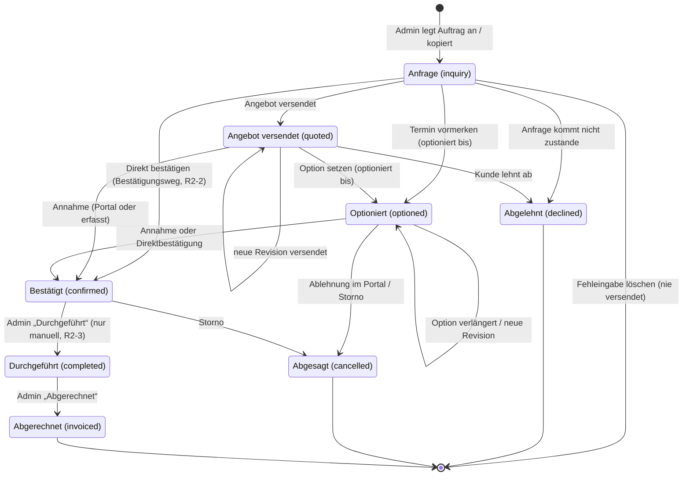
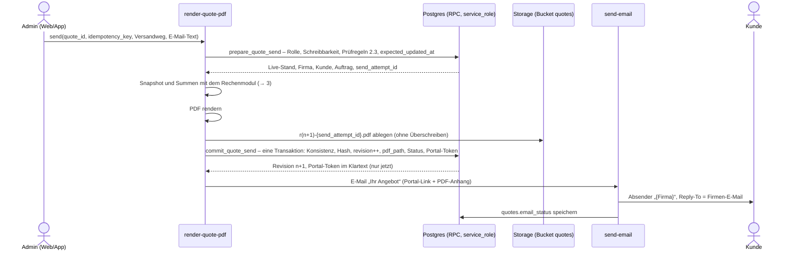
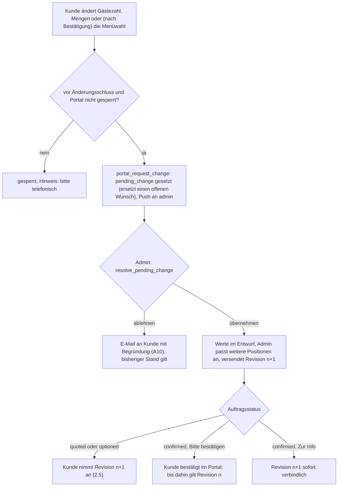
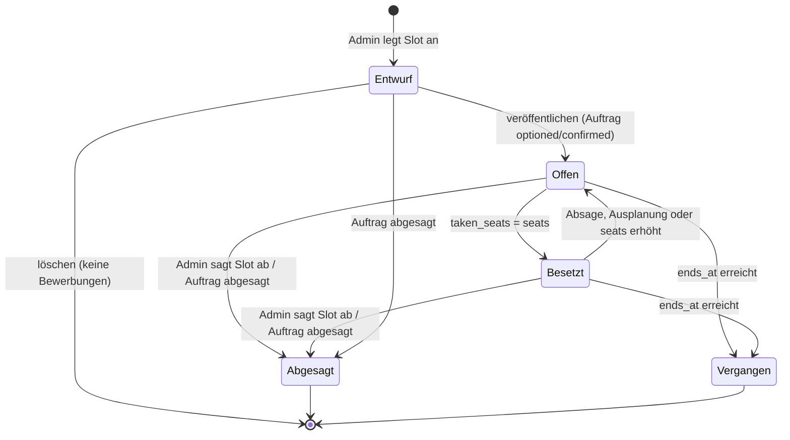
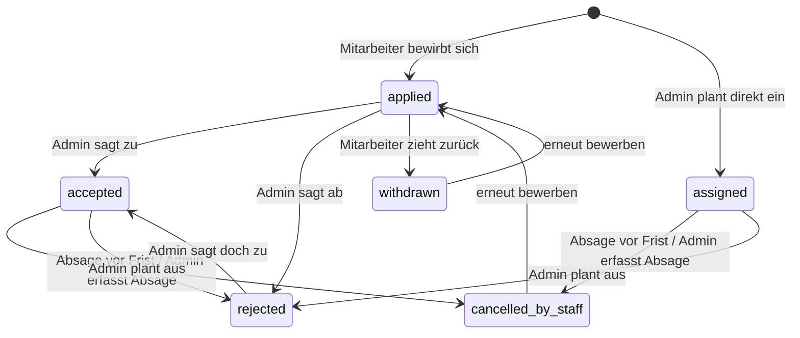
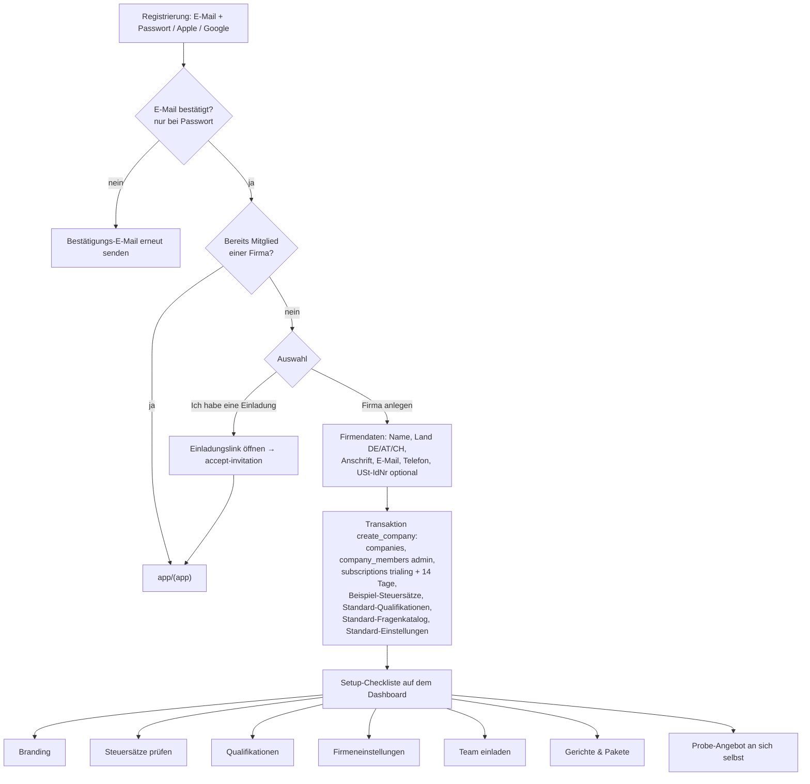
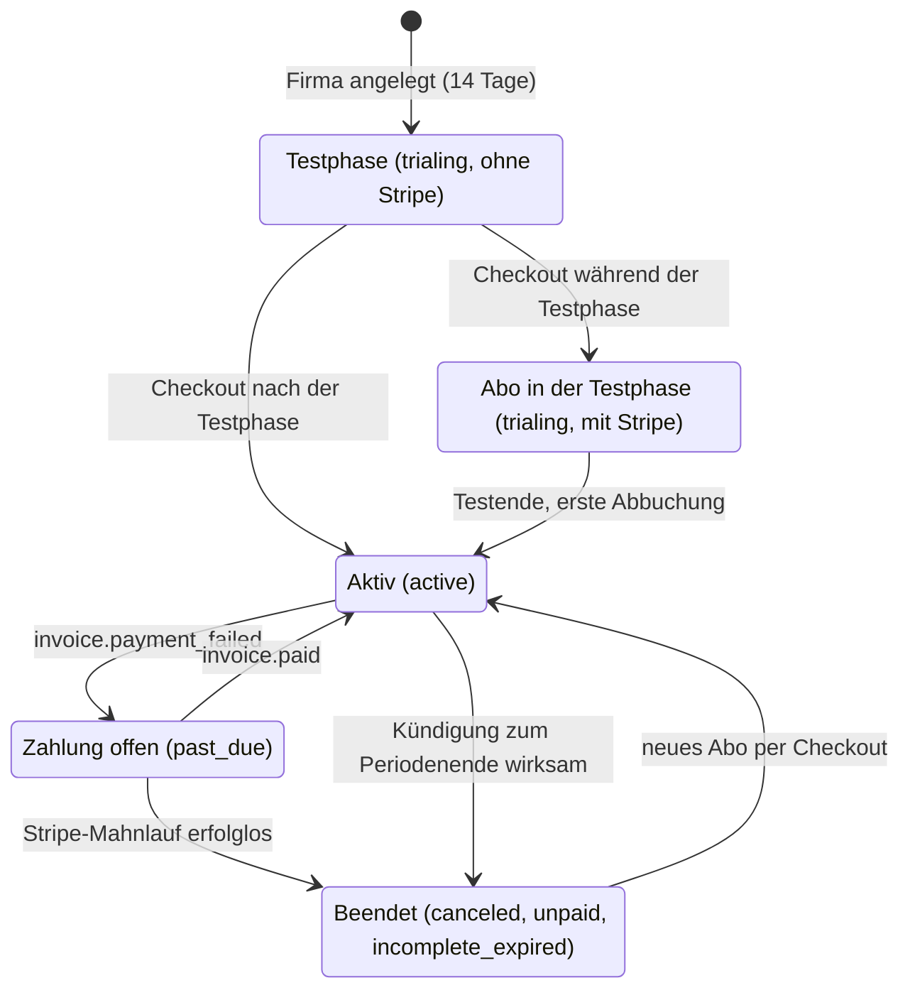
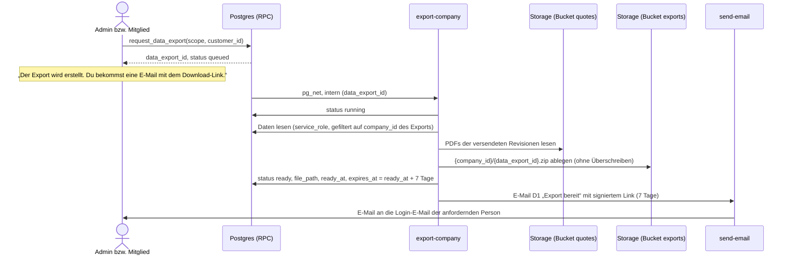

# Geschäftsprozesse & Regeln

Stand: 17.10.2026 · Grundlage: [00-entscheidungen.md](00-entscheidungen.md)

Dieses Dokument legt fest, **wie** die App sich verhält: Statusübergänge, Rechenregeln, Fristen, Benachrichtigungen. Es beschreibt keine Screens.

**Konventionen**

- Enum-Werte, Tabellen- und Edge-Function-Namen gemäß Glossar (`event_status`, `quotes`, `portal-api` …).
- Spaltennamen, die über das Glossar hinausgehen (z. B. `option_expires_at`), folgen dem Datenmodell [03-datenmodell.md](03-datenmodell.md); dort sind sie verbindlich festgelegt (03 §10.1).
- Geldbeträge: integer Cent. Zeitpunkte: `timestamptz`, Anzeige und Fristberechnung in `Europe/Berlin`.
- **Vorschlag** = begründete Empfehlung zu einem Punkt, der im Entscheidungsprotokoll offen ist.
- **entschieden (R2-x)** = festgelegt in 00 §9 „Entscheidungen Runde 2“ (R2-1 bis R2-14). Diese Punkte haben Vorrang vor abweichenden Vorschlägen in 01–06.
- Wer darf was: Statusänderungen und Angebotsbearbeitung nur `admin`. `kitchen` und `staff` lesen. Der Endkunde handelt ausschließlich über `portal-api` mit seinem Portal-Token.

---

## 1. Zustandsautomat Auftrag (`event_status`)



Alle Übergänge laufen **nur vorwärts** (entschieden, R2-4). Jeder Statuswechsel verlangt vorher einen Bestätigungsdialog (→ 1.1.1).

### 1.1 Erlaubte Übergänge (verbindliche Übergangstabelle)

Diese Tabelle ist die **einzige Quelle** für Statusübergänge (Entscheidung E-8 aus 06; **entschieden** durch R2-2, R2-3 und R2-4: Direktbestätigung erlaubt, „Durchgeführt“ nur manuell, keine Rückwärts-Übergänge). 01 §4.2.1 verweist hierher. Die Datenbankfunktion `set_event_status(event_id, new_status, reason, confirmation_channel)` prüft genau diese Tabelle und lehnt alle anderen Übergänge mit `invalid_transition` ab, insbesondere jeden Rückwärts-Übergang (`completed` → `confirmed`, `invoiced` → `completed`, `declined` → `quoted` und jede Reaktivierung von `declined`/`cancelled`); direkte Updates auf `events.status` sind per Spaltenprivileg gesperrt (03 §4.4). Die Oberfläche baut ihre Statusaktionen aus derselben Tabelle (`_shared/domain/event-status.ts`, 05 §4.10). Jeder Übergang wird in `event_status_changes` mit Zeitpunkt, Auslöser (Mitglied, Portal, System), Grund und ggf. Bestätigungsweg protokolliert.

| Von → Nach | Auslöser | Vorbedingungen | Nebenwirkungen |
|---|---|---|---|
| – → `inquiry` | Admin legt Auftrag an, erfasst ihn im Angebots-Chat (→ 11) oder kopiert einen (→ 9) | Kunde (`customers`) gewählt oder neu angelegt; Datum + Beginn | Kalender: Eintrag „unverbindlich“ (nur Admin). Kein Portal-Token. |
| `inquiry` → gelöscht | Admin „Fehleingabe löschen“ | nie versendet (`quotes.revision = 0`); keine Slots mit Bewerbungen | Hard Delete inkl. Entwurfsangebot. Nur für Fehleingaben (Dublette, Testeintrag). Eine echte Anfrage, die nicht zustande kommt, wird `declined`, damit K-02 und K-04 (01 §7) messbar bleiben. |
| `inquiry` → `quoted` | Admin „Angebot senden“ | Prüfregeln 2.3 | Revision 1 + Snapshot + PDF (→ 2.4); neuer Portal-Token; E-Mail A1 an Kunde; Kalender: „unverbindlich“. |
| `inquiry` → `optioned` | Admin „Termin vormerken“ (Kunde will den Termin schon vor dem Angebot halten; im Betrieb üblich) | Pflicht „optioniert bis“ (`option_expires_at` ≥ heute) | Kalender: Block „Option“ (schraffiert); Auftrag für `kitchen` sichtbar („vorläufig“); Erinnerungen (→ 1.3). |
| `inquiry` → `confirmed` | Admin „Direkt bestätigen“ (Stammkunde am Telefon, Business-Lunch-Kopie; **entschieden, R2-2**: ohne versendetes Angebot erlaubt) | Pflicht Bestätigungsweg (Telefon / E-Mail / persönlich) | Wie `quoted` → `confirmed`, aber ohne Portal-Annahmeprotokoll; protokolliert werden Admin, Zeitpunkt und Bestätigungsweg. Ohne versendete Revision gilt für die Küche der Live-Stand (→ 8). Bestätigungs-E-Mail an den Kunden optional (Checkbox, Standard an; ohne Angebot ohne PDF). |
| `inquiry` → `declined` | Admin „Anfrage kommt nicht zustande“ | Grund Pflicht | Aus Standardansichten ausgeblendet (Filter „Archiv“); Entwurfs-Slots abgesagt (→ 5.7). |
| `quoted` → `quoted` | Admin versendet eine neue Revision | Prüfregeln 2.3 | Revision++, neuer Snapshot, neues PDF, E-Mail A2. Portal-Aktionen erzeugen **keine** Revision (→ 4). |
| `quoted` → `optioned` | Admin „Optionieren“ (Kunde bittet um Reservierung) | Pflicht „optioniert bis“ (≥ heute) | Kalender: Block „Option“; Portal zeigt „Termin für Sie reserviert bis {Datum}“; Auftrag für `kitchen` sichtbar; Erinnerungen (→ 1.3). |
| `quoted` → `confirmed` | Kunde „Verbindlich annehmen“ im Portal **oder** Admin „Annahme erfassen“ | Portal: Prüfungen 2.5. Admin: Bestätigungsweg | Annahmeprotokoll; verbindlicher Snapshot (`quotes.binding_snapshot`, → 8); Kalender: fester Block; E-Mail A5 an Kunde (bei Erfassung abwählbar); Push + In-App + E-Mail an alle `admin` (A4); Push + In-App an `kitchen` (A15). |
| `quoted` → `declined` | Kunde „Ablehnen“ im Portal **oder** Admin „Ablehnung erfassen“ | – | Grund optional; Push + In-App + E-Mail an alle `admin` (A7); Kalendereintrag ausgeblendet; Portal: nur lesen mit Hinweis „abgelehnt“. Endzustand: Meldet sich der Kunde erneut, legt der Admin per „Auftrag kopieren“ (→ 9) einen neuen Auftrag an. |
| `optioned` → `optioned` | Admin verlängert die Option oder versendet eine neue Revision | „optioniert bis“ ≥ heute | Erinnerungen werden neu berechnet; die Markierung „Option abgelaufen“ entfällt. |
| `optioned` → `confirmed` | Portal-Annahme oder Admin „Annahme erfassen“ (beide mit versendeter Revision) **oder** Admin „Direkt bestätigen“ (ohne Angebot, R2-2) | Portal: Prüfungen 2.5; Admin: Bestätigungsweg | Wie `quoted` → `confirmed`; `option_expires_at` wird geleert, Erinnerungen entfallen. |
| `optioned` → `cancelled` | Kunde „Ablehnen“ im Portal **oder** Admin „Stornieren“ (Option verfallen, Kunde sagt ab) | Grund: Portal optional, Admin Pflicht | Kalender-Block entfernt; Slots abgesagt (→ 5.7); Push an alle Bewerber und Eingeplanten; Push an `kitchen` (A16); Portal: nur lesen. |
| `confirmed` → `completed` | Admin „Als durchgeführt markieren“ (einzeln oder gesammelt) | – | **Kein automatischer Wechsel** (entschieden, R2-3): Kein Job setzt `completed`. Erinnerung am Tag nach dem Event um 09:00 Europe/Berlin an alle `admin` (Job `events_completion`, Kategorie `completion_due`, A22); `invoiced` wird ohnehin manuell gesetzt. Portal: nur lesen. Schichten gelten als erledigt. Liegt der Eventbeginn noch in der Zukunft, warnt der Bestätigungsdialog zusätzlich („Das Event hat noch nicht stattgefunden“). |
| `confirmed` → `cancelled` | Admin „Stornieren“ (Kunde storniert per Telefon/Mail; im Portal **kein** Storno-Button) | Grund Pflicht; Freitext „Stornovereinbarung“ optional (keine festen Storno-Regeln laut 00 §3) | Kalender-Block entfernt; alle Slots abgesagt, Bewerber und Eingeplante per Push informiert (→ 5.7); Push an `kitchen` immer, nicht abschaltbar (A16); E-Mail an Kunde (Checkbox, Standard an, A17). Portal: nur lesen. |
| `completed` → `invoiced` | Admin „Als abgerechnet markieren“ | – | Freitextfelder Rechnungsnummer + Rechnungsdatum (bis zum Rechnungsmodul). Angebot und Auftrag werden schreibgeschützt; nur Rechnungsnummer und -datum bleiben bearbeitbar (das ist kein Statuswechsel). |

**Keine Rückwärts-Übergänge** (entschieden, R2-4): `declined`, `cancelled` und `invoiced` sind Endzustände; `completed` geht nur nach `invoiced`. Es gibt keine Funktion „Status korrigieren“, keine Rückkehr von `completed` nach `confirmed` oder von `invoiced` nach `completed`, keine Reaktivierung von `declined`/`cancelled` und keine Rücksprünge nach `inquiry`. Ein neuer Anlauf (Kunde meldet sich nach Ablehnung oder Absage erneut) läuft über „Auftrag kopieren“ (→ 9); das vermeidet halb wiederhergestellte Schichten und Benachrichtigungen. Pflicht-Test: Der Integrationstest aller Statuspaare gegen `set_event_status()` (05 §4.10) erwartet für jeden Rückwärts-Übergang, insbesondere die früheren Korrekturwege, `invalid_transition`; kein Job ändert `events.status`.

#### 1.1.1 Bestätigungsdialog vor jedem Statuswechsel

Fehlbedienungen verhindert ein Bestätigungsdialog statt eines Korrekturwegs (entschieden, R2-4). Er erscheint bei **jedem** vom Admin ausgelösten Statuswechsel, auch beim gesammelten „Als durchgeführt markieren“ und beim Startstatus `confirmed` einer Kopie (→ 9), und zeigt:

- Titel mit Auftrag und Zielstatus („Herbstfest Müller GmbH als abgerechnet markieren?“), bei Sammelaktionen die Liste der betroffenen Aufträge;
- die Pflichtangaben des Übergangs (optioniert bis, Bestätigungsweg, Grund, Rechnungsnummer);
- die Folgen nach der Tabelle oben: wer benachrichtigt wird („Kunde erhält eine E-Mail“, „3 Eingeplante werden informiert“), was gesperrt wird („Angebot wird schreibgeschützt“), welche Slots abgesagt werden;
- den festen Hinweis „Dieser Schritt kann nicht rückgängig gemacht werden.“;
- zwei Schaltflächen: „Abbrechen“ (Standard, hervorgehoben) und die Aktion mit dem Zielstatus als Text („Als abgerechnet markieren“), bei `cancelled` und `declined` in Warnfarbe.

Erst nach Tippen auf die Aktion ruft die App `set_event_status()` auf; der Dialog ist rein clientseitig, die RPC prüft unabhängig davon die Übergangstabelle. Portal-Aktionen des Kunden (Annahme, Ablehnung) haben ihren eigenen Bestätigungsdialog (→ 2.5, 2.6).

### 1.2 Wirkung je Status

| Status | Kalender Admin | Kalender/iCal Küche | iCal Staff | Portal (Kunde) | Küchenlisten | Schichtbörse |
|---|---|---|---|---|---|---|
| `inquiry` | unverbindlich (grau) | – | – | kein Zugang | – | Slots nur als Entwurf |
| `quoted` | unverbindlich (grau) | – | – | ansehen, annehmen, ablehnen, Menüwahl, Änderungswunsch, Sonderessen (→ 4) | – | Slots nur als Entwurf |
| `optioned` | Option (schraffiert) | Option (schraffiert) | nur eigene Schichten | ansehen, annehmen, ablehnen, Menüwahl, Änderungswunsch, Sonderessen (→ 4) | optional („inkl. Optionen“) | veröffentlichbar, Hinweis „Termin noch nicht fest“ |
| `confirmed` | fest (Akzentfarbe) | fest | nur eigene Schichten | ansehen; Änderungswünsche und Sonderessen bis „Änderungen bis“ / Sperre; ggf. „Änderung bestätigen“ | ja | veröffentlichbar |
| `completed` | fest (abgeblendet) | fest (abgeblendet) | eigene vergangene Schichten | nur lesen | Historie | geschlossen |
| `invoiced` | wie `completed` | wie `completed` | wie `completed` | nur lesen | Historie | geschlossen |
| `declined` | ausgeblendet (Filter „Archiv“) | – | – | nur lesen, Hinweis „abgelehnt“ | – | – |
| `cancelled` | ausgeblendet (Filter „Archiv“) | entfernt | entfernt | nur lesen, Hinweis „abgesagt“ | entfernt | alle Slots abgesagt |

**Kalender-Block** bedeutet im MVP: sichtbarer Eintrag + Eintrag im iCal-Feed (`ical-feed`). Es gibt keine harte Kapazitätsgrenze. **Vorschlag:** Beim Optionieren/Bestätigen erscheint ein Hinweis, wenn am selben Tag bereits Aufträge `optioned`/`confirmed` liegen („Am 12.06.2027 sind bereits 2 Aufträge eingeplant.“) – kein Blockieren, weil kleine Firmen mehrere kleine Lieferungen pro Tag fahren.

### 1.3 Option mit Ablaufdatum

- `events.option_expires_at` („optioniert bis“, Ende des gewählten Tages in Europe/Berlin) – Pflicht in `optioned`, nur dort gesetzt (Check in 03 §3.2), wird bei Verlassen von `optioned` geleert.
- Eine abgelaufene Option ändert den Status nicht; der Auftrag trägt die Markierung „Option abgelaufen“, bis der Admin verlängert, bestätigt oder storniert.
- Erinnerungen an alle `admin` (Push + In-App), ausgelöst vom täglichen Job um 08:00 Europe/Berlin:
  - **2 Tage vorher**: „Option für {event} läuft am {datum} ab.“
  - **Am Ablauftag**: „Option für {event} läuft heute ab.“
  - **Danach** täglich in der In-App-Liste „Überfällige Optionen“ (kein weiterer Push).
- **Vorschlag: kein automatisches Absagen.** Laut Entscheidung werden Fristen individuell gehandhabt; ein automatischer Storno würde Kunden verärgern, die mündlich verlängert haben. Admin entscheidet: verlängern, bestätigen oder absagen.
- Optional Button „Kunde erinnern“: E-Mail an den Kunden mit Portal-Link („Ihre Reservierung für {datum} läuft am {ablauf} ab“). Nur manuell.

---

## 2. Angebotsprozess

Grundsatz: **Ein Auftrag hat genau ein aktuelles Angebot** (`quotes.event_id` eindeutig) mit Revisionsnummer. Beim Versand wird ein Snapshot eingefroren. Keine parallelen Varianten, keine Versionsverwaltung.

### 2.1 Datenstand eines Angebots

| Element | Inhalt |
|---|---|
| Live-Stand | `quotes` + `quote_items`, vom Admin bearbeitbar |
| `quotes.revision` | 0 = nie versendet; jede Versendung +1. Portal-Aktionen erzeugen keine Revision (→ 4) |
| `quotes.snapshot` (jsonb) | Vollständiger eingefrorener Stand der aktuellen Revision: Positionen, Preise, Steuern, Summen, Texte, Allergene, Firmen- und Kundendaten, Branding |
| `quotes.snapshot_hash` | SHA-256 über `snapshot::text`, berechnet ausschließlich in der Datenbank (`commit_quote_send()`, 03 §4.7) |
| `quotes.portal_selection` (jsonb) | Menüwahl und Mengen, die der Kunde vor der Annahme im Portal direkt setzt (→ 4.1); verändert den Snapshot nicht |
| `quotes.binding_snapshot`, `quotes.binding_revision` | verbindlicher Stand für Küche und Portal: zuletzt angenommene, bestätigte oder „Zur Info“ versendete Revision inklusive Menüwahl (→ 2.7, 8) |
| `quotes.pending_change` (jsonb) | höchstens ein offener Änderungswunsch des Kunden (→ 4.2) |
| PDF je Revision | Bucket `quotes`, Pfad `{company_id}/{quote_id}/r{revision}-{send_attempt_id}.pdf`; der Pfad der versendeten Fassung steht in `quotes.pdf_path` und im Versandprotokoll `quotes.send_log`; ältere PDFs bleiben als Nachweis erhalten |
| `quotes.has_unsent_changes` | `true`, sobald der Live-Stand vom Snapshot abweicht → Banner „Änderungen nicht versendet“ |
| Texte | Einleitung, Schlusstext, Zahlungs-/Storno-Hinweise (Freitext, Firmen-Standardtexte vorbelegt), `valid_until` optional |

Das Portal zeigt **immer den Snapshot** (mit der Menüwahl aus `portal_selection`), nie den Live-Stand. So sieht der Kunde keine halbfertigen Änderungen.

### 2.2 Erstellen

1. Admin öffnet Auftrag → „Angebot“. Gästezahl (`events.guest_count`) ist vorbelegt.
2. Positionen hinzufügen (`quote_item_type`):

| Typ | Quelle | Menge | Einheit | Standard-Steuerkategorie |
|---|---|---|---|---|
| `package` | `menu_packages` | Gästezahl (gekoppelt) | Person | Speisen |
| `dish` | `dishes` | frei oder Gästezahl (gekoppelt) | Portion / Person | Speisen |
| `service` | frei, Vorlagen aus Firmeneinstellungen („Servicekraft“, „Koch vor Ort“) | Anzahl × Stunden | Std. | Personal |
| `equipment` | frei (Equipment-Modul erst nach MVP) | frei | Stück / pauschal | Equipment |
| `travel` | frei, Vorlage „Anfahrt“ | 1 | pauschal / km | Anfahrt |
| `beverage` | frei, Vorlage „Getränkepauschale“ | Gästezahl (gekoppelt) oder 1 | Person / pauschal | Getränke |
| `custom` | frei | frei | frei | wählbar |

3. **Kopplung an die Gästezahl** (`quote_items.quantity_mode`: `per_guest` | `fixed`): `per_guest`-Positionen übernehmen jede Änderung der Gästezahl im Live-Stand automatisch. Eine Gästezahl aus dem Portal kommt als Änderungswunsch und wirkt erst nach Übernahme durch den Admin (→ 4.2).
4. **Werte werden beim Hinzufügen kopiert** (Name, Beschreibung, Preis, Allergene, Diätformen, Steuersatz). Spätere Änderungen an `dishes`/`menu_packages` ändern bestehende Angebote nicht. Button „Aus Katalog aktualisieren“ übernimmt aktuelle Katalogwerte bewusst.
5. **Wahlgruppen** für die Menüwahl im Portal (**Vorschlag** `quote_items.choice_group`, `is_selected`): Admin bietet z. B. drei Pakete als Alternativen an; genau eine Position je Gruppe ist ausgewählt und wird berechnet. Nicht gewählte Alternativen erscheinen im Portal als Auswahl, im PDF als „Alternative“ ohne Summenwirkung.
6. Kalkulation pro Position (→ 3): Preis übernehmen (Pauschalpreis) oder Preisvorschlag aus Wareneinsatz; Positionsrabatt in %; Steuersatz. Rabatte gibt es nur über die Rabattfelder, nicht als negative Position (→ 3.6).
7. **Kinderportionen und Kinderpreise** sind im MVP kein eigenes Konzept (01 N-22; **entschieden, R2-11**: Kinder als eigene Angebotsposition). Umgang: Das Paket für Erwachsene wird auf feste Menge (`fixed`, Anzahl Erwachsene) gestellt, Kinder bekommen eine eigene Position (z. B. Paket „Kindermenü“, feste Menge). Die Gästezahl bleibt die Gesamtzahl; so zählt die Küche keine Portion doppelt.
8. Allergene: Das Angebot zeigt je Gericht die 14 Pflichtallergene als Kürzel und Diätformen (aus `dish_allergens`). Bei Paketen aggregiert über die enthaltenen Gerichte.

### 2.3 Prüfung vor Versand

Senden ist gesperrt, solange eine Regel verletzt ist (Fehlerliste im Formular):

- ≥ 1 berechnete Position, alle Positionen mit Steuersatz.
- Kunde hat E-Mail-Adresse.
- Firmenprofil: Name, Anschrift, Reply-To-E-Mail; Logo/Farbe optional (Fallback: App-Standard).
- Event hat Datum, Startzeit, Ort (Adresse oder „Abholung“).
- Abo schreibfähig (nicht im Lesemodus, → 7).
- Auftragsstatus `inquiry`, `quoted`, `optioned` oder `confirmed` (aus `completed` und den Endzuständen `declined`, `cancelled`, `invoiced` kein Versand, R2-4).

### 2.4 Versand

Den Versand steuert `render-quote-pdf` in einem Serveraufruf (05 §5.4, ADR-11). Die RPCs `prepare_quote_send()` und `commit_quote_send()` sind nur für `service_role` ausführbar; der Admin kann den Versand also nicht am PDF vorbei auslösen.



- `commit_quote_send()` setzt den Status `inquiry` → `quoted`; `quoted`, `optioned` und `confirmed` bleiben (2.7). In `declined`, `cancelled`, `completed` und `invoiced` lehnt bereits `prepare_quote_send()` den Versand ab (`invalid_transition`, R2-4).
- E-Mail: Betreff „Ihr Angebot für {event_titel} am {datum}“. Inhalt: Anrede, Kurztext der Firma, Button „Angebot online ansehen“ (Portal-Link), PDF im Anhang, Kontaktdaten der Firma.
- **Fehlerfall PDF**: Scheitert das PDF, wird nichts versendet und die Revision nicht erhöht (01 US-27.7); der Admin sieht „PDF fehlgeschlagen – erneut versuchen“.
- **Fehlerfall Commit**: Hat inzwischen ein anderer Versuch dieselbe Revision versendet, antwortet die Function mit 409. Die eigene Datei bleibt ungenutzt; `render-quote-pdf` löscht nach dem nächsten erfolgreichen Commit nicht referenzierte Versuchsdateien im Ordner des Angebots.
- **Fehlerfall E-Mail**: Scheitert nur die E-Mail, bleibt die Revision bestehen; der Admin sieht „E-Mail nicht zugestellt – erneut senden“. Erneutes Senden erhöht die Revision nicht.
- **Link kopieren**: Statt E-Mail-Versand kann der Admin den Portal-Link kopieren (z. B. für WhatsApp). Der Ablauf ist derselbe ohne E-Mail; `sent_via = 'link'`.
- Jeder Versand und jedes „Link kopieren“ erzeugt einen **neuen** Portal-Token; ältere Links bleiben gültig, bis sie ablaufen oder widerrufen werden (03 §3.6).

### 2.5 Ansicht und Annahme im Portal

Portal: `app/portal/[token]` (Expo Web, öffentlich), Daten ausschließlich über `portal-api`.

- **Ansicht**: Firmenlogo + Akzentfarbe, Eventdaten, Positionen (B2B netto / B2C brutto, → 3.6), Summen, Allergenlegende, Texte, PDF-Download der aktuellen Revision. Erster Aufruf je Revision wird protokolliert (`quotes.first_viewed_at`) → In-App-Hinweis an Admin „Angebot geöffnet“.
- **Annahme**: Button „Angebot verbindlich annehmen“ → Dialog mit Name (Pflicht), E-Mail (vorbelegt), Checkbox „Ich nehme das Angebot (Version {n}) verbindlich an.“ und, falls gepflegt, Anzeige der Zahlungs-/Storno-Hinweise.
- `portal-api` prüft: Token gültig, Status `quoted` oder `optioned`, übermittelte `revision` = aktuelle Revision (sonst 409 „Das Angebot wurde aktualisiert. Bitte prüfen Sie die neue Version.“), Gültigkeit nicht abgelaufen, alle Wahlgruppen gewählt, Portal-Aktionen erlaubt: `now() < writable_until + 30 Tage` (03 §6.4; im Lesemodus bleibt das Portal 30 Tage voll nutzbar, → 7.3).

**Protokoll der Annahme** (Spalten in `quotes`, zusätzlich ein Eintrag in `quotes.acceptance_log`, damit Annahmen späterer Revisionen die frühere nicht überschreiben; Namen nach 03 §3.3):

| Feld | Inhalt |
|---|---|
| `accepted_at` | Serverzeit (`now()`), nicht Client-Zeit |
| `acceptance_name` | eingegebener Name |
| `acceptance_email` | eingegebene/vorbelegte E-Mail |
| `acceptance_ip` | IP aus Request-Header (Edge Function) |
| `acceptance_user_agent` | User-Agent-String |
| `acceptance_revision` | Revisionsnummer |
| `acceptance_snapshot_hash` | SHA-256 über Snapshot und Menüwahl (`snapshot::text \|\| portal_selection::text`) |
| `acceptance_total_gross_cents` | Bruttosumme inklusive Menüwahl zum Zeitpunkt der Annahme |
| `acceptance_channel` | `portal`, `portal_confirmation` (Änderung im Portal bestätigt), `admin` (+ Bestätigungsweg in `acceptance_note`, `acceptance_member_id`) oder `info_only` |
| `acceptance_portal_token_id` | verwendeter Token |

Nach der Annahme: Status → `confirmed`; `binding_snapshot` = Snapshot mit eingearbeiteter Menüwahl, `binding_revision` = Revision; PDF `r{revision}-angenommen.pdf` mit Wahl und Vermerk „Angenommen am {datum} {uhrzeit} durch {name}“ (das Revisions-PDF bleibt unverändert); E-Mail „Auftragsbestätigung“ mit diesem PDF an den Kunden (A5); Push, In-App und E-Mail an Admins (A4); Push an `kitchen` (A15).

### 2.6 Ablehnung

- Portal-Button „Angebot ablehnen“ → optionaler Grund (Auswahl: „Preis“, „Termin“, „Anderer Anbieter“, „Veranstaltung findet nicht statt“, „Sonstiges“ + Freitext).
- Wirkung: aus `quoted` → `declined`; aus `optioned` → `cancelled` (Glossar: Absage nach Option). Push, In-App und E-Mail an Admins (A7), Portal nur lesen. Beides sind Endzustände (R2-4); meldet sich der Kunde erneut, läuft der neue Anlauf über „Auftrag kopieren“ (→ 9).
- Admin kann eine telefonische Ablehnung ebenso erfassen.

### 2.7 Überarbeitung nach Versand

| Ausgangsstatus | Ablauf | Ergebnis |
|---|---|---|
| `quoted`, `optioned` | Admin ändert Live-Stand → „Erneut senden“ | Revision++, neuer Snapshot + PDF, E-Mail „Ihr aktualisiertes Angebot (Version {n})“. Status unverändert. |
| `confirmed` | Admin ändert (z. B. nach übernommenem Änderungswunsch) → „Änderung senden“ mit Versandart **„Bitte bestätigen“** (Standard) oder **„Zur Info“** (01 US-36.3) | Revision++, E-Mail „Geänderte Auftragsbestätigung (Version {n})“. Status bleibt in beiden Fällen `confirmed`. *Bitte bestätigen:* Portal zeigt „Neue Version – bitte bestätigen“; bis zur Bestätigung (`portal_confirm_revision()`, wie eine Annahme protokolliert, Kanal `portal_confirmation`) bleibt Revision n verbindlich (`binding_snapshot`); Badge beim Admin „Version {n} noch nicht bestätigt“, Erinnerung nach 48 h bzw. am Änderungsschluss (A20). *Zur Info:* Revision n+1 ist sofort verbindlich (`acceptance_channel = 'info_only'`). |
| `declined`, `completed`, `invoiced`, `cancelled` | Bearbeitung und Versand gesperrt (keine Rückwärts-Übergänge, R2-4) | Neuer Anlauf über „Auftrag kopieren“ (→ 9) |

Ungesendete Änderungen bleiben im Live-Stand, bis der Admin sendet oder „Änderungen verwerfen“ wählt (Live-Stand wird aus dem Snapshot wiederhergestellt).

---

## 3. Kalkulationsregeln

Alle Rechnungen laufen in **einem gemeinsamen TypeScript-Modul** (`_shared/domain/calc`), das App, Web-Admin, `portal-api` und `render-quote-pdf` gleichermaßen nutzen; eine Rechenquelle verhindert Cent-Abweichungen zwischen Bildschirm und PDF. Dieser Abschnitt ist die **einzige Quelle der Rechenregeln**; 01 §4.2.2 und 05 §4.10 verweisen hierher. Die Datenbank speichert die Ergebnisse je Position und die Summen und prüft beim Versand die Konsistenz.

**Nur Ganzzahlen.** Das Modul rechnet ausschließlich mit Ganzzahlen (BigInt bzw. sichere Integer), nie mit Gleitkommazahlen. Grund: Mit JavaScript-Zahlen kippt kaufmännisches Runden an der ,5-Grenze (`1.15 * 350 = 402.49999999999994` → 402 statt 403 Cent). Werte aus PostgREST werden beim Einlesen sofort umgewandelt: Mengen `numeric(10,2)` → `q100 = Math.round(q × 100)` (exakt, da höchstens zwei Nachkommastellen), Stunden → Viertelstunden `h4`, Faktoren und Prozentsätze → Basispunkte, Wareneinsatz `numeric(12,4)` in Cent → Ganzzahl in 1/10000 Cent. Gerundet wird mit einem Helfer `divRoundHalfUp(zähler, nenner)` (kaufmännisch, ab ,5 vom Nullpunkt weg).

### 3.1 Begriffe

| Symbol | Bedeutung | Speicherung | im Modul |
|---|---|---|---|
| `G` | Gästezahl des Auftrags | `events.guest_count` (integer) | integer |
| `q` | Menge der Position | `quote_items.quantity` numeric(10,2); bei `per_guest` = `G` | `q100` (Hundertstel) |
| `h` | Stunden je Person (nur `service`) | `quote_items.hours` numeric(5,2), 0,25er-Schritte | `h4` (Viertelstunden) |
| `p` | Einzelpreis in Cent (in der Eingabeart der Firma, → 3.6) | integer | integer |
| `r` | Steuersatz in Basispunkten (700 = 7,00 %) | `tax_rates.rate_bp` | integer |
| `d` | Positionsrabatt in Basispunkten | `quote_items.discount_bp`, Standard 0 | integer |
| `R` | Gesamtrabatt (% oder Betrag) | `quotes.discount_bp` oder `quotes.discount_cents` | integer |
| `round()` | kaufmännisch auf ganze Cent: ab ,5 vom Nullpunkt weg | – | `divRoundHalfUp` |

### 3.2 Pauschalpreis pro Person

`Positionsbetrag = divRoundHalfUp(q100 × p, 100)`

`p` kommt aus `menu_packages.price_per_person_cents` bzw. `dishes.price_cents` und ist im Angebot überschreibbar.

### 3.3 Wareneinsatz (Zutatenkosten + Aufschlag)

Voraussetzung: Das Gericht hat Zutaten in `dish_ingredients` (Menge pro Person in g / ml / Stück) und die Zutat hat einen Einkaufspreis (`ingredients.price_cents` pro kg / l / Stück).

**Menge pro Person = Einkaufsmenge der Rohware vor dem Garen** (**entschieden, R2-7**; z. B. 180 g rohe Rinderschulter für eine Portion Schmorbraten mit ca. 120 g Garmenge). Dieselbe Menge dient Wareneinsatz und Einkaufsliste (→ 8.3); das Formular des Gerichts (04 SC-39) weist darauf hin. Würde die Garmenge eingetragen, wären Wareneinsatz und Einkaufsliste bei Schmorgerichten um 30–40 % zu niedrig.

```
Wareneinsatz je Person (Gericht d)  W_d = Σ_i  Menge_pP(i,d) [Basiseinheit] / Umrechnung(i) × Preis(i)
Wareneinsatz je Person (Paket)      W_P = Σ_d  W_d × Portionsfaktor(d)
Wareneinsatz der Position           W   = W_d bzw. W_P × q
Preisvorschlag je Person            p*  = aufrunden_auf_Raster(W_d × F)
Aufschlag in % ↔ Faktor             F   = 1 + Aufschlag% / 100     (200 % Aufschlag = Faktor 3,0)
Wareneinsatzquote                   WQ  = W_d / p*
```

- `Umrechnung(i)`: 1000 bei g→kg und ml→l, 1 bei Stück.
- Zwischenwerte des Wareneinsatzes als Ganzzahl in 1/10000 Cent (entspricht `numeric(12,4)` in Cent, `quote_items.unit_cost`); gerundet wird erst der Preisvorschlag.
- `F`: Firmen-Standard (**Vorschlag** 3,0), überschreibbar je Gericht, Paket oder Angebotsposition. Eingabe wahlweise als Faktor oder Aufschlag in %.
- Preisraster (Firmeneinstellung `companies.price_rounding_cents`): keines / 0,10 € / 0,50 € / 1,00 €, Standard 0,10 €. Der Preisvorschlag wird **immer auf das Raster aufgerundet**, im Standard auf volle 10 Cent (**entschieden, R2-5**, gilt einheitlich auch für 01 US-24.2: 9,40 € × 2,8 = 26,32 € → 26,40 €). Grund: Der Vorschlag liegt nie unter dem kalkulierten Wert, die Marge bleibt erhalten.
- `p*` ist nur ein **Vorschlag**. Der Admin übernimmt ihn oder überschreibt ihn; gespeichert wird der übernommene Preis `p`. Fehlt bei einer Zutat der Preis, zeigt die App „Wareneinsatz unvollständig“ und keinen Vorschlag.
- `Portionsfaktor` (**Vorschlag** `menu_package_dishes.portion_factor`, Standard 1,0): z. B. 0,5 für eine Beilage, die im Buffet nur jeder zweite Gast nimmt.
- Wareneinsatz und Quote sieht nur `admin`. `kitchen` sieht keine Preise und damit auch keine Einkaufspreise.

**Beispiel Wareneinsatz – Rinderschmorbraten (pro Person)**

| Zutat | Menge p. P. | Einkaufspreis | Kosten p. P. |
|---|---|---|---|
| Rinderschulter | 180 g | 14,90 €/kg | 0,180 × 1490 = 268,2 ct |
| Kartoffeln | 200 g | 1,20 €/kg | 0,200 × 120 = 24,0 ct |
| Rotwein | 50 ml | 6,00 €/l | 0,050 × 600 = 30,0 ct |
| Wurzelgemüse | 120 g | 3,50 €/kg | 0,120 × 350 = 42,0 ct |
| **Summe `W_d`** | | | **364,2 ct = 3,642 €** |

Faktor 3,2 → 364,2 × 3,2 = 1165,44 ct → aufgerundet auf 0,10 € → **p* = 11,70 €** · Wareneinsatzquote 3,642 / 11,70 = **31,1 %**.

### 3.4 Personal (`service`)

`Positionsbetrag = divRoundHalfUp(q100 × h4 × p, 400)` (Anzahl × Stunden × Stundensatz)

- Stunden in 0,25-Schritten (`quote_items.hours`), Anzahl = `q`.
- Stundensätze als Vorlagen in den Firmeneinstellungen (z. B. „Servicekraft 32,00 €/h“, „Koch vor Ort 45,00 €/h“).
- Beispiel: 3 Servicekräfte × 6,5 h × 32,00 € = **624,00 €**.

### 3.5 Steuersätze

- `tax_rates` pro Firma: Name, `rate_bp`, Kategorie (Speisen / Getränke / Personal / Equipment / Anfahrt / Sonstiges), Land, **`valid_from`** (**Vorschlag**). Jede Angebotsposition referenziert einen Steuersatz; der Standard ergibt sich aus Positionstyp → Kategorie (→ 2.2) und ist pro Position änderbar.
- Maßgeblich ist der Satz, der **am Leistungsdatum** (`events.starts_at`) gilt, nicht am Angebotsdatum. So bleiben Angebote über einen Steuersatzwechsel hinweg korrekt.
- Beim Firmen-Setup werden Beispielwerte für das gewählte Land angelegt; der Admin muss sie mit „Von mir geprüft“ bestätigen.
- **Kleinunternehmer** (**Vorschlag**, Firmeneinstellung): keine USt-Berechnung, Hinweistext auf Angebot/PDF.

**Beispielwerte (Vorschlag, keine Steuerberatung)**

| Kategorie | DE | AT | CH |
|---|---|---|---|
| Speisen | 7 % ¹ | 10 % | 8,1 % (mit Service) / 2,6 % (reine Lieferung) |
| Getränke | 19 % | 20 % | 8,1 % |
| Personal | 19 % ² | 20 % | 8,1 % |
| Equipment-Miete | 19 % ² | 20 % | 8,1 % |
| Anfahrt | 19 % ² | 20 % | 8,1 % |

¹ Nach unserem Kenntnisstand gilt in DE seit 01.01.2026 für Speisen in Gastronomie und Catering wieder 7 %, auch mit Service; Getränke bleiben bei 19 %.
² Nebenleistungen können umsatzsteuerlich der Hauptleistung folgen (einheitliche Leistung).

> **Die korrekten Sätze und ihre Zuordnung pflegt die Firma, idealerweise mit ihrem Steuerberater.** Die App rechnet nur mit den hinterlegten Werten und weist im Setup sowie in der Steuersatz-Verwaltung darauf hin.

### 3.6 Netto/Brutto, Rundung, Rabatt – Rechenreihenfolge

**Eingabeart** (Firmeneinstellung `companies.price_entry_mode`: `net` | `gross`, Standard `net`): Firmen mit überwiegend Privatkunden pflegen Bruttopreise („39,00 € p. P.“).

**Anzeigeart** (`quotes.price_display`: `net` | `gross`, bei Anlage aus `customers.type` vorbelegt: `business` → netto, `private` → brutto; je Angebot umschaltbar).

**Rechenseite = Anzeigeart.** Gerechnet wird von der Seite aus, die der Kunde sieht. So ergibt „Menge × angezeigter Einzelpreis“ immer exakt den angezeigten Positionsbetrag. Stimmen Eingabe- und Anzeigeart überein (der Normalfall), bleiben eingegebene Preise exakt erhalten.

Je Position `k`:

```
0. Einzelpreis auf der Rechenseite
                  Eingabeart = Anzeigeart:  p_k = Einzelpreis
                  brutto eingegeben, netto angezeigt:  p_k = divRoundHalfUp(p_in × 10000, 10000 + r_k)
                  netto eingegeben, brutto angezeigt:  p_k = divRoundHalfUp(p_in × (10000 + r_k), 10000)
1. Basis          B_k   = divRoundHalfUp(q100_k × p_k, 100)          (Personal: divRoundHalfUp(q100 × h4 × p, 400))
2. Positionsrabatt  B'_k = B_k − divRoundHalfUp(B_k × d_k, 10000)
3. Gesamtrabatt   B''_k = B'_k − divRoundHalfUp(B'_k × R_bp, 10000)    (bei Prozent)
                  bzw. Anteil am Betrag R_cents nach Largest-Remainder-Verfahren
```

Je Steuersatz `r` (Summe über alle Positionen `k` mit diesem Satz):

```
4. Rechenseite netto:   N_r  = Σ B''_k;   T_r = divRoundHalfUp(N_r × r, 10000);   Br_r = N_r + T_r
   Rechenseite brutto:  Br_r = Σ B''_k;   N_r = divRoundHalfUp(Br_r × 10000, 10000 + r);   T_r = Br_r − N_r
5. Summen          Netto = Σ N_r,  USt je Satz = T_r,  Brutto = Σ Br_r
6. Positionswerte  line_net/line_tax/line_gross je Position: T_r (bzw. N_r) nach Largest-Remainder
                   auf die Positionen des Satzes verteilt – nur zur Anzeige, die Summen stimmen exakt
```

- **Rundung**: kaufmännisch (`divRoundHalfUp`). Die Umsatzsteuer wird **je Steuersatz auf die Summe der Beträge dieses Satzes** gerechnet, nicht je Position. Das entspricht der Regel für Rechnungen (EN 16931, BR-CO-17: Steuerbetrag je Kategorie = Bemessungsgrundlage × Satz, gerundet), damit das spätere Rechnungsmodul dieselbe Regel nutzt.
- **Umrechnung bei abweichender Anzeigeart**: Der umgerechnete Einzelpreis `p_k` steht als `unit_price_display_cents` je Position im Snapshot; Portal und PDF zeigen genau diesen Wert.
- **Gesamtrabatt als Betrag**: Anteil_k = `R_cents × B'_k / Σ B'`; zuerst alle Anteile abrunden, die Rest-Cent an die Positionen mit dem größten Nachkommaanteil verteilen. Damit trägt jeder Steuersatz seinen Anteil am Rabatt, und die Rabattsumme stimmt exakt. Übersteigt der Rabatt die Summe, ist der Versand gesperrt.
- **Keine negativen Positionen**: Rabatte nur über die Rabattfelder (`quotes.discount_bp`/`discount_cents`, `quote_items.discount_bp`), weil eine negative Pauschalposition mit nur einem Steuersatz bei gemischten Sätzen falsch rechnen würde (03: `unit_price_cents ≥ 0`). 01 F-14, US-23.5 und US-25.5 folgen dieser Regel.
- **Summenblock**:
  - **Anzeige netto (B2B)**: Einzel- und Positionspreise netto; Summe netto · Rabatt · zzgl. USt je Satz (mit Bemessungsgrundlage) · Gesamtbetrag brutto.
  - **Anzeige brutto (B2C)**: Positionspreise brutto; Gesamtbetrag brutto · darin enthaltene USt je Satz.
  - Zusätzlich „entspricht {x} € pro Gast“ (Gesamt ÷ `G`, nur Anzeige).
- **Pflicht-Testfälle des Moduls** (zusätzlich zu den Beispielen): ,5-Grenzen `1,15 × 3,50 € = 4,03 €` und `0,41 × 24,50 € = 10,05 €`; Steuer je Satz (Beispiel unten); Anzeigeart ≠ Eingabeart (Beispiel unten).

**Rechenbeispiel – Firmenfeier, Anzeige netto, 60 Gäste, Eingabe netto, 5 % Gesamtrabatt**

| # | Typ | Position | Menge × Preis | Basis | −5 % | Netto | USt | USt-Anteil (verteilt) |
|---|---|---|---|---|---|---|---|---|
| 1 | `package` | Fingerfood „Business“ | 60 × 24,50 € | 1.470,00 | −73,50 | 1.396,50 | 7 % | 97,76 |
| 2 | `dish` | Rinderschmorbraten (aus 3.3) | 20 × 11,70 € | 234,00 | −11,70 | 222,30 | 7 % | 15,56 |
| 3 | `beverage` | Getränkepauschale | 60 × 9,80 € | 588,00 | −29,40 | 558,60 | 19 % | 106,14 |
| 4 | `service` | Servicekräfte | 3 × 6,5 h × 32,00 € | 624,00 | −31,20 | 592,80 | 19 % | 112,63 |
| 5 | `equipment` | Stehtische | 8 × 12,00 € | 96,00 | −4,80 | 91,20 | 19 % | 17,33 |
| 6 | `travel` | Anfahrt pauschal | 1 × 45,00 € | 45,00 | −2,25 | 42,75 | 19 % | 8,12 |

| Summenblock | Betrag |
|---|---|
| Summe netto vor Rabatt | 3.057,00 € |
| Rabatt 5 % | −152,85 € |
| **Summe netto** | **2.904,15 €** |
| zzgl. USt 7 % auf 1.618,80 € | 113,32 € (113,316) |
| zzgl. USt 19 % auf 1.285,35 € | 244,22 € (244,2165) |
| **Gesamtbetrag brutto** | **3.261,69 €** (≈ 54,36 € pro Gast) |

Verteilung der 19-%-Steuer auf die Positionen (Schritt 6): ungerundet 10.613,4 · 11.263,2 · 1.732,8 · 812,25 Cent; abgerundet 24.420 Cent, es fehlen 2 Cent → an die größten Reste (Stehtische ,8 und Getränke ,4). Würde je Position gerundet und summiert, ergäben sich 244,21 €; maßgeblich ist die Rundung je Steuersatz.

**Rechenbeispiel – Anzeige netto bei Eingabe brutto (B2B-Kunde einer Firma mit Bruttopreisen)**: Fingerfood 24,50 € brutto, 7 %, 60 Personen. `p = divRoundHalfUp(2450 × 10000, 10700) = 2290` → angezeigt „60 × 22,90 € = 1.374,00 €“; USt 7 % = 96,18 €; brutto 1.470,18 € (statt 1.470,00 € bei Anzeige brutto). Die Abweichung entsteht einmalig beim Umrechnen des Einzelpreises; dafür stimmen alle angezeigten Zeilen rechnerisch.

---

## 4. Änderungen durch den Kunden im Portal

Verbindliche MVP-Regel nach 01 §4.2.3 (Entscheidung E-10 aus 06, **entschieden, R2-1**: Menüwahl vor der Annahme wirkt direkt; Gästezahl und alle Änderungen nach der Bestätigung laufen als Änderungswunsch an den Admin; ab ± 20 % Gästezahl Hinweis „bitte anrufen“; Sonderessen und Allergien gelten sofort. Die frühere Variante „jede Portal-Änderung direkt mit neuer Revision“ entfällt).

### 4.1 Was der Kunde ändern kann

| Feld | vor Annahme (`quoted`, `optioned`) | nach Bestätigung (`confirmed`) | nach Änderungsschluss oder Sperre |
|---|---|---|---|
| Menüwahl (Wahlgruppe, → 2.2) | **direkt**, ohne neue Revision: `portal_select_choice()` speichert die Wahl in `quotes.portal_selection`; Summen und Allergenanzeige aktualisieren sich | **Änderungswunsch** (→ 4.2); die bisherige Wahl bleibt verbindlich | gesperrt, Telefonhinweis |
| Mengen von Positionen mit `customer_can_edit_quantity` (01 US-33.4, Should) | direkt in `portal_selection` | Änderungswunsch | gesperrt |
| Gästezahl | **Änderungswunsch** mit unverbindlicher Schätzung der neuen Summe (nur `per_guest`-Positionen hochgerechnet) | Änderungswunsch | gesperrt, Telefonhinweis |
| Allergien / Sonderessen | **direkt** in `event_dietary_requirements` (Quelle `customer`); kein Preiseffekt (Sonderessen sind im Preis p. P. enthalten; Aufpreise pflegt der Admin als Position) | direkt | nur lesbar |

Nicht im Portal änderbar: Datum, Uhrzeit, Ort, Zusatzpositionen, Preise. Dafür zeigt das Portal „Andere Änderungen? {Firma} · {Telefon} · {E-Mail}“.

**Warum die Gästezahl ein Änderungswunsch ist:** Bei Event-Catering skalieren Personal, Equipment und Anfahrt nicht automatisch mit der Gästezahl. Eine direkt wirksame Änderung von 80 auf 95 Gäste würde Preis und Küchenmengen ändern, ohne dass jemand die zusätzliche Servicekraft oder die Stehtische prüft. Die Menüwahl vor der Annahme ist dagegen eine vom Caterer selbst angebotene Alternative mit festem Preis und wirkt deshalb direkt.

### 4.2 Änderungswunsch



**Regeln im Detail**

- Je Auftrag gibt es höchstens einen offenen Änderungswunsch (`quotes.pending_change`); ein erneuter Wunsch ersetzt den offenen (01 US-34.2). Inhalt: `{requested_at, revision, name, comment, changes: {guest_count: {from, to}, choices: {gruppe: {from, to}}, quantities: {item_id: {from, to}}}}`.
- Senden verlangt den Namen (vorbelegt mit dem zuletzt eingegebenen) und optional einen Kommentar. Das Portal zeigt danach „Ihr Caterer prüft die Änderung“ (01 US-34.1).
- **Große Änderung**: Ändert sich die Gästezahl um **20 % oder mehr** (nach oben oder unten, **entschieden, R2-1**), zeigt das Portal vor dem Senden „Bei größeren Änderungen bitte kurz anrufen: {Telefon}“ (Senden bleibt möglich), und der Admin erhält den Wunsch als „wichtig“ mit dem Hinweis „Personalbedarf und Equipment prüfen“. Schicht-Slots werden nicht automatisch angepasst.
- Benachrichtigung: Push + In-App an alle `admin` (A8). Die Küche sieht keinen Push, aber in ihren Listen den Hinweis „Änderung offen: Gästezahl 80 → 95“ (→ 8).
- **Übernehmen** (`resolve_pending_change(quote_id, accept = true)`): Gästezahl (`events.guest_count`, `per_guest`-Mengen), Wahl und Mengen gehen in den Live-Stand, `has_unsent_changes = true`; der Admin passt weitere Positionen an (z. B. eine Servicekraft mehr) und versendet Revision n+1 (2.7). Erst mit Annahme, Bestätigung oder „Zur Info“-Versand wird der neue Stand verbindlich.
- **Ablehnen** (`resolve_pending_change(quote_id, accept = false, reason)`): Wunsch geschlossen, E-Mail mit Begründung an den Kunden (A10); das Portal zeigt den bisherigen Stand.
- Änderungsprotokoll `quotes.change_log` (nur anhängen): Zeitpunkt, Name, IP, User-Agent, Revision, Art (`choice`, `change_request`, `change_resolved`), Werte vorher/nachher. Auch die direkte Menüwahl vor der Annahme wird protokolliert (ohne Namensabfrage).

### 4.3 „Änderungen bis“ und Portal-Sperre

| Einstellung | Ort | Standard |
|---|---|---|
| `events.changes_until` (timestamptz, optional) | pro Auftrag, im Auftragsformular „Änderungen bis“ (04 SC-29) änderbar | vorbelegt aus der Firmeneinstellung der Auftragsart; leer = kein Änderungsschluss |
| `companies.portal_change_lead_hours` | Firmeneinstellungen, Event-Catering | 72 h vor Eventbeginn (**entschieden, R2-6**); leer = keine Frist |
| `companies.portal_change_lead_hours_business_lunch` | Firmeneinstellungen, Business-Lunch | 24 h vor Beginn (**entschieden, R2-6**): Teilnehmerzahlen ändern sich oft am Vortag (01 Persona 2.5) |
| `events.portal_locked` (bool) | pro Auftrag, Schalter „Portal-Änderungen sperren“ | aus |

- Nach Fristablauf oder bei Sperre: Portal zeigt alles lesend, Annahme/Ablehnung bleibt in `quoted`/`optioned` möglich (Sperre betrifft nur Detailänderungen).
- Ab `completed` ist das Portal grundsätzlich nur lesbar.
- Ein Portal-Token läuft **90 Tage nach Eventende** ab (**Vorschlag**) und kann vom Admin jederzeit widerrufen und neu erzeugt werden (z. B. wenn der Link an Dritte ging).

---

## 5. Schichtbörse

### 5.1 Slot (`shift_slots`)

| Feld | Inhalt |
|---|---|
| `event_id` | zugehöriger Auftrag |
| `title` | z. B. „Service“, „Bar“, „Spüle“, „Koch vor Ort“ |
| `qualification_id` | genau eine erforderliche Qualifikation (`qualifications`), **Pflicht** (**entschieden, R2-9**; 00 §3; 01 US-42.1). Wer sie nicht hat, sieht den Slot nicht (→ 5.4) |
| `starts_at`, `ends_at` | Schichtzeit (kann von der Eventzeit abweichen, z. B. Aufbau früher) |
| `seats` | Anzahl Plätze ≥ 1 |
| `taken_seats` | belegte Plätze (`accepted` + `assigned`), vom Trigger gepflegt, `0 ≤ taken_seats ≤ seats` (→ 5.5) |
| `meeting_point`, `dress_code`, `notes` | Einsatzinfos (**Vorschlag**: Standard aus dem Auftrag, pro Slot überschreibbar) |
| `published_at` | leer = Entwurf |
| `cancelled_at` | gesetzt = abgesagt |

Belegung: `taken_seats` = Anzahl `shift_applications` mit `status ∈ {accepted, assigned}`.

### 5.2 Slot-Lebenszyklus

Der Zustand wird berechnet, nicht gespeichert.



| Zustand | Bedingung | Bewerben möglich |
|---|---|---|
| Entwurf | `published_at` leer | nein (Direkt-Einplanung ja, wenn Auftrag `optioned`/`confirmed`) |
| Offen | veröffentlicht, `taken_seats < seats`, `now < starts_at` | ja |
| Besetzt | `taken_seats = seats` | nein |
| Abgesagt | `cancelled_at` gesetzt | nein |
| Vergangen | `now ≥ ends_at` | nein |

Veröffentlichen und Direkt-Einplanen sind erst ab Auftragsstatus `optioned` erlaubt (`publish_slots()`, `assign_member()`); in `inquiry` und `quoted` lassen sich Slots nur als Entwurf anlegen. Bei `optioned` sehen Mitarbeiter den Hinweis „Termin noch nicht fest“. Veröffentlichen löst **einen gebündelten Push je Auftrag** an alle passenden Mitarbeiter aus („3 neue Schichten am 12.06.“).

### 5.3 Bewerbungs-Zustandsautomat (`application_status`)

Pro Slot und Mitarbeiter gibt es höchstens eine Bewerbung (eindeutig `shift_slot_id, member_id`); erneutes Bewerben setzt dieselbe Zeile zurück auf `applied`.



| Von → Nach | Wer | Vorbedingung | Nebenwirkung |
|---|---|---|---|
| – → `applied` | Mitarbeiter | Slot offen und für ihn sichtbar (→ 5.4) | In-App an Admins (Push gebündelt je Auftrag, höchstens alle 15 min, 01 §4.2.5) |
| – → `assigned` | Admin | Platz frei; Auftrag `optioned`/`confirmed`; fehlt die Qualifikation, nur nach Bestätigung „ohne passende Qualifikation einplanen“ (01 US-46.4) | Push an Mitarbeiter; Einsatz im iCal-Feed |
| `applied` → `accepted` | Admin | Platz frei (→ 5.5) | Push „Zusage“; Einsatzinfos freigeschaltet; iCal |
| `applied` → `rejected` | Admin | – | Push „Absage“ (neutral formuliert) |
| `applied` → `withdrawn` | Mitarbeiter | vor `starts_at` | In-App an Admins |
| `accepted`/`assigned` → `cancelled_by_staff` | Mitarbeiter | `now ≤ starts_at − Frist` (→ 5.6; kein Sonderabsagerecht, R2-10) | Push an Admins; Platz wieder frei → Push an passende Mitarbeiter „Schicht wieder frei“ |
| `accepted`/`assigned` → `cancelled_by_staff` | Admin (erfasst späte Absage) | nach Frist | Vermerk `late_cancellation = true` (**Vorschlag**); Platz frei wie oben |
| `accepted`/`assigned` → `rejected` | Admin („ausplanen“) | – | Push an Mitarbeiter; Platz frei |
| `rejected` → `accepted` | Admin | Platz frei | wie Zusage |
| `withdrawn`/`cancelled_by_staff` → `applied` | Mitarbeiter | Slot offen | wie Bewerbung |

Eine Direkt-Einplanung muss der Mitarbeiter nicht bestätigen (**Vorschlag**: weniger Schritte; er kann innerhalb der Frist absagen).

### 5.4 Sichtbarkeit (RLS)

Ein Mitarbeiter sieht einen Slot in der Börse, wenn **alle** Bedingungen gelten:

1. Er ist Mitglied der Firma mit Rolle `staff` oder `kitchen` (**Vorschlag**: auch die Küche kann sich auf Slots wie „Koch vor Ort“ bewerben). `admin` sieht immer alles.
2. Slot ist veröffentlicht, nicht abgesagt, nicht besetzt, `now < starts_at`.
3. Auftrag ist `optioned` oder `confirmed`.
4. `qualification_id` ist in seinen `member_qualifications`.

Unabhängig davon sieht jeder Mitarbeiter alle Slots, auf die er eine Bewerbung hat (in jedem Status), unter „Meine Einsätze“ (View `my_shifts`).

**Datenumfang** (Datensparsamkeit; deckungsgleich mit 01 §3.3 Nr. 3 und der View `shift_board` in 03 §4.6):

| Vor Zusage (Börse) | Nach Zusage/Einplanung |
|---|---|
| Slot-Titel, Datum, Schichtzeit, Qualifikation, Ort als PLZ + Stadt, Dresscode, freie Plätze, Eventart, Gästezahl, Kennzeichen „vorläufig“ | zusätzlich: Auftragstitel, vollständige Adresse, Treffpunkt, Slot-Hinweis, Ablaufplan (`event_schedule_items`), Ansprechpartner vor Ort mit Telefon, Hinweise fürs Personal, Allergikerliste, Kolleg:innen (Vorname, Qualifikation) |

Kundenname und Preise sieht `staff` nie.

### 5.5 Überbuchungsschutz

- Zusage und Direkt-Einplanung laufen über die RPCs `decide_application()` und `assign_member()` (03 §4.7). Jede Belegung erhöht `shift_slots.taken_seats` mit einer bedingten Schreiboperation (`update … set taken_seats = taken_seats + 1 where taken_seats < seats`); trifft sie keine Zeile, bricht die Aktion mit „Alle Plätze sind bereits vergeben“ ab (03 §7.5). Weil die Belegung den Slot tatsächlich ändert, ist das unter READ COMMITTED und REPEATABLE READ sicher. Mitarbeiter schreiben ihre Übergänge (`applied`, `withdrawn`, `cancelled_by_staff`) ebenfalls nur über RPCs (`apply_for_slot()`, `cancel_my_application()`); die Fristprüfung erfolgt in der Datenbank.
- `seats` kann nicht unter `taken_seats` gesenkt werden (Check-Constraint).
- Bei vollem Slot bleiben offene Bewerbungen `applied` (implizite Warteliste). Wird ein Platz frei, erhält der Admin „Platz frei – 2 offene Bewerbungen“.
- **Überschneidung**: Hat der Mitarbeiter einen zeitlich überlappenden Einsatz (`accepted`/`assigned`), sieht der Admin beim Zusagen eine Warnung, der Mitarbeiter beim Bewerben ebenfalls. Kein Blockieren.

### 5.6 Absagefrist

- Firmeneinstellung `companies.shift_cancel_deadline_hours`, **Standard 48 h**, pro Firma einstellbar (**entschieden, R2-10**), Bereich 0–168 h.
- Bis `starts_at − Frist`: Button „Einsatz absagen“ (mit optionalem Grund). Die Absagefrist ist immer `starts_at − Frist`, berechnet aus der **aktuellen** Schichtzeit. Ein Sonderabsagerecht bei Verschiebung gibt es **nicht** (entschieden, R2-10): Auch nach einer Zeitänderung durch den Admin gilt nur diese Frist (→ 5.7). Pflicht-Test: Verschiebt der Admin einen Slot so, dass die Frist bereits abgelaufen ist, lehnt `cancel_my_application()` die Absage mit `deadline_passed` ab, und der Push S12 nennt „Absage nur noch über {admin}“.
- Danach: Button ausgeblendet, stattdessen „Absage nur noch über {Admin-Name}“ mit Anruf-Button. Der Admin erfasst die Absage.
- `withdrawn` (Bewerbung zurückziehen vor einer Entscheidung) ist bis Schichtbeginn jederzeit möglich.

### 5.7 Verhalten bei Änderungen am Auftrag

| Ereignis | Wirkung auf Slots | Wirkung auf Bewerbungen | Benachrichtigung |
|---|---|---|---|
| Auftrag → `cancelled` | alle Slots `cancelled_at = now()` | Status bleibt (Historie), Anzeige „Entfällt“ | Push an alle mit `applied`, `accepted`, `assigned`: „Einsatz entfällt“ |
| Auftrag → `declined` | Entwurfs-Slots werden abgesagt | – | – |
| Datum/Uhrzeit des Auftrags oder eines Slots geändert | Admin-Dialog: „Schichten um {Δ} verschieben“ / „einzeln anpassen“ / „nicht ändern“ | Status bleibt; **kein Sonderabsagerecht** (entschieden, R2-10, gilt einheitlich auch für 01 §4.2.4): Es gilt die normale Absagefrist, gerechnet ab der neuen Schichtzeit; ist sie dadurch schon abgelaufen, ist eine Absage nur über den Admin möglich | Jede Zeitänderung: Push an `accepted`/`assigned`/`applied` „Zeit geändert“ (S12), ausgelöst von `shift_slot_times_changed()` (03 §4.7), unabhängig von der Größe der Verschiebung |
| Adresse/Treffpunkt geändert | – | – | Push an `accepted`/`assigned` |
| Slot einzeln abgesagt | `cancelled_at` | wie Auftragsabsage | Push an Betroffene |
| Admin entfernt ein Mitglied | – | offene `applied` → `withdrawn`, künftige `accepted`/`assigned` → `rejected` mit Vermerk „Mitglied entfernt“ (01 US-07.3) | Push an Admins „Platz frei“ |
| Mitglied verlässt die Firma oder löscht sein Konto | – | offene `applied` → `withdrawn`, künftige `accepted`/`assigned` → `cancelled_by_staff`, nach Fristablauf mit `late_cancellation = true` (01 US-08) | Push an Admins „Platz frei“ |
| Qualifikation entzogen | – | bestehende Zusagen bleiben | – |

Erinnerung: 24 h vor Schichtbeginn Push an `accepted`/`assigned` (**Vorschlag**).

---

## 6. Benachrichtigungs-Matrix

**Mechanik**

- **In-App**: jede Team-Benachrichtigung ist eine Zeile in `notifications` (Empfänger `member_id`, Typ, Text, Deep-Link, gelesen-Zeitpunkt). Aufbewahrung 90 Tage (**Vorschlag**).
- **Push**: Insert in `notifications` mit `push_status = 'pending'` → Database Webhook bzw. Job → `push-dispatch` beansprucht die Zeile (`claim_notifications()`, Status `sending`) → Expo Push an alle `push_tokens` des Empfängers; Tickets in `push_tickets` (03 §3.7). Ungültige Tokens (Expo-Fehler `DeviceNotRegistered`) werden gelöscht. Ohne Token bleibt es bei In-App (`push_status = 'skipped'`).
- **E-Mail**: über `send-email`; an Endkunden mit Absender „{Firma}“ und Reply-To der Firma, an Teammitglieder (Einladung, Abo) mit Absender der App.
- Zeitgesteuerte Erinnerungen versenden die stündlichen Jobs zur jeweiligen Ortszeit (03 §9.6); ereignisgesteuerte sofort. Erinnerungen tragen einen `dedupe_key` (z. B. `option_expiring:{event_id}:{datum}`), damit ein wiederholter Joblauf nichts doppelt anlegt.
- Kanäle und Abschaltbarkeit folgen 01 §4.2.5; die Tabellen hier ergänzen die Texte.
- Ansprache: Team-App duzt, Endkunden werden gesiezt (**Vorschlag**, üblich in kleinen Betrieben).
- Platzhalter: `{kunde}`, `{event}` (Auftragstitel), `{datum}` (TT.MM.JJJJ), `{zeit}` (HH:MM), `{slot}`, `{name}`, `{firma}`, `{link}`, `{n}` (Revision), `{summe}`.

### 6.1 Auftrag & Angebot

| # | Ereignis | Empfänger | Kanal | Vorlage |
|---|---|---|---|---|
| A1 | Angebot versendet | Kunde | E-Mail + PDF | **Betreff:** Ihr Angebot für {event} am {datum} · „Guten Tag {kunde}, vielen Dank für Ihre Anfrage. Ihr Angebot finden Sie im Anhang und online: {link}“ |
| A2 | Revision versendet | Kunde | E-Mail + PDF | **Betreff:** Ihr aktualisiertes Angebot (Version {n}) · „Wir haben Ihr Angebot für {event} angepasst. Aktuelle Fassung: {link}“ |
| A3 | Angebot erstmals geöffnet | Admins | In-App | „{kunde} hat das Angebot für {event} geöffnet.“ |
| A4 | Angebot angenommen | Admins | Push + In-App + E-Mail (mit PDF) | „{kunde} hat das Angebot für {event} angenommen.“ |
| A5 | Angebot angenommen | Kunde | E-Mail + PDF | **Betreff:** Auftragsbestätigung: {event} am {datum} · „Vielen Dank für Ihren Auftrag. Ihre Bestätigung finden Sie im Anhang.“ |
| A6 | Admin bestätigt direkt | Kunde (Checkbox, Standard an) | E-Mail (+ PDF, falls ein Angebot versendet ist) | wie A5 |
| A7 | Angebot abgelehnt | Admins | Push + In-App + E-Mail | „{kunde} hat das Angebot für {event} abgelehnt. Grund: {grund}“ |
| A8 | Änderungswunsch des Kunden (→ 4.2) | Admins | Push + In-App; ab ± 20 % Gästezahl als „wichtig“ | „{kunde} wünscht eine Änderung für {event}: {zusammenfassung}“ |
| A9 | Sonderessen im Portal geändert | Admins und `kitchen` (ab `optioned`); nach dem Änderungsschluss (intern erfasst) zusätzlich Eingeplante | Push gebündelt + In-App; abschaltbar, kurzfristig nicht | „Sonderessen aktualisiert: {event}“ (ohne Gesundheitsdaten, 10.1) |
| A10 | Änderungswunsch abgelehnt | Kunde | E-Mail | **Betreff:** Ihre Änderungsanfrage zu {event} · Begründung des Admins; Übersicht: {link}. Ein übernommener Wunsch kommt als neue Version (A2) |
| A11 | Änderungsfrist endet morgen (**Vorschlag**, abschaltbar) | Kunde | E-Mail | **Betreff:** Änderungen noch bis {datum} möglich · „Gästezahl, Menü und Allergien können Sie bis {datum} hier anpassen: {link}“ |
| A12 | Option läuft in 2 Tagen ab | Admins | Push + In-App | „Option für {event} läuft am {datum} ab.“ |
| A13 | Option läuft heute ab | Admins | Push + In-App | „Option für {event} läuft heute ab.“ |
| A14 | „Kunde erinnern“ (manuell) | Kunde | E-Mail | **Betreff:** Ihre Reservierung für {datum} · „Ihre Reservierung läuft am {ablauf} ab. Angebot: {link}“ |
| A15 | Auftrag bestätigt | Küche | Push + In-App (abschaltbar) | „Neuer Auftrag: {event} am {datum}, {gäste} Gäste.“ |
| A16 | Auftrag abgesagt (aus `optioned` oder `confirmed`) | Küche | Push + In-App, nicht abschaltbar | „{event} am {datum} wurde abgesagt.“ |
| A17 | Auftrag abgesagt | Kunde (Checkbox, Standard an) | E-Mail | **Betreff:** Absage {event} am {datum} · Freitext des Admins |
| A18 | Datum/Zeit/Ort geändert | Küche | In-App | „{event}: neuer Termin {datum} {zeit}.“ |
| A19 | Änderung im Portal bestätigt („Bitte bestätigen“) | Admins | Push + In-App + E-Mail | „{kunde} hat Version {n} für {event} bestätigt.“ |
| A20 | Bestätigung offen (48 h nach Versand bzw. am Änderungsschluss, 01 US-36.7) | Admins | Push + In-App | „Version {n} für {event} ist noch nicht bestätigt.“ |
| A21 | Angebot nicht zugestellt (Bounce, 01 US-27.6, Should) | Admins | Push + In-App | „Angebot an {email} nicht zugestellt – Link kopieren?“ |
| A22 | Aufträge als durchgeführt markieren (Tag nach dem Event, 09:00; kein automatischer Statuswechsel, R2-3) | Admins | Push + In-App (abschaltbar) | „{n} Aufträge als durchgeführt markieren?“ |
| A23 | Angebotsgültigkeit abgelaufen | Admins | In-App | „Angebot für {event} ist abgelaufen.“ |
| A24 | Verbindliche Gästezahl geändert (Annahme, Bestätigung oder „Zur Info“-Version) | Küche | Push + In-App; abschaltbar, nach dem Änderungsschluss nicht | „Gästezahl geändert: {event} {alt} → {neu}“ |

### 6.2 Schichtbörse

| # | Ereignis | Empfänger | Kanal | Vorlage |
|---|---|---|---|---|
| S1 | Slots veröffentlicht | passende Mitarbeiter | Push + In-App (gebündelt je Auftrag) | „{anzahl} neue Schichten am {datum} in {stadt}.“ |
| S2 | Bewerbung eingegangen | Admins | In-App, Push gebündelt (höchstens 1 je Auftrag und 15 min, abschaltbar) | „{name} hat sich für {slot} am {datum} beworben.“ bzw. „{n} neue Bewerbungen für {event}“ |
| S3 | Zusage | Mitarbeiter | Push + In-App | „Du bist dabei: {slot} am {datum}, {zeit}.“ |
| S4 | Absage auf Bewerbung | Mitarbeiter | Push + In-App | „Für {slot} am {datum} hat es diesmal nicht geklappt.“ |
| S5 | Direkt eingeplant | Mitarbeiter | Push + In-App | „Du wurdest eingeplant: {slot} am {datum}, {zeit}.“ |
| S6 | Bewerbung zurückgezogen | Admins | In-App | „{name} hat die Bewerbung für {slot} zurückgezogen.“ |
| S7 | Absage nach Zusage | Admins | Push + In-App | „{name} hat {slot} am {datum} abgesagt. Platz ist wieder frei.“ |
| S8 | Platz wieder frei | passende Mitarbeiter | Push + In-App | „Schicht wieder frei: {slot} am {datum}, {zeit}.“ |
| S9 | Platz frei, offene Bewerbungen | Admins | In-App | „{slot} am {datum}: Platz frei, {anzahl} offene Bewerbungen.“ |
| S10 | Ausgeplant | Mitarbeiter | Push + In-App | „Du bist für {slot} am {datum} nicht mehr eingeplant.“ |
| S11 | Einsatz entfällt (Slot/Auftrag abgesagt) | Bewerber + Eingeplante | Push + In-App | „Einsatz entfällt: {slot} am {datum}.“ |
| S12 | Schichtzeit geändert (jede Verschiebung, R2-10) | Bewerber + Eingeplante | Push + In-App | „Neue Zeit für {slot}: {datum}, {zeit}.“ + bei Eingeplanten „Absage bis {frist} möglich.“ bzw., wenn die normale Frist bereits abgelaufen ist, „Absage nur noch über {admin}.“ (kein Sonderabsagerecht) |
| S13 | Adresse/Treffpunkt geändert | Eingeplante | Push + In-App | „Neuer Treffpunkt für {slot} am {datum}: {treffpunkt}.“ |
| S14 | Erinnerung 24 h vorher | Eingeplante | Push | „Morgen {zeit}: {slot}. Treffpunkt: {treffpunkt}.“ |
| S15 | Mitglied verlässt Firma, Platz frei | Admins | Push + In-App | „{slot} am {datum} ist wieder offen ({name} ist nicht mehr im Team).“ |

### 6.3 Team, Abo & Datenexport

| # | Ereignis | Empfänger | Kanal | Vorlage |
|---|---|---|---|---|
| T1 | Einladung erstellt | Eingeladene Person | E-Mail | **Betreff:** {admin} lädt dich zu {firma} ein · „Tritt dem Team bei: {link} (gültig 7 Tage)“ |
| T2 | Einladung angenommen | Admins | In-App | „{name} ist dem Team beigetreten ({rolle}).“ |
| B1 | Testphase endet in 7, 3 und 1 Tag(en) (01 US-55.3) | Admins | E-Mail + Banner im Web-Admin | **Betreff:** Deine Testphase endet am {datum} · Nutzungsübersicht, Stufenempfehlung, „Abo abschließen: {link}“ |
| B2 | Testphase beendet → Lesemodus | Admins | E-Mail + Banner im Web-Admin | **Betreff:** Testphase beendet · „Deine Daten bleiben erhalten. Zum Weiterarbeiten Abo abschließen: {link}“ |
| B3 | Abo aktiv | Admins | E-Mail (Stripe-Beleg) + Banner im Web-Admin | „Abo {stufe} ist aktiv.“ |
| B4 | Zahlung fehlgeschlagen | Admins | E-Mail + Banner im Web-Admin | **Betreff:** Zahlung fehlgeschlagen · „Bitte Zahlungsmethode prüfen: {link}“ |
| B5 | Abo gekündigt (endet zum Periodenende) | Admins | E-Mail + Banner im Web-Admin | „Dein Abo endet am {datum}. Danach Lesemodus.“ |
| D1 | Datenexport bereit (→ 10.2, R2-14) | anfordernde Person (Admin bzw. Mitglied bei „Eigene Daten“) | E-Mail (Absender App) | **Betreff:** Dein Export ist bereit · „Dein Datenexport für {firma} vom {datum} steht bereit: {link} (gültig bis {ablauf}, danach wird die Datei automatisch gelöscht). Gib den Link nicht weiter.“ |
| D2 | Datenexport fehlgeschlagen | anfordernde Person | E-Mail (Absender App) | **Betreff:** Export fehlgeschlagen · „Dein Datenexport konnte nicht erstellt werden. Bitte starte ihn erneut.“ |

Abo-Hinweise (B1–B5) laufen **nur per E-Mail und als Banner im Web-Admin**. Sie erzeugen keinen Push. Die Benachrichtigungsliste ist auch in der Mobile-App sichtbar; deshalb darf dort höchstens ein **neutraler** Eintrag der Kategorie `billing` stehen, ohne Link, ohne Preis und ohne Handlungsaufforderung (z. B. „Abo-Status: Lesemodus“). Die Datenbank erzwingt das für `billing` (kein Push, leere `data`, 03 §3.6); Grund sind 00 §5, 01 US-56.7 und die Store-Regeln (05 §7.7).

---

## 7. Onboarding & Abo-Lebenszyklus

### 7.1 Ablauf Neuanmeldung



**Setup-Checkliste** (jeder Schritt überspringbar, Fortschritt sichtbar bis alles erledigt ist):

| Schritt | Inhalt | Standardwerte (**Vorschlag**) |
|---|---|---|
| Branding | Logo (PNG/JPG, max. 2 MB), Akzentfarbe (Hex) mit Kontrastprüfung gegen Weiß, Live-Vorschau von Portal und PDF | App-Standardfarbe, kein Logo |
| Steuersätze | Beispielwerte des Landes (→ 3.5) prüfen, Bestätigung „Von mir geprüft“; bis dahin Hinweis beim Angebotsversand | je Land |
| Qualifikationen | Vorlagen anpassen | Service, Bar, Koch vor Ort, Spüle, Aufbau, Fahrer |
| Firmeneinstellungen | Absagefrist Schichten, Änderungsschluss Portal je Auftragsart, Kalkulationsfaktor, Preisraster, Eingabeart netto/brutto, Stundensätze, Angebots-Standardtexte, Puffer Einkaufsliste | 48 h · Event-Catering 72 h / Business-Lunch 24 h · 3,0 · 0,10 € (aufrunden) · netto · Service 32 € / Koch 45 € · Mustertexte · 5 % |
| Fragenkatalog | Standardkatalog prüfen und anpassen, Testlauf (→ 11) | 16 Standardfragen (03 §3.7) |
| Team einladen | → 7.2 | – |
| Gerichte & Pakete | erstes Gericht mit Preis, Allergenen, Diätformen; optional Zutaten; erstes Paket | – |
| Probe-Angebot | Angebot an die eigene E-Mail senden, Portal ansehen | – |

Allergene beim Gericht: Speichern erfordert die Bestätigung „Allergene geprüft“ (**Vorschlag**), damit „enthält keine Allergene“ von „noch nicht gepflegt“ unterscheidbar ist. Ungeprüfte Gerichte sind im Angebot markiert.

### 7.2 Team einladen (`invitations`, `accept-invitation`)

1. Admin gibt E-Mail, Rolle (`admin` | `kitchen` | `staff`) und optional Qualifikationen an.
2. Datenbank legt eine Einladung an: zufälliger Token (gespeichert nur als Hash), gültig **7 Tage**, einmalig verwendbar. `send-email` versendet T1.
3. Link öffnet per Universal Link die App, sonst Expo Web (**Vorschlag**: Route in `app/(auth)`). Die Person registriert sich oder meldet sich an.
4. `accept-invitation` prüft: Token existiert, nicht abgelaufen, nicht verwendet, nicht widerrufen; Nutzer ist **noch in keiner Firma** (sonst Fehler wie 01 US-06.5: „Du bist bereits Mitglied bei {firma}. Verlasse diese Firma zuerst.“; kein Hinweis auf ein zweites Konto, weil ein Nutzer genau einer Firma angehört). Dann: `company_members` mit Rolle, `member_qualifications`, Einladung als angenommen markiert, T2 an Admins.
5. **Vorschlag**: Die Login-E-Mail muss nicht mit der Einladungs-E-Mail übereinstimmen (Sign in with Apple liefert oft eine Relay-Adresse). Ausgleich: einmalige Verwendung, 7 Tage Gültigkeit, Admin sieht die tatsächliche Konto-E-Mail und kann das Mitglied sofort entfernen.

Regeln: Admin kann Einladungen widerrufen und neu senden; Rollen später ändern. Der **letzte Admin** kann weder entfernt noch herabgestuft werden. Ob Abo-Stufen die Teamgröße begrenzen, ist offen (Inhalt der Stufen noch nicht entschieden).

### 7.3 Abo-Zustände (`subscriptions`)

Das Modell folgt 03 §6.1: `subscriptions.status` spiegelt den Stripe-Status **1:1**; die App-Testphase ohne Stripe nutzt ebenfalls `trialing`. **Ob geschrieben werden darf, entscheidet allein `subscriptions.writable_until`** (`company_is_writable()` = `writable_until > now()` und keine Löschung beantragt). Einen eigenen Status für eine abgelaufene Testphase gibt es nicht: Läuft die Testphase ohne Abo ab, bleibt der Status `trialing`, und der Lesemodus ergibt sich aus `writable_until`.



| Zustand | `writable_until` (03 §6.1) | Schreiben im Team | Angebote senden | Kundenportal | Benachrichtigungen | Banner (nur Web-Admin) |
|---|---|---|---|---|---|---|
| Testphase | `trial_ends_at` (Tag 14, 23:59:59 Europe/Berlin) | ja | ja | voll | alle | „Testphase: noch {n} Tage“ |
| Abo in der Testphase abgeschlossen (Stripe `trialing`) | `trial_end` + 3 Tage | ja | ja | voll | alle | – |
| Aktiv | `current_period_end` + 3 Tage (bei Kündigung zum Periodenende: `current_period_end`) | ja | ja | voll | alle | bei Kündigung „Abo endet am {datum}“ |
| Zahlung offen | `payment_failed_at` + 14 Tage | ja | ja | voll | alle | „Zahlung fehlgeschlagen“ |
| **Lesemodus** (`writable_until ≤ now()`, z. B. Testphase ohne Abo abgelaufen, Abo beendet, Kulanz vorbei) | – | nein | nein | 30 Tage ab `writable_until` voll nutzbar (ansehen, annehmen, ablehnen, Sonderessen, Änderungswünsche); danach nur ansehen und PDF mit Hinweis „Bitte wenden Sie sich direkt an {firma}“ | Abo-Hinweise per E-Mail, Portal-Ereignisse (Annahme, Ablehnung, Änderungswunsch) an Admins, Einsatz-Erinnerungen (01 §6.4) | „Lesemodus – Abo abschließen“ |

- **Lesemodus**: Login für alle Rollen, alle Daten lesbar, Küchenlisten und Einsatzinfos nutzbar, Export möglich; keine Änderungen. Durchgesetzt in RLS-Schreibregeln über `company_is_writable()` sowie in `portal-api` und allen RPCs (03 §6.2). Ausnahmen nach 01 §6.4.
- **Checkout** (nur Web-Admin, nur `admin`): `create-checkout-session` legt bzw. nutzt den Stripe-Kunden, erzeugt eine Checkout-Session (Modus Abo, gewählte Stufe, `client_reference_id = company_id`, USt-IdNr-Erfassung). Bei Abschluss während der Testphase beginnt die Abrechnung erst mit `trial_ends_at` (frühes Abschließen kostet keine Testtage).
- **Verwaltung** (Zahlungsmethode, Kündigung, Rechnungen): Stripe Billing Portal. `create-checkout-session` erzeugt mit `action: 'portal'` auch diese Sitzung, damit keine weitere Function nötig ist (05 §5.2).
- **`stripe-webhook`**: prüft die Signatur, verwirft bereits verarbeitete Event-IDs (`stripe_events`, 03 §3.7), liest die Subscription frisch über die Stripe-API und schreibt den Zustand über `apply_stripe_subscription()` (Status 1:1, `writable_until` nach der Tabelle oben). Ein älterer Stand überschreibt nie einen neueren (`stripe_synced_at`). Relevante Events: `checkout.session.completed`, `customer.subscription.created|updated|deleted`, `invoice.paid`, `invoice.payment_failed`.
- **Testende**: Der Job `billing_lifecycle` versendet B1 (7, 3 und 1 Tag vorher) und B2; er ändert keinen Status. Die Schreibbarkeit endet minutengenau über `writable_until`, unabhängig vom Job.
- **Mobile-App**: kein Kauf-Button, keine Preise, kein Link zum Checkout. Admins sehen neutral „Abo-Status: Testphase (noch 5 Tage)“ bzw. „Lesemodus“. Andere Rollen sehen nur den Lesemodus-Hinweis.
- Datenhaltung nach Abo-Ende: → 10.3.

---

## 8. Küchenlisten

Sichtbar für `admin` und `kitchen`, ohne Preise. Offline lesbar, sobald einmal geladen – **nur in der nativen App** (iOS, Android); im Web werden Daten nicht offline gespeichert (05 §2.3). **Die Küche nutzt Smartphones mit der nativen App, kein Tablet** (entschieden, R2-8); die Listen sind für Smartphone-Breite gestaltet. Eine eigene Tablet-Optimierung (Layouts, iPad-Unterstützung) steht im Post-MVP-Backlog.

**Datenbasis** (verbindlich nach 01 §4.2.3, Entscheidung E-16 aus 06, als **Vorschlag** festgelegt): die **verbindliche Revision** des Auftrags, gespeichert in `quotes.binding_snapshot` – zuletzt angenommen, im Portal bestätigt oder „Zur Info“ versendet, mit eingearbeiteter Menüwahl. Gästezahl und Positionen kommen aus diesem Snapshot. Fehlt eine verbindliche Revision (z. B. `optioned`, Annahme steht aus), gilt der Snapshot der aktuellen Revision mit der Menüwahl aus `portal_selection` (Kennzeichen „vorläufig“); bei Revision 0 (Direktbestätigung ohne Angebot) der Live-Stand. Offene Änderungswünsche, versendete, aber unbestätigte Revisionen und ungesendete Entwurfsänderungen erscheinen nur als **Hinweis**, nie als Zahl („Änderung offen: Gästezahl 80 → 95“). Die Views `kitchen_events` und `kitchen_production_lines` setzen das um (03 §4.6).

**Filter**: Zeitraum (Standard: ein Tag; frei von–bis), Status `confirmed` (Schalter „inkl. Optionen“ für `optioned`), optional einzelne Aufträge. Berücksichtigt werden nur ausgewählte Positionen (`is_selected` bzw. Wahl) der Typen `package` und `dish`.

**Berechnung**: Produktions- und Einkaufsliste rechnet das gemeinsame TypeScript-Modul (`_shared/domain/kitchen`) aus den Views; so funktionieren Auftragsauswahl und Puffer auch offline mit den geladenen Daten. Jeder Abruf der Einkaufsliste mit Netz wird für Kennzahl K-10 gezählt (`log_usage_event('shopping_list_viewed')`, 03 §4.7).

### 8.1 Produktionsliste

```
Portionen(d, e) =  Σ  q_k × Portionsfaktor(d, Paket_k)       für Paket-Positionen k in Auftrag e, die d enthalten
                 + Σ  q_k                                       für Einzelgericht-Positionen k = d
                 − Σ  n_s                                       für Sonderessen s in e mit „ersetzt d“
                 + Σ  n_s                                       für Sonderessen s in e mit Ersatzgericht d

P(d)            = Σ_e Portionen(d, e)            (ungerundet, Grundlage der Einkaufsliste)
Anzeige(d)      = aufrunden(P(d)) ganze Portionen
```

- Die Produktionsliste enthält **keinen Puffer**. Der Puffer wirkt nur auf die Einkaufsliste (→ 8.3) und nie auf Preise.
- Darstellung: gruppiert nach Tag, je Gericht Portionen gesamt mit Aufschlüsselung je Auftrag, Allergen-Kürzel und Diätformen.

### 8.2 Sonderessen & Allergien

Quelle: `event_dietary_requirements` je Auftrag – Anzahl `n`, Diätform, zu meidende Allergene, Notiz, optional Tisch/Name, optional Ersatzpaare in `substitutions` (`[{from_dish_id, to_dish_id}]`, mehrere Paare je Eintrag, 01 US-38.3).

- Liste je Auftrag: „2 × vegan → Ofengemüse vegan (statt Rinderschmorbraten) · Tisch 4“.
- **Automatische Prüfung** gegen `dish_allergens` und Diätformen der Gerichte des Auftrags:
  - je Anforderung: „Nicht geeignet: Rinderschmorbraten (enthält Sellerie, Sulfite)“;
  - Ersatzgericht enthält ein zu meidendes Allergen oder passt nicht zur Diätform → rote Warnung;
  - Anforderung ohne Ersatzgericht → „Küche entscheidet“ (keine Mengenwirkung).
- Gerichte ohne Bestätigung „Allergene geprüft“ (→ 7.1) erscheinen mit Warnsymbol.

### 8.3 Einkaufsliste

```
Bedarf(i) = Σ_d  P(d) × Menge_pP(i, d) × (1 + Puffer)        in der Basiseinheit der Zutat (g | ml | Stück)
```

- `Menge_pP` = Einkaufsmenge der Rohware vor Garverlust (→ 3.3).
- `Puffer`: Firmeneinstellung `companies.shopping_buffer_bp`, **Standard 5 %** (01 §4.2.6; **entschieden, R2-7**), in der Einkaufsliste änderbar (01 US-39.1). Wirkt nur auf die Einkaufsliste, nie auf die Produktionsliste.

**Einheiten** (Anzeige nach 01 US-39.2)

| Art | Basiseinheit (gespeichert) | Eingabe erlaubt | Anzeige |
|---|---|---|---|
| Masse | g | g, kg (× 1000) | < 1000 g in g, auf ganze g aufgerundet; ab 1000 g in kg mit **einer** Nachkommastelle, aufgerundet (20.790 g → 20,8 kg) |
| Volumen | ml | ml, l (× 1000) | < 1000 ml in ml, auf ganze ml aufgerundet; ab 1000 ml in l mit einer Nachkommastelle, aufgerundet |
| Stück | Stück | Stück (auch Dezimal, z. B. 0,25 Ei p. P.) | aufgerundet auf ganze Stück |

- Jede Zutat hat genau eine Einheitenart. Keine Umrechnung zwischen Arten (keine Dichte, kein Stückgewicht) im MVP; Packungsgrößen kommen mit dem Modul Einkauf & Lieferanten.
- Gruppierung nach Warengruppe (`ingredients.product_group`, Vorlagen: Fleisch & Fisch, Obst & Gemüse, Molkerei, Trockenware, Getränke, Sonstiges).
- Gerichte ohne Zutaten erscheinen unter „Ohne Zutatenangaben“ mit Portionenzahl.
- Abhaken nur lokal auf dem Gerät (**Vorschlag**; Änderungen am Server sind laut Entscheidung nur online, Abhaken ist keine Datenänderung).

### 8.4 Zeitplan

- Quelle: `event_schedule_items` je Auftrag – Typ (Abfahrt, Aufbau, Ausgabe, Abbau, Lieferung, Sonstiges), Beginn, optional Ende, Notiz. Ein verantwortliches Teammitglied je Eintrag gibt es im MVP nicht (Zuständigkeiten stehen in der Notiz; Post-MVP mit P-07).
- **Vorschlag**: Beim Anlegen eines Auftrags wird eine Vorlage relativ zum Eventbeginn vorbelegt (Abfahrt −2:00 h, Aufbau −1:30 h, Ausgabe = Beginn, Abbau = Ende) und ist frei änderbar.
- Küchenansicht: alle Einträge des Zeitraums chronologisch über alle Aufträge („07:30 Abfahrt – Herbstfest Müller GmbH“).
- `staff` sieht den Ablaufplan nur für Aufträge, in denen er `accepted`/`assigned` ist.

### 8.5 Rechenbeispiel (Freitag, Puffer 5 % auf die Einkaufsliste)

Aufträge:
- **A** – 60 Gäste, Paket „Herbstbuffet“ = Rinderschmorbraten (Faktor 1,0), Kartoffelgratin (1,0), Ofengemüse vegan (0,5).
- **B** – 25 Gäste, Einzelgericht Rinderschmorbraten × 25; Sonderessen 2 × vegan, Ersatz „Ofengemüse vegan“, ersetzt Rinderschmorbraten.

Zutaten pro Person: Rinderschmorbraten wie in 3.3 (Rinderschulter 180 g, Kartoffeln 200 g, Rotwein 50 ml, Wurzelgemüse 120 g) · Kartoffelgratin (Kartoffeln 220 g, Sahne 60 ml, Eier 0,25 Stück) · Ofengemüse vegan (Zucchini 150 g, Wurzelgemüse 100 g, Zitronen 0,1 Stück).

**Produktionsliste**

| Gericht | A | B | Gesamt |
|---|---|---|---|
| Rinderschmorbraten | 60 × 1,0 = 60 | 25 − 2 = 23 | **83** |
| Kartoffelgratin | 60 × 1,0 = 60 | – | **60** |
| Ofengemüse vegan | 60 × 0,5 = 30 | + 2 | **32** |

Die Produktionsliste enthält keinen Puffer.

**Einkaufsliste** (Puffer 5 %)

| Zutat | Rechnung | ohne Puffer | mit 5 % | Anzeige |
|---|---|---|---|---|
| Rinderschulter | 83 × 180 g | 14.940 g | 15.687 g | 15,7 kg |
| Kartoffeln | 83 × 200 g + 60 × 220 g | 29.800 g | 31.290 g | 31,3 kg |
| Wurzelgemüse | 83 × 120 g + 32 × 100 g | 13.160 g | 13.818 g | 13,9 kg |
| Zucchini | 32 × 150 g | 4.800 g | 5.040 g | 5,1 kg |
| Rotwein | 83 × 50 ml | 4.150 ml | 4.357,5 ml | 4,4 l |
| Sahne | 60 × 60 ml | 3.600 ml | 3.780 ml | 3,8 l |
| Eier | 60 × 0,25 | 15 Stück | 15,75 Stück | 16 Stück |
| Zitronen | 32 × 0,1 | 3,2 Stück | 3,36 Stück | 4 Stück |

---

## 9. Business-Lunch: Auftrag kopieren

Business-Lunch-Lieferungen sind normale Aufträge; Wiederholung erfolgt durch Kopieren, nicht durch Serien. Kopieren ist aus jedem Status möglich (auch `cancelled`, `declined`, `invoiced`). Weil es keine Rückwärts-Übergänge gibt (R2-4), ist die Kopie auch der einzige Weg für einen neuen Anlauf nach Ablehnung oder Absage; die Vorlage bleibt unverändert im Archiv.

**Dialog „Auftrag kopieren“**

| Option | Standard |
|---|---|
| Neues Datum; auch mehrere Daten auf einmal (höchstens 10, 01 US-13.5, Should), Kurzwahl „gleicher Wochentag nächste Woche“ | – |
| Startstatus: `inquiry` oder `confirmed` (Direktbestätigung nach 1.1, entschieden R2-2; Bestätigungsweg Pflicht, Bestätigungsdialog nach 1.1.1; Stammkunde, Business-Lunch) | `inquiry` |
| Preise aus aktuellem Katalog übernehmen | aus (Preise der Vorlage; Hinweis „{n} Katalogpreise haben sich geändert – aktualisieren?“) |
| Sonderessen übernehmen | aus (01 US-13.2; Gästegruppen wechseln oft, übernommene Einträge würden falsche Mengen erzeugen); wenn an: ohne Namen/Tisch |
| Schicht-Slots übernehmen | an |

`copy_event()` nimmt Startstatus und Bestätigungsweg als Parameter (03 §4.7). Bei Startstatus `confirmed` gilt für die Küche der Live-Stand, bis eine Revision angenommen oder „Zur Info“ versendet ist (→ 8).

Jede Kopie ist ein **eigenständiger Auftrag**; nur `copied_from_event_id` (**Vorschlag**) verweist auf die Vorlage.

| Bereich | Übernommen | Zurückgesetzt / leer | Neu berechnet |
|---|---|---|---|
| Auftrag | Kunde, Titel, Eventart, Ort/Adresse, Ansprechpartner vor Ort, Gästezahl, Treffpunkt, Dresscode, interne Notizen | Status (→ Dialog), `option_expires_at`, `portal_locked`, Absagegrund, Stornovereinbarung, Rechnungsnummer/-datum | Beginn/Ende = neues Datum mit gleicher Uhrzeit; `changes_until` aus Firmenstandard |
| Angebot | Positionen inkl. Wahlgruppen und Auswahl, Mengenmodus, Rabatte, Texte, `valid_until`-Abstand | `revision = 0`, `snapshot`, `snapshot_hash`, `binding_*`, `portal_selection`, `pending_change`, `sent_at`, `first_viewed_at`, Annahmefelder, `acceptance_log`, `change_log`, `send_log`, `pdf_path`, PDFs | Steuersätze nach neuem Leistungsdatum (→ 3.5); optional Katalogpreise; Summen |
| Portal | – | kein Portal-Token (entsteht beim Versand) | – |
| Zeitplan | alle `event_schedule_items` | – | Zeit = neuer Beginn + bisheriger Abstand zum Beginn (in Ortszeit, damit die Sommerzeit nichts verschiebt) |
| Sonderessen | Anzahl, Diätform, Allergene, Ersatzgericht, Notiz | Tisch/Name (Gesundheitsdaten, → 10.3) | – |
| Schichten | Slots: Titel, Qualifikation, Plätze, Hinweise, relative Zeiten | `published_at` (Kopie = Entwurf), `cancelled_at`, alle Bewerbungen und Einplanungen | Slot-Zeiten wie Zeitplan |
| Benachrichtigungen | – | keine Übernahme; die Kopie selbst löst keine Benachrichtigung aus | – |

Nicht mehr vorhandene Katalogeinträge (Gericht gelöscht/archiviert) bleiben als kopierte Position erhalten, markiert mit „Nicht mehr im Katalog“.

---

## 10. Datenschutz-Prozesse

### 10.1 Rollenverteilung

- **Caterer** ist Verantwortlicher für Kunden-, Gäste- und Mitarbeiterdaten; die Plattform ist **Auftragsverarbeiter**. Die AVV wird bei „Firma anlegen“ per Checkbox akzeptiert; gespeichert werden Version, Zeitpunkt und Nutzer (`companies.avv_version`, `avv_accepted_at`, `avv_accepted_by`).
- Für Konto- und Abrechnungsdaten der Admins ist die Plattform selbst verantwortlich.
- Unterauftragsverarbeiter (in AVV und Datenschutzerklärung): Supabase (EU, Frankfurt), Stripe, E-Mail-Dienst, Expo Push Service / Apple / Google (Push-Zustellung).
- **Push-Texte enthalten keine Gesundheitsdaten** (**Vorschlag**): Statt „+1 Zöliakie“ steht „Sonderessen geändert“; Details nur in der App.
- Kundenportal, PDF und Kunden-E-Mails zeigen im Fußbereich Impressum und Datenschutzerklärung **des Caterers** (Firmenfelder `companies.imprint_url`, `companies.privacy_policy_url`).

### 10.2 Datenexport

| Export | `scope` | Wer | Inhalt |
|---|---|---|---|
| **Firma komplett** | `company` | `admin`, Web-Admin (04 SC-67), auch im Lesemodus | ZIP: CSV-Dateien je Bereich (UTF-8, Semikolon; Umfang wie 01 US-59.1) und zusätzlich JSON je Tabelle (maschinenlesbar, Art. 20 DSGVO); PDFs aller versendeten Revisionen; Logo. Ohne Passwort-Hashes, Push-Tokens, Token-Hashes von Portal/Einladungen. |
| **Ein Endkunde** (Auskunft nach Art. 15 DSGVO durch den Caterer) | `customer` | `admin` (Kundendetail, 04 SC-36) | ZIP: JSON + PDFs zu Kunde, seinen Aufträgen, Angeboten, Sonderessen, Annahme-/Änderungsprotokollen |
| **Eigene Daten** (Mitarbeiter) | `member` | jedes Mitglied im Profil (04 SC-68) | ZIP: JSON mit Profil, Rolle, Qualifikationen, Bewerbungen und Einsätzen |

**Ablauf: Hintergrund-Export mit Download-Link per E-Mail, nicht im Browser** (**entschieden, R2-14**; ersetzt den Browser-Export aus 06 E-17).



1. **Anfordern**: `request_data_export(scope, customer_id)` (Umfang `company` und `customer` nur `admin`, `member` jedes Mitglied für sich selbst; auch im Lesemodus) legt eine Zeile in `data_exports` mit `status = 'queued'` an und stößt per `pg_net` die Edge Function `export-company` an (intern, `x-internal-secret`; Glossar-Ergänzung, R2-14). Je Firma und Umfang (bei `member` je Mitglied) ist höchstens ein Export gleichzeitig `queued` oder `running`; ein weiterer Antrag zeigt den laufenden an.
2. **Erzeugen**: `export-company` setzt `running`, liest die Daten mit `service_role` streng gefiltert auf `company_id` (bei `customer` zusätzlich `customer_id`, bei `member` auf `requested_by_member_id`), kopiert die PDFs aus dem Bucket `quotes` (kein Neu-Rendern) und schreibt das ZIP gestreamt in den **privaten Bucket `exports`**, Pfad `{company_id}/{data_export_id}.zip` (erstes Segment `company_id`, Bucketname kein Pfadsegment, wie bei `quotes`).
3. **Bereitstellen**: `status = 'ready'`, `file_path`, `ready_at`, `expires_at = ready_at + 7 Tage`. Die Function erzeugt über die Storage-API einen **signierten Link, 7 Tage gültig**, mit Download-Namen `Export_{Firma}_{TT-MM-JJJJ}.zip`, und versendet über `send-email` die E-Mail „Export bereit“ (D1, → 6.3) an die Login-E-Mail der anfordernden Person. Der Link wird nicht in der Datenbank gespeichert. Weil er ohne Anmeldung funktioniert, geht er nur an diese eine Adresse, und die E-Mail weist darauf hin, ihn nicht weiterzugeben.
4. **Fehler**: `status = 'failed'`, `error` (technischer Text ohne personenbezogene Daten), E-Mail D2; die Exportliste zeigt „Fehlgeschlagen – erneut anfordern“ (04 SC-67). Steht ein Export länger als 30 min in `queued` oder `running` (abgebrochene Function), setzt ihn der Job `exports_cleanup` auf `failed`.
5. **Automatische Löschung nach 7 Tagen**: Der Job `exports_cleanup` (stündlich) lässt Dateien mit `expires_at ≤ now()` über die Storage-API löschen (Aufruf von `export-company` mit `action: 'cleanup'`, weil Dateien sich nicht per SQL löschen lassen) und setzt `status = 'expired'`, `file_path = null`. Die Protokollzeile bleibt (01 US-59.4).
6. **Zugriff**: Der Bucket `exports` hat keine Lese-Policy für Nutzer; Download nur über den signierten Link, Schreiben und Löschen nur `service_role`. `data_exports` lesen `admin` (alle Exporte der Firma, Exportliste in SC-67) und jedes Mitglied (eigene `member`-Exporte).
7. **Lesemodus und Löschantrag**: Der Export bleibt im Lesemodus möglich (01 §6.4). Ein vor dem Löschantrag angeforderter Export wird noch fertiggestellt und zugestellt; `purge-company` löscht mit der Firma auch den Ordner im Bucket `exports` (→ 10.3).
8. **Laufzeit**: Edge Functions haben eine Laufzeitgrenze (05 §5.1). Das Ziel „< 10 min bei 1.000 Aufträgen“ (01 US-59.5) wird im Pilot gemessen; reicht eine Laufzeit nicht, wird der Export in M9 auf mehrere Läufe aufgeteilt.
9. **Pflicht-Tests**: Export landet unter `{company_id}/…` und ist ohne signierten Link nicht abrufbar; ein Admin von Firma B kann weder die Zeile in `data_exports` noch die Datei von Firma A lesen; nach `expires_at` ist die Datei gelöscht und `status = 'expired'`; ein abgebrochener Lauf endet als `failed` mit E-Mail D2.

**`data_exports`** (Protokoll und Auftrag zugleich; Spaltennamen verbindlich in 03 §3.7):

| Spalte | Inhalt |
|---|---|
| `requested_by_member_id` | anfordernde Person (Empfänger der E-Mail) |
| `scope` | `company` · `customer` · `member` |
| `customer_id` | nur bei `scope = 'customer'` |
| `status` | `queued` → `running` → `ready` → `expired`; bei Fehler `failed` |
| `file_path` | `{company_id}/{data_export_id}.zip` im Bucket `exports`; leer bis `ready` und nach Ablauf |
| `ready_at`, `expires_at` | Bereitstellung; Ablauf von Link und Datei = `ready_at` + 7 Tage |
| `error` | Fehlertext bei `failed` |

### 10.3 Löschung

| Objekt | Auslöser | Ablauf | Was bleibt |
|---|---|---|---|
| **Firma** (01 US-60) | `admin` im Web-Admin: Export-Angebot, erneute Anmeldung + Eingabe des Firmennamens (`request_company_deletion()`) | `deletion_requested_at` setzen → **sofort** kein Zugriff mehr für alle Mitglieder, Portal- und iCal-Links ungültig; ein laufendes Stripe-Abo wird **automatisch gekündigt** (ohne anteilige Erstattung, **Vorschlag**); alle Mitglieder erhalten eine E-Mail → **30 Tage** Frist, in der eine Wiederherstellung nur über den Support möglich ist → der Job `billing_lifecycle` ruft die Edge Function **`purge-company`** auf (**entschieden, R2-13**): Sie löscht alle Firmendaten (CASCADE) und über die Storage-API die Ordner `{company_id}/` der Firma in allen Buckets (`logos`, `quotes`, `exports`); der Admin erhält eine Löschbestätigung. Die **Konten der Mitglieder bleiben ohne Firma bestehen** (01 US-60.4; sie können eine neue Firma anlegen oder eingeladen werden) | Abrechnungsdaten der Plattform bei Stripe (eigene Aufbewahrungspflicht der Plattform); Backups bis zu ihrem Ablauf |
| **Firma nach Abo-Ende** (**Vorschlag**) | automatisch | 6 Monate Lesemodus → E-Mail-Ankündigung 30 und 7 Tage vorher (mit Export-Hinweis) → endgültige Löschung wie oben, ohne weitere Frist | wie oben |
| **Mitarbeiter entfernen** | `admin` | Mitgliedschaft sofort beendet (RLS greift sofort), `push_tokens` und iCal-Token gelöscht, Qualifikationen gelöscht, offene Bewerbungen → `withdrawn`, künftige Einsätze → `rejected` mit Vermerk „Mitglied entfernt“ (→ 5.7). Das Login-Konto bleibt bestehen (kann später eingeladen werden oder sich selbst löschen) | vergangene Einsätze mit Namen für 12 Monate (**Vorschlag**: Nachweis für Lohnabrechnung), danach pseudonymisiert („Ehemaliges Teammitglied“) |
| **Eigenes Konto löschen** (01 US-08.1) | jedes Mitglied **in der App** (App-Store-Pflicht) | Dialog listet künftige Zusagen; danach offene Bewerbungen → `withdrawn`, künftige `accepted`/`assigned` → **`cancelled_by_staff`**, nach Fristablauf mit `late_cancellation = true`; Admin wird benachrichtigt; Profil, Qualifikationszuordnungen, Push-Tokens und Login-Konto werden gelöscht, vergangene Einsätze als „Ehemaliges Mitglied“ anonymisiert. Ausgeführt über die Edge Function **`delete-account`** (**entschieden, R2-12**; App-Store-Pflicht), die `delete_my_account()` aufruft; bei Sign in with Apple widerruft sie zuvor das Apple-Token (05 §5.10, §6.7). Letzter Admin: gesperrt mit „Admin-Rolle übertragen oder Firma löschen.“ | vergangene Einsätze ohne Namen |
| **Firma verlassen** (01 US-08.2) | jedes Mitglied | Folgen für die Bewerbungen wie „Eigenes Konto löschen“; das Konto bleibt ohne Firma bestehen | wie „Mitarbeiter entfernen“ |
| **Endkunde** (01 US-09.6, US-61) | `admin` | **Ohne Aufträge:** löschen. **Mit Aufträgen:** nur **anonymisieren** (`anonymize_customer()`; Name „Anonymisierter Kunde“, Kontakt-/Adressdaten, Notiz, Gastnamen entfernt, Annahme- und Änderungsprotokolle ohne Personenbezug, alle Portal-Tokens widerrufen; Positionen und Summen bleiben). Ein Löschen inklusive Aufträgen gibt es nicht (die Delete-Policy in 03 lässt es nicht zu). Hinweis vor Ausführung: „Der Vorgang ist nicht umkehrbar. Prüfen Sie Aufbewahrungspflichten und exportieren Sie ggf. vorher.“ | bei Anonymisierung nur nicht personenbezogene Auftragsdaten |
| **Gästedaten** (Name/Tisch/Notiz bei Sonderessen = Gesundheitsdaten, Art. 9 DSGVO) | automatisch | 30 Tage nach Eventende geleert (**Vorschlag**). Portal zeigt beim Eintragen: „Namen bitte nur angeben, wenn nötig.“ | Anzahl, Diätform, Allergene (ohne Personenbezug) |

### 10.4 Automatische Fristen (Übersicht; Vorschläge, soweit nicht als entschieden markiert)

| Daten | Frist |
|---|---|
| In-App-Benachrichtigungen | 90 Tage |
| Push-Tokens | bis Abmeldung oder Meldung „ungültig“ |
| Einladungen | gültig 7 Tage, gelöscht 30 Tage nach Ablauf |
| Portal-Tokens | ungültig 90 Tage nach Eventende |
| Sonderessen-Namen/-Notizen | 30 Tage nach Eventende |
| IP/User-Agent in Annahme-/Änderungsprotokollen | entfernt 3 Jahre nach Ende des Event-Jahres (regelmäßige Verjährung); Name, Zeitpunkt, Revision bleiben |
| Daten nach Abo-Ende | 6 Monate Lesemodus, dann Löschung nach Ankündigung |
| Firmendaten nach Löschantrag | 30 Tage, dann endgültige Löschung aller Daten und Dateien über `purge-company` (01 US-60.3; entschieden R2-13) |
| Export-Dateien (Bucket `exports`) und Download-Link | 7 Tage ab Bereitstellung (`expires_at`), dann automatisch gelöscht (Job `exports_cleanup`, entschieden R2-14) |
| Protokoll der Datenexporte (`data_exports`) | bis zur Löschung der Firma |
| Backups | gemäß Supabase-Plan; Frist in der Datenschutzerklärung nennen |

### 10.5 Handels- und steuerrechtliche Aufbewahrung (später mit dem Rechnungsmodul)

- Angebote und Auftragsbestätigungen können als Handels-/Geschäftsbriefe aufbewahrungspflichtig sein, Rechnungen und Buchungsbelege länger. Orientierung nach unserem Kenntnisstand (rechtlich zu prüfen): DE 6 Jahre für Handelsbriefe, 8 Jahre für Buchungsbelege, 10 Jahre für Bücher und Abschlüsse (§ 257 HGB, § 147 AO); AT 7 Jahre; CH 10 Jahre.
- **Im MVP** gibt es keine Rechnungen. Die Verantwortung für Aufbewahrung liegt bei der Firma; die App unterstützt sie mit Export und Löschhinweisen.
- **Mit dem Rechnungsmodul**: Sperren statt Löschen für aufbewahrungspflichtige Belege, unveränderbare Rechnungsdokumente (GoBD), E-Rechnung, Anbindung der Buchhaltung. Die Steuerrundung je Steuersatz (→ 3.6) entspricht bereits der Regel für Rechnungen.

---

## 11. Angebots-Chat (Fragenkatalog)

Verbindlich aus 00 §3: Der Admin erfasst eine Anfrage intern (z. B. während eines Kundentelefonats) in einem geführten Chat mit festen Fragen ohne KI. Ein Katalog je Firma (`intake_questions`), Verzweigungen über Bedingungen, danach der normale Angebots-Editor ohne automatische Positionsvorschläge. Stories: 01 US-63 bis US-66; Screens: 04 SC-17, SC-64, SC-65; Tabelle und RPC: 03 §3.7, §4.7.

### 11.1 Ablauf

```mermaid
flowchart TD
    S["Start: FAB + / Kundendetail (Kunde vorbelegt) / bestehende Anfrage"] --> L["Fragenkatalog laden (nur aktive Fragen, sortiert)"]
    L --> Q{"nächste Frage mit erfüllter Bedingung?"}
    Q -- ja --> A["Frage anzeigen, Antwortfeld je Antworttyp"]
    A --> P{"Pflichtfrage?"}
    P -- ja --> V["Antwort nötig, kein Überspringen"]
    P -- nein --> O["Antworten oder Überspringen"]
    V --> Q
    O --> Q
    Q -- nein --> Z["Zusammenfassung: alle Felder, antippbar"]
    Z --> C{"Abschluss"}
    C -- "Verwerfen (mit Rückfrage)" --> X["nichts gespeichert"]
    C -- "Auftrag anlegen und Angebot öffnen" --> T["create_event_from_intake: eine Transaktion"]
    T --> E["Angebots-Editor (SC-32), Revision 0"]
```



- Antworten liegen bis zum Abschluss **nur auf dem Gerät** (00 §4: Änderungen nur online). Offline ist der Chat nicht startbar; bricht die Verbindung ab, bleiben die Antworten erhalten und „Auftrag anlegen“ ist bis zur Rückkehr gesperrt. Im Lesemodus ist der Chat nicht startbar.
- **Antwort ändern**: Antippen einer früheren Antwort öffnet deren Eingabe; alle Bedingungen werden neu ausgewertet. Antworten auf Fragen, deren Bedingung nicht mehr erfüllt ist, werden verworfen und kurz angezeigt („2 Antworten entfallen“).
- **Pflichtfragen** (`is_required`): ohne „Überspringen“. Im Standardkatalog Pflicht: Kunde, Art, Datum, Beginn (wie 01 US-10.1).
- **Start aus einer bestehenden Anfrage** (`inquiry`, Revision 0, `?eventId=`): Felder mit Wert erscheinen als beantwortet und bleiben änderbar; der Abschluss aktualisiert diesen Auftrag statt einen neuen anzulegen.
- **Testlauf** aus dem Fragenkatalog: derselbe Ablauf mit Banner „Testlauf – nichts wird gespeichert“; der Abschluss legt nichts an.

### 11.2 Feldzuordnung je `intake_target`

| `intake_target` | passende Antworttypen | Wirkung beim Abschluss |
|---|---|---|
| `customer` | `customer` | bestehender Kunde (Suche ab 2 Zeichen) oder neuer Kunde mit Name, Typ, E-Mail (Duplikatwarnung wie 01 US-09.5); `events.customer_id` |
| `event_kind` | `single_choice` (Werte `event_catering`, `business_lunch`) | `events.kind`; bestimmt den Änderungsschluss (→ 4.3) |
| `occasion` | `single_choice`, `text` | `events.occasion` (Anlass) |
| `starts_at` | `date`, `time`, `time_range`, `datetime` | Datum und Uhrzeit dürfen auf getrennte Fragen verteilt sein: `date` liefert den Tag, `time` den Beginn, `time_range` Beginn **und** Ende (Ende vor Beginn = Folgetag, 01 US-10.2); daraus `events.starts_at` und ggf. `events.ends_at` in Europe/Berlin |
| `ends_at` | `time`, `datetime` | `events.ends_at` (wenn das Ende eine eigene Frage ist) |
| `guest_count` | `number` (ganze Zahl ≥ 1) | `events.guest_count`; `per_guest`-Positionen übernehmen sie später im Editor |
| `venue` | `text` | `events.venue_name` (Adresse ergänzt der Admin im Auftrag) |
| `dietary_requirements` | `number` mit `target_config = {"diet": "…"}` bzw. `{"allergens": […]}` | je Antwort > 0 ein Eintrag in `event_dietary_requirements` (`person_count` = Zahl, Quelle `internal`, Notiz „aus Anfrage“); 0 oder leer erzeugt nichts |
| `kitchen_notes` | `text`, `boolean`, `multi_choice` | Zeile „{Frage}: {Antwort}“ an `events.kitchen_notes` angehängt |
| `staff_notes` | `text`, `boolean` | Zeile an `events.staff_notes` angehängt |
| `customer_reference` | `text` | `quotes.customer_reference` („Ihre Referenz“) |
| ohne Zuordnung (`null`) | alle | Zeile „Angebots-Chat – {Frage}: {Antwort}“ an `events.internal_notes` angehängt (00 §3: Fragen ohne Feldzuordnung werden Notiz am Auftrag) |

- **Alle** Antworten stehen zusätzlich in `events.intake_answers` (`[{question_id, prompt, answer, target, answered_at}]`); `prompt` ist eine Kopie, weil sich Fragen später ändern können.
- **Titel**: Vorschlag „{Anlass} {Kunde}“ (z. B. „Firmenfeier Müller GmbH“), ohne Anlass „{Art} {Kunde}“ („Business-Lunch Steuerkanzlei Neumann“); in der Zusammenfassung änderbar (`events.title` ist Pflicht).
- Mehrere Fragen mit derselben Zuordnung: Bei Notizfeldern werden alle Zeilen angehängt, bei Einzelwerten gilt die letzte beantwortete Frage.
- Eine Sonderessen-Anzahl über der Gästezahl lehnt der Abschluss ab wie 01 US-35.3; der Chat zeigt die Frage erneut.

### 11.3 Abschluss als Transaktion

`create_event_from_intake(payload jsonb)` (03 §4.7; nur `admin`, im Lesemodus gesperrt) legt in **einer** Transaktion an bzw. aktualisiert: Kunde (falls neu), Auftrag `inquiry` (oder den bestehenden Auftrag aus `?eventId=`), Angebotsentwurf (`quotes`, Revision 0, Standardtexte, Kalkulationsart und Preisanzeige aus Firma und Kundentyp), Sonderessen-Einträge, Notizen und `intake_answers`. Scheitert ein Teil, entsteht nichts; die Antworten bleiben im Chat und „Erneut versuchen“ ist möglich. Positionen werden nicht angelegt (00 §3).

---

## Anhang: Vorschläge zur Freigabe und Stand der Entscheidungen

Die Punkte waren im Entscheidungsprotokoll offen und hier als Vorschlag gesetzt. Was 00 §9 (Runde 2) entschieden hat, ist mit R2-Verweis als **entschieden** gekennzeichnet; abweichende frühere Vorschläge sind im Text korrigiert. Der Rest bleibt Vorschlag zur Freigabe.

| # | Punkt | Stand | Abschnitt |
|---|---|---|---|
| 1 | Eine Übergangstabelle für alle Dokumente (E-8): `inquiry → optioned`; `inquiry → confirmed` und `optioned → confirmed` als Direktbestätigung mit Bestätigungsweg, auch ohne versendetes Angebot; `inquiry → declined` statt Löschen (Löschen nur für Fehleingaben); **keine Rückwärts-Übergänge**: `declined`, `cancelled` und `invoiced` sind Endzustände, neuer Anlauf per Kopie, keine Korrekturwege (`completed → confirmed`, `invoiced → completed`, `declined → quoted` entfallen), keine Funktion „Status korrigieren“; Bestätigungsdialog vor jedem Statuswechsel; „optioniert bis“ Pflicht | **entschieden** (R2-2, R2-4); „optioniert bis“ Pflicht und `inquiry → declined` bleiben Vorschlag | 1.1, 1.1.1, 1.3, 2.4, 2.7, 9 |
| 2 | „Durchgeführt“ nur manuell durch den Admin, kein automatischer Wechsel; Erinnerung am Tag nach dem Event um 09:00 (Job `events_completion`, A22) | **entschieden** (R2-3) | 1.1, 6.1 |
| 3 | Option ohne automatisches Absagen; Erinnerung 2 Tage vorher und am Ablauftag | Vorschlag | 1.3 |
| 4 | Snapshot + PDF je Revision, verbindlicher Snapshot, Menüwahl in `portal_selection`, Annahme-, Änderungs- und Versandprotokoll als jsonb-Arrays in `quotes`; Versand über `render-quote-pdf` mit Prepare/Commit | Vorschlag | 2.1, 2.4, 2.5, 4.2 |
| 5 | Mengenkopplung `per_guest`, Wahlgruppen für die Menüwahl; Kinderportionen nicht im MVP, Kinder als eigene Angebotsposition mit fester Menge | Kinderportionen **entschieden** (R2-11); Rest Vorschlag | 2.2 |
| 6 | Preisvorschläge auf volle 10 Cent **aufrunden**; Kalkulationsfaktor 3,0, Eingabeart netto/brutto, Rechenseite = Anzeigeart, USt je Steuersatz auf die Summe, nur Ganzzahlen, Steuersatz nach Leistungsdatum, keine negativen Positionen | Rundung **entschieden** (R2-5); Rest Vorschlag | 3 |
| 7 | Portal nach 01 (E-10): Menüwahl vor Annahme direkt, Gästezahl immer und alle Änderungen nach Bestätigung als Änderungswunsch an den Admin, Sonderessen und Allergien sofort; Hinweis „bitte anrufen“ ab ± 20 % Gästezahl; Änderungsschluss Event-Catering 72 h, Business-Lunch 24 h, pro Auftrag änderbar | **entschieden** (R2-1, R2-6) | 4 |
| 7a | „Menge p. P.“ = Rohware vor dem Garen; 5 % Puffer nur auf die Einkaufsliste, nicht auf die Produktionsliste | **entschieden** (R2-7) | 3.3, 8.1, 8.3 |
| 8 | Qualifikation je Slot: genau eine, Pflicht; ohne Qualifikation ist der Slot unsichtbar | **entschieden** (R2-9) | 5.1, 5.4 |
| 8a | Kein Sonderabsagerecht bei Verschiebung (24-h-Sonderabsage und Schwelle „wesentliche Zeitänderung“ entfallen, ebenso `special_cancel_until`); immer normale Absagefrist 48 h, pro Firma einstellbar; Eingeplante werden über jede Zeitänderung benachrichtigt | **entschieden** (R2-10) | 5.3, 5.6, 5.7, 6.2 |
| 8b | Küche darf sich auf Slots bewerben; Direkt-Einplanung ohne Bestätigung durch den Mitarbeiter (ohne passende Qualifikation nur nach Rückfrage an den Admin); Erinnerung 24 h vorher | Vorschlag | 5 |
| 9 | Duzen im Team, Siezen beim Kunden; keine Gesundheitsdaten in Push-Texten; Abo-Hinweise nur per E-Mail und Banner im Web-Admin | Vorschlag | 6, 10.1 |
| 10 | Einladung ohne E-Mail-Abgleich; Abo-Status 1:1 aus Stripe, Lesemodus allein über `writable_until`; Billing Portal über `create-checkout-session` | Vorschlag | 7 |
| 11 | Küchenlisten aus der verbindlichen Revision (E-16); Anzeige mit einer Nachkommastelle; Ersatzgericht-Logik für Sonderessen; lokales Abhaken | Vorschlag (Puffer → 7a) | 8 |
| 11a | Kein Küchen-Tablet: Die Küche nutzt Smartphones (native App); Tablet-Optimierung nach dem MVP (06 E-18 entfällt) | **entschieden** (R2-8) | 8 |
| 12 | Mehrfach-Kopie auf bis zu 10 Daten, Sonderessen standardmäßig nicht übernommen, Startstatus `inquiry` oder `confirmed` | Startstatus `confirmed` **entschieden** (R2-2); Rest Vorschlag | 9 |
| 13 | Datenexport im Hintergrund mit Download-Link per E-Mail: Function `export-company`, privater Bucket `exports` (`{company_id}/{data_export_id}.zip`), signierter Link 7 Tage gültig, E-Mail „Export bereit“, automatische Löschung nach 7 Tagen (Job `exports_cleanup`); ersetzt den Browser-Export (E-17) | **entschieden** (R2-14) | 6.3, 10.2, 10.4 |
| 13a | Konto löschen über Edge Function `delete-account` (inkl. Widerruf von Sign in with Apple); Firmenlöschung nach 30 Tagen über Edge Function `purge-company` (alle Daten und Dateien) | **entschieden** (R2-12, R2-13) | 10.3 |
| 13b | Löschfristen (Gästedaten 30 Tage, Lesemodus 6 Monate, IP/User-Agent 3 Jahre); Mitgliederkonten bleiben bei Firmenlöschung bestehen | Vorschlag | 10.3, 10.4 |
| 14 | Feldzuordnung, Titelvorschlag und Transaktion des Angebots-Chats | Vorschlag | 11 |
