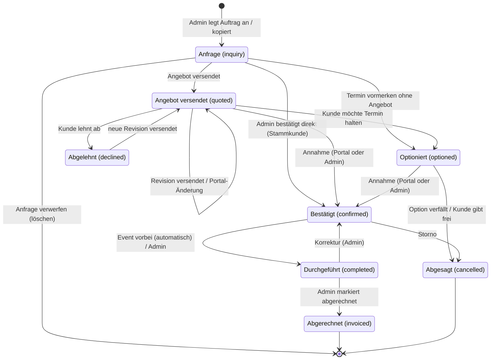
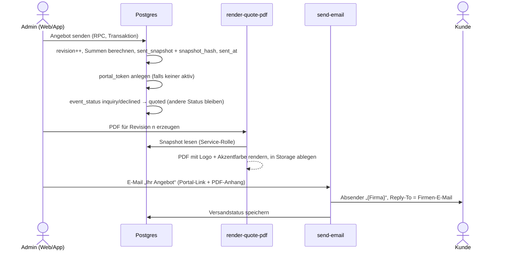
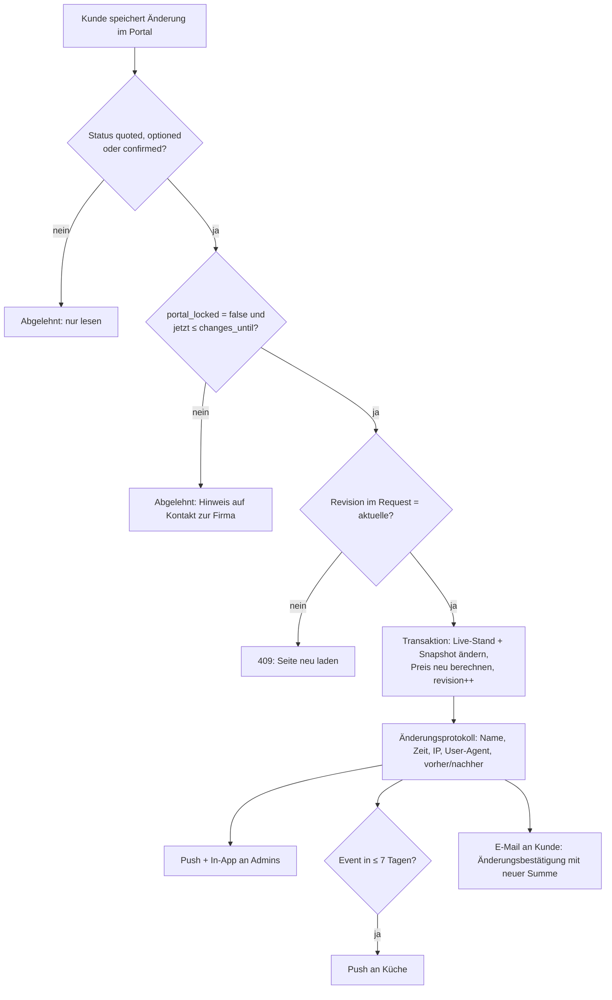
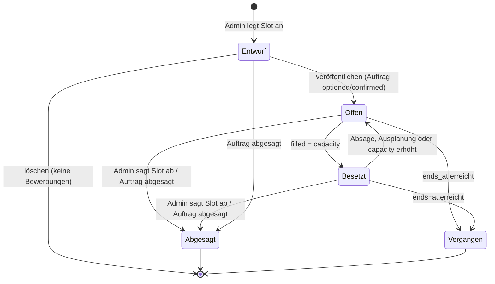
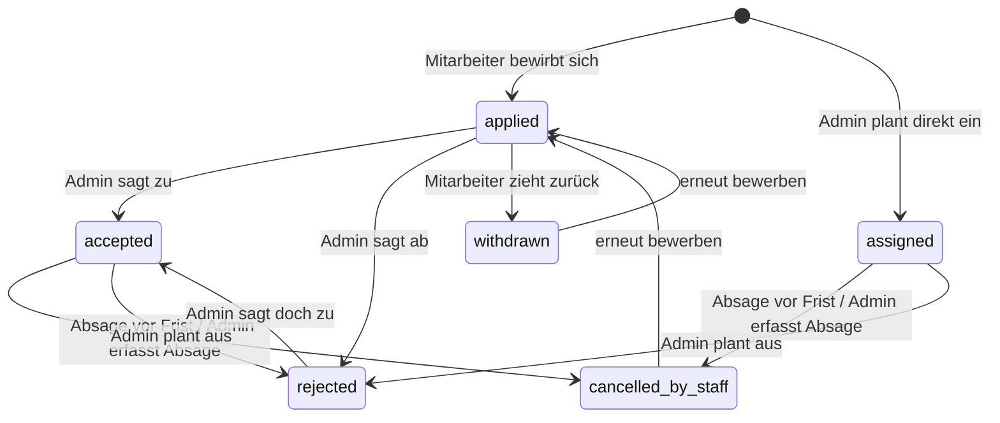
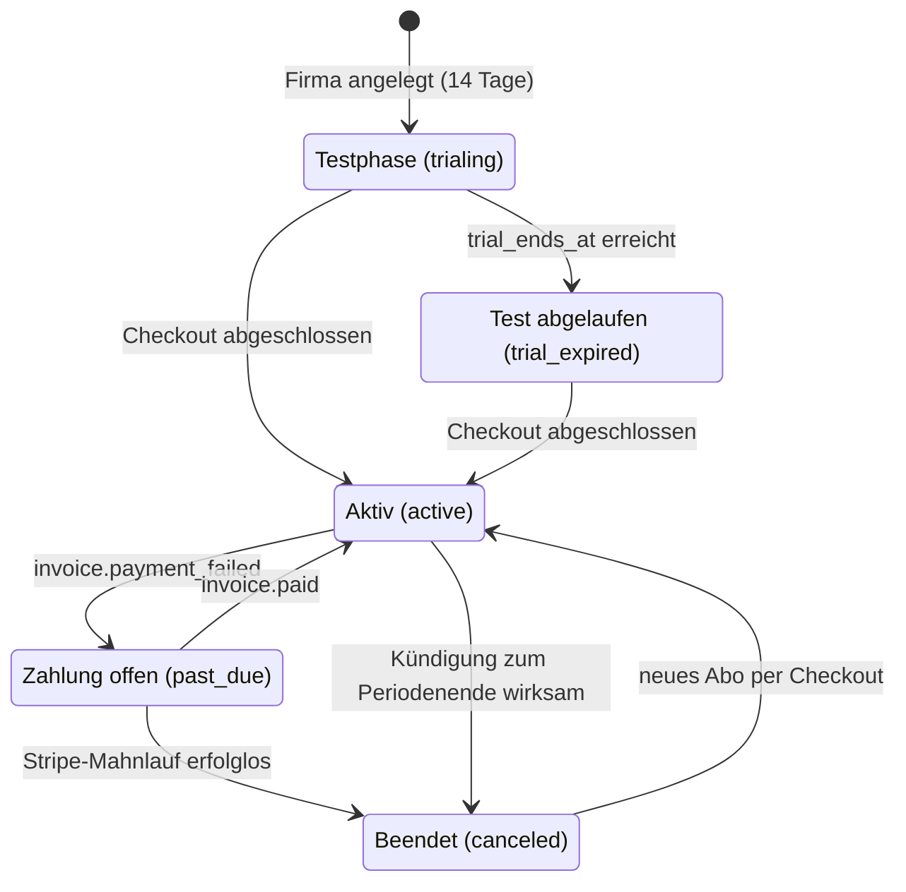

# Geschäftsprozesse & Regeln

Stand: 17.10.2026 · Grundlage: [00-entscheidungen.md](00-entscheidungen.md)

Dieses Dokument legt fest, **wie** die App sich verhält: Statusübergänge, Rechenregeln, Fristen, Benachrichtigungen. Es beschreibt keine Screens.

**Konventionen**

- Enum-Werte, Tabellen- und Edge-Function-Namen gemäß Glossar (`event_status`, `quotes`, `portal-api` …).
- Spaltennamen, die über das Glossar hinausgehen (z. B. `option_expires_at`), sind **Vorschläge** für das Datenmodell.
- Geldbeträge: integer Cent. Zeitpunkte: `timestamptz`, Anzeige und Fristberechnung in `Europe/Berlin`.
- **Vorschlag** = begründete Empfehlung zu einem Punkt, der im Entscheidungsprotokoll offen ist.
- Wer darf was: Statusänderungen und Angebotsbearbeitung nur `admin`. `kitchen` und `staff` lesen. Der Endkunde handelt ausschließlich über `portal-api` mit seinem Portal-Token.

---

## 1. Zustandsautomat Auftrag (`event_status`)



### 1.1 Erlaubte Übergänge

Alle anderen Übergänge lehnt die Datenbank ab (Vorschlag: Postgres-Funktion `set_event_status(event_id, new_status, reason)` mit Übergangstabelle; direkte Updates auf `events.status` per RLS gesperrt).

| Von → Nach | Auslöser | Vorbedingungen | Nebenwirkungen |
|---|---|---|---|
| – → `inquiry` | Admin legt Auftrag an oder kopiert einen (→ Abschnitt 9) | Kunde (`customers`) gewählt oder neu angelegt; Datum + Startzeit | Kalender: Eintrag „unverbindlich“ (nur Admin). Kein Portal-Token. |
| `inquiry` → gelöscht | Admin „Anfrage verwerfen“ | Nie ein Angebot versendet (`quotes.revision = 0`) | Hard Delete inkl. Entwurfsangebot. Kein Status, da nichts nach außen ging. |
| `inquiry` → `quoted` | Admin „Angebot senden“ | Angebot mit ≥ 1 Position; Kunden-E-Mail vorhanden; Firmenprofil vollständig (Name, Anschrift, Reply-To-E-Mail) | Revision 1 + Snapshot + PDF (→ 2.4); Portal-Token erzeugen; E-Mail an Kunde; Kalender: „unverbindlich“. |
| `inquiry` → `optioned` | Admin „Termin vormerken“ (**Vorschlag**: Kunde ruft an und will den Termin vor dem Angebot halten) | – | Kalender: Block „Option“ (schraffiert), auch für Küche sichtbar; iCal-Feed Admin. Optional `option_expires_at` setzen. |
| `inquiry` → `confirmed` | Admin „Direkt bestätigen“ (**Vorschlag**: Stammkunde, Business-Lunch-Kopie) | Pflichtangabe Bestätigungsweg (Telefon / E-Mail / persönlich) | Wie `→ confirmed` unten, aber ohne Annahmeprotokoll aus dem Portal; protokolliert wird Admin + Zeitpunkt + Bestätigungsweg. Optional Bestätigungs-E-Mail an Kunde (Checkbox, Standard an). |
| `quoted` → `quoted` | Admin versendet Revision oder Kunde ändert Details im Portal | Siehe 2.7 und 4 | Revision++, neuer Snapshot, neue PDF. E-Mail an Kunde nur bei Admin-Versand. |
| `quoted` → `optioned` | Admin (Kunde bittet telefonisch/per Mail um Reservierung) | – | Kalender: Block „Option“; optional `option_expires_at` + Erinnerungen (→ 1.3). Portal unverändert offen. |
| `quoted` → `confirmed` | Kunde „Angebot annehmen“ im Portal **oder** Admin „Annahme erfassen“ | Portal: aktuelle Revision angenommen (→ 2.5). Admin: Bestätigungsweg angeben | Annahmeprotokoll; Kalender: fester Block; Auftrag in Küchenlisten; Schicht-Slots veröffentlichbar ohne Hinweis „Termin offen“; E-Mail „Auftragsbestätigung“ an Kunde; Push an alle `admin`, In-App an `kitchen`. |
| `quoted` → `declined` | Kunde „Angebot ablehnen“ im Portal **oder** Admin erfasst Ablehnung | – | Grund (optional) speichern; Push an `admin`; Kalendereintrag entfernt; Portal: nur lesen mit Hinweis „abgelehnt“. |
| `declined` → `quoted` | Admin versendet neue Revision (Kunde meldet sich erneut) | Wie `inquiry → quoted` | Revision++, E-Mail an Kunde, Portal wieder aktiv. |
| `optioned` → `confirmed` | Kunde im Portal oder Admin | Ein versendetes Angebot existiert (`revision ≥ 1`); bei Option ohne Angebot zuerst Angebot senden | Wie `quoted → confirmed`; `option_expires_at` wird geleert, Erinnerungen entfallen. |
| `optioned` → `cancelled` | Admin (Option verfallen, Kunde sagt ab) **oder** Kunde „Ablehnen“ im Portal | – | Grund speichern; Kalender-Block entfernt; Schicht-Slots abgesagt (→ 5.7); Push an alle Bewerber und Eingeplanten; Portal: nur lesen. |
| `confirmed` → `completed` | Automatisch: täglicher Job 04:00 Europe/Berlin für Aufträge mit `ends_at < heute 00:00` (**Vorschlag**, pg_cron); oder Admin manuell | – | Portal: nur lesen. Schichten gelten als erledigt. Kalendereintrag bleibt (Historie). |
| `completed` → `confirmed` | Admin „Korrektur“ | Auftrag ist nicht `invoiced` | Nur Statuskorrektur, keine Benachrichtigung. |
| `confirmed` → `cancelled` | Admin „Auftrag absagen“ (Kunde storniert per Telefon/Mail; im Portal **kein** Storno-Button) | Grund Pflicht; Freitext „Stornovereinbarung“ optional (keine festen Storno-Regeln laut Entscheidung) | Kalender-Block entfernt; alle Slots abgesagt, alle Bewerber/Zugeteilten per Push informiert (→ 5.7); Küche Push, wenn Event ≤ 7 Tage entfernt; optional E-Mail an Kunde (Checkbox, Standard aus). Portal: nur lesen. |
| `completed` → `invoiced` | Admin „Als abgerechnet markieren“ | – | Freitextfelder Rechnungsnummer + Rechnungsdatum (**Vorschlag**, bis das Rechnungsmodul kommt). Angebot und Auftrag werden schreibgeschützt. |

`cancelled` und `invoiced` sind Endzustände. Wiederaufnahme eines abgesagten Auftrags: **Vorschlag** über „Auftrag kopieren“ statt Rücksprung (vermeidet halb wiederhergestellte Schichten und Benachrichtigungen).

### 1.2 Wirkung je Status

| Status | Kalender Admin | Kalender/iCal Küche | iCal Staff | Portal (Kunde) | Küchenlisten | Schichtbörse |
|---|---|---|---|---|---|---|
| `inquiry` | unverbindlich (grau) | – | – | kein Zugang | – | Slots nur als Entwurf |
| `quoted` | unverbindlich (grau) | – | – | ansehen, annehmen, ablehnen, Details ändern | – | Slots nur als Entwurf |
| `optioned` | Option (schraffiert) | Option (schraffiert) | nur eigene Schichten | ansehen, annehmen, ablehnen, Details ändern | optional („inkl. Optionen“) | veröffentlichbar, Hinweis „Termin noch nicht fest“ |
| `confirmed` | fest (Akzentfarbe) | fest | nur eigene Schichten | ansehen; Details ändern bis „Änderungen bis“ / Sperre | ja | veröffentlichbar |
| `completed` | fest (abgeblendet) | fest (abgeblendet) | eigene vergangene Schichten | nur lesen | Historie | geschlossen |
| `invoiced` | wie `completed` | wie `completed` | wie `completed` | nur lesen | Historie | geschlossen |
| `declined` | ausgeblendet (Filter „Archiv“) | – | – | nur lesen, Hinweis „abgelehnt“ | – | – |
| `cancelled` | ausgeblendet (Filter „Archiv“) | entfernt | entfernt | nur lesen, Hinweis „abgesagt“ | entfernt | alle Slots abgesagt |

**Kalender-Block** bedeutet im MVP: sichtbarer Eintrag + Eintrag im iCal-Feed (`ical-feed`). Es gibt keine harte Kapazitätsgrenze. **Vorschlag:** Beim Optionieren/Bestätigen erscheint ein Hinweis, wenn am selben Tag bereits Aufträge `optioned`/`confirmed` liegen („Am 12.06.2027 sind bereits 2 Aufträge eingeplant.“) – kein Blockieren, weil kleine Firmen mehrere kleine Lieferungen pro Tag fahren.

### 1.3 Option mit Ablaufdatum

- `events.option_expires_at` (Datum, optional) – nur in `optioned` editierbar, wird bei Verlassen von `optioned` geleert.
- Erinnerungen an alle `admin` (Push + In-App), ausgelöst vom täglichen Job um 08:00 Europe/Berlin:
  - **2 Tage vorher**: „Option für {event} läuft am {datum} ab.“
  - **Am Ablauftag**: „Option für {event} läuft heute ab.“
  - **Danach** täglich in der In-App-Liste „Überfällige Optionen“ (kein weiterer Push).
- **Vorschlag: kein automatisches Absagen.** Laut Entscheidung werden Fristen individuell gehandhabt; ein automatischer Storno würde Kunden verärgern, die mündlich verlängert haben. Admin entscheidet: verlängern, bestätigen oder absagen.
- Optional Button „Kunde erinnern“: E-Mail an den Kunden mit Portal-Link („Ihre Reservierung für {datum} läuft am {ablauf} ab“). Nur manuell.

---

## 2. Angebotsprozess

Grundsatz: **Ein Auftrag hat genau ein aktuelles Angebot** (`quotes.event_id` eindeutig) mit Revisionsnummer. Beim Versand wird ein Snapshot eingefroren. Keine parallelen Varianten, keine Versionsverwaltung.

### 2.1 Datenstand eines Angebots

| Element | Inhalt |
|---|---|
| Live-Stand | `quotes` + `quote_items`, vom Admin bearbeitbar |
| `quotes.revision` | 0 = nie versendet; jede Versendung bzw. Portal-Änderung +1 |
| `quotes.sent_snapshot` (jsonb, **Vorschlag**) | Vollständiger eingefrorener Stand der aktuellen Revision: Positionen, Preise, Steuern, Summen, Texte, Allergene, Firmen- und Kundendaten, Branding |
| `quotes.snapshot_hash` | SHA-256 über den kanonisch serialisierten Snapshot |
| PDF je Revision | Storage `quotes/{company_id}/{quote_id}/r{revision}.pdf`; ältere PDFs bleiben als Nachweis erhalten |
| `quotes.has_unsent_changes` | `true`, sobald der Live-Stand vom Snapshot abweicht → Banner „Änderungen nicht versendet“ |
| Texte | Einleitung, Schlusstext, Zahlungs-/Storno-Hinweise (Freitext, Firmen-Standardtexte vorbelegt), `valid_until` optional |

Das Portal zeigt **immer den Snapshot**, nie den Live-Stand. So sieht der Kunde keine halbfertigen Änderungen.

### 2.2 Erstellen

1. Admin öffnet Auftrag → „Angebot“. Gästezahl (`events.guest_count`) ist vorbelegt.
2. Positionen hinzufügen (`quote_item_type`):

| Typ | Quelle | Menge | Einheit | Standard-Steuerkategorie |
|---|---|---|---|---|
| `package` | `menu_packages` | Gästezahl (gekoppelt) | Person | Speisen |
| `dish` | `dishes` | frei oder Gästezahl (gekoppelt) | Portion / Person | Speisen |
| `service` | frei, Vorlagen aus Firmeneinstellungen („Servicekraft“, „Koch vor Ort“) | Anzahl × Stunden | Std. | Personal |
| `equipment` | frei (Equipment-Modul erst nach MVP) | frei | Stück / pauschal | Equipment |
| `travel` | frei, Vorlage „Anfahrt“ | 1 | pauschal / km | Anfahrt |
| `beverage` | frei, Vorlage „Getränkepauschale“ | Gästezahl (gekoppelt) oder 1 | Person / pauschal | Getränke |
| `custom` | frei | frei | frei | wählbar |

3. **Kopplung an die Gästezahl** (**Vorschlag** `quote_items.quantity_mode`: `per_guest` | `fixed`): `per_guest`-Positionen übernehmen jede Änderung der Gästezahl automatisch (auch aus dem Portal, → 4).
4. **Werte werden beim Hinzufügen kopiert** (Name, Beschreibung, Preis, Allergene, Diätformen, Steuersatz). Spätere Änderungen an `dishes`/`menu_packages` ändern bestehende Angebote nicht. Button „Aus Katalog aktualisieren“ übernimmt aktuelle Katalogwerte bewusst.
5. **Wahlgruppen** für die Menüwahl im Portal (**Vorschlag** `quote_items.choice_group`, `is_selected`): Admin bietet z. B. drei Pakete als Alternativen an; genau eine Position je Gruppe ist ausgewählt und wird berechnet. Nicht gewählte Alternativen erscheinen im Portal als Auswahl, im PDF als „Alternative“ ohne Summenwirkung.
6. Kalkulation pro Position (→ 3): Preis übernehmen (Pauschalpreis) oder Preisvorschlag aus Wareneinsatz; Rabatt; Steuersatz.
7. Allergene: Das Angebot zeigt je Gericht die 14 Pflichtallergene als Kürzel und Diätformen (aus `dish_allergens`). Bei Paketen aggregiert über die enthaltenen Gerichte.

### 2.3 Prüfung vor Versand

Senden ist gesperrt, solange eine Regel verletzt ist (Fehlerliste im Formular):

- ≥ 1 berechnete Position, alle Positionen mit Steuersatz.
- Kunde hat E-Mail-Adresse.
- Firmenprofil: Name, Anschrift, Reply-To-E-Mail; Logo/Farbe optional (Fallback: App-Standard).
- Event hat Datum, Startzeit, Ort (Adresse oder „Abholung“).
- Abo schreibfähig (nicht im Lesemodus, → 7).

### 2.4 Versand



- E-Mail: Betreff „Ihr Angebot für {event_titel} am {datum}“. Inhalt: Anrede, Kurztext der Firma, Button „Angebot online ansehen“ (Portal-Link), PDF im Anhang, Kontaktdaten der Firma.
- **Fehlerfall**: Schlägt PDF oder E-Mail fehl, bleibt die Revision bestehen (Snapshot ist die Wahrheit); der Admin sieht „E-Mail nicht zugestellt – erneut senden“. Erneutes Senden erhöht die Revision nicht.
- **Vorschlag**: Statt E-Mail-Versand kann der Admin den Portal-Link kopieren (z. B. für WhatsApp). Dann wird `sent_at` gesetzt, Versandkanal = „Link kopiert“.

### 2.5 Ansicht und Annahme im Portal

Portal: `app/portal/[token]` (Expo Web, öffentlich), Daten ausschließlich über `portal-api`.

- **Ansicht**: Firmenlogo + Akzentfarbe, Eventdaten, Positionen (B2B netto / B2C brutto, → 3.6), Summen, Allergenlegende, Texte, PDF-Download der aktuellen Revision. Erster Aufruf je Revision wird protokolliert (`quotes.first_viewed_at`) → In-App-Hinweis an Admin „Angebot geöffnet“.
- **Annahme**: Button „Angebot verbindlich annehmen“ → Dialog mit Name (Pflicht), E-Mail (vorbelegt), Checkbox „Ich nehme das Angebot (Version {n}) verbindlich an.“ und, falls gepflegt, Anzeige der Zahlungs-/Storno-Hinweise.
- `portal-api` prüft: Token gültig, Status `quoted` oder `optioned`, übermittelte `revision` = aktuelle Revision (sonst 409 „Das Angebot wurde aktualisiert. Bitte prüfen Sie die neue Version.“), Abo schreibfähig.

**Protokoll der Annahme** (in `quotes`, zusätzlich als Eintrag in `quotes.acceptance_log` jsonb-Array – **Vorschlag**, damit Annahmen späterer Revisionen die frühere nicht überschreiben):

| Feld | Inhalt |
|---|---|
| `accepted_at` | Serverzeit (`now()`), nicht Client-Zeit |
| `accepted_name` | eingegebener Name |
| `accepted_email` | eingegebene/vorbelegte E-Mail |
| `accepted_ip` | IP aus Request-Header (Edge Function) |
| `accepted_user_agent` | User-Agent-String |
| `accepted_revision` | Revisionsnummer |
| `accepted_snapshot_hash` | Hash des angenommenen Snapshots |
| `accepted_total_gross_cents` | Bruttosumme zum Zeitpunkt der Annahme |
| `accepted_via` | `portal` oder `admin` (+ Bestätigungsweg und `member_id` bei Admin-Erfassung) |
| `portal_token_id` | verwendeter Token |

Nach der Annahme: Status → `confirmed`; PDF der angenommenen Revision erhält den Vermerk „Angenommen am {datum} {uhrzeit} durch {name}“; E-Mail „Auftragsbestätigung“ mit diesem PDF an den Kunden; Push an Admins.

### 2.6 Ablehnung

- Portal-Button „Angebot ablehnen“ → optionaler Grund (Auswahl: „Preis“, „Termin“, „Anderer Anbieter“, „Veranstaltung findet nicht statt“, „Sonstiges“ + Freitext).
- Wirkung: aus `quoted` → `declined`; aus `optioned` → `cancelled` (Glossar: Absage nach Option). Push an Admins, Portal nur lesen.
- Admin kann eine telefonische Ablehnung ebenso erfassen.

### 2.7 Überarbeitung nach Versand

| Ausgangsstatus | Ablauf | Ergebnis |
|---|---|---|
| `quoted`, `optioned` | Admin ändert Live-Stand → „Erneut senden“ | Revision++, neuer Snapshot + PDF, E-Mail „Ihr aktualisiertes Angebot (Version {n})“. Status unverändert. |
| `declined` | wie oben | Status → `quoted` |
| `confirmed` | Admin ändert → „Änderung senden“ | Revision++, E-Mail „Geänderte Auftragsbestätigung (Version {n})“. Status bleibt `confirmed`. Portal zeigt „Neue Version – bitte bestätigen“; die Bestätigung wird wie eine Annahme protokolliert. Bis dahin Badge beim Admin: „Version {n} noch nicht bestätigt“. **Vorschlag**: Der Auftrag bleibt in jedem Fall bestätigt; die erneute Bestätigung dient dem Nachweis. |
| `completed`, `invoiced`, `cancelled` | Bearbeitung gesperrt | – |

Ungesendete Änderungen bleiben im Live-Stand, bis der Admin sendet oder „Änderungen verwerfen“ wählt (Live-Stand wird aus dem Snapshot wiederhergestellt).

---

## 3. Kalkulationsregeln

Alle Rechnungen laufen in **einem gemeinsamen TypeScript-Modul**, das App, Web-Admin, `portal-api` und `render-quote-pdf` gleichermaßen nutzen (**Vorschlag**; eine Rechenquelle verhindert Cent-Abweichungen zwischen Bildschirm und PDF). Die Datenbank speichert die Ergebnisse je Position und die Summen.

### 3.1 Begriffe

| Symbol | Bedeutung | Speicherung |
|---|---|---|
| `G` | Gästezahl des Auftrags | `events.guest_count` (integer) |
| `q` | Menge der Position | numeric(10,2); bei `per_guest` = `G` |
| `p` | Einzelpreis in Cent (in der Eingabeart der Firma, → 3.5) | integer |
| `r` | Steuersatz in Basispunkten (700 = 7,00 %) | `tax_rates.rate_bp` (**Vorschlag**) |
| `d` | Positionsrabatt in Basispunkten | integer, Standard 0 |
| `R` | Gesamtrabatt (% oder Betrag) | `quotes.discount_bp` oder `quotes.discount_cents` |
| `round()` | kaufmännisch auf ganze Cent: ab ,5 vom Nullpunkt weg | – |

### 3.2 Pauschalpreis pro Person

`Positionsbetrag = round(q × p)`

`p` kommt aus `menu_packages.price_per_person_cents` bzw. `dishes.price_cents` und ist im Angebot überschreibbar.

### 3.3 Wareneinsatz (Zutatenkosten + Aufschlag)

Voraussetzung: Das Gericht hat Zutaten in `dish_ingredients` (Menge pro Person in g / ml / Stück) und die Zutat hat einen Einkaufspreis (`ingredients.price_cents` pro kg / l / Stück).

```
Wareneinsatz je Person (Gericht d)  W_d = Σ_i  Menge_pP(i,d) [Basiseinheit] / Umrechnung(i) × Preis(i)
Wareneinsatz je Person (Paket)      W_P = Σ_d  W_d × Portionsfaktor(d)
Wareneinsatz der Position           W   = W_d bzw. W_P × q
Preisvorschlag je Person            p*  = aufrunden_auf_Raster(W_d × F)
Aufschlag in % ↔ Faktor             F   = 1 + Aufschlag% / 100     (200 % Aufschlag = Faktor 3,0)
Wareneinsatzquote                   WQ  = W_d / p*
```

- `Umrechnung(i)`: 1000 bei g→kg und ml→l, 1 bei Stück.
- Zwischenwerte des Wareneinsatzes in **numeric mit 4 Nachkommastellen** (Bruchteile von Cent); gerundet wird erst der Preisvorschlag.
- `F`: Firmen-Standard (**Vorschlag** 3,0), überschreibbar je Gericht, Paket oder Angebotsposition. Eingabe wahlweise als Faktor oder Aufschlag in %.
- Preisraster (**Vorschlag**, Firmeneinstellung): keines / 0,10 € / 0,50 € / 1,00 €, Standard 0,10 € aufrunden.
- `p*` ist nur ein **Vorschlag**. Der Admin übernimmt ihn oder überschreibt ihn; gespeichert wird der übernommene Preis `p`. Fehlt bei einer Zutat der Preis, zeigt die App „Wareneinsatz unvollständig“ und keinen Vorschlag.
- `Portionsfaktor` (**Vorschlag** `menu_package_dishes.portion_factor`, Standard 1,0): z. B. 0,5 für eine Beilage, die im Buffet nur jeder zweite Gast nimmt.
- Wareneinsatz und Quote sieht nur `admin`. `kitchen` sieht keine Preise und damit auch keine Einkaufspreise.

**Beispiel Wareneinsatz – Rinderschmorbraten (pro Person)**

| Zutat | Menge p. P. | Einkaufspreis | Kosten p. P. |
|---|---|---|---|
| Rinderschulter | 180 g | 14,90 €/kg | 0,180 × 1490 = 268,2 ct |
| Kartoffeln | 200 g | 1,20 €/kg | 0,200 × 120 = 24,0 ct |
| Rotwein | 50 ml | 6,00 €/l | 0,050 × 600 = 30,0 ct |
| Wurzelgemüse | 120 g | 3,50 €/kg | 0,120 × 350 = 42,0 ct |
| **Summe `W_d`** | | | **364,2 ct = 3,642 €** |

Faktor 3,2 → 364,2 × 3,2 = 1165,44 ct → aufgerundet auf 0,10 € → **p* = 11,70 €** · Wareneinsatzquote 3,642 / 11,70 = **31,1 %**.

### 3.4 Personal (`service`)

`Positionsbetrag = round(Anzahl × Stunden × Stundensatz)`

- Stunden in 0,25-Schritten (**Vorschlag** `quote_items.hours`), Anzahl = `q`.
- Stundensätze als Vorlagen in den Firmeneinstellungen (z. B. „Servicekraft 32,00 €/h“, „Koch vor Ort 45,00 €/h“).
- Beispiel: 3 Servicekräfte × 6,5 h × 32,00 € = **624,00 €**.

### 3.5 Steuersätze

- `tax_rates` pro Firma: Name, `rate_bp`, Kategorie (Speisen / Getränke / Personal / Equipment / Anfahrt / Sonstiges), Land, **`valid_from`** (**Vorschlag**). Jede Angebotsposition referenziert einen Steuersatz; der Standard ergibt sich aus Positionstyp → Kategorie (→ 2.2) und ist pro Position änderbar.
- Maßgeblich ist der Satz, der **am Leistungsdatum** (`events.starts_at`) gilt, nicht am Angebotsdatum. So bleiben Angebote über einen Steuersatzwechsel hinweg korrekt.
- Beim Firmen-Setup werden Beispielwerte für das gewählte Land angelegt; der Admin muss sie mit „Von mir geprüft“ bestätigen.
- **Kleinunternehmer** (**Vorschlag**, Firmeneinstellung): keine USt-Berechnung, Hinweistext auf Angebot/PDF.

**Beispielwerte (Vorschlag, keine Steuerberatung)**

| Kategorie | DE | AT | CH |
|---|---|---|---|
| Speisen | 7 % ¹ | 10 % | 8,1 % (mit Service) / 2,6 % (reine Lieferung) |
| Getränke | 19 % | 20 % | 8,1 % |
| Personal | 19 % ² | 20 % | 8,1 % |
| Equipment-Miete | 19 % ² | 20 % | 8,1 % |
| Anfahrt | 19 % ² | 20 % | 8,1 % |

¹ Nach unserem Kenntnisstand gilt in DE seit 01.01.2026 für Speisen in Gastronomie und Catering wieder 7 %, auch mit Service; Getränke bleiben bei 19 %.
² Nebenleistungen können umsatzsteuerlich der Hauptleistung folgen (einheitliche Leistung).

> **Die korrekten Sätze und ihre Zuordnung pflegt die Firma, idealerweise mit ihrem Steuerberater.** Die App rechnet nur mit den hinterlegten Werten und weist im Setup sowie in der Steuersatz-Verwaltung darauf hin.

### 3.6 Netto/Brutto, Rundung, Rabatt – Rechenreihenfolge

**Eingabeart** (**Vorschlag**, Firmeneinstellung `price_entry_mode`: `net` | `gross`, Standard `net`): Firmen mit überwiegend Privatkunden pflegen Bruttopreise („39,00 € p. P.“). Gerechnet wird immer von der Eingabeseite aus, damit eingegebene Beträge exakt erhalten bleiben.

Je Position `k`:

```
1. Basis          B_k = round(q_k × p_k)                     (Personal: round(q × Stunden × p))
2. Positionsrabatt  B'_k = B_k − round(B_k × d_k / 10000)
3. Gesamtrabatt   B''_k = B'_k − round(B'_k × R_bp / 10000)   (bei Prozent)
                  bzw. Anteil am Betrag R_cents nach Largest-Remainder-Verfahren
4. Steuer         Eingabe netto:  N_k = B''_k;  T_k = round(N_k × r_k / 10000);  Br_k = N_k + T_k
                  Eingabe brutto: Br_k = B''_k; N_k = round(Br_k × 10000 / (10000 + r_k)); T_k = Br_k − N_k
5. Summen         Σ N_k,  Σ T_k je Steuersatz,  Σ Br_k
```

- **Rundung**: kaufmännisch auf Cent **pro Position**, danach wird summiert (keine erneute Rundung der Summen).
- **Gesamtrabatt als Betrag**: Anteil_k = `R_cents × B'_k / Σ B'`; zuerst alle Anteile abrunden, die Rest-Cent an die Positionen mit dem größten Nachkommaanteil verteilen. Damit trägt jeder Steuersatz seinen Anteil am Rabatt, und die Rabattsumme stimmt exakt.
- **Keine negativen Positionen** (**Vorschlag**): Rabatte nur über die Rabattfelder, weil eine negative Pauschalposition mit nur einem Steuersatz bei gemischten Sätzen falsch rechnen würde.
- **Anzeige** nach Kundentyp (**Vorschlag** `customers.customer_type`: `business` | `private`):
  - **B2B**: Einzel- und Positionspreise netto; Summenblock: Summe netto · Rabatt · zzgl. USt je Satz (mit Bemessungsgrundlage) · Gesamtbetrag brutto.
  - **B2C**: Positionspreise brutto; Summenblock: Gesamtbetrag brutto · darin enthaltene USt je Satz.
  - Zusätzlich „entspricht {x} € pro Gast“ (Gesamt ÷ `G`, nur Anzeige).

**Rechenbeispiel – Firmenfeier, B2B, 60 Gäste, Eingabe netto, 5 % Gesamtrabatt**

| # | Typ | Position | Menge × Preis | Basis | −5 % | Netto | USt | Steuer |
|---|---|---|---|---|---|---|---|---|
| 1 | `package` | Fingerfood „Business“ | 60 × 24,50 € | 1.470,00 | −73,50 | 1.396,50 | 7 % | 97,76 (97,755) |
| 2 | `dish` | Rinderschmorbraten (aus 3.3) | 20 × 11,70 € | 234,00 | −11,70 | 222,30 | 7 % | 15,56 (15,561) |
| 3 | `beverage` | Getränkepauschale | 60 × 9,80 € | 588,00 | −29,40 | 558,60 | 19 % | 106,13 (106,134) |
| 4 | `service` | Servicekräfte | 3 × 6,5 h × 32,00 € | 624,00 | −31,20 | 592,80 | 19 % | 112,63 (112,632) |
| 5 | `equipment` | Stehtische | 8 × 12,00 € | 96,00 | −4,80 | 91,20 | 19 % | 17,33 (17,328) |
| 6 | `travel` | Anfahrt pauschal | 1 × 45,00 € | 45,00 | −2,25 | 42,75 | 19 % | 8,12 (8,1225) |

| Summenblock | Betrag |
|---|---|
| Summe netto vor Rabatt | 3.057,00 € |
| Rabatt 5 % | −152,85 € |
| **Summe netto** | **2.904,15 €** |
| zzgl. USt 7 % auf 1.618,80 € | 113,32 € |
| zzgl. USt 19 % auf 1.285,35 € | 244,21 € |
| **Gesamtbetrag brutto** | **3.261,68 €** (≈ 54,36 € pro Gast) |

Hinweis: Bei Summenrundung ergäbe sich für 19 % 1.285,35 × 0,19 = 244,2165 → 244,22 €. Die Abweichung von 1 Cent ist eine Folge der Positionsrundung und für Angebote unkritisch. **Mit dem Rechnungsmodul** wird die Rundungsmethode für Rechnungen (Steuerbetrag je Steuersatz) erneut geprüft.

---

## 4. Änderungen durch den Kunden im Portal

### 4.1 Was der Kunde ändern kann

| Feld | Eingabe | Wirkung |
|---|---|---|
| Gästezahl | ganze Zahl ≥ 1 | `events.guest_count`; alle `per_guest`-Positionen erhalten die neue Menge; Preis neu berechnet |
| Menüwahl | Auswahl je Wahlgruppe (→ 2.2) | `is_selected` wechselt; Preis neu berechnet; Allergenanzeige aktualisiert |
| Allergien / Sonderessen | Zeilen in `event_dietary_requirements`: Anzahl, Diätform (vegetarisch/vegan/halal …), zu meidende Allergene (aus den 14), Notiz, optional Tisch/Name | Küchenlisten (→ 8); kein Preiseffekt (**Vorschlag**: Sonderessen sind im Preis p. P. enthalten; Aufpreise pflegt der Admin selbst als Position) |

Nicht im Portal änderbar: Datum, Uhrzeit, Ort, Zusatzpositionen, Preise. Dafür zeigt das Portal „Andere Änderungen? {Firma} · {Telefon} · {E-Mail}“.

### 4.2 Empfehlung: Änderung wird direkt übernommen



**Begründung**

- **Tempo und Entlastung**: Gästezahl und Allergien ändern sich bei fast jedem Event mehrfach. Eine Freigabe pro Änderung wäre genau das WhatsApp-Hin-und-Her, das die App ersetzen soll.
- **Deterministische Preise**: Durch `per_guest`-Kopplung und feste Einzelpreise ist der neue Preis eindeutig. Der Kunde sieht die neue Summe vor dem Speichern („Neue Gesamtsumme: 3.812,40 €“) und bestätigt sie bewusst.
- **Kontrolle bleibt beim Caterer**: sofortige Benachrichtigung, vollständiges Änderungsprotokoll, „Änderungen bis“-Datum und Portal-Sperre.
- **Küche arbeitet mit aktuellen Zahlen**: Produktions- und Einkaufslisten rechnen sofort mit dem neuen Stand.

**Regeln im Detail**

- Speichern verlangt den Namen (vorbelegt mit dem zuletzt eingegebenen) und die Checkbox „Änderung verbindlich übernehmen“.
- Portal-Änderungen erzeugen eine neue Revision mit Herkunft `portal` und ändern **Live-Stand und Snapshot gleichzeitig**. Ungesendete Admin-Änderungen bleiben unversendet erhalten. PDF der neuen Revision wird bei Bedarf erzeugt (beim Download bzw. bei der Bestätigungs-E-Mail).
- Im Status `confirmed` gilt die vom Kunden gespeicherte Revision als angenommen (`accepted_revision` = neue Revision, Eintrag in `acceptance_log` mit `accepted_via = portal_change`).
- Änderungsprotokoll: **Vorschlag** `quotes.change_log` (jsonb-Array) mit Zeitpunkt, Name, IP, User-Agent, Revision, Feld, Wert vorher/nachher. Die Admin-Benachrichtigung enthält die Zusammenfassung („Gäste 60 → 72, +2 vegan“).
- **Große Änderung** (Gästezahl ± 20 % oder mehr, **Vorschlag**): Benachrichtigung als „wichtig“ markiert, Hinweis an Admin „Personalbedarf und Equipment prüfen“. Schicht-Slots werden nicht automatisch angepasst.

### 4.3 „Änderungen bis“ und Portal-Sperre

| Einstellung | Ort | Standard |
|---|---|---|
| `events.changes_until` (timestamptz, optional) | pro Auftrag | vorbelegt aus Firmeneinstellung |
| `companies.portal_change_lead_days` (**Vorschlag**) | Firmeneinstellungen | 3 Tage vor Eventbeginn, 23:59 Uhr; abschaltbar (leer = keine Frist) |
| `events.portal_locked` (bool) | pro Auftrag, Schalter „Portal-Änderungen sperren“ | aus |

- Nach Fristablauf oder bei Sperre: Portal zeigt alles lesend, Annahme/Ablehnung bleibt in `quoted`/`optioned` möglich (Sperre betrifft nur Detailänderungen).
- Ab `completed` ist das Portal grundsätzlich nur lesbar.
- Ein Portal-Token läuft **90 Tage nach Eventende** ab (**Vorschlag**) und kann vom Admin jederzeit widerrufen und neu erzeugt werden (z. B. wenn der Link an Dritte ging).

---

## 5. Schichtbörse

### 5.1 Slot (`shift_slots`)

| Feld | Inhalt |
|---|---|
| `event_id` | zugehöriger Auftrag |
| `title` | z. B. „Service“, „Bar“, „Spüle“, „Koch vor Ort“ |
| `qualification_id` | erforderliche Qualifikation (`qualifications`); leer = jeder darf |
| `starts_at`, `ends_at` | Schichtzeit (kann von der Eventzeit abweichen, z. B. Aufbau früher) |
| `capacity` | Anzahl Plätze ≥ 1 |
| `meeting_point`, `dress_code`, `notes` | Einsatzinfos (**Vorschlag**: Standard aus dem Auftrag, pro Slot überschreibbar) |
| `published_at` | leer = Entwurf |
| `cancelled_at` | gesetzt = abgesagt |

Belegung: `filled = Anzahl shift_applications mit status ∈ {accepted, assigned}`.

### 5.2 Slot-Lebenszyklus

Der Zustand wird berechnet, nicht gespeichert.



| Zustand | Bedingung | Bewerben möglich |
|---|---|---|
| Entwurf | `published_at` leer | nein (Direkt-Einplanung ja, wenn Auftrag `optioned`/`confirmed`) |
| Offen | veröffentlicht, `filled < capacity`, `now < starts_at` | ja |
| Besetzt | `filled ≥ capacity` | nein |
| Abgesagt | `cancelled_at` gesetzt | nein |
| Vergangen | `now ≥ ends_at` | nein |

Veröffentlichen ist erst ab Auftragsstatus `optioned` erlaubt. Bei `optioned` sehen Mitarbeiter den Hinweis „Termin noch nicht fest“. Veröffentlichen löst **einen gebündelten Push je Auftrag** an alle passenden Mitarbeiter aus („3 neue Schichten am 12.06.“).

### 5.3 Bewerbungs-Zustandsautomat (`application_status`)

Pro Slot und Mitarbeiter gibt es höchstens eine Bewerbung (eindeutig `shift_slot_id, member_id`); erneutes Bewerben setzt dieselbe Zeile zurück auf `applied`.



| Von → Nach | Wer | Vorbedingung | Nebenwirkung |
|---|---|---|---|
| – → `applied` | Mitarbeiter | Slot offen und für ihn sichtbar (→ 5.4) | In-App an Admins (Push gebündelt, max. 1 je Auftrag und Stunde, **Vorschlag**) |
| – → `assigned` | Admin | Platz frei; Auftrag `optioned`/`confirmed`; Mitarbeiter muss die Qualifikation **nicht** haben (Admin entscheidet, Warnhinweis) | Push an Mitarbeiter; Einsatz im iCal-Feed |
| `applied` → `accepted` | Admin | Platz frei (→ 5.5) | Push „Zusage“; Einsatzinfos freigeschaltet; iCal |
| `applied` → `rejected` | Admin | – | Push „Absage“ (neutral formuliert) |
| `applied` → `withdrawn` | Mitarbeiter | vor `starts_at` | In-App an Admins |
| `accepted`/`assigned` → `cancelled_by_staff` | Mitarbeiter | `now ≤ starts_at − Frist` | Push an Admins; Platz wieder frei → Push an passende Mitarbeiter „Schicht wieder frei“ |
| `accepted`/`assigned` → `cancelled_by_staff` | Admin (erfasst späte Absage) | nach Frist | Vermerk `late_cancellation = true` (**Vorschlag**); Platz frei wie oben |
| `accepted`/`assigned` → `rejected` | Admin („ausplanen“) | – | Push an Mitarbeiter; Platz frei |
| `rejected` → `accepted` | Admin | Platz frei | wie Zusage |
| `withdrawn`/`cancelled_by_staff` → `applied` | Mitarbeiter | Slot offen | wie Bewerbung |

Eine Direkt-Einplanung muss der Mitarbeiter nicht bestätigen (**Vorschlag**: weniger Schritte; er kann innerhalb der Frist absagen).

### 5.4 Sichtbarkeit (RLS)

Ein Mitarbeiter sieht einen Slot in der Börse, wenn **alle** Bedingungen gelten:

1. Er ist Mitglied der Firma mit Rolle `staff` oder `kitchen` (**Vorschlag**: auch die Küche kann sich auf Slots wie „Koch vor Ort“ bewerben). `admin` sieht immer alles.
2. Slot ist veröffentlicht, nicht abgesagt, nicht besetzt, `now < starts_at`.
3. Auftrag ist `optioned` oder `confirmed`.
4. `qualification_id` ist leer **oder** in seinen `member_qualifications`.

Unabhängig davon sieht jeder Mitarbeiter alle Slots, auf die er eine Bewerbung hat (in jedem Status), unter „Meine Einsätze“.

**Datenumfang** (Datensparsamkeit, **Vorschlag**):

| Vor Zusage (Börse) | Nach Zusage/Einplanung |
|---|---|
| Datum, Schichtzeit, Slot-Titel, Qualifikation, Ort als PLZ + Stadt, Eventart, Gästezahl, Slot-Hinweis | zusätzlich: vollständige Adresse, Treffpunkt, Dresscode, Ablaufplan (`event_schedule_items`), Ansprechpartner vor Ort mit Telefon |

Kundenname und Preise sieht `staff` nie.

### 5.5 Überbuchungsschutz

- Zusage und Direkt-Einplanung laufen über Postgres-Funktionen (RPC, **Vorschlag**: `accept_application`, `assign_member`), die den Slot per `SELECT … FOR UPDATE` sperren, `filled` zählen und bei `filled ≥ capacity` mit „Alle Plätze sind bereits vergeben“ abbrechen. Direkte Updates auf `shift_applications.status` sind per RLS nur für die eigenen Übergänge des Mitarbeiters (`withdrawn`, `cancelled_by_staff`, `applied`) erlaubt; die Fristprüfung erfolgt ebenfalls in der Datenbank.
- `capacity` kann nicht unter `filled` gesenkt werden.
- Bei vollem Slot bleiben offene Bewerbungen `applied` (implizite Warteliste). Wird ein Platz frei, erhält der Admin „Platz frei – 2 offene Bewerbungen“.
- **Überschneidung**: Hat der Mitarbeiter einen zeitlich überlappenden Einsatz (`accepted`/`assigned`), sieht der Admin beim Zusagen eine Warnung, der Mitarbeiter beim Bewerben ebenfalls. Kein Blockieren.

### 5.6 Absagefrist

- Firmeneinstellung `companies.shift_cancel_deadline_hours`, **Standard 48 h** (Vorschlag aus dem Entscheidungsprotokoll übernommen), Bereich 0–168 h.
- Bis `starts_at − Frist`: Button „Einsatz absagen“ (mit optionalem Grund).
- Danach: Button ausgeblendet, stattdessen „Absage nur noch über {Admin-Name}“ mit Anruf-Button. Der Admin erfasst die Absage.
- `withdrawn` (Bewerbung zurückziehen vor einer Entscheidung) ist bis Schichtbeginn jederzeit möglich.

### 5.7 Verhalten bei Änderungen am Auftrag

| Ereignis | Wirkung auf Slots | Wirkung auf Bewerbungen | Benachrichtigung |
|---|---|---|---|
| Auftrag → `cancelled` | alle Slots `cancelled_at = now()` | Status bleibt (Historie), Anzeige „Entfällt“ | Push an alle mit `applied`, `accepted`, `assigned`: „Einsatz entfällt“ |
| Auftrag → `declined` | Entwurfs-Slots werden abgesagt | – | – |
| Datum/Uhrzeit des Auftrags geändert | Admin-Dialog: „Schichten um {Δ} verschieben“ / „einzeln anpassen“ / „nicht ändern“ | Status bleibt | Push an `accepted`/`assigned`/`applied`: „Zeit geändert“ |
| Wesentliche Zeitänderung (anderer Tag oder > 60 min, **Vorschlag**) | – | Betroffene dürfen 24 h ab Benachrichtigung absagen, auch nach Ablauf der Frist | wie oben, mit Hinweis auf das Absagerecht |
| Adresse/Treffpunkt geändert | – | – | Push an `accepted`/`assigned` |
| Slot einzeln abgesagt | `cancelled_at` | wie Auftragsabsage | Push an Betroffene |
| Mitarbeiter verlässt die Firma | – | künftige `accepted`/`assigned` → `rejected` (System) | Push an Admins „Platz frei“ |
| Qualifikation entzogen | – | bestehende Zusagen bleiben | – |

Erinnerung: 24 h vor Schichtbeginn Push an `accepted`/`assigned` (**Vorschlag**).

---

## 6. Benachrichtigungs-Matrix

**Mechanik**

- **In-App**: jede Team-Benachrichtigung ist eine Zeile in `notifications` (Empfänger `member_id`, Typ, Text, Deep-Link, gelesen-Zeitpunkt). Aufbewahrung 90 Tage (**Vorschlag**).
- **Push**: Insert in `notifications` mit `push = true` → Database Webhook → `push-dispatch` → Expo Push an alle `push_tokens` des Empfängers. Ungültige Tokens (Expo-Fehler `DeviceNotRegistered`) werden gelöscht. Ohne Token bleibt es bei In-App.
- **E-Mail**: über `send-email`; an Endkunden mit Absender „{Firma}“ und Reply-To der Firma, an Teammitglieder (Einladung, Abo) mit Absender der App.
- Zeitgesteuerte Erinnerungen versendet der tägliche Job um 08:00 Europe/Berlin; ereignisgesteuerte sofort.
- Ansprache: Team-App duzt, Endkunden werden gesiezt (**Vorschlag**, üblich in kleinen Betrieben).
- Platzhalter: `{kunde}`, `{event}` (Auftragstitel), `{datum}` (TT.MM.JJJJ), `{zeit}` (HH:MM), `{slot}`, `{name}`, `{firma}`, `{link}`, `{n}` (Revision), `{summe}`.

### 6.1 Auftrag & Angebot

| # | Ereignis | Empfänger | Kanal | Vorlage |
|---|---|---|---|---|
| A1 | Angebot versendet | Kunde | E-Mail + PDF | **Betreff:** Ihr Angebot für {event} am {datum} · „Guten Tag {kunde}, vielen Dank für Ihre Anfrage. Ihr Angebot finden Sie im Anhang und online: {link}“ |
| A2 | Revision versendet | Kunde | E-Mail + PDF | **Betreff:** Ihr aktualisiertes Angebot (Version {n}) · „Wir haben Ihr Angebot für {event} angepasst. Aktuelle Fassung: {link}“ |
| A3 | Angebot erstmals geöffnet | Admins | In-App | „{kunde} hat das Angebot für {event} geöffnet.“ |
| A4 | Angebot angenommen | Admins | Push + In-App | „{kunde} hat das Angebot für {event} angenommen.“ |
| A5 | Angebot angenommen | Kunde | E-Mail + PDF | **Betreff:** Auftragsbestätigung: {event} am {datum} · „Vielen Dank für Ihren Auftrag. Ihre Bestätigung finden Sie im Anhang.“ |
| A6 | Admin bestätigt direkt | Kunde (Checkbox, Standard an) | E-Mail + PDF | wie A5 |
| A7 | Angebot abgelehnt | Admins | Push + In-App | „{kunde} hat das Angebot für {event} abgelehnt. Grund: {grund}“ |
| A8 | Kunde ändert Details | Admins | Push + In-App | „{kunde} hat {event} geändert: {zusammenfassung}“ |
| A9 | Kunde ändert Details, Event ≤ 7 Tage | Küche | Push + In-App | „Änderung {event} ({datum}): {zusammenfassung}“ |
| A10 | Kunde ändert Details | Kunde | E-Mail | **Betreff:** Ihre Änderung wurde übernommen · „Neue Gesamtsumme: {summe}. Übersicht: {link}“ |
| A11 | Änderungsfrist endet morgen (**Vorschlag**, abschaltbar) | Kunde | E-Mail | **Betreff:** Änderungen noch bis {datum} möglich · „Gästezahl, Menü und Allergien können Sie bis {datum} hier anpassen: {link}“ |
| A12 | Option läuft in 2 Tagen ab | Admins | Push + In-App | „Option für {event} läuft am {datum} ab.“ |
| A13 | Option läuft heute ab | Admins | Push + In-App | „Option für {event} läuft heute ab.“ |
| A14 | „Kunde erinnern“ (manuell) | Kunde | E-Mail | **Betreff:** Ihre Reservierung für {datum} · „Ihre Reservierung läuft am {ablauf} ab. Angebot: {link}“ |
| A15 | Auftrag bestätigt | Küche | In-App | „Neuer Auftrag: {event} am {datum}, {gäste} Gäste.“ |
| A16 | Auftrag abgesagt | Küche | Push (≤ 7 Tage) sonst In-App | „{event} am {datum} wurde abgesagt.“ |
| A17 | Auftrag abgesagt | Kunde (Checkbox, Standard aus) | E-Mail | **Betreff:** Absage {event} am {datum} · Freitext des Admins |
| A18 | Datum/Zeit/Ort geändert | Küche | In-App | „{event}: neuer Termin {datum} {zeit}.“ |

### 6.2 Schichtbörse

| # | Ereignis | Empfänger | Kanal | Vorlage |
|---|---|---|---|---|
| S1 | Slots veröffentlicht | passende Mitarbeiter | Push + In-App (gebündelt je Auftrag) | „{anzahl} neue Schichten am {datum} in {stadt}.“ |
| S2 | Bewerbung eingegangen | Admins | In-App, Push gebündelt (max. 1/Auftrag/Std.) | „{name} hat sich für {slot} am {datum} beworben.“ |
| S3 | Zusage | Mitarbeiter | Push + In-App | „Du bist dabei: {slot} am {datum}, {zeit}.“ |
| S4 | Absage auf Bewerbung | Mitarbeiter | Push + In-App | „Für {slot} am {datum} hat es diesmal nicht geklappt.“ |
| S5 | Direkt eingeplant | Mitarbeiter | Push + In-App | „Du wurdest eingeplant: {slot} am {datum}, {zeit}.“ |
| S6 | Bewerbung zurückgezogen | Admins | In-App | „{name} hat die Bewerbung für {slot} zurückgezogen.“ |
| S7 | Absage nach Zusage | Admins | Push + In-App | „{name} hat {slot} am {datum} abgesagt. Platz ist wieder frei.“ |
| S8 | Platz wieder frei | passende Mitarbeiter | Push + In-App | „Schicht wieder frei: {slot} am {datum}, {zeit}.“ |
| S9 | Platz frei, offene Bewerbungen | Admins | In-App | „{slot} am {datum}: Platz frei, {anzahl} offene Bewerbungen.“ |
| S10 | Ausgeplant | Mitarbeiter | Push + In-App | „Du bist für {slot} am {datum} nicht mehr eingeplant.“ |
| S11 | Einsatz entfällt (Slot/Auftrag abgesagt) | Bewerber + Eingeplante | Push + In-App | „Einsatz entfällt: {slot} am {datum}.“ |
| S12 | Schichtzeit geändert | Bewerber + Eingeplante | Push + In-App | „Neue Zeit für {slot}: {datum}, {zeit}.“ (+ „Absage bis {frist} möglich.“ bei wesentlicher Änderung) |
| S13 | Adresse/Treffpunkt geändert | Eingeplante | Push + In-App | „Neuer Treffpunkt für {slot} am {datum}: {treffpunkt}.“ |
| S14 | Erinnerung 24 h vorher | Eingeplante | Push | „Morgen {zeit}: {slot}. Treffpunkt: {treffpunkt}.“ |
| S15 | Mitglied verlässt Firma, Platz frei | Admins | Push + In-App | „{slot} am {datum} ist wieder offen ({name} ist nicht mehr im Team).“ |

### 6.3 Team & Abo

| # | Ereignis | Empfänger | Kanal | Vorlage |
|---|---|---|---|---|
| T1 | Einladung erstellt | Eingeladene Person | E-Mail | **Betreff:** {admin} lädt dich zu {firma} ein · „Tritt dem Team bei: {link} (gültig 7 Tage)“ |
| T2 | Einladung angenommen | Admins | In-App | „{name} ist dem Team beigetreten ({rolle}).“ |
| B1 | Testphase endet in 3 Tagen | Admins | E-Mail + In-App (nur Web-Admin) | **Betreff:** Deine Testphase endet am {datum} · „Abo abschließen: {link}“ |
| B2 | Testphase beendet → Lesemodus | Admins | E-Mail + In-App | **Betreff:** Testphase beendet · „Deine Daten bleiben erhalten. Zum Weiterarbeiten Abo abschließen: {link}“ |
| B3 | Abo aktiv | Admins | E-Mail (Stripe-Beleg) + In-App | „Abo {stufe} ist aktiv.“ |
| B4 | Zahlung fehlgeschlagen | Admins | E-Mail | **Betreff:** Zahlung fehlgeschlagen · „Bitte Zahlungsmethode prüfen: {link}“ |
| B5 | Abo gekündigt (endet zum Periodenende) | Admins | E-Mail | „Dein Abo endet am {datum}. Danach Lesemodus.“ |

Abo-Hinweise erzeugen **keinen Push** und in der Mobile-App keine Links oder Kaufaufforderungen (App-Store-Richtlinien); dort steht nur neutral „Abo-Status: {status}“.

---

## 7. Onboarding & Abo-Lebenszyklus

### 7.1 Ablauf Neuanmeldung


**Setup-Checkliste** (jeder Schritt überspringbar, Fortschritt sichtbar bis alles erledigt ist):

| Schritt | Inhalt | Standardwerte (**Vorschlag**) |
|---|---|---|
| Branding | Logo (PNG/JPG, max. 2 MB), Akzentfarbe (Hex) mit Kontrastprüfung gegen Weiß, Live-Vorschau von Portal und PDF | App-Standardfarbe, kein Logo |
| Steuersätze | Beispielwerte des Landes (→ 3.5) prüfen, Bestätigung „Von mir geprüft“; bis dahin Hinweis beim Angebotsversand | je Land |
| Qualifikationen | Vorlagen anpassen | Service, Bar, Koch vor Ort, Spüle, Aufbau, Fahrer |
| Firmeneinstellungen | Absagefrist Schichten, Portal-Änderungsfrist, Kalkulationsfaktor, Preisraster, Eingabeart netto/brutto, Stundensätze, Angebots-Standardtexte, Küchen-Puffer | 48 h · 3 Tage · 3,0 · 0,10 € · netto · Service 32 € / Koch 45 € · Mustertexte · 0 % |
| Team einladen | → 7.2 | – |
| Gerichte & Pakete | erstes Gericht mit Preis, Allergenen, Diätformen; optional Zutaten; erstes Paket | – |
| Probe-Angebot | Angebot an die eigene E-Mail senden, Portal ansehen | – |

Allergene beim Gericht: Speichern erfordert die Bestätigung „Allergene geprüft“ (**Vorschlag**), damit „enthält keine Allergene“ von „noch nicht gepflegt“ unterscheidbar ist. Ungeprüfte Gerichte sind im Angebot markiert.

### 7.2 Team einladen (`invitations`, `accept-invitation`)

1. Admin gibt E-Mail, Rolle (`admin` | `kitchen` | `staff`) und optional Qualifikationen an.
2. Datenbank legt eine Einladung an: zufälliger Token (gespeichert nur als Hash), gültig **7 Tage**, einmalig verwendbar. `send-email` versendet T1.
3. Link öffnet per Universal Link die App, sonst Expo Web (**Vorschlag**: Route in `app/(auth)`). Die Person registriert sich oder meldet sich an.
4. `accept-invitation` prüft: Token existiert, nicht abgelaufen, nicht verwendet, nicht widerrufen; Nutzer ist **noch in keiner Firma** (sonst Fehler „Dieses Konto gehört bereits zu {firma}. Bitte mit einer anderen E-Mail-Adresse registrieren.“). Dann: `company_members` mit Rolle, `member_qualifications`, Einladung als angenommen markiert, T2 an Admins.
5. **Vorschlag**: Die Login-E-Mail muss nicht mit der Einladungs-E-Mail übereinstimmen (Sign in with Apple liefert oft eine Relay-Adresse). Ausgleich: einmalige Verwendung, 7 Tage Gültigkeit, Admin sieht die tatsächliche Konto-E-Mail und kann das Mitglied sofort entfernen.

Regeln: Admin kann Einladungen widerrufen und neu senden; Rollen später ändern. Der **letzte Admin** kann weder entfernt noch herabgestuft werden. Ob Abo-Stufen die Teamgröße begrenzen, ist offen (Inhalt der Stufen noch nicht entschieden).

### 7.3 Abo-Zustände (`subscriptions`)



Statuswerte sind ein **Vorschlag** (`trialing`, `active`, `past_due`, `trial_expired`, `canceled`); eine Kündigung zum Periodenende bleibt bis zum Ende `active` mit `cancel_at_period_end = true`.

| Status | Schreiben im Team | Angebote senden | Kundenportal | Benachrichtigungen | Datenexport | Banner (nur Web-Admin) |
|---|---|---|---|---|---|---|
| `trialing` | ja | ja | voll | ja | ja | „Testphase: noch {n} Tage“ |
| `active` | ja | ja | voll | ja | ja | – |
| `past_due` | ja | ja | voll | ja | ja | „Zahlung fehlgeschlagen“ |
| `trial_expired`, `canceled` | **Lesemodus** | nein | nur lesen, Hinweis „Bitte wenden Sie sich direkt an {firma}“ | nur Abo-E-Mails | ja | „Lesemodus – Abo abschließen“ |

- **Lesemodus**: Login für alle Rollen, alle Daten lesbar, Küchenlisten und Einsatzinfos nutzbar, Export möglich; keine Änderungen. Durchgesetzt in RLS-Schreibregeln über eine Funktion `company_is_writable(company_id)` (**Vorschlag**) sowie in `portal-api` und allen RPCs.
- **Checkout** (nur Web-Admin, nur `admin`): `create-checkout-session` legt bzw. nutzt den Stripe-Kunden, erzeugt eine Checkout-Session (Modus Abo, gewählte Stufe, `client_reference_id = company_id`, USt-IdNr-Erfassung). Bei Abschluss während der Testphase beginnt die Abrechnung erst mit `trial_ends_at` (**Vorschlag**: frühes Abschließen kostet keine Testtage).
- **Verwaltung** (Zahlungsmethode, Kündigung, Rechnungen): Stripe Billing Portal. **Vorschlag**: `create-checkout-session` erzeugt mit Parameter `mode: "billing_portal"` auch diese Sitzung, damit keine weitere Function nötig ist.
- **`stripe-webhook`**: prüft die Signatur, verarbeitet idempotent (bereits verarbeitete Event-IDs ignorieren), schreibt als Einziger in `subscriptions`. Relevante Events: `checkout.session.completed`, `customer.subscription.created|updated|deleted`, `invoice.paid`, `invoice.payment_failed`.
- **Testende**: täglicher Job setzt `trialing → trial_expired` und löst B2 aus; B1 drei Tage vorher.
- **Mobile-App**: kein Kauf-Button, keine Preise, kein Link zum Checkout. Admins sehen neutral „Abo-Status: Testphase (noch 5 Tage)“ bzw. „Lesemodus“. Andere Rollen sehen nur den Lesemodus-Hinweis.
- Datenhaltung nach Abo-Ende: → 10.3.

---

## 8. Küchenlisten

Sichtbar für `admin` und `kitchen`, ohne Preise. Offline lesbar, sobald einmal geladen.

**Datenbasis** (**Vorschlag**): Live-Stand der Aufträge (nicht der versendete Snapshot), weil Absprachen per Telefon oft intern erfasst und nicht erneut versendet werden. Bei `has_unsent_changes` zeigt die Liste „enthält nicht versendete Änderungen“.

**Filter**: Zeitraum (Standard: ein Tag; frei von–bis), Status `confirmed` (Schalter „inkl. Optionen“ für `optioned`), optional einzelne Aufträge. Berücksichtigt werden nur ausgewählte Positionen (`is_selected`) der Typen `package` und `dish`.

### 8.1 Produktionsliste

```
Portionen(d, e) =  Σ  q_k × Portionsfaktor(d, Paket_k)       für Paket-Positionen k in Auftrag e, die d enthalten
                 + Σ  q_k                                       für Einzelgericht-Positionen k = d
                 − Σ  n_s                                       für Sonderessen s in e mit „ersetzt d“
                 + Σ  n_s                                       für Sonderessen s in e mit Ersatzgericht d

Gesamt(d)       = aufrunden( Σ_e Portionen(d, e) × (1 + Puffer) )
```

- `Puffer`: Firmeneinstellung Küchen-Puffer (**Vorschlag**, Standard 0 %); wirkt nur auf Küchen- und Einkaufslisten, nie auf Preise.
- Darstellung: gruppiert nach Tag, je Gericht Portionen gesamt mit Aufschlüsselung je Auftrag, Allergen-Kürzel und Diätformen.

### 8.2 Sonderessen & Allergien

Quelle: `event_dietary_requirements` je Auftrag – Anzahl `n`, Diätform, zu meidende Allergene, Notiz, optional Tisch/Name, optional Ersatzgericht und „ersetzt Gericht“ (**Vorschlag** `replacement_dish_id`, `replaces_dish_id`).

- Liste je Auftrag: „2 × vegan → Ofengemüse vegan (statt Rinderschmorbraten) · Tisch 4“.
- **Automatische Prüfung** gegen `dish_allergens` und Diätformen der Gerichte des Auftrags:
  - je Anforderung: „Nicht geeignet: Rinderschmorbraten (enthält Sellerie, Sulfite)“;
  - Ersatzgericht enthält ein zu meidendes Allergen oder passt nicht zur Diätform → rote Warnung;
  - Anforderung ohne Ersatzgericht → „Küche entscheidet“ (keine Mengenwirkung).
- Gerichte ohne Bestätigung „Allergene geprüft“ (→ 7.1) erscheinen mit Warnsymbol.

### 8.3 Einkaufsliste

```
Bedarf(i) = Σ_d  Gesamt(d) × Menge_pP(i, d)        in der Basiseinheit der Zutat (g | ml | Stück)
```

**Einheiten**

| Art | Basiseinheit (gespeichert) | Eingabe erlaubt | Anzeige |
|---|---|---|---|
| Masse | g | g, kg (× 1000) | < 1000 g in g; ab 1000 g in kg mit max. 2 Nachkommastellen, auf 10 g aufgerundet |
| Volumen | ml | ml, l (× 1000) | < 1000 ml in ml; ab 1000 ml in l, auf 10 ml aufgerundet |
| Stück | Stück | Stück (auch Dezimal, z. B. 0,25 Ei p. P.) | aufgerundet auf ganze Stück |

- Jede Zutat hat genau eine Einheitenart. Keine Umrechnung zwischen Arten (keine Dichte, kein Stückgewicht) im MVP; Packungsgrößen kommen mit dem Modul Einkauf & Lieferanten.
- Gruppierung nach Warengruppe (**Vorschlag** `ingredients.category`: Fleisch & Fisch, Obst & Gemüse, Molkerei, Trockenware, Getränke, Sonstiges).
- Gerichte ohne Zutaten erscheinen unter „Ohne Zutatenangaben“ mit Portionenzahl.
- Abhaken nur lokal auf dem Gerät (**Vorschlag**; Änderungen am Server sind laut Entscheidung nur online, Abhaken ist keine Datenänderung).

### 8.4 Zeitplan

- Quelle: `event_schedule_items` je Auftrag – Typ (Abfahrt, Aufbau, Ausgabe, Abbau, Sonstiges), Beginn, optional Ende, Notiz, optional verantwortliches Teammitglied.
- **Vorschlag**: Beim Anlegen eines Auftrags wird eine Vorlage relativ zum Eventbeginn vorbelegt (Abfahrt −2:00 h, Aufbau −1:30 h, Ausgabe = Beginn, Abbau = Ende) und ist frei änderbar.
- Küchenansicht: alle Einträge des Zeitraums chronologisch über alle Aufträge („07:30 Abfahrt – Herbstfest Müller GmbH“).
- `staff` sieht den Ablaufplan nur für Aufträge, in denen er `accepted`/`assigned` ist.

### 8.5 Rechenbeispiel (Freitag, Puffer 0 %)

Aufträge:
- **A** – 60 Gäste, Paket „Herbstbuffet“ = Rinderschmorbraten (Faktor 1,0), Kartoffelgratin (1,0), Ofengemüse vegan (0,5).
- **B** – 25 Gäste, Einzelgericht Rinderschmorbraten × 25; Sonderessen 2 × vegan, Ersatz „Ofengemüse vegan“, ersetzt Rinderschmorbraten.

Zutaten pro Person: Rinderschmorbraten wie in 3.3 (Rinderschulter 180 g, Kartoffeln 200 g, Rotwein 50 ml, Wurzelgemüse 120 g) · Kartoffelgratin (Kartoffeln 220 g, Sahne 60 ml, Eier 0,25 Stück) · Ofengemüse vegan (Zucchini 150 g, Wurzelgemüse 100 g, Zitronen 0,1 Stück).

**Produktionsliste**

| Gericht | A | B | Gesamt |
|---|---|---|---|
| Rinderschmorbraten | 60 × 1,0 = 60 | 25 − 2 = 23 | **83** |
| Kartoffelgratin | 60 × 1,0 = 60 | – | **60** |
| Ofengemüse vegan | 60 × 0,5 = 30 | + 2 | **32** |

Mit 5 % Puffer wäre Rinderschmorbraten aufrunden(83 × 1,05 = 87,15) = 88 Portionen.

**Einkaufsliste**

| Zutat | Rechnung | Bedarf | Anzeige |
|---|---|---|---|
| Rinderschulter | 83 × 180 g | 14.940 g | 14,94 kg |
| Kartoffeln | 83 × 200 g + 60 × 220 g | 29.800 g | 29,8 kg |
| Wurzelgemüse | 83 × 120 g + 32 × 100 g | 13.160 g | 13,16 kg |
| Zucchini | 32 × 150 g | 4.800 g | 4,8 kg |
| Rotwein | 83 × 50 ml | 4.150 ml | 4,15 l |
| Sahne | 60 × 60 ml | 3.600 ml | 3,6 l |
| Eier | 60 × 0,25 | 15 Stück | 15 Stück |
| Zitronen | 32 × 0,1 | 3,2 Stück | 4 Stück |

---

## 9. Business-Lunch: Auftrag kopieren

Business-Lunch-Lieferungen sind normale Aufträge; Wiederholung erfolgt durch Kopieren, nicht durch Serien. Kopieren ist aus jedem Status möglich (auch `cancelled`, `declined`, `invoiced`).

**Dialog „Auftrag kopieren“**

| Option | Standard |
|---|---|
| Neues Datum – **Vorschlag**: auch mehrere Daten auf einmal (max. 20), Kurzwahl „gleicher Wochentag nächste Woche“ | – |
| Startstatus: `inquiry` oder `confirmed` (Stammkunde, mit Angabe des Bestätigungswegs) | `inquiry` |
| Preise aus aktuellem Katalog übernehmen | aus (Preise der Vorlage) |
| Sonderessen übernehmen | an (ohne Namen/Tisch) |
| Schicht-Slots übernehmen | an |

Jede Kopie ist ein **eigenständiger Auftrag**; nur `copied_from_event_id` (**Vorschlag**) verweist auf die Vorlage.

| Bereich | Übernommen | Zurückgesetzt / leer | Neu berechnet |
|---|---|---|---|
| Auftrag | Kunde, Titel, Eventart, Ort/Adresse, Ansprechpartner vor Ort, Gästezahl, Treffpunkt, Dresscode, interne Notizen | Status (→ Dialog), `option_expires_at`, `portal_locked`, Absagegrund, Stornovereinbarung, Rechnungsnummer/-datum | Beginn/Ende = neues Datum mit gleicher Uhrzeit; `changes_until` aus Firmenstandard |
| Angebot | Positionen inkl. Wahlgruppen und Auswahl, Mengenmodus, Rabatte, Texte, `valid_until`-Abstand | `revision = 0`, Snapshot, `snapshot_hash`, `sent_at`, `first_viewed_at`, Annahmefelder, `acceptance_log`, `change_log`, PDFs | Steuersätze nach neuem Leistungsdatum (→ 3.5); optional Katalogpreise; Summen |
| Portal | – | kein Portal-Token (entsteht beim Versand) | – |
| Zeitplan | alle `event_schedule_items` | – | Zeit = neuer Beginn + bisheriger Abstand zum Beginn (in Ortszeit, damit die Sommerzeit nichts verschiebt) |
| Sonderessen | Anzahl, Diätform, Allergene, Ersatzgericht, Notiz | Tisch/Name (Gesundheitsdaten, → 10.3) | – |
| Schichten | Slots: Titel, Qualifikation, Plätze, Hinweise, relative Zeiten | `published_at` (Kopie = Entwurf), `cancelled_at`, alle Bewerbungen und Einplanungen | Slot-Zeiten wie Zeitplan |
| Benachrichtigungen | – | keine Übernahme; die Kopie selbst löst keine Benachrichtigung aus | – |

Nicht mehr vorhandene Katalogeinträge (Gericht gelöscht/archiviert) bleiben als kopierte Position erhalten, markiert mit „Nicht mehr im Katalog“.

---

## 10. Datenschutz-Prozesse

### 10.1 Rollenverteilung

- **Caterer** ist Verantwortlicher für Kunden-, Gäste- und Mitarbeiterdaten; die Plattform ist **Auftragsverarbeiter**. Die AVV wird bei „Firma anlegen“ per Checkbox akzeptiert; gespeichert werden Version, Zeitpunkt und Nutzer (**Vorschlag**).
- Für Konto- und Abrechnungsdaten der Admins ist die Plattform selbst verantwortlich.
- Unterauftragsverarbeiter (in AVV und Datenschutzerklärung): Supabase (EU, Frankfurt), Stripe, E-Mail-Dienst, Expo Push Service / Apple / Google (Push-Zustellung).
- **Push-Texte enthalten keine Gesundheitsdaten** (**Vorschlag**): Statt „+1 Zöliakie“ steht „Sonderessen geändert“; Details nur in der App.
- Kundenportal und PDF zeigen im Fußbereich Impressum und Datenschutzerklärung **des Caterers** (**Vorschlag** Firmenfelder `imprint_url`, `privacy_url`).

### 10.2 Datenexport

| Export | Wer | Inhalt |
|---|---|---|
| **Firma komplett** | `admin`, Web-Admin, auch im Lesemodus | ZIP: JSON je Tabelle; CSV für Kunden, Aufträge, Angebote + Positionen, Gerichte + Allergene + Zutaten, Team; PDFs aller versendeten Revisionen; Logo. Ohne Passwort-Hashes, Push-Tokens, Token-Hashes von Portal/Einladungen. |
| **Ein Endkunde** (Auskunft nach Art. 15 DSGVO durch den Caterer) | `admin` | JSON + PDFs zu Kunde, seinen Aufträgen, Angeboten, Sonderessen, Annahme-/Änderungsprotokollen |
| **Eigene Daten** (Mitarbeiter) | jedes Mitglied im Profil | JSON: Profil, Rolle, Qualifikationen, Bewerbungen und Einsätze |

**Vorschlag**: Export clientseitig im Web-Admin (Abruf über RLS, ZIP im Browser). Die Datenmengen kleiner Firmen sind gering; eine zusätzliche Edge Function entfällt. Wird es zu groß, später serverseitig.

### 10.3 Löschung

| Objekt | Auslöser | Ablauf | Was bleibt |
|---|---|---|---|
| **Firma** | `admin` im Web-Admin: erneute Anmeldung + Eingabe des Firmennamens; Vorbedingung: kein laufendes bezahltes Abo (sonst „Bitte zuerst kündigen“) | `deletion_requested_at` setzen → 14 Tage Widerrufsfrist im Lesemodus → Job löscht alle Firmendaten (CASCADE), Storage-Ordner der Firma und die Konten aller Mitglieder (ein Nutzer gehört genau einer Firma an); Mitglieder erhalten eine E-Mail | Abrechnungsdaten der Plattform bei Stripe (eigene Aufbewahrungspflicht der Plattform); Backups bis zu ihrem Ablauf |
| **Firma nach Abo-Ende** (**Vorschlag**) | automatisch | 6 Monate Lesemodus → E-Mail-Ankündigung 30 Tage vorher (mit Export-Hinweis) → wie oben | wie oben |
| **Mitarbeiter entfernen** | `admin` | Mitgliedschaft sofort beendet (RLS greift sofort), `push_tokens` und iCal-Token gelöscht, Qualifikationen gelöscht, künftige Einsätze → `rejected` (→ 5.7). Das Login-Konto bleibt bestehen (kann später eingeladen werden oder sich selbst löschen) | vergangene Einsätze mit Namen für 12 Monate (**Vorschlag**: Nachweis für Lohnabrechnung), danach pseudonymisiert („Ehemaliges Teammitglied“) |
| **Eigenes Konto löschen** | jedes Mitglied **in der App** (App-Store-Pflicht) | wie „Mitarbeiter entfernen“ + Löschung des Login-Kontos. Letzter Admin: gesperrt mit „Bitte zuerst einen anderen Admin bestimmen oder die Firma löschen.“ | wie oben |
| **Endkunde** | `admin` | Auswahl: **Löschen** (Kunde, Aufträge, Angebote, PDFs, Sonderessen, Portal-Tokens) oder **Anonymisieren** (Name „Gelöschter Kunde“, Kontakt-/Adressdaten, Annahme- und Änderungsprotokolle, Sonderessen-Details und PDFs entfernt; Positionen und Summen bleiben für Auswertungen). Hinweis vor Ausführung: „Prüfen Sie Aufbewahrungspflichten und exportieren Sie ggf. vorher.“ | bei Anonymisierung nur nicht personenbezogene Auftragsdaten |
| **Gästedaten** (Name/Tisch/Notiz bei Sonderessen = Gesundheitsdaten, Art. 9 DSGVO) | automatisch | 30 Tage nach Eventende geleert (**Vorschlag**). Portal zeigt beim Eintragen: „Namen bitte nur angeben, wenn nötig.“ | Anzahl, Diätform, Allergene (ohne Personenbezug) |

### 10.4 Automatische Fristen (Übersicht, Vorschläge)

| Daten | Frist |
|---|---|
| In-App-Benachrichtigungen | 90 Tage |
| Push-Tokens | bis Abmeldung oder Meldung „ungültig“ |
| Einladungen | gültig 7 Tage, gelöscht 30 Tage nach Ablauf |
| Portal-Tokens | ungültig 90 Tage nach Eventende |
| Sonderessen-Namen/-Notizen | 30 Tage nach Eventende |
| IP/User-Agent in Annahme-/Änderungsprotokollen | entfernt 3 Jahre nach Ende des Event-Jahres (regelmäßige Verjährung); Name, Zeitpunkt, Revision bleiben |
| Daten nach Abo-Ende | 6 Monate Lesemodus, dann Löschung nach Ankündigung |
| Backups | gemäß Supabase-Plan; Frist in der Datenschutzerklärung nennen |

### 10.5 Handels- und steuerrechtliche Aufbewahrung (später mit dem Rechnungsmodul)

- Angebote und Auftragsbestätigungen können als Handels-/Geschäftsbriefe aufbewahrungspflichtig sein, Rechnungen und Buchungsbelege länger. Orientierung nach unserem Kenntnisstand (rechtlich zu prüfen): DE 6 Jahre für Handelsbriefe, 8 Jahre für Buchungsbelege, 10 Jahre für Bücher und Abschlüsse (§ 257 HGB, § 147 AO); AT 7 Jahre; CH 10 Jahre.
- **Im MVP** gibt es keine Rechnungen. Die Verantwortung für Aufbewahrung liegt bei der Firma; die App unterstützt sie mit Export und Löschhinweisen.
- **Mit dem Rechnungsmodul**: Sperren statt Löschen für aufbewahrungspflichtige Belege, unveränderbare Rechnungsdokumente (GoBD), E-Rechnung, Anbindung der Buchhaltung, erneute Prüfung der Rundungsregel (→ 3.6).

---

## Anhang: Vorschläge zur Freigabe

Diese Punkte sind im Entscheidungsprotokoll offen und hier als Vorschlag gesetzt:

| # | Vorschlag | Abschnitt |
|---|---|---|
| 1 | Zusatzübergänge `inquiry → optioned`, `inquiry → confirmed` (Direktbestätigung), `declined → quoted`, `completed → confirmed` (Korrektur); Anfrage ohne Versand wird gelöscht statt abgelehnt | 1.1 |
| 2 | `confirmed → completed` automatisch am Folgetag 04:00 | 1.1 |
| 3 | Option ohne automatisches Absagen; Erinnerung 2 Tage vorher und am Ablauftag | 1.3 |
| 4 | Snapshot + PDF je Revision, Annahme- und Änderungsprotokoll als jsonb-Arrays in `quotes` | 2.1, 2.5, 4.2 |
| 5 | Mengenkopplung `per_guest`, Wahlgruppen für die Menüwahl | 2.2 |
| 6 | Kalkulationsfaktor 3,0, Preisraster 0,10 €, Eingabeart netto/brutto, Steuersatz nach Leistungsdatum, keine negativen Positionen | 3 |
| 7 | Portal-Änderungen direkt wirksam; Standard-Änderungsfrist 3 Tage vor Event; große Änderung ab ± 20 % markiert | 4 |
| 8 | Küche darf sich auf Slots bewerben; Direkt-Einplanung ohne Bestätigung; Sonderabsagerecht 24 h bei wesentlicher Zeitänderung; Erinnerung 24 h vorher | 5 |
| 9 | Duzen im Team, Siezen beim Kunden; keine Gesundheitsdaten in Push-Texten | 6, 10.1 |
| 10 | Einladung ohne E-Mail-Abgleich; Abo-Status `trial_expired`; Billing Portal über `create-checkout-session` | 7 |
| 11 | Küchenlisten aus dem Live-Stand; Küchen-Puffer; Ersatzgericht-Logik für Sonderessen; lokales Abhaken | 8 |
| 12 | Mehrfach-Kopie auf bis zu 20 Daten | 9 |
| 13 | Löschfristen (Gästedaten 30 Tage, Lesemodus 6 Monate, IP/User-Agent 3 Jahre), clientseitiger Export | 10 |
