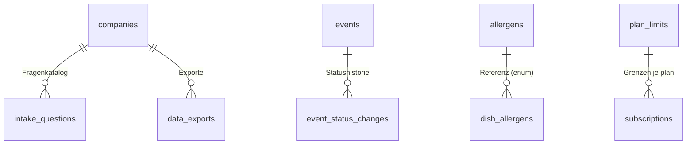
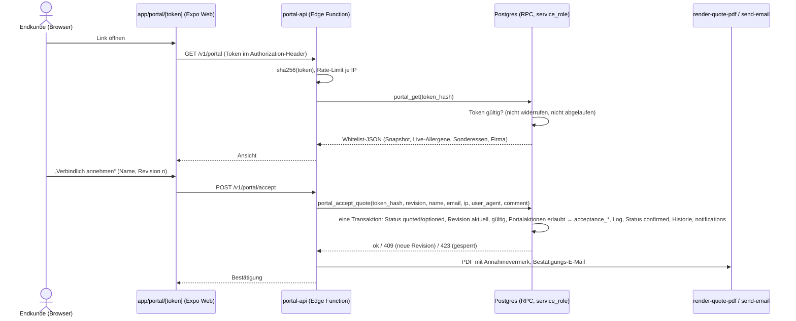

# 03 – Datenmodell (Supabase/Postgres)

Stand: 17.10.2026 · Grundlage: [00-entscheidungen.md](00-entscheidungen.md) (verbindlich), [01-produkt.md](01-produkt.md), [02-ablaeufe.md](02-ablaeufe.md)

**Lesehilfe**

- **Vorschlag** markiert eine begründete Empfehlung zu einem Punkt, den das Entscheidungsprotokoll offen lässt. Bis zur Bestätigung durch den Gründer gilt sie als Arbeitsannahme.
- Tabellen-, Enum-, Rollen- und Funktionsnamen folgen exakt dem Glossar. Tabellen außerhalb des Glossars stehen gesammelt in Abschnitt 3.7 und sind Vorschläge.
- Spaltennamen, die in 01/02 als Vorschlag genannt wurden, werden hier festgelegt. Abweichungen davon listet Abschnitt 10.
- Der SQL-Entwurf (Abschnitte 7 und 8) wurde lokal gegen PostgreSQL 16 mit nachgebildeten Supabase-Schemas (`auth.uid()`, `storage`, Rollen `anon`/`authenticated`/`service_role`) geladen und geprüft. Getestet wurden: Küche sieht keine Preise, Mandantentrennung, Spaltenschutz für Systemfelder, Lesemodus, Sichtbarkeit für `staff`, Überbuchung bei zwei parallelen Zusagen und Firmenlöschung per Kaskade.

**Inhalt**

0. Konventionen und Grundentscheidungen
1. ER-Diagramm
2. Enums
3. Tabellen
4. Row-Level-Security
5. Kundenportal-Zugriff
6. Abo-Durchsetzung
7. SQL-Entwurf
8. Storage-Buckets
9. Migrationen, Seed, Tests, Jobs
10. Abgleich mit 01/02 und offene Entscheidungen

---

## 0. Konventionen und Grundentscheidungen

| Thema | Festlegung | Begründung |
|---|---|---|
| Schema | Alle Fachtabellen in `public`; `auth`, `storage`, `extensions` werden nur referenziert | Standard für PostgREST und supabase-js |
| Namen | snake_case, Tabellen im Plural, Enum-Typen im Singular | Glossar |
| Primärschlüssel | `id uuid default gen_random_uuid()`; Verknüpfungstabellen mit zusammengesetztem PK | nicht erratbar; IDs können für Kopien clientseitig erzeugt werden |
| Mandant | Jede mandantenbezogene Tabelle hat `company_id uuid not null` → `companies` ON DELETE CASCADE | RLS filtert ohne Join; eine Firma lässt sich mit einem Statement löschen |
| Mandantenkonsistenz | Fremdschlüssel innerhalb eines Mandanten sind zusammengesetzt: `(company_id, x_id) → x (company_id, id)`. Jede referenzierte Tabelle hat dafür `unique (company_id, id)` | Die Datenbank verhindert Verweise über Firmengrenzen hinweg, auch bei einem Fehler in einer SECURITY-DEFINER-Funktion |
| Zeitpunkte | `timestamptz`. Reine Kalenderdaten ohne Uhrzeit (`valid_until`, `deposit_due_on`, `invoiced_on`, `valid_from`) als `date`. Fachlogik (Fristen, „heute“) in Europe/Berlin; `events.event_date` als generierte Spalte | Glossar |
| Geld | `integer` in Cent, auch Summen (bis 21,4 Mio. € je Feld) | Glossar |
| Prozentwerte | Basispunkte als `integer` (`700` = 7 %, `20000` = 200 % Aufschlag = Faktor 3,0) | ganzzahlig und rundungsfrei, wie 02 §3.1 |
| Mengen | `numeric(10,2)`; Menge pro Person `numeric(10,1)`; Wareneinsatz-Zwischenwerte `numeric(12,4)` | 02 §3.3, US-19.7 |
| Standardspalten | `created_at`, `updated_at` in jeder Tabelle; `updated_at` setzt der Trigger `set_updated_at()` | einheitlich, nötig für Offline-Stand und Konflikterkennung |
| Archivieren statt Löschen | `archived_at` bei Gerichten, Zutaten, Paketen, Qualifikationen, Steuersätzen, Fragen. Mitglieder werden nie hart gelöscht (`removed_at`) | Historie bleibt lesbar (US-07.4, US-21) |
| ON DELETE | **CASCADE** von `companies` und innerhalb eines Aggregats (Auftrag → Zeitplan, Sonderessen, Angebot, Slots, Portal-Tokens; Angebot → Positionen; Gericht → Allergene). **NO ACTION** für Verweise auf Stammdaten und Katalog (Kunde, Gericht, Paket, Zutat, Steuersatz, Qualifikation, Slot ← Bewerbung). **SET NULL (Spalte)** für optionale Verweise auf Mitglieder | NO ACTION statt RESTRICT: NO ACTION prüft erst am Ende des Statements, deshalb funktioniert die Firmenlöschung per Kaskade (getestet). `SET NULL (spalte)` (ab PG 15) setzt bei zusammengesetzten FKs nur die Verweisspalte, nicht `company_id` |
| Enums | Postgres-Enums für feste Wertelisten | typsichere generierte TS-Typen; Erweiterung per `alter type … add value` |
| `jsonb` | nur für Snapshots, Protokolle, Vorlagen, Antworten des Fragenkatalogs, Ersatzgerichte | keine relationale Abfrage nötig, außer in der Küchen-View (Snapshot-Positionen) |
| Rechenlogik | Beträge berechnet das gemeinsame TypeScript-Modul (02 §3). Die Datenbank speichert die Ergebnisse je Position und die Summen und prüft beim Versand die Konsistenz | eine Rechenquelle für App, Portal und PDF |

**Kürzel in Abschnitt 3**

- **[S]** = `id uuid` PK `default gen_random_uuid()` · `company_id uuid not null` → `companies(id)` ON DELETE CASCADE · `created_at timestamptz not null default now()` · `updated_at timestamptz not null default now()` (Trigger).
- **[S ohne id]** = wie [S], aber ohne `id` (Verknüpfungstabellen mit zusammengesetztem PK).
- **(c, x)** = zusammengesetzter Fremdschlüssel `(company_id, x)`.

---

## 1. ER-Diagramm

Alle Tabellen außer `companies` tragen `company_id` → `companies`. Aus Gründen der Lesbarkeit sind nur die fachlich wichtigen Kanten zu `companies` gezeichnet.

```mermaid
erDiagram
    auth_users ||--o| company_members : "user_id unique"
    companies ||--|{ company_members : "Mitglieder"
    companies ||--o{ invitations : "Einladungen"
    companies ||--|| subscriptions : "Abo"
    companies ||--o{ customers : "Kunden"
    companies ||--o{ tax_rates : "Steuersätze"
    companies ||--o{ qualifications : "Qualifikationen"
    companies ||--o{ dishes : "Gerichte"
    companies ||--o{ ingredients : "Zutaten"
    companies ||--o{ menu_packages : "Pakete"
    customers ||--o{ events : "beauftragt"
    events ||--o{ event_schedule_items : "Zeitplan"
    events ||--o{ event_dietary_requirements : "Sonderessen"
    events ||--o| quotes : "aktuelles Angebot"
    events ||--o{ portal_tokens : "Portal-Links"
    events ||--o{ shift_slots : "Slots"
    quotes ||--o{ quote_items : "Positionen"
    menu_packages |o--o{ quote_items : "Typ package"
    dishes |o--o{ quote_items : "Typ dish"
    tax_rates |o--o{ quote_items : "Steuersatz"
    tax_rates |o--o{ dishes : "Standardsatz"
    tax_rates |o--o{ menu_packages : "Standardsatz"
    dishes ||--o{ dish_allergens : "Allergene"
    dishes ||--o{ dish_ingredients : "Rezeptur"
    ingredients ||--o{ dish_ingredients : "verwendet in"
    menu_packages ||--o{ menu_package_dishes : "enthält"
    dishes ||--o{ menu_package_dishes : "Teil von"
    company_members ||--o{ member_qualifications : "besitzt"
    qualifications ||--o{ member_qualifications : "vergeben an"
    qualifications |o--o{ shift_slots : "erfordert"
    shift_slots ||--o{ shift_applications : "Bewerbungen"
    company_members ||--o{ shift_applications : "bewirbt sich"
    company_members ||--o{ push_tokens : "Geräte"
    company_members ||--o{ notifications : "empfängt"

    companies {
        uuid id PK
        text name
        text contact_email
        int shift_cancel_deadline_hours
        timestamptz deletion_requested_at
    }
    company_members {
        uuid id PK
        uuid company_id FK
        uuid user_id UK "auth.users"
        member_role role
        timestamptz removed_at
    }
    invitations {
        uuid id PK
        uuid company_id FK
        member_role role
        bytea token_hash UK
        timestamptz expires_at
    }
    subscriptions {
        uuid id PK
        uuid company_id FK, UK
        subscription_plan plan
        subscription_status status
        timestamptz writable_until
    }
    customers {
        uuid id PK
        uuid company_id FK
        customer_type type
        text name
        text email
    }
    events {
        uuid id PK
        uuid company_id FK
        uuid customer_id FK
        event_status status
        timestamptz starts_at
        int guest_count
    }
    event_schedule_items {
        uuid id PK
        uuid event_id FK
        schedule_item_kind kind
        timestamptz starts_at
    }
    event_dietary_requirements {
        uuid id PK
        uuid event_id FK
        int person_count
        diet_type diet
        text avoid_allergens "allergen[]"
    }
    quotes {
        uuid id PK
        uuid event_id FK, UK
        int revision
        quote_status status
        jsonb snapshot
        timestamptz accepted_at
    }
    quote_items {
        uuid id PK
        uuid quote_id FK
        quote_item_type type
        uuid menu_package_id FK
        uuid dish_id FK
        numeric quantity
        int unit_price_cents
        uuid tax_rate_id FK
        int sort_order
    }
    tax_rates {
        uuid id PK
        int rate_bp
        tax_category category
        date valid_from
    }
    dishes {
        uuid id PK
        text name
        int price_cents "nur admin"
        text diets "diet_type[]"
    }
    dish_allergens {
        uuid dish_id PK, FK
        allergen allergen PK
    }
    ingredients {
        uuid id PK
        text name
        ingredient_unit unit
        int price_cents "nur admin"
    }
    dish_ingredients {
        uuid dish_id PK, FK
        uuid ingredient_id PK, FK
        numeric quantity_per_person
    }
    menu_packages {
        uuid id PK
        text name
        int price_per_person_cents "nur admin"
    }
    menu_package_dishes {
        uuid menu_package_id PK, FK
        uuid dish_id PK, FK
        numeric portion_factor
    }
    qualifications {
        uuid id PK
        text name
    }
    member_qualifications {
        uuid member_id PK, FK
        uuid qualification_id PK, FK
    }
    shift_slots {
        uuid id PK
        uuid event_id FK
        uuid qualification_id FK
        timestamptz starts_at
        timestamptz ends_at
        int seats
    }
    shift_applications {
        uuid id PK
        uuid shift_slot_id FK
        uuid member_id FK
        application_status status
    }
    push_tokens {
        uuid id PK
        uuid member_id FK
        text expo_push_token UK
    }
    notifications {
        uuid id PK
        uuid member_id FK
        notification_category category
        timestamptz read_at
    }
    portal_tokens {
        uuid id PK
        uuid event_id FK
        bytea token_hash UK
        timestamptz expires_at
        timestamptz revoked_at
    }
```



Ergänzende Tabellen (Vorschlag, Abschnitt 3.7):



---

## 2. Enums

| Enum | Werte → Bedeutung | verwendet in |
|---|---|---|
| `member_role` | `admin` Admin/Inhaber · `kitchen` Küche · `staff` Service/Aushilfe | `company_members.role`, `invitations.role` |
| `event_status` | `inquiry` Anfrage · `quoted` Angebot versendet · `optioned` Optioniert · `confirmed` Bestätigt · `completed` Durchgeführt · `invoiced` Abgerechnet · `declined` Abgelehnt (Kunde lehnt Angebot ab) · `cancelled` Abgesagt (nach Option/Bestätigung storniert) | `events.status`, `event_status_changes` |
| `event_kind` | `event_catering` Event-Catering · `business_lunch` Business-/Office-Lunch | `events.kind` |
| `quote_status` | `draft` nie versendet (`revision = 0`) · `sent` aktuelle Revision versendet, noch nicht angenommen · `accepted` aktuelle Revision angenommen · `declined` abgelehnt | `quotes.status` |
| `quote_item_type` | `package` Menüpaket p. P. · `dish` Einzelgericht · `service` Personal · `equipment` Equipment-Miete · `travel` Anfahrt/Pauschale · `beverage` Getränkepauschale · `custom` frei | `quote_items.type` |
| `quantity_mode` | `per_guest` Menge folgt der Gästezahl · `fixed` feste Menge | `quote_items.quantity_mode` |
| `pricing_mode` | `flat` Pauschalpreis pro Person · `cost_based` Wareneinsatz + Aufschlag | `quotes.pricing_mode`, `companies.default_pricing_mode` |
| `price_basis` | `net` · `gross` | `companies.price_entry_mode` (Eingabeart), `quotes.price_display` (Anzeige) |
| `acceptance_channel` | `portal` Annahme im Portal · `portal_change` Kundenänderung im Portal gilt als angenommen (02 §4.2) · `admin` manuell erfasst · `info_only` Revision „Zur Info“ versendet (01 US-36.3) | `quotes.acceptance_channel` |
| `application_status` | `applied` beworben · `accepted` vom Admin zugesagt · `rejected` vom Admin abgesagt bzw. ausgeplant · `withdrawn` Bewerber zieht zurück · `cancelled_by_staff` Absage nach Zusage · `assigned` direkt durch Admin eingeplant | `shift_applications.status` |
| `allergen` | 14 Pflichtallergene, siehe Tabelle unten | `dish_allergens.allergen`, `event_dietary_requirements.avoid_allergens`, `allergens.code` |
| `diet_type` | `vegetarian` vegetarisch · `vegan` vegan · `halal` halal · `kosher` koscher · `gluten_free` glutenfrei · `lactose_free` laktosefrei | `dishes.diets`, `event_dietary_requirements.diet` |
| `dish_category` | `starter` Vorspeise · `soup` Suppe · `main` Hauptgang · `side` Beilage · `dessert` Dessert · `finger_food` Fingerfood · `beverage` Getränk · `other` Sonstiges | `dishes.category` |
| `ingredient_unit` | `g` · `ml` · `piece` Stück (Basiseinheit; Preis je kg, l bzw. Stück) | `ingredients.unit` |
| `tax_category` | `food` Speisen · `beverage` Getränke · `service` Personal · `equipment` Equipment-Miete · `travel` Anfahrt · `other` Sonstiges | `tax_rates.category` |
| `country_code` | `DE` · `AT` · `CH` (AT/CH vorbereitet, nicht aktivierbar) | `companies`, `customers`, `events`, `tax_rates` |
| `customer_type` | `business` geschäftlich (Anzeige netto) · `private` privat (Anzeige brutto) | `customers.type` |
| `schedule_item_kind` | `departure` Abfahrt · `setup` Aufbau · `service` Ausgabe · `teardown` Abbau · `delivery` Lieferung · `other` Sonstiges | `event_schedule_items.kind` |
| `dietary_source` | `customer` aus dem Portal · `internal` von Admin/Küche | `event_dietary_requirements.source` |
| `subscription_plan` | `start` · `team` · `profi` · `pilot` (intern, ohne Kosten und Ablauf, US-55.7) | `subscriptions.plan`, `plan_limits.plan` |
| `subscription_status` | Stripe-Status `trialing`, `active`, `past_due`, `canceled`, `unpaid`, `incomplete`, `incomplete_expired`, `paused`. Die App-Testphase ohne Stripe nutzt ebenfalls `trialing` | `subscriptions.status` |
| `push_platform` | `ios` · `android` | `push_tokens.platform` |
| `push_status` | `pending` · `sent` · `failed` · `skipped` (Kategorie abgeschaltet / kein Gerät) | `notifications.push_status` |
| `notification_category` | `application_received`, `application_decided`, `assignment_created`, `assignment_cancelled`, `slots_published`, `shift_changed`, `shift_called_off`, `shift_reminder`, `quote_accepted`, `quote_declined`, `quote_viewed`, `portal_change`, `dietary_changed`, `event_confirmed`, `event_cancelled`, `guest_count_changed`, `option_expiring`, `quote_expired`, `completion_due`, `slots_unfilled`, `member_joined`, `billing` (Zuordnung zu 01 §4.2.5; abschaltbar je Kategorie über `company_members.notification_prefs`) | `notifications.category` |
| `intake_answer_type` | `single_choice` · `multi_choice` · `number` · `date` · `time` · `datetime` · `text` · `boolean` | `intake_questions.answer_type` |
| `intake_target` | `customer` · `event_kind` · `occasion` · `starts_at` · `ends_at` · `guest_count` · `venue` · `dietary_requirements` · `kitchen_notes` · `staff_notes` · `customer_reference` (null = Antwort wird Notiz) | `intake_questions.target` |

**Die 14 Pflichtallergene** (LMIV Anhang II; Kurzcodes nach dem österreichischen Schema, 01 §4.2.6)

| `allergen` | Code | Bezeichnung |
|---|---|---|
| `gluten` | A | Glutenhaltiges Getreide |
| `crustaceans` | B | Krebstiere |
| `eggs` | C | Eier |
| `fish` | D | Fisch |
| `peanuts` | E | Erdnüsse |
| `soybeans` | F | Soja |
| `milk` | G | Milch (einschließlich Laktose) |
| `nuts` | H | Schalenfrüchte |
| `celery` | L | Sellerie |
| `mustard` | M | Senf |
| `sesame` | N | Sesamsamen |
| `sulphites` | O | Schwefeldioxid und Sulfite |
| `lupin` | P | Lupinen |
| `molluscs` | R | Weichtiere |

**Positionstyp → Steuerkategorie** (Standard je Position, änderbar; 02 §2.2)

| `quote_item_type` | `package`, `dish` | `beverage` | `service` | `equipment` | `travel` | `custom` |
|---|---|---|---|---|---|---|
| `tax_category` | `food` | `beverage` | `service` | `equipment` | `travel` | `other` (wählbar) |

---

## 3. Tabellen

### 3.1 Mandant und Team

#### `companies`

Mandant: Stammdaten, Branding und Firmeneinstellungen. Die Tabelle ist selbst der Mandant und hat daher kein `company_id`.

| Spalte | Typ | Null / Default | Beschreibung |
|---|---|---|---|
| `id` | uuid | PK, `gen_random_uuid()` | |
| `name` | text | not null, 1–120 Zeichen | Firmenname, zugleich Absendername der E-Mails |
| `street`, `postal_code`, `city` | text | null | Anschrift; vor dem ersten Versand Pflicht (02 §2.3) |
| `country` | country_code | not null, `'DE'` | `create_company()` lässt nur `DE` zu |
| `phone` | text | null | im Portal und bei „Absage nur telefonisch“ |
| `contact_email` | text | not null, Formatprüfung | Reply-To aller Kunden-E-Mails |
| `website`, `vat_id`, `tax_number`, `footer_text`, `privacy_policy_url` | text | null | PDF-Kopf/-Fuß, Portal (US-03.1) |
| `logo_path` | text | null | Pfad im Bucket `logos` |
| `accent_color` | text | null, `^#[0-9A-Fa-f]{6}$` | Akzentfarbe für Portal, PDF, E-Mail |
| `price_entry_mode` | price_basis | not null, `'net'` | Eingabeart der Preise (02 §3.6) |
| `default_pricing_mode` | pricing_mode | not null, `'flat'` | Vorbelegung `quotes.pricing_mode` |
| `default_markup_bp` | integer | not null, `20000` | Aufschlag auf den Wareneinsatz (200 % = Faktor 3,0) |
| `price_rounding_cents` | integer | not null, `10`, ∈ {1, 10, 50, 100} | Preisraster für den Preisvorschlag; `1` = kein Raster |
| `is_small_business` | boolean | not null, `false` | Kleinunternehmer: keine USt, Hinweistext (**Vorschlag** aus 02 §3.5) |
| `quote_validity_days` | integer | not null, `14` | Vorbelegung `quotes.valid_until` |
| `portal_change_lead_hours` | integer | `72`; null = kein Änderungsschluss | Vorbelegung `events.changes_until` |
| `portal_token_ttl_days` | integer | not null, `60` | Portal-Link gültig bis Eventende + n Tage |
| `shift_cancel_deadline_hours` | integer | not null, `48`, 0–168 | Absagefrist der Schichtbörse |
| `shopping_buffer_bp` | integer | not null, `500` | Puffer der Einkaufsliste (5 %) |
| `quote_intro_text`, `quote_terms_text`, `quote_closing_text` | text | null | Standardtexte für neue Angebote |
| `quote_item_templates` | jsonb | not null, `'[]'` | Vorlagen für Zusatzpositionen: `[{type, name, unit_label, unit_price_cents, quantity_mode, hours}]` („Servicekraft 32,00 €/h“, „Anfahrt“, „Getränkepauschale“) |
| `quote_number_year`, `quote_number_seq` | integer | null / `0` | Zähler für die Angebotsnummer `A-JJJJ-NNNN` (Trigger) |
| `avv_accepted_at`, `avv_accepted_by` | timestamptz / uuid | null | Annahme des AVV (US-62.1) |
| `created_by` | uuid | null | Nutzer, der die Firma angelegt hat |
| `deletion_requested_at` | timestamptz | null | gesetzt = Löschung beantragt; ab sofort liefern die `auth_*`-Funktionen null, damit hat niemand mehr Zugriff (US-60.2) |
| `created_at`, `updated_at` | timestamptz | not null, `now()` | |

- **FK:** `avv_accepted_by`, `created_by` → `auth.users(id)` ON DELETE SET NULL.
- **Lesen:** nur `admin` direkt. Alle anderen Rollen lesen die View `company_profile` (ohne Preis-Vorlagen und Kalkulationswerte).

#### `company_members`

Mitgliedschaft eines Nutzers. Verknüpft `auth.users` 1:1 mit genau einer Firma.

| Spalte | Typ | Null / Default | Beschreibung |
|---|---|---|---|
| [S] | | | |
| `user_id` | uuid | null, **unique** | → `auth.users(id)` ON DELETE SET NULL. Beim Entfernen oder bei Kontolöschung auf null gesetzt; dadurch kann derselbe Nutzer später einer anderen Firma beitreten |
| `role` | member_role | not null | Änderung nur über `set_member_role()` |
| `display_name` | text | not null, 1–80 Zeichen | Name in Teamliste, Schichten, Historie |
| `phone` | text | null | Teamliste, Ansprechpartner |
| `login_email` | text | null | Login-E-Mail beim Beitritt (Anzeige für Admin, US-06.3) |
| `notification_prefs` | jsonb | not null, `'{}'` | `{category: boolean}` für abschaltbare Kategorien |
| `ical_token_hash` | bytea | null, unique | SHA-256 des persönlichen iCal-Tokens; „Link zurücksetzen“ ersetzt ihn |
| `joined_at` | timestamptz | not null, `now()` | |
| `removed_at` | timestamptz | null | gesetzt = entfernt bzw. Firma verlassen |
| `removed_reason` | text | null | `removed_by_admin`, `left`, `account_deleted` |

- **Aktiv** = `user_id is not null and removed_at is null`.
- **Unique:** `user_id` (ein Nutzer, eine Firma); `(company_id, id)`.
- **Index:** `(company_id, role) where removed_at is null`.
- **Regeln:** Der letzte aktive `admin` kann weder herabgestuft noch entfernt werden (Prüfung in `set_member_role()`/`remove_member()` plus Trigger als Sicherung, **Vorschlag**). Beim Entfernen: `removed_at`, `user_id = null`, `ical_token_hash = null`, Push-Tokens löschen, Bewerbungen nach US-07.3. Bei Kontolöschung zusätzlich `display_name = 'Ehemaliges Mitglied'`, `phone`/`login_email = null` (US-08.1).

#### `invitations`

Einladung mit vorab festgelegter Firma, Rolle und Qualifikationen.

| Spalte | Typ | Null / Default | Beschreibung |
|---|---|---|---|
| [S] | | | |
| `email` | text | null | Ziel-E-Mail; null bei „Link teilen“ (US-05.2) |
| `display_name` | text | not null | vorgesehener Name |
| `role` | member_role | not null | |
| `qualification_ids` | uuid[] | not null, `'{}'` | werden bei der Annahme in `member_qualifications` übernommen; `accept-invitation` prüft, ob sie noch existieren |
| `token_hash` | bytea | not null, unique | SHA-256 des Einladungstokens (32 Byte Zufall, base64url) |
| `expires_at` | timestamptz | not null | Anlage + 7 Tage |
| `invited_by_member_id` | uuid | null | (c, …) → `company_members` SET NULL |
| `last_sent_at` | timestamptz | null | |
| `accepted_at`, `accepted_member_id` | timestamptz / uuid | null | `accepted_member_id`: (c, …) → `company_members` SET NULL |
| `revoked_at` | timestamptz | null | |

- **Status** wird berechnet: widerrufen → angenommen → abgelaufen (`expires_at < now()`) → offen.
- **„Erneut senden“** erzeugt einen neuen Token und eine neue Frist; der alte Link wird ungültig (nur der Hash ist gespeichert).
- **Unique:** `token_hash`; `(company_id, lower(email)) where accepted_at is null and revoked_at is null and email is not null` (keine doppelten offenen Einladungen).
- **Index:** `(company_id, created_at desc)`.
- Das Mitgliederlimit zählt aktive Mitglieder plus offene, nicht abgelaufene Einladungen (US-05.4).

#### `subscriptions`

Aktueller Abo-Zustand je Firma (eine Zeile pro Firma). Die Historie liegt bei Stripe.

| Spalte | Typ | Null / Default | Beschreibung |
|---|---|---|---|
| [S] | | | `company_id` zusätzlich **unique** |
| `plan` | subscription_plan | not null, `'profi'` | gebuchte Stufe; in der Testphase `profi` |
| `status` | subscription_status | not null, `'trialing'` | gespiegelt aus Stripe |
| `billing_interval` | text | null, `month`/`year` | |
| `stripe_customer_id`, `stripe_subscription_id` | text | null, unique | |
| `stripe_price_id` | text | null | |
| `trial_ends_at` | timestamptz | null | Tag 14, 23:59:59 Europe/Berlin |
| `current_period_end` | timestamptz | null | |
| `cancel_at_period_end` | boolean | not null, `false` | |
| `canceled_at`, `payment_failed_at` | timestamptz | null | `payment_failed_at` startet die 14-Tage-Kulanz |
| `writable_until` | timestamptz | not null | **einzige Quelle** für `company_is_writable()`; Regeln in Abschnitt 6.1 |
| `last_stripe_event_id`, `last_stripe_event_at` | text / timestamptz | null | Idempotenz des `stripe-webhook` |

- **Schreiben:** nur `service_role` (`stripe-webhook`, `create_company()`). `admin` liest; alle anderen sehen `is_writable` und `effective_plan` über `company_profile`.

### 3.2 Kunden und Aufträge

#### `customers`

| Spalte | Typ | Null / Default | Beschreibung |
|---|---|---|---|
| [S] | | | |
| `type` | customer_type | not null, `'private'` | bestimmt die Standard-Preisanzeige im Angebot |
| `name` | text | not null | Person oder Firmenname |
| `contact_person`, `email`, `phone` | text | null | E-Mail wird erst beim E-Mail-Versand Pflicht |
| `billing_street`, `billing_postal_code`, `billing_city` | text | null | Rechnungsanschrift |
| `billing_country` | country_code | null | |
| `vat_id` | text | null | USt-IdNr. bei Geschäftskunden |
| `notes` | text | null | interne Notiz |
| `anonymized_at` | timestamptz | null | gesetzt durch `anonymize_customer()`: Name → „Anonymisierter Kunde“, Kontakt- und Rechnungsfelder sowie Notiz null, Gastnamen der Sonderessen null, alle Portal-Tokens widerrufen (US-61.2) |

- **Unique:** `(company_id, id)`.
- **Indizes:** `(company_id, lower(email)) where email is not null` für die Duplikatwarnung; GIN-Trigramm auf `name` für die Suche ab 2 Zeichen.
- **Löschen** nur ohne Aufträge (Policy); sonst Anonymisierung.

#### `events`

Auftrag (Event-Catering oder Business-Lunch) mit Status, Termin, Ort und Hinweisen.

| Spalte | Typ | Null / Default | Beschreibung |
|---|---|---|---|
| [S] | | | |
| `customer_id` | uuid | not null | (c, …) → `customers` NO ACTION |
| `kind` | event_kind | not null, `'event_catering'` | |
| `title` | text | not null, 1–120 Zeichen | **Vorschlag:** Pflicht in der DB, die App belegt vor („Hochzeit 12.06.2027“). Eingeplantes Personal sieht den Titel; so entsteht nie ein Fallback mit Kundennamen |
| `occasion` | text | null | Anlass (Fragenkatalog), z. B. „Hochzeit“ |
| `status` | event_status | not null, `'inquiry'` | nur über `set_event_status()` änderbar (Spaltenprivileg) |
| `starts_at` | timestamptz | not null | Beginn |
| `ends_at` | timestamptz | null, `> starts_at` | Ende; „18:00–02:00“ wird als Folgetag gespeichert |
| `event_date` | date | generiert: `(starts_at at time zone 'Europe/Berlin')::date` | Kalender, „am selben Tag“-Hinweis, Tagesansicht |
| `guest_count` | integer | null, ≥ 1 | Gästezahl `G` |
| `venue_name`, `street`, `postal_code`, `city` | text | null | Ort. `staff` sieht vor der Zusage nur `postal_code` + `city` |
| `country` | country_code | not null, `'DE'` | |
| `is_pickup` | boolean | not null, `false` | Abholung statt Lieferung |
| `onsite_contact_name`, `onsite_contact_phone` | text | null | Ansprechpartner vor Ort |
| `meeting_point`, `dress_code`, `staff_notes` | text | null | Hinweise fürs Personal (Slot kann überschreiben) |
| `kitchen_notes` | text | null | Hinweise für die Küche |
| `internal_notes` | text | null | nur `admin`; nimmt auch Antworten des Fragenkatalogs ohne Feldzuordnung auf |
| `option_expires_at` | timestamptz | null | „optioniert bis“ (Ende des gewählten Tages in Europe/Berlin); nur in `optioned` erlaubt (Check) |
| `changes_until` | timestamptz | null | Änderungsschluss im Portal; vorbelegt aus `companies.portal_change_lead_hours` |
| `portal_locked` | boolean | not null, `false` | Portal-Änderungen gesperrt |
| `cancellation_agreement` | text | null | Freitext „Stornovereinbarung“ (02 §1.1) |
| `invoice_reference`, `invoiced_on` | text / date | null | externe Rechnungsnummer und -datum bis zum Rechnungsmodul |
| `intake_answers` | jsonb | not null, `'[]'` | Antworten des Angebots-Chats: `[{question_id, prompt, answer, target, answered_at}]`; `prompt` als Kopie, weil Fragen sich ändern |
| `copied_from_event_id` | uuid | null | (c, …) → `events` SET NULL (Spalte) |
| `created_by_member_id` | uuid | null, Default `auth_member_id()` | (c, …) → `company_members` SET NULL (Spalte) |

- **Unique:** `(company_id, id)`.
- **Checks:** `ends_at > starts_at`; `option_expires_at is null or status = 'optioned'`.
- **Indizes:** `(company_id, starts_at)` Kalender; `(company_id, status, event_date)` Listen und Tagesansicht; `(customer_id)`; GIN-Trigramm auf `title`.
- **Trigger (Vorschlag):** Ändert sich `starts_at`/`ends_at`, werden `portal_tokens.expires_at` der aktiven Tokens neu berechnet.
- **Löschen** („Anfrage verwerfen“) nur im Status `inquiry` und ohne versendete Revision (Policy).

#### `event_schedule_items`

Zeitplan eines Auftrags (Abfahrt, Aufbau, Ausgabe, Abbau …).

| Spalte | Typ | Null / Default | Beschreibung |
|---|---|---|---|
| [S] | | | |
| `event_id` | uuid | not null | (c, …) → `events` CASCADE |
| `kind` | schedule_item_kind | not null | |
| `label` | text | null | eigene Bezeichnung, v. a. bei `other` |
| `starts_at` | timestamptz | not null | darf vor dem Eventbeginn liegen (US-14.5) |
| `ends_at` | timestamptz | null, `> starts_at` | |
| `notes` | text | null | |

- **Index:** `(event_id, starts_at)`.
- **Lesen:** `admin`; `kitchen` ab `optioned`; `staff` nur mit eigenem Einsatz (`can_read_event()`). Im Portal nicht sichtbar.

#### `event_dietary_requirements`

Sonderessen und Allergien je Auftrag. Gesundheitsdaten im Sinne von Art. 9 DSGVO.

| Spalte | Typ | Null / Default | Beschreibung |
|---|---|---|---|
| [S] | | | |
| `event_id` | uuid | not null | (c, …) → `events` CASCADE |
| `person_count` | integer | not null, ≥ 1 | Anzahl Personen |
| `diet` | diet_type | null | Diätform |
| `avoid_allergens` | allergen[] | not null, `'{}'` | zu meidende Allergene |
| `guest_name` | text | null | optional; wird 30 Tage nach Eventende gelöscht |
| `table_label` | text | null | Tisch; ebenso gelöscht |
| `note` | text | null | Freitext |
| `substitutions` | jsonb | not null, `'[]'` | Ersatzgerichte `[{from_dish_id, to_dish_id}]` (mehrere Paare je Eintrag, US-38.3); Firmenzugehörigkeit der IDs prüft die schreibende Funktion |
| `source` | dietary_source | not null | `customer` (Portal) oder `internal` |
| `is_short_notice` | boolean | not null, `false` | nach dem Änderungsschluss erfasst → nicht abschaltbarer Push (US-40.3) |
| `created_by_member_id` | uuid | null | (c, …) → `company_members` SET NULL (Spalte) |
| `portal_author_name` | text | null | Name aus dem Portal-Dialog |
| `personal_data_purged_at` | timestamptz | null | Zeitpunkt der automatischen Löschung von `guest_name`/`table_label` |

- **Check:** `diet is not null or cardinality(avoid_allergens) > 0 or note is not null`.
- **Trigger (Vorschlag):** Summe `person_count` je Auftrag ≤ `events.guest_count` (US-35.3, US-40.4); `is_short_notice` automatisch, wenn `now() > events.changes_until`.
- **Index:** `(event_id)`.
- **Schreiben:** `admin`, `kitchen` (ab `optioned`), Portal über `portal-api`.

### 3.3 Angebote und Steuern

#### `quotes`

Genau ein aktuelles Angebot je Auftrag. Es besteht aus dem bearbeitbaren Live-Stand (`quotes` + `quote_items`) und dem eingefrorenen Snapshot der aktuellen Revision.

| Spalte | Typ | Null / Default | Beschreibung |
|---|---|---|---|
| [S] | | | |
| `event_id` | uuid | not null, **unique** | (c, …) → `events` CASCADE |
| `number` | text | not null | `A-JJJJ-NNNN` je Firma fortlaufend (Trigger `assign_quote_number`, race-sicher über Zeilensperre auf `companies`); Revision als Zusatz `R2` nur in der Anzeige |
| `status` | quote_status | not null, `'draft'` | |
| `revision` | integer | not null, `0` | 0 = nie versendet; +1 je Versand und je Portal-Änderung |
| `pricing_mode` | pricing_mode | not null, `'flat'` | Kalkulationsart des Angebots |
| `markup_bp` | integer | not null, `20000` | Aufschlag des Angebots (überschreibbar je Position) |
| `price_display` | price_basis | not null, `'gross'` | Anzeige netto/brutto; bei Anlage aus `customers.type` vorbelegt, umschaltbar |
| `discount_bp` / `discount_cents` | integer | not null, `0` | Gesamtrabatt in % oder als Betrag; höchstens eines ≠ 0 (Check) |
| `deposit_bp` / `deposit_cents` | integer | null | Anzahlung in % vom Brutto oder als Betrag; höchstens eines gesetzt |
| `deposit_due_on` | date | null | Fälligkeit der Anzahlung |
| `customer_reference` | text | null | „Ihre Referenz“ (Bestellnummer/Kostenstelle) |
| `intro_text`, `terms_text`, `closing_text` | text | null | Einleitung, Konditionen (Zahlung, Anzahlung, Storno), Schlusstext |
| `valid_until` | date | null | „Gültig bis“; maßgeblich ist der Live-Wert, damit „Gültigkeit verlängern“ ohne neue Revision wirkt (US-26.4) |
| `total_net_cents`, `total_tax_cents`, `total_gross_cents` | integer | not null, `0` | Summen des Live-Stands (TS-Modul) |
| `cost_total_cents` | integer | null | Wareneinsatz gesamt (nur `admin`) |
| `cost_incomplete` | boolean | not null, `false` | „Wareneinsatz unvollständig“ |
| `has_unsent_changes` | boolean | not null, `false` | Banner „Änderungen nicht versendet“ |
| `snapshot` | jsonb | null; gesetzt genau dann, wenn `revision > 0` | eingefrorener Stand der aktuellen Revision (Format unten) |
| `snapshot_hash` | text | null | SHA-256 (hex) über `snapshot::text` (jsonb-Textausgabe ist kanonisch sortiert) |
| `sent_at` | timestamptz | null | letzter Versand |
| `sent_via` | text | null, `email`/`link`/`internal` | `link` = „Link kopieren“; `internal` = Snapshot ohne Versand (z. B. Portal-Änderung) |
| `send_mode` | text | null, `confirm_required`/`info_only` | Versandart bei `confirmed` (01 US-36.3) |
| `email_status` | text | null, `pending`/`sent`/`failed`/`bounced` | Ergebnis von `send-email` |
| `first_viewed_at`, `last_viewed_at` | timestamptz | null | Portal-Aufrufe der aktuellen Revision |
| `accepted_at` | timestamptz | null | Serverzeit der letzten Annahme |
| `acceptance_revision` | integer | null, ≤ `revision` | angenommene Revision; `< revision` = „Version n noch nicht bestätigt“ |
| `acceptance_name`, `acceptance_email` | text | null | eingegebener Name und E-Mail |
| `acceptance_ip` | inet | null | IP aus dem Request-Header (Edge Function) |
| `acceptance_user_agent` | text | null | |
| `acceptance_snapshot_hash` | text | null | Hash des angenommenen Snapshots |
| `acceptance_total_gross_cents` | integer | null | Bruttosumme bei Annahme |
| `acceptance_channel` | acceptance_channel | null | |
| `acceptance_note` | text | null | bei `admin`: Bestätigungsweg (Telefon, E-Mail, persönlich); Kommentar des Kunden |
| `acceptance_member_id` | uuid | null | (c, …) → `company_members` SET NULL (Spalte) |
| `acceptance_portal_token_id` | uuid | null | (c, …) → `portal_tokens` SET NULL (Spalte) |
| `acceptance_log` | jsonb | not null, `'[]'` | alle Annahmen aller Revisionen, nur anhängen |
| `declined_at`, `decline_reason`, `decline_comment` | timestamptz / text / text | null | Ablehnung mit Grund aus der Auswahlliste |
| `change_log` | jsonb | not null, `'[]'` | Änderungsprotokoll, nur anhängen |
| `pending_change` | jsonb | null | offener Änderungswunsch; nur nötig, falls die Variante „Änderungswunsch“ aus 01 gilt (Abschnitt 10) |
| `editor_active_seconds` | integer | not null, `0` | aktive Editorzeit für Kennzahl K-01 |

- **Unique:** `event_id`; `(company_id, number)`; `(company_id, id)`.
- **Checks:** ein Rabatt-Typ; eine Anzahlungsart; `(revision = 0) = (snapshot is null)`; Annahmefelder vollständig.
- **Status-Semantik:** `draft` ⇔ `revision = 0`. `send_quote()` setzt `sent`. Eine Annahme setzt `accepted` mit `acceptance_revision = revision`. Eine neue Revision nach einer Annahme setzt wieder `sent`; die frühere Annahme bleibt in `accepted_at`/`acceptance_log` erhalten. Bei `info_only` gilt die neue Revision sofort als angenommen (`acceptance_channel = 'info_only'`).
- **Systemfelder** (`status`, `revision`, `snapshot*`, `sent_*`, `accepted_at`, `acceptance_*`, `declined_*`, `*_log`, `pending_change`, `number`) sind für `authenticated` nicht direkt schreibbar (Spaltenprivileg, Abschnitt 4.4).

**Snapshot-Format** (`schema_version` 1; enthält keine Kalkulationsdaten und ist damit für Portal und PDF geeignet)

```json
{
  "schema_version": 1,
  "revision": 2,
  "frozen_at": "2027-05-02T18:21:07+02:00",
  "source": "admin_send",
  "company": { "name": "Krügers Tafelküche", "logo_path": "…/logo-3f2a.png", "accent_color": "#1F6F5C",
               "street": "…", "postal_code": "…", "city": "…", "phone": "…", "contact_email": "…",
               "vat_id": "…", "footer_text": "…", "is_small_business": false },
  "customer": { "type": "private", "name": "Julia & Murat …", "billing_address": "…" },
  "event": { "title": "Hochzeit 12.06.2027", "kind": "event_catering", "starts_at": "…", "ends_at": "…",
             "guest_count": 80, "venue": "…", "option_expires_at": null },
  "quote": { "number": "A-2027-0042", "price_display": "gross", "valid_until": "2027-05-16",
             "customer_reference": null, "intro_text": "…", "terms_text": "…", "closing_text": "…",
             "deposit": { "bp": 3000, "cents": null, "due_on": "2027-05-31" } },
  "items": [
    { "id": "…", "type": "package", "sort_order": 1, "name": "Menü Klassik", "description": "…",
      "menu_package_id": "…", "dish_id": null, "quantity": 80, "quantity_mode": "per_guest",
      "unit_label": "Person", "hours": null, "unit_price_cents": 3900, "discount_bp": 0,
      "tax_rate_bp": 700, "line_net_cents": 291589, "line_tax_cents": 20411, "line_gross_cents": 312000,
      "choice_group": "menu", "is_selected": true, "is_heading": false,
      "allergens": ["celery", "milk", "sulphites"], "diets": [],
      "package_dishes": [ { "dish_id": "…", "name": "Rinderschmorbraten", "portion_factor": 1.0,
                            "allergens": ["celery", "sulphites"], "diets": [] } ] }
  ],
  "totals": { "net_before_discount_cents": 291589, "discount_cents": 0, "net_cents": 291589,
              "tax": [ { "rate_bp": 700, "base_cents": 291589, "tax_cents": 20411 } ],
              "gross_cents": 312000 }
}
```

- `send_quote()` baut den Snapshot in SQL aus `quotes`, `quote_items`, Firma, Kunde und Auftrag zusammen und rechnet nichts neu. Vorher prüft die Funktion: Σ Positionsbeträge = Kopfsummen, Prüfregeln aus 02 §2.3, `expected_updated_at` (Schutz vor Doppelklick, US-27.5).
- Allergene zeigen Portal und Küche **live** aus `dish_allergens`, nicht aus dem Snapshot (01 US-18.7: Sicherheit geht vor Snapshot). Das versendete PDF bleibt unverändert.
- `change_log`-Eintrag: `{at, revision, source: "portal"|"admin", name, ip, user_agent, changes: [{field, from, to}]}`.
- `acceptance_log`-Eintrag: `{at, revision, channel, name, email, ip, user_agent, snapshot_hash, total_gross_cents, member_id, portal_token_id, note}`.

#### `quote_items`

Positionen des Live-Stands. Werte aus Katalog und Paket werden beim Hinzufügen kopiert.

| Spalte | Typ | Null / Default | Beschreibung |
|---|---|---|---|
| [S] | | | |
| `quote_id` | uuid | not null | (c, …) → `quotes` CASCADE |
| `type` | quote_item_type | not null | |
| `sort_order` | integer | not null, `0` | Reihenfolge (Drag & Drop) |
| `menu_package_id` | uuid | null; Pflicht genau bei `package` | (c, …) → `menu_packages` NO ACTION |
| `dish_id` | uuid | null; Pflicht genau bei `dish` | (c, …) → `dishes` NO ACTION |
| `name`, `description` | text | `name` not null | Kopie aus dem Katalog, frei änderbar |
| `unit_label` | text | not null, `'Person'` | „Person“, „Portion“, „Std.“, „pauschal“ |
| `quantity_mode` | quantity_mode | not null, `'fixed'` | `per_guest` = Menge folgt `events.guest_count` |
| `quantity` | numeric(10,2) | not null, `1`, ≥ 0 | Menge `q`; bei `service` die Anzahl der Personen |
| `hours` | numeric(5,2) | null, > 0, 0,25er-Schritte | nur bei `service` |
| `unit_price_cents` | integer | null nur bei Überschrift, ≥ 0 | Einzelpreis `p` in der Eingabeart der Firma; **keine negativen Preise** (Rabatte über `discount_*`, 02 §3.6) |
| `price_is_manual` | boolean | not null, `false` | manuell überschrieben; bleibt bei Moduswechsel erhalten (US-24.3) |
| `markup_bp` | integer | null | Aufschlag-Überschreibung je Position |
| `unit_cost` | numeric(12,4) | null, ≥ 0 | Wareneinsatz je Einheit in Cent (Bruchteile); nur `admin` |
| `discount_bp` | integer | not null, `0` | Positionsrabatt |
| `tax_rate_id` | uuid | null | (c, …) → `tax_rates` NO ACTION; vor dem Versand Pflicht |
| `line_net_cents`, `line_tax_cents`, `line_gross_cents` | integer | null | Ergebnis des TS-Moduls |
| `choice_group` | text | null | Wahlgruppe für Alternativen (Menüwahl im Portal) |
| `is_selected` | boolean | not null, `true` | genau eine Position je Wahlgruppe ist gewählt (Prüfung beim Speichern/Versand) |
| `customer_can_edit_quantity` | boolean | not null, `false` | Kunde darf die Menge ändern (01 US-33.4, **Vorschlag**) |
| `is_heading` | boolean | not null, `false` | Zwischenüberschrift (`custom` ohne Preis) |

- **Checks:** `(type = 'package') = (menu_package_id is not null)`; `(type = 'dish') = (dish_id is not null)`; `hours` nur bei `service`; Überschrift nur als `custom` ohne Preis.
- **Indizes:** `(quote_id, sort_order)`; `(dish_id)` und `(menu_package_id)` partiell (Verwendungsprüfung beim Archivieren/Löschen); `(tax_rate_id)`.
- **Küche** liest Positionen nie direkt, sondern über `kitchen_production_lines` (ohne Preise).

#### `tax_rates`

| Spalte | Typ | Null / Default | Beschreibung |
|---|---|---|---|
| [S] | | | |
| `name` | text | not null | „Speisen 7 %“ |
| `rate_bp` | integer | not null, 0–10000 | 700 = 7,00 % |
| `category` | tax_category | not null | |
| `country` | country_code | not null, `'DE'` | |
| `valid_from` | date | not null, `2000-01-01` | maßgeblich ist der Satz am Leistungsdatum `events.event_date` (02 §3.5) |
| `is_default` | boolean | not null, `false` | Standard je Kategorie |
| `reviewed_at` | timestamptz | null | „Von mir geprüft“ im Setup |
| `archived_at` | timestamptz | null | deaktiviert |

- **Unique:** `(company_id, country, category, valid_from) where is_default and archived_at is null`.
- **Standardwahl je Position:** Kategorie aus dem Positionstyp (Abschnitt 2) → aktiver Standardsatz mit dem größten `valid_from ≤ event_date`.
- **Trigger (Vorschlag):** `rate_bp` ist nicht mehr änderbar, sobald `quote_items` den Satz verwenden (US-04.3); stattdessen neuen Satz anlegen und den alten archivieren.
- Nur `admin`.

### 3.4 Katalog

#### `dishes`

| Spalte | Typ | Null / Default | Beschreibung |
|---|---|---|---|
| [S] | | | |
| `name` | text | not null, 1–120 Zeichen | gleicher Name nur mit Warnung (kein Unique) |
| `description` | text | null | Text für das Angebot |
| `category` | dish_category | not null, `'main'` | |
| `portion_label` | text | not null, `'Portion'` | „Portion“, „Stück“ |
| `price_cents` | integer | null, ≥ 0 | Preis je Portion in der Eingabeart der Firma; **nur `admin`** |
| `tax_rate_id` | uuid | null | (c, …) → `tax_rates`; **nur `admin`** |
| `markup_bp` | integer | null | Aufschlag-Überschreibung; **nur `admin`** |
| `diets` | diet_type[] | not null, `'{}'` | Diätformen; Check: `vegan` ⇒ `vegetarian` |
| `allergens_reviewed_at`, `allergens_reviewed_by` | timestamptz / uuid | null | Prüfstatus „geprüft“ (Name + Zeitpunkt); `save_dish()` setzt ihn zurück, wenn sich Allergene ändern (**Vorschlag**). `allergens_reviewed_by`: (c, …) → `company_members` SET NULL (Spalte) |
| `archived_at` | timestamptz | null | nicht mehr wählbar für neue Positionen |

- **Indizes:** `(company_id, category, name) where archived_at is null`; GIN auf `diets`; GIN-Trigramm auf `name`.
- **Löschen** nur ohne jede Verwendung (FK NO ACTION aus `quote_items`, `menu_package_dishes`); sonst archivieren.
- Widerspruchsprüfung „vegan + Milch“ (US-18.4) ist eine Warnung in der App, kein Constraint.

#### `dish_allergens`

Die 14 Pflichtallergene je Gericht. Eine Zeile = „enthält“; keine Zeile = „enthält nicht“. Dass die Antworten vollständig sind, belegt der Prüfstatus am Gericht.

| Spalte | Typ | Null / Default | Beschreibung |
|---|---|---|---|
| [S ohne id] | | | |
| `dish_id` | uuid | not null | (c, …) → `dishes` CASCADE |
| `allergen` | allergen | not null | |

- **PK:** `(dish_id, allergen)`. **Index:** `(company_id, allergen)` für „ohne {Allergen}“-Filter.
- Paket-Allergene = Vereinigung über die Gerichte des Pakets (berechnet, nicht gespeichert).

#### `ingredients`

| Spalte | Typ | Null / Default | Beschreibung |
|---|---|---|---|
| [S] | | | |
| `name` | text | not null | |
| `unit` | ingredient_unit | not null | Basiseinheit der Mengen (g, ml, Stück) |
| `price_cents` | integer | null, ≥ 0 | Einkaufspreis je kg, l bzw. Stück; **nur `admin`** |
| `product_group` | text | null | Warengruppe für die Sortierung der Einkaufsliste |
| `archived_at` | timestamptz | null | |

- **Indizes:** `(company_id, lower(name))`; GIN-Trigramm auf `name` (Vorschlag „Zwiebel“/„Zwiebeln“, US-19.5).
- **Küche** liest über `kitchen_ingredients` und schreibt über `save_ingredient()`.

#### `dish_ingredients`

| Spalte | Typ | Null / Default | Beschreibung |
|---|---|---|---|
| [S ohne id] | | | |
| `dish_id` | uuid | not null | (c, …) → `dishes` CASCADE |
| `ingredient_id` | uuid | not null | (c, …) → `ingredients` NO ACTION (Zutat in Verwendung nur archivierbar) |
| `quantity_per_person` | numeric(10,1) | not null, > 0 | Menge pro Person in der Basiseinheit |
| `sort_order` | integer | not null, `0` | |

- **PK:** `(dish_id, ingredient_id)`. **Index:** `(ingredient_id)`.

#### `menu_packages`

| Spalte | Typ | Null / Default | Beschreibung |
|---|---|---|---|
| [S] | | | |
| `name`, `description` | text | `name` not null | |
| `price_per_person_cents` | integer | null, ≥ 0 | **nur `admin`** |
| `tax_rate_id` | uuid | null | (c, …) → `tax_rates`; nur `admin` |
| `markup_bp` | integer | null | nur `admin` |
| `archived_at` | timestamptz | null | |

- **Küche** liest über `kitchen_menu_packages` (ohne Preis), schreibt nicht (US-20.4).

#### `menu_package_dishes`

| Spalte | Typ | Null / Default | Beschreibung |
|---|---|---|---|
| [S ohne id] | | | |
| `menu_package_id` | uuid | not null | (c, …) → `menu_packages` CASCADE |
| `dish_id` | uuid | not null | (c, …) → `dishes` NO ACTION |
| `portion_factor` | numeric(4,2) | not null, `1.00`, > 0 | z. B. 0,5 für eine Beilage, die nur jeder zweite Gast nimmt |
| `sort_order` | integer | not null, `0` | |

- **PK:** `(menu_package_id, dish_id)`. **Index:** `(dish_id)`.

### 3.5 Personal

#### `qualifications`

| Spalte | Typ | Null / Default | Beschreibung |
|---|---|---|---|
| [S] | | | |
| `name` | text | not null, 1–60 Zeichen | Service, Bar, Küche vor Ort, Spülküche, Fahrer, Auf-/Abbau (vorbelegt) |
| `sort_order` | integer | not null, `0` | |
| `archived_at` | timestamptz | null | für neue Slots nicht wählbar |

- **Unique:** `(company_id, lower(name)) where archived_at is null`.

#### `member_qualifications`

| Spalte | Typ | Null / Default | Beschreibung |
|---|---|---|---|
| [S ohne id] | | | |
| `member_id` | uuid | not null | (c, …) → `company_members` CASCADE |
| `qualification_id` | uuid | not null | (c, …) → `qualifications` CASCADE |

- **PK:** `(member_id, qualification_id)`. **Index:** `(qualification_id)`.
- Lesen: `admin` alle; `kitchen`/`staff` nur eigene.

#### `shift_slots`

| Spalte | Typ | Null / Default | Beschreibung |
|---|---|---|---|
| [S] | | | |
| `event_id` | uuid | not null | (c, …) → `events` CASCADE |
| `qualification_id` | uuid | null = jede Qualifikation | (c, …) → `qualifications` NO ACTION |
| `title` | text | not null | „Service“, „Bar“, „Spüle“ |
| `starts_at`, `ends_at` | timestamptz | not null, `ends_at > starts_at` | Schichtzeit (darf von der Eventzeit abweichen) |
| `seats` | integer | not null, 1–100 | Anzahl Plätze |
| `meeting_point`, `dress_code`, `notes` | text | null | überschreiben die Angaben des Auftrags |
| `published_at` | timestamptz | null = Entwurf | Veröffentlichung erst ab `optioned` (`publish_slots()`) |
| `cancelled_at`, `cancel_reason` | timestamptz / text | null | Slot abgesagt bzw. geschlossen |
| `special_cancel_until` | timestamptz | null | Sonderabsagerecht: Benachrichtigung + 24 h nach einer Zeitänderung (01 §4.2.4, 02 §5.7) |

- **Zustand** wird berechnet (02 §5.2): Entwurf, offen, besetzt, abgesagt, vergangen. Belegt = Bewerbungen mit `status in ('accepted', 'assigned')`.
- **Indizes:** `(company_id, starts_at) where published_at is not null and cancelled_at is null` (Börse); `(event_id)`; `(qualification_id)`.
- **Trigger:** `guard_slot_seats` verhindert `seats` unter der Zahl der Belegten.
- **Lesen** `kitchen`/`staff`: nur über `shift_board` und `my_shifts`.

#### `shift_applications`

Bewerbung, Zusage, Einplanung und Absage. Je Slot und Mitglied gibt es genau eine Zeile; erneutes Bewerben setzt sie zurück.

| Spalte | Typ | Null / Default | Beschreibung |
|---|---|---|---|
| [S] | | | |
| `shift_slot_id` | uuid | not null | (c, …) → `shift_slots` NO ACTION (Slot mit Bewerbungen wird abgesagt, nicht gelöscht) |
| `member_id` | uuid | not null | (c, …) → `company_members` NO ACTION (Mitglieder werden nie hart gelöscht) |
| `status` | application_status | not null | |
| `comment` | text | null | Kommentar des Bewerbers |
| `applied_at` | timestamptz | null | |
| `decided_at`, `decided_by` | timestamptz / uuid | null | Entscheidung durch `admin`; `decided_by`: (c, …) → `company_members` SET NULL (Spalte) |
| `cancelled_at`, `cancel_reason` | timestamptz / text | null | Zurückziehen bzw. Absage |
| `late_cancellation` | boolean | not null, `false` | vom Admin nach Fristablauf eingetragen (Kennzahl K-09) |
| `status_note` | text | null | „ausgeplant“, „Mitglied entfernt“, „Einsatz entfällt“ |

- **Unique:** `(shift_slot_id, member_id)`.
- **Indizes:** `(member_id, status)` für „Meine Einsätze“; `(shift_slot_id) where status in ('accepted', 'assigned')` für die Belegungszählung.
- **Überbuchungsschutz:** Trigger `enforce_slot_capacity` (Abschnitt 7.5). Er sperrt die Slot-Zeile per `SELECT … FOR UPDATE`, zählt danach mit frischem Snapshot und bricht bei vollem Slot mit `hint = 'slot_full'` ab. Er greift auf jedem Schreibweg (RPC, `service_role`). Getestet: Zwei parallele Zusagen auf den letzten Platz → die zweite wartet auf die erste und scheitert.
- **Schreiben** ausschließlich über RPCs (Abschnitt 4.7); auch `admin` hat kein direktes INSERT/UPDATE.

### 3.6 Kommunikation und externer Zugang

#### `push_tokens`

| Spalte | Typ | Null / Default | Beschreibung |
|---|---|---|---|
| [S] | | | |
| `member_id` | uuid | not null | (c, …) → `company_members` CASCADE |
| `expo_push_token` | text | not null, **unique** | `ExponentPushToken[…]` |
| `platform` | push_platform | not null | |
| `device_name`, `app_version` | text | null | |
| `last_seen_at` | timestamptz | not null, `now()` | bei App-Start aktualisiert |

- **Index:** `(member_id)`.
- **Registrierung** über `register_push_token()`: löscht eine vorhandene Zeile mit demselben Token (Gerätewechsel zwischen Konten) und legt sie für das aktuelle Mitglied neu an. `push-dispatch` löscht Tokens, die Expo als `DeviceNotRegistered` meldet.

#### `notifications`

Benachrichtigungsliste in der App und Warteschlange für Push.

| Spalte | Typ | Null / Default | Beschreibung |
|---|---|---|---|
| [S] | | | |
| `member_id` | uuid | not null | Empfänger; (c, …) → `company_members` CASCADE |
| `category` | notification_category | not null | |
| `title`, `body` | text | not null | ohne Preise; für `staff` ohne Kunden- und Gesundheitsdaten (US-51.4) |
| `data` | jsonb | not null, `'{}'` | Ziel-Route und IDs, z. B. `{"route": "/events/…", "event_id": "…"}` |
| `event_id` | uuid | null | (c, …) → `events` CASCADE |
| `bundle_key` | text | null | Bündelung, z. B. `application_received:{event_id}` |
| `bundle_count` | integer | not null, `1` | Zähler für „3 neue Bewerbungen“ |
| `deliver_after` | timestamptz | not null, `now()` | Ruhezeit 22–7 Uhr für abschaltbare Kategorien |
| `push_status` | push_status | not null, `'pending'` | |
| `push_sent_at`, `push_error` | timestamptz / text | null | |
| `read_at` | timestamptz | null | |

- **Indizes:** `(member_id, created_at desc)`; `(member_id) where read_at is null` (Badge); `(deliver_after) where push_status = 'pending'`.
- **Unique:** `(member_id, bundle_key) where push_status = 'pending' and bundle_key is not null`. Neue Ereignisse derselben Bündelung erhöhen per Upsert `bundle_count`, statt eine neue Zeile anzulegen.
- **Anlegen** nur serverseitig (RPCs, Edge Functions); Mitglieder ändern nur `read_at` an eigenen Zeilen. Aufbewahrung 90 Tage (Job).

#### `portal_tokens`

Zugang des Endkunden zum Portal eines Auftrags.

| Spalte | Typ | Null / Default | Beschreibung |
|---|---|---|---|
| [S] | | | |
| `event_id` | uuid | not null | (c, …) → `events` CASCADE |
| `token_hash` | bytea | not null, **unique** | SHA-256 des Tokens; der Klartext steht nur im Link |
| `channel` | text | not null, `email`/`link` | Anlass der Erzeugung |
| `recipient_email` | text | null | bei `email` |
| `expires_at` | timestamptz | not null | Eventende (bzw. Beginn) + `companies.portal_token_ttl_days` |
| `revoked_at`, `revoked_by_member_id` | timestamptz / uuid | null | Widerruf; `revoked_by_member_id`: (c, …) → `company_members` SET NULL (Spalte) |
| `last_used_at` | timestamptz | null | |
| `use_count` | integer | not null, `0` | |
| `created_by_member_id` | uuid | null | (c, …) → `company_members` SET NULL (Spalte) |

- **Index:** `(event_id) where revoked_at is null`.
- **Entscheidung (Vorschlag):** Jeder E-Mail-Versand und jedes „Link kopieren“ erzeugt einen **neuen** Token; frühere Tokens bleiben gültig, bis sie ablaufen oder widerrufen werden. Grund: Gespeichert ist nur der Hash, ein bestehender Link lässt sich also nicht erneut anzeigen. Würde man je Versand den Token ersetzen, wären bereits weitergeleitete Links (Eltern, Kollegen) plötzlich tot. „Alle Links widerrufen“ (`revoke_portal_tokens()`) setzt `revoked_at` für alle Tokens des Auftrags.

### 3.7 Ergänzende Tabellen (Vorschlag)

Diese Tabellen stehen nicht im Glossar, sind aber für verbindliche Entscheidungen bzw. Stories nötig.

#### `allergens` (global, ohne `company_id`)

Referenzdaten für Kurzcode, Bezeichnung und Reihenfolge der 14 Allergene. Sie kommen per Migration (nicht per Seed), weil sie auch in Produktion gebraucht werden.

| Spalte | Typ | Null / Default | Beschreibung |
|---|---|---|---|
| `code` | allergen | PK | |
| `letter` | char(1) | not null, unique | A … R |
| `label_de` | text | not null | Bezeichnung (Tabelle in Abschnitt 2) |
| `sort_order` | integer | not null | |
| `created_at`, `updated_at` | timestamptz | not null, `now()` | |

Lesen: alle `authenticated`; Schreiben: nur Migrationen.

#### `intake_questions` – Fragenkatalog des Angebots-Chats

Verbindlich aus 00 §3; Tabellenname und Struktur sind ein Vorschlag. Ein Katalog je Firma, Verzweigung über `show_if`.

| Spalte | Typ | Null / Default | Beschreibung |
|---|---|---|---|
| [S] | | | |
| `sort_order` | integer | not null | Reihenfolge im Chat |
| `prompt` | text | not null | Fragetext |
| `help_text` | text | null | |
| `answer_type` | intake_answer_type | not null | |
| `options` | jsonb | not null, `'[]'` | bei Auswahl: `[{value, label}]` |
| `is_required` | boolean | not null, `false` | |
| `target` | intake_target | null | Feldzuordnung; null = Antwort wird Notiz (`events.internal_notes` + `intake_answers`) |
| `target_config` | jsonb | null | Zusatz zur Zuordnung, z. B. `{"diet": "vegetarian"}` bei `dietary_requirements` mit Antworttyp `number` |
| `show_if` | jsonb | null | eine Bedingung: `{"question_id": "…", "operator": "equals" \| "in" \| "not_equals" \| "gt" \| "lt" \| "is_true", "value": …}` |
| `archived_at` | timestamptz | null | Fragen werden archiviert, damit `show_if`-Verweise gültig bleiben |

- **Index:** `(company_id, sort_order) where archived_at is null`.
- Nur `admin`. Kompatibilität `target` ↔ `answer_type` und Zyklenfreiheit von `show_if` prüft die App beim Speichern.
- **Standardkatalog (Vorschlag)** über `seed_company_defaults()`: Kunde · Art · Anlass (Hochzeit, Geburtstag, Firmenfeier, Trauerfeier, Sonstiges) · Datum und Beginn · Ende · Gästezahl · Ort · *nur bei Anlass = Hochzeit:* Sektempfang? · Anzahl vegetarisch · Anzahl vegan · Allergien bekannt? → *bei Ja:* Freitext · Budget pro Person · Servicepersonal gewünscht?

#### `event_status_changes` – Statushistorie (US-11.7)

| Spalte | Typ | Null / Default | Beschreibung |
|---|---|---|---|
| [S] | | | |
| `event_id` | uuid | not null | (c, …) → `events` CASCADE |
| `from_status` | event_status | null | null bei Anlage |
| `to_status` | event_status | not null | |
| `actor_kind` | text | not null, `member`/`portal`/`system` | |
| `actor_member_id` | uuid | null | (c, …) → `company_members` SET NULL (Spalte) |
| `reason` | text | null | Ablehnungs-/Absagegrund |
| `confirmation_channel` | text | null, `phone`/`email`/`in_person` | bei manueller Bestätigung |

- **Index:** `(event_id, created_at)`. Lesen `admin`; geschrieben nur von `set_event_status()` und den `portal_*`-RPCs.

#### `plan_limits` (global)

Grenzen je Stufe als Konfiguration statt im Code (01 §6.1). Werte = Vorschlag aus 01.

| `plan` (PK) | `max_members` | `max_admins` | `shift_board` | `branding_footer` |
|---|---|---|---|---|
| `start` | 3 | 1 | false | true |
| `team` | 15 | 2 | true | false |
| `profi` | 40 | 5 | true | false |
| `pilot` | null (unbegrenzt) | null | true | false |

Lesen: alle `authenticated`. In der Testphase gilt `profi` (`effective_plan`).

#### `data_exports` (US-59)

| Spalte | Typ | Null / Default | Beschreibung |
|---|---|---|---|
| [S] | | | |
| `requested_by_member_id` | uuid | null | (c, …) → `company_members` SET NULL (Spalte) |
| `status` | text | not null, `queued`/`running`/`ready`/`failed`/`expired` | |
| `file_path` | text | null | Pfad im Bucket `exports` |
| `ready_at`, `expires_at` | timestamptz | null | Download 24 h gültig |
| `error` | text | null | |

Lesen und Anlegen: `admin`, auch im Lesemodus. Die Tabelle dient zugleich als Protokoll, wer wann exportiert hat (US-59.4).

---

## 4. Row-Level-Security

### 4.1 Grundsätze

1. **Default deny.** RLS ist auf jeder Tabelle aktiv. `anon` hat keine Rechte auf Tabellen, Views und Funktionen in `public` (`revoke all … from anon` plus geänderte Default Privileges). `authenticated` erhält nur, was Policies und Grants ausdrücklich erlauben.
2. **Mandantenfilter in jeder Policy:** `company_id = (select public.auth_company_id())`. Die Klammerung mit `select` lässt Postgres die Funktion einmal je Statement auswerten (InitPlan) statt je Zeile.
3. **Rolle und Firma kommen aus der Datenbank, nicht aus JWT-Claims.** Die Hilfsfunktionen lesen `company_members`. Damit wirken Rollenwechsel und Entfernen sofort (US-07.3 „verliert sofort den Zugriff“), ohne auf den Token-Refresh (bis zu 1 h) zu warten. Kosten: ein Index-Lookup über `company_members.user_id` je Statement.
4. **Lesemodus:** Jede Schreib-Policy enthält `(select public.company_is_writable())`; jede schreibende RPC ruft `assert_writable()` auf (Abschnitt 6).
5. **Fachliche Übergänge** (Auftragsstatus, Versand, Revisionen, Bewerbungen, Rollen) laufen ausschließlich über SECURITY-DEFINER-Funktionen mit `set search_path = ''`, eigener Rollen- und Mandantenprüfung und ausdrücklichem `grant execute`.
6. **`service_role`** wird nur in Edge Functions verwendet, nie in der App. Wo sie Fachlogik ausführt, ruft sie RPCs auf, die nur für `service_role` freigegeben sind.

### 4.2 Hilfsfunktionen

Alle Funktionen: `language sql stable security definer set search_path = ''`, `grant execute … to authenticated`.

| Funktion | Rückgabe | Inhalt |
|---|---|---|
| `auth_member_id()` | uuid | aktives Mitglied zu `auth.uid()`; null, wenn entfernt oder die Löschung der Firma beantragt ist |
| `auth_company_id()` | uuid | Firma des aktiven Mitglieds |
| `auth_role()` | member_role | Rolle des aktiven Mitglieds |
| `company_is_writable(p_company_id default auth_company_id())` | boolean | `subscriptions.writable_until > now()` und keine Löschung beantragt |
| `assert_writable()` | void | wirft `hint = 'read_only'` im Lesemodus (für RPCs) |
| `can_read_event(p_event_id)` | boolean | `admin`: Auftrag der eigenen Firma · `kitchen`: Status `optioned`, `confirmed`, `completed`, `invoiced`, `cancelled` · `staff`: Status `optioned` bis `invoiced` **und** eigener Slot mit `accepted`/`assigned`, Slot nicht abgesagt |

### 4.3 Entscheidung: Preise vor der Küche verbergen

RLS filtert Zeilen, nicht Spalten. Die Küche braucht Gerichte, Zutaten, Pakete und Mengen, darf aber Preise, Einkaufspreise, Aufschläge und Rohertrag nie erhalten, auch nicht im Offline-Cache (01 §3.3.2).

| Option | Vorteil | Nachteil |
|---|---|---|
| A · Spaltenprivilegien (`revoke select (price_cents)`) | Postgres-Bordmittel | Privilegien gelten je Datenbankrolle. Alle App-Nutzer sind `authenticated`, also wäre der Preis auch für `admin` gesperrt. Der Admin, der Preise am häufigsten braucht, bräuchte einen Sonderweg. `select *` schlägt für alle fehl |
| B · Preise in eigene Tabellen auslagern (`dish_prices` …) | saubere Zeilen-RLS | widerspricht Glossar und 02 (`dishes.price_cents`, `menu_packages.price_per_person_cents`, `ingredients.price_cents`); mehr Joins im Angebotseditor |
| C · Basistabellen mit Preisen nur für `admin`; die Küche liest **preisfreie Projektions-Views** und schreibt über RPCs | Admin arbeitet direkt mit den Tabellen; die Küche bekommt Preisspalten technisch nie ausgeliefert; einzeln testbar | Views mit `security_invoker = false` umgehen die RLS der Basistabellen, deshalb muss jede View den Mandanten- und Rollenfilter selbst enthalten. Der Supabase-Linter meldet „Security Definer View“ |
| D · eigene Datenbankrollen je App-Rolle über einen JWT-Claim | echte Spaltenrechte | für Supabase untypisch; Storage und Realtime erwarten `authenticated`; ein Rollenwechsel braucht einen Token-Refresh |

**Entscheidung: Option C.**

- `dishes`, `ingredients`, `menu_packages`, `quotes`, `quote_items`, `tax_rates`, `customers`, `events`, `companies`: SELECT-Policy nur für `admin`.
- Die Küche liest `kitchen_dishes`, `kitchen_ingredients`, `kitchen_menu_packages`, `kitchen_events` und `kitchen_production_lines`. Jede dieser Views filtert `company_id = auth_company_id()` und `auth_role() in ('admin', 'kitchen')` und enthält keine Preis-, Kosten- oder Margenspalte. Preisfreie Tabellen (`dish_allergens`, `dish_ingredients`, `menu_package_dishes`, `event_dietary_requirements`, `event_schedule_items`) liest und schreibt die Küche direkt.
- Die Küche schreibt Gerichte und Zutaten über `save_dish(jsonb)` und `save_ingredient(jsonb)`. Der Grund: Ein UPDATE mit WHERE-Klausel braucht in Postgres zusätzlich eine SELECT-Policy auf der Zeile, über die dann auch der Preis lesbar wäre. `save_dish()` speichert Gericht, Diätformen, Allergene und Zutaten atomar (eine Transaktion pro Formular) und übernimmt Preisfelder nur, wenn `auth_role() = 'admin'`. Der Admin darf weiterhin direkt in die Tabellen schreiben.
- Absicherung: pgTAP-Tests je View („`kitchen` erhält keine Spalte mit `price`/`cost`/`markup`“, „fremde Firma liefert 0 Zeilen“); die Linter-Meldung wird als bewusste Ausnahme dokumentiert. Muss der Linter frei von Meldungen sein, lassen sich dieselben Projektionen als `security definer`-Funktionen mit `returns table(…)` umsetzen; die Semantik bleibt gleich.
- Spaltenprivilegien (Option A) werden trotzdem genutzt, aber für einen anderen Zweck: Systemfelder, die **niemand** direkt schreiben darf (Abschnitt 4.4).

### 4.4 Systemfelder per Spaltenprivileg

`revoke insert, update` auf Tabellenebene und `grant insert (…)`, `grant update (…)` nur für die fachlich freien Spalten. Das gilt für alle `authenticated`, auch für `admin`:

| Tabelle | nicht direkt schreibbar | Weg |
|---|---|---|
| `events` | `status`, `company_id`, `created_by_member_id` | `set_event_status()` |
| `quotes` | `number`, `status`, `revision`, `snapshot`, `snapshot_hash`, `sent_*`, `send_mode`, `email_status`, `*_viewed_at`, `accepted_at`, `acceptance_*`, `declined_*`, `change_log`, `acceptance_log`, `pending_change` | `send_quote()`, `discard_quote_changes()`, `record_acceptance()`, `record_decline()`, `portal_*` |
| `companies` | `quote_number_*`, `avv_*`, `created_by`, `deletion_requested_at`, `country` | Trigger, `create_company()`, `request_company_deletion()` |
| `company_members` | alles außer `display_name`, `phone`, `notification_prefs` an der eigenen Zeile | `set_member_role()`, `remove_member()`, `accept-invitation` |
| `shift_applications`, `subscriptions`, `notifications` (außer `read_at`), `portal_tokens` | vollständig | RPCs bzw. `service_role` |

**Wartungsregel:** Eine neue Spalte in einer dieser Tabellen ist erst schreibbar, wenn der Grant ergänzt ist. Ein pgTAP-Test prüft die Grant-Listen.

### 4.5 Policy-Matrix

Legende: **L** lesen · **S** schreiben (insert/update/delete laut Policy) · **R** nur über RPC · **V** nur über View · **–** kein Zugriff · ¹ ohne Prüfung `company_is_writable()` (im Lesemodus erlaubt). Alle anderen Schreibrechte setzen ein schreibfähiges Abo voraus.

| Tabelle | `admin` | `kitchen` | `staff` | Hinweise |
|---|---|---|---|---|
| `companies` | L, S (Spaltenrechte) | V `company_profile` | V `company_profile` | Insert `create_company()`, Löschung `request_company_deletion()` ¹ |
| `company_members` | L; Rolle/Entfernen R (Entfernen ¹) | L (Teamliste) | L eigene Zeile | eigene Zeile: `display_name`, `phone`, `notification_prefs` ¹ |
| `invitations` | L; S über R | – | – | `create_invitation()`, `resend_invitation()`, `revoke_invitation()` |
| `subscriptions` | L | – | – | schreiben nur `service_role` |
| `customers` | L, S | – | – | Delete nur ohne Aufträge |
| `events` | L, S; Status R | V `kitchen_events` | V `my_shifts` | Delete nur `inquiry` ohne Versand |
| `event_schedule_items` | L, S | L (`can_read_event`) | L (`can_read_event`) | |
| `event_dietary_requirements` | L, S | L, S (`can_read_event`) | L (`can_read_event`) | Portal über `portal-api` |
| `quotes` | L, S; Systemfelder R | – (Hinweis `has_open_change` in `kitchen_events`) | – | |
| `quote_items` | L, S | V `kitchen_production_lines` | – | |
| `tax_rates` | L, S | – | – | |
| `dishes` | L, S | V `kitchen_dishes`; S über `save_dish()` | – | |
| `dish_allergens` | L, S | L, S | – | |
| `ingredients` | L, S | V `kitchen_ingredients`; S über `save_ingredient()` | – | |
| `dish_ingredients` | L, S | L, S | – | |
| `menu_packages` | L, S | V `kitchen_menu_packages` | – | |
| `menu_package_dishes` | L, S | L | – | |
| `qualifications` | L, S | L | L | |
| `member_qualifications` | L, S | L eigene | L eigene | |
| `shift_slots` | L, S | V `shift_board`, `my_shifts` | V `shift_board`, `my_shifts` | Veröffentlichen/Absagen über R |
| `shift_applications` | L; S nur R | L eigene; S nur R | L eigene; S nur R | Überbuchungs-Trigger |
| `push_tokens` | eigene L, S ¹ | eigene L, S ¹ | eigene L, S ¹ | `register_push_token()` |
| `notifications` | eigene L, `read_at` ¹ | eigene L, `read_at` ¹ | eigene L, `read_at` ¹ | Insert nur serverseitig |
| `portal_tokens` | L; S über R (Widerruf ¹) | – | – | |
| `allergens`, `plan_limits` | L | L | L | |
| `intake_questions` | L, S | – | – | |
| `event_status_changes` | L | – | – | |
| `data_exports` | L, Insert ¹ | – | – | |

Der Endkunde hat keine Zeile in dieser Matrix: Er greift nie auf die Datenbank zu, sondern nur über `portal-api` (Abschnitt 5).

### 4.6 Rollen-Views

Alle Views: `with (security_invoker = false, security_barrier = true)`, `revoke all … from anon, authenticated`, `grant select … to authenticated`. Sie sind über PostgREST wie Tabellen abfragbar (Filter, Sortierung, Paginierung) und erscheinen in den generierten Typen.

| View | Rollen | Zeilenfilter | Spalten (Auszug) | bewusst ausgelassen |
|---|---|---|---|---|
| `company_profile` | alle | eigene Firma | Name, Logo, Akzentfarbe, Telefon, Kontakt-E-Mail, Land, Absagefrist, `is_writable`, `effective_plan` | Positionsvorlagen mit Preisen, Aufschlag, Zähler, AVV, Steuer-IDs |
| `kitchen_events` | `admin`, `kitchen` | Status `optioned`, `confirmed`, `completed`, `invoiced`, `cancelled` (gekennzeichnet) | Titel, Art, Status, Termin, Gästezahl, Ort, Ansprechpartner vor Ort, Hinweise Küche und Personal, `has_open_change` | Kunde, `internal_notes`, `intake_answers`, Rechnungs- und Stornofelder |
| `kitchen_production_lines` | `admin`, `kitchen` | wie oben ohne `cancelled`; nur gewählte Positionen `package`/`dish` | Auftrag, Gericht, Kategorie, Portionen (Menge × Portionsfaktor), Herkunft Snapshot/Live | alle Beträge, übrige Positionstypen |
| `kitchen_dishes` | `admin`, `kitchen` | eigene Firma | alle Gerichtsspalten außer Preis/Steuer/Aufschlag, Allergene als Array | `price_cents`, `tax_rate_id`, `markup_bp` |
| `kitchen_ingredients` | `admin`, `kitchen` | eigene Firma | Name, Einheit, Warengruppe, Archiv | `price_cents` |
| `kitchen_menu_packages` | `admin`, `kitchen` | eigene Firma | Name, Beschreibung, Archiv, abgeleitete Allergene/Diätformen | Preis, Steuersatz, Aufschlag |
| `shift_board` | `kitchen`, `staff` | veröffentlicht, nicht abgesagt, nicht begonnen, nicht voll, Auftrag `optioned`/`confirmed`, Qualifikation leer oder vorhanden | Slot-Titel, Zeiten, Qualifikation, freie Plätze, Dresscode, Art, Gästezahl, PLZ/Ort, „vorläufig“, eigener Bewerbungsstatus | Adresse, Auftragstitel, Kunde, Ansprechpartner, Preise |
| `my_shifts` | alle (eigene Bewerbungen) | `member_id = auth_member_id()` | Status, Zeiten, Absagefrist (`cancel_deadline_at`), „Einsatz entfällt“; Einsatzinfos (Adresse, Treffpunkt, Dresscode, Ansprechpartner, Hinweise) **nur bei** `accepted`/`assigned` | Kunde, Preise |
| `event_colleagues` (**Vorschlag**) | `staff`, `kitchen` | Aufträge mit eigenem Einsatz | Vorname und Qualifikation der übrigen Eingeplanten (01 Fußnote ⁹) | Telefon, Nachname |

**Küche liest den verbindlichen Stand:** `kitchen_production_lines` liest die Positionen aus `quotes.snapshot` (versendete bzw. angenommene Revision, inklusive der Menüwahl). Nur wenn noch nie eine Revision existierte (`revision = 0`, z. B. direkt bestätigt), dient der Live-Stand. Unversendete Admin-Entwürfe landen so nie in Produktions- und Einkaufslisten. Aggregation über Tage, Ersatzgerichte und Konflikte berechnet das TS-Modul.

### 4.7 RPC-Katalog

Alle Funktionen: `security definer`, `set search_path = ''`, eigene Prüfung von Rolle und Mandant, `revoke execute … from public, anon`, `grant execute` nur an die genannte Rolle. Fehler werden mit `errcode` und einem maschinenlesbaren `hint` gemeldet (z. B. `slot_full`, `read_only`, `deadline_passed`), den die App in deutsche Texte übersetzt.

| Funktion | Aufrufer | Zweck | Lesemodus |
|---|---|---|---|
| `create_company(name, contact_email, accept_avv, country)` | Nutzer ohne Firma | Firma, `admin`, Testphase, `seed_company_defaults()` | – |
| `set_event_status(event_id, new_status, reason, confirmation_channel)` | `admin` | Übergangstabelle 02 §1.1, `event_status_changes`, Nebenwirkungen (Slots absagen, Benachrichtigungen, `option_expires_at` leeren) | gesperrt |
| `copy_event(event_id, new_starts_at[], copy_slots, copy_dietary)` | `admin` | Kopie inkl. Angebot (Revision 0, neue Nummer), Zeitplan relativ verschoben (US-13) | gesperrt |
| `send_quote(quote_id, expected_updated_at, via, send_mode)` | `admin` | Prüfregeln, Snapshot, `revision++`, Hash, Status, Portal-Token (gibt Klartext einmalig zurück) | gesperrt |
| `discard_quote_changes(quote_id)` | `admin` | Live-Stand aus dem Snapshot wiederherstellen | gesperrt |
| `record_acceptance(quote_id, note)`, `record_decline(quote_id, reason)` | `admin` | telefonische Annahme bzw. Ablehnung erfassen | gesperrt |
| `issue_portal_token(event_id, channel)` / `revoke_portal_tokens(event_id)` | `admin` | Link erzeugen (Klartext einmalig) / alle widerrufen | gesperrt / erlaubt |
| `save_dish(payload jsonb)`, `save_ingredient(payload jsonb)` | `admin`, `kitchen` | atomar speichern; Preisfelder nur `admin` | gesperrt |
| `anonymize_customer(customer_id)` | `admin` | US-61.2 | gesperrt |
| `create_invitation(...)`, `resend_invitation(id)`, `revoke_invitation(id)` | `admin` | Planlimit, Token (Klartext einmalig) | gesperrt |
| `set_member_role(member_id, role)`, `set_member_qualifications(member_id, uuid[])` | `admin` | letzter Admin, Admin-Limit | gesperrt |
| `remove_member(member_id)` | `admin` | Folgen nach US-07.3 | erlaubt |
| `leave_company()`, `delete_my_account()` | jedes Mitglied | US-08 (letzter Admin gesperrt) | erlaubt |
| `publish_slots(slot_ids uuid[])`, `cancel_slot(slot_id, reason)`, `shift_slot_times_changed(slot_id)` | `admin` | Planprüfung `shift_board`; gebündelter Push; Sonderabsagerecht | gesperrt |
| `apply_for_slot(slot_id, comment)` | `kitchen`, `staff` | Bewerbung bzw. Neubewerbung | gesperrt |
| `cancel_my_application(application_id, reason)` | jedes Mitglied (eigene) | `applied` → `withdrawn`; `accepted`/`assigned` → `cancelled_by_staff` bis zur Frist | gesperrt (US-47.7) |
| `decide_application(application_id, accept, note)` | `admin` | Zusage/Absage/Ausplanen | gesperrt |
| `assign_member(slot_id, member_id, ignore_qualification)` | `admin` | Direkt einplanen | gesperrt |
| `record_late_cancellation(application_id, reason)` | `admin` | Absage nach Frist, `late_cancellation = true` | gesperrt |
| `register_push_token(token, platform)`, `mark_notifications_read(ids uuid[])`, `reset_ical_token()` | jedes Mitglied | | erlaubt |
| `request_data_export()`, `request_company_deletion(confirm_name)` | `admin` | US-59, US-60 | erlaubt |
| `portal_get(token_hash)`, `portal_accept_quote(...)`, `portal_decline_quote(...)`, `portal_apply_change(...)`, `portal_save_dietary(...)`, `portal_mark_viewed(...)` | nur `service_role` (`portal-api`) | Abschnitt 5 | eigene Regel (6.4) |
| `ical_feed_entries(token_hash)` | nur `service_role` (`ical-feed`) | Feed-Einträge je Rolle ohne Preise, Kundenkontakt und Gesundheitsdaten | erlaubt |
| `apply_stripe_subscription(payload jsonb)` | nur `service_role` (`stripe-webhook`) | `subscriptions` + `writable_until` | – |

### 4.8 Edge Functions und Datenbankzugriff

| Edge Function | Authentifizierung | Datenbankzugriff | Zweck |
|---|---|---|---|
| `portal-api` | Portal-Token im `Authorization`-Header | `service_role`, ausschließlich `portal_*`-RPCs | Portal lesen und schreiben |
| `render-quote-pdf` | JWT `admin` oder interner Aufruf mit Secret | `service_role`: liest `quotes.snapshot`, schreibt Bucket `quotes` | PDF je Revision |
| `send-email` | JWT `admin` oder interner Aufruf | `service_role`; nimmt nur IDs und Vorlagennamen an, Empfänger ermittelt die Funktion selbst aus der DB; den vom Admin editierten Text setzt sie als reinen Text ein | E-Mails, `quotes.email_status` |
| `push-dispatch` | Database Webhook auf `notifications` + Cron | `service_role` | Expo Push, `push_status`, ungültige Tokens löschen |
| `stripe-webhook` | Stripe-Signatur | `service_role` → `apply_stripe_subscription()` | Abo-Zustand |
| `create-checkout-session` | JWT `admin`, nur Web | liest `subscriptions`, `plan_limits` | Stripe Checkout mit Limitprüfung (US-56.6) |
| `ical-feed` | iCal-Token im Pfad | `service_role` → `ical_feed_entries()` | ICS-Feed |
| `accept-invitation` | JWT des neuen Nutzers + Einladungstoken | `service_role` | Mitglied anlegen; `unique (user_id)` verhindert eine zweite Firma |

---

## 5. Kundenportal-Zugriff

### 5.1 Ablauf



### 5.2 Token

- 32 Byte Zufall (256 Bit, Anforderung ≥ 128 Bit, US-30.4), base64url; gespeichert wird nur `sha256(token)` in `portal_tokens.token_hash`. Die Suche läuft über den Unique-Index; bei dieser Entropie ist kein Salz nötig.
- Gültig, solange `revoked_at is null and expires_at > now()`. Die Antworten unterscheiden „unbekannt“ (neutrale Seite ohne Firmendaten) und „abgelaufen/widerrufen“ (Kontaktdaten der Firma) (US-30.3).
- Den Token liest die Seite aus der URL und sendet ihn im `Authorization`-Header, nicht als Query-Parameter, damit er nicht in Zugriffsprotokollen landet. Die Portalseite setzt `Referrer-Policy: no-referrer` und `noindex` und lädt keine Ressourcen von Dritten.
- Rate-Limit (**Vorschlag**): fehlerhafte Tokens je IP-Hash und Minute in einer `unlogged`-Hilfstabelle zählen. Ab 20 Fehlversuchen gibt es 15 Minuten lang 429.

### 5.3 Datenumfang

| `portal-api` liefert | `portal-api` liefert nie |
|---|---|
| Firma: Name, Logo-URL, Akzentfarbe, Anschrift, Telefon, Kontakt-E-Mail, Fußzeile, Link zur Datenschutzerklärung | interne Notizen, Hinweise Küche/Personal |
| Auftrag: Titel, Art, Termin, Ort, Gästezahl, Status, `option_expires_at`, `changes_until`, `portal_locked` | Kalkulation: `unit_cost`, `markup_bp`, `pricing_mode`, `cost_*` |
| Angebot: Nummer, aktuelle Revision **aus dem Snapshot** (Positionen, Wahlgruppen, Summen, Texte, Anzahlung, Referenz), `valid_until` live, Allergene/Diätformen **live** | Live-Entwurf und `has_unsent_changes` |
| Annahmestatus: `accepted_at`, `acceptance_name`, angenommene Revision | IP/User-Agent früherer Annahmen, `change_log` |
| Sonderessen des Auftrags (alle Einträge, auch interne, US-35.7) | Slots, Bewerbungen, Mitglieder, andere Aufträge desselben Kunden |
| Kunde: Name und Rechnungsanschrift nur lesend | Kundennotiz, andere Kunden |
| PDF der aktuellen Revision als Signed URL (5 min) | ältere Revisionen |

Schreibende Aktionen: annehmen, ablehnen, Sonderessen anlegen, ändern und löschen, Gästezahl/Menüwahl ändern (je nach Variante direkt oder als Änderungswunsch, Abschnitt 10). Jede Aktion prüft in der RPC: Token, Status, `revision` aus dem Request = aktuelle Revision (sonst 409), Änderungsschluss und `portal_locked`, Portalaktionen erlaubt (Abschnitt 6.4). Neue Summen berechnet `portal-api` mit dem gemeinsamen TS-Modul und übergibt sie der RPC; die RPC prüft die Konsistenz und schreibt Live-Stand, Snapshot und Protokoll in einer Transaktion.

### 5.4 Warum nicht anon-RLS

1. **Der anon-Key ist öffentlich** (im App-Bundle). Jede Policy für `anon` ist eine öffentliche Schnittstelle. Der Token müsste per Header in jede Policy jeder betroffenen Tabelle (`events`, `quotes`, `quote_items`, `event_dietary_requirements`, `companies`, `dishes`, `dish_allergens` …) eingebaut werden. Ein einziger Fehler legt Daten über Firmengrenzen offen.
2. **Das Portal braucht Spalten- und Versionslogik, keine Zeilenlogik.** Es zeigt den Snapshot statt des Live-Stands, Allergene live, keine Kalkulationsfelder und keine Notizen. Mit RLS ginge das nur über zusätzliche Views, also dieselbe Arbeit mit größerer Angriffsfläche.
3. **Schreibvorgänge sind Fachlogik:** Revisionsprüfung, Änderungsschluss, Neuberechnung, Protokoll mit IP und User-Agent, Statuswechsel, Benachrichtigungen, PDF und E-Mail. Das muss ohnehin serverseitig und transaktional laufen.
4. **IP-Adresse und Rate-Limit** stehen nur in der Edge Function zur Verfügung, nicht in PostgREST-Policies.
5. **Kleinste Angriffsfläche:** `anon` hat in `public` gar keine Rechte. Die einzige öffentliche Schnittstelle ist `portal-api` mit einer festen Whitelist, einzeln test- und protokollierbar.

---

## 6. Abo-Durchsetzung

### 6.1 `writable_until` als einzige Quelle

| Zustand (01 §6.3) | `subscriptions.status` | `writable_until` | gesetzt von |
|---|---|---|---|
| Testphase | `trialing` (ohne Stripe-IDs) | `trial_ends_at` = Tag 14, 23:59:59 Europe/Berlin | `create_company()` |
| Abo während der Testphase abgeschlossen | `trialing` (Stripe, `trial_end` = `trial_ends_at`) | `trial_ends_at` | `stripe-webhook` |
| Aktiv | `active` | `current_period_end` + 3 Tage (**Vorschlag**: Puffer für verspätete Verlängerungs-Webhooks) | `stripe-webhook` |
| Aktiv, zum Periodenende gekündigt | `active`, `cancel_at_period_end = true` | `current_period_end` | `stripe-webhook` |
| Zahlung offen | `past_due` | `payment_failed_at` + 14 Tage (US-58.4) | `stripe-webhook` |
| Beendet | `canceled`, `unpaid`, `incomplete_expired` | Zeitpunkt des Endes | `stripe-webhook` |
| Pilot | `active`, `plan = 'pilot'` | `'infinity'` | Support/Migration |
| Löschung beantragt | unverändert | unverändert; `companies.deletion_requested_at` sperrt Zugriff und Schreiben | `request_company_deletion()` |

- `company_is_writable()` = `writable_until > now()` und keine Löschung beantragt. Eine einzige Spalte bedeutet einen Lookup ohne Fallunterscheidung in jeder Policy.
- **`stripe-webhook`** verarbeitet ein Ereignis idempotent (`last_stripe_event_id`). Statt der Reihenfolge der Ereignisse zu vertrauen, liest er den aktuellen Abo-Zustand per Stripe-API nach und schreibt ihn vollständig (**Vorschlag**). Das ist robust gegen doppelte und vertauschte Webhooks.
- **Eine Testphase je Nutzer** (US-55.6, **Vorschlag**): `create_company()` setzt `auth.users.raw_app_meta_data.trial_used_at`. Bei einer weiteren Firmengründung desselben Nutzers wird `writable_until = now()` gesetzt (sofort Lesemodus bis zum Abschluss).

### 6.2 Durchsetzung

| Schicht | Mechanismus |
|---|---|
| Direkte Tabellenzugriffe | `with check (… and (select public.company_is_writable()))` in allen Insert-/Update-Policies, `using (…)` in Delete-Policies |
| RPCs | `perform public.assert_writable()` als erste Fachprüfung → Fehler `hint = 'read_only'` |
| Storage | Upload-Policy für Logos mit `company_is_writable()` |
| Edge Functions | `portal-api`, `send-email`, `render-quote-pdf` prüfen den Zustand über die RPCs |
| App | liest `company_profile.is_writable` für Banner und deaktivierte Buttons (nur UX, keine Sicherheit) |

**Ausnahmen (im Lesemodus erlaubt, 01 §6.4):** Lesen aller rollengerechten Daten; `remove_member()`, `leave_company()`, `delete_my_account()`; `register_push_token()`, `mark_notifications_read()`, `reset_ical_token()`; `request_data_export()`, `request_company_deletion()`; `revoke_portal_tokens()`; eigenes Profil (`display_name`, `phone`, `notification_prefs`); Abo-Abschluss (`create-checkout-session`); iCal-Feeds; Benachrichtigungen zu Abo und Portal-Ereignissen.

### 6.3 Planlimits

Prüfung serverseitig gegen `plan_limits` des `effective_plan` (in der Testphase `profi`):

| Prüfpunkt | Grenze |
|---|---|
| `create_invitation()`, `accept-invitation` | aktive Mitglieder + offene Einladungen ≤ `max_members` |
| `set_member_role(…, 'admin')`, `accept-invitation` mit Rolle `admin` | aktive Admins ≤ `max_admins` |
| `publish_slots()` | `shift_board = true`; Direkt einplanen bleibt in allen Stufen möglich |
| `render-quote-pdf`, `portal-api` | `branding_footer` → Fußzeile „erstellt mit catering-app“ |
| `create-checkout-session` | Nutzung ≤ Grenzen der Zielstufe (US-56.6, US-58.3) |

### 6.4 Fristen nach Ende des Schreibrechts

| Zeitpunkt | Wirkung |
|---|---|
| `writable_until` | Lesemodus für alle Rollen |
| `writable_until` + 30 Tage | Portalaktionen (annehmen, ablehnen, Sonderessen, Änderungen) für bereits versendete Angebote enden; danach nur ansehen + PDF. Regel in jeder `portal_*`-Schreib-RPC: `now() < writable_until + interval '30 days'` |
| `writable_until` + 5 Monate | erste Löschankündigung per E-Mail an alle Admins |
| `writable_until` + 6 Monate − 7 Tage | zweite Ankündigung |
| `writable_until` + 6 Monate | endgültige Löschung (Job über Edge Function, damit auch Storage-Dateien gelöscht werden) |
| `deletion_requested_at` + 30 Tage | endgültige Löschung nach Löschantrag (US-60.3) |

---

## 7. SQL-Entwurf

Die Blöcke entsprechen den Migrationsdateien aus Abschnitt 9.2 in dieser Reihenfolge. Sie enthalten die zentralen Tabellen und alles, wovon diese abhängen: `companies`, `company_members`, `subscriptions`, `customers`, `tax_rates`, `qualifications`, `member_qualifications`, `dishes`, `dish_allergens`, `menu_packages`, `menu_package_dishes`, `events`, `event_schedule_items`, `event_dietary_requirements`, `quotes`, `quote_items`, `shift_slots`, `shift_applications`. Die übrigen Tabellen aus Abschnitt 3 (`invitations`, `ingredients`, `dish_ingredients`, `push_tokens`, `notifications`, `portal_tokens` und die ergänzenden Tabellen) folgen demselben Muster und kommen in eigenen Migrationen dazu. Dazu gehört auch der FK `quotes.acceptance_portal_token_id`, der erst mit `portal_tokens` angelegt werden kann.

### 7.1 Typen und `updated_at`-Trigger

```sql
-- =====================================================================
-- 20261102090000_types.sql
-- =====================================================================
create extension if not exists pgcrypto with schema extensions;
create extension if not exists pg_trgm  with schema extensions;

create type public.member_role         as enum ('admin', 'kitchen', 'staff');
create type public.event_status        as enum ('inquiry', 'quoted', 'optioned', 'confirmed',
                                                'completed', 'invoiced', 'declined', 'cancelled');
create type public.event_kind          as enum ('event_catering', 'business_lunch');
create type public.quote_status        as enum ('draft', 'sent', 'accepted', 'declined');
create type public.quote_item_type     as enum ('package', 'dish', 'service', 'equipment',
                                                'travel', 'beverage', 'custom');
create type public.quantity_mode       as enum ('per_guest', 'fixed');
create type public.pricing_mode        as enum ('flat', 'cost_based');
create type public.price_basis         as enum ('net', 'gross');
create type public.acceptance_channel  as enum ('portal', 'portal_change', 'admin', 'info_only');
create type public.application_status  as enum ('applied', 'accepted', 'rejected', 'withdrawn',
                                                'cancelled_by_staff', 'assigned');
create type public.allergen            as enum ('gluten', 'crustaceans', 'eggs', 'fish', 'peanuts',
                                                'soybeans', 'milk', 'nuts', 'celery', 'mustard',
                                                'sesame', 'sulphites', 'lupin', 'molluscs');
create type public.diet_type           as enum ('vegetarian', 'vegan', 'halal', 'kosher',
                                                'gluten_free', 'lactose_free');
create type public.dish_category       as enum ('starter', 'soup', 'main', 'side', 'dessert',
                                                'finger_food', 'beverage', 'other');
create type public.tax_category        as enum ('food', 'beverage', 'service', 'equipment',
                                                'travel', 'other');
create type public.country_code        as enum ('DE', 'AT', 'CH');
create type public.customer_type       as enum ('business', 'private');
create type public.subscription_plan   as enum ('start', 'team', 'profi', 'pilot');
create type public.subscription_status as enum ('trialing', 'active', 'past_due', 'canceled',
                                                'unpaid', 'incomplete', 'incomplete_expired',
                                                'paused');
create type public.ingredient_unit     as enum ('g', 'ml', 'piece');
create type public.schedule_item_kind  as enum ('departure', 'setup', 'service', 'teardown',
                                                'delivery', 'other');
create type public.dietary_source      as enum ('customer', 'internal');
create type public.push_platform       as enum ('ios', 'android');
create type public.push_status         as enum ('pending', 'sent', 'failed', 'skipped');
create type public.notification_category as enum (
  'application_received', 'application_decided', 'assignment_created', 'assignment_cancelled',
  'slots_published', 'shift_changed', 'shift_called_off', 'shift_reminder', 'quote_accepted',
  'quote_declined', 'quote_viewed', 'portal_change', 'dietary_changed', 'event_confirmed',
  'event_cancelled', 'guest_count_changed', 'option_expiring', 'quote_expired', 'completion_due',
  'slots_unfilled', 'member_joined', 'billing');
create type public.intake_answer_type  as enum ('single_choice', 'multi_choice', 'number', 'date',
                                                'time', 'datetime', 'text', 'boolean');
create type public.intake_target       as enum ('customer', 'event_kind', 'occasion', 'starts_at',
                                                'ends_at', 'guest_count', 'venue',
                                                'dietary_requirements', 'kitchen_notes',
                                                'staff_notes', 'customer_reference');

-- Gemeinsamer Trigger für updated_at
create or replace function public.set_updated_at()
returns trigger
language plpgsql
set search_path = ''
as $$
begin
  new.updated_at := now();
  return new;
end;
$$;
```

### 7.2 Mandant, Team, Abo und Hilfsfunktionen

```sql
-- =====================================================================
-- 20261102090100_tenancy.sql  (companies, company_members, subscriptions)
-- =====================================================================
create table public.companies (
  id                          uuid primary key default gen_random_uuid(),
  name                        text not null check (char_length(btrim(name)) between 1 and 120),
  street                      text,
  postal_code                 text,
  city                        text,
  country                     public.country_code not null default 'DE',
  phone                       text,
  contact_email               text not null check (contact_email ~* '^[^@\s]+@[^@\s]+\.[^@\s]+$'),
  website                     text,
  vat_id                      text,
  tax_number                  text,
  footer_text                 text,
  privacy_policy_url          text,
  logo_path                   text,
  accent_color                text check (accent_color ~ '^#[0-9A-Fa-f]{6}$'),
  -- Einstellungen (Abschnitt 4.2.6 in 01-produkt.md)
  price_entry_mode            public.price_basis  not null default 'net',
  default_pricing_mode        public.pricing_mode not null default 'flat',
  default_markup_bp           integer not null default 20000
                              check (default_markup_bp between 0 and 100000),
  price_rounding_cents        integer not null default 10
                              check (price_rounding_cents in (1, 10, 50, 100)),
  is_small_business           boolean not null default false,
  quote_validity_days         integer not null default 14 check (quote_validity_days between 1 and 365),
  portal_change_lead_hours    integer default 72 check (portal_change_lead_hours between 0 and 720),
  portal_token_ttl_days       integer not null default 60 check (portal_token_ttl_days between 1 and 365),
  shift_cancel_deadline_hours integer not null default 48
                              check (shift_cancel_deadline_hours between 0 and 168),
  shopping_buffer_bp          integer not null default 500 check (shopping_buffer_bp between 0 and 5000),
  quote_intro_text            text,
  quote_terms_text            text,
  quote_closing_text          text,
  quote_item_templates        jsonb not null default '[]'::jsonb,
  quote_number_year           integer,
  quote_number_seq            integer not null default 0,
  avv_accepted_at             timestamptz,
  avv_accepted_by             uuid references auth.users (id) on delete set null,
  created_by                  uuid references auth.users (id) on delete set null,
  deletion_requested_at       timestamptz,
  created_at                  timestamptz not null default now(),
  updated_at                  timestamptz not null default now()
);

create table public.company_members (
  id                 uuid primary key default gen_random_uuid(),
  company_id         uuid not null references public.companies (id) on delete cascade,
  user_id            uuid unique references auth.users (id) on delete set null,  -- 1 Nutzer = 1 Firma
  role               public.member_role not null,
  display_name       text not null check (char_length(btrim(display_name)) between 1 and 80),
  phone              text,
  login_email        text,
  notification_prefs jsonb not null default '{}'::jsonb,
  ical_token_hash    bytea unique,
  joined_at          timestamptz not null default now(),
  removed_at         timestamptz,
  removed_reason     text,
  created_at         timestamptz not null default now(),
  updated_at         timestamptz not null default now(),
  unique (company_id, id)
);
create index company_members_active_idx
  on public.company_members (company_id, role) where removed_at is null;

create table public.subscriptions (
  id                     uuid primary key default gen_random_uuid(),
  company_id             uuid not null unique references public.companies (id) on delete cascade,
  plan                   public.subscription_plan   not null default 'profi',
  status                 public.subscription_status not null default 'trialing',
  billing_interval       text check (billing_interval in ('month', 'year')),
  stripe_customer_id     text unique,
  stripe_subscription_id text unique,
  stripe_price_id        text,
  trial_ends_at          timestamptz,
  current_period_end     timestamptz,
  cancel_at_period_end   boolean not null default false,
  canceled_at            timestamptz,
  payment_failed_at      timestamptz,
  writable_until         timestamptz not null,   -- einzige Quelle für company_is_writable()
  last_stripe_event_id   text,
  last_stripe_event_at   timestamptz,
  created_at             timestamptz not null default now(),
  updated_at             timestamptz not null default now()
);

-- ---------------------------------------------------------------------
-- Hilfsfunktionen für RLS (SECURITY DEFINER, STABLE, leerer search_path)
-- Lesen company_members direkt -> Rollenwechsel/Entfernen wirken sofort,
-- unabhängig von der Laufzeit des JWT.
-- ---------------------------------------------------------------------
create or replace function public.auth_member_id()
returns uuid
language sql stable security definer set search_path = ''
as $$
  select m.id
    from public.company_members m
    join public.companies c on c.id = m.company_id
   where m.user_id = auth.uid()
     and m.removed_at is null
     and c.deletion_requested_at is null
$$;

create or replace function public.auth_company_id()
returns uuid
language sql stable security definer set search_path = ''
as $$
  select m.company_id
    from public.company_members m
    join public.companies c on c.id = m.company_id
   where m.user_id = auth.uid()
     and m.removed_at is null
     and c.deletion_requested_at is null
$$;

create or replace function public.auth_role()
returns public.member_role
language sql stable security definer set search_path = ''
as $$
  select m.role
    from public.company_members m
    join public.companies c on c.id = m.company_id
   where m.user_id = auth.uid()
     and m.removed_at is null
     and c.deletion_requested_at is null
$$;

-- Schreibrecht nur bei aktivem Abo / laufender Testphase
create or replace function public.company_is_writable(p_company_id uuid default public.auth_company_id())
returns boolean
language sql stable security definer set search_path = ''
as $$
  select coalesce((
    select s.writable_until > now() and c.deletion_requested_at is null
      from public.subscriptions s
      join public.companies c on c.id = s.company_id
     where s.company_id = p_company_id), false)
$$;

-- Für RPCs: bricht im Lesemodus mit eindeutigem Fehlercode ab
create or replace function public.assert_writable()
returns void
language plpgsql stable security definer set search_path = ''
as $$
begin
  if not public.company_is_writable() then
    raise exception 'Nur-Lesen-Modus: Änderungen sind derzeit nicht möglich'
      using errcode = 'P0001', hint = 'read_only';
  end if;
end;
$$;
```

### 7.3 Stammdaten und Katalog

```sql
-- =====================================================================
-- 20261102090200_master_data.sql (customers, tax_rates, qualifications)
-- =====================================================================
create table public.customers (
  id                  uuid primary key default gen_random_uuid(),
  company_id          uuid not null references public.companies (id) on delete cascade,
  type                public.customer_type not null default 'private',
  name                text not null,
  contact_person      text,
  email               text,
  phone               text,
  billing_street      text,
  billing_postal_code text,
  billing_city        text,
  billing_country     public.country_code,
  vat_id              text,
  notes               text,
  anonymized_at       timestamptz,
  created_at          timestamptz not null default now(),
  updated_at          timestamptz not null default now(),
  unique (company_id, id)
);
create index customers_email_idx on public.customers (company_id, lower(email)) where email is not null;
create index customers_name_trgm_idx on public.customers using gin (name extensions.gin_trgm_ops);

create table public.tax_rates (
  id          uuid primary key default gen_random_uuid(),
  company_id  uuid not null references public.companies (id) on delete cascade,
  name        text not null,
  rate_bp     integer not null check (rate_bp between 0 and 10000),   -- 700 = 7,00 %
  category    public.tax_category not null,
  country     public.country_code not null default 'DE',
  valid_from  date not null default date '2000-01-01',
  is_default  boolean not null default false,
  reviewed_at timestamptz,
  archived_at timestamptz,
  created_at  timestamptz not null default now(),
  updated_at  timestamptz not null default now(),
  unique (company_id, id)
);
create unique index tax_rates_one_default_idx
  on public.tax_rates (company_id, country, category, valid_from)
  where is_default and archived_at is null;

create table public.qualifications (
  id          uuid primary key default gen_random_uuid(),
  company_id  uuid not null references public.companies (id) on delete cascade,
  name        text not null check (char_length(btrim(name)) between 1 and 60),
  sort_order  integer not null default 0,
  archived_at timestamptz,
  created_at  timestamptz not null default now(),
  updated_at  timestamptz not null default now(),
  unique (company_id, id)
);
create unique index qualifications_name_idx
  on public.qualifications (company_id, lower(name)) where archived_at is null;

create table public.member_qualifications (
  company_id       uuid not null references public.companies (id) on delete cascade,
  member_id        uuid not null,
  qualification_id uuid not null,
  created_at       timestamptz not null default now(),
  updated_at       timestamptz not null default now(),
  primary key (member_id, qualification_id),
  foreign key (company_id, member_id)
    references public.company_members (company_id, id) on delete cascade,
  foreign key (company_id, qualification_id)
    references public.qualifications (company_id, id) on delete cascade
);
create index member_qualifications_qual_idx on public.member_qualifications (qualification_id);

-- =====================================================================
-- 20261102090300_catalog.sql (dishes, dish_allergens, menu_packages ...)
-- =====================================================================
create table public.dishes (
  id                    uuid primary key default gen_random_uuid(),
  company_id            uuid not null references public.companies (id) on delete cascade,
  name                  text not null check (char_length(btrim(name)) between 1 and 120),
  description           text,
  category              public.dish_category not null default 'main',
  portion_label         text not null default 'Portion',
  price_cents           integer check (price_cents >= 0),        -- nur admin
  tax_rate_id           uuid,                                     -- nur admin
  markup_bp             integer check (markup_bp between 0 and 100000),  -- nur admin
  diets                 public.diet_type[] not null default '{}',
  allergens_reviewed_at timestamptz,
  allergens_reviewed_by uuid,
  archived_at           timestamptz,
  created_at            timestamptz not null default now(),
  updated_at            timestamptz not null default now(),
  unique (company_id, id),
  foreign key (company_id, tax_rate_id) references public.tax_rates (company_id, id),
  foreign key (company_id, allergens_reviewed_by)
    references public.company_members (company_id, id) on delete set null (allergens_reviewed_by),
  constraint dishes_vegan_is_vegetarian
    check (not ('vegan' = any (diets)) or 'vegetarian' = any (diets))
);
create index dishes_list_idx on public.dishes (company_id, category, name) where archived_at is null;
create index dishes_diets_idx on public.dishes using gin (diets);
create index dishes_name_trgm_idx on public.dishes using gin (name extensions.gin_trgm_ops);

create table public.dish_allergens (
  company_id uuid not null references public.companies (id) on delete cascade,
  dish_id    uuid not null,
  allergen   public.allergen not null,
  created_at timestamptz not null default now(),
  updated_at timestamptz not null default now(),
  primary key (dish_id, allergen),
  foreign key (company_id, dish_id) references public.dishes (company_id, id) on delete cascade
);
create index dish_allergens_allergen_idx on public.dish_allergens (company_id, allergen);

create table public.menu_packages (
  id                     uuid primary key default gen_random_uuid(),
  company_id             uuid not null references public.companies (id) on delete cascade,
  name                   text not null,
  description            text,
  price_per_person_cents integer check (price_per_person_cents >= 0),   -- nur admin
  tax_rate_id            uuid,
  markup_bp              integer check (markup_bp between 0 and 100000),
  archived_at            timestamptz,
  created_at             timestamptz not null default now(),
  updated_at             timestamptz not null default now(),
  unique (company_id, id),
  foreign key (company_id, tax_rate_id) references public.tax_rates (company_id, id)
);

create table public.menu_package_dishes (
  company_id      uuid not null references public.companies (id) on delete cascade,
  menu_package_id uuid not null,
  dish_id         uuid not null,
  portion_factor  numeric(4,2) not null default 1.00 check (portion_factor > 0),
  sort_order      integer not null default 0,
  created_at      timestamptz not null default now(),
  updated_at      timestamptz not null default now(),
  primary key (menu_package_id, dish_id),
  foreign key (company_id, menu_package_id)
    references public.menu_packages (company_id, id) on delete cascade,
  foreign key (company_id, dish_id) references public.dishes (company_id, id)   -- NO ACTION
);
create index menu_package_dishes_dish_idx on public.menu_package_dishes (dish_id);
```

### 7.4 Aufträge und Angebote

```sql
-- =====================================================================
-- 20261102090400_events_quotes.sql
-- =====================================================================
create table public.events (
  id                   uuid primary key default gen_random_uuid(),
  company_id           uuid not null references public.companies (id) on delete cascade,
  customer_id          uuid not null,
  kind                 public.event_kind not null default 'event_catering',
  title                text not null check (char_length(btrim(title)) between 1 and 120),
  occasion             text,
  status               public.event_status not null default 'inquiry',
  starts_at            timestamptz not null,
  ends_at              timestamptz,
  event_date           date generated always as ((starts_at at time zone 'Europe/Berlin')::date) stored,
  guest_count          integer check (guest_count >= 1),
  venue_name           text,
  street               text,
  postal_code          text,
  city                 text,
  country              public.country_code not null default 'DE',
  is_pickup            boolean not null default false,
  onsite_contact_name  text,
  onsite_contact_phone text,
  meeting_point        text,
  dress_code           text,
  staff_notes          text,
  kitchen_notes        text,
  internal_notes       text,
  option_expires_at    timestamptz,
  changes_until        timestamptz,
  portal_locked        boolean not null default false,
  cancellation_agreement text,
  invoice_reference    text,
  invoiced_on          date,
  intake_answers       jsonb not null default '[]'::jsonb,
  copied_from_event_id uuid,
  created_by_member_id uuid default public.auth_member_id(),
  created_at           timestamptz not null default now(),
  updated_at           timestamptz not null default now(),
  unique (company_id, id),
  foreign key (company_id, customer_id) references public.customers (company_id, id),
  foreign key (company_id, copied_from_event_id)
    references public.events (company_id, id) on delete set null (copied_from_event_id),
  foreign key (company_id, created_by_member_id)
    references public.company_members (company_id, id) on delete set null (created_by_member_id),
  constraint events_end_after_start check (ends_at is null or ends_at > starts_at),
  constraint events_option_only_when_optioned check (option_expires_at is null or status = 'optioned')
);
create index events_calendar_idx on public.events (company_id, starts_at);
create index events_status_idx   on public.events (company_id, status, event_date);
create index events_customer_idx on public.events (customer_id);
create index events_title_trgm_idx on public.events using gin (title extensions.gin_trgm_ops);

create table public.quotes (
  id                           uuid primary key default gen_random_uuid(),
  company_id                   uuid not null references public.companies (id) on delete cascade,
  event_id                     uuid not null unique,               -- genau ein aktuelles Angebot
  number                       text not null,                      -- A-2026-0042 (Trigger)
  status                       public.quote_status not null default 'draft',
  revision                     integer not null default 0 check (revision >= 0),
  pricing_mode                 public.pricing_mode not null default 'flat',
  markup_bp                    integer not null default 20000 check (markup_bp between 0 and 100000),
  price_display                public.price_basis not null default 'gross',
  discount_bp                  integer not null default 0 check (discount_bp between 0 and 10000),
  discount_cents               integer not null default 0 check (discount_cents >= 0),
  deposit_bp                   integer check (deposit_bp between 0 and 10000),
  deposit_cents                integer check (deposit_cents >= 0),
  deposit_due_on               date,
  customer_reference           text,
  intro_text                   text,
  terms_text                   text,
  closing_text                 text,
  valid_until                  date,
  total_net_cents              integer not null default 0,
  total_tax_cents              integer not null default 0,
  total_gross_cents            integer not null default 0,
  cost_total_cents             integer,                             -- Wareneinsatz, nur admin
  cost_incomplete              boolean not null default false,
  has_unsent_changes           boolean not null default false,
  snapshot                     jsonb,                               -- eingefrorene Revision
  snapshot_hash                text,
  sent_at                      timestamptz,
  sent_via                     text check (sent_via in ('email', 'link', 'internal')),
  send_mode                    text check (send_mode in ('confirm_required', 'info_only')),
  email_status                 text check (email_status in ('pending', 'sent', 'failed', 'bounced')),
  first_viewed_at              timestamptz,
  last_viewed_at               timestamptz,
  accepted_at                  timestamptz,
  acceptance_revision          integer,
  acceptance_name              text,
  acceptance_email             text,
  acceptance_ip                inet,
  acceptance_user_agent        text,
  acceptance_snapshot_hash     text,
  acceptance_total_gross_cents integer,
  acceptance_channel           public.acceptance_channel,
  acceptance_note              text,
  acceptance_member_id         uuid,
  acceptance_portal_token_id   uuid,
  acceptance_log               jsonb not null default '[]'::jsonb,
  declined_at                  timestamptz,
  decline_reason               text,
  decline_comment              text,
  change_log                   jsonb not null default '[]'::jsonb,
  pending_change               jsonb,
  editor_active_seconds        integer not null default 0,
  created_at                   timestamptz not null default now(),
  updated_at                   timestamptz not null default now(),
  unique (company_id, id),
  unique (company_id, number),
  foreign key (company_id, event_id) references public.events (company_id, id) on delete cascade,
  foreign key (company_id, acceptance_member_id)
    references public.company_members (company_id, id) on delete set null (acceptance_member_id),
  constraint quotes_one_discount_kind check (discount_bp = 0 or discount_cents = 0),
  constraint quotes_one_deposit_kind  check (deposit_bp is null or deposit_cents is null),
  constraint quotes_snapshot_iff_sent check ((revision = 0) = (snapshot is null)),
  constraint quotes_acceptance_complete
    check ((accepted_at is null) = (acceptance_revision is null)
       and (acceptance_revision is null or acceptance_revision <= revision))
);

create table public.quote_items (
  id                         uuid primary key default gen_random_uuid(),
  company_id                 uuid not null references public.companies (id) on delete cascade,
  quote_id                   uuid not null,
  type                       public.quote_item_type not null,
  sort_order                 integer not null default 0,
  menu_package_id            uuid,
  dish_id                    uuid,
  name                       text not null,
  description                text,
  unit_label                 text not null default 'Person',
  quantity_mode              public.quantity_mode not null default 'fixed',
  quantity                   numeric(10,2) not null default 1 check (quantity >= 0),
  hours                      numeric(5,2) check (hours > 0 and hours * 4 = trunc(hours * 4)),
  unit_price_cents           integer check (unit_price_cents >= 0),
  price_is_manual            boolean not null default false,
  markup_bp                  integer check (markup_bp between 0 and 100000),
  unit_cost                  numeric(12,4) check (unit_cost >= 0),   -- Wareneinsatz je Einheit in Cent
  discount_bp                integer not null default 0 check (discount_bp between 0 and 10000),
  tax_rate_id                uuid,
  line_net_cents             integer,
  line_tax_cents             integer,
  line_gross_cents           integer,
  choice_group               text,
  is_selected                boolean not null default true,
  customer_can_edit_quantity boolean not null default false,
  is_heading                 boolean not null default false,
  created_at                 timestamptz not null default now(),
  updated_at                 timestamptz not null default now(),
  foreign key (company_id, quote_id)
    references public.quotes (company_id, id) on delete cascade,
  foreign key (company_id, menu_package_id) references public.menu_packages (company_id, id),
  foreign key (company_id, dish_id)         references public.dishes (company_id, id),
  foreign key (company_id, tax_rate_id)     references public.tax_rates (company_id, id),
  constraint quote_items_package_ref check ((type = 'package') = (menu_package_id is not null)),
  constraint quote_items_dish_ref    check ((type = 'dish') = (dish_id is not null)),
  constraint quote_items_hours_only_service check (hours is null or type = 'service'),
  constraint quote_items_heading check (
    (is_heading and type = 'custom' and unit_price_cents is null)
    or (not is_heading and unit_price_cents is not null))
);
create index quote_items_quote_idx   on public.quote_items (quote_id, sort_order);
create index quote_items_dish_idx    on public.quote_items (dish_id) where dish_id is not null;
create index quote_items_package_idx on public.quote_items (menu_package_id) where menu_package_id is not null;
create index quote_items_tax_idx     on public.quote_items (tax_rate_id);

-- Angebotsnummer A-JJJJ-NNNN je Firma, race-sicher über Zeilensperre auf companies
create or replace function public.assign_quote_number()
returns trigger
language plpgsql
security definer
set search_path = ''
as $$
declare
  v_year integer := extract(year from (now() at time zone 'Europe/Berlin'))::integer;
  v_seq  integer;
begin
  update public.companies c
     set quote_number_seq  = case when c.quote_number_year = v_year then c.quote_number_seq + 1 else 1 end,
         quote_number_year = v_year
   where c.id = new.company_id
  returning c.quote_number_seq into v_seq;
  new.number := format('A-%s-%s', v_year, lpad(v_seq::text, 4, '0'));
  return new;
end;
$$;
create trigger quotes_assign_number
  before insert on public.quotes
  for each row execute function public.assign_quote_number();

create table public.event_schedule_items (
  id         uuid primary key default gen_random_uuid(),
  company_id uuid not null references public.companies (id) on delete cascade,
  event_id   uuid not null,
  kind       public.schedule_item_kind not null,
  label      text,
  starts_at  timestamptz not null,
  ends_at    timestamptz,
  notes      text,
  created_at timestamptz not null default now(),
  updated_at timestamptz not null default now(),
  foreign key (company_id, event_id) references public.events (company_id, id) on delete cascade,
  constraint event_schedule_items_end_after_start check (ends_at is null or ends_at > starts_at)
);
create index event_schedule_items_event_idx on public.event_schedule_items (event_id, starts_at);

create table public.event_dietary_requirements (
  id                      uuid primary key default gen_random_uuid(),
  company_id              uuid not null references public.companies (id) on delete cascade,
  event_id                uuid not null,
  person_count            integer not null check (person_count >= 1),
  diet                    public.diet_type,
  avoid_allergens         public.allergen[] not null default '{}',
  guest_name              text,                      -- Gesundheitsdaten: Löschung 30 Tage nach Event
  table_label             text,
  note                    text,
  substitutions           jsonb not null default '[]'::jsonb,   -- [{from_dish_id, to_dish_id}]
  source                  public.dietary_source not null,
  is_short_notice         boolean not null default false,
  created_by_member_id    uuid,
  portal_author_name      text,
  personal_data_purged_at timestamptz,
  created_at              timestamptz not null default now(),
  updated_at              timestamptz not null default now(),
  foreign key (company_id, event_id) references public.events (company_id, id) on delete cascade,
  foreign key (company_id, created_by_member_id)
    references public.company_members (company_id, id) on delete set null (created_by_member_id),
  constraint event_dietary_requirements_has_content
    check (diet is not null or cardinality(avoid_allergens) > 0 or note is not null)
);
create index event_dietary_requirements_event_idx on public.event_dietary_requirements (event_id);
```

### 7.5 Schichtbörse inklusive Überbuchungsschutz

```sql
-- =====================================================================
-- 20261102090500_shifts.sql
-- =====================================================================
create table public.shift_slots (
  id                   uuid primary key default gen_random_uuid(),
  company_id           uuid not null references public.companies (id) on delete cascade,
  event_id             uuid not null,
  qualification_id     uuid,                 -- null = jede Qualifikation
  title                text not null,
  starts_at            timestamptz not null,
  ends_at              timestamptz not null,
  seats                integer not null check (seats between 1 and 100),
  meeting_point        text,
  dress_code           text,
  notes                text,
  published_at         timestamptz,
  cancelled_at         timestamptz,
  cancel_reason        text,
  special_cancel_until timestamptz,          -- Sonderabsagerecht nach Zeitänderung
  created_at           timestamptz not null default now(),
  updated_at           timestamptz not null default now(),
  unique (company_id, id),
  foreign key (company_id, event_id) references public.events (company_id, id) on delete cascade,
  foreign key (company_id, qualification_id) references public.qualifications (company_id, id),
  constraint shift_slots_end_after_start check (ends_at > starts_at)
);
create index shift_slots_board_idx on public.shift_slots (company_id, starts_at)
  where published_at is not null and cancelled_at is null;
create index shift_slots_event_idx on public.shift_slots (event_id);
create index shift_slots_qualification_idx on public.shift_slots (qualification_id);

create table public.shift_applications (
  id                uuid primary key default gen_random_uuid(),
  company_id        uuid not null references public.companies (id) on delete cascade,
  shift_slot_id     uuid not null,
  member_id         uuid not null,
  status            public.application_status not null,
  comment           text,
  applied_at        timestamptz,
  decided_at        timestamptz,
  decided_by        uuid,
  cancelled_at      timestamptz,
  cancel_reason     text,
  late_cancellation boolean not null default false,
  status_note       text,
  created_at        timestamptz not null default now(),
  updated_at        timestamptz not null default now(),
  unique (shift_slot_id, member_id),
  foreign key (company_id, shift_slot_id) references public.shift_slots (company_id, id),  -- NO ACTION
  foreign key (company_id, member_id)     references public.company_members (company_id, id),
  foreign key (company_id, decided_by)
    references public.company_members (company_id, id) on delete set null (decided_by)
);
create index shift_applications_member_idx on public.shift_applications (member_id, status);
create index shift_applications_occupied_idx on public.shift_applications (shift_slot_id)
  where status in ('accepted', 'assigned');

-- Lesbarkeit eines Auftrags je Rolle (für Kindtabellen wie Zeitplan und Sonderessen)
create or replace function public.can_read_event(p_event_id uuid)
returns boolean
language sql stable security definer set search_path = ''
as $$
  select exists (
    select 1
      from public.events e
     where e.id = p_event_id
       and e.company_id = public.auth_company_id()
       and case public.auth_role()
             when 'admin'   then true
             when 'kitchen' then e.status in ('optioned', 'confirmed', 'completed', 'invoiced', 'cancelled')
             when 'staff'   then e.status in ('optioned', 'confirmed', 'completed', 'invoiced')
                                 and exists (
                                   select 1
                                     from public.shift_applications a
                                     join public.shift_slots s on s.id = a.shift_slot_id
                                    where s.event_id = e.id
                                      and s.cancelled_at is null
                                      and a.member_id = public.auth_member_id()
                                      and a.status in ('accepted', 'assigned'))
             else false
           end)
$$;

-- Überbuchungsschutz: jede Belegung sperrt die Slot-Zeile -> Belegungen eines Slots laufen seriell
create or replace function public.enforce_slot_capacity()
returns trigger
language plpgsql
security definer
set search_path = ''
as $$
declare
  v_seats integer;
  v_taken integer;
begin
  if new.status not in ('accepted', 'assigned') then
    return new;
  end if;
  if tg_op = 'UPDATE'
     and old.status in ('accepted', 'assigned')
     and old.shift_slot_id = new.shift_slot_id then
    return new;                                    -- belegt bleibt belegt
  end if;

  select s.seats into v_seats
    from public.shift_slots s
   where s.id = new.shift_slot_id
     for update;                                   -- Row-Lock: wartet auf parallele Zusagen

  select count(*) into v_taken                     -- neuer Snapshot nach dem Warten (READ COMMITTED)
    from public.shift_applications a
   where a.shift_slot_id = new.shift_slot_id
     and a.status in ('accepted', 'assigned')
     and a.id <> new.id;

  if v_taken >= v_seats then
    raise exception 'Alle Plätze sind bereits vergeben'
      using errcode = 'P0001', hint = 'slot_full';
  end if;
  return new;
end;
$$;
create trigger shift_applications_capacity
  before insert or update of status, shift_slot_id on public.shift_applications
  for each row execute function public.enforce_slot_capacity();

-- seats darf nicht unter die Zahl der Belegten sinken (UPDATE hält bereits die Zeilensperre)
create or replace function public.guard_slot_seats()
returns trigger
language plpgsql
security definer
set search_path = ''
as $$
declare
  v_taken integer;
begin
  select count(*) into v_taken
    from public.shift_applications a
   where a.shift_slot_id = new.id and a.status in ('accepted', 'assigned');
  if new.seats < v_taken then
    raise exception 'Erst % Person(en) ausplanen', v_taken - new.seats
      using errcode = 'P0001', hint = 'seats_below_taken';
  end if;
  return new;
end;
$$;
create trigger shift_slots_guard_seats
  before update of seats on public.shift_slots
  for each row when (new.seats < old.seats)
  execute function public.guard_slot_seats();

-- updated_at-Trigger für alle Tabellen dieser Migrationen
do $$
declare
  t text;
begin
  foreach t in array array[
    'companies', 'company_members', 'subscriptions', 'customers', 'tax_rates', 'qualifications',
    'member_qualifications', 'dishes', 'dish_allergens', 'menu_packages', 'menu_package_dishes',
    'events', 'event_schedule_items', 'event_dietary_requirements', 'quotes', 'quote_items',
    'shift_slots', 'shift_applications']
  loop
    execute format(
      'create trigger set_updated_at before update on public.%I
         for each row execute function public.set_updated_at()', t);
  end loop;
end;
$$;
```

**Warum race-sicher:** Jede Belegung (`accepted`/`assigned`) sperrt zuerst die Slot-Zeile mit `FOR UPDATE`. Eine zweite Transaktion wartet an dieser Sperre, bis die erste committet. Unter READ COMMITTED bekommt die anschließende Zählung einen neuen Snapshot, sieht also die erste Belegung und bricht ab. `guard_slot_seats` hält beim Senken von `seats` dieselbe Zeilensperre (UPDATE), daher gibt es auch dort kein Rennen. Unter REPEATABLE READ endet der Konflikt mit einem Serialisierungsfehler, ebenfalls ohne Überbuchung.

### 7.6 RLS-Policies und Spaltenprivilegien

```sql
-- =====================================================================
-- 20261102090600_rls.sql
-- =====================================================================
-- Grundsatz: anon hat keinerlei Rechte; authenticated nur über RLS-Policies.
revoke all on all tables    in schema public from anon;
revoke all on all functions in schema public from public, anon;
alter default privileges in schema public revoke all on tables    from anon;
alter default privileges in schema public revoke all on functions from public, anon;

grant execute on function public.auth_member_id(), public.auth_company_id(), public.auth_role(),
                          public.company_is_writable(uuid), public.can_read_event(uuid)
  to authenticated;

do $$
declare
  t text;
begin
  foreach t in array array[
    'companies', 'company_members', 'subscriptions', 'customers', 'tax_rates', 'qualifications',
    'member_qualifications', 'dishes', 'dish_allergens', 'menu_packages', 'menu_package_dishes',
    'events', 'event_schedule_items', 'event_dietary_requirements', 'quotes', 'quote_items',
    'shift_slots', 'shift_applications']
  loop
    execute format('alter table public.%I enable row level security', t);
  end loop;
end;
$$;

-- ---------- companies: Basistabelle nur admin; alle anderen lesen company_profile ----------
create policy companies_select_admin on public.companies
  for select to authenticated
  using (id = (select public.auth_company_id()) and (select public.auth_role()) = 'admin');
create policy companies_update_admin on public.companies
  for update to authenticated
  using      (id = (select public.auth_company_id()) and (select public.auth_role()) = 'admin')
  with check (id = (select public.auth_company_id()) and (select public.company_is_writable()));
-- INSERT nur über create_company(), DELETE nur über request_company_deletion()
revoke insert, delete on public.companies from authenticated;
revoke update on public.companies from authenticated;
grant update (name, street, postal_code, city, phone, contact_email, website, vat_id, tax_number,
              footer_text, privacy_policy_url, logo_path, accent_color, price_entry_mode,
              default_pricing_mode, default_markup_bp, price_rounding_cents, is_small_business,
              quote_validity_days, portal_change_lead_hours, portal_token_ttl_days,
              shift_cancel_deadline_hours, shopping_buffer_bp, quote_intro_text, quote_terms_text,
              quote_closing_text, quote_item_templates)
  on public.companies to authenticated;

-- ---------- company_members ----------
create policy members_select on public.company_members
  for select to authenticated
  using (
    company_id = (select public.auth_company_id())
    and (
      (select public.auth_role()) in ('admin', 'kitchen')      -- Teamliste
      or user_id = (select auth.uid())                          -- staff: nur sich selbst
    )
  );
create policy members_update_self on public.company_members
  for update to authenticated
  using      (user_id = (select auth.uid()))
  with check (user_id = (select auth.uid()));
revoke insert, update, delete on public.company_members from authenticated;
grant update (display_name, phone, notification_prefs) on public.company_members to authenticated;
-- Rollen, Entfernen, Beitritt: set_member_role(), remove_member(), accept-invitation

-- ---------- subscriptions: lesen admin, schreiben nur service_role (stripe-webhook) ----------
create policy subscriptions_select_admin on public.subscriptions
  for select to authenticated
  using (company_id = (select public.auth_company_id()) and (select public.auth_role()) = 'admin');
revoke insert, update, delete on public.subscriptions from authenticated;

-- ---------- Admin-only-Tabellen: customers, tax_rates, menu_packages, events, quotes, quote_items, shift_slots ----------
do $$
declare
  t text;
begin
  foreach t in array array['customers', 'tax_rates', 'menu_packages', 'events', 'quotes',
                           'quote_items', 'shift_slots']
  loop
    execute format($f$
      create policy %1$s_admin_select on public.%1$I for select to authenticated
        using (company_id = (select public.auth_company_id())
               and (select public.auth_role()) = 'admin');
      create policy %1$s_admin_insert on public.%1$I for insert to authenticated
        with check (company_id = (select public.auth_company_id())
                    and (select public.auth_role()) = 'admin'
                    and (select public.company_is_writable()));
      create policy %1$s_admin_update on public.%1$I for update to authenticated
        using      (company_id = (select public.auth_company_id())
                    and (select public.auth_role()) = 'admin')
        with check (company_id = (select public.auth_company_id())
                    and (select public.company_is_writable()));
    $f$, t);
  end loop;
end;
$$;

-- DELETE nur, wo fachlich erlaubt
create policy customers_admin_delete on public.customers for delete to authenticated
  using (company_id = (select public.auth_company_id()) and (select public.auth_role()) = 'admin'
         and (select public.company_is_writable())
         and not exists (select 1 from public.events e where e.customer_id = customers.id));
create policy events_admin_delete on public.events for delete to authenticated   -- „Anfrage verwerfen“
  using (company_id = (select public.auth_company_id()) and (select public.auth_role()) = 'admin'
         and (select public.company_is_writable())
         and status = 'inquiry'
         and not exists (select 1 from public.quotes q where q.event_id = events.id and q.revision > 0));
create policy quote_items_admin_delete on public.quote_items for delete to authenticated
  using (company_id = (select public.auth_company_id()) and (select public.auth_role()) = 'admin'
         and (select public.company_is_writable()));
create policy shift_slots_admin_delete on public.shift_slots for delete to authenticated
  using (company_id = (select public.auth_company_id()) and (select public.auth_role()) = 'admin'
         and (select public.company_is_writable()));   -- FK verhindert Löschen mit Bewerbungen

-- Systemfelder per Spaltenprivileg schützen (gilt für alle authenticated, auch admin)
revoke insert, update on public.events from authenticated;
grant insert (company_id, customer_id, kind, title, occasion, starts_at, ends_at, guest_count,
              venue_name, street, postal_code, city, country, is_pickup, onsite_contact_name,
              onsite_contact_phone, meeting_point, dress_code, staff_notes, kitchen_notes,
              internal_notes, changes_until, portal_locked, intake_answers, copied_from_event_id)
  on public.events to authenticated;
grant update (customer_id, kind, title, occasion, starts_at, ends_at, guest_count, venue_name,
              street, postal_code, city, country, is_pickup, onsite_contact_name,
              onsite_contact_phone, meeting_point, dress_code, staff_notes, kitchen_notes,
              internal_notes, option_expires_at, changes_until, portal_locked, intake_answers,
              cancellation_agreement, invoice_reference, invoiced_on)
  on public.events to authenticated;          -- status nur über set_event_status()

revoke insert, update on public.quotes from authenticated;
grant insert (company_id, event_id, pricing_mode, markup_bp, price_display, discount_bp,
              discount_cents, deposit_bp, deposit_cents, deposit_due_on, customer_reference,
              intro_text, terms_text, closing_text, valid_until)
  on public.quotes to authenticated;
grant update (pricing_mode, markup_bp, price_display, discount_bp, discount_cents, deposit_bp,
              deposit_cents, deposit_due_on, customer_reference, intro_text, terms_text,
              closing_text, valid_until, total_net_cents, total_tax_cents, total_gross_cents,
              cost_total_cents, cost_incomplete, has_unsent_changes, editor_active_seconds)
  on public.quotes to authenticated;          -- revision, snapshot, acceptance_* nur per RPC

-- ---------- dishes: Basistabelle nur admin (Preise); kitchen über kitchen_dishes + save_dish() ----------
create policy dishes_admin_all on public.dishes for all to authenticated
  using      (company_id = (select public.auth_company_id()) and (select public.auth_role()) = 'admin')
  with check (company_id = (select public.auth_company_id()) and (select public.auth_role()) = 'admin'
              and (select public.company_is_writable()));

-- ---------- preisfreie Katalogtabellen: admin + kitchen direkt ----------
do $$
declare
  t text;
begin
  foreach t in array array['dish_allergens', 'menu_package_dishes']
  loop
    execute format($f$
      create policy %1$s_select on public.%1$I for select to authenticated
        using (company_id = (select public.auth_company_id())
               and (select public.auth_role()) in ('admin', 'kitchen'));
    $f$, t);
  end loop;
end;
$$;
create policy dish_allergens_write on public.dish_allergens for all to authenticated
  using      (company_id = (select public.auth_company_id())
              and (select public.auth_role()) in ('admin', 'kitchen'))
  with check (company_id = (select public.auth_company_id())
              and (select public.auth_role()) in ('admin', 'kitchen')
              and (select public.company_is_writable()));
create policy menu_package_dishes_write on public.menu_package_dishes for all to authenticated
  using      (company_id = (select public.auth_company_id()) and (select public.auth_role()) = 'admin')
  with check (company_id = (select public.auth_company_id()) and (select public.auth_role()) = 'admin'
              and (select public.company_is_writable()));

-- ---------- qualifications / member_qualifications ----------
create policy qualifications_select on public.qualifications for select to authenticated
  using (company_id = (select public.auth_company_id()));
create policy qualifications_admin_write on public.qualifications for all to authenticated
  using      (company_id = (select public.auth_company_id()) and (select public.auth_role()) = 'admin')
  with check (company_id = (select public.auth_company_id()) and (select public.auth_role()) = 'admin'
              and (select public.company_is_writable()));
create policy member_qualifications_select on public.member_qualifications for select to authenticated
  using (company_id = (select public.auth_company_id())
         and ((select public.auth_role()) = 'admin' or member_id = (select public.auth_member_id())));
create policy member_qualifications_admin_write on public.member_qualifications for all to authenticated
  using      (company_id = (select public.auth_company_id()) and (select public.auth_role()) = 'admin')
  with check (company_id = (select public.auth_company_id()) and (select public.auth_role()) = 'admin'
              and (select public.company_is_writable()));

-- ---------- Kindtabellen eines Auftrags: Sichtbarkeit über can_read_event() ----------
create policy event_schedule_items_select on public.event_schedule_items for select to authenticated
  using (company_id = (select public.auth_company_id()) and public.can_read_event(event_id));
create policy event_schedule_items_admin_write on public.event_schedule_items for all to authenticated
  using      (company_id = (select public.auth_company_id()) and (select public.auth_role()) = 'admin')
  with check (company_id = (select public.auth_company_id()) and (select public.auth_role()) = 'admin'
              and (select public.company_is_writable()));

create policy event_dietary_select on public.event_dietary_requirements for select to authenticated
  using (company_id = (select public.auth_company_id()) and public.can_read_event(event_id));
create policy event_dietary_write on public.event_dietary_requirements for all to authenticated
  using      (company_id = (select public.auth_company_id())
              and (select public.auth_role()) in ('admin', 'kitchen')
              and public.can_read_event(event_id))
  with check (company_id = (select public.auth_company_id())
              and (select public.auth_role()) in ('admin', 'kitchen')
              and public.can_read_event(event_id)
              and (select public.company_is_writable()));

-- ---------- shift_applications: lesen admin alles, sonst nur eigene; schreiben nur per RPC ----------
create policy shift_applications_select on public.shift_applications for select to authenticated
  using (company_id = (select public.auth_company_id())
         and ((select public.auth_role()) = 'admin' or member_id = (select public.auth_member_id())));
revoke insert, update, delete on public.shift_applications from authenticated;
```

### 7.7 Rollen-Views

```sql
-- =====================================================================
-- 20261102090700_views.sql  – rollenbezogene Projektionen
-- security_invoker = false: die View liest als Owner (umgeht RLS der Basistabellen),
-- deshalb enthält JEDE View den Mandanten- und Rollenfilter selbst.
-- =====================================================================
create view public.company_profile
  with (security_invoker = false, security_barrier = true) as
select c.id, c.name, c.phone, c.contact_email, c.logo_path, c.accent_color, c.country,
       c.shift_cancel_deadline_hours,
       public.company_is_writable(c.id) as is_writable,
       case when s.status = 'trialing' then 'profi'::public.subscription_plan else s.plan end
         as effective_plan
  from public.companies c
  left join public.subscriptions s on s.company_id = c.id
 where c.id = (select public.auth_company_id());

create view public.kitchen_dishes
  with (security_invoker = false, security_barrier = true) as
select d.id, d.company_id, d.name, d.description, d.category, d.portion_label, d.diets,
       d.allergens_reviewed_at, d.allergens_reviewed_by, d.archived_at, d.created_at, d.updated_at,
       coalesce(array_agg(da.allergen order by da.allergen)
                  filter (where da.allergen is not null), '{}') as allergens
  from public.dishes d
  left join public.dish_allergens da on da.dish_id = d.id
 where d.company_id = (select public.auth_company_id())
   and (select public.auth_role()) in ('admin', 'kitchen')
 group by d.id;

create view public.kitchen_events
  with (security_invoker = false, security_barrier = true) as
select e.id, e.company_id, e.kind, e.title, e.status, e.starts_at, e.ends_at, e.event_date,
       e.guest_count, e.venue_name, e.street, e.postal_code, e.city, e.is_pickup,
       e.onsite_contact_name, e.onsite_contact_phone, e.meeting_point, e.dress_code,
       e.kitchen_notes, e.staff_notes, e.updated_at,
       coalesce(q.pending_change is not null
                or (q.accepted_at is not null and q.acceptance_revision < q.revision), false)
         as has_open_change
  from public.events e
  left join public.quotes q on q.event_id = e.id
 where e.company_id = (select public.auth_company_id())
   and (select public.auth_role()) in ('admin', 'kitchen')
   and e.status in ('optioned', 'confirmed', 'completed', 'invoiced', 'cancelled');

-- Produktionszeilen je Gericht: verbindlicher Stand = Snapshot; ohne Revision der Live-Stand
create view public.kitchen_production_lines
  with (security_invoker = false, security_barrier = true) as
with visible as (
  select e.id as event_id, e.company_id, e.status as event_status, e.event_date,
         q.id as quote_id, q.revision, q.snapshot
    from public.events e
    join public.quotes q on q.event_id = e.id
   where e.company_id = (select public.auth_company_id())
     and (select public.auth_role()) in ('admin', 'kitchen')
     and e.status in ('optioned', 'confirmed', 'completed', 'invoiced')
),
items as (
  select v.*, i.id as item_id, i.type, i.dish_id, i.menu_package_id, i.name as item_name,
         i.quantity, i.is_selected, i.package_dishes, true as from_snapshot
    from visible v
   cross join lateral jsonb_to_recordset(v.snapshot -> 'items')
         as i(id uuid, type public.quote_item_type, dish_id uuid, menu_package_id uuid,
              name text, quantity numeric, is_selected boolean, package_dishes jsonb)
   where v.revision > 0
  union all
  select v.*, qi.id, qi.type, qi.dish_id, qi.menu_package_id, qi.name,
         qi.quantity, qi.is_selected, null::jsonb, false
    from visible v
    join public.quote_items qi on qi.quote_id = v.quote_id
   where v.revision = 0
)
select it.event_id, it.company_id, it.event_status, it.event_date, it.item_id, it.type,
       it.item_name, it.from_snapshot,
       d.id as dish_id, d.name as dish_name, d.category as dish_category,
       round(it.quantity * coalesce(pd.portion_factor, 1), 2) as portions
  from items it
  left join lateral (
         select x.dish_id, x.portion_factor
           from jsonb_to_recordset(it.package_dishes) as x(dish_id uuid, portion_factor numeric)
          where it.from_snapshot
         union all
         select mpd.dish_id, mpd.portion_factor
           from public.menu_package_dishes mpd
          where not it.from_snapshot and mpd.menu_package_id = it.menu_package_id
       ) pd on it.type = 'package'
  join public.dishes d on d.id = coalesce(pd.dish_id, it.dish_id)
 where it.type in ('package', 'dish')
   and it.is_selected;

-- Schichtbörse: nur offene, passende Slots; keine Adresse, keine Kundendaten
create view public.shift_board
  with (security_invoker = false, security_barrier = true) as
select s.id as shift_slot_id, s.company_id, s.title, s.qualification_id,
       q.name as qualification_name, s.starts_at, s.ends_at, s.seats,
       s.seats - occ.taken as free_seats,
       coalesce(s.dress_code, e.dress_code) as dress_code,
       e.kind as event_kind, e.guest_count, e.postal_code, e.city,
       (e.status = 'optioned') as is_tentative,
       mine.status as my_application_status
  from public.shift_slots s
  join public.events e on e.id = s.event_id
  left join public.qualifications q on q.id = s.qualification_id
 cross join lateral (
         select count(*)::integer as taken
           from public.shift_applications a
          where a.shift_slot_id = s.id and a.status in ('accepted', 'assigned')) occ
  left join public.shift_applications mine
         on mine.shift_slot_id = s.id and mine.member_id = (select public.auth_member_id())
 where s.company_id = (select public.auth_company_id())
   and (select public.auth_role()) in ('kitchen', 'staff')
   and s.published_at is not null
   and s.cancelled_at is null
   and s.starts_at > now()
   and e.status in ('optioned', 'confirmed')
   and occ.taken < s.seats
   and (s.qualification_id is null
        or exists (select 1 from public.member_qualifications mq
                    where mq.member_id = (select public.auth_member_id())
                      and mq.qualification_id = s.qualification_id));

-- Meine Einsätze: alle eigenen Bewerbungen; Einsatzinfos nur bei accepted/assigned
create view public.my_shifts
  with (security_invoker = false, security_barrier = true) as
select a.id as application_id, a.company_id, a.status, a.applied_at, a.decided_at,
       a.cancelled_at, a.late_cancellation, a.status_note,
       s.id as shift_slot_id, s.title, q.name as qualification_name, s.starts_at, s.ends_at,
       (s.cancelled_at is not null or e.status in ('cancelled', 'declined')) as is_called_off,
       (e.status = 'optioned') as is_tentative,
       greatest(s.starts_at - make_interval(hours => c.shift_cancel_deadline_hours),
                coalesce(s.special_cancel_until, '-infinity'::timestamptz)) as cancel_deadline_at,
       e.postal_code, e.city,
       case when ok.active then e.id                                  end as event_id,
       case when ok.active then e.title                               end as event_title,
       case when ok.active then e.venue_name                          end as venue_name,
       case when ok.active then e.street                              end as street,
       case when ok.active then coalesce(s.meeting_point, e.meeting_point) end as meeting_point,
       case when ok.active then coalesce(s.dress_code, e.dress_code)  end as dress_code,
       case when ok.active then e.onsite_contact_name                 end as onsite_contact_name,
       case when ok.active then e.onsite_contact_phone                end as onsite_contact_phone,
       case when ok.active then e.staff_notes                         end as staff_notes,
       case when ok.active then s.notes                               end as slot_notes
  from public.shift_applications a
  join public.shift_slots s on s.id = a.shift_slot_id
  join public.events e      on e.id = s.event_id
  join public.companies c   on c.id = a.company_id
  left join public.qualifications q on q.id = s.qualification_id
 cross join lateral (
         select a.status in ('accepted', 'assigned')
                and s.cancelled_at is null
                and e.status in ('optioned', 'confirmed', 'completed', 'invoiced') as active) ok
 where a.member_id = (select public.auth_member_id());

do $$
declare
  v text;
begin
  foreach v in array array['company_profile', 'kitchen_dishes', 'kitchen_events',
                           'kitchen_production_lines', 'shift_board', 'my_shifts']
  loop
    execute format('revoke all on public.%I from anon, authenticated', v);
    execute format('grant select on public.%I to authenticated', v);
  end loop;
end;
$$;
```

### 7.8 RPCs (Auszug)

```sql
-- =====================================================================
-- 20261102090800_rpc.sql  – Auszug
-- =====================================================================
create or replace function public.create_company(
  p_name text, p_contact_email text, p_accept_avv boolean,
  p_country public.country_code default 'DE')
returns uuid
language plpgsql
security definer
set search_path = ''
as $$
declare
  v_uid        uuid := auth.uid();
  v_company_id uuid;
  v_trial_end  timestamptz;
begin
  if v_uid is null then
    raise exception 'Nicht angemeldet' using errcode = '42501';
  end if;
  if not p_accept_avv then
    raise exception 'AVV muss akzeptiert werden' using errcode = 'P0001', hint = 'avv_required';
  end if;
  if p_country <> 'DE' then
    raise exception 'Land noch nicht verfügbar' using errcode = 'P0001', hint = 'country_unavailable';
  end if;
  if exists (select 1 from public.company_members m where m.user_id = v_uid) then
    raise exception 'Du bist bereits Mitglied einer Firma' using errcode = 'P0001', hint = 'already_member';
  end if;

  -- Testphase endet am 14. Tag um 23:59:59 Europe/Berlin
  v_trial_end := ((((now() at time zone 'Europe/Berlin')::date + 14)::timestamp
                   + interval '23:59:59') at time zone 'Europe/Berlin');

  insert into public.companies (name, contact_email, country, created_by, avv_accepted_at, avv_accepted_by)
  values (p_name, p_contact_email, p_country, v_uid, now(), v_uid)
  returning id into v_company_id;

  insert into public.company_members (company_id, user_id, role, display_name, login_email)
  select v_company_id, u.id, 'admin',
         coalesce(nullif(u.raw_user_meta_data ->> 'full_name', ''), split_part(u.email, '@', 1)),
         u.email
    from auth.users u where u.id = v_uid;

  insert into public.subscriptions (company_id, plan, status, trial_ends_at, writable_until)
  values (v_company_id, 'profi', 'trialing', v_trial_end, v_trial_end);

  perform public.seed_company_defaults(v_company_id);
  return v_company_id;
end;
$$;

create or replace function public.seed_company_defaults(p_company_id uuid)
returns void
language sql
security definer
set search_path = ''
as $$
  insert into public.tax_rates (company_id, name, rate_bp, category, country, is_default) values
    (p_company_id, 'Speisen 7 %',     700, 'food',      'DE', true),
    (p_company_id, 'Getränke 19 %',  1900, 'beverage',  'DE', true),
    (p_company_id, 'Personal 19 %',  1900, 'service',   'DE', true),
    (p_company_id, 'Equipment 19 %', 1900, 'equipment', 'DE', true),
    (p_company_id, 'Anfahrt 19 %',   1900, 'travel',    'DE', true),
    (p_company_id, 'Sonstiges 19 %', 1900, 'other',     'DE', true);
  insert into public.qualifications (company_id, name, sort_order) values
    (p_company_id, 'Service', 1), (p_company_id, 'Bar', 2), (p_company_id, 'Küche vor Ort', 3),
    (p_company_id, 'Spülküche', 4), (p_company_id, 'Fahrer', 5), (p_company_id, 'Auf-/Abbau', 6);
  -- analog: Standard-Fragenkatalog (intake_questions), Standardtexte, Positionsvorlagen
$$;

-- Mitarbeiter bewirbt sich (staff/kitchen)
create or replace function public.apply_for_slot(p_slot_id uuid, p_comment text default null)
returns public.shift_applications
language plpgsql
security definer
set search_path = ''
as $$
declare
  v_member_id uuid := public.auth_member_id();
  v_slot      public.shift_slots;
  v_status    public.event_status;
  v_app       public.shift_applications;
begin
  if v_member_id is null or public.auth_role() not in ('staff', 'kitchen') then
    raise exception 'Keine Berechtigung' using errcode = '42501';
  end if;
  perform public.assert_writable();

  select s.* into v_slot
    from public.shift_slots s
   where s.id = p_slot_id and s.company_id = public.auth_company_id();
  if not found then
    raise exception 'Schicht nicht gefunden' using errcode = 'P0002';
  end if;
  select e.status into v_status from public.events e where e.id = v_slot.event_id;

  if v_slot.published_at is null or v_slot.cancelled_at is not null
     or v_slot.starts_at <= now() or v_status not in ('optioned', 'confirmed') then
    raise exception 'Bewerbung nicht möglich' using errcode = 'P0001', hint = 'slot_not_open';
  end if;
  if v_slot.qualification_id is not null and not exists (
       select 1 from public.member_qualifications mq
        where mq.member_id = v_member_id and mq.qualification_id = v_slot.qualification_id) then
    raise exception 'Qualifikation fehlt' using errcode = '42501', hint = 'missing_qualification';
  end if;
  if (select count(*) from public.shift_applications a
       where a.shift_slot_id = p_slot_id and a.status in ('accepted', 'assigned')) >= v_slot.seats then
    raise exception 'Alle Plätze sind bereits vergeben' using errcode = 'P0001', hint = 'slot_full';
  end if;

  insert into public.shift_applications as a
         (company_id, shift_slot_id, member_id, status, comment, applied_at)
  values (v_slot.company_id, p_slot_id, v_member_id, 'applied', p_comment, now())
  on conflict (shift_slot_id, member_id) do update
     set status = 'applied', comment = excluded.comment, applied_at = now(),
         decided_at = null, decided_by = null, cancelled_at = null, cancel_reason = null,
         late_cancellation = false, status_note = null
   where a.status in ('withdrawn', 'cancelled_by_staff')      -- rejected: keine Neubewerbung
  returning a.* into v_app;

  if v_app.id is null then
    raise exception 'Bewerbung existiert bereits' using errcode = 'P0001', hint = 'application_exists';
  end if;
  return v_app;
end;
$$;

-- Admin sagt zu (true) oder ab bzw. plant aus (false)
create or replace function public.decide_application(
  p_application_id uuid, p_accept boolean, p_note text default null)
returns public.shift_applications
language plpgsql
security definer
set search_path = ''
as $$
declare
  v_app public.shift_applications;
begin
  if public.auth_role() is distinct from 'admin' then
    raise exception 'Keine Berechtigung' using errcode = '42501';
  end if;
  perform public.assert_writable();

  select a.* into v_app
    from public.shift_applications a
   where a.id = p_application_id and a.company_id = public.auth_company_id()
     for update;
  if not found then
    raise exception 'Bewerbung nicht gefunden' using errcode = 'P0002';
  end if;

  if p_accept then
    if v_app.status not in ('applied', 'rejected') then
      raise exception 'Zusage nicht möglich (Status %)', v_app.status
        using errcode = 'P0001', hint = 'invalid_transition';
    end if;
    update public.shift_applications
       set status = 'accepted', decided_at = now(), decided_by = public.auth_member_id(),
           status_note = p_note
     where id = v_app.id
    returning * into v_app;                          -- Kapazität: Trigger enforce_slot_capacity
  else
    if v_app.status not in ('applied', 'accepted', 'assigned') then
      raise exception 'Absage nicht möglich (Status %)', v_app.status
        using errcode = 'P0001', hint = 'invalid_transition';
    end if;
    update public.shift_applications
       set status = 'rejected', decided_at = now(), decided_by = public.auth_member_id(),
           status_note = coalesce(p_note, case when v_app.status <> 'applied' then 'ausgeplant' end)
     where id = v_app.id
    returning * into v_app;
  end if;
  -- Benachrichtigung: insert into notifications (...) – siehe Abschnitt 3.6
  return v_app;
end;
$$;

-- Mitarbeiter zieht zurück (applied) oder sagt ab (accepted/assigned, bis Frist)
create or replace function public.cancel_my_application(p_application_id uuid, p_reason text default null)
returns public.shift_applications
language plpgsql
security definer
set search_path = ''
as $$
declare
  v_app      public.shift_applications;
  v_starts   timestamptz;
  v_deadline timestamptz;
begin
  perform public.assert_writable();
  select a.* into v_app
    from public.shift_applications a
   where a.id = p_application_id and a.member_id = public.auth_member_id()
     for update;
  if not found then
    raise exception 'Einsatz nicht gefunden' using errcode = 'P0002';
  end if;
  select s.starts_at,
         greatest(s.starts_at - make_interval(hours => c.shift_cancel_deadline_hours),
                  coalesce(s.special_cancel_until, '-infinity'::timestamptz))
    into v_starts, v_deadline
    from public.shift_slots s
    join public.companies c on c.id = s.company_id
   where s.id = v_app.shift_slot_id;

  if v_app.status = 'applied' and now() < v_starts then
    update public.shift_applications set status = 'withdrawn', cancelled_at = now(),
           cancel_reason = p_reason
     where id = v_app.id returning * into v_app;
  elsif v_app.status in ('accepted', 'assigned') then
    if now() > v_deadline then
      raise exception 'Absagefrist abgelaufen – bitte telefonisch absagen'
        using errcode = 'P0001', hint = 'deadline_passed';
    end if;
    update public.shift_applications set status = 'cancelled_by_staff', cancelled_at = now(),
           cancel_reason = p_reason
     where id = v_app.id returning * into v_app;
  else
    raise exception 'Absage nicht möglich (Status %)', v_app.status
      using errcode = 'P0001', hint = 'invalid_transition';
  end if;
  return v_app;
end;
$$;

-- Admin plant direkt ein; vorhandene Bewerbung applied -> accepted
create or replace function public.assign_member(
  p_slot_id uuid, p_member_id uuid, p_ignore_qualification boolean default false)
returns public.shift_applications
language plpgsql
security definer
set search_path = ''
as $$
declare
  v_slot   public.shift_slots;
  v_status public.event_status;
  v_app    public.shift_applications;
begin
  if public.auth_role() is distinct from 'admin' then
    raise exception 'Keine Berechtigung' using errcode = '42501';
  end if;
  perform public.assert_writable();

  select s.* into v_slot from public.shift_slots s
   where s.id = p_slot_id and s.company_id = public.auth_company_id();
  select e.status into v_status from public.events e where e.id = v_slot.event_id;
  if v_slot.id is null or v_slot.cancelled_at is not null or v_status not in ('optioned', 'confirmed') then
    raise exception 'Einplanen nicht möglich' using errcode = 'P0001', hint = 'slot_not_open';
  end if;
  if not exists (select 1 from public.company_members m
                  where m.id = p_member_id and m.company_id = v_slot.company_id
                    and m.removed_at is null and m.user_id is not null) then
    raise exception 'Mitglied nicht gefunden' using errcode = 'P0002';
  end if;
  if v_slot.qualification_id is not null and not p_ignore_qualification and not exists (
       select 1 from public.member_qualifications mq
        where mq.member_id = p_member_id and mq.qualification_id = v_slot.qualification_id) then
    raise exception 'Mitglied hat die Qualifikation nicht'
      using errcode = 'P0001', hint = 'missing_qualification';
  end if;

  insert into public.shift_applications as a
         (company_id, shift_slot_id, member_id, status, decided_at, decided_by)
  values (v_slot.company_id, p_slot_id, p_member_id, 'assigned', now(), public.auth_member_id())
  on conflict (shift_slot_id, member_id) do update
     set status = case when a.status = 'applied' then 'accepted'::public.application_status
                       else 'assigned'::public.application_status end,
         decided_at = now(), decided_by = excluded.decided_by, cancelled_at = null,
         cancel_reason = null, late_cancellation = false, status_note = null
   where a.status not in ('accepted', 'assigned')
  returning a.* into v_app;                          -- Kapazität: Trigger enforce_slot_capacity

  if v_app.id is null then
    raise exception 'Bereits eingeplant' using errcode = 'P0001', hint = 'already_assigned';
  end if;
  return v_app;
end;
$$;

grant execute on function public.create_company(text, text, boolean, public.country_code),
                          public.apply_for_slot(uuid, text),
                          public.decide_application(uuid, boolean, text),
                          public.cancel_my_application(uuid, text),
                          public.assign_member(uuid, uuid, boolean)
  to authenticated;
```

**Verhalten im Test** (Auszug): `admin` setzt `events.status` direkt → `permission denied` (Spaltenprivileg). `kitchen` liest `dishes` → 0 Zeilen; `kitchen_dishes` → Gerichte mit Allergenen, die Spalte `price_cents` existiert dort nicht. `staff` ohne Qualifikation „Bar“ bewirbt sich auf einen Bar-Slot → `missing_qualification`. Vor der Zusage liefert `my_shifts` keine Adresse, danach schon. Ein nur beworbenes Mitglied sieht Zeitplan und Sonderessen nicht, ein zugesagtes sieht sie. Ein Admin einer anderen Firma legt einen Kunden mit fremder `company_id` an → RLS-Fehler. Lesemodus: Insert → RLS-Fehler, Lesen funktioniert. Firmenlöschung entfernt alle abhängigen Zeilen.

---

## 8. Storage-Buckets

| Bucket | öffentlich | Pfadkonvention | Grenzen | Lesen | Schreiben |
|---|---|---|---|---|---|
| `logos` | ja (öffentliche URL) | `{company_id}/logo-{uuid}.{png\|jpg}` | 2 MB, `image/png`, `image/jpeg` (kein SVG, US-03.2) | jeder über die öffentliche URL (nötig für E-Mails, deren Bilder eine dauerhafte URL brauchen); kein Listing | `admin` der Firma, nur im Schreibmodus; jedes Upload bekommt einen neuen Dateinamen (Cache, kein Upsert), danach wird die alte Datei gelöscht |
| `quotes` | nein | `{company_id}/{quote_id}/r{revision}.pdf`, nach Annahme zusätzlich `r{revision}-angenommen.pdf` | 10 MB, `application/pdf` | `admin` der Firma (Historie aller Revisionen); Endkunde nur per Signed URL (5 min) über `portal-api` | nur `service_role` (`render-quote-pdf`); Dateien sind unveränderlich, der Download-Name wird per `Content-Disposition` gesetzt (`Angebot_A-2026-0042_R2.pdf`) |
| `exports` | nein | `{company_id}/{data_export_id}.zip` | `application/zip` | `admin` der Firma, Link 24 h | nur `service_role` (Export-Job) |

- Das erste Pfadsegment ist immer `company_id`. Darauf prüfen die Policies mit `storage.foldername(name)`.
- **Löschen:** Zeilen in `storage.objects` per SQL zu löschen entfernt die Dateien nicht aus dem Objektspeicher. Firmenlöschung und Export-Bereinigung löschen deshalb über die Storage-API (Edge Function bzw. Job mit `service_role`), Präfix `{company_id}/` je Bucket.

```sql
-- =====================================================================
-- 20261102090900_storage.sql
-- =====================================================================
insert into storage.buckets (id, name, public, file_size_limit, allowed_mime_types) values
  ('logos',   'logos',   true,   2097152, array['image/png', 'image/jpeg']),
  ('quotes',  'quotes',  false, 10485760, array['application/pdf']),
  ('exports', 'exports', false,     null, array['application/zip']);

create policy logos_admin_insert on storage.objects for insert to authenticated
  with check (bucket_id = 'logos'
              and (storage.foldername(name))[1] = (select public.auth_company_id())::text
              and (select public.auth_role()) = 'admin'
              and (select public.company_is_writable()));
create policy logos_admin_delete on storage.objects for delete to authenticated
  using (bucket_id = 'logos'
         and (storage.foldername(name))[1] = (select public.auth_company_id())::text
         and (select public.auth_role()) = 'admin');
create policy quotes_admin_read on storage.objects for select to authenticated
  using (bucket_id = 'quotes'
         and (storage.foldername(name))[1] = (select public.auth_company_id())::text
         and (select public.auth_role()) = 'admin');
create policy exports_admin_read on storage.objects for select to authenticated
  using (bucket_id = 'exports'
         and (storage.foldername(name))[1] = (select public.auth_company_id())::text
         and (select public.auth_role()) = 'admin');
-- Schreiben in quotes/ und exports/ nur service_role (render-quote-pdf, Export-Job)
```

---

## 9. Migrationen, Seed, Tests, Jobs

### 9.1 Verzeichnisstruktur (Vorschlag)

```
supabase/
  config.toml
  migrations/            # versioniert, nur vorwärts
  seed.sql               # Demo-Daten, nur lokal und in Preview-Branches
  tests/                 # pgTAP: supabase test db
  functions/
    portal-api/  render-quote-pdf/  send-email/  push-dispatch/
    stripe-webhook/  create-checkout-session/  ical-feed/  accept-invitation/
    _shared/             # gemeinsames TS-Rechenmodul, Supabase-Client, Token-Hashing
```

### 9.2 Migrationsreihenfolge

| Datei | Inhalt |
|---|---|
| `20261102090000_types.sql` | Extensions, alle Enums, `set_updated_at()` |
| `20261102090100_tenancy.sql` | `companies`, `company_members`, `subscriptions`, Hilfsfunktionen |
| `20261102090200_master_data.sql` | `customers`, `tax_rates`, `qualifications`, `member_qualifications` |
| `20261102090300_catalog.sql` | `dishes`, `dish_allergens`, `ingredients`, `dish_ingredients`, `menu_packages`, `menu_package_dishes` |
| `20261102090400_events_quotes.sql` | `events`, `quotes`, `quote_items`, `event_schedule_items`, `event_dietary_requirements`, Angebotsnummer |
| `20261102090500_shifts.sql` | `shift_slots`, `shift_applications`, `can_read_event()`, Überbuchungsschutz, `updated_at`-Trigger |
| `20261102090550_comms_access.sql` | `invitations`, `push_tokens`, `notifications`, `portal_tokens`, FK `quotes.acceptance_portal_token_id` |
| `20261102090560_reference.sql` | `allergens` (14 Zeilen), `plan_limits` (4 Zeilen), `intake_questions`, `event_status_changes`, `data_exports` |
| `20261102090600_rls.sql` | RLS, Policies, Grants, Spaltenprivilegien |
| `20261102090700_views.sql` | Rollen-Views |
| `20261102090800_rpc.sql` | RPCs inklusive `portal_*`, `ical_feed_entries`, `apply_stripe_subscription` |
| `20261102090900_storage.sql` | Buckets und Storage-Policies |
| `20261102091000_cron.sql` | pg_cron-Jobs (Abschnitt 9.6) |

### 9.3 Regeln

1. **Nur vorwärts.** Eine angewendete Migration wird nie geändert; Korrekturen kommen als neue Migration. Entwürfe entstehen mit `supabase db diff` oder per Hand und werden immer gelesen, nie blind übernommen.
2. **Expand/Contract bei brechenden Änderungen:** Ältere App-Versionen laufen noch auf Geräten. Neue Spalte bzw. View zuerst ergänzen, App ausliefern, alte Struktur frühestens mit der nächsten Mindestversion entfernen.
3. **Checkliste je neuer Tabelle:** `company_id` + zusammengesetzte FKs, `unique (company_id, id)` falls referenziert, `created_at`/`updated_at` + Trigger, `enable row level security`, Policies für alle drei Rollen, Grants/Spaltenprivilegien, pgTAP-Test, `supabase gen types typescript --local`.
4. **Referenzdaten in Migrationen** (`allergens`, `plan_limits`, Standardwerte in `seed_company_defaults()`), weil `seed.sql` in Produktion nicht läuft.
5. **CI:** `supabase db reset` (alle Migrationen + Seed) → `supabase test db` → `supabase db lint`. Produktion: `supabase db push` nach Review, Projekt in der Region Frankfurt (`eu-central-1`).

### 9.4 Seed (`supabase/seed.sql`, nur lokal und in Preview-Branches)

| Bereich | Inhalt |
|---|---|
| Nutzer | in `auth.users`/`auth.identities` mit Demo-Passwort (nur lokal): `sabine@demo.local` (`admin`), `tobias@demo.local` (`kitchen`), `lena@demo.local` (`staff`: Service, Bar), `jonas@demo.local` (`staff`: Service, Fahrer), `mia@demo.local` (`staff`: Spülküche) |
| Firma | „Krügers Tafelküche“ über `create_company()` (Testphase `profi`), Logo-Platzhalter, Akzentfarbe, Standardtexte, Positionsvorlagen „Servicekraft 32,00 €/h“, „Koch vor Ort 45,00 €/h“, „Anfahrt 45,00 €“ |
| Katalog | 20 Zutaten, darunter das Beispiel aus 02 §3.3 (Rinderschulter 14,90 €/kg, Kartoffeln 1,20 €/kg, Rotwein 6,00 €/l, Wurzelgemüse 3,50 €/kg); 12 Gerichte mit Allergenen und Diätformen, darunter Rinderschmorbraten, Kartoffelgratin, Mousse au Chocolat, Gemüse-Curry (vegan); Pakete „Klassik“ (Faktoren 1,0), „Mediterran“, „Fingerfood Business“ (24,50 € p. P.) |
| Kunden | Julia & Murat (privat), Steuerkanzlei Neumann mit Ansprechpartnerin Petra Neumann (geschäftlich) |
| Aufträge | je einer pro `event_status`; Hochzeit (`confirmed`, 80 Gäste, Snapshot Revision 2, 10 × vegan mit Ersatz Rinderbraten → Gemüse-Curry); Firmenfeier mit dem Rechenbeispiel aus 02 §3.6 (60 Gäste, 5 % Rabatt, 3.261,68 € brutto) als Regressionsfall für das TS-Modul; Business-Lunch plus Kopie |
| Personal | Slots in allen Zuständen (Entwurf, offen, besetzt, abgesagt, vergangen), Bewerbungen in allen `application_status`-Werten, eine späte Absage (`late_cancellation`) |
| Sonstiges | Standard-Fragenkatalog; einige `notifications` gelesen/ungelesen; ein Portal-Token mit bekanntem Klartext für lokale Portal-Tests |

Feste UUIDs (z. B. `00000000-0000-4000-8000-0000000000xx`) machen Tests und Screenshots reproduzierbar.

### 9.5 Tests

- **pgTAP** (`supabase/tests/*.sql`): je Rolle mit `set local role authenticated` und `set local request.jwt.claims` prüfen:
  - Policy-Matrix (Abschnitt 4.5) als Tabelle von Erwartungen.
  - Keine View für `kitchen`/`staff` enthält Spalten mit `price`, `cost` oder `markup` (Abfrage gegen `information_schema.columns`).
  - Grant-Listen der Spaltenprivilegien.
  - Statusübergänge von `set_event_status()` gegen die Übergangstabelle aus 02 §1.1.
  - Lesemodus.
  - Mandantentrennung mit zwei Firmen.
- **Nebenläufigkeit:** Skript mit zwei Verbindungen (zwei Zusagen auf den letzten Platz, eine davon mit `pg_sleep` in offener Transaktion); Erwartung: genau eine `accepted`, die andere `slot_full`.
- **TS-Modul:** die Rechenbeispiele aus 02 §3.3 und §3.6 als Unit-Tests; dieselben Daten im Seed.

### 9.6 Zeitgesteuerte Jobs (pg_cron)

pg_cron plant in UTC. Die Jobs laufen stündlich und entscheiden anhand der Ortszeit Europe/Berlin. Das ist sicher bei der Zeitumstellung und idempotent über `notifications.bundle_key`. Jobs mit E-Mail, Push oder Storage rufen per `pg_net` eine Edge Function auf.

| Job | Takt | Wirkung |
|---|---|---|
| `events_completion` | stündlich, wirkt 04:00 bzw. 09:00 | `confirmed` → `completed` oder Erinnerung „als durchgeführt markieren?“ (offene Entscheidung, Abschnitt 10) |
| `option_reminders` | stündlich, wirkt 08:00 | `option_expiring` 2 Tage vorher und am Ablauftag |
| `quote_expiry` | stündlich | `quote_expired` bei abgelaufener Gültigkeit (Liste) |
| `shift_reminders` | stündlich | 24 h vor Slot-Beginn; `slots_unfilled` 72 h vorher |
| `push_deferred` | alle 5 min | `push-dispatch` für `deliver_after ≤ now()` (Ruhezeit) |
| `dietary_purge` | täglich | `guest_name`, `table_label` → null, `personal_data_purged_at` 30 Tage nach Eventende |
| `notifications_retention` | täglich | löscht Einträge älter als 90 Tage |
| `billing_lifecycle` | täglich | Testphase-Mails (7/3/1 Tage), Löschankündigungen, endgültige Löschungen nach 6.4 |
| `exports_cleanup` | stündlich | abgelaufene Exporte: Datei (Storage-API) und `status = 'expired'` |

---

## 10. Abgleich mit 01/02 und offene Entscheidungen

### 10.1 Festgelegte Namen und Abweichungen

| Thema | 01 / 02 | dieses Dokument | Grund |
|---|---|---|---|
| Snapshot-Spalte | 02: `quotes.sent_snapshot` | `quotes.snapshot` | Vorgabe der Planung für das Datenmodell; auch Portal-Änderungen erzeugen Snapshots ohne Versand |
| Annahmefelder | 02: `accepted_name`, `accepted_email`, `accepted_ip`, `accepted_user_agent`, `accepted_revision`, `accepted_snapshot_hash`, `accepted_total_gross_cents`, `accepted_via` | `acceptance_name`, `acceptance_email`, `acceptance_ip`, `acceptance_user_agent`, `acceptance_revision`, `acceptance_snapshot_hash`, `acceptance_total_gross_cents`, `acceptance_channel`; `accepted_at` bleibt | einheitliches Präfix `acceptance_*` |
| Slot-Kapazität | 02: `shift_slots.capacity` | `shift_slots.seats` | Vorgabe der Planung für das Datenmodell |
| Änderungsschluss | 02: `companies.portal_change_lead_days` (3 Tage, 23:59); 01: 72 h | `companies.portal_change_lead_hours`, Standard 72 | eine Einheit, deckt beide Lesarten ab |
| Portal-Link-Gültigkeit | 01: 60 Tage nach Event; 02: 90 Tage | `portal_token_ttl_days`, Standard 60 (**Vorschlag**: kürzer = datensparsamer) | Firmeneinstellung |
| Portal-Token je Auftrag | 02: „Token anlegen, falls keiner aktiv“ | neuer Token je Versand bzw. Link-Kopie, alte bleiben gültig | nur der Hash ist gespeichert; ein bestehender Link lässt sich nicht erneut anzeigen (3.6) |
| Rabatt | 01 US-23.5/US-25.5: Rabatt als negative `custom`-Position; 02 §3.6: keine negativen Positionen, Rabattfelder | `unit_price_cents ≥ 0`; `discount_bp`/`discount_cents` je Angebot, `discount_bp` je Position | folgt 02 (korrekte USt-Aufteilung bei gemischten Sätzen); 01 anpassen |
| Slot-Qualifikation | 01: Pflicht; 02: leer = jeder | `shift_slots.qualification_id` nullable | deckt beide ab; die App kann Pflicht erzwingen |
| Statusfeld des Angebots | – | `quotes.status` (`quote_status`) zusätzlich zu `event_status` | Vorgabe; Semantik in 3.3 |
| Zusatzpositions-Vorlagen | 02: Stundensatz-Vorlagen in den Firmeneinstellungen | `companies.quote_item_templates` (jsonb, alle Zusatztypen) | eine Struktur für Personal, Anfahrt, Getränkepauschale |

### 10.2 Offene Entscheidungen (Datenmodell unterstützt beide Varianten)

| # | Frage | Variante A | Variante B | Auswirkung im Modell |
|---|---|---|---|---|
| D-1 | Gästezahl/Menüwahl im Portal | 02 §4.2: direkt übernehmen, neue Revision | 01 US-34/36: Änderungswunsch, Admin übernimmt | A nutzt `change_log`; B zusätzlich `quotes.pending_change` (höchstens ein offener Wunsch) |
| D-2 | Abschluss vergangener Aufträge | 02: automatisch `confirmed` → `completed` um 04:00 | 01 US-11.5: Erinnerung um 09:00, Admin setzt gesammelt | nur Job `events_completion` |
| D-3 | Korrektur-Übergänge | 02: `declined` → `quoted` per neuer Revision; Wiederaufnahme per Kopie | 01: `declined`/`cancelled` → `inquiry`, `invoiced` → `completed` | nur Übergangstabelle in `set_event_status()` |
| D-4 | `inquiry` → `declined` („Anfrage kommt nicht zustande“) | 01: erlaubt | 02: Anfrage verwerfen = löschen | beides möglich (Delete-Policy und Statusübergang) |
| D-5 | Testphase-Ende | Tag 14 23:59 Berlin (01, umgesetzt) | exakt 14 × 24 h | `create_company()` |

### 10.3 Annahmen dieses Dokuments

- Supabase-Projekt auf Postgres ≥ 15 (`ON DELETE SET NULL (spalte)`, `security_invoker` für Views).
- Ein Abo je Firma; Steuerberechnung des App-Abos über Stripe.
- Rechenlogik ausschließlich im TS-Modul; die DB prüft beim Versand nur Konsistenz (Σ Positionen = Kopf).
- Push-Texte, iCal und Offline-Cache werden ausschließlich aus den rollengerechten Views bzw. RPCs gespeist.
