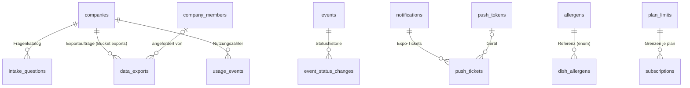
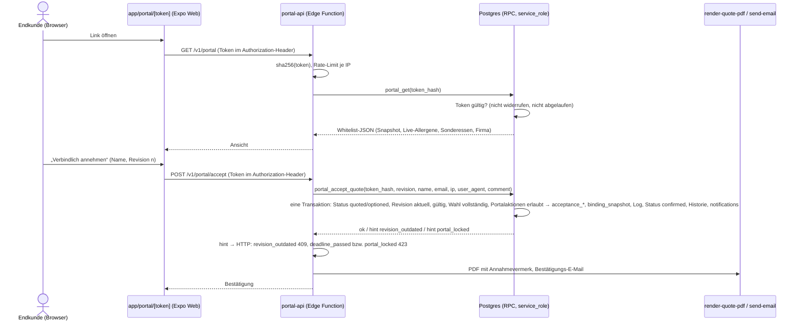

# 03 – Datenmodell (Supabase/Postgres)

Stand: 17.10.2026 · Grundlage: [00-entscheidungen.md](00-entscheidungen.md) (verbindlich), [01-produkt.md](01-produkt.md), [02-ablaeufe.md](02-ablaeufe.md)

**Lesehilfe**

- **Vorschlag** markiert eine begründete Empfehlung zu einem Punkt, den das Entscheidungsprotokoll offen lässt. Bis zur Bestätigung durch den Gründer gilt sie als Arbeitsannahme.
- **entschieden (R2-x)** markiert einen Punkt, den der Gründer in Runde 2 entschieden hat (00 §9, R2-1 bis R2-14). Diese Entscheidungen haben Vorrang vor allen abweichenden Vorschlägen; die Auswirkungen im Modell fasst 10.2 zusammen.
- Tabellen-, Enum-, Rollen- und Funktionsnamen folgen exakt dem Glossar. Tabellen außerhalb des Glossars stehen gesammelt in Abschnitt 3.7 und sind Vorschläge, soweit sie nicht als entschieden markiert sind (`data_exports`, R2-14).
- Spaltennamen, die in 01/02 als Vorschlag genannt wurden, werden hier festgelegt. Abweichungen davon listet Abschnitt 10.
- Der SQL-Entwurf (Abschnitte 7 und 8) wurde lokal gegen PostgreSQL 16 mit nachgebildeten Supabase-Schemas (`auth.uid()`, `storage`, Rollen `anon`/`authenticated`/`service_role`) geladen und geprüft. Getestet wurden: Küche sieht keine Preise, Mandantentrennung, Spaltenschutz für Systemfelder, Lesemodus, Sichtbarkeit für `staff`, Überbuchung bei zwei parallelen Zusagen und Firmenlöschung per Kaskade.
- **Stand nach der Prüfrunde:** Eingearbeitet sind die Befunde zu Funktionsrechten (`EXECUTE` für `PUBLIC`/`anon`), DELETE im Lesemodus, Überbuchung unter REPEATABLE READ (`taken_seats`), verbindlichem Stand der Küche (`binding_snapshot`), Menüwahl ohne Revision (`portal_selection`), Versand über Prepare/Commit, Push-Tickets, Idempotenz der Jobs und Teamliste der Küche. Diese geänderten SQL-Blöcke sind **noch nicht erneut** gegen PostgreSQL 16 geladen; das ist der erste Schritt beim Anlegen der Migrationen (pgTAP aus 9.5).
- **Stand nach Runde 2 (00 §9):** Eingearbeitet sind keine Rückwärts-Übergänge im Auftragsstatus (R2-4, Übergangsprüfung `private.is_allowed_event_transition()` in 7.8), kein automatisches „Durchgeführt“ (R2-3), Direktbestätigung (R2-2), kein Sonderabsagerecht der Schichtbörse (R2-10, Spalte `shift_slots.special_cancel_until` entfällt), Hintergrund-Export mit Download-Link per E-Mail (R2-14: `data_exports` mit Status, Pfad und Ablauf, Bucket `exports`, Edge Function `export-company`, Job `exports_cleanup`) sowie die freigegebenen Edge Functions `delete-account` (R2-12) und `purge-company` (R2-13). Auch diese Blöcke sind noch nicht erneut geladen.

**Inhalt**

0. Konventionen und Grundentscheidungen
1. ER-Diagramm
2. Enums
3. Tabellen
4. Row-Level-Security
5. Kundenportal-Zugriff
6. Abo-Durchsetzung
7. SQL-Entwurf
8. Storage-Buckets
9. Migrationen, Seed, Tests, Jobs
10. Abgleich mit 01/02 und offene Entscheidungen

---

## 0. Konventionen und Grundentscheidungen

| Thema | Festlegung | Begründung |
|---|---|---|
| Schema | Alle Fachtabellen in `public`; `auth`, `storage`, `extensions` werden nur referenziert | Standard für PostgREST und supabase-js |
| Namen | snake_case, Tabellen im Plural, Enum-Typen im Singular | Glossar |
| Primärschlüssel | `id uuid default gen_random_uuid()`; Verknüpfungstabellen mit zusammengesetztem PK | nicht erratbar; IDs können für Kopien clientseitig erzeugt werden |
| Mandant | Jede mandantenbezogene Tabelle hat `company_id uuid not null` → `companies` ON DELETE CASCADE | RLS filtert ohne Join; eine Firma lässt sich mit einem Statement löschen |
| Mandantenkonsistenz | Fremdschlüssel innerhalb eines Mandanten sind zusammengesetzt: `(company_id, x_id) → x (company_id, id)`. Jede referenzierte Tabelle hat dafür `unique (company_id, id)` | Die Datenbank verhindert Verweise über Firmengrenzen hinweg, auch bei einem Fehler in einer SECURITY-DEFINER-Funktion |
| Zeitpunkte | `timestamptz`. Reine Kalenderdaten ohne Uhrzeit (`valid_until`, `deposit_due_on`, `invoiced_on`, `valid_from`) als `date`. Fachlogik (Fristen, „heute“) in Europe/Berlin; `events.event_date` als generierte Spalte | Glossar |
| Geld | `integer` in Cent, auch Summen (bis 21,4 Mio. € je Feld) | Glossar |
| Prozentwerte | Basispunkte als `integer` (`700` = 7 %, `20000` = 200 % Aufschlag = Faktor 3,0) | ganzzahlig und rundungsfrei, wie 02 §3.1 |
| Mengen | `numeric(10,2)`; Menge pro Person `numeric(10,1)`; Wareneinsatz-Zwischenwerte `numeric(12,4)` | 02 §3.3, US-19.7 |
| Standardspalten | `created_at`, `updated_at` in jeder Tabelle; `updated_at` setzt der Trigger `set_updated_at()` | einheitlich, nötig für Offline-Stand und Konflikterkennung |
| Archivieren statt Löschen | `archived_at` bei Gerichten, Zutaten, Paketen, Qualifikationen, Steuersätzen, Fragen. Mitglieder werden nie hart gelöscht (`removed_at`) | Historie bleibt lesbar (US-07.4, US-21) |
| ON DELETE | **CASCADE** von `companies` und innerhalb eines Aggregats (Auftrag → Zeitplan, Sonderessen, Angebot, Slots, Portal-Tokens; Angebot → Positionen; Gericht → Allergene). **NO ACTION** für Verweise auf Stammdaten und Katalog (Kunde, Gericht, Paket, Zutat, Steuersatz, Qualifikation, Slot ← Bewerbung). **SET NULL (Spalte)** für optionale Verweise auf Mitglieder | NO ACTION statt RESTRICT: NO ACTION prüft erst am Ende des Statements, deshalb funktioniert die Firmenlöschung per Kaskade (getestet). `SET NULL (spalte)` (ab PG 15) setzt bei zusammengesetzten FKs nur die Verweisspalte, nicht `company_id` |
| Enums | Postgres-Enums für feste Wertelisten | typsichere generierte TS-Typen; Erweiterung per `alter type … add value` |
| `jsonb` | nur für Snapshots, Protokolle, Vorlagen, Antworten des Fragenkatalogs, Ersatzgerichte | keine relationale Abfrage nötig, außer in der Küchen-View (Snapshot-Positionen) |
| Rechenlogik | Beträge berechnet das gemeinsame TypeScript-Modul (02 §3, nur Ganzzahlen). Die Datenbank speichert die Ergebnisse je Position und die Summen und prüft beim Versand die Konsistenz | eine Rechenquelle für App, Portal und PDF |
| Funktionsrechte | Keine Funktion ist für `PUBLIC` oder `anon` ausführbar. Jede RPC erhält `EXECUTE` ausdrücklich und nur für die vorgesehene Rolle (`authenticated` oder `service_role`); rein interne Funktionen liegen im nicht veröffentlichten Schema `private` (4.1, 7.1) | Supabase vergibt sonst per Default `EXECUTE` an `anon` und `authenticated` |
| Fehlervertrag | Fachliche Fehler: `raise exception '<deutscher Text>' using errcode = 'P0001', hint = '<code>'` (z. B. `slot_full`, `read_only`, `deadline_passed`). Die App liest `hint` (05 §4.6); HTTP-Status vergeben nur Edge Functions | ein maschinenlesbarer Code je Fehler, unabhängig vom Text |

**Kürzel in Abschnitt 3**

- **[S]** = `id uuid` PK `default gen_random_uuid()` · `company_id uuid not null` → `companies(id)` ON DELETE CASCADE · `created_at timestamptz not null default now()` · `updated_at timestamptz not null default now()` (Trigger).
- **[S ohne id]** = wie [S], aber ohne `id` (Verknüpfungstabellen mit zusammengesetztem PK).
- **(c, x)** = zusammengesetzter Fremdschlüssel `(company_id, x)`.

---

## 1. ER-Diagramm

Alle Tabellen außer `companies` tragen `company_id` → `companies`. Aus Gründen der Lesbarkeit sind nur die fachlich wichtigen Kanten zu `companies` gezeichnet.

```mermaid
erDiagram
    auth_users ||--o| company_members : "user_id unique"
    companies ||--|{ company_members : "Mitglieder"
    companies ||--o{ invitations : "Einladungen"
    companies ||--|| subscriptions : "Abo"
    companies ||--o{ customers : "Kunden"
    companies ||--o{ tax_rates : "Steuersätze"
    companies ||--o{ qualifications : "Qualifikationen"
    companies ||--o{ dishes : "Gerichte"
    companies ||--o{ ingredients : "Zutaten"
    companies ||--o{ menu_packages : "Pakete"
    customers ||--o{ events : "beauftragt"
    events ||--o{ event_schedule_items : "Zeitplan"
    events ||--o{ event_dietary_requirements : "Sonderessen"
    events ||--o| quotes : "aktuelles Angebot"
    events ||--o{ portal_tokens : "Portal-Links"
    events ||--o{ shift_slots : "Slots"
    quotes ||--o{ quote_items : "Positionen"
    menu_packages |o--o{ quote_items : "Typ package"
    dishes |o--o{ quote_items : "Typ dish"
    tax_rates |o--o{ quote_items : "Steuersatz"
    tax_rates |o--o{ dishes : "Standardsatz"
    tax_rates |o--o{ menu_packages : "Standardsatz"
    dishes ||--o{ dish_allergens : "Allergene"
    dishes ||--o{ dish_ingredients : "Rezeptur"
    ingredients ||--o{ dish_ingredients : "verwendet in"
    menu_packages ||--o{ menu_package_dishes : "enthält"
    dishes ||--o{ menu_package_dishes : "Teil von"
    company_members ||--o{ member_qualifications : "besitzt"
    qualifications ||--o{ member_qualifications : "vergeben an"
    qualifications ||--o{ shift_slots : "erfordert (Pflicht, R2-9)"
    shift_slots ||--o{ shift_applications : "Bewerbungen"
    company_members ||--o{ shift_applications : "bewirbt sich"
    company_members ||--o{ push_tokens : "Geräte"
    company_members ||--o{ notifications : "empfängt"

    companies {
        uuid id PK
        text name
        text contact_email
        int shift_cancel_deadline_hours
        timestamptz deletion_requested_at
    }
    company_members {
        uuid id PK
        uuid company_id FK
        uuid user_id UK "auth.users"
        member_role role
        timestamptz removed_at
    }
    invitations {
        uuid id PK
        uuid company_id FK
        member_role role
        bytea token_hash UK
        timestamptz expires_at
    }
    subscriptions {
        uuid id PK
        uuid company_id FK, UK
        subscription_plan plan
        subscription_status status
        timestamptz writable_until
    }
    customers {
        uuid id PK
        uuid company_id FK
        customer_type type
        text name
        text email
    }
    events {
        uuid id PK
        uuid company_id FK
        uuid customer_id FK
        event_status status
        timestamptz starts_at
        int guest_count
    }
    event_schedule_items {
        uuid id PK
        uuid event_id FK
        schedule_item_kind kind
        timestamptz starts_at
    }
    event_dietary_requirements {
        uuid id PK
        uuid event_id FK
        int person_count
        diet_type diet
        text avoid_allergens "allergen[]"
    }
    quotes {
        uuid id PK
        uuid event_id FK, UK
        int revision
        quote_status status
        jsonb snapshot
        jsonb binding_snapshot
        jsonb portal_selection
        jsonb pending_change
        timestamptz accepted_at
    }
    quote_items {
        uuid id PK
        uuid quote_id FK
        quote_item_type type
        uuid menu_package_id FK
        uuid dish_id FK
        numeric quantity
        int unit_price_cents
        uuid tax_rate_id FK
        int sort_order
    }
    tax_rates {
        uuid id PK
        int rate_bp
        tax_category category
        date valid_from
    }
    dishes {
        uuid id PK
        text name
        int price_cents "nur admin"
        text diets "diet_type[]"
    }
    dish_allergens {
        uuid dish_id PK, FK
        allergen allergen PK
    }
    ingredients {
        uuid id PK
        text name
        ingredient_unit unit
        int price_cents "nur admin"
    }
    dish_ingredients {
        uuid dish_id PK, FK
        uuid ingredient_id PK, FK
        numeric quantity_per_person
    }
    menu_packages {
        uuid id PK
        text name
        int price_per_person_cents "nur admin"
    }
    menu_package_dishes {
        uuid menu_package_id PK, FK
        uuid dish_id PK, FK
        numeric portion_factor
    }
    qualifications {
        uuid id PK
        text name
    }
    member_qualifications {
        uuid member_id PK, FK
        uuid qualification_id PK, FK
    }
    shift_slots {
        uuid id PK
        uuid event_id FK
        uuid qualification_id FK
        timestamptz starts_at
        timestamptz ends_at
        int seats
        int taken_seats
    }
    shift_applications {
        uuid id PK
        uuid shift_slot_id FK
        uuid member_id FK
        application_status status
    }
    push_tokens {
        uuid id PK
        uuid member_id FK
        text expo_push_token UK
    }
    notifications {
        uuid id PK
        uuid member_id FK
        notification_category category
        timestamptz read_at
    }
    portal_tokens {
        uuid id PK
        uuid event_id FK
        bytea token_hash UK
        timestamptz expires_at
        timestamptz revoked_at
    }
```



Ergänzende Tabellen (Abschnitt 3.7; Vorschläge, `data_exports` entschieden R2-14):



`stripe_events` (verarbeitete Stripe-Ereignisse) ist global und hat keine Kante.

---

## 2. Enums

| Enum | Werte → Bedeutung | verwendet in |
|---|---|---|
| `member_role` | `admin` Admin/Inhaber · `kitchen` Küche · `staff` Service/Aushilfe | `company_members.role`, `invitations.role` |
| `event_status` | `inquiry` Anfrage · `quoted` Angebot versendet · `optioned` Optioniert · `confirmed` Bestätigt · `completed` Durchgeführt (nur manuell durch den Admin, R2-3) · `invoiced` Abgerechnet · `declined` Abgelehnt (Kunde lehnt Angebot ab) · `cancelled` Abgesagt (nach Option/Bestätigung storniert). Übergänge nur vorwärts (R2-4); `declined`, `cancelled` und `invoiced` sind Endzustände | `events.status`, `event_status_changes` |
| `event_kind` | `event_catering` Event-Catering · `business_lunch` Business-/Office-Lunch | `events.kind` |
| `quote_status` | `draft` nie versendet (`revision = 0`) · `sent` aktuelle Revision versendet, noch nicht angenommen · `accepted` aktuelle Revision angenommen · `declined` abgelehnt | `quotes.status` |
| `quote_item_type` | `package` Menüpaket p. P. · `dish` Einzelgericht · `service` Personal · `equipment` Equipment-Miete · `travel` Anfahrt/Pauschale · `beverage` Getränkepauschale · `custom` frei | `quote_items.type` |
| `quantity_mode` | `per_guest` Menge folgt der Gästezahl · `fixed` feste Menge | `quote_items.quantity_mode` |
| `pricing_mode` | `flat` Pauschalpreis pro Person · `cost_based` Wareneinsatz + Aufschlag | `quotes.pricing_mode`, `companies.default_pricing_mode` |
| `price_basis` | `net` · `gross` | `companies.price_entry_mode` (Eingabeart), `quotes.price_display` (Anzeige) |
| `acceptance_channel` | `portal` Annahme im Portal · `portal_confirmation` Änderung im Portal bestätigt („Bitte bestätigen“, 01 US-36.3) · `admin` manuell erfasst · `info_only` Revision „Zur Info“ versendet (01 US-36.3) | `quotes.acceptance_channel` |
| `application_status` | `applied` beworben · `accepted` vom Admin zugesagt · `rejected` vom Admin abgesagt bzw. ausgeplant · `withdrawn` Bewerber zieht zurück · `cancelled_by_staff` Absage nach Zusage · `assigned` direkt durch Admin eingeplant | `shift_applications.status` |
| `allergen` | 14 Pflichtallergene, siehe Tabelle unten | `dish_allergens.allergen`, `event_dietary_requirements.avoid_allergens`, `allergens.code` |
| `diet_type` | `vegetarian` vegetarisch · `vegan` vegan · `halal` halal · `kosher` koscher · `gluten_free` glutenfrei · `lactose_free` laktosefrei | `dishes.diets`, `event_dietary_requirements.diet` |
| `dish_category` | `starter` Vorspeise · `soup` Suppe · `main` Hauptgang · `side` Beilage · `dessert` Dessert · `finger_food` Fingerfood · `beverage` Getränk · `other` Sonstiges | `dishes.category` |
| `ingredient_unit` | `g` · `ml` · `piece` Stück (Basiseinheit; Preis je kg, l bzw. Stück) | `ingredients.unit` |
| `tax_category` | `food` Speisen · `beverage` Getränke · `service` Personal · `equipment` Equipment-Miete · `travel` Anfahrt · `other` Sonstiges | `tax_rates.category` |
| `country_code` | `DE` · `AT` · `CH` (AT/CH vorbereitet, nicht aktivierbar) | `companies`, `customers`, `events`, `tax_rates` |
| `customer_type` | `business` geschäftlich (Anzeige netto) · `private` privat (Anzeige brutto) | `customers.type` |
| `schedule_item_kind` | `departure` Abfahrt · `setup` Aufbau · `service` Ausgabe · `teardown` Abbau · `delivery` Lieferung · `other` Sonstiges | `event_schedule_items.kind` |
| `dietary_source` | `customer` aus dem Portal · `internal` von Admin/Küche | `event_dietary_requirements.source` |
| `subscription_plan` | `start` · `team` · `profi` · `pilot` (intern, ohne Kosten und Ablauf, US-55.7) | `subscriptions.plan`, `plan_limits.plan` |
| `subscription_status` | Stripe-Status 1:1 gespiegelt: `trialing`, `active`, `past_due`, `canceled`, `unpaid`, `incomplete`, `incomplete_expired`, `paused`. Die App-Testphase ohne Stripe nutzt ebenfalls `trialing`. Einen Status „Testphase abgelaufen“ gibt es nicht; der Lesemodus ergibt sich allein aus `writable_until` (6.1) | `subscriptions.status` |
| `push_platform` | `ios` · `android` | `push_tokens.platform` |
| `push_status` | `pending` wartet auf Versand · `sending` von `push-dispatch` beansprucht (`claim_notifications()`) · `sent` · `failed` · `skipped` (Kategorie abgeschaltet, kein Gerät oder Kategorie `billing`) | `notifications.push_status` |
| `notification_category` | `application_received`, `application_decided`, `assignment_created`, `assignment_cancelled`, `slots_published`, `shift_changed`, `shift_called_off`, `shift_reminder`, `quote_accepted` (auch „Änderung bestätigt“), `quote_declined`, `quote_viewed`, `quote_delivery_failed` (01 US-27.6), `revision_confirmation_pending` (01 US-36.7), `portal_change` (Änderungswunsch), `dietary_changed`, `event_confirmed`, `event_cancelled`, `guest_count_changed`, `option_expiring`, `quote_expired`, `completion_due`, `slots_unfilled`, `member_joined`, `billing` (nur neutraler Listeneintrag ohne Push und Link, 3.6). Zuordnung zu 01 §4.2.5; abschaltbar je Kategorie über `company_members.notification_prefs` | `notifications.category` |
| `intake_answer_type` | `single_choice` · `multi_choice` · `number` · `date` · `time` · `time_range` (Beginn und Ende in einer Frage) · `datetime` · `text` · `boolean` · `customer` (Kundensuche bzw. neuer Kunde) | `intake_questions.answer_type` |
| `intake_target` | `customer` · `event_kind` · `occasion` · `starts_at` · `ends_at` · `guest_count` · `venue` · `dietary_requirements` · `kitchen_notes` · `staff_notes` · `customer_reference` (null = Antwort wird Notiz) | `intake_questions.target` |

**Die 14 Pflichtallergene** (LMIV Anhang II; Kurzcodes nach dem österreichischen Schema, 01 §4.2.6)

| `allergen` | Code | Bezeichnung |
|---|---|---|
| `gluten` | A | Glutenhaltiges Getreide |
| `crustaceans` | B | Krebstiere |
| `eggs` | C | Eier |
| `fish` | D | Fisch |
| `peanuts` | E | Erdnüsse |
| `soybeans` | F | Soja |
| `milk` | G | Milch (einschließlich Laktose) |
| `nuts` | H | Schalenfrüchte |
| `celery` | L | Sellerie |
| `mustard` | M | Senf |
| `sesame` | N | Sesamsamen |
| `sulphites` | O | Schwefeldioxid und Sulfite |
| `lupin` | P | Lupinen |
| `molluscs` | R | Weichtiere |

**Positionstyp → Steuerkategorie** (Standard je Position, änderbar; 02 §2.2)

| `quote_item_type` | `package`, `dish` | `beverage` | `service` | `equipment` | `travel` | `custom` |
|---|---|---|---|---|---|---|
| `tax_category` | `food` | `beverage` | `service` | `equipment` | `travel` | `other` (wählbar) |

---

## 3. Tabellen

### 3.1 Mandant und Team

#### `companies`

Mandant: Stammdaten, Branding und Firmeneinstellungen. Die Tabelle ist selbst der Mandant und hat daher kein `company_id`.

| Spalte | Typ | Null / Default | Beschreibung |
|---|---|---|---|
| `id` | uuid | PK, `gen_random_uuid()` | |
| `name` | text | not null, 1–120 Zeichen | Firmenname, zugleich Absendername der E-Mails |
| `street`, `postal_code`, `city` | text | null | Anschrift; vor dem ersten Versand Pflicht (02 §2.3) |
| `country` | country_code | not null, `'DE'` | `create_company()` lässt nur `DE` zu |
| `phone` | text | null | im Portal und bei „Absage nur telefonisch“ |
| `contact_email` | text | not null, Formatprüfung | Reply-To aller Kunden-E-Mails |
| `website`, `vat_id`, `tax_number`, `footer_text`, `privacy_policy_url` | text | null | PDF-Kopf/-Fuß, Portal (US-03.1) |
| `imprint_url` | text | null | Impressum des Caterers für Portal-, PDF- und Kunden-E-Mail-Fußzeile (02 §10.1, 04 SC-58, 05 §5.5) |
| `logo_path` | text | null | Pfad im Bucket `logos` |
| `accent_color` | text | null, `^#[0-9A-Fa-f]{6}$` | Akzentfarbe für Portal, PDF, E-Mail |
| `price_entry_mode` | price_basis | not null, `'net'` | Eingabeart der Preise (02 §3.6) |
| `default_pricing_mode` | pricing_mode | not null, `'flat'` | Vorbelegung `quotes.pricing_mode` |
| `default_markup_bp` | integer | not null, `20000` | Aufschlag auf den Wareneinsatz (200 % = Faktor 3,0) |
| `price_rounding_cents` | integer | not null, `10`, ∈ {1, 10, 50, 100} | Preisraster für den Preisvorschlag, immer aufgerundet (02 §3.3; entschieden R2-5: Standard volle 10 Cent, 26,32 € → 26,40 €); `1` = kein Raster |
| `is_small_business` | boolean | not null, `false` | Kleinunternehmer: keine USt, Hinweistext (**Vorschlag** aus 02 §3.5) |
| `quote_validity_days` | integer | not null, `14` | Vorbelegung `quotes.valid_until` |
| `portal_change_lead_hours` | integer | `72`; null = kein Änderungsschluss | Vorbelegung `events.changes_until` für Event-Catering (entschieden R2-6) |
| `portal_change_lead_hours_business_lunch` | integer | `24`; null = kein Änderungsschluss | Vorbelegung `events.changes_until` für Business-Lunch (entschieden R2-6, 01 §4.2.6) |
| `portal_token_ttl_days` | integer | not null, `60` | Portal-Link gültig bis Eventende + n Tage |
| `shift_cancel_deadline_hours` | integer | not null, `48`, 0–168 | Absagefrist der Schichtbörse, pro Firma einstellbar; gilt immer, auch nach einer Verschiebung des Events oder Slots (kein Sonderabsagerecht, entschieden R2-10) |
| `shopping_buffer_bp` | integer | not null, `500` | Puffer nur der Einkaufsliste (5 %); die Produktionsliste hat keinen Puffer (02 §8; entschieden R2-7) |
| `quote_intro_text`, `quote_terms_text`, `quote_closing_text` | text | null | Standardtexte für neue Angebote |
| `quote_item_templates` | jsonb | not null, `'[]'` | Vorlagen für Zusatzpositionen: `[{type, name, unit_label, unit_price_cents, quantity_mode, hours}]` („Servicekraft 32,00 €/h“, „Anfahrt“, „Getränkepauschale“) |
| `quote_number_year`, `quote_number_seq` | integer | null / `0` | Zähler für die Angebotsnummer `A-JJJJ-NNNN` (Trigger) |
| `avv_accepted_at`, `avv_accepted_by` | timestamptz / uuid | null | Annahme des AVV (US-62.1) |
| `avv_version` | text | null | angenommene AVV-Version (02 §10.1); `create_company()` setzt die aktuelle Version |
| `onboarding_completed_at` | timestamptz | null | Onboarding abgeschlossen oder übersprungen; steuert das Auth-Gate (04 §1.1 Nr. 2) |
| `created_by` | uuid | null | Nutzer, der die Firma angelegt hat |
| `deletion_requested_at` | timestamptz | null | gesetzt = Löschung beantragt; ab sofort liefern die `auth_*`-Funktionen null, damit hat niemand mehr Zugriff (US-60.2) |
| `created_at`, `updated_at` | timestamptz | not null, `now()` | |

- **FK:** `avv_accepted_by`, `created_by` → `auth.users(id)` ON DELETE SET NULL.
- **Lesen:** nur `admin` direkt. Alle anderen Rollen lesen die View `company_profile` (ohne Preis-Vorlagen und Kalkulationswerte).

#### `company_members`

Mitgliedschaft eines Nutzers. Verknüpft `auth.users` 1:1 mit genau einer Firma.

| Spalte | Typ | Null / Default | Beschreibung |
|---|---|---|---|
| [S] | | | |
| `user_id` | uuid | null, **unique** | → `auth.users(id)` ON DELETE SET NULL. Beim Entfernen oder bei Kontolöschung auf null gesetzt; dadurch kann derselbe Nutzer später einer anderen Firma beitreten |
| `role` | member_role | not null | Änderung nur über `set_member_role()` |
| `display_name` | text | not null, 1–80 Zeichen | Name in Teamliste, Schichten, Historie |
| `phone` | text | null | Teamliste, Ansprechpartner |
| `login_email` | text | null | Login-E-Mail beim Beitritt (Anzeige für Admin, US-06.3) |
| `notification_prefs` | jsonb | not null, `'{}'` | `{category: boolean}` für abschaltbare Kategorien |
| `ical_token_hash` | bytea | null, unique | SHA-256 des persönlichen iCal-Tokens; „Link zurücksetzen“ ersetzt ihn |
| `joined_at` | timestamptz | not null, `now()` | |
| `removed_at` | timestamptz | null | gesetzt = entfernt bzw. Firma verlassen |
| `removed_reason` | text | null | `removed_by_admin`, `left`, `account_deleted` |

- **Aktiv** = `user_id is not null and removed_at is null`.
- **Lesen:** `admin` alle Zeilen der Firma; `kitchen` und `staff` nur die eigene Zeile. Die Teamliste der Küche (Name, Rolle, Telefon, 01 §3.2) kommt aus der View `team_directory` (4.6), damit `login_email`, `notification_prefs`, `ical_token_hash` und `removed_reason` anderer Mitglieder nie ausgeliefert werden.
- **Unique:** `user_id` (ein Nutzer, eine Firma); `(company_id, id)`.
- **Index:** `(company_id, role) where removed_at is null`.
- **Regeln:** Der letzte aktive `admin` kann weder herabgestuft noch entfernt werden (Prüfung in `set_member_role()`/`remove_member()` plus Trigger als Sicherung, **Vorschlag**). Beim Entfernen: `removed_at`, `user_id = null`, `ical_token_hash = null`, Push-Tokens löschen, Bewerbungen nach US-07.3. Bei Kontolöschung zusätzlich `display_name = 'Ehemaliges Mitglied'`, `phone`/`login_email = null` (US-08.1).

#### `invitations`

Einladung mit vorab festgelegter Firma, Rolle und Qualifikationen.

| Spalte | Typ | Null / Default | Beschreibung |
|---|---|---|---|
| [S] | | | |
| `email` | text | null | Ziel-E-Mail; null bei „Link teilen“ (US-05.2) |
| `display_name` | text | not null | vorgesehener Name |
| `role` | member_role | not null | |
| `qualification_ids` | uuid[] | not null, `'{}'` | werden bei der Annahme in `member_qualifications` übernommen; `accept-invitation` prüft, ob sie noch existieren |
| `token_hash` | bytea | not null, unique | SHA-256 des Einladungstokens (32 Byte Zufall, base64url) |
| `expires_at` | timestamptz | not null | Anlage + 7 Tage |
| `invited_by_member_id` | uuid | null | (c, …) → `company_members` SET NULL |
| `last_sent_at` | timestamptz | null | |
| `accepted_at`, `accepted_member_id` | timestamptz / uuid | null | `accepted_member_id`: (c, …) → `company_members` SET NULL |
| `revoked_at` | timestamptz | null | |

- **Status** wird berechnet: widerrufen → angenommen → abgelaufen (`expires_at < now()`) → offen.
- **„Erneut senden“** erzeugt einen neuen Token und eine neue Frist; der alte Link wird ungültig (nur der Hash ist gespeichert).
- **Unique:** `token_hash`; `(company_id, lower(email)) where accepted_at is null and revoked_at is null and email is not null` (keine doppelten offenen Einladungen).
- **Index:** `(company_id, created_at desc)`.
- Das Mitgliederlimit zählt aktive Mitglieder plus offene, nicht abgelaufene Einladungen (US-05.4).

#### `subscriptions`

Aktueller Abo-Zustand je Firma (eine Zeile pro Firma). Die Historie liegt bei Stripe.

| Spalte | Typ | Null / Default | Beschreibung |
|---|---|---|---|
| [S] | | | `company_id` zusätzlich **unique** |
| `plan` | subscription_plan | not null, `'profi'` | gebuchte Stufe; in der Testphase `profi` |
| `status` | subscription_status | not null, `'trialing'` | 1:1 gespiegelt aus Stripe; ohne Stripe `trialing` (App-Testphase) |
| `billing_interval` | text | null, `month`/`year` | |
| `stripe_customer_id`, `stripe_subscription_id` | text | null, unique | |
| `stripe_price_id` | text | null | |
| `trial_ends_at` | timestamptz | null | Tag 14, 23:59:59 Europe/Berlin |
| `current_period_end` | timestamptz | null | |
| `cancel_at_period_end` | boolean | not null, `false` | |
| `canceled_at`, `payment_failed_at` | timestamptz | null | `payment_failed_at` startet die 14-Tage-Kulanz |
| `writable_until` | timestamptz | not null | **einzige Quelle** für `company_is_writable()`; Regeln in Abschnitt 6.1 |
| `stripe_synced_at` | timestamptz | null | Zeitpunkt, zu dem `stripe-webhook` den geschriebenen Stand bei Stripe abgerufen hat; ein Stand mit älterem Abrufzeitpunkt wird verworfen (6.1) |
| `last_stripe_event_id`, `last_stripe_event_at` | text / timestamptz | null | zuletzt verarbeitetes Ereignis (Diagnose); Idempotenz über `stripe_events` (3.7) |

- **Schreiben:** nur `service_role` (`stripe-webhook`, `create_company()`). `admin` liest; alle anderen sehen `is_writable` und `effective_plan` über `company_profile`.

### 3.2 Kunden und Aufträge

#### `customers`

| Spalte | Typ | Null / Default | Beschreibung |
|---|---|---|---|
| [S] | | | |
| `type` | customer_type | not null, `'private'` | bestimmt die Standard-Preisanzeige im Angebot |
| `name` | text | not null | Person oder Firmenname |
| `contact_person`, `email`, `phone` | text | null | E-Mail wird erst beim E-Mail-Versand Pflicht |
| `billing_street`, `billing_postal_code`, `billing_city` | text | null | Rechnungsanschrift |
| `billing_country` | country_code | null | |
| `vat_id` | text | null | USt-IdNr. bei Geschäftskunden |
| `notes` | text | null | interne Notiz |
| `anonymized_at` | timestamptz | null | gesetzt durch `anonymize_customer()`: Name → „Anonymisierter Kunde“, Kontakt- und Rechnungsfelder sowie Notiz null, Gastnamen der Sonderessen null, alle Portal-Tokens widerrufen (US-61.2) |

- **Unique:** `(company_id, id)`.
- **Indizes:** `(company_id, lower(email)) where email is not null` für die Duplikatwarnung; GIN-Trigramm auf `name` für die Suche ab 2 Zeichen.
- **Löschen** nur ohne Aufträge (Policy); sonst Anonymisierung.

#### `events`

Auftrag (Event-Catering oder Business-Lunch) mit Status, Termin, Ort und Hinweisen.

| Spalte | Typ | Null / Default | Beschreibung |
|---|---|---|---|
| [S] | | | |
| `customer_id` | uuid | not null | (c, …) → `customers` NO ACTION |
| `kind` | event_kind | not null, `'event_catering'` | |
| `title` | text | not null, 1–120 Zeichen | **Vorschlag:** Pflicht in der DB, die App belegt vor („Hochzeit 12.06.2027“). Eingeplantes Personal sieht den Titel; so entsteht nie ein Fallback mit Kundennamen |
| `occasion` | text | null | Anlass (Fragenkatalog), z. B. „Hochzeit“ |
| `status` | event_status | not null, `'inquiry'` | nur über `set_event_status()` und die Versand-/Portal-RPCs änderbar (Spaltenprivileg); nur Vorwärts-Übergänge nach 02 §1.1 (R2-4) |
| `starts_at` | timestamptz | not null | Beginn |
| `ends_at` | timestamptz | null, `> starts_at` | Ende; „18:00–02:00“ wird als Folgetag gespeichert |
| `event_date` | date | generiert: `(starts_at at time zone 'Europe/Berlin')::date` | Kalender, „am selben Tag“-Hinweis, Tagesansicht |
| `guest_count` | integer | null, ≥ 1 | Gästezahl `G` |
| `venue_name`, `street`, `postal_code`, `city` | text | null | Ort. `staff` sieht vor der Zusage nur `postal_code` + `city` |
| `country` | country_code | not null, `'DE'` | |
| `is_pickup` | boolean | not null, `false` | Abholung statt Lieferung |
| `onsite_contact_name`, `onsite_contact_phone` | text | null | Ansprechpartner vor Ort |
| `meeting_point`, `dress_code`, `staff_notes` | text | null | Hinweise fürs Personal (Slot kann überschreiben) |
| `kitchen_notes` | text | null | Hinweise für die Küche |
| `internal_notes` | text | null | nur `admin`; nimmt auch Antworten des Fragenkatalogs ohne Feldzuordnung auf |
| `option_expires_at` | timestamptz | null | „optioniert bis“ (Ende des gewählten Tages in Europe/Berlin); in `optioned` Pflicht, sonst null (Check) |
| `changes_until` | timestamptz | null | Änderungsschluss im Portal; vorbelegt aus `companies.portal_change_lead_hours` (Event-Catering, 72 h) bzw. `portal_change_lead_hours_business_lunch` (Business-Lunch, 24 h), je Auftrag änderbar (entschieden R2-6); null = kein Änderungsschluss |
| `portal_locked` | boolean | not null, `false` | Portal-Änderungen gesperrt |
| `cancellation_agreement` | text | null | Freitext „Stornovereinbarung“ (02 §1.1) |
| `invoice_reference`, `invoiced_on` | text / date | null | externe Rechnungsnummer und -datum bis zum Rechnungsmodul |
| `intake_answers` | jsonb | not null, `'[]'` | Antworten des Angebots-Chats: `[{question_id, prompt, answer, target, answered_at}]`; `prompt` als Kopie, weil Fragen sich ändern |
| `copied_from_event_id` | uuid | null | (c, …) → `events` SET NULL (Spalte) |
| `created_by_member_id` | uuid | null, Default `auth_member_id()` | (c, …) → `company_members` SET NULL (Spalte) |

- **Unique:** `(company_id, id)`.
- **Checks:** `ends_at > starts_at`; `(status = 'optioned') = (option_expires_at is not null)` („optioniert bis“ Pflicht, 02 §1.3).
- **Indizes:** `(company_id, starts_at)` Kalender; `(company_id, status, event_date)` Listen und Tagesansicht; `(customer_id)`; GIN-Trigramm auf `title`.
- **Trigger (Vorschlag):** Ändert sich `starts_at`/`ends_at`, werden `portal_tokens.expires_at` der aktiven Tokens neu berechnet.
- **Löschen** („Fehleingabe löschen“, 02 §1.1) nur im Status `inquiry` und ohne versendete Revision (Policy). Eine Anfrage, die nicht zustande kommt, wird `declined`.
- **Statusübergänge** (02 §1.1, entschieden R2-2, R2-3, R2-4): nur vorwärts, geprüft in `private.is_allowed_event_transition()` (7.8). Direktbestätigung `inquiry`/`optioned` → `confirmed` ohne versendetes Angebot ist erlaubt (Bestätigungsweg Pflicht, R2-2). `completed` setzt nur der Admin, nie ein Job (R2-3). Es gibt keine Rückwärts-Übergänge (`completed` → `confirmed`, `invoiced` → `completed`, `declined` → `quoted`), keine Reaktivierung von `declined`/`cancelled` und keine Funktion „Status korrigieren“ (R2-4); ein neuer Anlauf läuft über `copy_event()`. Fehlbedienungen verhindert der Bestätigungsdialog vor jedem Statuswechsel in der App (02 §1.1.1); die Datenbank prüft unabhängig davon die Übergangstabelle.

#### `event_schedule_items`

Zeitplan eines Auftrags (Abfahrt, Aufbau, Ausgabe, Abbau …).

| Spalte | Typ | Null / Default | Beschreibung |
|---|---|---|---|
| [S] | | | |
| `event_id` | uuid | not null | (c, …) → `events` CASCADE |
| `kind` | schedule_item_kind | not null | |
| `label` | text | null | eigene Bezeichnung, v. a. bei `other` |
| `starts_at` | timestamptz | not null | darf vor dem Eventbeginn liegen (US-14.5) |
| `ends_at` | timestamptz | null, `> starts_at` | |
| `notes` | text | null | |

- **Index:** `(event_id, starts_at)`.
- **Lesen:** `admin`; `kitchen` ab `optioned`; `staff` nur mit eigenem Einsatz (`can_read_event()`). Im Portal nicht sichtbar.

#### `event_dietary_requirements`

Sonderessen und Allergien je Auftrag. Gesundheitsdaten im Sinne von Art. 9 DSGVO.

| Spalte | Typ | Null / Default | Beschreibung |
|---|---|---|---|
| [S] | | | |
| `event_id` | uuid | not null | (c, …) → `events` CASCADE |
| `person_count` | integer | not null, ≥ 1 | Anzahl Personen |
| `diet` | diet_type | null | Diätform |
| `avoid_allergens` | allergen[] | not null, `'{}'` | zu meidende Allergene |
| `guest_name` | text | null | optional; wird 30 Tage nach Eventende gelöscht |
| `table_label` | text | null | Tisch; ebenso gelöscht |
| `note` | text | null | Freitext |
| `substitutions` | jsonb | not null, `'[]'` | Ersatzgerichte `[{from_dish_id, to_dish_id}]` (mehrere Paare je Eintrag, US-38.3); Firmenzugehörigkeit der IDs prüft die schreibende Funktion |
| `source` | dietary_source | not null | `customer` (Portal) oder `internal` |
| `is_short_notice` | boolean | not null, `false` | nach dem Änderungsschluss erfasst → nicht abschaltbarer Push (US-40.3) |
| `created_by_member_id` | uuid | null | (c, …) → `company_members` SET NULL (Spalte) |
| `portal_author_name` | text | null | Name aus dem Portal-Dialog |
| `personal_data_purged_at` | timestamptz | null | Zeitpunkt der automatischen Löschung von `guest_name`/`table_label` |

- **Check:** `diet is not null or cardinality(avoid_allergens) > 0 or note is not null`.
- **Trigger (Vorschlag):** Summe `person_count` je Auftrag ≤ `events.guest_count` (US-35.3, US-40.4); `is_short_notice` automatisch, wenn `now() > events.changes_until`.
- **Index:** `(event_id)`.
- **Schreiben:** `admin`, `kitchen` (ab `optioned`), Portal über `portal-api`. Einträge aus dem Portal gelten sofort, ohne Änderungswunsch (entschieden R2-1).

### 3.3 Angebote und Steuern

#### `quotes`

Genau ein aktuelles Angebot je Auftrag. Es besteht aus dem bearbeitbaren Live-Stand (`quotes` + `quote_items`) und dem eingefrorenen Snapshot der aktuellen Revision.

| Spalte | Typ | Null / Default | Beschreibung |
|---|---|---|---|
| [S] | | | |
| `event_id` | uuid | not null, **unique** | (c, …) → `events` CASCADE |
| `number` | text | not null | `A-JJJJ-NNNN` je Firma fortlaufend (Trigger `assign_quote_number`, race-sicher über Zeilensperre auf `companies`); Revision als Zusatz `R2` nur in der Anzeige |
| `status` | quote_status | not null, `'draft'` | |
| `revision` | integer | not null, `0` | 0 = nie versendet; +1 je Versand (Portal-Aktionen erzeugen keine Revision, 02 §4) |
| `pricing_mode` | pricing_mode | not null, `'flat'` | Kalkulationsart des Angebots |
| `markup_bp` | integer | not null, `20000` | Aufschlag des Angebots (überschreibbar je Position) |
| `price_display` | price_basis | not null, `'gross'` | Anzeige netto/brutto; bei Anlage aus `customers.type` vorbelegt, umschaltbar |
| `discount_bp` / `discount_cents` | integer | not null, `0` | Gesamtrabatt in % oder als Betrag; höchstens eines ≠ 0 (Check) |
| `deposit_bp` / `deposit_cents` | integer | null | Anzahlung in % vom Brutto oder als Betrag; höchstens eines gesetzt |
| `deposit_due_on` | date | null | Fälligkeit der Anzahlung |
| `customer_reference` | text | null | „Ihre Referenz“ (Bestellnummer/Kostenstelle) |
| `intro_text`, `terms_text`, `closing_text` | text | null | Einleitung, Konditionen (Zahlung, Anzahlung, Storno), Schlusstext |
| `valid_until` | date | null | „Gültig bis“; maßgeblich ist der Live-Wert, damit „Gültigkeit verlängern“ ohne neue Revision wirkt (US-26.4) |
| `total_net_cents`, `total_tax_cents`, `total_gross_cents` | integer | not null, `0` | Summen des Live-Stands (TS-Modul) |
| `cost_total_cents` | integer | null | Wareneinsatz gesamt (nur `admin`) |
| `cost_incomplete` | boolean | not null, `false` | „Wareneinsatz unvollständig“ |
| `has_unsent_changes` | boolean | not null, `false` | Banner „Änderungen nicht versendet“ |
| `snapshot` | jsonb | null; gesetzt genau dann, wenn `revision > 0` | eingefrorener Stand der aktuellen Revision (Format unten); unveränderlich bis zur nächsten Revision |
| `snapshot_hash` | text | null | `encode(sha256(convert_to(snapshot::text, 'UTF8')), 'hex')`, berechnet **nur** in `commit_quote_send()` (jsonb-Textausgabe ist kanonisch; ein in TypeScript berechneter Hash würde abweichen) |
| `pdf_path` | text | null | Objektpfad des PDFs der aktuellen Revision im Bucket `quotes` (8), gesetzt in `commit_quote_send()` |
| `send_log` | jsonb | not null, `'[]'` | Versandprotokoll, nur anhängen: `{revision, sent_at, via, send_mode, pdf_path, snapshot_hash, member_id}`; Grundlage der PDF-Historie (US-28.2) |
| `binding_snapshot` | jsonb | null | **verbindlicher Stand** für Küche und Portal (01 §4.2.3): Snapshot der zuletzt angenommenen, im Portal bestätigten oder „Zur Info“ versendeten Revision, mit eingearbeiteter Menüwahl und Mengen aus `portal_selection` |
| `binding_revision` | integer | null, ≤ `revision` | Revision von `binding_snapshot`; `< revision` = neuere Revision noch nicht verbindlich |
| `portal_selection` | jsonb | null | Menüwahl und Mengen, die der Kunde **vor** der Annahme direkt setzt (02 §4.1; entschieden R2-1): `{"choices": {choice_group: item_id}, "quantities": {item_id: quantity}}`; ändert weder Snapshot noch Hash |
| `selection_updated_at` | timestamptz | null | letzte Änderung von `portal_selection` |
| `sent_at` | timestamptz | null | letzter Versand |
| `sent_via` | text | null, `email`/`link` | `link` = „Link kopieren“ |
| `send_mode` | text | null, `confirm_required`/`info_only` | Versandart bei `confirmed` (01 US-36.3) |
| `email_status` | text | null, `pending`/`sent`/`failed`/`bounced` | Ergebnis von `send-email` |
| `first_viewed_at`, `last_viewed_at` | timestamptz | null | Portal-Aufrufe der aktuellen Revision |
| `accepted_at` | timestamptz | null | Serverzeit der letzten Annahme |
| `acceptance_revision` | integer | null, ≤ `revision` | angenommene Revision; `< revision` = „Version n noch nicht bestätigt“ |
| `acceptance_name`, `acceptance_email` | text | null | eingegebener Name und E-Mail |
| `acceptance_ip` | inet | null | IP aus dem Request-Header (Edge Function) |
| `acceptance_user_agent` | text | null | |
| `acceptance_snapshot_hash` | text | null | Hash über Snapshot und Menüwahl: `sha256(convert_to(snapshot::text \|\| coalesce(portal_selection::text, ''), 'UTF8'))` |
| `acceptance_total_gross_cents` | integer | null | Bruttosumme inklusive Menüwahl bei Annahme |
| `acceptance_channel` | acceptance_channel | null | |
| `acceptance_note` | text | null | bei `admin`: Bestätigungsweg (Telefon, E-Mail, persönlich); Kommentar des Kunden |
| `acceptance_member_id` | uuid | null | (c, …) → `company_members` SET NULL (Spalte) |
| `acceptance_portal_token_id` | uuid | null | (c, …) → `portal_tokens` SET NULL (Spalte) |
| `acceptance_log` | jsonb | not null, `'[]'` | alle Annahmen aller Revisionen, nur anhängen |
| `declined_at`, `decline_reason`, `decline_comment` | timestamptz / text / text | null | Ablehnung mit Grund aus der Auswahlliste |
| `change_log` | jsonb | not null, `'[]'` | Änderungsprotokoll, nur anhängen |
| `pending_change` | jsonb | null | höchstens ein offener Änderungswunsch des Kunden (02 §4.2; entschieden R2-1: Gästezahl immer, Menüwahl und Mengen nach der Bestätigung): `{requested_at, revision, name, comment, ip, user_agent, changes: {guest_count, choices, quantities}}`; gesetzt von `portal_request_change()`, geschlossen von `resolve_pending_change()` (bestätigen oder ablehnen). Die Markierung „wichtig“ ab ± 20 % Gästezahl wird gegen die verbindliche Gästezahl berechnet, keine eigene Spalte |
| `editor_active_seconds` | integer | not null, `0` | aktive Editorzeit für Kennzahl K-01 |

- **Unique:** `event_id`; `(company_id, number)`; `(company_id, id)`.
- **Checks:** ein Rabatt-Typ; eine Anzahlungsart; `(revision = 0) = (snapshot is null)`; `(binding_revision is null) = (binding_snapshot is null)` und `binding_revision ≤ revision`; Annahmefelder vollständig.
- **Status-Semantik:** `draft` ⇔ `revision = 0`. `commit_quote_send()` setzt `sent`. Eine Annahme (`portal_accept_quote()`, `record_acceptance()`) bzw. Bestätigung (`portal_confirm_revision()`) setzt `accepted` mit `acceptance_revision = revision`. Eine neue Revision nach einer Annahme setzt wieder `sent`; die frühere Annahme bleibt in `accepted_at`/`acceptance_log` erhalten. Bei `info_only` gilt die neue Revision sofort als angenommen (`acceptance_channel = 'info_only'`).
- **Verbindlicher Stand:** `binding_snapshot`/`binding_revision` werden gesetzt bei Annahme (Portal oder erfasst), bei Bestätigung einer Revision im Portal und bei einem `info_only`-Versand, solange der Auftrag `confirmed` ist. Ein Versand mit „Bitte bestätigen“ lässt sie unverändert: Revision n bleibt verbindlich, bis der Kunde n+1 bestätigt (01 US-34.4, US-38.2). Dabei wird die Menüwahl aus `portal_selection` in die Positionen eingearbeitet (`is_selected`, Mengen), ebenso in den Live-Stand (`quote_items`), damit Revision n+1 die Wahl fortführt; `portal_selection` wird danach geleert.
- **Systemfelder** (`status`, `revision`, `snapshot*`, `binding_*`, `portal_selection`, `selection_updated_at`, `pdf_path`, `sent_*`, `accepted_at`, `acceptance_*`, `declined_*`, `*_log`, `pending_change`, `number`) sind für `authenticated` nicht direkt schreibbar (Spaltenprivileg, Abschnitt 4.4).

**Snapshot-Format** (`schema_version` 1; enthält keine Kalkulationsdaten und ist damit für Portal und PDF geeignet)

```json
{
  "schema_version": 1,
  "revision": 2,
  "frozen_at": "2027-05-02T18:21:07+02:00",
  "source": "admin_send",
  "company": { "name": "Krügers Tafelküche", "logo_path": "…/logo-3f2a.png", "accent_color": "#1F6F5C",
               "street": "…", "postal_code": "…", "city": "…", "phone": "…", "contact_email": "…",
               "vat_id": "…", "footer_text": "…", "is_small_business": false },
  "customer": { "type": "private", "name": "Julia & Murat …", "billing_address": "…" },
  "event": { "title": "Hochzeit 12.06.2027", "kind": "event_catering", "starts_at": "…", "ends_at": "…",
             "guest_count": 80, "venue": "…", "option_expires_at": null },
  "quote": { "number": "A-2027-0042", "price_display": "gross", "valid_until": "2027-05-16",
             "customer_reference": null, "intro_text": "…", "terms_text": "…", "closing_text": "…",
             "deposit": { "bp": 3000, "cents": null, "due_on": "2027-05-31" } },
  "items": [
    { "id": "…", "type": "package", "sort_order": 1, "name": "Menü Klassik", "description": "…",
      "menu_package_id": "…", "dish_id": null, "quantity": 80, "quantity_mode": "per_guest",
      "unit_label": "Person", "hours": null, "unit_price_cents": 3900, "unit_price_display_cents": 3900,
      "discount_bp": 0,
      "tax_rate_bp": 700, "line_net_cents": 291589, "line_tax_cents": 20411, "line_gross_cents": 312000,
      "choice_group": "menu", "is_selected": true, "is_heading": false,
      "allergens": ["celery", "milk", "sulphites"], "diets": [],
      "package_dishes": [ { "dish_id": "…", "name": "Rinderschmorbraten", "portion_factor": 1.0,
                            "allergens": ["celery", "sulphites"], "diets": [] } ] }
  ],
  "totals": { "net_before_discount_cents": 291589, "discount_cents": 0, "net_cents": 291589,
              "tax": [ { "rate_bp": 700, "base_cents": 291589, "tax_cents": 20411 } ],
              "gross_cents": 312000 }
}
```

- **Versand** (02 §2.4, 05 §5.4): Den Snapshot baut `render-quote-pdf` mit dem TS-Rechenmodul aus den Daten, die `prepare_quote_send()` liefert. `commit_quote_send()` rechnet nichts neu, sondern prüft die Konsistenz (Schema-Version, Σ Positionsbeträge = Kopfsummen je Steuersatz, Positions-IDs = Live-Stand, erwartete Revision) und berechnet den Hash. Beide RPCs sind nur für `service_role` ausführbar; ohne PDF gibt es keinen Versand und keine neue Revision (01 US-27.7). `unit_price_display_cents` ist der angezeigte Einzelpreis auf der Rechenseite (02 §3.6).
- Allergene zeigen Portal und Küche **live** aus `dish_allergens`, nicht aus dem Snapshot (01 US-18.7: Sicherheit geht vor Snapshot). Das versendete PDF bleibt unverändert.
- `change_log`-Eintrag: `{at, revision, source: "portal"|"admin", kind: "choice"|"change_request"|"change_resolved", name, ip, user_agent, changes: [{field, from, to}]}`.
- `acceptance_log`-Eintrag: `{at, revision, channel, name, email, ip, user_agent, snapshot_hash, total_gross_cents, member_id, portal_token_id, note, pdf_path}`; `pdf_path` zeigt auf `r{revision}-angenommen.pdf`.

#### `quote_items`

Positionen des Live-Stands. Werte aus Katalog und Paket werden beim Hinzufügen kopiert.

| Spalte | Typ | Null / Default | Beschreibung |
|---|---|---|---|
| [S] | | | |
| `quote_id` | uuid | not null | (c, …) → `quotes` CASCADE |
| `type` | quote_item_type | not null | |
| `sort_order` | integer | not null, `0` | Reihenfolge (Drag & Drop) |
| `menu_package_id` | uuid | null; Pflicht genau bei `package` | (c, …) → `menu_packages` NO ACTION |
| `dish_id` | uuid | null; Pflicht genau bei `dish` | (c, …) → `dishes` NO ACTION |
| `name`, `description` | text | `name` not null | Kopie aus dem Katalog, frei änderbar |
| `unit_label` | text | not null, `'Person'` | „Person“, „Portion“, „Std.“, „pauschal“ |
| `quantity_mode` | quantity_mode | not null, `'fixed'` | `per_guest` = Menge folgt `events.guest_count` |
| `quantity` | numeric(10,2) | not null, `1`, ≥ 0 | Menge `q`; bei `service` die Anzahl der Personen |
| `hours` | numeric(5,2) | null, > 0, 0,25er-Schritte | nur bei `service` |
| `unit_price_cents` | integer | null nur bei Überschrift, ≥ 0 | Einzelpreis `p` in der Eingabeart der Firma; **keine negativen Preise** (Rabatte über `discount_*`, 02 §3.6) |
| `price_is_manual` | boolean | not null, `false` | manuell überschrieben; bleibt bei Moduswechsel erhalten (US-24.3) |
| `markup_bp` | integer | null | Aufschlag-Überschreibung je Position |
| `unit_cost` | numeric(12,4) | null, ≥ 0 | Wareneinsatz je Einheit in Cent (Bruchteile); nur `admin` |
| `discount_bp` | integer | not null, `0` | Positionsrabatt |
| `tax_rate_id` | uuid | null | (c, …) → `tax_rates` NO ACTION; vor dem Versand Pflicht |
| `line_net_cents`, `line_tax_cents`, `line_gross_cents` | integer | null | Ergebnis des TS-Moduls |
| `choice_group` | text | null | Wahlgruppe für Alternativen (Menüwahl im Portal) |
| `is_selected` | boolean | not null, `true` | genau eine Position je Wahlgruppe ist gewählt (Prüfung beim Speichern/Versand) |
| `customer_can_edit_quantity` | boolean | not null, `false` | Kunde darf die Menge ändern (01 US-33.4, **Vorschlag**) |
| `is_heading` | boolean | not null, `false` | Zwischenüberschrift (`custom` ohne Preis) |

- **Checks:** `(type = 'package') = (menu_package_id is not null)`; `(type = 'dish') = (dish_id is not null)`; `hours` nur bei `service`; Überschrift nur als `custom` ohne Preis.
- **Indizes:** `(quote_id, sort_order)`; `(dish_id)` und `(menu_package_id)` partiell (Verwendungsprüfung beim Archivieren/Löschen); `(tax_rate_id)`.
- **Küche** liest Positionen nie direkt, sondern über `kitchen_production_lines` (ohne Preise, aus dem verbindlichen Stand, 4.6).

#### `tax_rates`

| Spalte | Typ | Null / Default | Beschreibung |
|---|---|---|---|
| [S] | | | |
| `name` | text | not null | „Speisen 7 %“ |
| `rate_bp` | integer | not null, 0–10000 | 700 = 7,00 % |
| `category` | tax_category | not null | |
| `country` | country_code | not null, `'DE'` | |
| `valid_from` | date | not null, `2000-01-01` | maßgeblich ist der Satz am Leistungsdatum `events.event_date` (02 §3.5) |
| `is_default` | boolean | not null, `false` | Standard je Kategorie |
| `reviewed_at` | timestamptz | null | „Von mir geprüft“ im Setup |
| `archived_at` | timestamptz | null | deaktiviert |

- **Unique:** `(company_id, country, category, valid_from) where is_default and archived_at is null`.
- **Standardwahl je Position:** Kategorie aus dem Positionstyp (Abschnitt 2) → aktiver Standardsatz mit dem größten `valid_from ≤ event_date`.
- **Trigger (Vorschlag):** `rate_bp` ist nicht mehr änderbar, sobald `quote_items` den Satz verwenden (US-04.3); stattdessen neuen Satz anlegen und den alten archivieren.
- Nur `admin`.

### 3.4 Katalog

#### `dishes`

| Spalte | Typ | Null / Default | Beschreibung |
|---|---|---|---|
| [S] | | | |
| `name` | text | not null, 1–120 Zeichen | gleicher Name nur mit Warnung (kein Unique) |
| `description` | text | null | Text für das Angebot |
| `category` | dish_category | not null, `'main'` | |
| `portion_label` | text | not null, `'Portion'` | „Portion“, „Stück“ |
| `price_cents` | integer | null, ≥ 0 | Preis je Portion in der Eingabeart der Firma; **nur `admin`** |
| `tax_rate_id` | uuid | null | (c, …) → `tax_rates`; **nur `admin`** |
| `markup_bp` | integer | null | Aufschlag-Überschreibung; **nur `admin`** |
| `diets` | diet_type[] | not null, `'{}'` | Diätformen; Check: `vegan` ⇒ `vegetarian` |
| `allergens_reviewed_at`, `allergens_reviewed_by` | timestamptz / uuid | null | Prüfstatus „geprüft“ (Name + Zeitpunkt); `save_dish()` setzt ihn zurück, wenn sich Allergene ändern (**Vorschlag**). `allergens_reviewed_by`: (c, …) → `company_members` SET NULL (Spalte) |
| `archived_at` | timestamptz | null | nicht mehr wählbar für neue Positionen |

- **Indizes:** `(company_id, category, name) where archived_at is null`; GIN auf `diets`; GIN-Trigramm auf `name`.
- **Löschen** nur ohne jede Verwendung (FK NO ACTION aus `quote_items`, `menu_package_dishes`); sonst archivieren.
- Widerspruchsprüfung „vegan + Milch“ (US-18.4) ist eine Warnung in der App, kein Constraint.

#### `dish_allergens`

Die 14 Pflichtallergene je Gericht. Eine Zeile = „enthält“; keine Zeile = „enthält nicht“. Dass die Antworten vollständig sind, belegt der Prüfstatus am Gericht.

| Spalte | Typ | Null / Default | Beschreibung |
|---|---|---|---|
| [S ohne id] | | | |
| `dish_id` | uuid | not null | (c, …) → `dishes` CASCADE |
| `allergen` | allergen | not null | |

- **PK:** `(dish_id, allergen)`. **Index:** `(company_id, allergen)` für „ohne {Allergen}“-Filter.
- Paket-Allergene = Vereinigung über die Gerichte des Pakets (berechnet, nicht gespeichert).

#### `ingredients`

| Spalte | Typ | Null / Default | Beschreibung |
|---|---|---|---|
| [S] | | | |
| `name` | text | not null | |
| `unit` | ingredient_unit | not null | Basiseinheit der Mengen (g, ml, Stück) |
| `price_cents` | integer | null, ≥ 0 | Einkaufspreis je kg, l bzw. Stück; **nur `admin`** |
| `product_group` | text | null | Warengruppe für die Sortierung der Einkaufsliste |
| `archived_at` | timestamptz | null | |

- **Indizes:** `(company_id, lower(name))`; GIN-Trigramm auf `name` (Vorschlag „Zwiebel“/„Zwiebeln“, US-19.5).
- **Küche** liest über `kitchen_ingredients` und schreibt über `save_ingredient()`.

#### `dish_ingredients`

| Spalte | Typ | Null / Default | Beschreibung |
|---|---|---|---|
| [S ohne id] | | | |
| `dish_id` | uuid | not null | (c, …) → `dishes` CASCADE |
| `ingredient_id` | uuid | not null | (c, …) → `ingredients` NO ACTION (Zutat in Verwendung nur archivierbar) |
| `quantity_per_person` | numeric(10,1) | not null, > 0 | Menge pro Person in der Basiseinheit = **Einkaufsmenge der Rohware vor dem Garen** (02 §3.3; entschieden R2-7); Grundlage von Wareneinsatz und Einkaufsliste (Einkaufsliste mit Puffer `shopping_buffer_bp`, Produktionsliste ohne) |
| `sort_order` | integer | not null, `0` | |

- **PK:** `(dish_id, ingredient_id)`. **Index:** `(ingredient_id)`.

#### `menu_packages`

| Spalte | Typ | Null / Default | Beschreibung |
|---|---|---|---|
| [S] | | | |
| `name`, `description` | text | `name` not null | |
| `price_per_person_cents` | integer | null, ≥ 0 | **nur `admin`** |
| `tax_rate_id` | uuid | null | (c, …) → `tax_rates`; nur `admin` |
| `markup_bp` | integer | null | nur `admin` |
| `archived_at` | timestamptz | null | |

- **Küche** liest über `kitchen_menu_packages` (ohne Preis), schreibt nicht (US-20.4).

#### `menu_package_dishes`

| Spalte | Typ | Null / Default | Beschreibung |
|---|---|---|---|
| [S ohne id] | | | |
| `menu_package_id` | uuid | not null | (c, …) → `menu_packages` CASCADE |
| `dish_id` | uuid | not null | (c, …) → `dishes` NO ACTION |
| `portion_factor` | numeric(4,2) | not null, `1.00`, > 0 | z. B. 0,5 für eine Beilage, die nur jeder zweite Gast nimmt |
| `sort_order` | integer | not null, `0` | |

- **PK:** `(menu_package_id, dish_id)`. **Index:** `(dish_id)`.

### 3.5 Personal

#### `qualifications`

| Spalte | Typ | Null / Default | Beschreibung |
|---|---|---|---|
| [S] | | | |
| `name` | text | not null, 1–60 Zeichen | Service, Bar, Küche vor Ort, Spülküche, Fahrer, Auf-/Abbau (vorbelegt) |
| `sort_order` | integer | not null, `0` | |
| `archived_at` | timestamptz | null | für neue Slots nicht wählbar |

- **Unique:** `(company_id, lower(name)) where archived_at is null`.

#### `member_qualifications`

| Spalte | Typ | Null / Default | Beschreibung |
|---|---|---|---|
| [S ohne id] | | | |
| `member_id` | uuid | not null | (c, …) → `company_members` CASCADE |
| `qualification_id` | uuid | not null | (c, …) → `qualifications` CASCADE |

- **PK:** `(member_id, qualification_id)`. **Index:** `(qualification_id)`.
- Lesen: `admin` alle; `kitchen`/`staff` nur eigene.

#### `shift_slots`

| Spalte | Typ | Null / Default | Beschreibung |
|---|---|---|---|
| [S] | | | |
| `event_id` | uuid | not null | (c, …) → `events` CASCADE |
| `qualification_id` | uuid | **not null** | (c, …) → `qualifications` NO ACTION; genau eine Qualifikation je Slot, Pflicht (entschieden R2-9; 00 §3, 01 US-42.1). Wer sie nicht hat, sieht den Slot nicht (`shift_board`) |
| `title` | text | not null | „Service“, „Bar“, „Spüle“ |
| `starts_at`, `ends_at` | timestamptz | not null, `ends_at > starts_at` | Schichtzeit (darf von der Eventzeit abweichen) |
| `seats` | integer | not null, 1–100 | Anzahl Plätze |
| `taken_seats` | integer | not null, `0`, Check `taken_seats between 0 and seats` | belegte Plätze (`accepted` + `assigned`), gepflegt vom Trigger `track_slot_occupancy` (7.5); nie direkt schreibbar |
| `meeting_point`, `dress_code`, `notes` | text | null | überschreiben die Angaben des Auftrags |
| `published_at` | timestamptz | null = Entwurf | Veröffentlichung erst ab `optioned` (`publish_slots()`) |
| `cancelled_at`, `cancel_reason` | timestamptz / text | null | Slot abgesagt bzw. geschlossen |

- **Zustand** wird berechnet (02 §5.2): Entwurf, offen, besetzt, abgesagt, vergangen. Belegt = `taken_seats` (= Bewerbungen mit `status in ('accepted', 'assigned')`).
- **Absagefrist** (entschieden R2-10): immer `starts_at − companies.shift_cancel_deadline_hours`, berechnet aus der **aktuellen** Schichtzeit (`my_shifts.cancel_deadline_at`, `cancel_my_application()`). Ein Sonderabsagerecht bei Verschiebung gibt es nicht; die frühere Spalte `special_cancel_until` und die Regel „wesentliche Zeitänderung“ entfallen. Ändert der Admin `starts_at`/`ends_at`, benachrichtigt `shift_slot_times_changed()` Bewerber und Eingeplante mit neuer Zeit und Frist (Kategorie `shift_changed`, 02 S12); ist die Frist dadurch schon abgelaufen, ist eine Absage nur noch über den Admin möglich (`record_late_cancellation()`).
- **Indizes:** `(company_id, starts_at) where published_at is not null and cancelled_at is null` (Börse); `(event_id)`; `(qualification_id)`.
- **Kapazität:** Die Check-Constraint `taken_seats between 0 and seats` verhindert auch, dass `seats` unter die Zahl der Belegten sinkt (Fehler `23514`, Constraint `shift_slots_taken_le_seats` → App-Code `seats_below_taken`).
- **Lesen** `kitchen`/`staff`: nur über `shift_board`, `my_shifts`; `kitchen` zusätzlich `event_staffing` (Besetzung je Auftrag, 01 §3.2), `staff` zusätzlich `event_colleagues` (4.6).

#### `shift_applications`

Bewerbung, Zusage, Einplanung und Absage. Je Slot und Mitglied gibt es genau eine Zeile; erneutes Bewerben setzt sie zurück.

| Spalte | Typ | Null / Default | Beschreibung |
|---|---|---|---|
| [S] | | | |
| `shift_slot_id` | uuid | not null | (c, …) → `shift_slots` NO ACTION (Slot mit Bewerbungen wird abgesagt, nicht gelöscht) |
| `member_id` | uuid | not null | (c, …) → `company_members` NO ACTION (Mitglieder werden nie hart gelöscht) |
| `status` | application_status | not null | |
| `comment` | text | null | Kommentar des Bewerbers |
| `applied_at` | timestamptz | null | |
| `decided_at`, `decided_by` | timestamptz / uuid | null | Entscheidung durch `admin`; `decided_by`: (c, …) → `company_members` SET NULL (Spalte) |
| `cancelled_at`, `cancel_reason` | timestamptz / text | null | Zurückziehen bzw. Absage |
| `late_cancellation` | boolean | not null, `false` | vom Admin nach Fristablauf eingetragen (Kennzahl K-09) |
| `status_note` | text | null | „ausgeplant“, „Mitglied entfernt“, „Einsatz entfällt“ |

- **Unique:** `(shift_slot_id, member_id)`.
- **Indizes:** `(member_id, status)` für „Meine Einsätze“; `(shift_slot_id) where status in ('accepted', 'assigned')` für die Belegungszählung.
- **Überbuchungsschutz:** Trigger `track_slot_occupancy` (Abschnitt 7.5). Jede neue Belegung führt eine echte Schreiboperation auf dem Slot aus (`update shift_slots set taken_seats = taken_seats + 1 where id = … and taken_seats < seats`); trifft sie keine Zeile, bricht er mit `hint = 'slot_full'` ab. Verlässt eine Bewerbung `accepted`/`assigned`, zählt er wieder herunter. Er greift auf jedem Schreibweg (RPC, `service_role`) und ist unter READ COMMITTED und REPEATABLE READ sicher (Begründung in 7.5).
- **Schreiben** ausschließlich über RPCs (Abschnitt 4.7); auch `admin` hat kein direktes INSERT/UPDATE.

### 3.6 Kommunikation und externer Zugang

#### `push_tokens`

| Spalte | Typ | Null / Default | Beschreibung |
|---|---|---|---|
| [S] | | | |
| `member_id` | uuid | not null | (c, …) → `company_members` CASCADE |
| `expo_push_token` | text | not null, **unique** | `ExponentPushToken[…]` |
| `platform` | push_platform | not null | |
| `device_name`, `app_version` | text | null | |
| `last_seen_at` | timestamptz | not null, `now()` | bei App-Start aktualisiert |

- **Index:** `(member_id)`.
- **Registrierung** über `register_push_token()`: löscht eine vorhandene Zeile mit demselben Token (Gerätewechsel zwischen Konten) und legt sie für das aktuelle Mitglied neu an. `push-dispatch` löscht Tokens, die Expo im Ticket oder Receipt als `DeviceNotRegistered` meldet (`push_tickets.push_token_id` wird dabei null).

#### `notifications`

Benachrichtigungsliste in der App und Warteschlange für Push.

| Spalte | Typ | Null / Default | Beschreibung |
|---|---|---|---|
| [S] | | | |
| `member_id` | uuid | not null | Empfänger; (c, …) → `company_members` CASCADE |
| `category` | notification_category | not null | |
| `title`, `body` | text | not null | ohne Preise; für `staff` ohne Kunden- und Gesundheitsdaten (US-51.4) |
| `data` | jsonb | not null, `'{}'` | Ziel-Route und IDs, z. B. `{"route": "/events/…", "event_id": "…"}` |
| `event_id` | uuid | null | (c, …) → `events` CASCADE |
| `bundle_key` | text | null | Bündelung, z. B. `application_received:{event_id}` |
| `bundle_count` | integer | not null, `1` | Zähler für „3 neue Bewerbungen“ |
| `dedupe_key` | text | null | Idempotenz zeitgesteuerter Erinnerungen, z. B. `option_expiring:{event_id}:{lokales Datum}`, `shift_reminder:{application_id}`, `slots_unfilled:{shift_slot_id}` |
| `deliver_after` | timestamptz | not null, `now()` | frühester Versand: Bündelfenster (15 min für Bewerbungen) bzw. Ruhezeit 22–7 Uhr für abschaltbare Kategorien |
| `push_status` | push_status | not null, `'pending'` | `pending` → `sending` → `sent`/`failed`; `skipped` ohne Push |
| `claimed_at` | timestamptz | null | Beanspruchung durch `push-dispatch` (`claim_notifications()`); Zeilen in `sending`, die älter als 10 min sind, setzt der Job `push_deferred` auf `pending` zurück |
| `push_sent_at`, `push_error` | timestamptz / text | null | |
| `read_at` | timestamptz | null | |

- **Indizes:** `(member_id, created_at desc)`; `(member_id) where read_at is null` (Badge); `(deliver_after) where push_status = 'pending'`.
- **Unique:** `(member_id, bundle_key) where push_status = 'pending' and bundle_key is not null`: Neue Ereignisse derselben Bündelung erhöhen per Upsert `bundle_count`, statt eine neue Zeile anzulegen (nur Bündelung). `(member_id, dedupe_key)` **ohne Prädikat**: Jobs fügen Erinnerungen mit `on conflict (member_id, dedupe_key) do nothing` ein; ein erneuter Joblauf, ein Wiederholungslauf nach Fehler oder eine Bedingung wie „Stunde ≥ 8“ legt dieselbe Erinnerung daher nie doppelt an, auch nach dem Versand.
- **Kategorie `billing`** (Abo-Hinweise, 02 §6.3): nie Push, kein Link, neutraler Text. Check: `category <> 'billing' or (push_status = 'skipped' and data = '{}'::jsonb)`; die erzeugende Funktion verwendet nur neutrale Texte ohne Preis und Aufforderung („Abo-Status: Lesemodus“).
- **Anlegen** nur serverseitig (RPCs, Edge Functions); Mitglieder ändern nur `read_at` an eigenen Zeilen. Aufbewahrung 90 Tage (Job).
- **Push-Tickets** der Expo-API stehen je Gerät in `push_tickets` (3.7); daraus liest der Job `push_receipts` die Receipts und löscht Tokens mit `DeviceNotRegistered` (01 US-51.6).

#### `portal_tokens`

Zugang des Endkunden zum Portal eines Auftrags.

| Spalte | Typ | Null / Default | Beschreibung |
|---|---|---|---|
| [S] | | | |
| `event_id` | uuid | not null | (c, …) → `events` CASCADE |
| `token_hash` | bytea | not null, **unique** | SHA-256 des Tokens; der Klartext steht nur im Link |
| `channel` | text | not null, `email`/`link` | Anlass der Erzeugung |
| `recipient_email` | text | null | bei `email` |
| `expires_at` | timestamptz | not null | Eventende (bzw. Beginn) + `companies.portal_token_ttl_days` |
| `revoked_at`, `revoked_by_member_id` | timestamptz / uuid | null | Widerruf; `revoked_by_member_id`: (c, …) → `company_members` SET NULL (Spalte) |
| `last_used_at` | timestamptz | null | |
| `use_count` | integer | not null, `0` | |
| `created_by_member_id` | uuid | null | (c, …) → `company_members` SET NULL (Spalte) |

- **Index:** `(event_id) where revoked_at is null`.
- **Entscheidung (Vorschlag):** Jeder E-Mail-Versand und jedes „Link kopieren“ erzeugt einen **neuen** Token; frühere Tokens bleiben gültig, bis sie ablaufen oder widerrufen werden. Grund: Gespeichert ist nur der Hash, ein bestehender Link lässt sich also nicht erneut anzeigen. Würde man je Versand den Token ersetzen, wären bereits weitergeleitete Links (Eltern, Kollegen) plötzlich tot. „Alle Links widerrufen“ (`revoke_portal_tokens()`) setzt `revoked_at` für alle Tokens des Auftrags.

### 3.7 Ergänzende Tabellen (Vorschlag)

Diese Tabellen stehen nicht im Glossar, sind aber für verbindliche Entscheidungen bzw. Stories nötig. `data_exports` ist durch R2-14 entschieden; die übrigen sind Vorschläge.

#### `allergens` (global, ohne `company_id`)

Referenzdaten für Kurzcode, Bezeichnung und Reihenfolge der 14 Allergene. Sie kommen per Migration (nicht per Seed), weil sie auch in Produktion gebraucht werden.

| Spalte | Typ | Null / Default | Beschreibung |
|---|---|---|---|
| `code` | allergen | PK | |
| `letter` | char(1) | not null, unique | A … R |
| `label_de` | text | not null | Bezeichnung (Tabelle in Abschnitt 2) |
| `sort_order` | integer | not null | |
| `created_at`, `updated_at` | timestamptz | not null, `now()` | |

Lesen: alle `authenticated`; Schreiben: nur Migrationen.

#### `intake_questions` – Fragenkatalog des Angebots-Chats

Verbindlich aus 00 §3; Tabellenname und Struktur sind ein Vorschlag. Ein Katalog je Firma, Verzweigung über `show_if`. Regeln für Ablauf und Feldzuordnung: 02 §11; Stories: 01 US-63 bis US-66.

| Spalte | Typ | Null / Default | Beschreibung |
|---|---|---|---|
| [S] | | | |
| `sort_order` | integer | not null | Reihenfolge im Chat |
| `prompt` | text | not null | Fragetext |
| `help_text` | text | null | |
| `answer_type` | intake_answer_type | not null | |
| `options` | jsonb | not null, `'[]'` | bei Auswahl: `[{value, label}]` |
| `is_required` | boolean | not null, `false` | Pflichtfrage (kein „Überspringen“) |
| `target` | intake_target | null | Feldzuordnung (02 §11.2); null = Antwort wird Notiz (`events.internal_notes` + `intake_answers`) |
| `target_config` | jsonb | null | Zusatz zur Zuordnung, z. B. `{"diet": "vegetarian"}` bei `dietary_requirements` mit Antworttyp `number`. Bei `time_range` mit `target = 'starts_at'` füllt die Antwort Beginn und Ende (`starts_at`, `ends_at`); der Tag kommt aus einer Frage vom Typ `date` mit demselben Ziel |
| `show_if` | jsonb | null | eine Bedingung: `{"question_id": "…", "operator": "equals" \| "in" \| "not_equals" \| "gt" \| "lt" \| "is_true", "value": …}` |
| `archived_at` | timestamptz | null | Fragen werden archiviert, damit `show_if`-Verweise gültig bleiben |

- **Index:** `(company_id, sort_order) where archived_at is null`.
- Nur `admin`. Kompatibilität `target` ↔ `answer_type` (Tabelle 02 §11.2) und Zyklenfreiheit von `show_if` (Bedingung nur auf eine frühere Frage) prüft die App beim Speichern.
- **Standardkatalog (Vorschlag)** über `private.seed_company_defaults()`, deckungsgleich mit 04 §2.11:

| # | `prompt` | `answer_type` (`options`) | `target` (`target_config`) | `is_required` | `show_if` |
|---|---|---|---|---|---|
| 1 | Für wen ist die Anfrage? | `customer` | `customer` | ja | – |
| 2 | Was ist es? | `single_choice` (`event_catering` Event-Catering, `business_lunch` Business-Lunch) | `event_kind` | ja | – |
| 3 | Welcher Anlass? | `single_choice` (Hochzeit, Geburtstag, Firmenfeier, Trauerfeier, Sonstiges) | `occasion`; Titelvorschlag „{Anlass} {Kunde}“ | nein | Frage 2 `equals` `event_catering` |
| 4 | An welchem Tag? | `date` | `starts_at` (Tag) | ja | – |
| 5 | Von wann bis wann? | `time_range` | `starts_at` (Beginn und Ende) | ja (Beginn) | – |
| 6 | Wie viele Gäste? | `number` | `guest_count` | nein | – |
| 7 | Wo findet es statt? | `text` | `venue` | nein | – |
| 8 | Gibt es vor Ort eine Küche? | `boolean` | `kitchen_notes` | nein | Frage 2 `equals` `event_catering` |
| 9 | Wird Service-Personal gewünscht? | `boolean` | – (Notiz) | nein | Frage 2 `equals` `event_catering` |
| 10 | Sind Sonderessen bekannt? | `boolean` | – (Notiz; steuert 11–13) | nein | – |
| 11 | Wie viele vegetarisch? | `number` | `dietary_requirements` (`{"diet": "vegetarian"}`) | nein | Frage 10 `is_true` |
| 12 | Wie viele vegan? | `number` | `dietary_requirements` (`{"diet": "vegan"}`) | nein | Frage 10 `is_true` |
| 13 | Allergien oder Unverträglichkeiten? | `text` | `kitchen_notes` (die Küche legt daraus genaue Sonderessen an) | nein | Frage 10 `is_true` |
| 14 | Sektempfang oder Mitternachtssnack? | `multi_choice` (Sektempfang, Mitternachtssnack) | – (Notiz) | nein | Frage 3 `equals` Hochzeit |
| 15 | Budget pro Person? | `number` (€) | – (Notiz) | nein | – |
| 16 | Ihre Referenz (Bestellnummer, Kostenstelle)? | `text` | `customer_reference` | nein | Frage 2 `equals` `business_lunch` |

#### `push_tickets` – Expo-Push-Tickets je Gerät (Vorschlag, 05 §5.6)

| Spalte | Typ | Null / Default | Beschreibung |
|---|---|---|---|
| [S] | | | |
| `notification_id` | uuid | not null | (c, …) → `notifications` CASCADE |
| `push_token_id` | uuid | null | (c, …) → `push_tokens` SET NULL (Spalte) |
| `expo_push_token` | text | not null | Kopie, falls der Token inzwischen gelöscht ist |
| `ticket_id` | text | null, **unique** | Ticket-ID der Expo-API (null, wenn Expo sofort einen Fehler meldet) |
| `status` | text | not null, `ok`/`error` | Ergebnis des Tickets |
| `error` | text | null | z. B. `DeviceNotRegistered`, `MessageRateExceeded` |
| `receipt_status` | text | null, `ok`/`error` | Ergebnis des Receipts |
| `receipt_checked_at` | timestamptz | null | |

- **Index:** `(receipt_checked_at) where ticket_id is not null and receipt_checked_at is null`.
- Nur `service_role` (`push-dispatch`); Aufbewahrung 7 Tage (Job `push_receipts`).

#### `stripe_events` – verarbeitete Stripe-Ereignisse (global, Vorschlag, 05 §7.4)

| Spalte | Typ | Null / Default | Beschreibung |
|---|---|---|---|
| `id` | text | PK | Stripe-Event-ID (`evt_…`) |
| `type` | text | not null | z. B. `invoice.payment_failed` |
| `company_id` | uuid | null | → `companies` SET NULL; zur Diagnose |
| `processed_at` | timestamptz | not null, `now()` | |

- `stripe-webhook` legt die Zeile in derselben Transaktion an, in der `apply_stripe_subscription()` schreibt; ein Duplikat (`unique violation`) beendet die Verarbeitung ohne Nebenwirkungen (keine doppelte E-Mail B3/B4). Nur `service_role`; Aufbewahrung 90 Tage (Job `data_retention`).

#### `usage_events` – Nutzungszähler für Kennzahlen (Vorschlag, 01 §7 K-10)

| Spalte | Typ | Null / Default | Beschreibung |
|---|---|---|---|
| [S] | | | |
| `member_id` | uuid | null | (c, …) → `company_members` SET NULL (Spalte) |
| `kind` | text | not null, `shopping_list_viewed` | erweiterbar per Check |
| `event_date` | date | not null | Tag in Europe/Berlin (für „Wochen mit Abruf“) |

- **Unique:** `(company_id, member_id, kind, event_date)`: höchstens ein Eintrag je Mitglied, Art und Tag.
- Schreiben nur über `log_usage_event(kind)`, auch im Lesemodus (keine Fachwirkung); Lesen nur über das Schema `analytics` (05 §10.4).

#### `event_status_changes` – Statushistorie (US-11.7)

| Spalte | Typ | Null / Default | Beschreibung |
|---|---|---|---|
| [S] | | | |
| `event_id` | uuid | not null | (c, …) → `events` CASCADE |
| `from_status` | event_status | null | null bei Anlage |
| `to_status` | event_status | not null | |
| `actor_kind` | text | not null, `member`/`portal`/`system` | `system` nur für serverseitige Folgeübergänge ohne handelndes Mitglied; kein Job setzt einen Auftragsstatus (R2-3) |
| `actor_member_id` | uuid | null | (c, …) → `company_members` SET NULL (Spalte) |
| `reason` | text | null | Ablehnungs-/Absagegrund |
| `confirmation_channel` | text | null, `phone`/`email`/`in_person` | bei manueller Bestätigung, auch Direktbestätigung ohne Angebot (R2-2) |

- **Index:** `(event_id, created_at)`. Lesen `admin`; geschrieben nur von `set_event_status()`, `commit_quote_send()`, `record_acceptance()`, `record_decline()` und den `portal_*`-RPCs.
- Jede Zeile ist ein Vorwärts-Übergang nach 02 §1.1 (`private.is_allowed_event_transition(from_status, to_status)`, R2-4); Korrektur-Zeilen (Rückwärts-Übergänge) gibt es nicht. Die Historie ist nur anhängend (kein Update/Delete für `authenticated`).

#### `plan_limits` (global)

Grenzen je Stufe als Konfiguration statt im Code (01 §6.1). Werte = Vorschlag aus 01.

| `plan` (PK) | `max_members` | `max_admins` | `shift_board` | `branding_footer` |
|---|---|---|---|---|
| `start` | 3 | 1 | false | true |
| `team` | 15 | 2 | true | false |
| `profi` | 40 | 5 | true | false |
| `pilot` | null (unbegrenzt) | null | true | false |

Lesen: alle `authenticated`. In der Testphase gilt `profi` (`effective_plan`).

#### `data_exports` – Exportaufträge und -protokoll (US-59, entschieden R2-14)

Der Export entsteht **im Hintergrund**, nicht im Browser (entschieden R2-14; ersetzt den Browser-Export aus 06 E-17). `request_data_export()` legt die Zeile an, die Edge Function `export-company` erzeugt das ZIP im privaten Bucket `exports` (8) und verschickt über `send-email` die E-Mail „Export bereit“ (02 D1) mit einem signierten Link, der 7 Tage gültig ist. Danach löscht der Job `exports_cleanup` die Datei automatisch (9.6). Ablauf: 02 §10.2. Die Zeile ist Auftrag und Protokoll zugleich und bleibt nach dem Ablauf erhalten (01 US-59.4).

| Spalte | Typ | Null / Default | Beschreibung |
|---|---|---|---|
| [S] | | | `created_at` = Zeitpunkt der Anforderung |
| `requested_by_member_id` | uuid | null | anfordernde Person, Empfänger der E-Mail (Login-E-Mail); (c, …) → `company_members` SET NULL (Spalte) |
| `scope` | text | not null, `company`/`customer`/`member` | Firma komplett, ein Endkunde (US-61.1) oder eigene Daten eines Mitglieds (02 §10.2) |
| `customer_id` | uuid | null; Pflicht genau bei `customer` | (c, …) → `customers` SET NULL (Spalte) |
| `status` | text | not null, `'queued'`; `queued`/`running`/`ready`/`failed`/`expired` | `queued` → `running` → `ready` → `expired`; bei Fehler `failed` |
| `file_path` | text | null | Objektpfad `{company_id}/{data_export_id}.zip` im Bucket `exports` (`data_export_id` = `id`); gesetzt genau bei `ready`, nach Ablauf null |
| `ready_at` | timestamptz | null | Bereitstellung (Status `ready`) |
| `expires_at` | timestamptz | null | Ablauf von signiertem Link und Datei = `ready_at + interval '7 days'` |
| `error` | text | null | technischer Fehlertext bei `failed`, ohne personenbezogene Daten |

- **Checks:** Constraint `(status = 'ready') = (file_path is not null)` und `(status in ('ready', 'expired')) = (expires_at is not null)`. `customer_id` ist bei `scope = 'customer'` Pflicht; das prüft `request_data_export()`, weil SET NULL die Spalte später leeren kann.
- **Unique:** `(company_id, scope, (case when scope = 'member' then requested_by_member_id end)) nulls not distinct where status in ('queued', 'running')`: je Firma und Umfang (bei `member` je Mitglied) höchstens ein laufender Export; ein weiterer Antrag liefert den laufenden zurück (01 US-59.8).
- **Indizes:** `(company_id, created_at desc)` (Exportliste SC-67); `(expires_at) where status = 'ready'` (Job `exports_cleanup`); `(updated_at) where status in ('queued', 'running')` (abgebrochene Läufe nach 30 min → `failed`).
- **Der signierte Link** wird nicht gespeichert; er steht nur in der E-Mail an die anfordernde Person.
- **Anlegen** nur über `request_data_export(scope, customer_id)`: `company`/`customer` nur `admin`, `member` jedes Mitglied für sich selbst; auch im Lesemodus. **Status, Pfad und Ablauf** schreibt nur `service_role` (`export-company`, `exports_cleanup`). **Lesen:** `admin` alle Zeilen der Firma, jedes Mitglied die eigenen `member`-Exporte.

---

## 4. Row-Level-Security

### 4.1 Grundsätze

1. **Default deny.** RLS ist auf jeder Tabelle aktiv. `anon` hat keine Rechte auf Tabellen, Views und Funktionen in `public`. `authenticated` erhält nur, was Policies und Grants ausdrücklich erlauben. **Funktionen:** Postgres vergibt `EXECUTE` global an `PUBLIC`, und Supabase vergibt per Default Privileges in `public` zusätzlich `EXECUTE` an `anon` und `authenticated`. Ein `alter default privileges in schema public revoke … from public` wirkt nicht, weil globale Default-Rechte nicht pro Schema widerrufen werden können. Deshalb gilt ab der ersten Migration (7.1): `alter default privileges for role postgres revoke execute on functions from public;` (ohne `in schema`) und `alter default privileges for role postgres in schema public revoke execute on functions from anon, authenticated;`. Jede RPC wird danach ausdrücklich freigegeben (`grant execute … to authenticated` bzw. `to service_role`). Rein interne Funktionen (`seed_company_defaults()`) liegen im nicht veröffentlichten Schema `private`; Trigger-Funktionen erhalten kein `EXECUTE` für App-Rollen (Trigger prüfen beim Feuern kein `EXECUTE`). Ein pgTAP-Test sichert das ab (9.5).
2. **Mandantenfilter in jeder Policy:** `company_id = (select public.auth_company_id())`. Die Klammerung mit `select` lässt Postgres die Funktion einmal je Statement auswerten (InitPlan) statt je Zeile.
3. **Rolle und Firma kommen aus der Datenbank, nicht aus JWT-Claims.** Die Hilfsfunktionen lesen `company_members`. Damit wirken Rollenwechsel und Entfernen sofort (US-07.3 „verliert sofort den Zugriff“), ohne auf den Token-Refresh (bis zu 1 h) zu warten. Kosten: ein Index-Lookup über `company_members.user_id` je Statement.
4. **Lesemodus:** Jede Schreib-Policy enthält `(select public.company_is_writable())`; jede schreibende RPC ruft `assert_writable()` auf (Abschnitt 6).
5. **Fachliche Übergänge** (Auftragsstatus, Versand, Revisionen, Bewerbungen, Rollen) laufen ausschließlich über SECURITY-DEFINER-Funktionen mit `set search_path = ''`, eigener Rollen- und Mandantenprüfung und ausdrücklichem `grant execute`.
6. **`service_role`** wird nur in Edge Functions verwendet, nie in der App. Wo sie Fachlogik ausführt, ruft sie RPCs auf, die nur für `service_role` freigegeben sind.

### 4.2 Hilfsfunktionen

Alle Funktionen: `language sql stable security definer set search_path = ''`, `grant execute … to authenticated`.

| Funktion | Rückgabe | Inhalt |
|---|---|---|
| `auth_member_id()` | uuid | aktives Mitglied zu `auth.uid()`; null, wenn entfernt oder die Löschung der Firma beantragt ist |
| `auth_company_id()` | uuid | Firma des aktiven Mitglieds |
| `auth_role()` | member_role | Rolle des aktiven Mitglieds |
| `company_is_writable(p_company_id default auth_company_id())` | boolean | `subscriptions.writable_until > now()` und keine Löschung beantragt |
| `assert_writable()` | void | wirft `hint = 'read_only'` im Lesemodus (für RPCs) |
| `can_read_event(p_event_id)` | boolean | `admin`: Auftrag der eigenen Firma · `kitchen`: Status `optioned`, `confirmed`, `completed`, `invoiced`, `cancelled` · `staff`: Status `optioned` bis `invoiced` **und** eigener Slot mit `accepted`/`assigned`, Slot nicht abgesagt. Bei Migrationen je Meilenstein entsteht die Funktion in M3 ohne den `staff`-Zweig (`staff` → false) und wird in M7 mit `shift_slots`/`shift_applications` per `create or replace` ergänzt (9.2) |

### 4.3 Entscheidung: Preise vor der Küche verbergen

RLS filtert Zeilen, nicht Spalten. Die Küche braucht Gerichte, Zutaten, Pakete und Mengen, darf aber Preise, Einkaufspreise, Aufschläge und Rohertrag nie erhalten, auch nicht im Offline-Cache (01 §3.3.2).

| Option | Vorteil | Nachteil |
|---|---|---|
| A · Spaltenprivilegien (`revoke select (price_cents)`) | Postgres-Bordmittel | Privilegien gelten je Datenbankrolle. Alle App-Nutzer sind `authenticated`, also wäre der Preis auch für `admin` gesperrt. Der Admin, der Preise am häufigsten braucht, bräuchte einen Sonderweg. `select *` schlägt für alle fehl |
| B · Preise in eigene Tabellen auslagern (`dish_prices` …) | saubere Zeilen-RLS | widerspricht Glossar und 02 (`dishes.price_cents`, `menu_packages.price_per_person_cents`, `ingredients.price_cents`); mehr Joins im Angebotseditor |
| C · Basistabellen mit Preisen nur für `admin`; die Küche liest **preisfreie Projektions-Views** und schreibt über RPCs | Admin arbeitet direkt mit den Tabellen; die Küche bekommt Preisspalten technisch nie ausgeliefert; einzeln testbar | Views mit `security_invoker = false` umgehen die RLS der Basistabellen, deshalb muss jede View den Mandanten- und Rollenfilter selbst enthalten. Der Supabase-Linter meldet „Security Definer View“ |
| D · eigene Datenbankrollen je App-Rolle über einen JWT-Claim | echte Spaltenrechte | für Supabase untypisch; Storage und Realtime erwarten `authenticated`; ein Rollenwechsel braucht einen Token-Refresh |

**Entscheidung: Option C.**

- `dishes`, `ingredients`, `menu_packages`, `quotes`, `quote_items`, `tax_rates`, `customers`, `events`, `companies`: SELECT-Policy nur für `admin`.
- Die Küche liest `kitchen_dishes`, `kitchen_ingredients`, `kitchen_menu_packages`, `kitchen_events` und `kitchen_production_lines`. Jede dieser Views filtert `company_id = auth_company_id()` und `auth_role() in ('admin', 'kitchen')` und enthält keine Preis-, Kosten- oder Margenspalte. Preisfreie Tabellen (`dish_allergens`, `dish_ingredients`, `menu_package_dishes`, `event_dietary_requirements`, `event_schedule_items`) liest und schreibt die Küche direkt.
- Die Küche schreibt Gerichte und Zutaten über `save_dish(jsonb)` und `save_ingredient(jsonb)`. Der Grund: Ein UPDATE mit WHERE-Klausel braucht in Postgres zusätzlich eine SELECT-Policy auf der Zeile, über die dann auch der Preis lesbar wäre. `save_dish()` speichert Gericht, Diätformen, Allergene und Zutaten atomar (eine Transaktion pro Formular) und übernimmt Preisfelder nur, wenn `auth_role() = 'admin'`. Der Admin darf weiterhin direkt in die Tabellen schreiben.
- Absicherung: pgTAP-Tests je View („`kitchen` erhält keine Spalte mit `price`/`cost`/`markup`“, „fremde Firma liefert 0 Zeilen“); die Linter-Meldung wird als bewusste Ausnahme dokumentiert. Muss der Linter frei von Meldungen sein, lassen sich dieselben Projektionen als `security definer`-Funktionen mit `returns table(…)` umsetzen; die Semantik bleibt gleich.
- Spaltenprivilegien (Option A) werden trotzdem genutzt, aber für einen anderen Zweck: Systemfelder, die **niemand** direkt schreiben darf (Abschnitt 4.4).

### 4.4 Systemfelder per Spaltenprivileg

`revoke insert, update` auf Tabellenebene und `grant insert (…)`, `grant update (…)` nur für die fachlich freien Spalten. Das gilt für alle `authenticated`, auch für `admin`:

| Tabelle | nicht direkt schreibbar | Weg |
|---|---|---|
| `events` | `status`, `company_id`, `created_by_member_id` | `set_event_status()` (nur Vorwärts-Übergänge, R2-4) |
| `quotes` | `number`, `status`, `revision`, `snapshot`, `snapshot_hash`, `binding_snapshot`, `binding_revision`, `portal_selection`, `selection_updated_at`, `pdf_path`, `send_log`, `sent_*`, `send_mode`, `email_status`, `*_viewed_at`, `accepted_at`, `acceptance_*`, `declined_*`, `change_log`, `acceptance_log`, `pending_change` | `prepare_quote_send()`/`commit_quote_send()` (nur `service_role`), `discard_quote_changes()`, `record_acceptance()`, `record_decline()`, `resolve_pending_change()`, `portal_*` |
| `shift_slots` | `taken_seats`, `published_at`, `cancelled_at`, `cancel_reason` | Trigger `track_slot_occupancy`; `publish_slots()`, `cancel_slot()` |
| `companies` | `quote_number_*`, `avv_*`, `created_by`, `deletion_requested_at`, `country` | Trigger, `create_company()`, `request_company_deletion()` |
| `company_members` | alles außer `display_name`, `phone`, `notification_prefs` an der eigenen Zeile | `set_member_role()`, `remove_member()`, `accept-invitation` |
| `shift_applications`, `subscriptions`, `notifications` (außer `read_at`), `portal_tokens`, `data_exports`, `event_status_changes` | vollständig | RPCs bzw. `service_role` (`data_exports`: `request_data_export()`, Status/Pfad/Ablauf nur `export-company`) |

**Wartungsregel:** Eine neue Spalte in einer dieser Tabellen ist erst schreibbar, wenn der Grant ergänzt ist. Ein pgTAP-Test prüft die Grant-Listen.

### 4.5 Policy-Matrix

Legende: **L** lesen · **S** schreiben (insert/update/delete laut Policy) · **R** nur über RPC · **V** nur über View · **–** kein Zugriff · ¹ ohne Prüfung `company_is_writable()` (im Lesemodus erlaubt). Alle anderen Schreibrechte setzen ein schreibfähiges Abo voraus.

| Tabelle | `admin` | `kitchen` | `staff` | Hinweise |
|---|---|---|---|---|
| `companies` | L, S (Spaltenrechte) | V `company_profile` | V `company_profile` | Insert `create_company()`, Löschung `request_company_deletion()` ¹ |
| `company_members` | L; Rolle/Entfernen R (Entfernen ¹) | L eigene Zeile; Teamliste V `team_directory` | L eigene Zeile | eigene Zeile: `display_name`, `phone`, `notification_prefs` ¹ |
| `invitations` | L; S über R | – | – | `create_invitation()`, `resend_invitation()`, `revoke_invitation()` |
| `subscriptions` | L | – | – | schreiben nur `service_role` |
| `customers` | L, S | – | – | Delete nur ohne Aufträge |
| `events` | L, S; Status R | V `kitchen_events` | V `my_shifts` | Delete nur `inquiry` ohne Versand |
| `event_schedule_items` | L, S | L (`can_read_event`) | L (`can_read_event`) | |
| `event_dietary_requirements` | L, S | L, S (`can_read_event`) | L (`can_read_event`) | Portal über `portal-api` |
| `quotes` | L, S; Systemfelder R | – (Hinweis `has_open_change` in `kitchen_events`) | – | |
| `quote_items` | L, S | V `kitchen_production_lines` | – | |
| `tax_rates` | L, S | – | – | |
| `dishes` | L, S | V `kitchen_dishes`; S über `save_dish()` | – | |
| `dish_allergens` | L, S | L, S | – | |
| `ingredients` | L, S | V `kitchen_ingredients`; S über `save_ingredient()` | – | |
| `dish_ingredients` | L, S | L, S | – | |
| `menu_packages` | L, S | V `kitchen_menu_packages` | – | |
| `menu_package_dishes` | L, S | L | – | |
| `qualifications` | L, S | L | L | |
| `member_qualifications` | L, S | L eigene | L eigene | |
| `shift_slots` | L, S | V `shift_board`, `my_shifts`, `event_staffing` | V `shift_board`, `my_shifts`, `event_colleagues` | Veröffentlichen/Absagen über R |
| `shift_applications` | L; S nur R | L eigene; S nur R | L eigene; S nur R | Überbuchungs-Trigger |
| `push_tokens` | eigene L, S ¹ | eigene L, S ¹ | eigene L, S ¹ | `register_push_token()` |
| `notifications` | eigene L, `read_at` ¹ | eigene L, `read_at` ¹ | eigene L, `read_at` ¹ | Insert nur serverseitig |
| `portal_tokens` | L; S über R (Widerruf ¹) | – | – | |
| `allergens`, `plan_limits` | L | L | L | |
| `intake_questions` | L, S | – | – | |
| `event_status_changes` | L | – | – | |
| `data_exports` | L; Insert über R ¹ | L eigene `member`-Exporte; Insert über R ¹ | L eigene `member`-Exporte; Insert über R ¹ | `request_data_export()`; Status, `file_path`, `expires_at` nur `service_role` (`export-company`, R2-14) |
| `push_tickets`, `stripe_events` | – | – | – | nur `service_role` |
| `usage_events` | Insert über R ¹ | Insert über R ¹ | Insert über R ¹ | `log_usage_event()`; Lesen nur Schema `analytics` |

Der Endkunde hat keine Zeile in dieser Matrix: Er greift nie auf die Datenbank zu, sondern nur über `portal-api` (Abschnitt 5).

### 4.6 Rollen-Views

Alle Views: `with (security_invoker = false, security_barrier = true)`, `revoke all … from anon, authenticated`, `grant select … to authenticated`. Sie sind über PostgREST wie Tabellen abfragbar (Filter, Sortierung, Paginierung) und erscheinen in den generierten Typen.

| View | Rollen | Zeilenfilter | Spalten (Auszug) | bewusst ausgelassen |
|---|---|---|---|---|
| `company_profile` | alle | eigene Firma | Name, Logo, Akzentfarbe, Telefon, Kontakt-E-Mail, Land, Absagefrist, `onboarding_completed_at`, `is_writable`, `effective_plan` | Positionsvorlagen mit Preisen, Aufschlag, Zähler, AVV, Steuer-IDs |
| `kitchen_events` | `admin`, `kitchen` | Status `optioned`, `confirmed`, `completed`, `invoiced`, `cancelled` (gekennzeichnet) | Titel, Art, Status, Termin, `guest_count` **aus dem verbindlichen Stand** (siehe unten), `draft_guest_count` (Live-Wert, nur für den Hinweis), `basis` (`binding`/`snapshot`/`live`), Ort, Ansprechpartner vor Ort, Hinweise Küche und Personal, `has_open_change` | Kunde, `internal_notes`, `intake_answers`, Rechnungs- und Stornofelder |
| `kitchen_production_lines` | `admin`, `kitchen` | wie oben ohne `cancelled`; nur gewählte Positionen `package`/`dish` | Auftrag, Gericht, Kategorie, Portionen (Menge × Portionsfaktor), `basis` | alle Beträge, übrige Positionstypen |
| `team_directory` | `admin`, `kitchen` | eigene Firma, aktive Mitglieder | `id`, `display_name`, `role`, `phone`, `joined_at` (01 §3.2: Name, Rolle, Telefon) | `login_email`, `notification_prefs`, `ical_token_hash`, `removed_*`, `user_id` |
| `event_staffing` | `admin`, `kitchen` | Aufträge ab `optioned` (ohne `cancelled`, `declined`), nicht abgesagte Slots | je Slot: Auftrag, Titel, Qualifikation, Zeiten, `seats`, `taken_seats`, veröffentlicht ja/nein, Vornamen der Eingeplanten (01 §3.2 „Besetzung sehen“, 04 SC-21) | Bewerbungen, Kommentare, Telefon, Nachnamen |
| `kitchen_dishes` | `admin`, `kitchen` | eigene Firma | alle Gerichtsspalten außer Preis/Steuer/Aufschlag, Allergene als Array | `price_cents`, `tax_rate_id`, `markup_bp` |
| `kitchen_ingredients` | `admin`, `kitchen` | eigene Firma | Name, Einheit, Warengruppe, Archiv | `price_cents` |
| `kitchen_menu_packages` | `admin`, `kitchen` | eigene Firma | Name, Beschreibung, Archiv, abgeleitete Allergene/Diätformen | Preis, Steuersatz, Aufschlag |
| `shift_board` | `kitchen`, `staff` | veröffentlicht, nicht abgesagt, nicht begonnen, nicht voll, Auftrag `optioned`/`confirmed`, Qualifikation vorhanden | Slot-Titel, Zeiten, Qualifikation, freie Plätze, Dresscode, Art, Gästezahl, PLZ/Ort, „vorläufig“, eigener Bewerbungsstatus | Adresse, Auftragstitel, Kunde, Ansprechpartner, Slot-Hinweis, Preise |
| `my_shifts` | alle (eigene Bewerbungen) | `member_id = auth_member_id()` | Status, Zeiten, Absagefrist (`cancel_deadline_at` = `starts_at` − `shift_cancel_deadline_hours` aus der aktuellen Schichtzeit, kein Sonderabsagerecht, R2-10), „Einsatz entfällt“; Einsatzinfos (Adresse, Treffpunkt, Dresscode, Ansprechpartner, Hinweise) **nur bei** `accepted`/`assigned` | Kunde, Preise |
| `event_colleagues` | `staff`, `kitchen` | Aufträge, in denen das Mitglied selbst `accepted`/`assigned` ist (Slot nicht abgesagt) | Vorname und Slot-Qualifikation der übrigen Eingeplanten (01 Fußnote ⁹) | Telefon, Nachname, Bewerber |

**Küche liest den verbindlichen Stand** (01 §4.2.3, 02 §8): `kitchen_production_lines` und `kitchen_events` nehmen Positionen und Gästezahl aus der ersten vorhandenen Quelle:

1. `quotes.binding_snapshot` (`basis = 'binding'`): zuletzt angenommene, bestätigte oder „Zur Info“ versendete Revision mit eingearbeiteter Menüwahl;
2. sonst `quotes.snapshot` mit der Menüwahl aus `portal_selection` (`basis = 'snapshot'`, z. B. `optioned` vor der Annahme);
3. sonst bei `revision = 0` der Live-Stand (`basis = 'live'`, z. B. Direktbestätigung ohne Angebot).

Ein „Bitte bestätigen“-Versand ändert die Küchendaten also erst nach der Bestätigung; übernimmt der Admin einen Wunsch 80 → 95 in den Entwurf, zeigt die Küche weiter 80 Gäste und den Hinweis „Änderung offen“ (`has_open_change`: offener `pending_change`, `binding_revision < revision` oder Live-Gästezahl ≠ verbindliche Gästezahl). Unversendete Admin-Entwürfe landen so nie in Produktions- und Einkaufslisten. Aggregation über Tage, Ersatzgerichte, Konflikte, Puffer (nur Einkaufsliste, R2-7) und Einkaufsliste berechnet das TS-Modul (`_shared/domain/kitchen`) aus diesen Views, `kitchen_ingredients`, `dish_ingredients` und `event_dietary_requirements`; eine eigene RPC für die Einkaufsliste gibt es nicht (05 §4.4). Abrufe der Einkaufsliste zählt die App über `log_usage_event()` (K-10).

### 4.7 RPC-Katalog

Alle Funktionen: `security definer`, `set search_path = ''`, eigene Prüfung von Rolle und Mandant, `revoke execute … from public, anon, authenticated` und danach `grant execute` **nur** an die genannte Rolle (`authenticated` bzw. `service_role`). Funktionen „nur `service_role`“ sind damit für angemeldete Nutzer nicht aufrufbar (sonst könnte z. B. jeder sein Abo über `apply_stripe_subscription()` selbst schreibbar setzen). Fehlervertrag (0): `errcode = 'P0001'`, deutscher Text in `message`, maschinenlesbarer Code in `hint` (z. B. `slot_full`, `read_only`, `deadline_passed`, `revision_outdated`, `invalid_transition`); die App übersetzt `hint` in deutsche Texte (05 §4.6).

| Funktion | Aufrufer | Zweck | Lesemodus |
|---|---|---|---|
| `create_company(name, contact_email, accept_avv, country)` | Nutzer ohne Firma | Firma, `admin`, Testphase, AVV-Version, `private.seed_company_defaults()` | – |
| `set_event_status(event_id, new_status, reason, confirmation_channel)` | `admin` | Übergangstabelle 02 §1.1 (einzige Quelle) über `private.is_allowed_event_transition()` (7.8): nur Vorwärts-Übergänge, jeder Rückwärts-Übergang und jede Reaktivierung → `invalid_transition` (entschieden R2-4); Direktbestätigung `inquiry`/`optioned` → `confirmed` ohne Angebot mit Pflicht-`confirmation_channel` (R2-2); `confirmed` → `completed` nur hier, also nur manuell (R2-3); `event_status_changes`, Nebenwirkungen (Slots absagen, Benachrichtigungen, `option_expires_at` setzen bzw. leeren); bei `confirmed` per Annahme setzt sie den verbindlichen Stand. Den Bestätigungsdialog vor jedem Wechsel zeigt die App (02 §1.1.1); die RPC ist dieselbe für Einzel- und Sammelaktionen | gesperrt |
| `copy_event(event_id, new_starts_at[], copy_slots, copy_dietary, start_status, confirmation_channel)` | `admin` | Kopie inkl. Angebot (Revision 0, neue Nummer), Zeitplan relativ verschoben (US-13); aus jedem Status, auch `declined`/`cancelled`/`invoiced` (einziger Weg für einen neuen Anlauf, R2-4); `start_status` ∈ {`inquiry`, `confirmed`}, bei `confirmed` ist `confirmation_channel` Pflicht (Direktbestätigung, R2-2, 02 §9); höchstens 10 Termine | gesperrt |
| `create_event_from_intake(payload jsonb)` | `admin` | Abschluss des Angebots-Chats (02 §11.3): Kunde (falls neu), Auftrag `inquiry` (bzw. Update des Auftrags aus `payload.event_id`, nur `inquiry` mit Revision 0), Angebotsentwurf Revision 0, Sonderessen, Notizen und `intake_answers` in einer Transaktion | gesperrt |
| `prepare_quote_send(quote_id, expected_updated_at, idempotency_key)` | nur `service_role` (`render-quote-pdf`) | Rolle `admin` und bestätigte Login-E-Mail des aufrufenden Mitglieds (übergeben aus dem geprüften JWT), Schreibbarkeit, Prüfregeln 02 §2.3, Auftragsstatus `inquiry`/`quoted`/`optioned`/`confirmed` (sonst `invalid_transition`, R2-4); liefert Live-Stand, Firma, Kunde, Auftrag und eine `send_attempt_id`; dieselbe `idempotency_key` liefert dasselbe Ergebnis | gesperrt |
| `commit_quote_send(quote_id, send_attempt_id, expected_revision, snapshot jsonb, pdf_path, via, send_mode)` | nur `service_role` (`render-quote-pdf`) | eine Transaktion: Zeilensperre, `revision = expected_revision` prüfen (sonst `revision_outdated`), Konsistenz des Snapshots (3.3), Hash in SQL, `revision++`, `pdf_path`, `send_log`, Status `inquiry` → `quoted` (aus `declined` nie, R2-4), bei `info_only` verbindlicher Stand, neuer Portal-Token (Klartext einmalig zurück) | gesperrt |
| `discard_quote_changes(quote_id)` | `admin` | Live-Stand aus dem Snapshot wiederherstellen | gesperrt |
| `record_acceptance(quote_id, note)`, `record_decline(quote_id, reason)` | `admin` | telefonische Annahme bzw. Ablehnung erfassen (`quoted`/`optioned` → `confirmed` bzw. `quoted` → `declined`; `declined` ist Endzustand, R2-4); die Annahme setzt `binding_snapshot` | gesperrt |
| `resolve_pending_change(quote_id, accept boolean, reason)` | `admin` | offenen Änderungswunsch (R2-1) übernehmen (Werte in den Live-Stand, `has_unsent_changes`) oder ablehnen (Begründung Pflicht, E-Mail A10 über `send-email`); `change_log` (02 §4.2) | gesperrt |
| `issue_portal_token(event_id, channel)` / `revoke_portal_tokens(event_id)` | `admin` | Link erzeugen (Klartext einmalig) / alle widerrufen | gesperrt / erlaubt |
| `save_dish(payload jsonb)`, `save_ingredient(payload jsonb)` | `admin`, `kitchen` | atomar speichern; Preisfelder nur `admin` | gesperrt |
| `anonymize_customer(customer_id)` | `admin` | US-61.2 | gesperrt |
| `create_invitation(...)`, `resend_invitation(id)`, `revoke_invitation(id)` | `admin` | Planlimit, Token (Klartext einmalig) | gesperrt |
| `set_member_role(member_id, role)`, `set_member_qualifications(member_id, uuid[])` | `admin` | letzter Admin, Admin-Limit | gesperrt |
| `remove_member(member_id)` | `admin` | Folgen nach US-07.3 | erlaubt |
| `leave_company()`, `delete_my_account()` | jedes Mitglied | US-08: künftige Zusagen → `cancelled_by_staff` (nach Fristablauf mit `late_cancellation`), letzter Admin gesperrt; das Löschen des Kontos läuft über die Edge Function `delete-account` (freigegeben R2-12), die `delete_my_account()` aufruft und bei Sign in with Apple zuvor das Apple-Token widerruft (05 §6.7) | erlaubt |
| `publish_slots(slot_ids uuid[])`, `cancel_slot(slot_id, reason)` | `admin` | Auftrag mindestens `optioned`; Planprüfung `shift_board`; gebündelter Push | gesperrt |
| `shift_slot_times_changed(slot_id, old_starts_at, old_ends_at)` | `admin` (aus dem Slot-Speichern bzw. „Schichten verschieben“ nach einer Zeitänderung des Auftrags) | bei **jeder** Zeitänderung Push + In-App „Einsatz geändert“ (Kategorie `shift_changed`, 02 S12) an `applied`/`accepted`/`assigned` mit neuer Zeit und der Absagefrist aus dem neuen Beginn bzw. „Absage nur noch über {admin}“, wenn sie schon abgelaufen ist. Kein Sonderabsagerecht und keine Schwelle „wesentliche Änderung“ (entschieden R2-10); die Funktion schreibt keine Slot-Spalte | gesperrt |
| `apply_for_slot(slot_id, comment)` | `kitchen`, `staff` | Bewerbung bzw. Neubewerbung | gesperrt |
| `cancel_my_application(application_id, reason)` | jedes Mitglied (eigene) | `applied` → `withdrawn`; `accepted`/`assigned` → `cancelled_by_staff` bis zur Frist `starts_at − shift_cancel_deadline_hours` (aktuelle Schichtzeit, kein Sonderabsagerecht, R2-10), nie nach Schichtbeginn; danach `deadline_passed` | gesperrt (US-47.7) |
| `decide_application(application_id, accept, note)` | `admin` | Zusage (auch `rejected` → `accepted`) / Absage / Ausplanen | gesperrt |
| `assign_member(slot_id, member_id, ignore_qualification)` | `admin` | Direkt einplanen, Auftrag mindestens `optioned` | gesperrt |
| `record_late_cancellation(application_id, reason)` | `admin` | Absage nach Frist, `late_cancellation = true` | gesperrt |
| `register_push_token(token, platform)`, `mark_notifications_read(ids uuid[])`, `reset_ical_token()` | jedes Mitglied | | erlaubt |
| `log_usage_event(kind)` | jedes Mitglied | Nutzungszähler (`usage_events`, K-10), höchstens ein Eintrag je Mitglied, Art und Tag | erlaubt |
| `request_data_export(scope, customer_id)` | `admin` (`company`, `customer`); jedes Mitglied (`member`, nur eigene Daten) | US-59, US-61.1, entschieden R2-14: legt `data_exports` mit `status = 'queued'` an (läuft für Firma und Umfang schon ein Export, liefert sie diesen zurück) und stößt per `pg_net` die Edge Function `export-company` an (intern, `x-internal-secret`); Rückgabe `data_export_id` und Status. Der Download kommt nur per E-Mail-Link (7 Tage), nie im Browser | erlaubt |
| `request_company_deletion(confirm_name)` | `admin` | US-60 (sofortiger Zugriffsentzug über `deletion_requested_at`; stößt per `pg_net` die sofortige Kündigung eines laufenden Stripe-Abos an, interne Aktion `cancel_subscription` von `create-checkout-session`; endgültige Löschung nach 30 Tagen über die Edge Function `purge-company`, freigegeben R2-13, 6.4) | erlaubt |
| `portal_get(token_hash)` | nur `service_role` (`portal-api`) | Ansicht nach 5.3 | erlaubt |
| `portal_accept_quote(token_hash, revision, name, email, ip, user_agent, comment)`, `portal_decline_quote(token_hash, revision, reason, comment, ip, user_agent)` | nur `service_role` | Annahme bzw. Ablehnung in `quoted`/`optioned` (Ablehnung: `quoted` → `declined`, `optioned` → `cancelled`, beides endgültig, R2-4); Annahme setzt `binding_snapshot` mit Menüwahl | eigene Regel (6.4) |
| `portal_select_choice(token_hash, revision, choice_group, item_id, quantities jsonb)` | nur `service_role` | Menüwahl und Mengen **vor** der Annahme direkt in `portal_selection` (02 §4.1, entschieden R2-1), keine neue Revision; nur `quoted`/`optioned`, vor dem Änderungsschluss | eigene Regel (6.4) |
| `portal_request_change(token_hash, revision, payload jsonb, name, ip, user_agent)` | nur `service_role` | Änderungswunsch (Gästezahl immer; Menüwahl und Mengen nach Bestätigung; entschieden R2-1) in `pending_change`; ersetzt einen offenen Wunsch (US-34.2); Benachrichtigung A8, ab ± 20 % Gästezahl als „wichtig“ (Hinweis „bitte anrufen“ zeigt das Portal vor dem Senden) | eigene Regel (6.4) |
| `portal_confirm_revision(token_hash, revision, name, email, ip, user_agent)` | nur `service_role` | „Änderung bestätigen“: nur bei `confirmed`, `send_mode = 'confirm_required'` und `acceptance_revision < revision`; Protokoll wie eine Annahme (Kanal `portal_confirmation`), verbindlicher Stand = neue Revision | eigene Regel (6.4) |
| `portal_save_dietary(token_hash, payload jsonb, name)`, `portal_delete_dietary(token_hash, dietary_id)`, `portal_mark_viewed(token_hash, revision)` | nur `service_role` | Sonderessen direkt (Quelle `customer`); Aufruf protokollieren | eigene Regel (6.4) / erlaubt |
| `claim_notifications(p_limit int)` | nur `service_role` (`push-dispatch`) | `update notifications set push_status = 'sending', claimed_at = now() where id in (select id … where push_status = 'pending' and deliver_after <= now() order by deliver_after for update skip locked limit p_limit) returning *`; verhindert doppelten Versand durch Webhook und Job | – |
| `ical_feed_entries(token_hash)` | nur `service_role` (`ical-feed`) | Feed-Einträge je Rolle ohne Preise, Kundenkontakt und Gesundheitsdaten | erlaubt |
| `apply_stripe_subscription(payload jsonb)` | nur `service_role` (`stripe-webhook`) | `subscriptions` + `writable_until` (6.1); sperrt die Zeile (`for update`) und schreibt nur, wenn `payload.fetched_at > stripe_synced_at`; legt `stripe_events` an | – |

### 4.8 Edge Functions und Datenbankzugriff

| Edge Function | Authentifizierung | Datenbankzugriff | Zweck |
|---|---|---|---|
| `portal-api` | Portal-Token im `Authorization`-Header (GET zum Ansehen, POST für Aktionen, 5.1) | `service_role`, ausschließlich `portal_*`-RPCs | Portal lesen und schreiben |
| `render-quote-pdf` | JWT `admin` oder interner Aufruf mit Secret | `service_role`: `prepare_quote_send()`, `commit_quote_send()`; liest Snapshots, schreibt Bucket `quotes` ohne Überschreiben | Versand und PDF je Revision, PDF „angenommen“ |
| `send-email` | JWT `admin` oder interner Aufruf | `service_role`; nimmt nur IDs und Vorlagennamen an, Empfänger ermittelt die Funktion selbst aus der DB; den vom Admin editierten Text setzt sie als reinen Text ein | E-Mails, `quotes.email_status` |
| `push-dispatch` | Database Webhook auf `notifications` + Cron | `service_role` → `claim_notifications()`, `push_tickets` | Expo Push, Receipts, `push_status`, ungültige Tokens löschen |
| `stripe-webhook` | Stripe-Signatur | `service_role` → `apply_stripe_subscription()` | Abo-Zustand |
| `create-checkout-session` | JWT `admin`, nur Web; intern (`cancel_subscription` bei Firmenlöschung) | liest `subscriptions`, `plan_limits` | Stripe Checkout mit Limitprüfung (US-56.6), Customer Portal, Kündigung bei Firmenlöschung |
| `delete-account` (Glossar-Ergänzung, **freigegeben R2-12**, 05 §5.10) | JWT des Mitglieds + frischer Apple-`authorizationCode` | `service_role` → `delete_my_account()` | Apple-Token widerrufen, dann Konto löschen (App-Store-Pflicht) |
| `purge-company` (Glossar-Ergänzung, **freigegeben R2-13**) | nur intern: Job `billing_lifecycle` per `pg_net` mit `x-internal-secret` | `service_role`: `delete from companies` (CASCADE), über die Storage-API die Ordner `{company_id}/` in `logos`, `quotes` und `exports` | endgültige Löschung 30 Tage nach `deletion_requested_at` bzw. 6 Monate nach `writable_until` (6.4); Löschbestätigung per `send-email` |
| `export-company` (Glossar-Ergänzung, **entschieden R2-14**) | nur intern: `request_data_export()` per `pg_net` bzw. Job `exports_cleanup` (`action: 'cleanup'`), jeweils mit `x-internal-secret` | `service_role`: liest die Daten streng gefiltert auf `company_id` des Exports (bei `customer` zusätzlich `customer_id`, bei `member` `requested_by_member_id`), kopiert PDFs aus `quotes`, schreibt `{company_id}/{data_export_id}.zip` in `exports` (`upsert: false`) und `data_exports` (`status`, `file_path`, `ready_at`, `expires_at`, `error`) | Hintergrund-Export, signierter Link 7 Tage, E-Mail „Export bereit“ (02 D1) bzw. „Export fehlgeschlagen“ (D2) über `send-email`; bei `cleanup` Dateien abgelaufener Exporte löschen |
| `ical-feed` | iCal-Token im Pfad | `service_role` → `ical_feed_entries()` | ICS-Feed |
| `accept-invitation` | JWT des neuen Nutzers + Einladungstoken | `service_role` | Mitglied anlegen; `unique (user_id)` verhindert eine zweite Firma |

---

## 5. Kundenportal-Zugriff

### 5.1 Ablauf



### 5.2 Token

- 32 Byte Zufall (256 Bit, Anforderung ≥ 128 Bit, US-30.4), base64url; gespeichert wird nur `sha256(token)` in `portal_tokens.token_hash`. Die Suche läuft über den Unique-Index; bei dieser Entropie ist kein Salz nötig.
- Gültig, solange `revoked_at is null and expires_at > now()`. Die Antworten unterscheiden „unbekannt“ (neutrale Seite ohne Firmendaten) und „abgelaufen/widerrufen“ (Kontaktdaten der Firma) (US-30.3).
- **Transport an `portal-api`:** Die Seite liest den Token aus der Route `app/portal/[token]` und sendet ihn im `Authorization`-Header (GET `/v1/portal` zum Ansehen, POST `/v1/portal/{aktion}` für Aktionen), nie als Query-Parameter oder im Body. So steht er nicht in den Protokollen von Supabase und Edge Functions.
- **Restrisiko (bewusst getragen):** Der Link selbst hat das Format `https://portal.{domain}/portal/{token}` (Glossar-Route `app/portal/[token]`). Der Pfad mit Token steht deshalb in den Zugriffsprotokollen des Web-Hostings (Netlify, 05 §8.10), im Browserverlauf und ggf. in Proxy-Protokollen von Firmenkunden. Ein Token im URL-Fragment (`#t=…`) würde das vermeiden, verlangt aber eine andere Route als das Glossar (`app/portal/index.tsx`) und ist deshalb nicht umgesetzt. Gegenmaßnahmen: 256 Bit Zufall; Ablauf nach Eventende + `portal_token_ttl_days`; Widerruf jederzeit („Alle Links widerrufen“, neuer Link je Versand); Rate-Limit; `Referrer-Policy: no-referrer`; keine Ressourcen von Dritten; Sentry ersetzt den Token in URLs (05 §10.3); Aufbewahrung der Hosting-Protokolle beim Anbieter prüfen, möglichst kurz einstellen und in der Datenschutzerklärung nennen; kein Log-Export mit Pfaden. Ändert sich die Bewertung, ist die Fragment-Variante eine Glossar-Änderung.
- Die Portalseite setzt `Referrer-Policy: no-referrer` und `noindex` und lädt keine Ressourcen von Dritten.
- Rate-Limit (**Vorschlag**): fehlerhafte Tokens je IP-Hash und Minute in einer `unlogged`-Hilfstabelle zählen. Ab 20 Fehlversuchen gibt es 15 Minuten lang 429.

### 5.3 Datenumfang

| `portal-api` liefert | `portal-api` liefert nie |
|---|---|
| Firma: Name, Logo-URL, Akzentfarbe, Anschrift, Telefon, Kontakt-E-Mail, Fußzeile, Link zur Datenschutzerklärung | interne Notizen, Hinweise Küche/Personal |
| Auftrag: Titel, Art, Termin, Ort, Status, `option_expires_at`, `changes_until`, `portal_locked`; **Gästezahl aus dem Snapshot** der angezeigten Revision bzw. bei `confirmed` aus `binding_snapshot` („verbindlich: 80 Gäste“), nie aus dem Live-Stand | Kalkulation: `unit_cost`, `markup_bp`, `pricing_mode`, `cost_*`; Live-Gästezahl des Entwurfs |
| Angebot: Nummer, aktuelle Revision **aus dem Snapshot** (Positionen, Wahlgruppen, Summen, Texte, Anzahlung, Referenz) mit der Menüwahl aus `portal_selection` bzw. nach der Annahme aus `binding_snapshot`; bei offener Bestätigung beide Fassungen („Neue Version – bitte bestätigen“, verbindlich bleibt Version n); `valid_until` live, Allergene/Diätformen **live** | Live-Entwurf und `has_unsent_changes` |
| Annahmestatus: `accepted_at`, `acceptance_name`, angenommene Revision; offener Änderungswunsch (`pending_change` ohne IP/User-Agent) | IP/User-Agent früherer Annahmen, `change_log` |
| Sonderessen des Auftrags (alle Einträge, auch interne, US-35.7) | Slots, Bewerbungen, Mitglieder, andere Aufträge desselben Kunden |
| Kunde: Name und Rechnungsanschrift nur lesend | Kundennotiz, andere Kunden |
| PDF der aktuellen Revision (`pdf_path`) bzw. nach der Annahme `r{n}-angenommen.pdf` als Signed URL (5 min) | ältere Revisionen |

Schreibende Aktionen (Regeln 02 §4): annehmen (`portal_accept_quote`), ablehnen (`portal_decline_quote`), Menüwahl vor der Annahme (`portal_select_choice`), Änderungswunsch (`portal_request_change`), Änderung bestätigen (`portal_confirm_revision`), Sonderessen anlegen, ändern und löschen (`portal_save_dietary`, `portal_delete_dietary`). Jede Aktion prüft in der RPC: Token, Status, `revision` aus dem Request = aktuelle Revision (sonst `revision_outdated`), Änderungsschluss und `portal_locked` (sonst `portal_locked`/`deadline_passed`), Portalaktionen erlaubt (6.4). Keine Portal-Aktion verändert Snapshot oder Revision; Summen inklusive Menüwahl berechnet `portal-api` mit dem gemeinsamen TS-Modul für die Anzeige, die RPC speichert bei der Annahme die Bruttosumme und prüft sie gegen Snapshot und Wahl.

### 5.4 Warum nicht anon-RLS

1. **Der anon-Key ist öffentlich** (im App-Bundle). Jede Policy für `anon` ist eine öffentliche Schnittstelle. Der Token müsste per Header in jede Policy jeder betroffenen Tabelle (`events`, `quotes`, `quote_items`, `event_dietary_requirements`, `companies`, `dishes`, `dish_allergens` …) eingebaut werden. Ein einziger Fehler legt Daten über Firmengrenzen offen.
2. **Das Portal braucht Spalten- und Versionslogik, keine Zeilenlogik.** Es zeigt den Snapshot statt des Live-Stands, Allergene live, keine Kalkulationsfelder und keine Notizen. Mit RLS ginge das nur über zusätzliche Views, also dieselbe Arbeit mit größerer Angriffsfläche.
3. **Schreibvorgänge sind Fachlogik:** Revisionsprüfung, Änderungsschluss, Neuberechnung, Protokoll mit IP und User-Agent, Statuswechsel, Benachrichtigungen, PDF und E-Mail. Das muss ohnehin serverseitig und transaktional laufen.
4. **IP-Adresse und Rate-Limit** stehen nur in der Edge Function zur Verfügung, nicht in PostgREST-Policies.
5. **Kleinste Angriffsfläche:** `anon` hat in `public` gar keine Rechte. Die einzige öffentliche Schnittstelle ist `portal-api` mit einer festen Whitelist, einzeln test- und protokollierbar.

---

## 6. Abo-Durchsetzung

### 6.1 `writable_until` als einzige Quelle

| Zustand (01 §6.3) | `subscriptions.status` | `writable_until` | gesetzt von |
|---|---|---|---|
| Testphase | `trialing` (ohne Stripe-IDs) | `trial_ends_at` = Tag 14, 23:59:59 Europe/Berlin | `create_company()` |
| Abo während der Testphase abgeschlossen | `trialing` (Stripe, `trial_end` = `trial_ends_at`) | `trial_end` + 3 Tage (Puffer wie bei `active`, damit die Firma am Testende nicht bis zum Eingang des Webhooks schreibgeschützt ist) | `stripe-webhook` |
| Aktiv | `active` | `current_period_end` + 3 Tage (**Vorschlag**: Puffer für verspätete Verlängerungs-Webhooks) | `stripe-webhook` |
| Aktiv, zum Periodenende gekündigt | `active`, `cancel_at_period_end = true` | `current_period_end` | `stripe-webhook` |
| Zahlung offen | `past_due` | `payment_failed_at` + 14 Tage (US-58.4) | `stripe-webhook` |
| Beendet | `canceled`, `unpaid`, `incomplete_expired` | Zeitpunkt des Endes | `stripe-webhook` |
| Pilot | `active`, `plan = 'pilot'` | `'infinity'` | Support/Migration |
| Löschung beantragt | unverändert | unverändert; `companies.deletion_requested_at` sperrt Zugriff und Schreiben | `request_company_deletion()` |

- `company_is_writable()` = `writable_until > now()` und keine Löschung beantragt. Eine einzige Spalte bedeutet einen Lookup ohne Fallunterscheidung in jeder Policy. Es gibt keinen Status „Testphase abgelaufen“; Jobs ändern den Status nie (der Job `billing_lifecycle` versendet nur E-Mails).
- **`stripe-webhook`** (**Vorschlag**): (1) Signatur prüfen; (2) Event-ID in `stripe_events` eintragen – ein Duplikat beendet die Verarbeitung ohne Nebenwirkungen; (3) statt der Reihenfolge der Ereignisse zu vertrauen, die Subscription frisch per Stripe-API lesen und den Abrufzeitpunkt als `fetched_at` mitgeben; (4) `apply_stripe_subscription()` sperrt die Zeile (`select … for update`) und schreibt Status (1:1), Plan, Perioden und `writable_until` nur, wenn `fetched_at > stripe_synced_at`. Damit überschreibt ein parallel verarbeiteter, älterer Stand nie einen neueren.
- **Plan** `pilot` für den Pilotbetrieb und die Review-Firma (kein Stripe, `writable_until = 'infinity'`, von Löschjobs ausgenommen).
- **Eine Testphase je Nutzer** (US-55.6, **Vorschlag**): `create_company()` setzt `auth.users.raw_app_meta_data.trial_used_at`. Bei einer weiteren Firmengründung desselben Nutzers wird `writable_until = now()` gesetzt (sofort Lesemodus bis zum Abschluss).

### 6.2 Durchsetzung

| Schicht | Mechanismus |
|---|---|
| Direkte Tabellenzugriffe | `with check (… and (select public.company_is_writable()))` in allen Insert-/Update-Policies; in Delete-Policies und in `for all`-Policies zusätzlich im `using`, weil DELETE nur `using` auswertet (getrennte SELECT-Policies sorgen dafür, dass Lesen im Lesemodus erhalten bleibt) |
| RPCs | `perform public.assert_writable()` als erste Fachprüfung → Fehler `hint = 'read_only'` |
| Storage | Upload-Policy für Logos mit `company_is_writable()` |
| Edge Functions | `portal-api`, `send-email`, `render-quote-pdf` prüfen den Zustand über die RPCs |
| App | liest `company_profile.is_writable` für Banner und deaktivierte Buttons (nur UX, keine Sicherheit) |

**Ausnahmen (im Lesemodus erlaubt, 01 §6.4):** Lesen aller rollengerechten Daten; `remove_member()`, `leave_company()`, `delete_my_account()`; `register_push_token()`, `mark_notifications_read()`, `reset_ical_token()`, `log_usage_event()`; `request_data_export()` (ein vor dem Löschantrag angeforderter Hintergrund-Export wird noch fertiggestellt und zugestellt, R2-14), `request_company_deletion()`; `revoke_portal_tokens()`; eigenes Profil (`display_name`, `phone`, `notification_prefs`); Abo-Abschluss (`create-checkout-session`); iCal-Feeds; Benachrichtigungen zu Abo und Portal-Ereignissen.

### 6.3 Planlimits

Prüfung serverseitig gegen `plan_limits` des `effective_plan` (in der Testphase `profi`):

| Prüfpunkt | Grenze |
|---|---|
| `create_invitation()`, `accept-invitation` | aktive Mitglieder + offene Einladungen ≤ `max_members` |
| `set_member_role(…, 'admin')`, `accept-invitation` mit Rolle `admin` | aktive Admins ≤ `max_admins` |
| `publish_slots()` | `shift_board = true`; Direkt einplanen bleibt in allen Stufen möglich |
| `render-quote-pdf`, `portal-api` | `branding_footer` → Fußzeile „erstellt mit catering-app“ |
| `create-checkout-session` | Nutzung ≤ Grenzen der Zielstufe (US-56.6, US-58.3) |

### 6.4 Fristen nach Ende des Schreibrechts

| Zeitpunkt | Wirkung |
|---|---|
| `writable_until` | Lesemodus für alle Rollen |
| `writable_until` + 30 Tage | Portalaktionen (annehmen, ablehnen, Sonderessen, Änderungen) für bereits versendete Angebote enden; danach nur ansehen + PDF. Regel in jeder `portal_*`-Schreib-RPC: `now() < writable_until + interval '30 days'` |
| `writable_until` + 5 Monate | erste Löschankündigung per E-Mail an alle Admins |
| `writable_until` + 6 Monate − 7 Tage | zweite Ankündigung |
| `writable_until` + 6 Monate | endgültige Löschung: Job `billing_lifecycle` ruft die Edge Function `purge-company` auf, damit auch Storage-Dateien gelöscht werden (freigegeben R2-13) |
| `deletion_requested_at` + 30 Tage | endgültige Löschung nach Löschantrag über `purge-company` (US-60.3, freigegeben R2-13), inklusive der Exporte im Bucket `exports` |

---

## 7. SQL-Entwurf

Die Blöcke entsprechen den Migrationsdateien aus Abschnitt 9.2 in dieser Reihenfolge. Sie enthalten die zentralen Tabellen und alles, wovon diese abhängen: `companies`, `company_members`, `subscriptions`, `customers`, `tax_rates`, `qualifications`, `member_qualifications`, `dishes`, `dish_allergens`, `menu_packages`, `menu_package_dishes`, `events`, `event_schedule_items`, `event_dietary_requirements`, `quotes`, `quote_items`, `shift_slots`, `shift_applications`. Die übrigen Tabellen aus Abschnitt 3 (`invitations`, `ingredients`, `dish_ingredients`, `push_tokens`, `notifications`, `portal_tokens` und die ergänzenden Tabellen) folgen demselben Muster und kommen in eigenen Migrationen dazu. Dazu gehört auch der FK `quotes.acceptance_portal_token_id`, der erst mit `portal_tokens` angelegt werden kann.

### 7.1 Typen und `updated_at`-Trigger

```sql
-- =====================================================================
-- 20261102090000_types.sql
-- =====================================================================
create extension if not exists pgcrypto with schema extensions;
create extension if not exists pg_trgm  with schema extensions;

-- Funktionsrechte zuerst festlegen (4.1 Nr. 1): EXECUTE nie an PUBLIC, anon oder
-- authenticated per Default. Globale Default-Rechte lassen sich nicht pro Schema
-- widerrufen, deshalb die erste Zeile ohne IN SCHEMA. Die zweite Zeile hebt die
-- Supabase-Default-Grants in public für anon und authenticated auf.
alter default privileges for role postgres revoke execute on functions from public;
alter default privileges for role postgres in schema public
  revoke execute on functions from anon, authenticated;

-- Nicht über PostgREST veröffentlichtes Schema für rein interne Funktionen
create schema if not exists private;
revoke all on schema private from public, anon, authenticated;

create type public.member_role         as enum ('admin', 'kitchen', 'staff');
create type public.event_status        as enum ('inquiry', 'quoted', 'optioned', 'confirmed',
                                                'completed', 'invoiced', 'declined', 'cancelled');
create type public.event_kind          as enum ('event_catering', 'business_lunch');
create type public.quote_status        as enum ('draft', 'sent', 'accepted', 'declined');
create type public.quote_item_type     as enum ('package', 'dish', 'service', 'equipment',
                                                'travel', 'beverage', 'custom');
create type public.quantity_mode       as enum ('per_guest', 'fixed');
create type public.pricing_mode        as enum ('flat', 'cost_based');
create type public.price_basis         as enum ('net', 'gross');
create type public.acceptance_channel  as enum ('portal', 'portal_confirmation', 'admin', 'info_only');
create type public.application_status  as enum ('applied', 'accepted', 'rejected', 'withdrawn',
                                                'cancelled_by_staff', 'assigned');
create type public.allergen            as enum ('gluten', 'crustaceans', 'eggs', 'fish', 'peanuts',
                                                'soybeans', 'milk', 'nuts', 'celery', 'mustard',
                                                'sesame', 'sulphites', 'lupin', 'molluscs');
create type public.diet_type           as enum ('vegetarian', 'vegan', 'halal', 'kosher',
                                                'gluten_free', 'lactose_free');
create type public.dish_category       as enum ('starter', 'soup', 'main', 'side', 'dessert',
                                                'finger_food', 'beverage', 'other');
create type public.tax_category        as enum ('food', 'beverage', 'service', 'equipment',
                                                'travel', 'other');
create type public.country_code        as enum ('DE', 'AT', 'CH');
create type public.customer_type       as enum ('business', 'private');
create type public.subscription_plan   as enum ('start', 'team', 'profi', 'pilot');
create type public.subscription_status as enum ('trialing', 'active', 'past_due', 'canceled',
                                                'unpaid', 'incomplete', 'incomplete_expired',
                                                'paused');
create type public.ingredient_unit     as enum ('g', 'ml', 'piece');
create type public.schedule_item_kind  as enum ('departure', 'setup', 'service', 'teardown',
                                                'delivery', 'other');
create type public.dietary_source      as enum ('customer', 'internal');
create type public.push_platform       as enum ('ios', 'android');
create type public.push_status         as enum ('pending', 'sending', 'sent', 'failed', 'skipped');
create type public.notification_category as enum (
  'application_received', 'application_decided', 'assignment_created', 'assignment_cancelled',
  'slots_published', 'shift_changed', 'shift_called_off', 'shift_reminder', 'quote_accepted',
  'quote_declined', 'quote_viewed', 'quote_delivery_failed', 'revision_confirmation_pending',
  'portal_change', 'dietary_changed', 'event_confirmed', 'event_cancelled', 'guest_count_changed',
  'option_expiring', 'quote_expired', 'completion_due', 'slots_unfilled', 'member_joined', 'billing');
create type public.intake_answer_type  as enum ('single_choice', 'multi_choice', 'number', 'date',
                                                'time', 'time_range', 'datetime', 'text',
                                                'boolean', 'customer');
create type public.intake_target       as enum ('customer', 'event_kind', 'occasion', 'starts_at',
                                                'ends_at', 'guest_count', 'venue',
                                                'dietary_requirements', 'kitchen_notes',
                                                'staff_notes', 'customer_reference');

-- Gemeinsamer Trigger für updated_at
create or replace function public.set_updated_at()
returns trigger
language plpgsql
set search_path = ''
as $$
begin
  new.updated_at := now();
  return new;
end;
$$;
-- Trigger-Funktionen brauchen kein EXECUTE für App-Rollen (gilt für alle Trigger-Funktionen)
revoke execute on function public.set_updated_at() from public, anon, authenticated;
```

### 7.2 Mandant, Team, Abo und Hilfsfunktionen

```sql
-- =====================================================================
-- 20261102090100_tenancy.sql  (companies, company_members, subscriptions)
-- =====================================================================
create table public.companies (
  id                          uuid primary key default gen_random_uuid(),
  name                        text not null check (char_length(btrim(name)) between 1 and 120),
  street                      text,
  postal_code                 text,
  city                        text,
  country                     public.country_code not null default 'DE',
  phone                       text,
  contact_email               text not null check (contact_email ~* '^[^@\s]+@[^@\s]+\.[^@\s]+$'),
  website                     text,
  vat_id                      text,
  tax_number                  text,
  footer_text                 text,
  privacy_policy_url          text,
  imprint_url                 text,
  logo_path                   text,
  accent_color                text check (accent_color ~ '^#[0-9A-Fa-f]{6}$'),
  -- Einstellungen (Abschnitt 4.2.6 in 01-produkt.md)
  price_entry_mode            public.price_basis  not null default 'net',
  default_pricing_mode        public.pricing_mode not null default 'flat',
  default_markup_bp           integer not null default 20000
                              check (default_markup_bp between 0 and 100000),
  price_rounding_cents        integer not null default 10
                              check (price_rounding_cents in (1, 10, 50, 100)),
  is_small_business           boolean not null default false,
  quote_validity_days         integer not null default 14 check (quote_validity_days between 1 and 365),
  portal_change_lead_hours    integer default 72 check (portal_change_lead_hours between 0 and 720),
  portal_change_lead_hours_business_lunch
                              integer default 24
                              check (portal_change_lead_hours_business_lunch between 0 and 720),
  portal_token_ttl_days       integer not null default 60 check (portal_token_ttl_days between 1 and 365),
  shift_cancel_deadline_hours integer not null default 48
                              check (shift_cancel_deadline_hours between 0 and 168),
  shopping_buffer_bp          integer not null default 500 check (shopping_buffer_bp between 0 and 5000),
  quote_intro_text            text,
  quote_terms_text            text,
  quote_closing_text          text,
  quote_item_templates        jsonb not null default '[]'::jsonb,
  quote_number_year           integer,
  quote_number_seq            integer not null default 0,
  avv_accepted_at             timestamptz,
  avv_accepted_by             uuid references auth.users (id) on delete set null,
  avv_version                 text,
  onboarding_completed_at     timestamptz,
  created_by                  uuid references auth.users (id) on delete set null,
  deletion_requested_at       timestamptz,
  created_at                  timestamptz not null default now(),
  updated_at                  timestamptz not null default now()
);

create table public.company_members (
  id                 uuid primary key default gen_random_uuid(),
  company_id         uuid not null references public.companies (id) on delete cascade,
  user_id            uuid unique references auth.users (id) on delete set null,  -- 1 Nutzer = 1 Firma
  role               public.member_role not null,
  display_name       text not null check (char_length(btrim(display_name)) between 1 and 80),
  phone              text,
  login_email        text,
  notification_prefs jsonb not null default '{}'::jsonb,
  ical_token_hash    bytea unique,
  joined_at          timestamptz not null default now(),
  removed_at         timestamptz,
  removed_reason     text,
  created_at         timestamptz not null default now(),
  updated_at         timestamptz not null default now(),
  unique (company_id, id)
);
create index company_members_active_idx
  on public.company_members (company_id, role) where removed_at is null;

create table public.subscriptions (
  id                     uuid primary key default gen_random_uuid(),
  company_id             uuid not null unique references public.companies (id) on delete cascade,
  plan                   public.subscription_plan   not null default 'profi',
  status                 public.subscription_status not null default 'trialing',
  billing_interval       text check (billing_interval in ('month', 'year')),
  stripe_customer_id     text unique,
  stripe_subscription_id text unique,
  stripe_price_id        text,
  trial_ends_at          timestamptz,
  current_period_end     timestamptz,
  cancel_at_period_end   boolean not null default false,
  canceled_at            timestamptz,
  payment_failed_at      timestamptz,
  writable_until         timestamptz not null,   -- einzige Quelle für company_is_writable()
  stripe_synced_at       timestamptz,            -- Abrufzeitpunkt des geschriebenen Stripe-Stands
  last_stripe_event_id   text,
  last_stripe_event_at   timestamptz,
  created_at             timestamptz not null default now(),
  updated_at             timestamptz not null default now()
);

-- ---------------------------------------------------------------------
-- Hilfsfunktionen für RLS (SECURITY DEFINER, STABLE, leerer search_path)
-- Lesen company_members direkt -> Rollenwechsel/Entfernen wirken sofort,
-- unabhängig von der Laufzeit des JWT.
-- ---------------------------------------------------------------------
create or replace function public.auth_member_id()
returns uuid
language sql stable security definer set search_path = ''
as $$
  select m.id
    from public.company_members m
    join public.companies c on c.id = m.company_id
   where m.user_id = auth.uid()
     and m.removed_at is null
     and c.deletion_requested_at is null
$$;

create or replace function public.auth_company_id()
returns uuid
language sql stable security definer set search_path = ''
as $$
  select m.company_id
    from public.company_members m
    join public.companies c on c.id = m.company_id
   where m.user_id = auth.uid()
     and m.removed_at is null
     and c.deletion_requested_at is null
$$;

create or replace function public.auth_role()
returns public.member_role
language sql stable security definer set search_path = ''
as $$
  select m.role
    from public.company_members m
    join public.companies c on c.id = m.company_id
   where m.user_id = auth.uid()
     and m.removed_at is null
     and c.deletion_requested_at is null
$$;

-- Schreibrecht nur bei aktivem Abo / laufender Testphase
create or replace function public.company_is_writable(p_company_id uuid default public.auth_company_id())
returns boolean
language sql stable security definer set search_path = ''
as $$
  select coalesce((
    select s.writable_until > now() and c.deletion_requested_at is null
      from public.subscriptions s
      join public.companies c on c.id = s.company_id
     where s.company_id = p_company_id), false)
$$;

-- Für RPCs: bricht im Lesemodus mit eindeutigem Fehlercode ab
create or replace function public.assert_writable()
returns void
language plpgsql stable security definer set search_path = ''
as $$
begin
  if not public.company_is_writable() then
    raise exception 'Nur-Lesen-Modus: Änderungen sind derzeit nicht möglich'
      using errcode = 'P0001', hint = 'read_only';
  end if;
end;
$$;
```

### 7.3 Stammdaten und Katalog

```sql
-- =====================================================================
-- 20261102090200_master_data.sql (customers, tax_rates, qualifications)
-- =====================================================================
create table public.customers (
  id                  uuid primary key default gen_random_uuid(),
  company_id          uuid not null references public.companies (id) on delete cascade,
  type                public.customer_type not null default 'private',
  name                text not null,
  contact_person      text,
  email               text,
  phone               text,
  billing_street      text,
  billing_postal_code text,
  billing_city        text,
  billing_country     public.country_code,
  vat_id              text,
  notes               text,
  anonymized_at       timestamptz,
  created_at          timestamptz not null default now(),
  updated_at          timestamptz not null default now(),
  unique (company_id, id)
);
create index customers_email_idx on public.customers (company_id, lower(email)) where email is not null;
create index customers_name_trgm_idx on public.customers using gin (name extensions.gin_trgm_ops);

create table public.tax_rates (
  id          uuid primary key default gen_random_uuid(),
  company_id  uuid not null references public.companies (id) on delete cascade,
  name        text not null,
  rate_bp     integer not null check (rate_bp between 0 and 10000),   -- 700 = 7,00 %
  category    public.tax_category not null,
  country     public.country_code not null default 'DE',
  valid_from  date not null default date '2000-01-01',
  is_default  boolean not null default false,
  reviewed_at timestamptz,
  archived_at timestamptz,
  created_at  timestamptz not null default now(),
  updated_at  timestamptz not null default now(),
  unique (company_id, id)
);
create unique index tax_rates_one_default_idx
  on public.tax_rates (company_id, country, category, valid_from)
  where is_default and archived_at is null;

create table public.qualifications (
  id          uuid primary key default gen_random_uuid(),
  company_id  uuid not null references public.companies (id) on delete cascade,
  name        text not null check (char_length(btrim(name)) between 1 and 60),
  sort_order  integer not null default 0,
  archived_at timestamptz,
  created_at  timestamptz not null default now(),
  updated_at  timestamptz not null default now(),
  unique (company_id, id)
);
create unique index qualifications_name_idx
  on public.qualifications (company_id, lower(name)) where archived_at is null;

create table public.member_qualifications (
  company_id       uuid not null references public.companies (id) on delete cascade,
  member_id        uuid not null,
  qualification_id uuid not null,
  created_at       timestamptz not null default now(),
  updated_at       timestamptz not null default now(),
  primary key (member_id, qualification_id),
  foreign key (company_id, member_id)
    references public.company_members (company_id, id) on delete cascade,
  foreign key (company_id, qualification_id)
    references public.qualifications (company_id, id) on delete cascade
);
create index member_qualifications_qual_idx on public.member_qualifications (qualification_id);

-- =====================================================================
-- 20261102090300_catalog.sql (dishes, dish_allergens, menu_packages ...)
-- =====================================================================
create table public.dishes (
  id                    uuid primary key default gen_random_uuid(),
  company_id            uuid not null references public.companies (id) on delete cascade,
  name                  text not null check (char_length(btrim(name)) between 1 and 120),
  description           text,
  category              public.dish_category not null default 'main',
  portion_label         text not null default 'Portion',
  price_cents           integer check (price_cents >= 0),        -- nur admin
  tax_rate_id           uuid,                                     -- nur admin
  markup_bp             integer check (markup_bp between 0 and 100000),  -- nur admin
  diets                 public.diet_type[] not null default '{}',
  allergens_reviewed_at timestamptz,
  allergens_reviewed_by uuid,
  archived_at           timestamptz,
  created_at            timestamptz not null default now(),
  updated_at            timestamptz not null default now(),
  unique (company_id, id),
  foreign key (company_id, tax_rate_id) references public.tax_rates (company_id, id),
  foreign key (company_id, allergens_reviewed_by)
    references public.company_members (company_id, id) on delete set null (allergens_reviewed_by),
  constraint dishes_vegan_is_vegetarian
    check (not ('vegan' = any (diets)) or 'vegetarian' = any (diets))
);
create index dishes_list_idx on public.dishes (company_id, category, name) where archived_at is null;
create index dishes_diets_idx on public.dishes using gin (diets);
create index dishes_name_trgm_idx on public.dishes using gin (name extensions.gin_trgm_ops);

create table public.dish_allergens (
  company_id uuid not null references public.companies (id) on delete cascade,
  dish_id    uuid not null,
  allergen   public.allergen not null,
  created_at timestamptz not null default now(),
  updated_at timestamptz not null default now(),
  primary key (dish_id, allergen),
  foreign key (company_id, dish_id) references public.dishes (company_id, id) on delete cascade
);
create index dish_allergens_allergen_idx on public.dish_allergens (company_id, allergen);

create table public.menu_packages (
  id                     uuid primary key default gen_random_uuid(),
  company_id             uuid not null references public.companies (id) on delete cascade,
  name                   text not null,
  description            text,
  price_per_person_cents integer check (price_per_person_cents >= 0),   -- nur admin
  tax_rate_id            uuid,
  markup_bp              integer check (markup_bp between 0 and 100000),
  archived_at            timestamptz,
  created_at             timestamptz not null default now(),
  updated_at             timestamptz not null default now(),
  unique (company_id, id),
  foreign key (company_id, tax_rate_id) references public.tax_rates (company_id, id)
);

create table public.menu_package_dishes (
  company_id      uuid not null references public.companies (id) on delete cascade,
  menu_package_id uuid not null,
  dish_id         uuid not null,
  portion_factor  numeric(4,2) not null default 1.00 check (portion_factor > 0),
  sort_order      integer not null default 0,
  created_at      timestamptz not null default now(),
  updated_at      timestamptz not null default now(),
  primary key (menu_package_id, dish_id),
  foreign key (company_id, menu_package_id)
    references public.menu_packages (company_id, id) on delete cascade,
  foreign key (company_id, dish_id) references public.dishes (company_id, id)   -- NO ACTION
);
create index menu_package_dishes_dish_idx on public.menu_package_dishes (dish_id);
```

### 7.4 Aufträge und Angebote

```sql
-- =====================================================================
-- 20261102090400_events_quotes.sql
-- =====================================================================
create table public.events (
  id                   uuid primary key default gen_random_uuid(),
  company_id           uuid not null references public.companies (id) on delete cascade,
  customer_id          uuid not null,
  kind                 public.event_kind not null default 'event_catering',
  title                text not null check (char_length(btrim(title)) between 1 and 120),
  occasion             text,
  status               public.event_status not null default 'inquiry',
  starts_at            timestamptz not null,
  ends_at              timestamptz,
  event_date           date generated always as ((starts_at at time zone 'Europe/Berlin')::date) stored,
  guest_count          integer check (guest_count >= 1),
  venue_name           text,
  street               text,
  postal_code          text,
  city                 text,
  country              public.country_code not null default 'DE',
  is_pickup            boolean not null default false,
  onsite_contact_name  text,
  onsite_contact_phone text,
  meeting_point        text,
  dress_code           text,
  staff_notes          text,
  kitchen_notes        text,
  internal_notes       text,
  option_expires_at    timestamptz,
  changes_until        timestamptz,
  portal_locked        boolean not null default false,
  cancellation_agreement text,
  invoice_reference    text,
  invoiced_on          date,
  intake_answers       jsonb not null default '[]'::jsonb,
  copied_from_event_id uuid,
  created_by_member_id uuid default public.auth_member_id(),
  created_at           timestamptz not null default now(),
  updated_at           timestamptz not null default now(),
  unique (company_id, id),
  foreign key (company_id, customer_id) references public.customers (company_id, id),
  foreign key (company_id, copied_from_event_id)
    references public.events (company_id, id) on delete set null (copied_from_event_id),
  foreign key (company_id, created_by_member_id)
    references public.company_members (company_id, id) on delete set null (created_by_member_id),
  constraint events_end_after_start check (ends_at is null or ends_at > starts_at),
  -- „optioniert bis“ ist in optioned Pflicht und sonst leer (02 §1.3); set_event_status() setzt beides zusammen
  constraint events_option_iff_optioned check ((status = 'optioned') = (option_expires_at is not null))
);
create index events_calendar_idx on public.events (company_id, starts_at);
create index events_status_idx   on public.events (company_id, status, event_date);
create index events_customer_idx on public.events (customer_id);
create index events_title_trgm_idx on public.events using gin (title extensions.gin_trgm_ops);

create table public.quotes (
  id                           uuid primary key default gen_random_uuid(),
  company_id                   uuid not null references public.companies (id) on delete cascade,
  event_id                     uuid not null unique,               -- genau ein aktuelles Angebot
  number                       text not null,                      -- A-2026-0042 (Trigger)
  status                       public.quote_status not null default 'draft',
  revision                     integer not null default 0 check (revision >= 0),
  pricing_mode                 public.pricing_mode not null default 'flat',
  markup_bp                    integer not null default 20000 check (markup_bp between 0 and 100000),
  price_display                public.price_basis not null default 'gross',
  discount_bp                  integer not null default 0 check (discount_bp between 0 and 10000),
  discount_cents               integer not null default 0 check (discount_cents >= 0),
  deposit_bp                   integer check (deposit_bp between 0 and 10000),
  deposit_cents                integer check (deposit_cents >= 0),
  deposit_due_on               date,
  customer_reference           text,
  intro_text                   text,
  terms_text                   text,
  closing_text                 text,
  valid_until                  date,
  total_net_cents              integer not null default 0,
  total_tax_cents              integer not null default 0,
  total_gross_cents            integer not null default 0,
  cost_total_cents             integer,                             -- Wareneinsatz, nur admin
  cost_incomplete              boolean not null default false,
  has_unsent_changes           boolean not null default false,
  snapshot                     jsonb,                               -- eingefrorene Revision
  snapshot_hash                text,                                -- nur commit_quote_send()
  pdf_path                     text,                                -- PDF der aktuellen Revision
  send_log                     jsonb not null default '[]'::jsonb,  -- Versandprotokoll
  binding_snapshot             jsonb,                               -- verbindlicher Stand (Küche, Portal)
  binding_revision             integer,
  portal_selection             jsonb,                               -- Menüwahl vor der Annahme
  selection_updated_at         timestamptz,
  sent_at                      timestamptz,
  sent_via                     text check (sent_via in ('email', 'link')),
  send_mode                    text check (send_mode in ('confirm_required', 'info_only')),
  email_status                 text check (email_status in ('pending', 'sent', 'failed', 'bounced')),
  first_viewed_at              timestamptz,
  last_viewed_at               timestamptz,
  accepted_at                  timestamptz,
  acceptance_revision          integer,
  acceptance_name              text,
  acceptance_email             text,
  acceptance_ip                inet,
  acceptance_user_agent        text,
  acceptance_snapshot_hash     text,
  acceptance_total_gross_cents integer,
  acceptance_channel           public.acceptance_channel,
  acceptance_note              text,
  acceptance_member_id         uuid,
  acceptance_portal_token_id   uuid,
  acceptance_log               jsonb not null default '[]'::jsonb,
  declined_at                  timestamptz,
  decline_reason               text,
  decline_comment              text,
  change_log                   jsonb not null default '[]'::jsonb,
  pending_change               jsonb,
  editor_active_seconds        integer not null default 0,
  created_at                   timestamptz not null default now(),
  updated_at                   timestamptz not null default now(),
  unique (company_id, id),
  unique (company_id, number),
  foreign key (company_id, event_id) references public.events (company_id, id) on delete cascade,
  foreign key (company_id, acceptance_member_id)
    references public.company_members (company_id, id) on delete set null (acceptance_member_id),
  constraint quotes_one_discount_kind check (discount_bp = 0 or discount_cents = 0),
  constraint quotes_one_deposit_kind  check (deposit_bp is null or deposit_cents is null),
  constraint quotes_snapshot_iff_sent check ((revision = 0) = (snapshot is null)),
  constraint quotes_binding_consistent
    check ((binding_revision is null) = (binding_snapshot is null)
       and (binding_revision is null or binding_revision <= revision)),
  constraint quotes_acceptance_complete
    check ((accepted_at is null) = (acceptance_revision is null)
       and (acceptance_revision is null or acceptance_revision <= revision))
);

create table public.quote_items (
  id                         uuid primary key default gen_random_uuid(),
  company_id                 uuid not null references public.companies (id) on delete cascade,
  quote_id                   uuid not null,
  type                       public.quote_item_type not null,
  sort_order                 integer not null default 0,
  menu_package_id            uuid,
  dish_id                    uuid,
  name                       text not null,
  description                text,
  unit_label                 text not null default 'Person',
  quantity_mode              public.quantity_mode not null default 'fixed',
  quantity                   numeric(10,2) not null default 1 check (quantity >= 0),
  hours                      numeric(5,2) check (hours > 0 and hours * 4 = trunc(hours * 4)),
  unit_price_cents           integer check (unit_price_cents >= 0),
  price_is_manual            boolean not null default false,
  markup_bp                  integer check (markup_bp between 0 and 100000),
  unit_cost                  numeric(12,4) check (unit_cost >= 0),   -- Wareneinsatz je Einheit in Cent
  discount_bp                integer not null default 0 check (discount_bp between 0 and 10000),
  tax_rate_id                uuid,
  line_net_cents             integer,
  line_tax_cents             integer,
  line_gross_cents           integer,
  choice_group               text,
  is_selected                boolean not null default true,
  customer_can_edit_quantity boolean not null default false,
  is_heading                 boolean not null default false,
  created_at                 timestamptz not null default now(),
  updated_at                 timestamptz not null default now(),
  foreign key (company_id, quote_id)
    references public.quotes (company_id, id) on delete cascade,
  foreign key (company_id, menu_package_id) references public.menu_packages (company_id, id),
  foreign key (company_id, dish_id)         references public.dishes (company_id, id),
  foreign key (company_id, tax_rate_id)     references public.tax_rates (company_id, id),
  constraint quote_items_package_ref check ((type = 'package') = (menu_package_id is not null)),
  constraint quote_items_dish_ref    check ((type = 'dish') = (dish_id is not null)),
  constraint quote_items_hours_only_service check (hours is null or type = 'service'),
  constraint quote_items_heading check (
    (is_heading and type = 'custom' and unit_price_cents is null)
    or (not is_heading and unit_price_cents is not null))
);
create index quote_items_quote_idx   on public.quote_items (quote_id, sort_order);
create index quote_items_dish_idx    on public.quote_items (dish_id) where dish_id is not null;
create index quote_items_package_idx on public.quote_items (menu_package_id) where menu_package_id is not null;
create index quote_items_tax_idx     on public.quote_items (tax_rate_id);

-- Angebotsnummer A-JJJJ-NNNN je Firma, race-sicher über Zeilensperre auf companies
create or replace function public.assign_quote_number()
returns trigger
language plpgsql
security definer
set search_path = ''
as $$
declare
  v_year integer := extract(year from (now() at time zone 'Europe/Berlin'))::integer;
  v_seq  integer;
begin
  update public.companies c
     set quote_number_seq  = case when c.quote_number_year = v_year then c.quote_number_seq + 1 else 1 end,
         quote_number_year = v_year
   where c.id = new.company_id
  returning c.quote_number_seq into v_seq;
  new.number := format('A-%s-%s', v_year, lpad(v_seq::text, 4, '0'));
  return new;
end;
$$;
revoke execute on function public.assign_quote_number() from public, anon, authenticated;
create trigger quotes_assign_number
  before insert on public.quotes
  for each row execute function public.assign_quote_number();

create table public.event_schedule_items (
  id         uuid primary key default gen_random_uuid(),
  company_id uuid not null references public.companies (id) on delete cascade,
  event_id   uuid not null,
  kind       public.schedule_item_kind not null,
  label      text,
  starts_at  timestamptz not null,
  ends_at    timestamptz,
  notes      text,
  created_at timestamptz not null default now(),
  updated_at timestamptz not null default now(),
  foreign key (company_id, event_id) references public.events (company_id, id) on delete cascade,
  constraint event_schedule_items_end_after_start check (ends_at is null or ends_at > starts_at)
);
create index event_schedule_items_event_idx on public.event_schedule_items (event_id, starts_at);

create table public.event_dietary_requirements (
  id                      uuid primary key default gen_random_uuid(),
  company_id              uuid not null references public.companies (id) on delete cascade,
  event_id                uuid not null,
  person_count            integer not null check (person_count >= 1),
  diet                    public.diet_type,
  avoid_allergens         public.allergen[] not null default '{}',
  guest_name              text,                      -- Gesundheitsdaten: Löschung 30 Tage nach Event
  table_label             text,
  note                    text,
  substitutions           jsonb not null default '[]'::jsonb,   -- [{from_dish_id, to_dish_id}]
  source                  public.dietary_source not null,
  is_short_notice         boolean not null default false,
  created_by_member_id    uuid,
  portal_author_name      text,
  personal_data_purged_at timestamptz,
  created_at              timestamptz not null default now(),
  updated_at              timestamptz not null default now(),
  foreign key (company_id, event_id) references public.events (company_id, id) on delete cascade,
  foreign key (company_id, created_by_member_id)
    references public.company_members (company_id, id) on delete set null (created_by_member_id),
  constraint event_dietary_requirements_has_content
    check (diet is not null or cardinality(avoid_allergens) > 0 or note is not null)
);
create index event_dietary_requirements_event_idx on public.event_dietary_requirements (event_id);
```

### 7.5 Schichtbörse inklusive Überbuchungsschutz

```sql
-- =====================================================================
-- 20261102090500_shifts.sql
-- =====================================================================
create table public.shift_slots (
  id                   uuid primary key default gen_random_uuid(),
  company_id           uuid not null references public.companies (id) on delete cascade,
  event_id             uuid not null,
  qualification_id     uuid not null,        -- genau eine, Pflicht (R2-9; 00 §3, 01 US-42.1)
  title                text not null,
  starts_at            timestamptz not null,
  ends_at              timestamptz not null,
  seats                integer not null check (seats between 1 and 100),
  taken_seats          integer not null default 0,   -- gepflegt von track_slot_occupancy
  meeting_point        text,
  dress_code           text,
  notes                text,
  published_at         timestamptz,
  cancelled_at         timestamptz,
  cancel_reason        text,
  -- kein Sonderabsagerecht bei Verschiebung (R2-10): Absagefrist = starts_at - shift_cancel_deadline_hours
  created_at           timestamptz not null default now(),
  updated_at           timestamptz not null default now(),
  unique (company_id, id),
  foreign key (company_id, event_id) references public.events (company_id, id) on delete cascade,
  foreign key (company_id, qualification_id) references public.qualifications (company_id, id),
  constraint shift_slots_end_after_start check (ends_at > starts_at),
  -- verhindert Überbuchung und das Senken von seats unter die Belegung
  constraint shift_slots_taken_le_seats check (taken_seats between 0 and seats)
);
create index shift_slots_board_idx on public.shift_slots (company_id, starts_at)
  where published_at is not null and cancelled_at is null;
create index shift_slots_event_idx on public.shift_slots (event_id);
create index shift_slots_qualification_idx on public.shift_slots (qualification_id);

create table public.shift_applications (
  id                uuid primary key default gen_random_uuid(),
  company_id        uuid not null references public.companies (id) on delete cascade,
  shift_slot_id     uuid not null,
  member_id         uuid not null,
  status            public.application_status not null,
  comment           text,
  applied_at        timestamptz,
  decided_at        timestamptz,
  decided_by        uuid,
  cancelled_at      timestamptz,
  cancel_reason     text,
  late_cancellation boolean not null default false,
  status_note       text,
  created_at        timestamptz not null default now(),
  updated_at        timestamptz not null default now(),
  unique (shift_slot_id, member_id),
  foreign key (company_id, shift_slot_id) references public.shift_slots (company_id, id),  -- NO ACTION
  foreign key (company_id, member_id)     references public.company_members (company_id, id),
  foreign key (company_id, decided_by)
    references public.company_members (company_id, id) on delete set null (decided_by)
);
create index shift_applications_member_idx on public.shift_applications (member_id, status);
create index shift_applications_occupied_idx on public.shift_applications (shift_slot_id)
  where status in ('accepted', 'assigned');

-- Lesbarkeit eines Auftrags je Rolle (für Kindtabellen wie Zeitplan und Sonderessen)
create or replace function public.can_read_event(p_event_id uuid)
returns boolean
language sql stable security definer set search_path = ''
as $$
  select exists (
    select 1
      from public.events e
     where e.id = p_event_id
       and e.company_id = public.auth_company_id()
       and case public.auth_role()
             when 'admin'   then true
             when 'kitchen' then e.status in ('optioned', 'confirmed', 'completed', 'invoiced', 'cancelled')
             when 'staff'   then e.status in ('optioned', 'confirmed', 'completed', 'invoiced')
                                 and exists (
                                   select 1
                                     from public.shift_applications a
                                     join public.shift_slots s on s.id = a.shift_slot_id
                                    where s.event_id = e.id
                                      and s.cancelled_at is null
                                      and a.member_id = public.auth_member_id()
                                      and a.status in ('accepted', 'assigned'))
             else false
           end)
$$;

-- Überbuchungsschutz: jede neue Belegung ist eine echte Schreiboperation auf dem Slot.
-- Die bedingte UPDATE-Anweisung prüft und zählt atomar; parallele Belegungen desselben
-- Slots laufen über die Zeilensperre seriell (Begründung unter dem Block).
create or replace function public.track_slot_occupancy()
returns trigger
language plpgsql
security definer
set search_path = ''
as $$
declare
  v_was boolean := false;   -- Zeile belegte vorher einen Platz
  v_is  boolean := false;   -- Zeile belegt nachher einen Platz
begin
  if tg_op <> 'INSERT' then
    v_was := old.status in ('accepted', 'assigned');
  end if;
  if tg_op <> 'DELETE' then
    v_is := new.status in ('accepted', 'assigned');
  end if;

  if v_is and not v_was then
    update public.shift_slots s
       set taken_seats = s.taken_seats + 1
     where s.id = new.shift_slot_id
       and s.taken_seats < s.seats;
    if not found then
      raise exception 'Alle Plätze sind bereits vergeben'
        using errcode = 'P0001', hint = 'slot_full';
    end if;
  elsif v_was and not v_is then
    update public.shift_slots s
       set taken_seats = s.taken_seats - 1
     where s.id = old.shift_slot_id;
  end if;

  if tg_op = 'DELETE' then
    return old;
  end if;
  return new;
end;
$$;
revoke execute on function public.track_slot_occupancy() from public, anon, authenticated;
create trigger shift_applications_occupancy
  before insert or update of status or delete on public.shift_applications
  for each row execute function public.track_slot_occupancy();
-- shift_slot_id einer Bewerbung ist unveränderlich (kein Grant, RPCs ändern ihn nie)

-- updated_at-Trigger für alle Tabellen dieser Migrationen
do $$
declare
  t text;
begin
  foreach t in array array[
    'companies', 'company_members', 'subscriptions', 'customers', 'tax_rates', 'qualifications',
    'member_qualifications', 'dishes', 'dish_allergens', 'menu_packages', 'menu_package_dishes',
    'events', 'event_schedule_items', 'event_dietary_requirements', 'quotes', 'quote_items',
    'shift_slots', 'shift_applications']
  loop
    execute format(
      'create trigger set_updated_at before update on public.%I
         for each row execute function public.set_updated_at()', t);
  end loop;
end;
$$;
```

**Warum race-sicher:** Die frühere Variante (`select … for update` auf dem Slot, danach zählen) war nur unter READ COMMITTED sicher: Unter REPEATABLE READ bricht Postgres nur ab, wenn die gesperrte Zeile tatsächlich **geändert** wurde, nicht wenn sie nur gesperrt war; die Zählung lief dann auf dem alten Snapshot und belegte 2 von 1 Plätzen (nachgeprüft). Jetzt ändert jede Belegung die Slot-Zeile (`taken_seats + 1`):

- **READ COMMITTED** (Standard von PostgREST): Die zweite Transaktion wartet an der Zeilensperre, wertet danach `taken_seats < seats` auf der neuen Zeilenversion aus, trifft keine Zeile und bricht mit `slot_full` ab.
- **REPEATABLE READ / SERIALIZABLE**: Die zweite Transaktion bricht mit SQLSTATE `40001` („could not serialize access due to concurrent update“) ab. `errors.ts` bildet `40001` auf `slot_full` bzw. „Bitte erneut versuchen“ ab (05 §4.6); es entsteht keine Überbuchung.
- **`seats` senken parallel zu einer Zusage**: Beide Anweisungen ändern dieselbe Zeile und laufen seriell; die Check-Constraint `taken_seats between 0 and seats` prüft die neueste Version und lehnt ab (`23514`, Constraint `shift_slots_taken_le_seats` → `seats_below_taken`, „Erst {n} Person(en) ausplanen“).

Die frühere Funktion `guard_slot_seats` entfällt; die Check-Constraint ersetzt sie.

### 7.6 RLS-Policies und Spaltenprivilegien

```sql
-- =====================================================================
-- 20261102090600_rls.sql
-- =====================================================================
-- Grundsatz: anon hat keinerlei Rechte; authenticated nur über RLS-Policies und
-- ausdrücklich freigegebene Funktionen. Die Default Privileges für Funktionen setzt
-- bereits die erste Migration (7.1); hier werden bestehende Objekte bereinigt.
revoke all on all tables    in schema public from anon;
revoke all on all functions in schema public from public, anon, authenticated;
alter default privileges for role postgres in schema public revoke all on tables from anon;

grant execute on function public.auth_member_id(), public.auth_company_id(), public.auth_role(),
                          public.company_is_writable(uuid), public.assert_writable(),
                          public.can_read_event(uuid)
  to authenticated;

do $$
declare
  t text;
begin
  foreach t in array array[
    'companies', 'company_members', 'subscriptions', 'customers', 'tax_rates', 'qualifications',
    'member_qualifications', 'dishes', 'dish_allergens', 'menu_packages', 'menu_package_dishes',
    'events', 'event_schedule_items', 'event_dietary_requirements', 'quotes', 'quote_items',
    'shift_slots', 'shift_applications']
  loop
    execute format('alter table public.%I enable row level security', t);
  end loop;
end;
$$;

-- ---------- companies: Basistabelle nur admin; alle anderen lesen company_profile ----------
create policy companies_select_admin on public.companies
  for select to authenticated
  using (id = (select public.auth_company_id()) and (select public.auth_role()) = 'admin');
create policy companies_update_admin on public.companies
  for update to authenticated
  using      (id = (select public.auth_company_id()) and (select public.auth_role()) = 'admin')
  with check (id = (select public.auth_company_id()) and (select public.company_is_writable()));
-- INSERT nur über create_company(), DELETE nur über request_company_deletion()
revoke insert, delete on public.companies from authenticated;
revoke update on public.companies from authenticated;
grant update (name, street, postal_code, city, phone, contact_email, website, vat_id, tax_number,
              footer_text, privacy_policy_url, imprint_url, logo_path, accent_color,
              price_entry_mode, default_pricing_mode, default_markup_bp, price_rounding_cents,
              is_small_business, quote_validity_days, portal_change_lead_hours,
              portal_change_lead_hours_business_lunch, portal_token_ttl_days,
              shift_cancel_deadline_hours, shopping_buffer_bp, quote_intro_text, quote_terms_text,
              quote_closing_text, quote_item_templates, onboarding_completed_at)
  on public.companies to authenticated;

-- ---------- company_members ----------
-- admin: alle Zeilen der Firma; kitchen/staff: nur die eigene Zeile.
-- Die Teamliste der Küche kommt aus der View team_directory (Name, Rolle, Telefon).
create policy members_select on public.company_members
  for select to authenticated
  using (
    company_id = (select public.auth_company_id())
    and (
      (select public.auth_role()) = 'admin'
      or user_id = (select auth.uid())
    )
  );
create policy members_update_self on public.company_members
  for update to authenticated
  using      (user_id = (select auth.uid()))
  with check (user_id = (select auth.uid()));
revoke insert, update, delete on public.company_members from authenticated;
grant update (display_name, phone, notification_prefs) on public.company_members to authenticated;
-- Rollen, Entfernen, Beitritt: set_member_role(), remove_member(), accept-invitation

-- ---------- subscriptions: lesen admin, schreiben nur service_role (stripe-webhook) ----------
create policy subscriptions_select_admin on public.subscriptions
  for select to authenticated
  using (company_id = (select public.auth_company_id()) and (select public.auth_role()) = 'admin');
revoke insert, update, delete on public.subscriptions from authenticated;

-- ---------- Admin-only-Tabellen: customers, tax_rates, menu_packages, events, quotes, quote_items, shift_slots ----------
do $$
declare
  t text;
begin
  foreach t in array array['customers', 'tax_rates', 'menu_packages', 'events', 'quotes',
                           'quote_items', 'shift_slots']
  loop
    execute format($f$
      create policy %1$s_admin_select on public.%1$I for select to authenticated
        using (company_id = (select public.auth_company_id())
               and (select public.auth_role()) = 'admin');
      create policy %1$s_admin_insert on public.%1$I for insert to authenticated
        with check (company_id = (select public.auth_company_id())
                    and (select public.auth_role()) = 'admin'
                    and (select public.company_is_writable()));
      create policy %1$s_admin_update on public.%1$I for update to authenticated
        using      (company_id = (select public.auth_company_id())
                    and (select public.auth_role()) = 'admin')
        with check (company_id = (select public.auth_company_id())
                    and (select public.company_is_writable()));
    $f$, t);
  end loop;
end;
$$;

-- DELETE nur, wo fachlich erlaubt
create policy customers_admin_delete on public.customers for delete to authenticated
  using (company_id = (select public.auth_company_id()) and (select public.auth_role()) = 'admin'
         and (select public.company_is_writable())
         and not exists (select 1 from public.events e where e.customer_id = customers.id));
create policy events_admin_delete on public.events for delete to authenticated   -- „Anfrage verwerfen“
  using (company_id = (select public.auth_company_id()) and (select public.auth_role()) = 'admin'
         and (select public.company_is_writable())
         and status = 'inquiry'
         and not exists (select 1 from public.quotes q where q.event_id = events.id and q.revision > 0));
create policy quote_items_admin_delete on public.quote_items for delete to authenticated
  using (company_id = (select public.auth_company_id()) and (select public.auth_role()) = 'admin'
         and (select public.company_is_writable()));
create policy shift_slots_admin_delete on public.shift_slots for delete to authenticated
  using (company_id = (select public.auth_company_id()) and (select public.auth_role()) = 'admin'
         and (select public.company_is_writable()));   -- FK verhindert Löschen mit Bewerbungen

-- Systemfelder per Spaltenprivileg schützen (gilt für alle authenticated, auch admin)
revoke insert, update on public.events from authenticated;
grant insert (company_id, customer_id, kind, title, occasion, starts_at, ends_at, guest_count,
              venue_name, street, postal_code, city, country, is_pickup, onsite_contact_name,
              onsite_contact_phone, meeting_point, dress_code, staff_notes, kitchen_notes,
              internal_notes, changes_until, portal_locked, intake_answers, copied_from_event_id)
  on public.events to authenticated;
grant update (customer_id, kind, title, occasion, starts_at, ends_at, guest_count, venue_name,
              street, postal_code, city, country, is_pickup, onsite_contact_name,
              onsite_contact_phone, meeting_point, dress_code, staff_notes, kitchen_notes,
              internal_notes, option_expires_at, changes_until, portal_locked, intake_answers,
              cancellation_agreement, invoice_reference, invoiced_on)
  on public.events to authenticated;          -- status nur über set_event_status()

revoke insert, update on public.quotes from authenticated;
grant insert (company_id, event_id, pricing_mode, markup_bp, price_display, discount_bp,
              discount_cents, deposit_bp, deposit_cents, deposit_due_on, customer_reference,
              intro_text, terms_text, closing_text, valid_until)
  on public.quotes to authenticated;
grant update (pricing_mode, markup_bp, price_display, discount_bp, discount_cents, deposit_bp,
              deposit_cents, deposit_due_on, customer_reference, intro_text, terms_text,
              closing_text, valid_until, total_net_cents, total_tax_cents, total_gross_cents,
              cost_total_cents, cost_incomplete, has_unsent_changes, editor_active_seconds)
  on public.quotes to authenticated;          -- revision, snapshot, binding_*, acceptance_* nur per RPC

-- shift_slots: Belegung (taken_seats) nur per Trigger; Veröffentlichen und Absagen nur per RPC
-- (publish_slots, cancel_slot). Zeitänderungen über diesen Grant, danach Push per
-- shift_slot_times_changed (kein Sonderabsagerecht, R2-10)
revoke insert, update on public.shift_slots from authenticated;
grant insert (company_id, event_id, qualification_id, title, starts_at, ends_at, seats,
              meeting_point, dress_code, notes)
  on public.shift_slots to authenticated;
grant update (qualification_id, title, starts_at, ends_at, seats, meeting_point, dress_code, notes)
  on public.shift_slots to authenticated;

-- ---------- dishes: Basistabelle nur admin (Preise); kitchen über kitchen_dishes + save_dish() ----------
-- getrennte Policies: Lesen auch im Lesemodus, Schreiben und Löschen nur bei schreibbarem Abo
create policy dishes_admin_select on public.dishes for select to authenticated
  using (company_id = (select public.auth_company_id()) and (select public.auth_role()) = 'admin');
create policy dishes_admin_insert on public.dishes for insert to authenticated
  with check (company_id = (select public.auth_company_id()) and (select public.auth_role()) = 'admin'
              and (select public.company_is_writable()));
create policy dishes_admin_update on public.dishes for update to authenticated
  using      (company_id = (select public.auth_company_id()) and (select public.auth_role()) = 'admin'
              and (select public.company_is_writable()))
  with check (company_id = (select public.auth_company_id()) and (select public.company_is_writable()));
create policy dishes_admin_delete on public.dishes for delete to authenticated
  using (company_id = (select public.auth_company_id()) and (select public.auth_role()) = 'admin'
         and (select public.company_is_writable()));

-- ---------- preisfreie Katalogtabellen: admin + kitchen direkt ----------
do $$
declare
  t text;
begin
  foreach t in array array['dish_allergens', 'menu_package_dishes']
  loop
    execute format($f$
      create policy %1$s_select on public.%1$I for select to authenticated
        using (company_id = (select public.auth_company_id())
               and (select public.auth_role()) in ('admin', 'kitchen'));
    $f$, t);
  end loop;
end;
$$;
-- Schreib-Policies "for all": company_is_writable() auch im USING, weil DELETE nur USING
-- auswertet (sonst wäre Löschen im Lesemodus möglich). Lesen läuft über die getrennten
-- SELECT-Policies und bleibt im Lesemodus erhalten.
create policy dish_allergens_write on public.dish_allergens for all to authenticated
  using      (company_id = (select public.auth_company_id())
              and (select public.auth_role()) in ('admin', 'kitchen')
              and (select public.company_is_writable()))
  with check (company_id = (select public.auth_company_id())
              and (select public.auth_role()) in ('admin', 'kitchen')
              and (select public.company_is_writable()));
create policy menu_package_dishes_write on public.menu_package_dishes for all to authenticated
  using      (company_id = (select public.auth_company_id()) and (select public.auth_role()) = 'admin'
              and (select public.company_is_writable()))
  with check (company_id = (select public.auth_company_id()) and (select public.auth_role()) = 'admin'
              and (select public.company_is_writable()));

-- ---------- qualifications / member_qualifications ----------
create policy qualifications_select on public.qualifications for select to authenticated
  using (company_id = (select public.auth_company_id()));
create policy qualifications_admin_write on public.qualifications for all to authenticated
  using      (company_id = (select public.auth_company_id()) and (select public.auth_role()) = 'admin'
              and (select public.company_is_writable()))
  with check (company_id = (select public.auth_company_id()) and (select public.auth_role()) = 'admin'
              and (select public.company_is_writable()));
create policy member_qualifications_select on public.member_qualifications for select to authenticated
  using (company_id = (select public.auth_company_id())
         and ((select public.auth_role()) = 'admin' or member_id = (select public.auth_member_id())));
create policy member_qualifications_admin_write on public.member_qualifications for all to authenticated
  using      (company_id = (select public.auth_company_id()) and (select public.auth_role()) = 'admin'
              and (select public.company_is_writable()))
  with check (company_id = (select public.auth_company_id()) and (select public.auth_role()) = 'admin'
              and (select public.company_is_writable()));

-- ---------- Kindtabellen eines Auftrags: Sichtbarkeit über can_read_event() ----------
create policy event_schedule_items_select on public.event_schedule_items for select to authenticated
  using (company_id = (select public.auth_company_id()) and public.can_read_event(event_id));
create policy event_schedule_items_admin_write on public.event_schedule_items for all to authenticated
  using      (company_id = (select public.auth_company_id()) and (select public.auth_role()) = 'admin'
              and (select public.company_is_writable()))
  with check (company_id = (select public.auth_company_id()) and (select public.auth_role()) = 'admin'
              and (select public.company_is_writable()));

create policy event_dietary_select on public.event_dietary_requirements for select to authenticated
  using (company_id = (select public.auth_company_id()) and public.can_read_event(event_id));
create policy event_dietary_write on public.event_dietary_requirements for all to authenticated
  using      (company_id = (select public.auth_company_id())
              and (select public.auth_role()) in ('admin', 'kitchen')
              and public.can_read_event(event_id)
              and (select public.company_is_writable()))
  with check (company_id = (select public.auth_company_id())
              and (select public.auth_role()) in ('admin', 'kitchen')
              and public.can_read_event(event_id)
              and (select public.company_is_writable()));

-- ---------- shift_applications: lesen admin alles, sonst nur eigene; schreiben nur per RPC ----------
create policy shift_applications_select on public.shift_applications for select to authenticated
  using (company_id = (select public.auth_company_id())
         and ((select public.auth_role()) = 'admin' or member_id = (select public.auth_member_id())));
revoke insert, update, delete on public.shift_applications from authenticated;
```

### 7.7 Rollen-Views

```sql
-- =====================================================================
-- 20261102090700_views.sql  – rollenbezogene Projektionen
-- security_invoker = false: die View liest als Owner (umgeht RLS der Basistabellen),
-- deshalb enthält JEDE View den Mandanten- und Rollenfilter selbst.
-- =====================================================================
create view public.company_profile
  with (security_invoker = false, security_barrier = true) as
select c.id, c.name, c.phone, c.contact_email, c.logo_path, c.accent_color, c.country,
       c.shift_cancel_deadline_hours, c.onboarding_completed_at,
       public.company_is_writable(c.id) as is_writable,
       case when s.status = 'trialing' then 'profi'::public.subscription_plan else s.plan end
         as effective_plan
  from public.companies c
  left join public.subscriptions s on s.company_id = c.id
 where c.id = (select public.auth_company_id());

create view public.kitchen_dishes
  with (security_invoker = false, security_barrier = true) as
select d.id, d.company_id, d.name, d.description, d.category, d.portion_label, d.diets,
       d.allergens_reviewed_at, d.allergens_reviewed_by, d.archived_at, d.created_at, d.updated_at,
       coalesce(array_agg(da.allergen order by da.allergen)
                  filter (where da.allergen is not null), '{}') as allergens
  from public.dishes d
  left join public.dish_allergens da on da.dish_id = d.id
 where d.company_id = (select public.auth_company_id())
   and (select public.auth_role()) in ('admin', 'kitchen')
 group by d.id;

-- Gästezahl und Hinweise aus dem verbindlichen Stand (4.6): binding_snapshot → snapshot → live
create view public.kitchen_events
  with (security_invoker = false, security_barrier = true) as
select e.id, e.company_id, e.kind, e.title, e.status, e.starts_at, e.ends_at, e.event_date,
       b.guest_count,                         -- verbindliche bzw. vorläufige Gästezahl
       e.guest_count as draft_guest_count,    -- Live-Wert, nur für den Hinweis „Änderung offen“
       b.basis,
       e.venue_name, e.street, e.postal_code, e.city, e.is_pickup,
       e.onsite_contact_name, e.onsite_contact_phone, e.meeting_point, e.dress_code,
       e.kitchen_notes, e.staff_notes, e.updated_at,
       coalesce(q.pending_change is not null
                or q.binding_revision < q.revision
                or b.guest_count is distinct from e.guest_count, false) as has_open_change
  from public.events e
  left join public.quotes q on q.event_id = e.id
 cross join lateral (
         select case when q.binding_snapshot is not null then 'binding'
                     when q.revision > 0 then 'snapshot'
                     else 'live' end as basis,
                case when q.binding_snapshot is not null
                       then (q.binding_snapshot -> 'event' ->> 'guest_count')::integer
                     when q.revision > 0
                       then (q.snapshot -> 'event' ->> 'guest_count')::integer
                     else e.guest_count end as guest_count) b
 where e.company_id = (select public.auth_company_id())
   and (select public.auth_role()) in ('admin', 'kitchen')
   and e.status in ('optioned', 'confirmed', 'completed', 'invoiced', 'cancelled');

-- Produktionszeilen je Gericht aus dem verbindlichen Stand:
-- 1. binding_snapshot (Wahl eingearbeitet), 2. snapshot + portal_selection, 3. Live-Stand bei Revision 0
create view public.kitchen_production_lines
  with (security_invoker = false, security_barrier = true) as
with visible as (
  select e.id as event_id, e.company_id, e.status as event_status, e.event_date,
         q.id as quote_id,
         case when q.binding_snapshot is not null then 'binding'
              when q.revision > 0 then 'snapshot'
              else 'live' end as basis,
         coalesce(q.binding_snapshot, q.snapshot) as source_snapshot,
         case when q.binding_snapshot is null then q.portal_selection end as selection
    from public.events e
    join public.quotes q on q.event_id = e.id
   where e.company_id = (select public.auth_company_id())
     and (select public.auth_role()) in ('admin', 'kitchen')
     and e.status in ('optioned', 'confirmed', 'completed', 'invoiced')
),
items as (
  select v.event_id, v.company_id, v.event_status, v.event_date, v.basis,
         i.id as item_id, i.type, i.dish_id, i.menu_package_id, i.name as item_name,
         coalesce((v.selection -> 'quantities' ->> i.id::text)::numeric, i.quantity) as quantity,
         case when i.choice_group is not null and (v.selection -> 'choices') ? i.choice_group
              then (v.selection -> 'choices' ->> i.choice_group) = i.id::text
              else i.is_selected end as is_selected,
         i.package_dishes
    from visible v
   cross join lateral jsonb_to_recordset(v.source_snapshot -> 'items')
         as i(id uuid, type public.quote_item_type, dish_id uuid, menu_package_id uuid,
              name text, quantity numeric, is_selected boolean, choice_group text,
              package_dishes jsonb)
   where v.basis <> 'live'
  union all
  select v.event_id, v.company_id, v.event_status, v.event_date, v.basis,
         qi.id, qi.type, qi.dish_id, qi.menu_package_id, qi.name,
         qi.quantity, qi.is_selected, null::jsonb
    from visible v
    join public.quote_items qi on qi.quote_id = v.quote_id
   where v.basis = 'live'
)
select it.event_id, it.company_id, it.event_status, it.event_date, it.item_id, it.type,
       it.item_name, it.basis,
       d.id as dish_id, d.name as dish_name, d.category as dish_category,
       round(it.quantity * coalesce(pd.portion_factor, 1), 2) as portions
  from items it
  left join lateral (
         select x.dish_id, x.portion_factor
           from jsonb_to_recordset(it.package_dishes) as x(dish_id uuid, portion_factor numeric)
          where it.basis <> 'live'
         union all
         select mpd.dish_id, mpd.portion_factor
           from public.menu_package_dishes mpd
          where it.basis = 'live' and mpd.menu_package_id = it.menu_package_id
       ) pd on it.type = 'package'
  join public.dishes d on d.id = coalesce(pd.dish_id, it.dish_id)
 where it.type in ('package', 'dish')
   and it.is_selected;

-- Teamliste für die Küche: nur Name, Rolle, Telefon (01 §3.2)
create view public.team_directory
  with (security_invoker = false, security_barrier = true) as
select m.id, m.company_id, m.display_name, m.role, m.phone, m.joined_at
  from public.company_members m
 where m.company_id = (select public.auth_company_id())
   and (select public.auth_role()) in ('admin', 'kitchen')
   and m.removed_at is null
   and m.user_id is not null;

-- Besetzung je Auftrag für die Küche (01 §3.2 „Besetzung sehen“, 04 SC-21 lesend)
create view public.event_staffing
  with (security_invoker = false, security_barrier = true) as
select s.id as shift_slot_id, s.company_id, s.event_id, e.title as event_title, e.event_date,
       s.title, q.name as qualification_name, s.starts_at, s.ends_at, s.seats, s.taken_seats,
       (s.published_at is not null) as is_published,
       coalesce(array_agg(split_part(m.display_name, ' ', 1) order by m.display_name)
                  filter (where m.id is not null), '{}') as assigned_first_names
  from public.shift_slots s
  join public.events e         on e.id = s.event_id
  join public.qualifications q on q.id = s.qualification_id
  left join public.shift_applications a
         on a.shift_slot_id = s.id and a.status in ('accepted', 'assigned')
  left join public.company_members m on m.id = a.member_id
 where s.company_id = (select public.auth_company_id())
   and (select public.auth_role()) in ('admin', 'kitchen')
   and s.cancelled_at is null
   and e.status in ('optioned', 'confirmed', 'completed', 'invoiced')
 group by s.id, e.id, q.id;

-- Kolleg:innen am eigenen Einsatz: Vorname und Slot-Qualifikation (01 Fußnote 9)
create view public.event_colleagues
  with (security_invoker = false, security_barrier = true) as
select s.event_id, s.company_id, s.id as shift_slot_id, q.name as qualification_name,
       split_part(m.display_name, ' ', 1) as first_name
  from public.shift_applications a
  join public.shift_slots s     on s.id = a.shift_slot_id
  join public.events e          on e.id = s.event_id
  join public.qualifications q  on q.id = s.qualification_id
  join public.company_members m on m.id = a.member_id
 where s.company_id = (select public.auth_company_id())
   and (select public.auth_role()) in ('staff', 'kitchen')
   and a.status in ('accepted', 'assigned')
   and a.member_id <> (select public.auth_member_id())
   and s.cancelled_at is null
   and e.status in ('optioned', 'confirmed', 'completed', 'invoiced')
   and exists (select 1
                 from public.shift_applications mine
                 join public.shift_slots ms on ms.id = mine.shift_slot_id
                where ms.event_id = s.event_id
                  and ms.cancelled_at is null
                  and mine.member_id = (select public.auth_member_id())
                  and mine.status in ('accepted', 'assigned'));

-- Schichtbörse: nur offene, passende Slots; keine Adresse, keine Kundendaten
create view public.shift_board
  with (security_invoker = false, security_barrier = true) as
select s.id as shift_slot_id, s.company_id, s.title, s.qualification_id,
       q.name as qualification_name, s.starts_at, s.ends_at, s.seats,
       s.seats - s.taken_seats as free_seats,
       coalesce(s.dress_code, e.dress_code) as dress_code,
       e.kind as event_kind, e.guest_count, e.postal_code, e.city,
       (e.status = 'optioned') as is_tentative,
       mine.status as my_application_status
  from public.shift_slots s
  join public.events e on e.id = s.event_id
  join public.qualifications q on q.id = s.qualification_id
  left join public.shift_applications mine
         on mine.shift_slot_id = s.id and mine.member_id = (select public.auth_member_id())
 where s.company_id = (select public.auth_company_id())
   and (select public.auth_role()) in ('kitchen', 'staff')
   and s.published_at is not null
   and s.cancelled_at is null
   and s.starts_at > now()
   and e.status in ('optioned', 'confirmed')
   and s.taken_seats < s.seats
   and exists (select 1 from public.member_qualifications mq
                where mq.member_id = (select public.auth_member_id())
                  and mq.qualification_id = s.qualification_id);

-- Meine Einsätze: alle eigenen Bewerbungen; Einsatzinfos nur bei accepted/assigned
create view public.my_shifts
  with (security_invoker = false, security_barrier = true) as
select a.id as application_id, a.company_id, a.status, a.applied_at, a.decided_at,
       a.cancelled_at, a.late_cancellation, a.status_note,
       s.id as shift_slot_id, s.title, q.name as qualification_name, s.starts_at, s.ends_at,
       (s.cancelled_at is not null or e.status in ('cancelled', 'declined')) as is_called_off,
       (e.status = 'optioned') as is_tentative,
       -- Absagefrist immer aus der aktuellen Schichtzeit; kein Sonderabsagerecht (R2-10).
       -- shift_cancel_deadline_hours >= 0, die Frist liegt also nie nach Schichtbeginn
       s.starts_at - make_interval(hours => c.shift_cancel_deadline_hours) as cancel_deadline_at,
       e.postal_code, e.city,
       case when ok.active then e.id                                  end as event_id,
       case when ok.active then e.title                               end as event_title,
       case when ok.active then e.venue_name                          end as venue_name,
       case when ok.active then e.street                              end as street,
       case when ok.active then coalesce(s.meeting_point, e.meeting_point) end as meeting_point,
       case when ok.active then coalesce(s.dress_code, e.dress_code)  end as dress_code,
       case when ok.active then e.onsite_contact_name                 end as onsite_contact_name,
       case when ok.active then e.onsite_contact_phone                end as onsite_contact_phone,
       case when ok.active then e.staff_notes                         end as staff_notes,
       case when ok.active then s.notes                               end as slot_notes
  from public.shift_applications a
  join public.shift_slots s on s.id = a.shift_slot_id
  join public.events e      on e.id = s.event_id
  join public.companies c   on c.id = a.company_id
  join public.qualifications q on q.id = s.qualification_id
 cross join lateral (
         select a.status in ('accepted', 'assigned')
                and s.cancelled_at is null
                and e.status in ('optioned', 'confirmed', 'completed', 'invoiced') as active) ok
 where a.member_id = (select public.auth_member_id());

do $$
declare
  v text;
begin
  foreach v in array array['company_profile', 'kitchen_dishes', 'kitchen_events',
                           'kitchen_production_lines', 'team_directory', 'event_staffing',
                           'event_colleagues', 'shift_board', 'my_shifts']
  loop
    execute format('revoke all on public.%I from anon, authenticated', v);
    execute format('grant select on public.%I to authenticated', v);
  end loop;
end;
$$;
```

### 7.8 RPCs (Auszug)

```sql
-- =====================================================================
-- 20261102090800_rpc.sql  – Auszug
-- =====================================================================
create or replace function public.create_company(
  p_name text, p_contact_email text, p_accept_avv boolean,
  p_country public.country_code default 'DE')
returns uuid
language plpgsql
security definer
set search_path = ''
as $$
declare
  v_uid        uuid := auth.uid();
  v_company_id uuid;
  v_trial_end  timestamptz;
begin
  if v_uid is null then
    raise exception 'Nicht angemeldet' using errcode = '42501';
  end if;
  if not p_accept_avv then
    raise exception 'AVV muss akzeptiert werden' using errcode = 'P0001', hint = 'avv_required';
  end if;
  if p_country <> 'DE' then
    raise exception 'Land noch nicht verfügbar' using errcode = 'P0001', hint = 'country_unavailable';
  end if;
  if exists (select 1 from public.company_members m where m.user_id = v_uid) then
    raise exception 'Du bist bereits Mitglied einer Firma' using errcode = 'P0001', hint = 'already_member';
  end if;

  -- Testphase endet am 14. Tag um 23:59:59 Europe/Berlin
  v_trial_end := ((((now() at time zone 'Europe/Berlin')::date + 14)::timestamp
                   + interval '23:59:59') at time zone 'Europe/Berlin');

  insert into public.companies (name, contact_email, country, created_by,
                                avv_accepted_at, avv_accepted_by, avv_version)
  values (p_name, p_contact_email, p_country, v_uid, now(), v_uid, '2026-10')  -- aktuelle AVV-Version
  returning id into v_company_id;

  insert into public.company_members (company_id, user_id, role, display_name, login_email)
  select v_company_id, u.id, 'admin',
         coalesce(nullif(u.raw_user_meta_data ->> 'full_name', ''), split_part(u.email, '@', 1)),
         u.email
    from auth.users u where u.id = v_uid;

  insert into public.subscriptions (company_id, plan, status, trial_ends_at, writable_until)
  values (v_company_id, 'profi', 'trialing', v_trial_end, v_trial_end);

  perform private.seed_company_defaults(v_company_id);
  return v_company_id;
end;
$$;

-- Interne Funktion im nicht veröffentlichten Schema private: über PostgREST nicht erreichbar,
-- kein EXECUTE für anon/authenticated (sonst könnte jeder mit einer fremden company_id,
-- die z. B. im öffentlichen Logo-Pfad steht, Steuersätze in fremde Firmen schreiben)
create or replace function private.seed_company_defaults(p_company_id uuid)
returns void
language sql
security definer
set search_path = ''
as $$
  insert into public.tax_rates (company_id, name, rate_bp, category, country, is_default) values
    (p_company_id, 'Speisen 7 %',     700, 'food',      'DE', true),
    (p_company_id, 'Getränke 19 %',  1900, 'beverage',  'DE', true),
    (p_company_id, 'Personal 19 %',  1900, 'service',   'DE', true),
    (p_company_id, 'Equipment 19 %', 1900, 'equipment', 'DE', true),
    (p_company_id, 'Anfahrt 19 %',   1900, 'travel',    'DE', true),
    (p_company_id, 'Sonstiges 19 %', 1900, 'other',     'DE', true);
  insert into public.qualifications (company_id, name, sort_order) values
    (p_company_id, 'Service', 1), (p_company_id, 'Bar', 2), (p_company_id, 'Küche vor Ort', 3),
    (p_company_id, 'Spülküche', 4), (p_company_id, 'Fahrer', 5), (p_company_id, 'Auf-/Abbau', 6);
  -- analog: Standard-Fragenkatalog (16 Fragen aus 3.7), Standardtexte, Positionsvorlagen
$$;
revoke execute on function private.seed_company_defaults(uuid) from public, anon, authenticated;

-- Auftragsstatus: Übergangstabelle aus 02 §1.1 als einzige Quelle in der Datenbank.
-- Nur Vorwärts-Übergänge (entschieden R2-4). Jede Funktion, die events.status ändert
-- (set_event_status, commit_quote_send, record_acceptance, record_decline,
-- portal_accept_quote, portal_decline_quote), prüft vorher diese Funktion und bricht sonst
-- mit hint = 'invalid_transition' ab. confirmed -> completed erlaubt nur set_event_status()
-- mit auth_role() = 'admin', also nie ein Job (R2-3). Neubeginn nach Endzustand: copy_event().
create or replace function private.is_allowed_event_transition(
  p_from public.event_status, p_to public.event_status)
returns boolean
language sql
stable
set search_path = ''
as $$
  select exists (
    select 1
      from (values
              ('inquiry',   'quoted'),      -- erster Versand (commit_quote_send)
              ('inquiry',   'optioned'),    -- Termin vormerken
              ('inquiry',   'confirmed'),   -- Direktbestätigung ohne Angebot (R2-2)
              ('inquiry',   'declined'),    -- Anfrage kommt nicht zustande
              ('quoted',    'optioned'),
              ('quoted',    'confirmed'),   -- Annahme im Portal oder erfasst
              ('quoted',    'declined'),
              ('optioned',  'confirmed'),   -- Annahme oder Direktbestätigung (R2-2)
              ('optioned',  'cancelled'),
              ('confirmed', 'completed'),   -- nur manuell durch den Admin (R2-3)
              ('confirmed', 'cancelled'),
              ('completed', 'invoiced')
           ) as t(from_status, to_status)
     where t.from_status::public.event_status = p_from
       and t.to_status::public.event_status   = p_to)
  -- bewusst nicht enthalten (R2-4): completed -> confirmed, invoiced -> completed,
  -- declined -> quoted, jede Reaktivierung von declined/cancelled, Rücksprünge nach inquiry
$$;
revoke execute on function private.is_allowed_event_transition(public.event_status, public.event_status)
  from public, anon, authenticated;

-- Mitarbeiter bewirbt sich (staff/kitchen)
create or replace function public.apply_for_slot(p_slot_id uuid, p_comment text default null)
returns public.shift_applications
language plpgsql
security definer
set search_path = ''
as $$
declare
  v_member_id uuid := public.auth_member_id();
  v_slot      public.shift_slots;
  v_status    public.event_status;
  v_app       public.shift_applications;
begin
  if v_member_id is null or public.auth_role() not in ('staff', 'kitchen') then
    raise exception 'Keine Berechtigung' using errcode = '42501';
  end if;
  perform public.assert_writable();

  select s.* into v_slot
    from public.shift_slots s
   where s.id = p_slot_id and s.company_id = public.auth_company_id();
  if not found then
    raise exception 'Schicht nicht gefunden' using errcode = 'P0002';
  end if;
  select e.status into v_status from public.events e where e.id = v_slot.event_id;

  if v_slot.published_at is null or v_slot.cancelled_at is not null
     or v_slot.starts_at <= now() or v_status not in ('optioned', 'confirmed') then
    raise exception 'Bewerbung nicht möglich' using errcode = 'P0001', hint = 'slot_not_open';
  end if;
  if not exists (
       select 1 from public.member_qualifications mq
        where mq.member_id = v_member_id and mq.qualification_id = v_slot.qualification_id) then
    raise exception 'Qualifikation fehlt' using errcode = '42501', hint = 'missing_qualification';
  end if;
  if v_slot.taken_seats >= v_slot.seats then   -- voller Slot: keine neue Bewerbung (US-44.4)
    raise exception 'Alle Plätze sind bereits vergeben' using errcode = 'P0001', hint = 'slot_full';
  end if;

  insert into public.shift_applications as a
         (company_id, shift_slot_id, member_id, status, comment, applied_at)
  values (v_slot.company_id, p_slot_id, v_member_id, 'applied', p_comment, now())
  on conflict (shift_slot_id, member_id) do update
     set status = 'applied', comment = excluded.comment, applied_at = now(),
         decided_at = null, decided_by = null, cancelled_at = null, cancel_reason = null,
         late_cancellation = false, status_note = null
   where a.status in ('withdrawn', 'cancelled_by_staff')      -- rejected: keine Neubewerbung
  returning a.* into v_app;

  if v_app.id is null then
    raise exception 'Bewerbung existiert bereits' using errcode = 'P0001', hint = 'application_exists';
  end if;
  return v_app;
end;
$$;

-- Admin sagt zu (true) oder ab bzw. plant aus (false)
create or replace function public.decide_application(
  p_application_id uuid, p_accept boolean, p_note text default null)
returns public.shift_applications
language plpgsql
security definer
set search_path = ''
as $$
declare
  v_app public.shift_applications;
begin
  if public.auth_role() is distinct from 'admin' then
    raise exception 'Keine Berechtigung' using errcode = '42501';
  end if;
  perform public.assert_writable();

  select a.* into v_app
    from public.shift_applications a
   where a.id = p_application_id and a.company_id = public.auth_company_id()
     for update;
  if not found then
    raise exception 'Bewerbung nicht gefunden' using errcode = 'P0002';
  end if;

  if p_accept then
    if v_app.status not in ('applied', 'rejected') then
      raise exception 'Zusage nicht möglich (Status %)', v_app.status
        using errcode = 'P0001', hint = 'invalid_transition';
    end if;
    update public.shift_applications
       set status = 'accepted', decided_at = now(), decided_by = public.auth_member_id(),
           status_note = p_note
     where id = v_app.id
    returning * into v_app;                          -- Kapazität: Trigger track_slot_occupancy
  else
    if v_app.status not in ('applied', 'accepted', 'assigned') then
      raise exception 'Absage nicht möglich (Status %)', v_app.status
        using errcode = 'P0001', hint = 'invalid_transition';
    end if;
    update public.shift_applications
       set status = 'rejected', decided_at = now(), decided_by = public.auth_member_id(),
           status_note = coalesce(p_note, case when v_app.status <> 'applied' then 'ausgeplant' end)
     where id = v_app.id
    returning * into v_app;
  end if;
  -- Benachrichtigung: insert into notifications (...) – siehe Abschnitt 3.6
  return v_app;
end;
$$;

-- Mitarbeiter zieht zurück (applied) oder sagt ab (accepted/assigned, bis Frist)
create or replace function public.cancel_my_application(p_application_id uuid, p_reason text default null)
returns public.shift_applications
language plpgsql
security definer
set search_path = ''
as $$
declare
  v_app      public.shift_applications;
  v_starts   timestamptz;
  v_deadline timestamptz;
begin
  perform public.assert_writable();
  select a.* into v_app
    from public.shift_applications a
   where a.id = p_application_id and a.member_id = public.auth_member_id()
     for update;
  if not found then
    raise exception 'Einsatz nicht gefunden' using errcode = 'P0002';
  end if;
  select s.starts_at,
         -- Absagefrist wie my_shifts: immer aus der aktuellen Schichtzeit, kein Sonderabsagerecht (R2-10)
         s.starts_at - make_interval(hours => c.shift_cancel_deadline_hours)
    into v_starts, v_deadline
    from public.shift_slots s
    join public.companies c on c.id = s.company_id
   where s.id = v_app.shift_slot_id;

  if v_app.status = 'applied' and now() < v_starts then
    update public.shift_applications set status = 'withdrawn', cancelled_at = now(),
           cancel_reason = p_reason
     where id = v_app.id returning * into v_app;
  elsif v_app.status in ('accepted', 'assigned') then
    if now() > v_deadline or now() >= v_starts then
      raise exception 'Absagefrist abgelaufen – bitte telefonisch absagen'
        using errcode = 'P0001', hint = 'deadline_passed';
    end if;
    update public.shift_applications set status = 'cancelled_by_staff', cancelled_at = now(),
           cancel_reason = p_reason
     where id = v_app.id returning * into v_app;
  else
    raise exception 'Absage nicht möglich (Status %)', v_app.status
      using errcode = 'P0001', hint = 'invalid_transition';
  end if;
  return v_app;
end;
$$;

-- Admin plant direkt ein; vorhandene Bewerbung applied -> accepted
create or replace function public.assign_member(
  p_slot_id uuid, p_member_id uuid, p_ignore_qualification boolean default false)
returns public.shift_applications
language plpgsql
security definer
set search_path = ''
as $$
declare
  v_slot   public.shift_slots;
  v_status public.event_status;
  v_app    public.shift_applications;
begin
  if public.auth_role() is distinct from 'admin' then
    raise exception 'Keine Berechtigung' using errcode = '42501';
  end if;
  perform public.assert_writable();

  select s.* into v_slot from public.shift_slots s
   where s.id = p_slot_id and s.company_id = public.auth_company_id();
  select e.status into v_status from public.events e where e.id = v_slot.event_id;
  if v_slot.id is null or v_slot.cancelled_at is not null or v_status not in ('optioned', 'confirmed') then
    raise exception 'Einplanen nicht möglich' using errcode = 'P0001', hint = 'slot_not_open';
  end if;
  if not exists (select 1 from public.company_members m
                  where m.id = p_member_id and m.company_id = v_slot.company_id
                    and m.removed_at is null and m.user_id is not null) then
    raise exception 'Mitglied nicht gefunden' using errcode = 'P0002';
  end if;
  if not p_ignore_qualification and not exists (
       select 1 from public.member_qualifications mq
        where mq.member_id = p_member_id and mq.qualification_id = v_slot.qualification_id) then
    raise exception 'Mitglied hat die Qualifikation nicht'
      using errcode = 'P0001', hint = 'missing_qualification';
  end if;

  insert into public.shift_applications as a
         (company_id, shift_slot_id, member_id, status, decided_at, decided_by)
  values (v_slot.company_id, p_slot_id, p_member_id, 'assigned', now(), public.auth_member_id())
  on conflict (shift_slot_id, member_id) do update
     set status = case when a.status = 'applied' then 'accepted'::public.application_status
                       else 'assigned'::public.application_status end,
         decided_at = now(), decided_by = excluded.decided_by, cancelled_at = null,
         cancel_reason = null, late_cancellation = false, status_note = null
   where a.status not in ('accepted', 'assigned')
  returning a.* into v_app;                          -- Kapazität: Trigger track_slot_occupancy

  if v_app.id is null then
    raise exception 'Bereits eingeplant' using errcode = 'P0001', hint = 'already_assigned';
  end if;
  return v_app;
end;
$$;

-- Freigabemuster für jede RPC: erst allen entziehen, dann genau der vorgesehenen Rolle geben
revoke execute on function public.create_company(text, text, boolean, public.country_code),
                           public.apply_for_slot(uuid, text),
                           public.decide_application(uuid, boolean, text),
                           public.cancel_my_application(uuid, text),
                           public.assign_member(uuid, uuid, boolean)
  from public, anon, authenticated;
grant execute on function public.create_company(text, text, boolean, public.country_code),
                          public.apply_for_slot(uuid, text),
                          public.decide_application(uuid, boolean, text),
                          public.cancel_my_application(uuid, text),
                          public.assign_member(uuid, uuid, boolean)
  to authenticated;
-- Funktionen nur für Edge Functions (Muster):
-- revoke execute on function public.apply_stripe_subscription(jsonb) from public, anon, authenticated;
-- grant  execute on function public.apply_stripe_subscription(jsonb) to service_role;
-- ebenso prepare_quote_send, commit_quote_send, claim_notifications, ical_feed_entries, alle portal_*
```

**Verhalten im Test** (Auszug): `admin` setzt `events.status` direkt → `permission denied` (Spaltenprivileg). `set_event_status()` von `completed` nach `confirmed`, von `invoiced` nach `completed` oder von `declined`/`cancelled` in einen anderen Status → `invalid_transition` (R2-4); `inquiry` → `confirmed` mit Bestätigungsweg ohne versendetes Angebot → erlaubt (R2-2). `kitchen` liest `dishes` → 0 Zeilen; `kitchen_dishes` → Gerichte mit Allergenen, die Spalte `price_cents` existiert dort nicht. `staff` ohne Qualifikation „Bar“ bewirbt sich auf einen Bar-Slot → `missing_qualification`. Vor der Zusage liefert `my_shifts` keine Adresse, danach schon. Ein nur beworbenes Mitglied sieht Zeitplan und Sonderessen nicht, ein zugesagtes sieht sie. Ein Admin einer anderen Firma legt einen Kunden mit fremder `company_id` an → RLS-Fehler. Lesemodus: Insert → RLS-Fehler, Lesen funktioniert. Firmenlöschung entfernt alle abhängigen Zeilen.

---

## 8. Storage-Buckets

| Bucket | öffentlich | Pfadkonvention | Grenzen | Lesen | Schreiben |
|---|---|---|---|---|---|
| `logos` | ja (öffentliche URL) | `{company_id}/logo-{uuid}.{png\|jpg}` | 2 MB, `image/png`, `image/jpeg` (kein SVG, US-03.2) | jeder über die öffentliche URL (nötig für E-Mails, deren Bilder eine dauerhafte URL brauchen); kein Listing | `admin` der Firma, nur im Schreibmodus; jedes Upload bekommt einen neuen Dateinamen (Cache, kein Upsert), danach wird die alte Datei gelöscht |
| `quotes` | nein | `{company_id}/{quote_id}/r{revision}-{send_attempt_id}.pdf` je Versandversuch; nach Annahme bzw. Bestätigung zusätzlich `{company_id}/{quote_id}/r{revision}-angenommen.pdf`. Der Bucketname ist **kein** Pfadsegment | 10 MB, `application/pdf` | `admin` der Firma (Historie aller Revisionen über `send_log`); Endkunde nur per Signed URL (5 min) über `portal-api` | nur `service_role` (`render-quote-pdf`), Upload mit `upsert: false`: zwei parallele Versuche derselben Revision schreiben verschiedene Dateien, nur der Pfad des erfolgreichen Commits steht in `quotes.pdf_path`; Dateien sind unveränderlich; nicht referenzierte Versuchsdateien löscht `render-quote-pdf` nach dem nächsten erfolgreichen Commit. Download-Name per `Content-Disposition` (`Angebot_A-2026-0042_R2.pdf`) |
| `exports` (entschieden R2-14) | nein | `{company_id}/{data_export_id}.zip` (`data_exports.file_path`). Der Bucketname ist **kein** Pfadsegment | `application/zip`; keine eigene Größengrenze im Bucket (projektweite Upload-Grenze, Größe im Pilot messen, 02 §10.2 Nr. 8) | **keine** Lese-Policy für `authenticated`; Download nur über den signierten Link (7 Tage gültig), den `export-company` erzeugt und per E-Mail „Export bereit“ an die anfordernde Person schickt | nur `service_role` (`export-company`), Upload mit `upsert: false`; Löschung nach 7 Tagen durch den Job `exports_cleanup` (über `export-company`, `action: 'cleanup'`) und mit der Firma durch `purge-company`. Download-Name `Export_{Firma}_{TT-MM-JJJJ}.zip` |

- Das erste Pfadsegment ist immer `company_id`. Darauf prüfen die Policies mit `storage.foldername(name)`. Ein Pfad mit Präfix (z. B. `quotes/{company_id}/…`) würde die Lese-Policy des Admins und die Löschung je Präfix aushebeln.
- **Löschen:** Zeilen in `storage.objects` per SQL zu löschen entfernt die Dateien nicht aus dem Objektspeicher. Die Firmenlöschung löscht deshalb über die Storage-API (Edge Function `purge-company` mit `service_role`, freigegeben R2-13), Präfix `{company_id}/` in `logos`, `quotes` und `exports`; ebenso löscht `export-company` abgelaufene Exporte über die Storage-API.
- **Export-Bucket** (entschieden R2-14; ersetzt den Browser-Export aus E-17): Der Export entsteht im Hintergrund, die Datei liegt höchstens 7 Tage ab `ready_at` im Bucket (`data_exports.expires_at`), danach löscht der Job `exports_cleanup` sie automatisch (9.6). Ein signierter Link funktioniert ohne Anmeldung; deshalb geht er nur an die Login-E-Mail der anfordernden Person und wird nicht gespeichert.
- **Test:** Ein Storage-Test prüft, dass der Admin von Firma A die PDFs von Firma A lesen kann, die von Firma B nicht, und dass `kitchen`/`staff` keine PDFs lesen. Für `exports`: Kein `authenticated`-Nutzer (auch nicht der Admin derselben Firma) liest oder listet Objekte direkt; die Datei liegt unter `{company_id}/…`; nach `expires_at` ist sie gelöscht und `data_exports.status = 'expired'`.

```sql
-- =====================================================================
-- 20261102090900_storage.sql
-- =====================================================================
insert into storage.buckets (id, name, public, file_size_limit, allowed_mime_types) values
  ('logos',   'logos',   true,   2097152, array['image/png', 'image/jpeg']),
  ('quotes',  'quotes',  false, 10485760, array['application/pdf']),
  ('exports', 'exports', false,     null, array['application/zip']);   -- R2-14, Hintergrund-Export

create policy logos_admin_insert on storage.objects for insert to authenticated
  with check (bucket_id = 'logos'
              and (storage.foldername(name))[1] = (select public.auth_company_id())::text
              and (select public.auth_role()) = 'admin'
              and (select public.company_is_writable()));
create policy logos_admin_delete on storage.objects for delete to authenticated
  using (bucket_id = 'logos'
         and (storage.foldername(name))[1] = (select public.auth_company_id())::text
         and (select public.auth_role()) = 'admin');
create policy quotes_admin_read on storage.objects for select to authenticated
  using (bucket_id = 'quotes'
         and (storage.foldername(name))[1] = (select public.auth_company_id())::text
         and (select public.auth_role()) = 'admin');
-- Schreiben in den Bucket quotes nur service_role (render-quote-pdf)
-- Bucket exports: bewusst keine Policy für authenticated (kein Lesen, Listen, Schreiben).
-- Schreiben, Löschen und signierte Links (createSignedUrl, 7 Tage) nur service_role (export-company);
-- purge-company löscht {company_id}/ mit der Firma
```

---

## 9. Migrationen, Seed, Tests, Jobs

### 9.1 Verzeichnisstruktur (Vorschlag)

```
supabase/
  config.toml
  migrations/            # versioniert, nur vorwärts
  seed.sql               # Demo-Daten, nur lokal und in Preview-Branches
  tests/                 # pgTAP: supabase test db
  functions/
    portal-api/  render-quote-pdf/  send-email/  push-dispatch/
    stripe-webhook/  create-checkout-session/  ical-feed/  accept-invitation/
    delete-account/      # Glossar-Ergänzung, freigegeben (R2-12): Kontolöschung inkl. Apple-Token-Widerruf
    purge-company/       # Glossar-Ergänzung, freigegeben (R2-13): endgültige Firmenlöschung inkl. Storage
    export-company/      # Glossar-Ergänzung, entschieden (R2-14): Hintergrund-Export, Bucket exports, Cleanup
    _shared/             # gemeinsames TS-Rechenmodul, Supabase-Client, Token-Hashing
```

### 9.2 Migrationsreihenfolge

| Datei | Inhalt |
|---|---|
| `20261102090000_types.sql` | Default Privileges für Funktionen (4.1 Nr. 1), Schema `private`, Extensions, alle Enums, `set_updated_at()` |
| `20261102090100_tenancy.sql` | `companies`, `company_members`, `subscriptions`, Hilfsfunktionen |
| `20261102090200_master_data.sql` | `customers`, `tax_rates`, `qualifications`, `member_qualifications` |
| `20261102090300_catalog.sql` | `dishes`, `dish_allergens`, `ingredients`, `dish_ingredients`, `menu_packages`, `menu_package_dishes` |
| `20261102090400_events_quotes.sql` | `events`, `quotes`, `quote_items`, `event_schedule_items`, `event_dietary_requirements`, Angebotsnummer |
| `20261102090500_shifts.sql` | `shift_slots`, `shift_applications`, `can_read_event()`, Überbuchungsschutz, `updated_at`-Trigger |
| `20261102090550_comms_access.sql` | `invitations`, `push_tokens`, `notifications`, `push_tickets`, `portal_tokens`, FK `quotes.acceptance_portal_token_id` |
| `20261102090560_reference.sql` | `allergens` (14 Zeilen), `plan_limits` (4 Zeilen), `intake_questions`, `event_status_changes`, `data_exports` (mit `status`, `file_path`, `ready_at`, `expires_at`, `error`; R2-14), `stripe_events`, `usage_events` |
| `20261102090600_rls.sql` | RLS, Policies, Grants, Spaltenprivilegien |
| `20261102090700_views.sql` | Rollen-Views |
| `20261102090800_rpc.sql` | RPCs inklusive `portal_*`, `ical_feed_entries`, `apply_stripe_subscription`; `private.is_allowed_event_transition()` (R2-4) |
| `20261102090900_storage.sql` | Buckets `logos`, `quotes`, `exports` (R2-14) und Storage-Policies |
| `20261102091000_cron.sql` | pg_cron-Jobs (Abschnitt 9.6) |

**Aufteilung nach Meilensteinen (06 §1.15):** Die Tabelle oben ist die Zielstruktur. Entstehen die Migrationen je Meilenstein, gilt die Abhängigkeit von `language sql`-Funktionen: Postgres prüft deren Rumpf beim Anlegen (`check_function_bodies`). `can_read_event()` greift auf `shift_slots` und `shift_applications` zu, die erst in M7 entstehen; die Policies von `event_schedule_items` und `event_dietary_requirements` brauchen die Funktion aber schon in M3. Deshalb: In M3 entsteht `can_read_event()` **ohne** den `staff`-Zweig (`when 'staff' then false`), in M7 folgt `create or replace` mit dem Zweig über Slots und Bewerbungen. Dasselbe Muster gilt für jede SQL-Funktion, die auf spätere Tabellen zugreift.

### 9.3 Regeln

1. **Nur vorwärts.** Eine angewendete Migration wird nie geändert; Korrekturen kommen als neue Migration. Entwürfe entstehen mit `supabase db diff` oder per Hand und werden immer gelesen, nie blind übernommen.
2. **Expand/Contract bei brechenden Änderungen:** Ältere App-Versionen laufen noch auf Geräten. Neue Spalte bzw. View zuerst ergänzen, App ausliefern, alte Struktur frühestens mit der nächsten Mindestversion entfernen.
3. **Checkliste je neuer Tabelle:** `company_id` + zusammengesetzte FKs, `unique (company_id, id)` falls referenziert, `created_at`/`updated_at` + Trigger, `enable row level security`, Policies für alle drei Rollen, Grants/Spaltenprivilegien, pgTAP-Test, `supabase gen types typescript --local`.
4. **Referenzdaten in Migrationen** (`allergens`, `plan_limits`, Standardwerte in `private.seed_company_defaults()`), weil `seed.sql` in Produktion nicht läuft.
5. **Checkliste je neuer Funktion:** `security definer` nur mit `set search_path = ''`; `revoke execute … from public, anon, authenticated`; danach `grant execute` an genau eine Rolle; interne Funktionen in `private`.
6. **CI:** `supabase db reset` (alle Migrationen + Seed) → `supabase test db` → `supabase db lint`. Produktion: `supabase db push` nach Review, Projekt in der Region Frankfurt (`eu-central-1`).

### 9.4 Seed (`supabase/seed.sql`, nur lokal und in Preview-Branches)

| Bereich | Inhalt |
|---|---|
| Nutzer | in `auth.users`/`auth.identities` mit Demo-Passwort (nur lokal): `sabine@demo.local` (`admin`), `tobias@demo.local` (`kitchen`), `lena@demo.local` (`staff`: Service, Bar), `jonas@demo.local` (`staff`: Service, Fahrer), `mia@demo.local` (`staff`: Spülküche) |
| Firma | „Krügers Tafelküche“ über `create_company()` (Testphase `profi`), Logo-Platzhalter, Akzentfarbe, Standardtexte, Positionsvorlagen „Servicekraft 32,00 €/h“, „Koch vor Ort 45,00 €/h“, „Anfahrt 45,00 €“ |
| Katalog | 20 Zutaten, darunter das Beispiel aus 02 §3.3 (Rinderschulter 14,90 €/kg, Kartoffeln 1,20 €/kg, Rotwein 6,00 €/l, Wurzelgemüse 3,50 €/kg); 12 Gerichte mit Allergenen und Diätformen, darunter Rinderschmorbraten, Kartoffelgratin, Mousse au Chocolat, Gemüse-Curry (vegan); Pakete „Klassik“ (Faktoren 1,0), „Mediterran“, „Fingerfood Business“ (24,50 € p. P.) |
| Kunden | Julia & Murat (privat), Steuerkanzlei Neumann mit Ansprechpartnerin Petra Neumann (geschäftlich) |
| Aufträge | je einer pro `event_status`; Hochzeit (`confirmed`, 80 Gäste, Snapshot Revision 2, 10 × vegan mit Ersatz Rinderbraten → Gemüse-Curry); Firmenfeier mit dem Rechenbeispiel aus 02 §3.6 (60 Gäste, 5 % Rabatt, USt je Steuersatz, 3.261,69 € brutto) als Regressionsfall für das TS-Modul; Business-Lunch plus Kopie |
| Personal | Slots in allen Zuständen (Entwurf, offen, besetzt, abgesagt, vergangen), Bewerbungen in allen `application_status`-Werten, eine späte Absage (`late_cancellation`) |
| Sonstiges | Standard-Fragenkatalog; einige `notifications` gelesen/ungelesen; ein Portal-Token mit bekanntem Klartext für lokale Portal-Tests |

Feste UUIDs (z. B. `00000000-0000-4000-8000-0000000000xx`) machen Tests und Screenshots reproduzierbar.

### 9.5 Tests

- **pgTAP** (`supabase/tests/*.sql`): je Rolle mit `set local role authenticated` und `set local request.jwt.claims` prüfen:
  - Policy-Matrix (Abschnitt 4.5) als Tabelle von Erwartungen.
  - Keine View für `kitchen`/`staff` enthält Spalten mit `price`, `cost` oder `markup` (Abfrage gegen `information_schema.columns`).
  - Grant-Listen der Spaltenprivilegien.
  - Statusübergänge von `set_event_status()` gegen die Übergangstabelle aus 02 §1.1: alle 64 Statuspaare gegen `private.is_allowed_event_transition()`; jeder Rückwärts-Übergang (insbesondere die früheren Korrekturen `completed` → `confirmed`, `invoiced` → `completed`, `declined` → `quoted`) und jede Reaktivierung von `declined`/`cancelled` → `invalid_transition` (R2-4); `inquiry`/`optioned` → `confirmed` ohne versendetes Angebot nur mit `confirmation_channel` (R2-2); `prepare_quote_send()` lehnt Aufträge in `declined`, `cancelled`, `completed`, `invoiced` ab.
  - Kein Job ändert `events.status` (R2-3): Nach einem Lauf von `events_completion` sind alle `confirmed`-Aufträge weiterhin `confirmed`, es gibt nur `completion_due`-Benachrichtigungen; `set_event_status()` ohne `auth.uid()` (Kontext pg_cron) → Fehler.
  - Absagefrist (R2-10): Verschiebt der Admin einen Slot so, dass `starts_at − shift_cancel_deadline_hours` bereits vorbei ist, lehnt `cancel_my_application()` mit `deadline_passed` ab; `my_shifts.cancel_deadline_at` = neue Frist; `shift_slots` hat keine Spalte `special_cancel_until`.
  - Datenexport (R2-14): `request_data_export()` legt `queued` an und liefert bei laufendem Export desselben Umfangs den vorhandenen zurück; `member`-Umfang nur für sich selbst, `company`/`customer` nur `admin`; Admin von Firma B liest keine Zeile von Firma A; `authenticated` kann `status`, `file_path`, `expires_at` nicht schreiben.
  - Lesemodus, inklusive „DELETE im Lesemodus betrifft 0 Zeilen“ je Tabelle mit Schreib-Policy und je Rolle (`dishes`, `dish_allergens`, `menu_package_dishes`, `qualifications`, `member_qualifications`, `event_schedule_items`, `event_dietary_requirements`, `customers`, `quote_items`, `shift_slots`).
  - Mandantentrennung mit zwei Firmen.
  - **Funktionsrechte:** Keine Funktion in `public` und `private` ist für `anon` ausführbar (`has_function_privilege('anon', oid, 'execute')` = false für alle `pg_proc`-Einträge der Schemas); `authenticated` darf genau die Funktionen einer Whitelist ausführen (RPC-Katalog 4.7 mit Aufrufer ≠ „nur `service_role`“ plus Hilfsfunktionen 4.2); `seed_company_defaults` ist für `authenticated` nicht ausführbar.
  - **Spaltenumfang:** `team_directory` liefert genau `id, company_id, display_name, role, phone, joined_at`; `kitchen` erhält aus `company_members` nur die eigene Zeile.
  - **Storage:** Admin A liest PDFs von A, nicht von B (8); Bucket `exports` ist für `authenticated` weder les- noch listbar.
- **Nebenläufigkeit:** Skript mit zwei Verbindungen (zwei Zusagen auf den letzten Platz, eine davon mit `pg_sleep` in offener Transaktion), je einmal unter READ COMMITTED und unter REPEATABLE READ; Erwartung: genau eine `accepted`, die andere `slot_full` bzw. `40001`; `taken_seats` = 1. Zusätzlich: `seats` senken parallel zu einer Zusage → Check-Verletzung, keine Überbuchung.
- **TS-Modul:** die Rechenbeispiele aus 02 §3.3, §3.6 und §8.5 sowie die ,5-Grenzfälle aus 02 §3.6 als Unit-Tests; dieselben Daten im Seed.

### 9.6 Zeitgesteuerte Jobs (pg_cron)

pg_cron plant in UTC. Die Jobs laufen stündlich und entscheiden anhand der Ortszeit Europe/Berlin. Das ist sicher bei der Zeitumstellung. **Idempotent** sind die Erinnerungs-Jobs über `notifications.dedupe_key` mit `on conflict (member_id, dedupe_key) do nothing` (3.6), nicht über `bundle_key` (der gilt nur für die Bündelung offener Pushes). Jobs mit E-Mail, Push oder Storage rufen per `pg_net` eine Edge Function auf. Diese Tabelle ist die einzige Liste der Jobs; 05 §4.12 und 06 verwenden diese Namen. Kein Job ändert `subscriptions.status` oder `events.status`; insbesondere setzt kein Job `completed` (kein nächtlicher Abschluss, entschieden R2-3).

| Job | Takt | Wirkung | `dedupe_key` |
|---|---|---|---|
| `events_completion` | stündlich, wirkt 09:00 | Erinnerung `completion_due` „{n} Aufträge als durchgeführt markieren?“ an alle `admin` am Tag nach dem Event für `confirmed`-Aufträge mit Ende (ohne Ende: Beginn) am Vortag in Europe/Berlin; **kein** automatischer Statuswechsel, den Status setzt der Admin selbst nach dem Bestätigungsdialog (entschieden R2-3, 02 §1.1) | `completion_due:{lokales Datum}` |
| `option_reminders` | stündlich, wirkt 08:00 | `option_expiring` 2 Tage vorher und am Ablauftag | `option_expiring:{event_id}:{lokales Datum}` |
| `quote_expiry` | stündlich | `quote_expired` bei abgelaufener Gültigkeit (Liste) | `quote_expired:{quote_id}:{revision}` |
| `confirmation_reminders` | stündlich, wirkt 08:00 | `revision_confirmation_pending` 48 h nach einem „Bitte bestätigen“-Versand bzw. am Änderungsschluss (01 US-36.7) | `revision_confirmation_pending:{quote_id}:{revision}:{anlass}` |
| `shift_reminders` | stündlich | `shift_reminder` 24 h vor Slot-Beginn; `slots_unfilled` 72 h vorher | `shift_reminder:{application_id}` · `slots_unfilled:{shift_slot_id}` |
| `push_deferred` | alle 5 min | `push-dispatch` (`mode: 'batch'`) für `deliver_after ≤ now()` (Bündelung, Ruhezeit); setzt `sending`-Zeilen mit `claimed_at` älter als 10 min auf `pending` zurück | – |
| `push_receipts` | alle 15 min | `push-dispatch` (`mode: 'receipts'`): Receipts zu `push_tickets` abrufen, `DeviceNotRegistered` → Token löschen; Tickets älter als 7 Tage löschen | – |
| `dietary_purge` | täglich | `guest_name`, `table_label` → null, `personal_data_purged_at` 30 Tage nach Eventende | – |
| `notifications_retention` | täglich | löscht Einträge älter als 90 Tage | – |
| `data_retention` | täglich | Einladungen 30 Tage nach Ablauf, Rate-Limit-Zeilen, `stripe_events` älter als 90 Tage, IP/User-Agent in Annahme- und Änderungsprotokollen 3 Jahre nach Ende des Event-Jahres (02 §10.4) | – |
| `billing_lifecycle` | täglich | Testphase-Mails (7/3/1 Tage vorher, Testende), Löschankündigungen (30 und 7 Tage vorher), endgültige Löschungen nach 6.4 inklusive Storage über die Edge Function `purge-company` (freigegeben R2-13); nur E-Mails und Löschungen, kein Statuswechsel | – |
| `exports_cleanup` | stündlich | ruft `export-company` (`action: 'cleanup'`) auf: Dateien von `data_exports` mit `status = 'ready'` und `expires_at ≤ now()` über die Storage-API löschen, danach `status = 'expired'`, `file_path = null` (7 Tage nach Bereitstellung, entschieden R2-14); Exporte, die länger als 30 min in `queued`/`running` stehen (`updated_at`), → `failed` mit E-Mail „Export fehlgeschlagen“ (02 D2) | – |

---

## 10. Abgleich mit 01/02 und offene Entscheidungen

### 10.1 Festgelegte Namen und Abweichungen

| Thema | 01 / 02 | dieses Dokument | Grund |
|---|---|---|---|
| Snapshot-Spalte | 02 (früher): `quotes.sent_snapshot` | `quotes.snapshot`; dazu `binding_snapshot` (verbindlicher Stand) und `portal_selection` (Menüwahl vor Annahme) | Vorgabe der Planung für das Datenmodell; 02 nutzt jetzt diese Namen |
| Annahmefelder | 02: `accepted_name`, `accepted_email`, `accepted_ip`, `accepted_user_agent`, `accepted_revision`, `accepted_snapshot_hash`, `accepted_total_gross_cents`, `accepted_via` | `acceptance_name`, `acceptance_email`, `acceptance_ip`, `acceptance_user_agent`, `acceptance_revision`, `acceptance_snapshot_hash`, `acceptance_total_gross_cents`, `acceptance_channel`; `accepted_at` bleibt | einheitliches Präfix `acceptance_*` |
| Slot-Kapazität | 02: `shift_slots.capacity` | `shift_slots.seats` | Vorgabe der Planung für das Datenmodell |
| Änderungsschluss | 02 (früher): `companies.portal_change_lead_days` (3 Tage, 23:59); 01: 72 h | `companies.portal_change_lead_hours` (Event-Catering, Standard 72) und `portal_change_lead_hours_business_lunch` (Standard 24); `events.changes_until` je Auftrag änderbar | entschieden R2-6; eine Einheit; Business-Lunch-Teilnehmerzahlen ändern sich oft am Vortag (01 Persona 2.5) |
| Weitere Spaltennamen | 02 (früher): `customers.customer_type`, `ingredients.category`, `replacement_dish_id`/`replaces_dish_id`, `privacy_url` | `customers.type`, `ingredients.product_group`, `event_dietary_requirements.substitutions`, `companies.privacy_policy_url` | 02 ist angeglichen |
| Portal-Link-Gültigkeit | 01: 60 Tage nach Event; 02: 90 Tage | `portal_token_ttl_days`, Standard 60 (**Vorschlag**: kürzer = datensparsamer) | Firmeneinstellung |
| Portal-Token je Auftrag | 02: „Token anlegen, falls keiner aktiv“ | neuer Token je Versand bzw. Link-Kopie, alte bleiben gültig | nur der Hash ist gespeichert; ein bestehender Link lässt sich nicht erneut anzeigen (3.6) |
| Rabatt | 01 (früher) US-23.5/US-25.5: Rabatt als negative `custom`-Position; 02 §3.6: keine negativen Positionen, Rabattfelder | `unit_price_cents ≥ 0`; `discount_bp`/`discount_cents` je Angebot, `discount_bp` je Position | folgt 02 (korrekte USt-Aufteilung bei gemischten Sätzen); 01 ist angeglichen |
| Slot-Qualifikation | 01: Pflicht; 02 (früher): leer = jeder | `shift_slots.qualification_id` **not null** | entschieden R2-9: genau eine Qualifikation je Slot, wer sie nicht hat, sieht den Slot nicht (00 §3); 02 ist angeglichen |
| Sonderabsagerecht | 02 §5.7 (früher): `shift_slots.special_cancel_until` nach „wesentlicher Zeitänderung“ | entfällt; Absagefrist immer `starts_at − shift_cancel_deadline_hours` | entschieden R2-10; Eingeplante werden über jede Zeitänderung benachrichtigt (`shift_slot_times_changed()`) |
| Datenexport | 01/02 (früher): Export im Browser, `data_exports` nur Protokoll (E-17) | `data_exports` mit `status`, `file_path`, `ready_at`, `expires_at`, `error`, Umfang `member` zusätzlich; Bucket `exports`; Edge Function `export-company`; Job `exports_cleanup` | entschieden R2-14; 01 US-59 und 02 §10.2 sind angeglichen |
| Statusfeld des Angebots | – | `quotes.status` (`quote_status`) zusätzlich zu `event_status` | Vorgabe; Semantik in 3.3 |
| Zusatzpositions-Vorlagen | 02: Stundensatz-Vorlagen in den Firmeneinstellungen | `companies.quote_item_templates` (jsonb, alle Zusatztypen) | eine Struktur für Personal, Anfahrt, Getränkepauschale |

### 10.2 Entscheidungen (Stand Runde 2: D-1 bis D-4 und D-7 entschieden, D-5 offen, D-6 Vorschlag)

| # | Frage | Festlegung | Status | Auswirkung im Modell |
|---|---|---|---|---|
| D-1 (E-10) | Gästezahl/Menüwahl im Portal | **01**: Gästezahl immer und alle Änderungen nach der Bestätigung als Änderungswunsch an den Admin (bestätigen oder ablehnen), Menüwahl vor der Annahme direkt ohne neue Revision, Sonderessen und Allergien sofort; ab ± 20 % Gästezahl Hinweis „bitte anrufen“ (02 §4) | **entschieden (R2-1)** | `pending_change` fest im Modell; `portal_selection`; RPCs `portal_request_change`, `portal_select_choice`, `resolve_pending_change`, `portal_confirm_revision`; Kanal `portal_change` entfällt; „wichtig“ ab ± 20 % berechnet, keine Spalte |
| D-2 (E-8) | Abschluss vergangener Aufträge | **01 US-11.5**: Erinnerung am Tag nach dem Event um 09:00, Admin setzt `completed` selbst (einzeln oder gesammelt); nie automatisch, auch kein nächtlicher Job | **entschieden (R2-3)** | Job `events_completion` nur mit Erinnerung `completion_due`; `confirmed` → `completed` nur über `set_event_status()` durch `admin` |
| D-3 (E-8) | Korrektur-Übergänge | **keine Rückwärts-Übergänge**: kein `completed` → `confirmed`, kein `invoiced` → `completed`, kein `declined` → `quoted`, keine Reaktivierung von `declined`/`cancelled`, keine Funktion „Status korrigieren“, keine Rücksprünge nach `inquiry`. `declined`, `cancelled`, `invoiced` sind Endzustände; neuer Anlauf per Kopie. Ersatz: Bestätigungsdialog vor jedem Statuswechsel (02 §1.1.1, clientseitig) | **entschieden (R2-4)** | `private.is_allowed_event_transition()` (7.8) als Übergangstabelle für `set_event_status()`, `commit_quote_send()` (nur `inquiry` → `quoted`), `record_*` und `portal_*`; `prepare_quote_send()` lehnt Endzustände ab; Tests 9.5 |
| D-4 (E-8) | `inquiry` → `declined`, Direktbestätigung | `inquiry` → `declined` erlaubt („Anfrage kommt nicht zustande“, Grund Pflicht); Löschen nur für Fehleingaben ohne Versand. Zusätzlich `inquiry` → `optioned` und Direktbestätigung `inquiry`/`optioned` → `confirmed` ohne versendetes Angebot mit Bestätigungsweg | **entschieden (R2-2)** für die Direktbestätigung; übrige Übergänge folgen der Übergangstabelle 02 §1.1 | Statusübergang, `event_status_changes.confirmation_channel`, `copy_event(…, start_status = 'confirmed', confirmation_channel)`, Delete-Policy; Küche liest bei Revision 0 den Live-Stand (4.6) |
| D-5 | Testphase-Ende | Tag 14 23:59 Berlin (01, umgesetzt) oder exakt 14 × 24 h | offen | `create_company()` |
| D-6 (E-16) | Datenbasis der Küche | verbindliche Revision (01 §4.2.3) | Vorschlag, Bestätigung ausstehend | `binding_snapshot`/`binding_revision`; Views 4.6 |
| D-7 (E-17) | Datenexport | **Hintergrund-Export mit Download-Link per E-Mail**, nicht im Browser: Edge Function `export-company`, privater Bucket `exports` (`{company_id}/{data_export_id}.zip`), signierter Link 7 Tage gültig, E-Mail „Export bereit“ an die anfordernde Person, automatische Löschung nach 7 Tagen (02 §10.2) | **entschieden (R2-14)**; ersetzt E-17 | `data_exports` mit `status`, `file_path`, `ready_at`, `expires_at`, `error` (3.7); Bucket `exports` (8); Job `exports_cleanup` (9.6) |

**Runde 2 im Überblick** (00 §9; alle Punkte entschieden, keiner mehr „zur Freigabe“):

| # | Entscheidung | Auswirkung im Datenmodell |
|---|---|---|
| R2-1 | Kundenportal: Menüwahl vor der Annahme direkt, Gästezahl und Änderungen nach der Bestätigung als Änderungswunsch, ab ± 20 % „bitte anrufen“, Sonderessen sofort | D-1; `portal_selection`, `pending_change`, `event_dietary_requirements` (Quelle `customer`) |
| R2-2 | Direktbestätigung ohne Angebot erlaubt | D-4; `inquiry`/`optioned` → `confirmed` in `private.is_allowed_event_transition()`, Bestätigungsweg Pflicht |
| R2-3 | „Durchgeführt“ nie automatisch, Erinnerung am Folgetag 09:00 | D-2; Job `events_completion` (9.6) ohne Statuswechsel |
| R2-4 | Keine Rückwärts-Übergänge, Bestätigungsdialog vor jedem Statuswechsel | D-3; Übergangstabelle (7.8), RPC-Katalog (4.7), Tests (9.5) |
| R2-5 | Preisvorschlag auf volle 10 Cent aufgerundet | `companies.price_rounding_cents` Standard `10`, immer aufrunden (TS-Modul) |
| R2-6 | Änderungsschluss 72 h (Event-Catering) bzw. 24 h (Business-Lunch), je Auftrag änderbar | `portal_change_lead_hours`, `portal_change_lead_hours_business_lunch`, `events.changes_until` |
| R2-7 | Menge p. P. = Rohware vor dem Garen; 5 % Puffer nur in der Einkaufsliste | `dish_ingredients.quantity_per_person`, `companies.shopping_buffer_bp` = `500` |
| R2-8 | Kein Küchen-Tablet; Küche nutzt Smartphones (native App) | keine Auswirkung im Modell (keine Gerätetypen, `push_platform` bleibt `ios`/`android`); Tablet-Optimierung nach dem MVP (01 P-23) |
| R2-9 | Genau eine Qualifikation je Slot (Pflicht) | `shift_slots.qualification_id not null`, Filter in `shift_board` |
| R2-10 | Kein Sonderabsagerecht bei Verschiebung; normale Absagefrist (48 h, pro Firma), Benachrichtigung über die Zeitänderung | Spalte `shift_slots.special_cancel_until` entfällt; `my_shifts.cancel_deadline_at` und `cancel_my_application()` ohne Sonderfrist; `shift_slot_times_changed()` nur Benachrichtigung |
| R2-11 | Keine Kinderportionen im MVP; Kinder als eigene Angebotsposition | keine Spalte für Kinderzahl; eigene `quote_items` mit `quantity_mode = 'fixed'` (02 §2.2) |
| R2-12 | `delete-account` freigegeben | Edge Function (4.8, 9.1) → `delete_my_account()` |
| R2-13 | `purge-company` freigegeben | Edge Function (4.8, 9.1), aufgerufen von `billing_lifecycle`; löscht Daten (CASCADE) und `{company_id}/` in `logos`, `quotes`, `exports` |
| R2-14 | Datenexport per Download-Link per E-Mail | D-7; `data_exports` (3.7), Bucket `exports` (8), `export-company` (4.8), Job `exports_cleanup` (9.6) |

### 10.3 Annahmen dieses Dokuments

- Supabase-Projekt auf Postgres ≥ 15 (`ON DELETE SET NULL (spalte)`, `security_invoker` für Views).
- Ein Abo je Firma; Steuerberechnung des App-Abos über Stripe.
- Rechenlogik ausschließlich im TS-Modul (nur Ganzzahlen, USt je Steuersatz); die DB prüft beim Versand nur Konsistenz (Σ Positionen = Kopf je Steuersatz) und berechnet den Snapshot-Hash.
- RPCs laufen unter READ COMMITTED (PostgREST-Standard); der Überbuchungsschutz ist auch unter REPEATABLE READ sicher (7.5).
- Push-Texte, iCal und Offline-Cache werden ausschließlich aus den rollengerechten Views bzw. RPCs gespeist.
