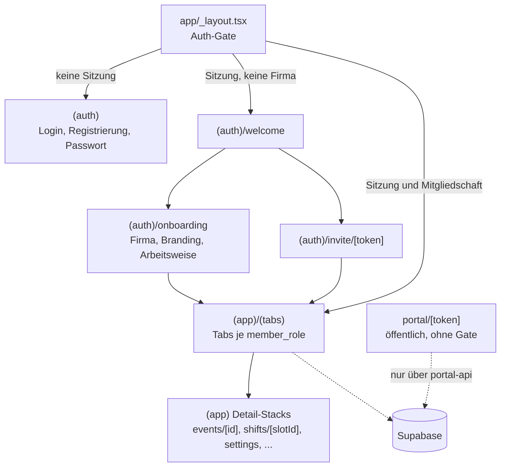
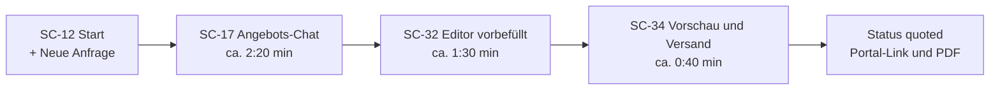
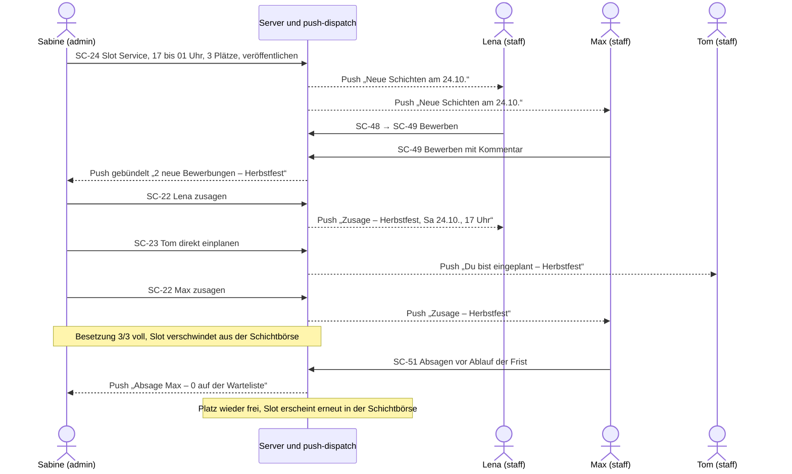
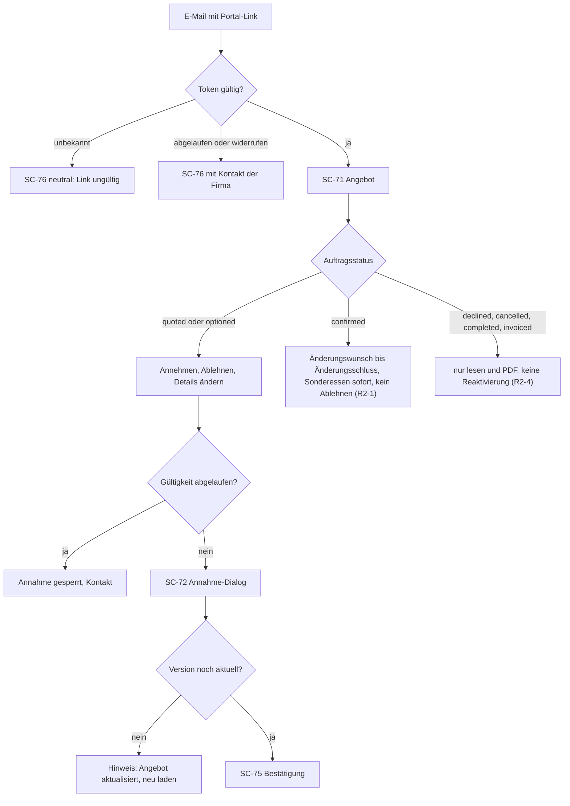

# 04 – Screens & UX

Stand: 17.10.2026 · Arbeitstitel: catering-app · Grundlage: `docs/00-entscheidungen.md` (verbindlich), `docs/01-produkt.md`, `docs/02-ablaeufe.md`

**Lesehilfe**

- Inhalte ohne Markierung setzen 00, 01 und 02 um. **[Vorschlag]** markiert eine begründete Empfehlung zu einem offenen Punkt; bis zur Freigabe gilt sie als Arbeitsannahme.
- **entschieden (R2-x)** markiert einen Punkt, den der Gründer in Runde 2 entschieden hat (00 §9, R2-1 bis R2-14). Diese Entscheidungen haben Vorrang vor allen abweichenden Vorschlägen in 01–06; frühere abweichende Vorschläge sind hier korrigiert.
- Screens tragen IDs `SC-xx`. User Stories (`US-xx`) und Features (`F-xx`) verweisen auf 01, Abschnittsangaben „02 §x“ auf 02.
- Routen sind relativ zu `app/` angegeben. Routen-Segmente sind englisch (Code), die Oberfläche ist deutsch.
- Es gibt noch keinen Code. Der Dateibaum in Abschnitt 1.2 ist die **Soll-Struktur**.
- Ansprache: Team-App duzt, Kundenportal und E-Mails an Endkunden siezen (02, Anhang Nr. 9).

**Inhalt**

0. Abhängigkeiten zu 01/02, die Screens betreffen
1. Navigationsstruktur
2. Screen-Inventar (SC-01 bis SC-76) und Schlüssel-Screens im Detail
3. Zustände je Screen-Typ
4. Design-Prinzipien und Design-Tokens
5. Appllama-Rechercheplan
6. Wichtigste UX-Abläufe
7. Vorschläge zur Freigabe und Stand der Entscheidungen

---

## 0. Abhängigkeiten zu 01/02, die Screens betreffen

| # | Thema | Stand | Auswirkung auf Screens | Umgang in diesem Dokument |
|---|---|---|---|---|
| 0.1 | Angebots-Chat (Fragenkatalog) | in 00 §3 verbindlich; Feature F-32 und Stories US-63 bis US-66 in 01; Ablauf und Feldzuordnung in 02 §11; Tabelle `intake_questions`, Felder `events.occasion` und `events.intake_answers`, RPC `create_event_from_intake` in 03 | SC-17, SC-64, SC-65, Einstiege in SC-12/SC-15/SC-36/SC-18 | Screens hier; Regeln und Daten in 01–03 nachgezogen |
| 0.2 | Kundenänderungen im Portal | **entschieden (R2-1, R2-6;** ersetzt den Vorschlag 06 E-10**)**: Regel aus 01 §4.2.3 – Menüwahl vor der Annahme wirkt direkt; Gästezahl und alle Änderungen nach der Bestätigung laufen als Änderungswunsch an den Admin (bestätigen oder ablehnen); ab ± 20 % Gästezahl Hinweis „bitte anrufen“; Sonderessen und Allergien gelten sofort. Änderungsschluss Standard 72 h (Event-Catering) bzw. 24 h (Business-Lunch) vor Beginn, je Auftrag änderbar; 02 §4 folgt | SC-74, SC-75, SC-28, Banner in SC-18 | Screens folgen dieser Regel |
| 0.3 | Erlaubte Statusübergänge | **entschieden (R2-2, R2-3, R2-4;** ersetzt den Vorschlag 06 E-8**)**: eine Übergangstabelle in 02 §1.1, 01 §4.2.1 verweist darauf. Direktbestätigung ohne Angebot erlaubt (R2-2); `completed` nur manuell (R2-3); **keine Rückwärts-Übergänge** und keine Funktion „Status korrigieren“, stattdessen Bestätigungsdialog vor jedem Statuswechsel (R2-4, 02 §1.1.1) | Statusaktionen in SC-18, SC-31 | Die Oberfläche bildet ihre Statusaktionen aus dieser Übergangstabelle (dieselbe, die `set_event_status()` prüft); keine fest verdrahteten Buttons, keine Korrektur- oder Reaktivierungsaktionen. Jede Statusaktion öffnet zuerst den Bestätigungsdialog SC-31. Primäraktion je Status: 2.10 |
| 0.4 | „Durchgeführt“ | **entschieden (R2-3)**: `completed` setzt nur der Admin; kein automatischer Wechsel, auch kein nächtlicher Job. Erinnerung am Tag nach dem Event um 09:00 (Job `events_completion`, Kategorie `completion_due`, 02 A22) mit Sammelaktion (01 US-11.5) | Karte „Als durchgeführt markieren“ in SC-12 | Karte bleibt; die Sammelaktion läuft über den Bestätigungsdialog SC-31 |
| 0.5 | Datenbasis der Küchenlisten | entschieden (06 E-16, **[Vorschlag]**): verbindliche Revision (01 §4.2.3, `quotes.binding_snapshot`) | Hinweisbanner in SC-13, SC-25, SC-44, SC-46 | Banner „Änderung offen: Gästezahl 80 → 95“; nie die Entwurfszahl als Menge |
| 0.6 | „Revision“ vs. „Version“ | 01 nutzt „Revision“, 02 im Portal „Version“ | Portal-Texte | **[Vorschlag]** Team-App „Revision“, Portal „Version“ (laienverständlich, Persona 2.4 in 01) |
| 0.7 | Küchen-Gerät | **entschieden (R2-8)**: kein Küchen-Tablet; die Küche nutzt Smartphones mit der nativen App (offline lesbar). Tablet-Optimierung nach dem MVP (01 P-23) | SC-13, SC-25, SC-44 – SC-46, Layouts 1.4 | Küchen-Screens nur für Smartphone und Web gestaltet; keine Tablet-Layouts im MVP |
| 0.8 | Schichtbörse bei Verschiebung | **entschieden (R2-10)**: kein Sonderabsagerecht; immer die normale Absagefrist (Standard 48 h, pro Firma einstellbar), gerechnet ab der neuen Schichtzeit; Eingeplante und Bewerber werden über jede Zeitänderung benachrichtigt (02 §5.7, S12) | SC-24, SC-29, SC-51 | Kein Hinweis auf Sonderabsage; Hinweis „Eingeplante werden benachrichtigt“ |
| 0.9 | Datenexport | **entschieden (R2-14**; ersetzt den Browser-Export aus 06 E-17**)**: Hintergrund-Export über `request_data_export()` und Edge Function `export-company`, ZIP im privaten Bucket `exports` unter `{company_id}/{data_export_id}.zip`, E-Mail „Export bereit“ (02 D1) mit signiertem Link, 7 Tage gültig, danach automatische Löschung (Job `exports_cleanup`); Protokoll und Status in `data_exports` (02 §10.2) | SC-67, SC-36, SC-68 | Kein Download im Browser; Screens zeigen nur Anforderung und Exportliste mit Status |
| 0.10 | Konto und Firma löschen | **entschieden (R2-12, R2-13)**: Edge Function `delete-account` (inkl. Widerruf von Sign in with Apple) und `purge-company` (löscht 30 Tage nach dem Antrag alle Daten und Dateien der Firma) sind freigegeben | SC-68, SC-67 | Dialoge nennen die Folgen (3.3 Regel 7) |

---

## 1. Navigationsstruktur

### 1.1 Grundsätze

1. **Drei Bereiche, drei Layouts:** `(auth)` für Anmeldung, Registrierung, Einladung und Onboarding; `(app)` für die Team-App mit rollenabhängigen Tabs; `portal/[token]` als öffentliches Kundenportal (Web) ohne App-Shell.
2. **Auth-Gate im Root-Layout:** keine Sitzung → `(auth)/login`; Sitzung ohne Mitgliedschaft → `(auth)/welcome`; admin mit nicht abgeschlossenem Onboarding → `(auth)/onboarding/*` (`companies.onboarding_completed_at` ist leer, gelesen über `company_profile`); Sitzung mit Mitgliedschaft → `(app)`. `portal/[token]` und `(auth)/invite/[token]` sind vom Gate ausgenommen.
3. **Rollenabhängige Tabs:** Ein Tabs-Layout in `(app)/(tabs)`. Alle Tab-Routen existieren für alle Rollen; sichtbar sind nur die der Rolle (`href: null` für die übrigen). Ausgeblendete Tab-Routen bleiben für berechtigte Rollen über „Mehr“ bzw. die Sidebar erreichbar; die eigene Tab-Leisten-Komponente markiert dann „Mehr“ als aktiv **[Vorschlag]**.
4. **Route-Guard:** Ruft eine Rolle eine Route ohne Recht auf (Deep Link, alter Push), leitet die App auf den ersten Tab der Rolle um und zeigt „Kein Zugriff auf diesen Bereich“. Rechte setzt immer der Server durch (01 §3.3); die Oberfläche blendet nur aus.
5. **Details außerhalb der Tabs:** Detail- und Bearbeitungsrouten liegen als Stack in `(app)`, nicht in `(tabs)`. Damit hat jedes Objekt genau eine URL (Push, E-Mail, Web-Lesezeichen). Auf Mobil verdecken Detailseiten die Tab-Leiste (mehr Platz für Aktionsleisten, Zurück-Geste) **[Vorschlag]**.
6. **Bearbeiten:** Mobil als Modal (`presentation: 'modal'`) oder Bottom Sheet; im Web als Dialog (max. 560 px) oder Seitenpanel (480 px).
7. **Plattformdateien:** Web-only-Funktionen (Abo, Datenexport der Firma, Firmenlöschung) nutzen `*.web.tsx`; der Export selbst entsteht im Hintergrund und kommt als Download-Link per E-Mail, nicht als Browser-Download (R2-14); die gleichnamige Datei ohne Endung zeigt nativ nur einen neutralen Hinweis ohne Preis, Kauf-Button oder Kauf-Link (00 §5, US-56.7).

### 1.2 Expo-Router-Dateibaum (Soll)

```text
app/
├── _layout.tsx                    Root: Provider (Sitzung, Daten-Cache, Theme), Auth-Gate, Banner-Host
├── +not-found.tsx                 „Seite nicht gefunden“
├── (auth)/
│   ├── _layout.tsx                Stack ohne Tabs
│   ├── login.tsx                  SC-01
│   ├── register.tsx               SC-02
│   ├── verify-email.tsx           SC-03
│   ├── forgot-password.tsx        SC-04
│   ├── reset-password.tsx         SC-05
│   ├── invite/[token].tsx         SC-06  Universal Link, auch mit Sitzung erreichbar
│   ├── welcome.tsx                SC-07  Firma anlegen oder Einladung
│   └── onboarding/
│       ├── _layout.tsx            Wizard-Stack, Fortschritt „Schritt x von 3“
│       ├── company.tsx            SC-08
│       ├── branding.tsx           SC-09
│       ├── defaults.tsx           SC-10
│       └── done.tsx               SC-11
├── (app)/
│   ├── _layout.tsx                Guard (Sitzung + company_members); Shell: Mobil Stack, Web ≥ 1024 px Sidebar
│   ├── (tabs)/
│   │   ├── _layout.tsx            Tabs, Sichtbarkeit je member_role (1.3)
│   │   ├── index.tsx              Weiterleitung auf den ersten Tab der Rolle
│   │   ├── start.tsx              SC-12  admin
│   │   ├── events.tsx             SC-15  admin
│   │   ├── calendar.tsx           SC-14  alle Rollen
│   │   ├── staffing.tsx           SC-47  admin
│   │   ├── today.tsx              SC-13  kitchen
│   │   ├── production.tsx         SC-44, SC-45 (Ansicht ?view=dietary)  kitchen; admin über Mehr
│   │   ├── shopping.tsx           SC-46  kitchen; admin über Mehr
│   │   ├── dishes.tsx             SC-38  kitchen; admin über Mehr
│   │   ├── my-shifts.tsx          SC-50  staff; kitchen über Mehr
│   │   ├── shift-board.tsx        SC-48  staff; kitchen über Mehr
│   │   └── more.tsx               SC-53  alle Rollen
│   ├── notifications.tsx          SC-52  über Glocke
│   ├── events/
│   │   ├── new.tsx                SC-16  Modal
│   │   ├── intake.tsx             SC-17  Angebots-Chat, Vollbild, optional ?eventId=
│   │   └── [id]/
│   │       ├── _layout.tsx        SC-18  Kopf + Top-Tabs
│   │       ├── index.tsx          SC-19  Übersicht
│   │       ├── quote.tsx          SC-20  Angebot
│   │       ├── staffing.tsx       SC-21  Personal
│   │       ├── kitchen.tsx        SC-25  Küche
│   │       ├── schedule.tsx       SC-26  Zeitplan
│   │       ├── portal.tsx         SC-28  Portal
│   │       ├── edit.tsx           SC-29  Modal
│   │       ├── copy.tsx           SC-30  Modal
│   │       ├── slots/[slotId].tsx SC-22
│   │       └── quote-editor/
│   │           ├── index.tsx      SC-32
│   │           └── send.tsx       SC-34
│   ├── customers/
│   │   ├── index.tsx              SC-35
│   │   ├── new.tsx                SC-37  Modal
│   │   └── [id]/
│   │       ├── index.tsx          SC-36
│   │       └── edit.tsx           SC-37  Modal
│   ├── dishes/
│   │   ├── new.tsx                SC-39
│   │   └── [id].tsx               SC-39
│   ├── packages/
│   │   ├── index.tsx              SC-40
│   │   ├── new.tsx                SC-41
│   │   └── [id].tsx               SC-41
│   ├── ingredients/index.tsx      SC-42
│   ├── shifts/[slotId].tsx        SC-49 (vor Zusage) / SC-51 (nach Zusage)
│   ├── team/
│   │   ├── index.tsx              SC-54
│   │   └── [memberId].tsx         SC-56
│   ├── settings/
│   │   ├── index.tsx              SC-57
│   │   ├── company.tsx            SC-58
│   │   ├── branding.tsx           SC-59
│   │   ├── tax-rates.tsx          SC-60
│   │   ├── qualifications.tsx     SC-61
│   │   ├── defaults.tsx           SC-62
│   │   ├── quote-texts.tsx        SC-63
│   │   ├── questionnaire.tsx      SC-64
│   │   ├── subscription.tsx       SC-66  nativ: nur neutraler Abo-Status
│   │   ├── subscription.web.tsx   SC-66  Web: Stufen, Checkout, Verwaltung
│   │   ├── privacy.tsx            SC-67  nativ: Hinweis „im Web-Admin verfügbar“
│   │   └── privacy.web.tsx        SC-67  Web: Export anfordern (Link per E-Mail), AVV, Firma löschen
│   └── profile/
│       ├── index.tsx              SC-68
│       ├── notifications.tsx      SC-69
│       └── calendar-feed.tsx      SC-70
└── portal/
    └── [token]/
        ├── _layout.tsx            Portal-Shell: Branding, noindex, kein Auth-Gate; Fehlerzustand SC-76
        ├── index.tsx              SC-71 (Dialoge SC-72, SC-73)
        ├── changes.tsx            SC-74
        └── done.tsx               SC-75
```

Sheets und Dialoge ohne eigene Route: SC-23, SC-24, SC-27, SC-31, SC-33, SC-43, SC-55, SC-65, SC-72, SC-73.



### 1.3 Tab-Leisten je Rolle

Grundlage: 01 §3.4 **[Vorschlag]**, hier um Badges, Icons und Mehr-Inhalte ergänzt. Höchstens 5 Tabs. Die Glocke (SC-52) sitzt bei allen Rollen rechts in der Kopfzeile der Tab-Screens, mit Zähler ungelesener Einträge (US-52.1).

| Rolle | Tab 1 | Tab 2 | Tab 3 | Tab 4 | Tab 5 |
|---|---|---|---|---|---|
| `admin` | **Start** (Icon `home`) · SC-12 | **Aufträge** (`clipboard-list`) · SC-15 · Badge: offene Änderungswünsche | **Kalender** (`calendar`) · SC-14 | **Personal** (`users`) · SC-47 · Badge: offene Bewerbungen | **Mehr** (`menu`) · SC-53 |
| `kitchen` | **Heute** (`sun`) · SC-13 · Badge: „kurzfristig geändert“ | **Produktion** (`chef-hat`) · SC-44 | **Einkauf** (`shopping-cart`) · SC-46 | **Gerichte** (`utensils`) · SC-38 | **Mehr** · SC-53 |
| `staff` | **Einsätze** (`calendar-check`) · SC-50 · Badge: neue Entscheidungen | **Schichtbörse** (`search`) · SC-48 · Badge: neue passende Slots | **Kalender** · SC-14 | **Mehr** · SC-53 | – |

Icons: Lucide **[Vorschlag]** (4.5).

| Rolle | Inhalte von „Mehr“ (SC-53) |
|---|---|
| `admin` | Kunden · Gerichte · Pakete · Zutaten · Produktion · Einkauf · Team · Einstellungen · Abo-Status (neutral, mobil ohne Link) · Profil · Hilfe · Rechtliches · Abmelden |
| `kitchen` | Kalender · Schichtbörse · Meine Einsätze · Pakete (lesen) · Zutaten · Team (lesen) · Profil · Hilfe · Rechtliches · Abmelden |
| `staff` | Profil · Kalender-Abo · Benachrichtigungseinstellungen · Hilfe · Rechtliches · Abmelden |

**Schnellaktion admin [Vorschlag]:** Ein „+“-Button (FAB) auf Start, Aufträge und Kalender öffnet ein Aktionsblatt: „Anfrage im Chat erfassen“ (Standard, SC-17) · „Schnellerfassung“ (SC-16) · „Kunde anlegen“ (SC-37).

### 1.4 Web-Admin-Layout vs. Mobil

Die Breiten ab 768 px gelten für das **Web** (Expo Web, Portal). Die native App nutzt im MVP auf jedem Gerät das Phone-Layout; eigene Tablet-Layouts und Tablet-Unterstützung im Build gibt es im MVP nicht (entschieden R2-8; Tablet-Optimierung nach dem MVP, 01 P-23).

| Bereich | < 768 px (Phone, native App) | 768–1023 px (schmales Web-Fenster) | ≥ 1024 px (Web-Admin) | ≥ 1280 px |
|---|---|---|---|---|
| Navigation | Bottom-Tabs | Bottom-Tabs | Sidebar 240 px, einklappbar auf 72 px; Kopfzeile mit Suche, „+ Neue Anfrage“, Glocke, Profil | wie 1024 |
| Listen | Zeilen/Karten, Filter als Chips + Sheet | Zeilen | Tabelle mit Spalten, Sortierung, Filterleiste | wie 1024 |
| Auftragsdetail (SC-18) | Kopf kompakt, Top-Tabs horizontal scrollbar, Aktionsleiste unten | Top-Tabs | Kopf + Tabs, rechte Infospalte 320 px (Status, Kunde, nächste Schritte) | wie 1024 |
| Angebots-Editor (SC-32) | Positionsliste + Summenleiste sticky unten; Position als Sheet | 2 Spalten: Positionen · Summen | 2 Spalten + Katalog als ausklappbares Seitenpanel | 3 Spalten: Katalog · Positionen · Kalkulation |
| Formulare | Vollbild-Modal oder Sheet | Sheet zentriert (max. 600 px) | Dialog oder Seitenpanel | wie 1024 |
| Kalender (SC-14) | Monat, Liste | Monat, Woche, Liste **[Vorschlag]** | Monat, Woche, Liste | wie 1024 |
| Küche (SC-13, SC-44, SC-46) | 1 Spalte, große Ziele (Smartphone in der Küche, R2-8) | 1 Spalte wie Phone, max. 720 px (kein Küchen-Tablet-Layout im MVP) | zusätzlich Druckansicht A4, schwarz-weiß tauglich | wie 1024 |
| Kundenportal | 1 Spalte ab 360 px, Aktionsleiste sticky unten | 1 Spalte, max. 720 px | 2 Spalten: Inhalt + sticky Summenkarte mit Aktionen | max. 1120 px |

Sidebar-Gliederung im Web (nur Einträge der Rolle):

| Gruppe | `admin` | `kitchen` | `staff` |
|---|---|---|---|
| Übersicht | Start · Aufträge · Kalender · Personal | Heute · Kalender | Einsätze · Schichtbörse · Kalender |
| Stammdaten | Kunden · Gerichte · Pakete · Zutaten | Gerichte · Pakete · Zutaten | – |
| Küche | Produktion · Einkauf | Produktion · Einkauf | – |
| Personal | – | Schichtbörse · Meine Einsätze | – |
| Verwaltung | Team · Einstellungen · Abo | Team (lesen) | – |
| unten | Testphasen-Hinweis · Profil · Abmelden | Profil · Abmelden | Profil · Abmelden |

`staff` ist im Web nutzbar, aber nicht optimiert (01 §3.4).

```text
Web ≥ 1024 px – Shell
┌──────────────┬──────────────────────────────────────────────────────────────┐
│ catering-app │ [Suche Aufträge, Kunden]      [+ Neue Anfrage] [Glocke 3] [SK] │
│              ├──────────────────────────────────────────────────────────────┤
│ ÜBERSICHT    │ Aufträge › Herbstfest Müller GmbH                              │
│ Start        │ ┌──────────────────────────────────────────┬─────────────────┐ │
│ Aufträge  2  │ │ Übersicht  Angebot  Personal  Küche  ... │ Status          │ │
│ Kalender     │ │                                          │ Bestätigt       │ │
│ Personal  5  │ │  Inhalt des Tabs                         │ Kunde, Termin   │ │
│ STAMMDATEN   │ │                                          │ Nächste Schritte│ │
│ Kunden       │ │                                          │                 │ │
│ ...          │ └──────────────────────────────────────────┴─────────────────┘ │
│ Testphase:   │                                                                │
│ noch 9 Tage  │                                                                │
└──────────────┴──────────────────────────────────────────────────────────────┘
```

Umsetzung **[Vorschlag]**: Headless-Tabs aus `expo-router/ui` (TabList, TabTrigger, TabSlot) mit eigener Tab-Leiste (Mobil) bzw. Sidebar (≥ 1024 px). Beides teilt dieselben Routen und dieselbe Rollenfilterung. Entscheidung beim ersten Prototyp; Alternative: React-Navigation-Tabs mit seitlicher Tab-Leiste.

### 1.5 Deep Links

| Auslöser | Ziel-Route | Rolle |
|---|---|---|
| E-Mail Einladung | `/invite/[token]` | neue Mitglieder |
| E-Mail Passwort-Reset | `/reset-password` | alle |
| E-Mail Angebot, Bestätigung, Änderung | `/portal/[token]` (immer Browser) | Endkunde |
| Push neue Bewerbung (einzeln/gebündelt) | `/events/[id]/slots/[slotId]` bzw. `/staffing?filter=bewerbungen` | admin |
| Push Absage durch Mitglied | `/events/[id]/slots/[slotId]` | admin |
| Push neue passende Slots | `/shift-board` | staff, kitchen |
| Push Zusage, Einplanung, Einsatz geändert, Erinnerung 24 h | `/shifts/[slotId]` | staff, kitchen |
| Push Einsatz entfällt, ausgeplant | `/my-shifts` (Eintrag hervorgehoben) | staff, kitchen |
| Push Angebot angenommen/abgelehnt, Änderung bestätigt | `/events/[id]/quote` | admin |
| Push Änderungswunsch | `/events/[id]/portal` | admin |
| Push Sonderessen aktualisiert | `/events/[id]/kitchen` (admin, kitchen) · `/shifts/[slotId]` (staff) | alle |
| Push neuer bestätigter Auftrag, Storno, Gästezahl geändert | `/events/[id]/kitchen` | kitchen |
| Push Option läuft ab | `/events/[id]` | admin |
| Push „Aufträge als durchgeführt markieren“ (Folgetag 09:00, Job `events_completion`, 02 A22; kein automatischer Statuswechsel, R2-3) | `/start` (Sammelaktion mit Bestätigungsdialog SC-31) | admin |
| Push unbesetzte Slots | `/staffing?filter=unbesetzt` | admin |
| Push Mitglied beigetreten | `/team/[memberId]` | admin |
| E-Mail Testphase, Zahlung fehlgeschlagen | `/settings/subscription` (Web) | admin |
| E-Mail „Export bereit“ (02 D1, R2-14) | signierter Download-Link auf die ZIP-Datei im Bucket `exports` (7 Tage gültig; kein App- oder Web-Admin-Link, kein Login nötig) | anfordernde Person |
| E-Mail „Export fehlgeschlagen“ (02 D2) | `/settings/privacy` (Web; bei eigenem Export `/profile`) | anfordernde Person |

- Fehlt beim Öffnen die Berechtigung (z. B. inzwischen ausgeplant), zeigt das Ziel einen Hinweis statt eines Fehlers (US-51.2).
- Universal Links **[Vorschlag]**: `/invite/*` und `/reset-password` öffnen die App, falls installiert. `/portal/*` ist bewusst ausgenommen und öffnet immer den Browser (Endkunden haben keine App, Mitglieder sollen die Kundensicht sehen).

---

## 2. Screen-Inventar

**Legende** · Plattform: **M** = iOS/Android-App · **W** = Web (Expo Web) · **M+W** = beide · Rollen gemäß `member_role`; Endkunde = Portal-Token · „Sheet in SC-xx“ = Bottom Sheet (Mobil) bzw. Dialog/Seitenpanel (Web) ohne eigene Route.

### 2.1 Auth & Onboarding

| ID | Name | Route | Rolle(n) | Plattform | Zweck | Kernelemente | Haupt-Aktionen | US / Thema |
|---|---|---|---|---|---|---|---|---|
| SC-01 | Login | `(auth)/login` | alle Mitglieder | M+W | Anmelden | E-Mail, Passwort (einblendbar), „Mit Apple anmelden“ (iOS, Web), „Mit Google anmelden“, Links Registrieren und Passwort vergessen, Hinweis „Anmeldung nur online“ | Anmelden | US-02 · Konto |
| SC-02 | Registrierung | `(auth)/register` | neue Nutzer | M+W | Konto anlegen | E-Mail, Passwort mit Anforderungen, Apple/Google, Links Nutzungsbedingungen und Datenschutz; im Einladungskontext E-Mail vorbefüllt und Firmenhinweis; Fehler „Konto existiert bereits“ | Konto erstellen | US-01.1, US-01.5, US-06.2, US-62.2 · Konto |
| SC-03 | E-Mail bestätigen | `(auth)/verify-email` | neue Nutzer (Passwort) | M+W | Bestätigung, ohne zu blockieren | Adresse, „E-Mail-App öffnen“, „Erneut senden“ (Sperre 60 s **[Vorschlag]**), „Weiter einrichten“; Hinweis: Versand von Angeboten und Einladungen erst nach Bestätigung | Erneut senden · Weiter | US-01.7 · Konto |
| SC-04 | Passwort vergessen | `(auth)/forgot-password` | alle | M+W | Reset anfordern | E-Mail; neutrale Bestätigung „Falls ein Konto existiert, ist ein Link unterwegs“ | Link senden | US-02.3 · Konto |
| SC-05 | Neues Passwort | `(auth)/reset-password` | alle | M+W | Passwort aus Mail-Link setzen | Passwort, Wiederholung; Fehler „Link abgelaufen“ mit „Neuen Link anfordern“ | Speichern und anmelden | US-02.3 · Konto |
| SC-06 | Einladung annehmen | `(auth)/invite/[token]` | Eingeladene | M+W | Firma per Link beitreten | Karte „{Firma} lädt dich als {Rolle} ein“, vorgesehene Qualifikationen, gültig bis; ohne Sitzung Registrieren/Anmelden (E-Mail vorbefüllt, Apple/Google); Fehler: ungültig, abgelaufen, widerrufen, „Du bist bereits Mitglied bei {Firma A}“; nach Beitritt Push-Erklärung vor der Systemabfrage | Beitreten · Registrieren · Anmelden | US-06, US-51 · Team |
| SC-07 | Willkommen | `(auth)/welcome` | Konto ohne Firma | M+W | Weg wählen | Karten „Neue Firma anlegen“ und „Ich habe eine Einladung“ (Link einfügen), Abmelden | Firma anlegen · Einladung öffnen | US-01.1, US-01.6, US-02.5 · Konto |
| SC-08 | Onboarding 1 · Firma | `(auth)/onboarding/company` | Gründer (wird `admin`) | M+W | Pflichtdaten, Firma und Testphase anlegen | Pflicht: Firmenname, Land (DE; AT/CH sichtbar, deaktiviert „bald verfügbar“), Kontakt-E-Mail (Reply-To; bei Apple-Relay leer), AVV-Checkbox mit PDF-Link. Optional: Telefon, Anschrift (für den Versand nötig **[Vorschlag]**: hier optional, Prüfung vor Versand). Fortschritt 1/3 | Firma anlegen und Testphase starten | US-01.2, US-01.4, US-62.1 · Firma |
| SC-09 | Onboarding 2 · Branding | `(auth)/onboarding/branding` | admin | M+W | Logo und Akzentfarbe | Logo-Upload (PNG/JPG ≤ 2 MB), Farbwahl (8 Vorschläge + Hex), Kontrastwarnung, Live-Vorschau Portal-Kopf und PDF-Kopf | Weiter · Überspringen | US-01.3, US-03 · Firma |
| SC-10 | Onboarding 3 · Arbeitsweise | `(auth)/onboarding/defaults` | admin | M+W | vorbelegte Standards bestätigen | Catering-Arten (Event, Business-Lunch), Standard-Kalkulationsart, Absagefrist (48 h, R2-10), Änderungsschluss (Event-Catering 72 h, Business-Lunch 24 h, R2-6), DE-Steuersätze als Liste mit „Von mir geprüft“ | Übernehmen · Überspringen | US-04, 02 §7.1 · Einstellungen |
| SC-11 | Onboarding · Fertig | `(auth)/onboarding/done` | admin | M+W | Abschluss, nächste Schritte | „Testphase bis {Datum}“ (mobil ohne Preis/Link), drei Startaufgaben: Team einladen, erstes Gericht anlegen, Probe-Angebot an dich selbst; Push-Erklärung | Zur Startseite | US-55.1, US-51 · Testphase |

**Onboarding-Prinzip:** Pflicht ist nur Schritt 1 (setzt „Firmen-Setup in einem Schritt“ aus F-01 um). Schritte 2–3 sind überspringbar; Restaufgaben erscheinen als Setup-Checkliste auf SC-12 (02 §7.1), bis alle erledigt oder ausgeblendet sind.

### 2.2 Start, Kalender, Aufträge

| ID | Name | Route | Rolle(n) | Plattform | Zweck | Kernelemente | Haupt-Aktionen | US / Thema |
|---|---|---|---|---|---|---|---|---|
| SC-12 | Start | `(tabs)/start` | admin | M+W | Was ist heute zu tun? | Setup-Checkliste (bis erledigt); Karte „Heute und morgen“; Karte „Zu erledigen“ mit Zählern: Anfragen ohne Angebot > 24 h, Optionen mit Ablauf ≤ 3 Tage, offene Änderungswünsche, abgelaufene Angebote, unbesetzte Slots 7 Tage, offene Bewerbungen, „als durchgeführt markieren“ (0.4: `confirmed` mit Ende gestern oder früher; nur manuell, R2-3); Testphasen-Hinweis; FAB „+“; Web: Karten zweispaltig | Neue Anfrage · Eintrag öffnen · Sammelaktion „Durchgeführt“ (Auswahl der Aufträge → Bestätigungsdialog SC-31 mit Liste) | US-17, US-11.5, US-11.10, US-55.2 · Startübersicht |
| SC-13 | Heute | `(tabs)/today` | kitchen | M (Smartphone; kein Küchen-Tablet, R2-8) + W; **offline nur in der nativen App**, im Web nur online | Tagesüberblick Küche | Umschalter Heute/Morgen; Auftragskarten: Titel, Gäste (verbindlicher Stand), Abfahrt und Ausgabe aus dem Zeitplan, Anzahl Sonderessen, Hinweise Küche; Badges „vorläufig“, „Änderung offen“, „kurzfristig geändert“ (oben, bis geöffnet); „Stand: …“; keine Preise | Auftrag öffnen (SC-25) · Produktion für diesen Tag | US-37 · Küche |
| SC-14 | Kalender | `(tabs)/calendar` | admin, kitchen, staff | M+W | Termine überblicken | Ansichten Monat · Woche (nur Web, dort schon ab 768 px **[Vorschlag]**; 01: nur Web; native App ohne Wochenansicht, da kein Tablet-Layout im MVP, R2-8) · Liste; Statusdarstellung nach 4.3; admin: Filter Status und Art; staff: Schalter „offene passende Slots“; Fortsetzung über Mitternacht; „Stand: …“ offline | Eintrag öffnen (admin, kitchen → SC-18; staff → SC-51/SC-49) · admin: Tag lange drücken → Neue Anfrage | US-15 · Kalender |
| SC-15 | Aufträge | `(tabs)/events` | admin | M+W | Aufträge finden und filtern | Suche (Titel, Kunde, Ort, Angebotsnummer); Filterchips Status (Standard „Anstehend“), Zeitraum, Art, Kunde; Trefferzahl; Zeile: Datum, Titel, Kunde, Gäste, Statusbadge, Hinweis-Icons (Option läuft ab, Änderungswunsch, ungesendete Änderungen); Web: sortierbare Tabelle | Neue Anfrage (Chat/Formular) · Öffnen · Kopieren (Kontextmenü) | US-16, US-13 · Aufträge |
| SC-16 | Schnellerfassung Anfrage | `events/new` (Modal) | admin | M+W | Anfrage in < 2 min ohne Chat | Kunde (Suche ab 2 Zeichen oder neu inline), Pflicht: Art, Datum, Beginn; Ende (+1 Tag), Titel (Hinweis „Eingeplantes Personal sieht den Titel“), Ort, Gästezahl, Ansprechpartner vor Ort, Hinweise Küche und Personal, interne Notiz; Warnungen „Am {Datum} bereits {n} Aufträge“, Datum in der Vergangenheit | Speichern · Speichern und Angebot erstellen | US-10, US-09.2 · Aufträge |
| SC-17 | Angebots-Chat | `events/intake` (Vollbild, optional `?eventId=`) | admin | M+W | Anfrage geführt erfassen, z. B. am Telefon | Chatverlauf (Frage links, Antwort rechts, antippbar zum Ändern), Antwortfeld je Typ in der Daumenzone, Fortschritt „Frage 5 von ca. 11“, „Überspringen“ nur bei optionalen Fragen, Live-Zusammenfassung (Web rechte Spalte, mobil einblendbar), Abschlusskarte mit allen Feldern und Titelvorschlag; Details 2.11 | Antworten · Antwort ändern · Auftrag anlegen und Angebot öffnen · Verwerfen | F-32: US-63, US-64; US-10, US-23 · Angebot |
| SC-18 | Auftragsdetail (Rahmen) | `events/[id]/_layout` | admin; kitchen (ab `optioned`, Tabs Übersicht, Personal, Küche, Zeitplan, lesend) | M+W | ein Auftrag, alle Aspekte | Kopf: Titel, Datum/Zeit, Kunde (nur admin), Gäste, Statusbadge, Primäraktion je Status (2.10), Überlauf-Menü (nur Vorwärts-Übergänge, keine Korrektur, R2-4); Banner: Änderungswunsch, Option abgelaufen, ungesendete Änderungen; Top-Tabs Übersicht · Angebot · Personal · Küche · Zeitplan · Portal (rollengefiltert); Web: rechte Infospalte | Statuswechsel (immer über den Bestätigungsdialog SC-31) · Kopieren · Bearbeiten | US-11, US-12, US-13, US-36.1 · Aufträge |
| SC-19 | Tab Übersicht | `events/[id]` | admin, kitchen | M+W | Stammdaten | Art, Anlass, Ort (öffnet Karten-App), Ansprechpartner vor Ort (Anruf), Hinweise Küche und Personal, interne Notiz (admin), Notizen aus dem Angebots-Chat (admin), Statushistorie aufklappbar (admin) | Bearbeiten (SC-29) | US-10, US-11.7 · Aufträge |
| SC-20 | Tab Angebot | `events/[id]/quote` | admin | M+W | Angebotsstand und Versand | Angebotsnummer und Revision; Zustand (Entwurf · versendet am · angesehen am · angenommen am/von); Kurzsummen Netto, Brutto, Rohertrag; Positionen lesend; Revisionen mit PDF; Annahmeprotokoll; in `declined`, `cancelled`, `completed`, `invoiced` Bearbeiten und Versand gesperrt mit Hinweis „Abgelehnte oder stornierte Aufträge lassen sich nicht wieder öffnen – bitte Auftrag kopieren“ bzw. „Auftrag ist abgeschlossen“ (R2-4) | Angebot erstellen/bearbeiten (SC-32) · Senden/Erneut senden (SC-34) · Link kopieren · PDF · Gültigkeit verlängern · Änderungen verwerfen · in Endzuständen nur Kopieren (SC-30) | US-23.1, US-26.4, US-27, US-28, US-30.6 · Angebot |
| SC-21 | Tab Personal | `events/[id]/staffing` | admin (bearbeiten), kitchen (lesen über die View `event_staffing`: Slots, Zeiten, Besetzung, Vornamen der Eingeplanten, keine Bewerbungen) | M+W | Slots des Auftrags | Slot-Zeilen: Qualifikation, Zeit, Besetzung „2/3“ mit Balken, Zustand (Entwurf · offen · voll · abgesagt), „vorläufig“, Anzahl offener Bewerbungen (nur admin); Hinweis Stufe „Start“ (nur direkt einplanen); in `inquiry`/`quoted` Hinweis „Veröffentlichen ab Option“ | Slot anlegen (SC-24) · Alle veröffentlichen · Duplizieren · Slot öffnen (SC-22) | US-42, US-50.3 · Schichtbörse |
| SC-22 | Slot-Detail (Admin) | `events/[id]/slots/[slotId]` | admin | M+W | Bewerbungen entscheiden | Slot-Kopf (Zeit, Qualifikation, Treffpunkt, Besetzung); Abschnitte Eingeplant · Bewerbungen (inkl. Warteliste) · Verlauf (zurückgezogen, abgesagt, „nach Frist“, ausgeplant); je Person: Name, Qualifikationen, Kommentar, Bewerbungszeitpunkt, Einsätze der letzten 90 Tage, Überschneidungswarnung | Zusagen · Absagen · Übrige absagen · Einplanen (SC-23) · Ausplanen · Absage eintragen · Slot bearbeiten/schließen | US-45, US-46, US-47.4 · Schichtbörse |
| SC-23 | Einplanen | Sheet in SC-21/SC-22 | admin | M+W | direkt einplanen | Mitgliederliste, qualifizierte zuerst, Überschneidungshinweis, Mehrfachauswahl bis zur Zahl freier Plätze, Bestätigung „ohne passende Qualifikation einplanen“ | Einplanen | US-46 · Schichtbörse |
| SC-24 | Slot anlegen/bearbeiten | Sheet in SC-21/SC-22 | admin | M+W | Slot definieren | Pflicht: genau eine Qualifikation (Einfachauswahl, entschieden R2-9; Hinweis „Nur Mitglieder mit dieser Qualifikation sehen den Slot“), Beginn, Ende (vorbelegt aus Zeitplan), Anzahl; optional Bezeichnung, Treffpunkt-Hinweis, Dresscode; Fehler „Erst 1 Person ausplanen“; bei jeder Zeitänderung mit Eingeplanten oder Bewerbern Hinweis „{n} Personen werden über die neue Zeit benachrichtigt. Absage weiter nur bis {neuer Beginn − Absagefrist}“ (kein Sonderabsagerecht, entschieden R2-10) | Speichern · Speichern und veröffentlichen (ab `optioned`) | US-42 · Schichtbörse |
| SC-25 | Tab Küche | `events/[id]/kitchen` | admin, kitchen | M+W (offline nur nativ) | Produktion und Sonderessen eines Auftrags | Produktionsliste des Auftrags aus dem verbindlichen Stand (Gericht, Portionen, Allergen-Codes), Allergikerliste mit Ersatz und Konflikten (rot), Hinweise Küche, Banner nach 0.5; keine Preise | Sonderessen erfassen (SC-27) · Einkaufsliste für diesen Auftrag | US-37.2, US-40 · Küche |
| SC-26 | Tab Zeitplan | `events/[id]/schedule` | admin (bearbeiten), kitchen (lesen) | M+W | Ablauf mit Uhrzeiten | Zeitleiste: Typ-Icon (Abfahrt, Aufbau, Ausgabe, Abbau, Sonstiges), Beginn–Ende, Notiz; leer: „Standardablauf einfügen“ | Eintrag hinzufügen/bearbeiten · Standardablauf | US-14 · Aufträge |
| SC-27 | Sonderessen-Eintrag | Sheet in SC-25/SC-45 | admin, kitchen | M+W | Sonderessen erfassen | Pflicht: Anzahl; Diätform, 14 Allergene (Code + Klartext, Mehrfachauswahl), Gast/Tisch (optional, Datenschutzhinweis), Notiz, Ersatzpaare „statt X → Y“, Quelle (Kunde/intern); Prüfung Summe ≤ Gästezahl | Speichern · Löschen | US-40, US-35.3 · Allergene |
| SC-28 | Tab Portal | `events/[id]/portal` | admin | M+W | Kundensicht steuern | Link-Status (aktiv bis, abgelaufen, widerrufen), zuletzt angesehen; Änderungswunsch alt → neu mit Kommentar, ab ± 20 % Gästezahl als „wichtig“ mit Hinweis „Personalbedarf und Equipment prüfen“ (R2-1); Änderungsschluss des Auftrags; Schalter „Portal-Änderungen sperren“; Protokoll (Annahme, Änderungen) | Übernehmen · Ablehnen mit Begründung · Link kopieren · Als Kunde ansehen · Link neu erzeugen | US-30, US-36, 02 §4.3 · Kundenportal |
| SC-29 | Auftrag bearbeiten | `events/[id]/edit` (Modal) | admin | M+W | Stammdaten ändern | Felder wie SC-16 plus Anlass und **„Änderungen bis“** (Änderungsschluss des Portals, vorbelegt aus der Firmeneinstellung der Auftragsart – Event-Catering 72 h, Business-Lunch 24 h, entschieden R2-6 –, je Auftrag änderbar, leer = kein Änderungsschluss; 01 US-10.8); bei Zeitänderung mit Slots Dialog „Schichten verschieben / einzeln anpassen / nicht ändern“ mit Hinweis „Eingeplante und Bewerber werden über die neue Zeit benachrichtigt; es gilt die normale Absagefrist ab der neuen Schichtzeit“ (kein Sonderabsagerecht, R2-10; 02 §5.7) | Speichern | US-10, 02 §4.3, §5.7 · Aufträge |
| SC-30 | Auftrag kopieren | `events/[id]/copy` (Modal) | admin | M+W | Wiederholung, v. a. Business-Lunch | Neues Datum (Kurzwahl „gleicher Wochentag nächste Woche“), mehrere Termine (bis 10, Should), Startstatus „Anfrage“ (Standard) oder „Bestätigt“ (Direktbestätigung mit Bestätigungsweg, entschieden R2-2; vor dem Anlegen Bestätigungsdialog SC-31), Optionen Slots (an) und Sonderessen (aus), Hinweis „{n} Katalogpreise haben sich geändert“; einziger Weg für einen neuen Anlauf nach `declined` oder `cancelled` (keine Reaktivierung, R2-4) | Kopieren · Kopieren und senden | US-13 · Aufträge |
| SC-31 | Statuswechsel (Bestätigungsdialog) | Sheet in SC-18, SC-12 (Sammelaktion), SC-30 (Startstatus „Bestätigt“) | admin | M+W | Übergang mit Pflichtangaben und Bestätigung vor **jedem** Statuswechsel (entschieden R2-4, 02 §1.1.1) | Titel mit Auftrag und Zielstatus („Herbstfest Müller GmbH als abgerechnet markieren?“), bei Sammelaktionen Liste der Aufträge; Pflichtangaben je Übergang nach 02 §1.1: Optionieren bzw. Termin vormerken (optioniert bis, Pflicht), Annahme erfassen bzw. Direkt bestätigen (Bestätigungsweg, Bestätigungs-E-Mail an/aus; Direktbestätigung auch ohne versendetes Angebot, entschieden R2-2), Stornieren (Grund, Liste der Betroffenen, E-Mail an Kunde an/aus, Standard an), Ablehnung erfassen bzw. „Anfrage kommt nicht zustande“ (Grund), Durchgeführt (nur manuell, R2-3; Warnung „Das Event hat noch nicht stattgefunden“, wenn der Beginn in der Zukunft liegt), Abgerechnet (externe Rechnungsnummer); Folgen (wer benachrichtigt wird, was gesperrt wird, welche Slots abgesagt werden); fester Hinweis „Dieser Schritt kann nicht rückgängig gemacht werden.“; keine Korrektur- oder Reaktivierungsoption | „Abbrechen“ (Standard, hervorgehoben) · Aktion mit Zielstatus als Text („Als abgerechnet markieren“; bei Stornieren und Ablehnen in Warnfarbe) | US-11, US-11.10, US-12 · Status |

### 2.3 Angebot

| ID | Name | Route | Rolle(n) | Plattform | Zweck | Kernelemente | Haupt-Aktionen | US / Thema |
|---|---|---|---|---|---|---|---|---|
| SC-32 | Angebots-Editor | `events/[id]/quote-editor` | admin | M+W (Web optimiert) | Positionen, Kalkulation, Texte | Kopf: Gästezahl (skaliert pro-Person-Positionen), Preisanzeige netto/brutto, gültig bis, „Ihre Referenz“; Positionen mit Typ-Icon, Menge × Einzelpreis, Steuersatz, Allergen-Codes, Kennzeichen „manuell“, „archiviert“, „Paket geändert“; Wahlgruppen und Zwischenüberschriften; Kalkulation (Pauschal oder Wareneinsatz + Aufschlag mit Preisvorschlag, auf volle 10 Cent **aufgerundet**, z. B. 26,32 € → 26,40 € – entschieden R2-5; Wareneinsatz, Rohertrag € und %, Wareneinsatzquote); Summen (Netto, USt je Satz, Brutto, Anzahlung); Texte (Einleitung, Konditionen, Schlusstext) einklappbar; Warnungen (ungeprüfte Allergene, Wareneinsatz unvollständig, Steuersatz veraltet, Katalogpreise geändert); Entwurf speichert automatisch (nur online) **[Vorschlag]** | Position hinzufügen (SC-33) · Sortieren (Web Drag & Drop, Mobil „Verschieben“) · Wahlgruppe bilden · Aus Katalog aktualisieren · Vorschau und senden (SC-34) | US-23 – US-26, US-28.1 · Angebot |
| SC-33 | Position hinzufügen/bearbeiten | Sheet in SC-32 | admin | M+W | eine Position | Typwahl als 7 Kacheln (Paket, Gericht, Personal, Equipment, Anfahrt, Getränke, Frei = `package`, `dish`, `service`, `equipment`, `travel`, `beverage`, `custom`); Katalogsuche mit Filtern; Vorlagen; Felder Bezeichnung, Beschreibung, Menge, „pro Person“, Einheit, Einzelpreis netto (Kennzeichen „manuell“), Steuersatz, Wahlgruppe mit Standard, „Menge durch Kunden änderbar“; Allergene abgeleitet, lesend; Hilfetext zu Kindern: keine Kinderzahl und keine Kinderpreise im MVP – Kinder als eigene Position mit fester Menge (z. B. Paket „Kindermenü“), das Erwachsenen-Paket auf feste Menge (entschieden R2-11) | Hinzufügen · Weitere hinzufügen · Entfernen | US-23.2 – US-23.5, US-24.3, US-33.1, US-33.4 · Angebot |
| SC-34 | Vorschau und Versand | `events/[id]/quote-editor/send` | admin | M+W | prüfen und versenden | Prüfliste: Blocker rot (keine Position, Gästezahl fehlt, negative Summe, Kunde ohne E-Mail, Login-E-Mail unbestätigt, Lesemodus, Auftrag `declined`/`cancelled`/`completed`/`invoiced` – kein Versand aus Endzuständen, „bitte Auftrag kopieren“, R2-4), Warnungen gelb mit Bestätigung (ungeprüfte Allergene, Wareneinsatz unvollständig, Datum in der Vergangenheit, Steuersätze nicht geprüft); Vorschau-Umschalter Portal · PDF · E-Mail (Betreff/Text änderbar); Versandweg E-Mail oder „Link kopieren“; bei `confirmed`: „Bitte bestätigen“ (Standard) oder „Zur Info“; Ergebnis: Erfolg mit Link, Fehler „PDF fehlgeschlagen – erneut versuchen“ | Revision {n+1} versenden | US-27, US-28.3, US-29 · Angebot |

### 2.4 Kunden & Katalog

| ID | Name | Route | Rolle(n) | Plattform | Zweck | Kernelemente | Haupt-Aktionen | US / Thema |
|---|---|---|---|---|---|---|---|---|
| SC-35 | Kunden | `customers` | admin | M+W | Kunden finden | Suche ab 2 Zeichen (Name, Firma, E-Mail, Telefon), Filter privat/geschäftlich; Zeile: Name, Ansprechpartner, nächster Auftrag | Kunde anlegen · Öffnen | US-09 · Kunden |
| SC-36 | Kundendetail | `customers/[id]` | admin | M+W | Kunde mit Historie | Kontakt (Anruf, E-Mail), Rechnungsanschrift, Notiz, Aufträge mit Datum und Status | Neuer Auftrag (Chat, Kunde vorbelegt) · Bearbeiten · Kundendaten exportieren (Should; `request_data_export('customer', …)`, Hintergrund-Export, Toast „Du bekommst eine E-Mail mit dem Download-Link“, R2-14) · Anonymisieren/Löschen | US-09.4, US-61 · Kunden, Datenschutz |
| SC-37 | Kunde anlegen/bearbeiten | `customers/new`, `customers/[id]/edit` (Modal) | admin | M+W | Stammdaten | Typ, Pflicht: Name bzw. Firmenname; Ansprechpartner, E-Mail, Telefon, Rechnungsanschrift, Notiz; Hinweis „Möglicher Duplikat: {Kunde}“ mit Link | Speichern | US-09.1, US-09.5 · Kunden |
| SC-38 | Gerichte | `(tabs)/dishes` | kitchen (Tab), admin (Mehr/Sidebar) | M+W | Gerichte pflegen und finden | mobil oben Segment Gerichte / Pakete / Zutaten (wechselt zu SC-40, SC-42); Suche, Filter Kategorie, „ohne {Allergen}“, Diätform, „ungeprüft“, Archiv; Zeile: Name, Kategorie, Allergen-Codes, Diät-Kennzeichen, Prüfstatus, Preis (nur admin) | Gericht anlegen · Öffnen | US-21, US-22 · Gerichte |
| SC-39 | Gericht anlegen/bearbeiten | `dishes/new`, `dishes/[id]` | admin, kitchen | M+W | Gericht mit Allergenen und Zutaten | Pflicht: Name; Beschreibung, Kategorie, Portionsbezeichnung; Preis netto und Steuersatz (nur admin); Allergen-Raster 14 × Ja/Nein mit Status „ungeprüft“ bzw. „geprüft von … am …“; Diätformen („vegan“ setzt „vegetarisch“), Widerspruchswarnung; Zutaten mit Menge p. P. (neue Zutat inline) und Hinweis am Feld „Einkaufsmenge der Rohware vor dem Garen, z. B. 180 g rohe Rinderschulter“ (01 US-19.2, entschieden R2-7); Wareneinsatz pro Portion live (nur admin, „unvollständig“); Hinweis „Betrifft {n} Aufträge“ | Speichern · Allergene geprüft · Archivieren · Löschen (ohne Verwendung) | US-18, US-19, US-21 · Gerichte, Allergene |
| SC-40 | Pakete | `packages` | admin (bearbeiten), kitchen (lesen) | M+W | Menüpakete überblicken | Liste: Name, Preis p. P. (nur admin), Anzahl Gerichte, abgeleitete Allergene und Diätformen, „Allergene ungeprüft“; Archiv-Filter | Paket anlegen · Öffnen | US-20, US-21 · Pakete |
| SC-41 | Paket anlegen/bearbeiten | `packages/new`, `packages/[id]` | admin (bearbeiten), kitchen (lesen, ohne Preis) | M+W | Paket zusammenstellen | Pflicht: Name, Preis netto p. P.; Beschreibung, Steuersatz, Gerichte sortierbar mit Portionsfaktor (Standard 1,0), abgeleitete Allergene und Diätformen, Wareneinsatz und Rohertrag p. P. (nur admin) | Gericht hinzufügen · Speichern · Archivieren | US-20 · Pakete |
| SC-42 | Zutaten | `ingredients` | admin, kitchen | M+W | Zutatenstamm | Suche, Warengruppe, Archiv; Zeile: Name, Basiseinheit, verwendet in {n} Gerichten; nur admin: Einkaufspreis je kg/l/Stück und „Preis fehlt“ | Zutat anlegen (SC-43) · Archivieren | US-19 · Zutaten |
| SC-43 | Zutat anlegen/bearbeiten | Sheet in SC-42/SC-39 | admin, kitchen | M+W | eine Zutat | Pflicht: Name (mit Vorschlag ähnlicher Zutaten), Basiseinheit (g, ml, Stück); Warengruppe; Einkaufspreis (nur admin) | Speichern | US-19.1, US-19.5 · Zutaten |

### 2.5 Küche

| ID | Name | Route | Rolle(n) | Plattform | Zweck | Kernelemente | Haupt-Aktionen | US / Thema |
|---|---|---|---|---|---|---|---|---|
| SC-44 | Produktion | `(tabs)/production` | kitchen (Tab), admin (Mehr/Sidebar) | M+W; **offline nur in der nativen App**, im Web nur online | Was in welcher Menge, Tag oder Woche (verbindlicher Stand, ohne Puffer, entschieden R2-7) | Zeitraum-Chips Heute · Morgen · Diese Woche · Zeitraum; Schalter „inkl. Optionen (vorläufig)“; Auftrags-Chips zum Abwählen; Segment Gerichte / Sonderessen; Liste Tag → Kategorie → Gericht mit Portionen gesamt (aufklappbar je Auftrag), Allergen-Codes; Konflikte rot oben; Banner nach 0.5; „Stand: …“ | Aufträge an-/abwählen · Druckansicht (Web, Should) · Zur Einkaufsliste (gleiche Auswahl) | US-38 · Küche |
| SC-45 | Sonderessen im Zeitraum | `(tabs)/production?view=dietary` | kitchen, admin | M+W | alle Sonderessen und Konflikte | gruppiert nach Auftrag: Anzahl, Diätform, Allergene im Klartext, Gast/Tisch, Ersatz, Konflikt, „kurzfristig“; Filter „nur Konflikte“ | Eintrag bearbeiten (SC-27) · Auftrag öffnen | US-40.2, US-38.4 · Allergene |
| SC-46 | Einkauf | `(tabs)/shopping` | kitchen (Tab), admin (Mehr/Sidebar) | M+W; **offline nur in der nativen App**, im Web nur online | Einkaufsliste | Zeitraum und Auftragsauswahl wie SC-44 (geteilt); Puffer % änderbar (Standard 5 %, nur hier, nicht in der Produktionsliste; entschieden R2-7); gruppiert nach Warengruppe; Mengen in g/kg, ml/l (ab 1.000 mit einer Nachkommastelle, aufgerundet), Stück; lokales Abhaken mit Fortschritt „12 von 30“; Abschnitt „Nicht berücksichtigt“; geschätzte Kosten nur admin (Should) | Teilen (Text) · CSV (Web) · Drucken (Web) · Haken zurücksetzen | US-39 · Küche |

### 2.6 Personal & Schichtbörse

| ID | Name | Route | Rolle(n) | Plattform | Zweck | Kernelemente | Haupt-Aktionen | US / Thema |
|---|---|---|---|---|---|---|---|---|
| SC-47 | Personal (Besetzung) | `(tabs)/staffing` | admin | M+W | Besetzung der nächsten 14 Tage | Auftragszeilen: Datum, Titel, Besetzung „4/6“ mit Farbe und Text (voll · teilweise · unbesetzt), offene Bewerbungen; Filter „nur unbesetzt“, „mit offenen Bewerbungen“ | Auftrag öffnen (SC-21) · Slot öffnen (SC-22) | US-50 · Schichtbörse |
| SC-48 | Schichtbörse – offene Slots | `(tabs)/shift-board` | staff (Tab), kitchen (Mehr) | M+W (Mobil optimiert) | passende Slots finden | nach Datum gruppierte Karten: Datum, Zeit, Slot-Titel/Qualifikation, PLZ + Ort, Eventart, Gäste, freie Plätze, Dresscode, „vorläufig“, Überschneidung, eigener Status; Filter Zeitraum; nur Slots, deren (einzige) Qualifikation das Mitglied hat – andere sind nicht sichtbar (entschieden R2-9); keine Kundendaten, keine Preise | Slot öffnen (SC-49) · Bewerben | US-43 · Schichtbörse |
| SC-49 | Slot-Detail vor Zusage | `shifts/[slotId]` | staff, kitchen | M+W | entscheiden und bewerben | Daten der Karte (Slot-Titel, Datum, Zeit, PLZ/Ort, Qualifikation, Dresscode, Eventart, Gäste, freie Plätze), „Termin noch nicht fest“, eigener Bewerbungsstatus (Beworben · Warteliste · Abgesagt durch Betrieb), Hinweis „Adresse, Treffpunkt und Ablauf siehst du nach der Zusage“ | Bewerben (Kommentar optional) · Zurückziehen · Erneut bewerben | US-43, US-44 · Schichtbörse |
| SC-50 | Meine Einsätze | `(tabs)/my-shifts` | staff (Tab), kitchen (Mehr) | M+W | eigene Planung: Einsätze und Bewerbungen | Segmente Kommend · Bewerbungen · Vergangen (90 Tage); Status im Klartext (4.3); Summe geplanter Stunden im Monat (Should); Kennzeichen „offline verfügbar“ | Einsatz öffnen (SC-51) · Bewerbung öffnen (SC-49) | US-49 · Einsätze |
| SC-51 | Einsatzdetail | `shifts/[slotId]` (bei `accepted`/`assigned`) | staff, kitchen | M+W | alles für den Einsatz, auch offline | Titel, Datum, Slot-Zeit, Adresse (Karten-App), Treffpunkt, Dresscode, Ablaufplan, Ansprechpartner vor Ort (Anruf), Hinweise Personal, Allergikerliste, Kolleg:innen (Vorname, Qualifikation), „Absage möglich bis {Wochentag, Datum, Uhrzeit}“ (Slot-Beginn minus Absagefrist, Standard 48 h; nach einer Verschiebung aus der neuen Zeit berechnet, kein Sonderabsagerecht, R2-10), geänderte Felder markiert („Neue Zeit“) | Route öffnen · Anrufen · Absagen (bis Frist; danach „Absage nur noch telefonisch“ mit Anruf-Button) | US-48, US-47 · Einsätze |

SC-49 und SC-51 teilen sich eine Route, damit Push-Links stabil bleiben: Der Screen zeigt je nach eigenem `application_status` die Vor- oder Nach-Zusage-Sicht.

### 2.7 Benachrichtigungen, Team, Einstellungen, Abo, Profil

| ID | Name | Route | Rolle(n) | Plattform | Zweck | Kernelemente | Haupt-Aktionen | US / Thema |
|---|---|---|---|---|---|---|---|---|
| SC-52 | Benachrichtigungen | `notifications` | alle | M+W | nachlesen | Liste 90 Tage, gruppiert Heute · Diese Woche · Älter, Ungelesen-Punkt, Kategorie-Icon; Banner bei verweigerter Push-Berechtigung mit Weg in die Systemeinstellungen; Abo-Einträge (Kategorie `billing`) nur neutral („Abo-Status: Lesemodus“), ohne Link, Preis oder Aufforderung (02 §6.3) | Eintrag öffnen · Alle als gelesen markieren | US-52, US-51.2, US-51.5 · Benachrichtigungen |
| SC-53 | Mehr | `(tabs)/more` | alle | M (Web: Sidebar) | weitere Bereiche | rollenabhängige Liste (1.3), Abo-Status neutral (admin, mobil ohne Link), Hilfe, Impressum und Datenschutz, App-Version | Bereich öffnen · Abmelden | US-55.2, US-62.2 |
| SC-54 | Team | `team` | admin (bearbeiten), kitchen (lesen: Name, Rolle, Telefon über die View `team_directory`) | M+W | Mitglieder und Einladungen | Segmente Mitglieder · Einladungen; Mitglied: Name, Rolle, Qualifikationen, Telefon, Beitritt; Einladung: Status (offen, angenommen, abgelaufen, widerrufen), gültig bis; Limit „8 von 15 Mitgliedern“ | Einladen (SC-55) · Erneut senden · Widerrufen · Link teilen | US-05, US-07 · Team |
| SC-55 | Mitglied einladen | Sheet in SC-54 | admin | M+W | Einladung erstellen | Name, Pflicht: Rolle (`admin`, `kitchen`, `staff` mit Kurzerklärung); Qualifikationen; E-Mail (optional bei „Link teilen“); Fehler „bereits Mitglied“, E-Mail unbestätigt, Limit – nativ neutral „Limit der aktuellen Stufe erreicht ({n} Mitglieder). Bitte ein Mitglied entfernen.“ ohne Kauf- oder Upgrade-Hinweis, im Web mit Link „Stufe wechseln“ (01 US-05.4) | Per E-Mail einladen · Link teilen | US-05 · Team |
| SC-56 | Mitglied | `team/[memberId]` | admin | M+W | Rolle, Qualifikationen, Entfernen | Kontakt, Rolle ändern (letzter Admin gesperrt), Qualifikationen zuordnen, künftige Einsätze, Einsätze der letzten 90 Tage; Entfernen-Dialog listet die Folgen | Speichern · Entfernen | US-07, US-41.2 · Team |
| SC-57 | Einstellungen | `settings` | admin | M+W | Einstieg | Gruppen: Firma · Branding · Steuersätze · Qualifikationen · Fristen & Standardwerte · Angebotstexte & Vorlagen · Fragenkatalog · Abo (Web) · Datenschutz & Export (Web) | Bereich öffnen | US-03, US-04 · Einstellungen |
| SC-58 | Firma | `settings/company` | admin | M+W | Stammdaten | Name, Anschrift, Telefon, Kontakt-E-Mail (Reply-To), Website, USt-IdNr. oder Steuernummer, Fußzeilentext, Links Datenschutzerklärung und Impressum der Firma (02 §10.1) | Speichern | US-03.1 · Einstellungen |
| SC-59 | Branding | `settings/branding` | admin | M+W | Logo und Akzentfarbe | wie SC-09, zusätzlich Vorschau der E-Mail; Hinweis „wirkt sofort auf Portal und neue PDFs, versendete PDFs bleiben unverändert“ | Speichern | US-03.2 – US-03.5 · Branding |
| SC-60 | Steuersätze | `settings/tax-rates` | admin | M+W | Sätze und Standards je Positionstyp | Liste: Bezeichnung, %, Standard für Positionstypen, aktiv; Land DE (AT/CH vorbereitet, nicht aktivierbar); „Von mir geprüft“; Prozentsatz bei Verwendung gesperrt | Satz anlegen · Deaktivieren · Standard setzen | US-04.2, US-04.3 · Einstellungen |
| SC-61 | Qualifikationen | `settings/qualifications` | admin | M+W | Qualifikationen pflegen | Liste mit Anzahl Mitglieder, Archiv, Vorlagen | Anlegen · Umbenennen · Archivieren | US-41 · Schichtbörse |
| SC-62 | Fristen & Standardwerte | `settings/defaults` | admin | M+W | Regeln des Betriebs | Absagefrist Schichtbörse in h (Standard 48; gilt auch nach Verschiebungen, kein Sonderabsagerecht – entschieden R2-10), Änderungsschluss Portal je Auftragsart (Event-Catering 72 h, Business-Lunch 24 h; gilt für neue Aufträge, je Auftrag änderbar – entschieden R2-6), Angebotsgültigkeit, Kalkulationsart, Aufschlag, Preisraster (Standard 0,10 €, immer aufrunden – entschieden R2-5), Puffer Einkauf (5 %, nur Einkaufsliste – entschieden R2-7), Option-Erinnerung; je Feld Erklärung mit Beispiel („Slot Sa 16:00 → Absage bis Do 16:00“) | Speichern | US-04, 01 §4.2.6 · Einstellungen |
| SC-63 | Angebotstexte & Vorlagen | `settings/quote-texts` | admin | M+W (Web optimiert) | Standardtexte und Positionsvorlagen | Einleitung, Konditionen (Zahlung, Anzahlung, Storno), Schlusstext, E-Mail-Text mit Platzhaltern, Positionsvorlagen (Servicekraft, Koch vor Ort, Anfahrt, Getränkepauschale) | Speichern | US-04.6, 02 §2.2 · Angebot |
| SC-64 | Fragenkatalog | `settings/questionnaire` | admin | M+W (Web optimiert) | Fragen für den Angebots-Chat (`intake_questions`) | sortierbare Fragenliste: Fragetext, Antworttyp-Icon, Feldzuordnung oder „Notiz“, Bedingungs-Badge („nur wenn Anlass = Hochzeit“), Pflicht/optional; Hinweis auf Standardkatalog | Frage anlegen (SC-65) · Sortieren · Testlauf (SC-17 ohne Speichern) · Standard wiederherstellen | F-32: US-65, US-66 |
| SC-65 | Frage bearbeiten | Sheet in SC-64 | admin | M+W | eine Frage | Pflicht: Fragetext, Antworttyp (Auswahl, Mehrfachauswahl, Zahl, Datum, Uhrzeit, Zeitspanne Beginn–Ende, Datum + Uhrzeit, Text, Ja/Nein, Kunde; Enum `intake_answer_type`); Antwortoptionen; Pflicht/optional; Feldzuordnung (nur zum Antworttyp passende Felder nach 02 §11.2, oder Notiz); Bedingung (frühere Frage + Vergleich + Wert); Hilfetext | Speichern · Archivieren | F-32: US-65 |
| SC-66 | Abo | `settings/subscription` (`.web.tsx` / nativ) | admin | W (nativ nur neutraler Status) | Abo abschließen und verwalten | Status (Testphase noch n Tage · aktiv · Zahlung offen · Lesemodus); Stufenkarten mit Preisen und Grenzen; Nutzung (Mitglieder, Admins); monatlich/jährlich; Empfehlung; „Zahlung wird verarbeitet“; nativ: „Abo-Status: …“ ohne Preis, Button, Link | Abo wählen (Stripe Checkout über `create-checkout-session`) · Verwalten (Stripe-Kundenportal) | US-55 – US-58 · Abo |
| SC-67 | Datenschutz & Export | `settings/privacy` (`.web.tsx` / nativ Hinweis) | admin | W | Pflichten nach DSGVO | Export anfordern (entschieden R2-14, ersetzt den Browser-Export aus 06 E-17): `request_data_export('company', null)` legt einen Eintrag in `data_exports` an, der Export entsteht im Hintergrund (Edge Function `export-company`), auch wenn das Fenster geschlossen wird; Bestätigung „Export wird erstellt – du bekommst eine E-Mail mit dem Download-Link“; kein Download im Browser. Exportliste aus `data_exports`: angefordert am/von, Umfang, Status (`queued` „In Warteschlange“ · `running` „Wird erstellt“ · `ready` „Bereit – Link per E-Mail, gültig bis {expires_at}“ · `failed` „Fehlgeschlagen – erneut anfordern“ · `expired` „Abgelaufen – neuen Export anfordern“); läuft bereits ein Export, zeigt der Button den laufenden statt eines zweiten. AVV als PDF mit Annahmedatum, Unterauftragsverarbeiter, Firma löschen (Export-Angebot, Firmenname eintippen, erneute Anmeldung; Hinweis auf sofortigen Zugriffsentzug, automatische Kündigung des Abos und endgültige Löschung aller Daten und Dateien nach 30 Tagen über `purge-company`, entschieden R2-13) | Export anfordern · Erneut anfordern · AVV laden · Firma löschen | US-59, US-60, US-62 · Datenschutz |
| SC-68 | Profil | `profile` | alle | M+W | eigenes Konto | Name, Telefon, E-Mail, eigene Qualifikationen (lesen), Links zu SC-69 und SC-70, eigene Daten exportieren (`request_data_export('member', null)`, Hintergrund-Export, Download-Link per E-Mail an die Login-E-Mail, 7 Tage gültig; Status des letzten eigenen Exports – entschieden R2-14), Passwort ändern, Abmelden, Firma verlassen, Konto löschen (in der App, App-Store-Pflicht; Edge Function `delete-account` inkl. Widerruf von Sign in with Apple – entschieden R2-12; Dialog mit künftigen Einsätzen und erneuter Anmeldung; letzter Admin gesperrt) | Speichern · Daten exportieren · Abmelden · Konto löschen | US-08, US-41.5, 02 §10.2 · Konto |
| SC-69 | Benachrichtigungseinstellungen | `profile/notifications` | alle | M+W | Kategorien steuern | Kategorien der Rolle mit Schalter, nicht abschaltbare als „immer aktiv“ gekennzeichnet, Ruhezeit 22–07 Uhr (Should), Status der System-Berechtigung | Schalten · Systemeinstellungen öffnen | US-51.3, US-51.5, US-51.7 · Benachrichtigungen |
| SC-70 | Kalender-Abo | `profile/calendar-feed` | alle | M+W | iCal-Link (`ical-feed`) | persönlicher Link, Kurzanleitung Apple/Google/Outlook, Hinweis „Aktualisierung bestimmt dein Kalenderdienst“ | Abonnieren (webcal://) · Link kopieren · Link zurücksetzen | US-53 · Kalender |

### 2.8 Kundenportal

| ID | Name | Route | Rolle(n) | Plattform | Zweck | Kernelemente | Haupt-Aktionen | US / Thema |
|---|---|---|---|---|---|---|---|---|
| SC-71 | Portal · Angebot | `portal/[token]` | Endkunde | W (ab 360 px) | Angebot prüfen | Kopf mit Logo und Akzentfarbe des Caterers; Statuszeile („Angebot vom … · gültig bis …“, „Termin für Sie reserviert bis …“, „Verbindlich angenommen am … von …“, „Neue Version – bitte bestätigen“); Auftragsdaten; Positionen mit Allergen-Codes (antippen → Klartext) und Diätformen; Wahlgruppen als Auswahlkarten; Summen (Netto, USt je Satz, Brutto; Privatkunde brutto je Position); Anzahlung; Konditionen; PDF; Kontakt; sticky Aktionsleiste; Fußzeile Impressum/Datenschutz (App und Caterer) | Verbindlich annehmen (SC-72) · Ablehnen (SC-73) · Details ändern (SC-74) · PDF laden | US-30, US-33 · Kundenportal |
| SC-72 | Portal · Annehmen | Dialog in SC-71 | Endkunde | W | verbindliche Annahme | Zusammenfassung (Datum, Gäste, Menüwahl, Brutto); Pflicht: Name, Checkbox „Ich nehme das Angebot {Nummer} Version {n} verbindlich an“; Kommentar; Zahlungs- und Storno-Hinweise | Verbindlich annehmen | US-31 · Kundenportal |
| SC-73 | Portal · Ablehnen | Dialog in SC-71 | Endkunde | W | Ablehnung mit Grund | Grund-Auswahl (optional), Kommentar; Hinweis „Die Ablehnung ist endgültig“ (keine Reaktivierung, R2-4) und „Sie können sich jederzeit wieder bei {Firma} melden“ (neuer Anlauf: der Caterer erstellt ein neues Angebot) | Angebot endgültig ablehnen | US-32 · Kundenportal |
| SC-74 | Portal · Details ändern | `portal/[token]/changes` | Endkunde | W | Gästezahl, Menüwahl, Sonderessen | Regel entschieden (R2-1): Menüwahl vor der Annahme wirkt direkt (in SC-71); Gästezahl und nach der Bestätigung alle Änderungen gehen als Änderungswunsch an den Caterer („Ihr Caterer prüft die Änderung“); Sonderessen und Allergien gelten sofort. Abschnitte: Gästezahl (Stepper + unverbindliche neue Summe; ab ± 20 % Hinweis „Bei größeren Änderungen bitte kurz anrufen: {Telefon}“, Senden bleibt möglich), Menüwahl, Mengen änderbarer Positionen, Sonderessen & Allergien (Liste + „Eintrag hinzufügen“: Anzahl, Diätform, Allergene, Gast/Tisch optional mit Datenschutzhinweis, Notiz; „gilt sofort“); Konflikthinweis „{Gericht} enthält {Allergen} – Ihr Caterer plant eine Alternative“; „Änderungen möglich bis {Datum}“ (Änderungsschluss, Standard 72 h bzw. 24 h vor Beginn, R2-6); gesperrt: „Kurzfristige Änderungen bitte telefonisch: {Telefon}“ | Änderung senden · Eintrag speichern | US-33 – US-35 · Kundenportal |
| SC-75 | Portal · Bestätigung | `portal/[token]/done` | Endkunde | W | Ergebnis bestätigen | je Ergebnis: „Vielen Dank – verbindlich angenommen am …“, „Abgelehnt am …“ oder „Ihr Caterer prüft die Änderung“; „So geht es weiter“ (E-Mail mit PDF, Ansprechpartner, Änderungsschluss); PDF | PDF laden · Zurück zum Angebot | US-31.3, US-32.3, US-34.1 · Kundenportal |
| SC-76 | Portal · Link ungültig | Zustand von `portal/[token]/_layout` | Endkunde | W | Fehler ohne Datenleck | unbekannter Token: neutral „Link ungültig“ ohne Firmendaten; abgelaufen oder widerrufen: „Link nicht mehr gültig – bitte kontaktieren Sie {Firma}“ mit Kontakt | Firma kontaktieren (tel:, mailto:) | US-30.3 · Kundenportal |

Weitere Portal-Zustände von SC-71 (kein eigener Screen): Angebot abgelaufen (Annahme gesperrt, Kontakt) · abgelehnt · storniert („Auftrag storniert“) · durchgeführt/abgerechnet (nur lesen + PDF) · nach Änderungsschluss (Details gesperrt) · Firma > 30 Tage im Lesemodus („Bitte kontaktieren Sie {Firma}“) · neuere Version vorhanden („Das Angebot wurde aktualisiert“ + Neu laden).

### 2.9 Abdeckung der MVP-Features

| Feature (01 §4.1) | Screens |
|---|---|
| F-01 Registrierung, Login, Onboarding | SC-01 – SC-11 |
| F-02 Firmenprofil, Branding, Einstellungen | SC-57 – SC-63 |
| F-03 Team, Einladungen, Rollen | SC-06, SC-54 – SC-56, SC-68 |
| F-04 Kunden | SC-35 – SC-37 |
| F-05 – F-07 Aufträge, Kopieren, Zeitplan | SC-15 – SC-19, SC-26, SC-29 – SC-31 |
| F-08 – F-10 Kalender, Liste, Start | SC-12, SC-14, SC-15 |
| F-11 – F-13 Gerichte, Zutaten, Pakete | SC-38 – SC-43 |
| F-14, F-15 Angebot, Versand, PDF | SC-20, SC-32 – SC-34 |
| F-32 Angebots-Chat & Fragenkatalog | SC-17, SC-64, SC-65 |
| F-16, F-17 Kundenportal | SC-28, SC-71 – SC-76 |
| F-18 – F-20 Küche, Einkauf, Sonderessen | SC-13, SC-25, SC-27, SC-44 – SC-46 |
| F-21 – F-26 Qualifikationen, Schichtbörse, Einsätze, Besetzung | SC-21 – SC-24, SC-47 – SC-51, SC-61 |
| F-27, F-28 Push, Liste, iCal | SC-52, SC-69, SC-70 |
| F-29 Offline-Lesen | Abschnitt 3 (alle Screens) |
| F-30 Testphase, Abo, Lesemodus | SC-11, SC-12, SC-66, Abschnitt 3 |
| F-31 Datenschutz | SC-36, SC-67, SC-68 |

### 2.10 Statusaktionen im Auftragskopf (SC-18)

Gilt für `admin`. Die angebotenen Übergänge kommen aus der Übergangstabelle in 02 §1.1 (0.3, entschieden R2-2, R2-3, R2-4); hier ist nur festgelegt, welche Aktion **primär** erscheint **[Vorschlag]**. Es gibt nur Vorwärts-Übergänge: keine Aktion „Korrektur“, „Status korrigieren“ oder „Reaktivieren“, kein `completed` → `confirmed`, kein `invoiced` → `completed`, kein `declined` → `quoted` (R2-4). Jede Statusaktion – einzeln oder als Sammelaktion – öffnet zuerst den Bestätigungsdialog SC-31; erst „Bestätigen“ ruft `set_event_status()` auf. „Kopieren“, „Bearbeiten“ und „Erneut senden“ sind keine Statuswechsel.

| Status | Badge-Text | Primäraktion | weitere Aktionen (Überlauf-Menü) |
|---|---|---|---|
| `inquiry` | Anfrage | „Angebot erstellen“ (ohne Angebot) bzw. „Angebot senden“ | Im Chat ergänzen (SC-17) · Termin vormerken (optioniert bis) · Direkt bestätigen (Bestätigungsweg; auch ohne versendetes Angebot, entschieden R2-2) · „Anfrage kommt nicht zustande“ · Bearbeiten · Kopieren · Fehleingabe löschen (nur ohne Versand) |
| `quoted` | Angebot versendet | „Annahme erfassen“ | Optionieren · Erneut senden · Ablehnung erfassen · Kopieren |
| `optioned` | Optioniert bis {Datum} | „Annahme erfassen“ (mit versendetem Angebot) bzw. „Direkt bestätigen“ (ohne Angebot, R2-2) | Option verlängern · Angebot senden/erneut senden · Stornieren · Kopieren |
| `confirmed` | Bestätigt | vor Eventende „Personal planen“ (→ Tab Personal), danach „Als durchgeführt markieren“ (nur manuell; Erinnerung am Folgetag 09:00, R2-3) | Änderung senden · Stornieren · Kopieren |
| `completed` | Durchgeführt | „Als abgerechnet markieren“ | Kopieren |
| `invoiced` | Abgerechnet | – (Endzustand; nur Rechnungsnummer und -datum bearbeitbar, kein Statuswechsel) | Kopieren |
| `declined` | Abgelehnt | „Kopieren“ (neuer Anlauf als neuer Auftrag; Endzustand, keine neue Version, R2-4) | – |
| `cancelled` | Abgesagt | „Kopieren“ (neuer Anlauf als neuer Auftrag; Endzustand, R2-4) | – |

### 2.11 Schlüssel-Screens im Detail

#### SC-17 Angebots-Chat

Verbindlich aus 00 §3: interner Chat für den Admin, feste Fragen ohne KI, eine Frage nach der anderen, Antworttypen Auswahl, Mehrfachauswahl, Zahl, Datum/Uhrzeit, Text, Ja/Nein, Verzweigungen, ein Katalog pro Firma, danach der normale Angebots-Editor ohne automatische Positionsvorschläge. Akzeptanzkriterien: 01 US-63 bis US-66; Feldzuordnung und Transaktion: 02 §11; Daten: `intake_questions` (03 §3.7), `events.occasion`, `events.intake_answers`.

**Interaktionsregeln [Vorschlag]**

1. **Einstieg:** FAB „+“ → „Anfrage im Chat erfassen“ (Standard), „Neuer Auftrag“ im Kundendetail (Frage „Kunde“ bereits beantwortet) oder „Angebot erstellen“ an einer bestehenden Anfrage (`?eventId=`; bereits gefüllte Felder erscheinen als beantwortet und bleiben änderbar).
2. **Antwortfeld in der Daumenzone:** Auswahl als große Buttons (≥ 48 pt), Mehrfachauswahl als Chips + „Weiter“, Zahl als Stepper mit Zifferntastatur, Datum/Uhrzeit mit nativen Pickern, Text einzeilig/mehrzeilig, Ja/Nein als zwei Buttons. Web: Enter = weiter, Ziffern 1–9 wählen Optionen, Tab-Reihenfolge logisch.
3. **Antwort ändern:** Antippen einer früheren Antwort öffnet deren Eingabe. Verzweigungen werden neu ausgewertet; entfallende Folgeantworten werden verworfen und kurz angezeigt („2 Antworten entfallen“).
4. **Fortschritt:** „Frage 5 von ca. 11“ (Schätzung wegen Verzweigungen) und Balken; nur optionale Fragen haben „Überspringen“, Pflichtfragen nicht.
5. **Antworttyp „Kunde“ [Vorschlag]:** Suche ab 2 Zeichen in `customers`, Treffer als Buttons, „Neuer Kunde“ mit Name, Typ, E-Mail inline; Duplikatwarnung wie US-09.5.
6. **Zwischenstand:** Antworten liegen bis zum Abschluss nur auf dem Gerät; „Verwerfen“ fragt nach. Schreiben erst mit „Auftrag anlegen“ (00 §4: Änderungen nur online). Offline ist der Chat nicht startbar; bricht die Verbindung ab, bleiben die Antworten erhalten.
7. **Abschluss:** Zusammenfassungskarte aller Felder (antippbar) mit Titelvorschlag → „Auftrag anlegen und Angebot öffnen“: RPC `create_event_from_intake` legt in einer Transaktion Auftrag `inquiry` mit Feldern, Angebot Revision 0, Sonderessen-Einträge und Notizen an (Antworten ohne Feldzuordnung in der internen Notiz) → SC-32.
8. **Testlauf** aus SC-64 nutzt denselben Screen mit Banner „Testlauf – nichts wird gespeichert“.

**Standard-Fragenkatalog für neue Firmen [Vorschlag]**

Deckungsgleich mit dem Seed in 03 §3.7 (dort mit `answer_type`, `target` und `show_if` je Frage). Pflichtfragen: 1, 2, 4, 5.

| # | Frage | Antworttyp | Feldzuordnung | Bedingung |
|---|---|---|---|---|
| 1 | Für wen ist die Anfrage? | Kunde | Auftrag: Kunde | – |
| 2 | Was ist es? | Auswahl: Event-Catering, Business-Lunch | Auftrag: Art | – |
| 3 | Welcher Anlass? | Auswahl: Hochzeit, Geburtstag, Firmenfeier, Trauerfeier, Sonstiges | Auftrag: Anlass (`events.occasion`) und Titelvorschlag „{Anlass} {Kunde}“ | Art = Event-Catering |
| 4 | An welchem Tag? | Datum | Auftrag: Datum (Tag von `starts_at`) | – |
| 5 | Von wann bis wann? | Zeitspanne (Beginn, Ende; Ende vor Beginn = Folgetag) | Auftrag: Beginn und Ende (`starts_at`, `ends_at`) | – |
| 6 | Wie viele Gäste? | Zahl | Auftrag: Gästezahl | – |
| 7 | Wo findet es statt? | Text | Auftrag: Ort (Name; Adresse ergänzt der Admin) | – |
| 8 | Gibt es vor Ort eine Küche? | Ja/Nein | Auftrag: Hinweise Küche | Art = Event-Catering |
| 9 | Wird Service-Personal gewünscht? | Ja/Nein | Notiz | Art = Event-Catering |
| 10 | Sind Sonderessen bekannt? | Ja/Nein | Notiz; steuert 11–13 | – |
| 11 | Wie viele vegetarisch? | Zahl | Sonderessen: Anzahl, Diätform vegetarisch | Frage 10 = Ja |
| 12 | Wie viele vegan? | Zahl | Sonderessen: Anzahl, Diätform vegan | Frage 10 = Ja |
| 13 | Allergien oder Unverträglichkeiten? | Text | Auftrag: Hinweise Küche; die Küche legt daraus genaue Sonderessen an (kein Eintrag mit geschätzter Anzahl) | Frage 10 = Ja |
| 14 | Sektempfang oder Mitternachtssnack? | Mehrfachauswahl | Notiz | Anlass = Hochzeit |
| 15 | Budget pro Person? | Zahl (€) | Notiz | – (optional) |
| 16 | Ihre Referenz (Bestellnummer, Kostenstelle)? | Text | Angebot: Ihre Referenz | Art = Business-Lunch |

Das Feld „Anlass“ ist `events.occasion` (03 §3.2); es erscheint auch in SC-16/SC-29 und im Tab Übersicht (SC-19).

```text
SC-17 mobil                              SC-17 Web ≥ 1024 px
┌──────────────────────────────┐        ┌──────────────────────────────┬──────────────────┐
│ x  Neue Anfrage  Frage 6/~11 │        │ Neue Anfrage    Frage 6/~11  │ ZUSAMMENFASSUNG  │
│ ▓▓▓▓▓▓▓▓▓▓░░░░░░░░           │        │ ▓▓▓▓▓▓▓▓▓▓░░░░░░░░           │ Kunde  Müller    │
│ ┌───────────────────┐        │        │ ┌───────────────────┐        │ Art    Event     │
│ │ An welchem Tag?   │        │        │ │ An welchem Tag?   │        │ Anlass Feier     │
│ └───────────────────┘        │        │ └───────────────────┘        │ Datum  24.10.26  │
│          ┌─────────────────┐ │        │        ┌─────────────────┐   │ Zeit   18–23 Uhr │
│          │ Sa, 24.10.2026  │ │        │        │ Sa, 24.10.2026  │   │ Gäste  –         │
│          └─────────────────┘ │        │        └─────────────────┘   │ Ort    –         │
│ ┌───────────────────┐        │        │ ┌───────────────────┐        │                  │
│ │ Wie viele Gäste?  │        │        │ │ Wie viele Gäste?  │        │                  │
│ └───────────────────┘        │        │ └───────────────────┘        │                  │
├──────────────────────────────┤        ├──────────────────────────────┤                  │
│  [ – ]      60      [ + ]    │        │ [ 60 ]   Enter = weiter      │                  │
│  [        Weiter          ]  │        │                              │                  │
└──────────────────────────────┘        └──────────────────────────────┴──────────────────┘
```

#### SC-32 Angebots-Editor

```text
Web ≥ 1280 px
┌───────────────────────────────────────────────────────────────────────────────────────┐
│ Aufträge › Herbstfest Müller GmbH › Angebot A-2026-0042 · Entwurf (Revision 0)          │
│ Gäste [ 60 ]   Preise: (•) netto  ( ) brutto   Gültig bis [31.10.2026]   Referenz [   ] │
├────────────────┬───────────────────────────────────────────┬──────────────────────────┤
│ KATALOG        │ POSITIONEN                                │ KALKULATION              │
│ [Suche ...]    │ ≡ Paket Herbstbuffet   60 × 32,00  1.920,00│ Art: Pauschal ▾          │
│ Pakete         │   A C G L O · p. P.                       │ Wareneinsatz     612,00  │
│ Gerichte       │ ≡ Servicekraft      18 Std. × 35,00 630,00 │ Rohertrag      2.058,00  │
│ Vorlagen       │ ≡ Getränkepauschale  60 × 12,50    750,00 │                (77 %)    │
│  Servicekraft  │   Wareneinsatz fehlt                      │ ──────────────────────── │
│  Anfahrt       │ ≡ Anfahrt             1 × 45,00     45,00 │ Netto          3.345,00  │
│  Getränke      │ [+ Position]  [+ Wahlgruppe]              │ USt 7 %          134,40  │
│                │ Texte ▸ Einleitung · Konditionen · Schluss│ USt 19 %         270,75  │
│                │                                           │ Brutto         3.750,15  │
│                │                                           │ [ Vorschau und senden ]  │
└────────────────┴───────────────────────────────────────────┴──────────────────────────┘

Mobil
┌──────────────────────────────┐
│ ‹ Angebot   Entwurf R0     ⋯ │
│ 60 Gäste · netto · bis 31.10.│
├──────────────────────────────┤
│ Paket Herbstbuffet           │
│ 60 × 32,00 €     1.920,00 €  │
│ A C G L O                    │
├──────────────────────────────┤
│ Servicekraft                 │
│ 18 Std. × 35,00 €   630,00 € │
├──────────────────────────────┤
│ [ + Position ]               │
├──────────────────────────────┤
│ Netto 3.345,00 €             │
│ Brutto 3.750,15 € · RE 77 % ▴│  ← antippen: Kalkulation als Sheet
│ [   Vorschau und senden    ] │
└──────────────────────────────┘
```

Regeln **[Vorschlag]**: „+ Position“ öffnet SC-33 mit fokussierter Suche; ein Paket ist in höchstens 3 Taps hinzugefügt (Typ → Suche → Treffer). Rohertrag und Kalkulation sind nur für `admin` und nie in Portal, PDF oder Küchenansichten (US-24.6).

#### SC-71 Kundenportal

```text
Mobil (ab 360 px)                         Desktop ≥ 1024 px
┌──────────────────────────────┐          ┌──────────────────────────────────────────────┐
│ [Logo] Krügers Tafelküche    │          │ [Logo] Krügers Tafelküche     Kontakt  PDF   │
│ ▬▬▬▬▬▬ Akzentfarbe Caterer   │          ├────────────────────────────┬─────────────────┤
│ Angebot A-2026-0042 · Vers. 2│          │ Hochzeit Julia & Murat     │ SUMME           │
│ gültig bis 31.10.2026        │          │ Sa 12.06.2027 · 80 Gäste   │ Brutto 8.432,50 │
├──────────────────────────────┤          │ Bitte wählen Sie Ihr Menü  │ inkl. USt       │
│ Hochzeit · Sa 12.06.2027     │          │ (•) Mediterran  ( ) Klassik│ [Verbindlich    │
│ 18:00 Uhr · 80 Gäste         │          │ Positionen, Allergene ...  │  annehmen]      │
├──────────────────────────────┤          │ Konditionen ...            │ Details ändern  │
│ Bitte wählen Sie Ihr Menü    │          │                            │ Ablehnen        │
│ (•) Menü Mediterran  58,00 € │          │                            │                 │
│ ( ) Menü Klassik     54,00 € │          └────────────────────────────┴─────────────────┘
├──────────────────────────────┤
│ Positionen · Summen · PDF    │
├──────────────────────────────┤
│ [  Verbindlich annehmen   ]  │  sticky
│ Details ändern · Ablehnen    │
└──────────────────────────────┘
```

---

## 3. Zustände je Screen-Typ

### 3.1 Screen-Typen

| Typ | Screens |
|---|---|
| Liste | SC-14, SC-15, SC-35, SC-38, SC-40, SC-42, SC-44 – SC-48, SC-50, SC-52, SC-54 |
| Detail | SC-18 – SC-22, SC-25, SC-26, SC-28, SC-36, SC-49, SC-51, SC-56 |
| Formular/Editor | SC-01 – SC-10, SC-16, SC-29 – SC-34, SC-37, SC-39, SC-41, SC-58 – SC-65, SC-68 – SC-70 |
| Dashboard | SC-12, SC-13 |
| Chat | SC-17 |
| Portal | SC-71 – SC-76 |

### 3.2 Zustandsmatrix

| Zustand | Liste | Detail | Formular/Editor | Dashboard | Chat | Portal |
|---|---|---|---|---|---|---|
| **Laden (erstmals)** | 3–6 Skeleton-Zeilen; Filter und Suche schon bedienbar | Skeleton für Kopf und aktiven Tab | Felder als Skeleton; kein Vollbild-Spinner | Skeleton-Karten | erste Frage erscheint nach dem Laden des Katalogs | neutrales Skeleton ohne Branding, bis Firmendaten geladen sind |
| **Laden (Aktualisierung)** | Pull-to-refresh, Daten bleiben sichtbar | still im Hintergrund | Speichern-Button mit Spinner, Doppelauslösung gesperrt | Karten bleiben sichtbar | – | Aktion-Button mit Spinner, idempotent |
| **Leer** | Erstnutzung: ein Satz + Primäraktion (3.4); Filter ohne Treffer: „Keine Treffer für …“ + „Filter zurücksetzen“ | leere Abschnitte mit Kurztext + Aktion („Noch keine Slots – Slot anlegen“) | – | „Alles erledigt“ + nächste 3 Aufträge (US-17.3) | Katalog leer → Standardkatalog (00) | – |
| **Fehler** | Inline-Karte „Konnte nicht geladen werden“ + „Erneut versuchen“; letzter Stand bleibt sichtbar | 404 „Nicht mehr verfügbar“; 403 „Kein Zugriff mehr“ (z. B. ausgeplant) + Zurück | Feldfehler am Feld (Icon + Text), Formularfehler oben; Eingaben bleiben erhalten; Konflikte (Slot voll, Revision veraltet) als Dialog mit Lösungsaktion („Anzahl auf 4 erhöhen und zusagen“) | Fehler je Karte, Rest bleibt sichtbar | Fehler bei „Auftrag anlegen“: Antworten bleiben, „Erneut versuchen“ | 409 „Das Angebot wurde aktualisiert“ + „Neu laden“; Netzfehler „Keine Verbindung – Ihre Eingaben bleiben erhalten“ |
| **Offline** | Banner „Offline – Stand: {Datum, Uhrzeit}“; Daten aus dem Cache; Anlegen, Bewerben usw. deaktiviert mit „Nur online möglich“; ohne Cache: „Noch nicht offline verfügbar – bitte einmal mit Netz öffnen“ | aus dem Cache lesbar; Statusaktionen und Bearbeiten deaktiviert; Anrufen und Karten-App bleiben möglich | Bearbeiten deaktiviert; bereits offene Formulare behalten Eingaben, Speichern deaktiviert; kein automatisches Senden (keine Warteschlange) | aus dem Cache | Chat nicht startbar; laufender Chat behält Antworten, „Auftrag anlegen“ deaktiviert | keine Offline-Funktion (US-54.8): „Keine Verbindung“ |
| **Lesemodus nach Testphase** | Banner „Nur-Lesen-Modus – Änderungen sind derzeit nicht möglich“ (admin Web zusätzlich „Abo wählen“); Anlegen deaktiviert | Statusaktionen, Bearbeiten deaktiviert; Mitglied entfernen, Konto löschen und Datenexport anfordern bleiben möglich (01 §6.4, US-59.3) | Felder schreibgeschützt; ein Speichern während des Wechsels wird abgelehnt, Eingaben bleiben, Hinweis nennt den Grund (US-57.3) | „Zu erledigen“ nur informativ | nicht startbar | 30 Tage voll nutzbar, danach nur ansehen + PDF, „Bitte kontaktieren Sie {Firma}“ (01 §6.4) |

### 3.3 Regeln

1. **Rolle ohne Recht → ausblenden.** Preise, Kosten, Rohertrag, Kundenkontakt fehlen für `kitchen`/`staff` vollständig (kein „gesperrtes Feld“).
2. **Offline oder Lesemodus → deaktivieren, nicht ausblenden.** Die Aktion bleibt sichtbar, ist ausgegraut (Kontrast ≥ 3:1 für die Kontur) und erklärt beim Antippen den Grund („Nur online möglich“, „Nur-Lesen-Modus“). `staff` sieht bei gesperrter Absage „Bitte melde dich direkt bei {Firma}: {Telefon}“ mit Anruf-Button (US-57.4, US-47.7).
3. **Eine zentrale Schreibprüfung [Vorschlag]:** Eine gemeinsame Funktion (z. B. `useCanWrite()`) kombiniert Verbindung, Abo-Zustand und Rolle; alle Schreibaktionen nutzen sie. Der Server prüft unabhängig davon.
4. **Eingaben gehen nie verloren:** Formulare, Editor und Chat behalten Eingaben bei Netzabbruch, Lesemodus-Wechsel und Serverfehlern (US-23.8, US-54.5).
5. **Stand sichtbar:** Jede aus dem Cache gezeigte Liste nennt „Stand: {Zeitpunkt}“.
6. **Berechtigung entfällt während der Ansicht** (ausgeplant, entfernt): Detail zeigt „Du bist für diesen Einsatz nicht mehr eingeplant“; Cache-Eintrag wird beim nächsten Online-Abruf entfernt (US-48.5).
7. **Rückmeldung:** Erfolg als Toast mit Objekt („Angebot versendet – Revision 2“); destruktive Aktionen (Stornieren, Entfernen, Konto löschen, Firma löschen) und **jeder Statuswechsel eines Auftrags** mit Bestätigungsdialog, der die Folgen auflistet (US-07.3, US-08.1, US-11.10); Statuswechsel sind nicht umkehrbar, deshalb ist „Abbrechen“ die Standardschaltfläche (entschieden R2-4, SC-31); keine optimistischen Updates für Status, Beträge und Zusagen (Server ist maßgeblich), erlaubt für „gelesen“ und lokales Abhaken **[Vorschlag]**.

### 3.4 Globale Banner und Priorität

| Prio | Banner | Wer | Farbe | schließbar |
|---|---|---|---|---|
| 1 | „Offline – Stand: …“ | alle | neutral (`bg.muted`, Text `text`) | nein, verschwindet automatisch |
| 2 | „Nur-Lesen-Modus – Änderungen sind derzeit nicht möglich“ | alle Mitglieder | warning | nein |
| 3 | „Zahlung fehlgeschlagen“ | admin (Web mit Link, mobil neutral) | danger | nein |
| 4 | „Testphase: noch {n} Tage“ | admin; Web mit „Abo wählen“, mobil nur auf SC-12/SC-53 ohne Link | info | ja, je Tag |
| 5 | „Push-Benachrichtigungen sind aus“ | alle | info | ja |
| Kontext | Änderungswunsch, Option abgelaufen, ungesendete Änderungen, Änderung offen, kurzfristig geändert | im jeweiligen Auftrag, Küche | warning | nein |

Höchstens ein globales Banner sichtbar; weitere als Zähler „+1“ zum Aufklappen. Kontextbanner stehen zusätzlich unter dem Screen-Kopf.

### 3.5 Texte für Leerzustände

| Screen | Text | Aktion |
|---|---|---|
| SC-15 Aufträge | „Noch keine Aufträge. Erfasse deine erste Anfrage – am schnellsten im Angebots-Chat.“ | Anfrage erfassen |
| SC-14 Kalender (staff) | „Noch keine Einsätze. Offene Schichten findest du in der Schichtbörse.“ | Zur Schichtbörse |
| SC-13 Heute | „Heute und morgen stehen keine bestätigten Aufträge an.“ | Diese Woche ansehen |
| SC-44 Produktion | „Im gewählten Zeitraum gibt es keine bestätigten Aufträge.“ | Optionen einbeziehen · Zeitraum ändern |
| SC-46 Einkauf | „Keine Zutaten im Zeitraum. Gerichte ohne Zutaten stehen unter ‚Nicht berücksichtigt‘.“ | – |
| SC-38 Gerichte | „Lege dein erstes Gericht an – mit Allergenen ist es sofort angebotsfertig.“ | Gericht anlegen |
| SC-35 Kunden | „Noch keine Kunden. Kunden entstehen auch direkt bei einer Anfrage.“ | Kunde anlegen |
| SC-47 Personal | „In den nächsten 14 Tagen sind keine Slots angelegt.“ | Auftrag öffnen |
| SC-48 Schichtbörse | „Gerade keine offenen Schichten für deine Qualifikationen ({Liste}). Wir benachrichtigen dich, sobald neue kommen.“ | Benachrichtigungen prüfen |
| SC-50 Meine Einsätze | „Noch keine Einsätze. Bewirb dich in der Schichtbörse.“ | Zur Schichtbörse |
| SC-52 Benachrichtigungen | „Keine Benachrichtigungen in den letzten 90 Tagen.“ | – |
| SC-54 Team | „Du bist noch allein. Lade Küche und Aushilfen ein.“ | Einladen |

---

## 4. Design-Prinzipien und Design-Tokens

### 4.1 Prinzipien

1. **Clean & professionell (00 §6):** hell, viel Weißraum, eine Akzentfarbe, Linien statt Schatten, Vorbild moderne B2B-Tools.
2. **Eine Hauptaktion je Screen.** Primärbutton in Akzentfarbe, mobil in der Daumenzone unten; alles Weitere sekundär oder im Überlauf-Menü.
3. **Status nie nur über Farbe:** immer Farbe + Icon/Muster + Text (4.3).
4. **Zahlen zuerst lesbar:** tabellarische Ziffern, rechtsbündig, deutsches Format „1.234,56 €“, Datum „Sa, 24.10.2026, 16:00 Uhr“.
5. **Küchentauglich auf dem Smartphone:** große Ziele (56 pt für Kernaktionen), große Mengenangaben, keine Preise, Konflikte oben, einspaltig im Hochformat. Kein Küchen-Tablet im MVP (entschieden R2-8); Tablet-Layouts kommen mit der Tablet-Optimierung nach dem MVP (01 P-23).
6. **Unterwegs-tauglich:** Einhandbedienung, Sheets statt Vollbildformulare, Anruf- und Karten-Buttons direkt am Inhalt, Offline-Stand sichtbar.
7. **Vertrauen im Portal:** klar, was verbindlich ist („gültige Version“, „verbindlich angenommen am …“), Fachbegriffe erklärt („p. P. = pro Person“, „netto = ohne Umsatzsteuer“), Siezen.
8. **Branding nur nach außen:** Logo und Akzentfarbe des Caterers nur in Portal, PDF und E-Mail; die Team-App bleibt im App-Design (00 §6, US-03.5).

### 4.2 Farben **[Vorschlag]**

Neutrale Basis (Slate) + Akzent **Petrol** `#0F766E`. Begründung: frisch und lebensmittelnah, seriös, klar unterscheidbar von den Statusfarben Blau, Indigo, Amber und Rot; weißer Text darauf erfüllt AA (5,5:1). Endgültig mit Name und Marke festlegen (offener Punkt in 00).

| Token | Hex | Verwendung | Kontrast |
|---|---|---|---|
| `color.bg` | `#FFFFFF` | Seiten, Karten | – |
| `color.bg.subtle` | `#F8FAFC` | App-Hintergrund hinter Karten, Tabellenköpfe | – |
| `color.bg.muted` | `#F1F5F9` | Chips, Skeleton, Offline-Banner | – |
| `color.border` | `#E2E8F0` | Trennlinien, Kartenränder (dekorativ) | 1,2:1 auf Weiß |
| `color.border.input` | `#8A94A6` | Eingabefelder, Checkboxen, Radio | 3,1:1 auf Weiß |
| `color.text` | `#0F172A` | Haupttext | 17,9:1 |
| `color.text.secondary` | `#475569` | Sekundärtext | 7,6:1 |
| `color.text.tertiary` | `#64748B` | Hilfetexte, Zeitstempel | 4,8:1 |
| `color.accent` | `#0F766E` | Primärbutton, aktiver Tab, Links, Auswahl | 5,5:1 (Weiß darauf ebenso) |
| `color.accent.pressed` | `#115E59` | gedrückt/hover | 7,6:1 mit Weiß |
| `color.accent.subtle` | `#CCFBF1` | ausgewählte Zeile, Badge „Bestätigt“ | – |
| `color.focus` | `#2563EB` | Fokusring 2 px mit 2 px Abstand (Web, Tastatur) | 5,2:1 |
| `color.success` / `.subtle` | `#15803D` / `#DCFCE7` | Erfolg, „voll besetzt“, Zusage | 5,0:1 |
| `color.warning` / `.subtle` | `#B45309` / `#FEF3C7` | Hinweise, „teilweise“, Lesemodus | 5,0:1 |
| `color.danger` / `.subtle` | `#B91C1C` / `#FEE2E2` | Fehler, Konflikte, „unbesetzt“, destruktiv | 6,5:1 |
| `color.info` / `.subtle` | `#1D4ED8` / `#DBEAFE` | Info-Banner, „Beworben“ | 6,7:1 |

### 4.3 Status-Farben

**Auftragsstatus (`event_status`)** – Badge-Text auf Badge-Hintergrund, alle ≥ 6:1. Die Kalenderdarstellung folgt 02 §1.2 („unverbindlich grau“, „Option schraffiert“, „fest Akzentfarbe“) und 01 US-15.1 („vorläufig gestrichelt“).

| Status | Label | Badge Text / Hintergrund | Icon (Lucide) | Kalender | Kontrast |
|---|---|---|---|---|---|
| `inquiry` | Anfrage | `#075985` / `#E0F2FE` | `inbox` | grauer Umriss, gestrichelt („vorläufig“) | 6,6:1 |
| `quoted` | Angebot versendet | `#3730A3` / `#E0E7FF` | `send` | grauer Umriss, gestrichelt („vorläufig“) | 8,1:1 |
| `optioned` | Optioniert | `#92400E` / `#FEF3C7` | `bookmark` | Amber, schraffiert | 6,4:1 |
| `confirmed` | Bestätigt | `#115E59` / `#CCFBF1` | `circle-check` | gefüllt in Akzentfarbe, weißer Text | 6,7:1 |
| `completed` | Durchgeführt | `#5B21B6` / `#EDE9FE` | `flag` | gefüllt, abgeblendet | 7,6:1 |
| `invoiced` | Abgerechnet | `#334155` / `#F1F5F9` | `receipt` | gefüllt, abgeblendet | 9,5:1 |
| `declined` | Abgelehnt | `#57534E` / `#F5F5F4` | `circle-x` | nur mit Filter „Archiv“, durchgestrichen | 7,0:1 |
| `cancelled` | Abgesagt | `#991B1B` / `#FEE2E2` | `ban` | nur mit Filter „Archiv“, durchgestrichen | 6,8:1 |

Zusatzkennzeichen (kein Status): „Option abgelaufen“ (danger, Umriss) · „Änderung offen“ (warning) · „ungesendete Änderungen“ (info) · „vorläufig“ (gestrichelter Rahmen).

`completed` erscheint nie automatisch: Ein bestätigter Auftrag bleibt nach dem Event `confirmed`, bis der Admin ihn markiert (R2-3). `declined`, `cancelled` und `invoiced` sind Endzustände ohne Aktion zurück (R2-4).

**Bewerbungsstatus (`application_status`)** – Texte nach US-49.2.

| Status | Text für das Mitglied | Text für admin | Farbe |
|---|---|---|---|
| `applied` | Beworben (Slot voll: „Warteliste“) | Bewerbung | info (Warteliste: warning) |
| `accepted` | Zugesagt | Zugesagt | success |
| `assigned` | Eingeplant | Eingeplant | success |
| `rejected` | Abgesagt durch Betrieb (bzw. „ausgeplant“) | Abgesagt / ausgeplant | neutral |
| `withdrawn` | Zurückgezogen | Zurückgezogen | neutral |
| `cancelled_by_staff` | Von dir abgesagt | Abgesagt durch {Name}, ggf. „nach Frist“ | neutral; „nach Frist“: warning |
| (Slot geschlossen, Auftrag storniert) | Einsatz entfällt | Entfällt | danger |

**Besetzung (Slot/Auftrag):** voll → success „3/3 voll“ · teilweise → warning „2/3“ · unbesetzt → danger „0/3“ (US-50.1).

### 4.4 Typografie **[Vorschlag]**

Schrift: **Inter** als **statische** Schnitte `Inter-Regular.ttf` (400) und `Inter-SemiBold.ttf` (600), per `expo-font` unter eigenen Familiennamen geladen (`Inter_400Regular`, `Inter_600SemiBold`); tabellarische Ziffern (`tnum`) für Beträge und Mengen; Fallback Systemschrift. Der Text-Wrapper bildet die Tokens `weight 400/600` auf diese Familiennamen ab und setzt **kein** `fontWeight`: Bei einer variablen TTF wählt React Native auf Android das Gewicht über `fontWeight` nicht zuverlässig aus. Dieselben Dateien bettet das PDF ein (05 §5.4). Begründung: identisches Schriftbild in App, Web, Portal und PDF; gute Lesbarkeit kleiner Größen.

| Token | Größe / Zeilenhöhe | Gewicht | Verwendung |
|---|---|---|---|
| `text.display` | 28 / 36 | 600 | Seitentitel im Web, Portal-Gesamtsumme |
| `text.title1` | 22 / 28 | 600 | Screen-Titel |
| `text.title2` | 18 / 24 | 600 | Abschnitts- und Kartentitel |
| `text.body` | 16 / 24 | 400 | Fließtext, Eingaben (≥ 16 px verhindert Auto-Zoom in iOS Safari, wichtig fürs Portal) |
| `text.body.strong` | 16 / 24 | 600 | Beträge, Hervorhebungen |
| `text.small` | 14 / 20 | 400 | Sekundärinfo, Tabellenzellen im Web |
| `text.caption` | 12 / 16 | 500 | Badges, Labels, Zeitstempel (Minimum) |
| `text.kitchen` | 20 / 28 | 600 | Portionen und Mengen in Küchenlisten |

### 4.5 Abstände, Größen, Radius, Elevation **[Vorschlag]**

| Token | Wert | Verwendung |
|---|---|---|
| `space.1` … `space.16` | 4 · 8 · 12 · 16 · 20 · 24 · 32 · 40 · 48 · 64 | 4/8-Raster; nur diese Werte |
| Seitenrand | 16 (Phone, native App) · 24 (Web 768–1023 px) · 32 (Web ≥ 1024 px) | kein eigener Tablet-Wert im MVP (R2-8) |
| Kartenpolster | 16 | – |
| Abstand Formularfelder | 16; zwischen Abschnitten 24 | – |
| Listenzeile | min. 56 (einzeilig), 64–72 (zweizeilig) | – |
| Touch-Ziel | min. 44 × 44 pt (iOS) / 48 × 48 dp (Android); Küche Kernaktionen 56 | kleine Icons mit erweitertem Trefferbereich |
| `radius.sm` | 6 | Checkbox, kleine Elemente |
| `radius.md` | 8 | Buttons, Eingabefelder |
| `radius.lg` | 12 | Karten, Dialoge |
| `radius.xl` | 16 | Bottom Sheets (oben) |
| `radius.full` | 999 | Chips, Badges, Avatare |
| `elevation.0` | Rand `color.border`, kein Schatten | Karten |
| `elevation.1` | 0 1 2 rgba(15,23,42,0.06) | sticky Leisten |
| `elevation.2` | 0 8 24 rgba(15,23,42,0.12) | Sheets, Popover, FAB |
| Bewegung | 150 ms (Tippen), 250 ms (Sheet), ease-out | bei „Bewegung reduzieren“ nur Überblenden |
| Icons | Lucide, 20 px inline, 24 px Tabs, Strich 2 px | – |

```ts
// Vorschlag: tokens.ts (eine Quelle für App, Web und Portal)
export const tokens = {
  color: {
    bg: '#FFFFFF', bgSubtle: '#F8FAFC', bgMuted: '#F1F5F9',
    border: '#E2E8F0', borderInput: '#8A94A6',
    text: '#0F172A', textSecondary: '#475569', textTertiary: '#64748B',
    accent: '#0F766E', accentPressed: '#115E59', accentSubtle: '#CCFBF1',
    focus: '#2563EB', success: '#15803D', warning: '#B45309', danger: '#B91C1C', info: '#1D4ED8',
  },
  space: { 1: 4, 2: 8, 3: 12, 4: 16, 5: 20, 6: 24, 8: 32, 10: 40, 12: 48, 16: 64 },
  radius: { sm: 6, md: 8, lg: 12, xl: 16, full: 999 },
  font: {
    family: { regular: 'Inter_400Regular', semibold: 'Inter_600SemiBold' }, // statt fontWeight
    body: { size: 16, lineHeight: 24 },
  },
} as const;
```

### 4.6 Dark Mode **[Vorschlag: nein im MVP]**

- 00 §6 legt einen hellen Stil fest; Dark Mode verdoppelt den Prüfaufwand (Statusfarben, Kontraste, Logo-Vorschau, Druck).
- Tokens werden trotzdem semantisch benannt (`text`, `bg`, nicht `slate900`), damit Dark Mode später ohne Umbau ergänzbar ist.
- App-Konfiguration auf hell fixiert (`userInterfaceStyle: "light"`); Portal und PDF bleiben dauerhaft hell (Branding).
- Neu bewerten nach dem Pilot (Küche früh morgens, Service abends in dunklen Locations).

### 4.7 Barrierefreiheit

| Thema | Regel |
|---|---|
| Ziel | WCAG 2.2 AA für App, Web-Admin und Portal. Ob das Barrierefreiheitsstärkungsgesetz für Portal oder Plattform greift, ist rechtlich zu prüfen; das Ziel gilt unabhängig davon **[Vorschlag]** |
| Kontrast | Text ≥ 4,5:1, große Schrift und UI-Konturen ≥ 3:1; alle Tokens in 4.2/4.3 geprüft |
| Touch-Ziele | ≥ 44 × 44 pt (iOS) / 48 × 48 dp (Android), Küche 56; Abstand zwischen Zielen ≥ 8 |
| Dynamic Type / Schriftgröße | Systemskalierung bis 200 %; Layouts brechen um, Web-Tabellen werden Karten; Begrenzung (Faktor 1,3) nur für Tab-Labels und Badges |
| Screenreader | Labels für Statusbadges („Status: Bestätigt“), Allergen-Codes als Klartext („enthält glutenhaltiges Getreide, Milch“), Beträge als „2.354,70 Euro“, Besetzung als „2 von 3 Plätzen besetzt“ |
| Nicht nur Farbe | Status mit Text und Icon; Konflikte mit Icon und Text; Pflichtfelder mit Wort „Pflicht“ statt nur Stern |
| Tastatur (Web) | sichtbarer Fokusring, logische Reihenfolge, Escape schließt Dialoge; Chat: Enter = weiter, Ziffern = Auswahl; Editor: Kürzel „N“ = neue Position **[Vorschlag]** |
| Formulare | Label über dem Feld (kein Platzhalter als Label), Fehlermeldung mit Lösung, Fokus springt zum ersten Fehler |
| Sprache | `lang="de"` im Portal; einfache Sprache für Endkunden |
| Bewegung | „Bewegung reduzieren“ wird respektiert |

### 4.8 Branding des Caterers (nur Portal, PDF, E-Mail)

| Element | Regel |
|---|---|
| Akzentfarbe | `--brand-accent` = Akzentfarbe der Firma, Fallback `color.accent` |
| Text auf Akzent | Weiß bei Kontrast ≥ 4,5:1, sonst `#0F172A` **[Vorschlag]** (strenger als die 3:1-Warnung in US-03.3, weil Buttontext normale Schriftgröße hat) |
| Einsatz der Akzentfarbe | Kopfleiste bzw. Linie, Primärbutton „Verbindlich annehmen“, Überschriften-Akzent, gewählte Menükarte; PDF: Überschriften und Linien (US-29.1) |
| Nicht in Akzentfarbe | Statusanzeigen, Warnungen, Fehler, Fließtext; Links nur, wenn Kontrast ≥ 4,5:1, sonst `color.text` unterstrichen |
| Logo | Portal max. 48 px hoch; PDF ca. 20 mm hoch; ohne Logo Firmenname als `text.title2` |
| Basis | Inter und neutrale Farben wie in der App |
| Fußzeile | Impressum und Datenschutz (App und Caterer); „erstellt mit catering-app“ nur in Stufe „Start“ (01 §6.1, Vorschlag) |

### 4.9 Basis-Komponenten **[Vorschlag]**

AppShell (Tabs/Sidebar) · ScreenHeader (Titel, Glocke, Aktionen) · Banner · StatusBadge · AllergenCodes (mit Klartext-Popover) · DietTags · Money (Cent → „1.234,56 €“) · DateTimeText (Europe/Berlin, „+1 Tag“) · ListRow · FilterChips · SearchField · EmptyState · Skeleton · BottomSheet/SidePanel · StickyActionBar · FormField (Label, Hilfe, Fehler) · NumberStepper · DateTimePicker · SegmentedControl · ChatBubble + AnswerInput · OccupancyBar („2/3“) · Timeline · ConfirmDialog (mit Folgenliste; Variante StatusChangeDialog für SC-31 mit altem/neuem Status, Pflichtangaben und Hinweis „nicht rückgängig“, R2-4) · WriteGuard (deaktiviert Schreibaktionen zentral, 3.3).

---

## 5. Appllama-Rechercheplan

**Nur Plan – nicht ausgeführt.** Jeder Aufruf kostet 1 Credit; `get_credits` ist kostenlos.

### 5.1 Rahmen

| Punkt | Stand / Regel |
|---|---|
| Kontingent | 1.500 Credits/Monat, am 17.10.2026 0 verbraucht, Reset am 01.11.2026; Limits 400/Tag, 90/Minute (abgefragt mit dem kostenlosen `get_credits`) |
| Katalog | umsatzstarke iOS-Apps; B2B-Tools mit Abrechnung außerhalb des App Stores (z. B. Schichtplaner) fehlen eventuell → Verfügbarkeit zuerst per `search_apps` prüfen, sonst Analog-Apps (Gig, Buchung, Quiz) und semantische Suche |
| Medien | Bild-/Video-URLs laufen nach ca. 1 h ab → nur `screen_ref` (`app_id/screen_id`) und eigene Beschreibung speichern, keine Bilder ins Repo; Wasserzeichen ignorieren und nie übernehmen |
| Nutzung | gezielt je Ziel-Screen, kein flächiges Durchsuchen des Katalogs (Nutzungsbedingungen) |
| Abbruchregeln | je Suchbegriff höchstens 2 Seiten; nach 2 irrelevanten Seiten Begriff wechseln oder auf `semantic` umstellen; je Ziel-Screen höchstens 3 Muster; `list_app_screens` immer mit `flow`- oder `section`-Filter; `get_screen` nur für die Shortlist (liefert zusätzlich bis zu 5 ähnliche Screens anderer Apps) |
| Start jeder Sitzung | `get_credits` (kostenlos) |

### 5.2 Werkzeuge und Einsatz

| Werkzeug | Zweck in diesem Plan | Kosten |
|---|---|---|
| `list_ui_elements` | Element-Familien (z. B. Bottom Tab Bar, Top Progress Bar) einmalig holen | 1 |
| `list_flows` (`query`) | Flow-Namen/Slugs finden (z. B. „onboarding“, „calendar“, „invoice“) | 1 je Seite |
| `search_apps` (`query`) | Kandidaten-Apps finden und prüfen, ob vorhanden; liefert Flows mit Screen-Anzahl (ersetzt meist `get_app`) | 1 je Seite |
| `search_screens` `keyword` | Screens nach Name/Kategorie, filterbar nach `section`, `flow`, `screen_type`, `element`, `app_id` | 1 je Seite (10) |
| `search_screens` `semantic` | Screens nach Bedeutung (englische Beschreibung) | 1 je Abfrage |
| `get_flow_apps` | Apps mit einem bestimmten Flow, umsatzstärkste zuerst | 1 je Seite |
| `list_app_screens` | Screens einer App in Journey-Reihenfolge, mit `flow`/`section` gefiltert | 1 je Seite (10) |
| `get_screen` | ein Screen im Detail + ähnliche Screens | 1 |
| `get_element_screens` | Beispiele einer Element-Familie | 1 je Seite |

### 5.3 Phase 0 – Orientierung (gemeinsam, ca. 5 Credits)

- `list_ui_elements` (1): Element-IDs für Bottom Tab Bar, Top Progress Bar, Rounded Primary CTA, Segmented Control, Bottom Sheet notieren.
- `list_flows` mit `query` „onboarding“, „calendar“, „invoice“, „schedule“ (4): Slugs für die Bereiche notieren.
- Ergebnis: Tabelle „Flow-Slug → Bereich“ und „Element-ID → Komponente (4.9)“.

### 5.4 Bereich A – Onboarding & Firmen-Setup (ca. 30 Credits)

- **Ziel:** minimale Pflichtdaten bis zum ersten Nutzen; Wizard und Setup-Checkliste kombinieren; Einladungs-Landingpage; Push-Erklärung vor der Systemabfrage; Testphasen-Hinweis ohne Kaufaufforderung auf iOS; Logo/Farbe mit Live-Vorschau.
- **Ziel-Screens:** SC-01 – SC-11, Setup-Checkliste in SC-12, SC-54/SC-55, SC-59.
- **`search_screens` keyword:** „sign up“, „login“, „forgot password“, „create workspace“, „business profile“, „invite team“, „join team“, „setup checklist“, „upload logo“, „brand color“, „notification permission“, „free trial“ (Filter `section: onboarding` bzw. `screen_type: sign-up`).
- **`search_screens` semantic:** „business setup wizard asking company name and country with progress bar“, „team invitation landing screen showing company name and role“, „onboarding checklist card on home dashboard with progress“, „logo upload and brand color picker with live preview“.
- **Kandidaten-Apps:** A-Liste: Shopify (Setup-Checkliste), Square (Business-Setup), Slack (Workspace anlegen, Einladung annehmen), Fresha bzw. Booksy Biz (kleiner Dienstleister mit Team und Leistungskatalog – strukturell nah). B-Liste: Notion, Canva (Brand Kit), Wix, QuickBooks, Calendly, Connecteam/Homebase (Mitarbeiter-Einladung).
- **Fragen:** (1) Wie viele Pflichtfelder vor dem ersten Nutzen? (2) Wizard oder Checkliste – wie wird der Fortschritt nach dem Wizard weitergeführt? (3) Wie zeigt eine Einladungsseite Firma, Rolle, Absender und Fehlerfälle? (4) Wann und mit welchem Text wird vor der Push-Abfrage erklärt? (5) Wie wird eine Testphase in iOS ohne Kauf-Link kommuniziert? (6) Wie werden Logo und Farbe mit Vorschau gesetzt? (7) Anordnung von Apple/Google/E-Mail und Pflichtlinks.
- **Budget:** `search_apps` 4 · keyword 8 · semantic 4 · `list_app_screens` 8 (4 Apps × 2 Seiten, `section: onboarding`) · `get_screen` 5 · `get_flow_apps` 1 = **30**.

### 5.5 Bereich B – Kalender & Listen (ca. 40 Credits)

- **Ziel:** Statusdarstellung im Kalender; Monat/Woche/Liste mobil und Web; Filter und Suche in Listen; Detail mit vielen Bereichen mobil; Tagesansicht Küche; gruppierte, abhakbare Einkaufsliste; Offline-/Stand-Anzeige; Benachrichtigungsliste.
- **Ziel-Screens:** SC-12 – SC-15, SC-18, SC-19, SC-26, SC-35, SC-38, SC-44 – SC-47, SC-52.
- **`search_screens` keyword:** „calendar“, „month view“, „week view“, „agenda“, „schedule“, „today“, „filter“, „search results“, „empty state“, „grocery list“, „checklist“, „notifications“, „booking details“.
- **`search_screens` semantic:** „month calendar with colored event bars and day agenda list below“, „list with status filter chips and result count“, „appointment detail screen with segmented tabs“, „grocery list grouped by aisle with checkboxes“, „offline banner showing last updated time“, „day view cards with time and guest count“.
- **Kandidaten-Apps:** A-Liste: Google Calendar, Fantastical, TimeTree (geteilter Teamkalender), Fresha/Booksy Biz/Square Appointments (Terminstatus, Team-Kalender), Bring! (Einkaufsliste, DACH), AnyList. B-Liste: Calendars (Readdle), Timepage, Structured, Todoist („Heute“-Ansicht), Airbnb (Gastgeber-Kalender, Buchungsstatus), OpenTable/Resy (Reservierungslisten).
- **Fragen:** (1) Status im Kalender: Farbe, Muster oder Rand; wie viele Einträge pro Tag in der Monatsansicht? (2) Wechsel Monat/Woche/Liste auf Mobil (Segment, Menü, Geste)? (3) Filter als Chips oder Sheet; Anzeige aktiver Filter und Trefferzahl? (4) Detail mit 6 Bereichen mobil: Top-Tabs, Segment oder Anker-Scroll? (5) Abhakbare, gruppierte Listen mit großen Zielen? (6) Wie zeigen Apps Offline-Stand? (7) Leerzustände mit Aktion.
- **Budget:** `search_apps` 4 · keyword 10 · semantic 6 · `list_app_screens` 10 · `get_screen` 8 · `get_flow_apps` 2 = **40**.

### 5.6 Bereich C – Schichten & Jobs (ca. 45 Credits)

- **Ziel:** Schichtbörse aus Mitarbeitersicht (Eignung, Bewerben, Status, Warteliste, Absagefrist, Einsatzinfos offline) und Admin-Sicht (Besetzungsgrad, Bewerber entscheiden, direkt einplanen, Überbuchung verhindern).
- **Ziel-Screens:** SC-21 – SC-24, SC-47 – SC-51.
- **`search_screens` keyword:** „shift“, „open shifts“, „my shifts“, „schedule“, „jobs“, „job details“, „apply“, „accept offer“, „cancel“, „requests“, „approve“, „team schedule“.
- **`search_screens` semantic:** „shift marketplace list of open shifts with time and location“, „apply for shift button with confirmation“, „my upcoming shifts with status labels“, „shift detail with map, meeting point and call contact button“, „manager approves shift requests list“, „staffing coverage indicator 2 of 3 filled“, „cancel shift deadline warning“.
- **Kandidaten-Apps:** A-Liste: Deputy, When I Work, Homebase, Connecteam, 7shifts (Verfügbarkeit im Katalog zuerst prüfen); umsatzstarke Analogien: Uber Driver, DoorDash Dasher (Schichten planen), Instacart Shopper (Aufträge annehmen), Upwork (Bewerbung und Status). B-Liste: Indeed, LinkedIn (Bewerbungsstatus), Rover, TaskRabbit Tasker (Anfrage annehmen/ablehnen), Planday, Papershift/Shiftbase (deutschsprachig; Abdeckung prüfen).
- **Fragen:** (1) Wie wird Eignung gezeigt („passt zu deiner Qualifikation“)? (2) Bewerben mit einem Tipp oder mit Bestätigung? (3) Wie verständlich sind Status Beworben/Warteliste/Zugesagt? (4) Wie werden Absagefrist und Folgen kommuniziert (Datum, Countdown)? (5) Aufbau des Einsatzdetails: Karte, Treffpunkt, Kontakt, Ablauf, Offline-Kennzeichen? (6) Admin: Bewerber vergleichen, Zu-/Absage aus der Liste, Besetzungsgrad visualisieren? (7) Wie führt ein Push in den Ziel-Screen?
- **Budget:** `search_apps` 6 · keyword 10 · semantic 7 · `list_app_screens` 12 · `get_screen` 8 · `get_flow_apps` 2 = **45**.

### 5.7 Bereich D – Formulare & Angebote (ca. 55 Credits)

- **Ziel:** Angebots-Editor mobil und Web (Positionen, Summen, Kalkulation); Vorschau und Versand; geführte Fragen für den Angebots-Chat (Verzweigung, Antwort ändern, Fortschritt); Gericht-Editor mit Allergenen; Portal: Angebot ansehen, verbindlich annehmen, Bestätigungsseite.
- **Ziel-Screens:** SC-16, SC-17, SC-32 – SC-34, SC-39, SC-41, SC-64, SC-65, SC-71 – SC-75.
- **`search_screens` keyword:** „invoice“, „estimate“, „quote“, „line items“, „add item“, „order summary“, „checkout“, „review order“, „sign“, „confirmation“, „quiz“, „question“, „date picker“, „menu“, „allergens“, „edit product“.
- **`search_screens` semantic:** „invoice builder line items with quantity price and totals“, „estimate preview before sending with pdf“, „add line item bottom sheet with catalog search“, „order summary with tax breakdown and sticky total bar“, „accept and sign document with name and checkbox“, „booking confirmed success screen with next steps“, „one question per screen quiz with large answer buttons and progress“, „chat style questions with quick reply buttons“, „menu item with allergen information and dietary tags“, „product editor with price and variants“.
- **Kandidaten-Apps:** A-Liste: Invoice Simple, Invoice2go, Square (Rechnungen/Kostenvoranschläge), Jobber (Angebote für Dienstleister), Housecall Pro bzw. Joist; geführte Fragen: Noom, BetterMe, Flo (lange Fragestrecken mit Verzweigung, in umsatzstarken Apps verbreitet); Annahme: DocuSign, PandaDoc. B-Liste: QuickBooks, FreshBooks, Zoho Invoice, Typeform; Lieferando/Wolt/Uber Eats (Allergen- und Menüdarstellung); Shopify (Produkt-Editor); Airbnb/OpenTable (Bestätigungsseite).
- **Fragen:** (1) Position hinzufügen mobil: Sheet mit Suche oder Vollbild; Menge/Preis inline? (2) Wo stehen Summen und Steuern sticky, wie aufgeschlüsselt? (3) Vorschau vor Versand: Umschalter PDF/E-Mail? (4) Welche Elemente schaffen Verbindlichkeit bei der Annahme (Name, Checkbox, Zeitstempel)? (5) Fragestrecke: Fortschritt bei Verzweigung, Zurück/Antwort ändern, Überspringen, Zusammenfassung? (6) Allergene: Codes, Icons oder Text, Legende? (7) Bestätigungsseite: Wie wird „So geht es weiter“ erklärt?
- **Budget:** `search_apps` 6 · keyword 12 · semantic 10 · `list_app_screens` 14 · `get_screen` 10 · `get_flow_apps` 2 · `get_element_screens` 1 = **55**.

### 5.8 Ergebnisformat

Ablage je Bereich in `docs/research/appllama-<bereich>.md` **[Vorschlag]** (entsteht erst bei der Ausführung). Je Muster ein Steckbrief:

```markdown
### M-<Bereich>-<nn> · <Mustername>
- Quelle(n): <App> · `<app_id>/<screen_id>` · Flow <slug>
- Löst: <Problem in einem Satz>
- Aufbau: <Elemente in Reihenfolge, oben nach unten>
- Interaktion: <Tippen, Gesten, Zustände, Rückmeldung>
- Übertrag auf: SC-xx, SC-yy
- Anpassung für uns: <Rollen, Offline, Lesemodus, DACH/Deutsch, Datenschutz, keine Preise für kitchen>
- Bewertung: übernehmen | anpassen | verwerfen – <Begründung>
- Umsetzung in Expo: <Komponenten aus 4.9, Aufwand niedrig/mittel/hoch, Risiken>
```

Jeder Bereich endet mit einer **Entscheidungsvorlage**: Tabelle „SC-xx · gewähltes Muster · Quelle · Begründung · offene Frage an den Gründer“ und den Antworten auf die Fragen aus 5.4–5.7.

### 5.9 Budget und Reihenfolge

| # | Bereich | Plan | Obergrenze | Sitzung | Begründung der Reihenfolge |
|---|---|---|---|---|---|
| 0 | Orientierung | 5 | 8 | 1 | liefert Flow-Slugs und Element-IDs für alle Bereiche |
| 1 | Onboarding & Firmen-Setup | 30 | 40 | 1 | erste Bau-Etappe (Auth, Firma); legt Formular-Grundbausteine fest |
| 2 | Formulare & Angebote | 55 | 70 | 1 | Kernnutzen und Kennzahl K-01, höchstes Gestaltungsrisiko (Editor, Chat, Portal) |
| 3 | Kalender & Listen | 40 | 50 | 2 | Listen-/Detailmuster für fast alle übrigen Screens |
| 4 | Schichten & Jobs | 45 | 55 | 2 | eigenständiger Bereich; Katalogabdeckung unsicher, profitiert von Erfahrungen aus 1–3 |
| – | Reserve (Nachrecherche beim Screen-Design) | 25 | – | bei Bedarf | – |
| | **Summe** | **200** | **223 + Reserve** | | ca. 13–15 % des Monatskontingents; Rest bleibt für Detailfragen während der Etappen |

Beide Sitzungen bleiben unter dem Tageslimit von 400. Vor jeder Sitzung `get_credits`; überschreitet ein Bereich seine Obergrenze, wird er mit dem bis dahin Gefundenen abgeschlossen.

---

## 6. Wichtigste UX-Abläufe

### 6.1 „Angebot in unter 5 Minuten“

Kontext: Sabine (admin) telefoniert mit einem neuen Firmenkunden; Firmenfeier, 60 Gäste. Voraussetzung: Pakete und Positionsvorlagen sind gepflegt.



| # | Screen | Aktion | Ergebnis | Zeit (kumuliert) |
|---|---|---|---|---|
| 1 | SC-12 | „+“ → „Anfrage im Chat erfassen“ | Chat startet | 0:00 |
| 2 | SC-17 | Kunde: „Müller“ tippen → kein Treffer → „Neuer Kunde“: Name, geschäftlich, E-Mail | Kunde vorgemerkt | 0:30 |
| 3 | SC-17 | Art „Event-Catering“, Anlass „Firmenfeier“ (Buttons) | Titelvorschlag „Firmenfeier Müller GmbH“ | 0:40 |
| 4 | SC-17 | Datum 24.10.2026, 18:00–23:00 | – | 1:05 |
| 5 | SC-17 | Gäste 60, Ort (Text) | – | 1:30 |
| 6 | SC-17 | Sonderessen: Ja → 4 vegetarisch, 2 vegan, „1 × Zöliakie“ | 3 Sonderessen-Einträge vorgemerkt | 2:00 |
| 7 | SC-17 | Budget überspringen → Zusammenfassung prüfen → „Auftrag anlegen und Angebot öffnen“ | Auftrag `inquiry`, Angebot Revision 0, Notizen | 2:20 |
| 8 | SC-32 | „+ Position“ → Paket → „Herbst“ → „Herbstbuffet“ | 60 × p. P., an Gästezahl gekoppelt | 2:50 |
| 9 | SC-32 | „+ Position“ → Vorlage Servicekraft → 18 Std. | Personalposition | 3:15 |
| 10 | SC-32 | Vorlagen Getränkepauschale p. P. und Anfahrt | 4 Positionen | 3:40 |
| 11 | SC-32 | Kalkulation prüfen: Rohertrag 77 %, Hinweis „Getränke ohne Wareneinsatz“ | – | 3:50 |
| 12 | SC-34 | Prüfliste grün, E-Mail-Vorschau → „Revision 1 versenden“ | Status `quoted`, Portal-Token, PDF, E-Mail | 4:30 |

**Variante Business-Lunch (< 1 min, US-13.6):** SC-15 → Kontextmenü „Kopieren“ → SC-30 „gleicher Wochentag nächste Woche“ → „Kopieren und senden“ → SC-34 → senden.

**Designregeln daraus:** Standardwerte überall (Gültigkeit, Texte, Steuersätze, Kalkulationsart) · Vorlagen statt Freitext · Fokus springt nach „+ Position“ in die Suche · Paket in ≤ 3 Taps · keine Zwischen-Dialoge beim Bearbeiten, Prüfliste nur einmal am Ende · im Web vollständig per Tastatur bedienbar · gemessen wird K-01 (aktive Editorzeit).

### 6.2 „Slot besetzen“

Kontext: Auftrag „Herbstfest Müller GmbH“ ist `confirmed`. Sabine braucht 3 Servicekräfte; Lena und Max bewerben sich, Tom ist Stammkraft.



| # | Wer | Screen | Aktion | Regel |
|---|---|---|---|---|
| 1 | admin | SC-21 → SC-24 | Slot anlegen: Qualifikation Service, Zeit aus Zeitplan, 3 Plätze → „Speichern und veröffentlichen“ | Veröffentlichen ab `optioned`; gebündelter Push an Qualifizierte (02 §5.2) |
| 2 | staff | Push → SC-48 → SC-49 | Slot prüfen (PLZ/Ort, Zeit, Dresscode) → „Bewerben“ | nur passende Slots sichtbar; Überschneidung als Hinweis |
| 3 | admin | Push/Badge → SC-22 | Bewerber prüfen (Qualifikation, Einsätze 90 Tage) → „Zusagen“ | Kapazitätsprüfung serverseitig; bei vollem Slot Dialog „Anzahl erhöhen und zusagen“ |
| 4 | admin | SC-22 → SC-23 | Stammkraft „Einplanen“ | `assigned`, keine Bestätigung nötig (02 §5.3) |
| 5 | staff | Push → SC-51 | Einsatzinfos lesen; „Absage möglich bis Do, 22.10.2026, 17:00 Uhr“ | Einsatz offline verfügbar (Vorladen 14 Tage) |
| 6 | staff | SC-51 | „Absagen“ innerhalb der Frist | `cancelled_by_staff`, Platz frei, Slot wieder in der Börse, Push an admin |
| 7 | admin | Push → SC-22 | Warteliste prüfen oder erneut veröffentlichen | kein automatisches Nachrücken (US-47.6) |

**Designregeln daraus:** Besetzung überall als „2/3“ mit Farbe und Text · Bewerben ein Tipp + optionaler Kommentar · Absagefrist immer als konkretes Datum mit Uhrzeit · nach der Frist statt „Absagen“ der Anruf-Button · verschiebt der Admin die Schicht, erhalten Eingeplante und Bewerber „Neue Zeit für {Slot}“ (02 S12) und SC-51 markiert die Zeit als geändert; die Absagefrist rechnet ab der neuen Zeit, ein Sonderabsagerecht gibt es nicht (entschieden R2-10) · Push-Texte ohne Kundendaten und Gesundheitsdaten (US-51.4).

### 6.3 „Koch sieht morgen“

Kontext: Tobias (kitchen), Donnerstag 15:00, Android-Smartphone mit der nativen App (kein Küchen-Tablet, R2-8), Kellerküche mit schwachem Netz.

| # | Screen | Aktion | Was er sieht |
|---|---|---|---|
| 1 | App-Start → SC-13 | App öffnen (Tab „Heute“) | Hintergrund lädt die Aufträge der nächsten 7 Tage vor (US-54.6) |
| 2 | SC-13 | Umschalter „Morgen“ | 2 Karten: „Herbstfest Müller GmbH · 60 Gäste · Abfahrt 07:30 · Ausgabe 12:00 · 3 Sonderessen“ (bestätigt) und „Hochzeit K. · 80 Gäste“ mit „vorläufig“; oben Badge „Änderung offen: Gästezahl 60 → 65“ |
| 3 | SC-44 | Tab „Produktion“ (Zeitraum „Morgen“ wird übernommen **[Vorschlag]**), Optionen aus | je Gericht Portionen gesamt, aufklappbar je Auftrag; Konflikt rot oben: „2 × vegan: kein Ersatz für Kartoffelgratin“ |
| 4 | SC-27 | Konflikt antippen → Ersatz „Kartoffelgratin → Ofengemüse vegan“ speichern | Liste rechnet neu (online) |
| 5 | SC-46 | Tab „Einkauf“ (gleiche Auswahl), Puffer 5 % | nach Warengruppe gruppiert, „Rinderschulter 15,7 kg“ usw. (Rechnung wie 02 §8.5: 14.940 g + 5 % = 15.687 g, aufgerundet); „Teilen“ → WhatsApp |
| 6 | SC-46 | im Kühlraum ohne Netz abhaken | Banner „Offline – Stand: Do, 15:04 Uhr“; Haken lokal; Speichern von Sonderessen deaktiviert |

**Designregeln daraus:** Küchen-Zeitraum wird zwischen Heute, Produktion und Einkauf geteilt · Mengen in `text.kitchen` · Konflikte und kurzfristige Änderungen immer oben · nie Preise · Stand-Zeitpunkt sichtbar · Abhaken ohne Netz möglich.

### 6.4 „Kunde nimmt Angebot an“

Kontext: Julia (Endkundin), iPhone, abends; Angebot Version 2 mit Wahlgruppe.

| # | Screen | Aktion | Ergebnis |
|---|---|---|---|
| 1 | E-Mail | „Ihr Angebot für Ihre Hochzeit am 12.06.2027“ von „Krügers Tafelküche“ → „Angebot online ansehen“ | Browser öffnet `portal/[token]` |
| 2 | SC-71 | Seite lädt (neutrales Skeleton, dann Branding) | Statuszeile „Angebot A-2026-0042 · Version 2 · gültig bis 31.10.2026“ |
| 3 | SC-71 | Wahlgruppe: „Menü Mediterran“ wählen | Summen aktualisieren sich sofort, keine neue Revision (US-33.2) |
| 4 | SC-71 | Allergen-Code „G“ antippen | Popover „Milch und Milcherzeugnisse (inkl. Laktose)“ |
| 5 | SC-74 | „Details ändern“ → Sonderessen „2 × vegan“, „1 × glutenfrei (Zöliakie), Tisch 4“ | gespeichert; Hinweis „{Gericht} enthält glutenhaltiges Getreide – Ihr Caterer plant eine Alternative“ |
| 6 | SC-72 | sticky „Verbindlich annehmen“ → Zusammenfassung prüfen, Name, Checkbox | „Verbindlich annehmen“ |
| 7 | SC-75 | Bestätigung | „Vielen Dank, Julia Becker. Verbindlich angenommen am 17.10.2026, 21:14 Uhr.“ · So geht es weiter: E-Mail mit PDF, Änderungen möglich bis 09.06.2027 · PDF laden |
| 8 | System | – | Status `confirmed`, E-Mail an Kunde und admin, Push an admin und `kitchen` (US-31.3) |



| Randfall | Verhalten |
|---|---|
| neuere Version während der Ansicht versendet | Annahme abgelehnt, „Das Angebot wurde aktualisiert“ + Neu laden (US-28.4) |
| Gültigkeit abgelaufen | Annahme gesperrt: „Angebot abgelaufen – bitte kontaktieren Sie {Firma}“ (US-26.3) |
| Doppelklick, zweiter Tab | idempotent: „Bereits angenommen am {Zeitpunkt} von {Name}“ (US-31.5) |
| Wahlgruppe ohne Auswahl | „Verbindlich annehmen“ erst nach der Wahl aktiv, Hinweis an der Gruppe (US-31.4) |
| Firma > 30 Tage im Lesemodus | nur ansehen und PDF, „Bitte kontaktieren Sie {Firma}“ |

**Designregeln daraus:** eine Spalte auf dem Smartphone, Aktionen sticky unten · Bruttopreise für Privatkunden · verbindliche Formulierungen nur im Annahme-Dialog · Bestätigungsseite erklärt die nächsten Schritte und bleibt über den Link wieder abrufbar (Statuszeile „Verbindlich angenommen am …“).

---

## 7. Vorschläge zur Freigabe und Stand der Entscheidungen

Was 00 §9 (Runde 2) entschieden hat, ist mit R2-Verweis als **entschieden** gekennzeichnet; abweichende frühere Vorschläge sind im Text korrigiert. Der Rest bleibt Vorschlag zur Freigabe.

| # | Punkt | Stand | Abschnitt |
|---|---|---|---|
| 1 | Details als Stack-Routen außerhalb der Tabs, eine URL je Objekt; Tab-Leiste auf Detailseiten ausgeblendet | Vorschlag | 1.1 |
| 2 | Headless-Tabs (`expo-router/ui`) für Bottom-Tabs und Web-Sidebar ab 1024 px | Vorschlag | 1.4 |
| 3 | Web-only-Screens über `*.web.tsx`, nativ neutrale Hinweise ohne Preis/Link | Vorschlag | 1.1, SC-66, SC-67 |
| 4 | Portal-Links nie als Universal Link (immer Browser) | Vorschlag | 1.5 |
| 5 | Mehr-Inhalte je Rolle inkl. „Meine Einsätze“ und „Zutaten“ für `kitchen`; FAB „+“ für admin | Vorschlag | 1.3 |
| 6 | Kalender-Wochenansicht im Web schon ab 768 px (schmales Fenster); in der nativen App keine Wochenansicht, kein Tablet-Layout | Wochenansicht ab 768 px Vorschlag; kein Tablet-Layout **entschieden** (R2-8) | 1.4, SC-14 |
| 7 | Onboarding: nur Schritt 1 Pflicht, Branding und Arbeitsweise überspringbar, Rest als Setup-Checkliste | Vorschlag | 2.1 |
| 8 | Angebots-Chat: Antworttypen „Kunde“ und „Zeitspanne“, Zwischenstand nur lokal bis „Auftrag anlegen“, Start auch aus bestehender Anfrage, Standard-Fragenkatalog mit 16 Fragen (Allergien als Hinweis Küche) | Vorschlag | 2.11 |
| 9 | Portal-Screens nach der Regel aus 01 §4.2.3 (E-10): Menüwahl vor der Annahme direkt; Gästezahl und alle Änderungen nach der Bestätigung als Änderungswunsch; Hinweis „bitte anrufen“ ab ± 20 % Gästezahl; Sonderessen und Allergien sofort; Änderungsschluss 72 h (Event-Catering) bzw. 24 h (Business-Lunch), je Auftrag änderbar | **entschieden** (R2-1, R2-6) | 0.2, SC-10, SC-28, SC-29, SC-62, SC-74 |
| 10 | Statusaktionen aus der Übergangstabelle 02 §1.1 (E-8): Direktbestätigung auch ohne Angebot; `completed` nur manuell mit Erinnerung am Folgetag 09:00 (Job `events_completion`); **keine Rückwärts-Übergänge** und keine Korrektur-/Reaktivierungsaktionen (`completed → confirmed`, `invoiced → completed`, `declined → quoted` entfallen); Bestätigungsdialog SC-31 vor jedem Statuswechsel; neuer Anlauf nur über „Kopieren“ | **entschieden** (R2-2, R2-3, R2-4); Primäraktion je Status (2.10) bleibt Vorschlag | 0.3, 0.4, 2.10, SC-12, SC-18, SC-30, SC-31, SC-34 |
| 11 | „Version“ im Portal, „Revision“ in der Team-App | Vorschlag | 0.6 |
| 12 | Entwurf im Editor speichert automatisch (online) | Vorschlag | SC-32 |
| 13 | Küchen-Zeitraum geteilt zwischen Heute, Produktion, Einkauf | Vorschlag | 6.3 |
| 14 | Zentrale Schreibprüfung (offline, Lesemodus, Rolle); deaktivieren statt ausblenden bei offline/Lesemodus | Vorschlag | 3.3 |
| 15 | Akzentfarbe Petrol `#0F766E`, Statuspalette 4.3, Inter in zwei statischen Schnitten, Tokens 4.5 | Vorschlag | 4 |
| 16 | Kein Dark Mode im MVP, Tokens semantisch für später | Vorschlag | 4.6 |
| 17 | Text auf Caterer-Akzent ab 4,5:1 weiß, sonst dunkel | Vorschlag | 4.8 |
| 18 | Ziel WCAG 2.2 AA; BFSG-Relevanz rechtlich prüfen | Vorschlag | 4.7 |
| 19 | Appllama: Reihenfolge Orientierung → Onboarding → Formulare & Angebote → Kalender & Listen → Schichten & Jobs; Budget 200 Credits in 2 Sitzungen; Ablage `docs/research/` | Vorschlag | 5 |
| 20 | **Kein Küchen-Tablet:** Die Küche nutzt Smartphones mit der nativen App (offline lesbar); Web-Küchenansichten nur online; keine Tablet-Layouts, keine iPad-/Android-Tablet-Unterstützung im Build und keine Tablet-Testgeräte im MVP; Tablet-Optimierung im Post-MVP-Backlog (01 P-23). Ersetzt den früheren Vorschlag „Küchen-Tablet als native App“ (06 E-18 entfällt) | **entschieden** (R2-8) | 0.7, 1.4, 4.1, 4.5, SC-13, SC-44, SC-46, 6.3 |
| 21 | Kein Sonderabsagerecht bei Verschiebung: Hinweis zur 24-h-Sonderabsage und Schwelle „wesentliche Zeitänderung“ entfallen; immer normale Absagefrist (48 h, pro Firma einstellbar) ab der neuen Schichtzeit; Eingeplante und Bewerber werden über jede Zeitänderung benachrichtigt | **entschieden** (R2-10) | 0.8, SC-24, SC-29, SC-51, SC-62, 6.2 |
| 22 | Slot mit genau einer Qualifikation (Pflicht); ohne diese Qualifikation ist der Slot unsichtbar | **entschieden** (R2-9) | SC-24, SC-48 |
| 23 | Preisvorschlag auf volle 10 Cent aufrunden; „Menge p. P.“ = Rohware vor dem Garen, 5 % Puffer nur auf die Einkaufsliste; Kinder als eigene Angebotsposition (keine Kinderportionen im MVP) | **entschieden** (R2-5, R2-7, R2-11) | SC-32, SC-33, SC-39, SC-44, SC-46, SC-62 |
| 24 | Datenexport per Download-Link per E-Mail statt im Browser: `request_data_export()` → Edge Function `export-company` im Hintergrund, privater Bucket `exports` (`{company_id}/{data_export_id}.zip`), E-Mail „Export bereit“ mit signiertem Link (7 Tage), automatische Löschung nach 7 Tagen (Job `exports_cleanup`), Status in `data_exports`; ersetzt den Browser-Export (06 E-17) | **entschieden** (R2-14) | 0.9, 1.5, SC-36, SC-67, SC-68 |
| 25 | Konto löschen über Edge Function `delete-account` (inkl. Widerruf von Sign in with Apple); Firmenlöschung nach 30 Tagen über `purge-company` (alle Daten und Dateien) | **entschieden** (R2-12, R2-13) | 0.10, SC-67, SC-68 |
