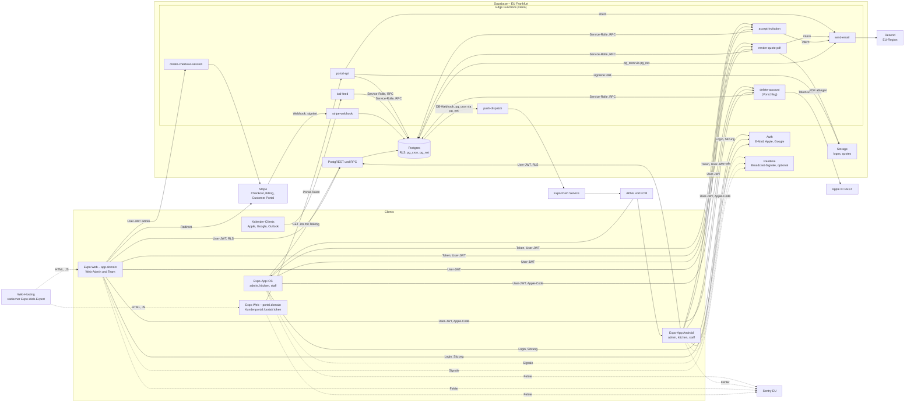
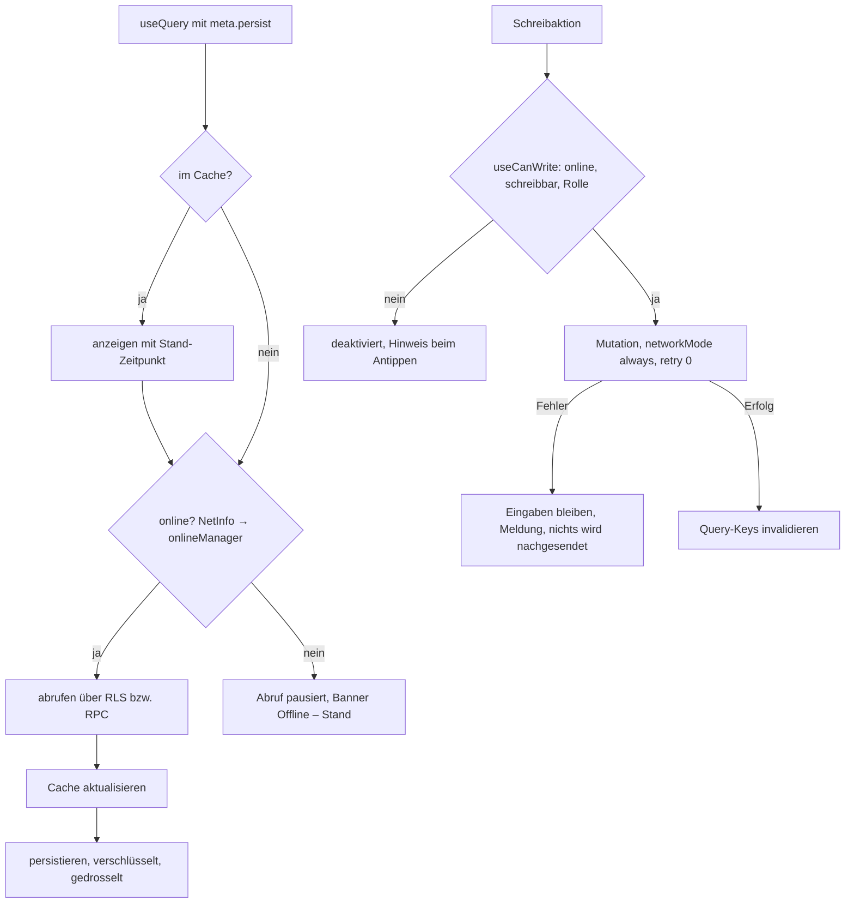
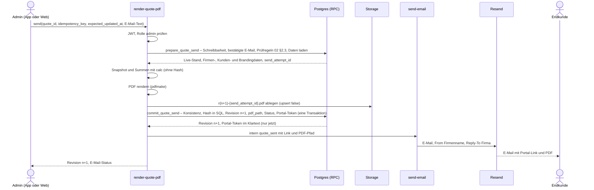
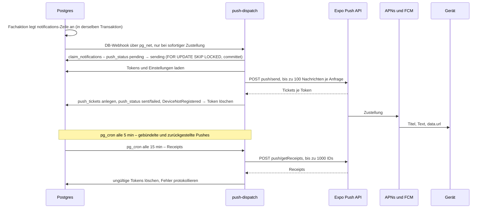
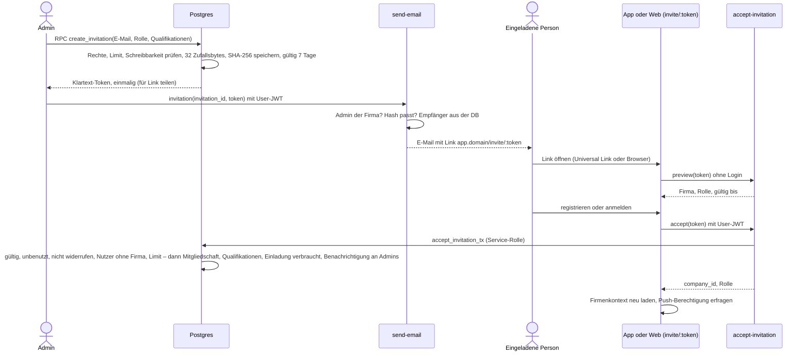
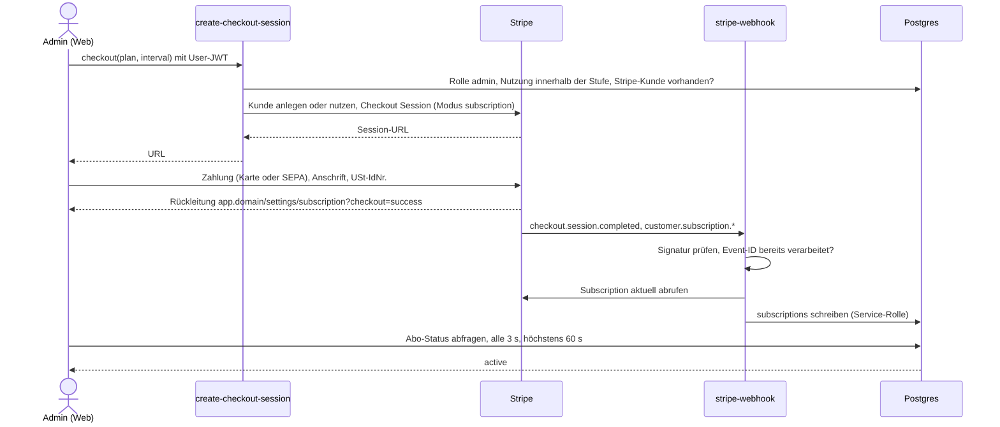
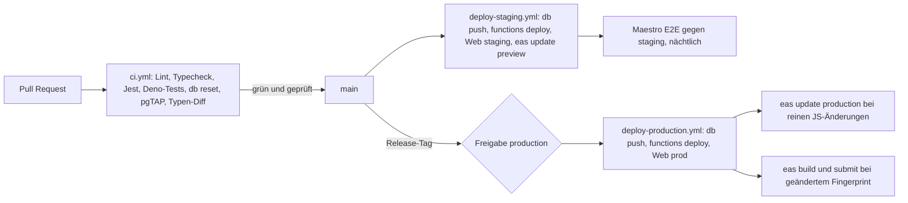

# 05 – Technische Architektur

Stand: 17.10.2026 · Arbeitstitel: catering-app · Grundlage: `docs/00-entscheidungen.md` (verbindlich), `docs/01-produkt.md`, `docs/02-ablaeufe.md`, `docs/04-screens-ux.md`

**Lesehilfe**

- Inhalte ohne Markierung setzen 00 bzw. das Glossar um. **[Vorschlag]** markiert eine begründete Empfehlung zu einem offenen Punkt; bis zur Freigabe gilt sie als Arbeitsannahme.
- Es gibt noch keinen Code. Ordner, Dateien, RPC-, Spalten- und Hilfstabellennamen außerhalb des Glossars sind Soll-Vorgaben bzw. Vorschläge; Spalten und Policies legt das Datenmodell verbindlich fest.
- **Versionen:** keine festen Versionsnummern. Gemeint ist jeweils die aktuelle stabile Version beim Projektstart („aktuelles stabiles Expo SDK“); im Repo fixieren Lockfile und exakte Versionsangaben den Stand.
- Anbieter-Limits, Konditionen und Store-Richtlinien sind Planungsstand und vor Umsetzung bzw. Einreichung in der jeweiligen Doku zu prüfen (Kennzeichen „prüfen“).
- `{domain}` steht für die noch offene Marke (00, offene Punkte). Verweise: „01 US-27.7“ = Akzeptanzkriterium 7 der Story US-27; „02 §2.4“ = Abschnitt 2.4 in 02; „04 §3.3“ = Abschnitt 3.3 in 04.

**Inhalt**

0. Leitlinien und Überblick
1. Architekturdiagramm und Komponenten
2. Stack mit Begründung und Alternativen
3. Projektstruktur und Typgenerierung
4. Datenzugriff
5. Edge Functions
6. Auth
7. Abo und Stripe
8. Sicherheit und Datenschutz
9. Umgebungen und Delivery
10. Qualität
11. Architektur-Entscheidungen (ADR-01 bis ADR-22)
12. Abweichungen zwischen 01/02 und Glossar-Lücken
13. Vorschläge zur Freigabe

---

## 0. Leitlinien und Überblick

### 0.1 Leitlinien

1. **Der Server entscheidet.** Rechte, Fristen, Kapazitäten, Statuswechsel und Summen prüft der Server (01 §3.3). Die App blendet aus und deaktiviert, ersetzt aber keine Prüfung (04 §3.3).
2. **Fachlogik in Postgres.** RLS und Postgres-Funktionen (RPC) decken alles ab, was Transaktionen, Zeilensperren oder Fachregeln braucht. Es gibt keine eigene API-Schicht.
3. **Edge Functions nur, wo nötig:** für externe Dienste (Stripe, E-Mail, Expo Push), für öffentliche Endpunkte ohne Login (Portal, iCal, Einladungsvorschau), für Geheimnisse und für die PDF-Erzeugung.
4. **Eine Codebasis.** iOS, Android, Web-Admin und Kundenportal kommen aus einem Expo-Projekt. Plattformunterschiede laufen ausschließlich über Plattformdateien (`*.web.tsx`, `*.native.tsx`).
5. **Offline lesen, online schreiben.** Der Query-Cache wird persistiert; eine Schreib-Warteschlange gibt es nicht (00 §4, 01 N-14).
6. **Datensparsamkeit by Design:** rollengerechte Lesepfade, keine Preise für `kitchen`, keine Gesundheitsdaten in Push-Texten und Logs, Tokens nur als Hash.
7. **Betreibbar durch eine Person:** verwaltete Dienste, wenige Anbieter, alles als Code (Migrationen, Functions, Konfiguration), CI prüft vor jedem Deploy.

### 0.2 Auf einen Blick

| Thema | Festlegung |
|---|---|
| Clients | Expo-App (iOS, Android) für `admin`, `kitchen`, `staff`; derselbe Build als Expo Web unter `app.{domain}`; Kundenportal `app/portal/[token]` unter `portal.{domain}` |
| Backend | Supabase in Frankfurt: Postgres mit RLS, Auth, Storage, Edge Functions, `pg_cron`, `pg_net`, Realtime nur als optionales Signal |
| Datenzugriff | supabase-js v2 mit generierten Typen; TanStack Query mit verschlüsseltem, persistiertem Cache (nativ); Schreiben nur online |
| Externe Dienste | Stripe (Abo, nur Web), Resend (E-Mail, EU-Region) **[Vorschlag]**, Expo Push Service, Sentry (EU), Netlify (Web-Hosting) **[Vorschlag]** |
| PDF | pdfmake in `render-quote-pdf`; pdf-lib als Rückfallebene **[Vorschlag]** |
| UI | NativeWind + react-native-reusables, Lucide-Icons, Inter **[Vorschlag]** |
| Delivery | GitHub Actions (Lint, Typecheck, Tests, pgTAP, Typen-Diff), EAS Build/Submit/Update, Umgebungen lokal/staging/prod |

---

## 1. Architekturdiagramm und Komponenten

### 1.1 Gesamtbild



### 1.2 Komponenten

| Komponente | Aufgabe | Technik | Ort |
|---|---|---|---|
| Team-App iOS/Android | alle Rollen, Offline-Lesen, Push | Expo (React Native), Expo Router; Development- und Store-Builds über EAS | Gerät |
| Web-Admin / Team-Web | derselbe Build im Browser; Schwerpunkt `admin` (Angebote, Kalkulation, Abo, Export) | Expo Web, SPA-Export | `app.{domain}` |
| Kundenportal | öffentlich, ohne Login, nur über `portal-api` | derselbe Web-Build, eigene Origin | `portal.{domain}` |
| Postgres | Daten, RLS, RPC, Zeitjobs (`pg_cron`), HTTP aus der DB (`pg_net`) | Supabase Postgres | Frankfurt |
| Auth | Konten, Sitzungen, Apple und Google | Supabase Auth | Frankfurt |
| Storage | Logos (öffentlich lesbar), Angebots-PDFs (privat) | Supabase Storage | Frankfurt |
| Realtime | optionale Änderungssignale (Schichtbörse, Besetzung) | Supabase Realtime Broadcast | Frankfurt |
| Edge Functions | die 8 Functions aus dem Glossar, dazu `delete-account` als Glossar-Ergänzung (**Vorschlag**, 5.10) | Deno (Supabase Edge Runtime) | Ausführungsregion auf eu-central-1 festlegen (prüfen, 5.1) |
| Stripe | Abo der Caterer | Checkout, Billing, Customer Portal, Stripe Tax | EU/USA |
| E-Mail-Dienst | Kunden-, Team- und Auth-E-Mails | Resend (API und SMTP) **[Vorschlag]** | EU-Region (prüfen) |
| Expo Push Service | Weiterleitung an APNs/FCM | HTTPS-API | USA |
| Kalender-Clients | lesendes ICS-Abo | HTTPS/webcal | – |
| Sentry | Fehler- und Absturzberichte | Sentry SaaS, EU-Datenregion | Frankfurt |
| Web-Hosting | Auslieferung des Web-Exports, Header, Weiterleitungen | Netlify **[Vorschlag]** (9.4) | CDN |

### 1.3 Vertrauensgrenzen

| Grenze | Wer | Nachweis | Was dahinter erlaubt ist |
|---|---|---|---|
| Team-Clients → Supabase | angemeldete Mitglieder | User-JWT + Publishable Key | nur, was RLS und RPC-Prüfungen für Firma und Rolle zulassen |
| Portal → `portal-api` | Endkunde | Portal-Token (256 Bit, nur Hash gespeichert) | nur der eine Auftrag des Tokens, nur Snapshot-Daten |
| Kalender → `ical-feed` | Kalenderdienst | iCal-Token | nur lesende Termine des Mitglieds, rollengerecht |
| Stripe → `stripe-webhook` | Stripe | Webhook-Signatur | Schreiben in `subscriptions` |
| DB/Functions → Functions | `pg_cron`, `pg_net`, andere Functions | interner Schlüssel (`x-internal-secret`) | interne Aktionen (Push, E-Mail, PDF) |
| Functions → DB | Edge Functions | Service-Rolle (Secret Key) | alles; deshalb nur über eng geschnittene RPCs (8.4) |

---

## 2. Stack mit Begründung und Alternativen

### 2.1 Übersicht

| Bereich | Wahl | Begründung | Alternativen (warum nicht) |
|---|---|---|---|
| Framework | Expo, jeweils aktuelles stabiles SDK (New Architecture, Hermes) | 00 §5; eine Codebasis für iOS, Android und Web; EAS für Build, Submit und OTA-Updates; Config-Plugins statt nativer Projektpflege | React Native ohne Expo (mehr native Pflege), Flutter (andere Sprache, Web-Formulare schwächer), separate Next.js-Web-App (doppelte Logik) |
| Builds | Development Builds, kein Expo Go | native Module (Google Sign-In, MMKV), eigene Push-Credentials | Expo Go (unterstützt diese Module nicht) |
| Navigation | Expo Router mit typisierten Routen; Headless-Tabs aus `expo-router/ui` (04 §1.4) | 00 §5; Datei-Routing liefert Web-URLs, Deep Links und Universal Links ohne eigene Linking-Konfiguration; Struktur aus 04 §1.2 | React Navigation direkt (Deep-Link-Mapping von Hand) |
| Sprache | TypeScript `strict`, zusätzlich `noUncheckedIndexedAccess` | Fehler zur Compile-Zeit; generierte DB-Typen durchgängig | – |
| Backend-Client | supabase-js v2, `createClient<Database>` | 00 §5; Auth, PostgREST, RPC, Storage, Realtime und Functions in einem typisierten Client | eigene REST-API (mehr Code, RLS-Vorteile gehen verloren) |
| Server-State | TanStack Query (aktuelle Hauptversion) mit `persistQueryClient` | Cache, Refetch bei Fokus und Reconnect, gezielte Invalidierung, Persistenz für Offline-Lesen (4.8) | SWR (schwächere Mutationen/Persistenz), RTK Query (mehr Boilerplate), Sync-Engines wie PowerSync oder WatermelonDB (lohnen sich erst mit Offline-Schreiben, P-15) |
| Client-State | Zustand, nur für UI- und Entwurfszustand | sehr klein, ohne Provider, Persistenz-Middleware für Entwürfe des Angebots-Chats | Redux (überdimensioniert), nur Context (Re-Render-Kaskaden) |
| Formulare | react-hook-form + zod (`@hookform/resolvers`) | performant bei großen Formularen (Angebots-Editor); zod-Schemas teilen App und Edge Functions | Formik (langsamer, wenig gepflegt), TanStack Form (jünger) |
| UI | NativeWind + react-native-reusables **[Vorschlag]** | 2.2 | Tamagui, gluestack-ui, React Native Paper (2.2) |
| Bottom Sheets | `@gorhom/bottom-sheet` nur nativ; im Web Dialog oder Seitenpanel (04 §1.1 Nr. 6) | etabliert, gestengesteuert | Modal-Screens (weniger einhändig bedienbar) |
| Icons | `lucide-react-native` (+ `react-native-svg`) | 04 nutzt Lucide; einheitliche Strichstärke auf allen Plattformen | `@expo/vector-icons` (gemischte Icon-Stile) |
| Schrift | Inter, statische Schnitte (Regular, SemiBold) über `expo-font` | 04 §4.4; dieselben TTF-Dateien im PDF | Systemschrift (weicht vom PDF ab) |
| Datum/Zeit | date-fns + `@date-fns/tz` + Locale `de`; Picker nativ `@react-native-community/datetimepicker`, im Web HTML-Eingaben (`*.web.tsx`) | modular importierbar; Anzeige immer in Europe/Berlin, unabhängig von der Gerätezone | Day.js (TZ nur per Plugin), Luxon (größer), Temporal (noch nicht überall verfügbar) |
| Geld/Zahlen | `Intl.NumberFormat('de-DE')` und eigene Cent-Helfer (`src/lib/money.ts`) | „1.234,56 €“; Beträge durchgehend integer Cent | Geld-Bibliotheken (für Cent-Integer unnötig) |
| i18n | i18next + react-i18next, nur Sprache `de` | Texte nicht im Code; Namensräume `team` (Du) und `portal` (Sie, 04 Lesehilfe); P-22 vorbereitet | Lingui, Konstanten im Code (späterer Umbau teuer) |
| Listen | `@shopify/flash-list` für lange Listen (Aufträge, Benachrichtigungen, Gerichte, Schichtbörse) | Zell-Recycling, flüssig auf Mittelklasse-Android (Persona 2.2 in 01) | FlatList (für kurze Listen weiter zulässig) |
| Sichere Speicherung | `expo-secure-store` hält den Schlüssel, `react-native-mmkv` speichert verschlüsselt; Web: `localStorage` | 2.3 | AsyncStorage (unverschlüsselt) |
| Netzwerkstatus | `@react-native-community/netinfo` → `onlineManager` von TanStack Query | Offline-Banner, Abrufe pausieren, Reconnect-Refetch | – |
| Push | `expo-notifications`, `expo-device` | 00 §5 | OneSignal, Firebase direkt (weiterer Anbieter) |
| Login nativ | `expo-apple-authentication`, `@react-native-google-signin/google-signin`, `expo-crypto` (Nonce), `expo-web-browser` (OAuth-Fallback) | native Dialoge, `signInWithIdToken` | `expo-auth-session` für alles (nativ schlechteres UX) |
| Bilder | `expo-image`, `expo-image-picker`, `expo-image-manipulator` | Logo beim Upload normalisieren (5.4) | – |
| Karten, Telefon | kein Karten-SDK; `Linking` öffnet System-Karten-App und Telefon | 04 §4.1 Nr. 6; keine Kosten, keine API-Keys | Google Maps SDK |
| Monitoring | `@sentry/react-native` mit EU-Datenregion | 10.3 | Crashlytics, Bugsnag |
| Tests | Jest (`jest-expo`), React Native Testing Library, pgTAP, Maestro | 10.1 | Detox (aufwendiger) |
| Code-Qualität | ESLint (`eslint-config-expo`), Prettier | Expo-Standard | Biome |
| Paketmanager | npm | Expo-Standard, wenigste Sonderfälle mit Metro | pnpm (Hoisting-Einstellungen nötig), Bun |
| Edge Functions | Deno, npm-Pakete über `npm:`-Spezifizierer | Supabase Edge Runtime | – |

### 2.2 UI-Bibliothek **[Vorschlag]**

| Kriterium | **react-native-reusables auf NativeWind** | Tamagui | gluestack-ui | React Native Paper |
|---|---|---|---|---|
| Optik | shadcn/ui-Stil: hell, Linien statt Schatten, eine Akzentfarbe – entspricht 00 §6 und 04 §4.1 | frei gestaltbar | frei gestaltbar | Material Design, wirkt eher Android-App als B2B-Tool |
| Web-Qualität (Web-Admin, Portal) | NativeWind erzeugt im Web echtes CSS; Primitives mit ARIA-Rollen | gut, mit Compiler-Optimierung | gut | gut |
| Eigentum am Code | Komponenten werden in `src/components/ui` kopiert und gehören dem Projekt | Bibliothek mit eigenem Theme-System | Kopier-Ansatz wie reusables | Bibliothek |
| Design-Tokens aus 04 §4.2–4.5 | direkt als Tailwind-Theme (`tailwind.config.js`) | eigenes Token-System | Tailwind-basiert | Theme-Objekt, Material-Rollen |
| Lernkurve, Stabilität | niedrig (Tailwind-Klassen); Claude erzeugt Tailwind zuverlässig | hoch (Compiler, Konfiguration, häufige Brüche) | mittel | niedrig |
| Barrierefreiheit | Primitives (`@rn-primitives`) mit Rollen und Fokus | gut | gut | gut |

**Entscheidung:** react-native-reusables auf NativeWind. Die Komponentenliste aus 04 §4.9 baut auf diesen Basiskomponenten auf (Button, Input, Dialog, Popover, Select, Tabs, Toast); fehlende Teile (StickyActionBar, OccupancyBar, ChatBubble) entstehen im selben Stil. Muster aus der Appllama-Recherche (04 §5) fließen als Varianten dieser Komponenten ein, nicht als weitere Bibliothek.
**Risiko:** Hauptversionswechsel von NativeWind erfordern Migrationen. Gegenmaßnahme: Versionen fixieren, Upgrade nur zusammen mit einem SDK-Upgrade.

### 2.3 Speicherung auf dem Gerät

| Daten | Nativ (iOS/Android) | Web (`app.{domain}`) | Web (`portal.{domain}`) |
|---|---|---|---|
| Auth-Sitzung (Access-/Refresh-Token) | verschlüsselte MMKV-Instanz; der Schlüssel (32 Byte) liegt in `expo-secure-store` (Keychain/Keystore). SecureStore allein ist für große Werte wie das Sitzungs-JSON unzuverlässig | `localStorage` (supabase-js-Standard); Schutz über CSP (8.7) und getrennte Portal-Origin | keine Sitzung |
| Query-Cache (Offline-Lesen) | dieselbe verschlüsselte MMKV-Instanz; enthält auch Gesundheitsdaten (Sonderessen), daher verschlüsselt (01 US-54.7) | nicht persistiert, nur Arbeitsspeicher **[Vorschlag]**: Offline ist kein Ziel des Web-Admins, und Gesundheitsdaten bleiben nicht im Browser | nicht persistiert |
| Entwurf Angebots-Chat | MMKV (verschlüsselt) | `sessionStorage` (an den Tab gebunden) | – |
| Lokales Abhaken in Küchenlisten (02 §8) | MMKV | `localStorage` | – |
| Push-Token | nur serverseitig (`push_tokens`) | – | – |

Beim Abmelden, beim Entfernen aus der Firma und beim Rollenwechsel löscht die App Cache, Entwürfe und Sitzung (01 US-54.7).

### 2.4 Versionspflege

- Neue Expo-SDKs erscheinen mehrmals im Jahr. Upgrade **[Vorschlag]** innerhalb von 4–6 Wochen nach Release, mit `npx expo install --fix` und vollständigem Testlauf. Die Stores verlangen regelmäßig neuere Build-Werkzeuge bzw. Android-Ziel-API-Level.
- Bibliotheken nur in Versionen, die das jeweilige SDK unterstützt (`npx expo install`).
- Ein Upgrade pro Pull Request; Native-Änderungen erzeugen einen neuen Fingerprint und damit einen neuen Store-Build (9.3).

---

## 3. Projektstruktur und Typgenerierung

### 3.1 Ordnerbaum (Soll)

Ein Repository, ein npm-Paket (kein Monorepo-Werkzeug). Routen gemäß 04 §1.2.

```text
catering-app/
├── app/                                Expo Router – nur Routing, Layouts, Guards
│   ├── _layout.tsx                     Provider (Query, Sitzung, i18n, Theme), Auth-Gate, Banner-Host
│   ├── (auth)/                         login, register, verify-email, reset-password, invite/[token], welcome, onboarding/*
│   ├── (app)/                          Team-App: (tabs)/ mit rollenabhängigen Tabs, Detail-Stacks
│   │   └── settings/subscription.web.tsx   Kauf-UI nur im Web-Bundle (7.7)
│   └── portal/[token]/                 Kundenportal (öffentlich, noindex)
├── src/
│   ├── features/
│   │   ├── auth/  onboarding/  team/  company/  customers/
│   │   ├── events/  intake/  quotes/  catalog/  kitchen/
│   │   ├── shifts/  calendar/  notifications/  subscription/
│   │   ├── privacy/  profile/  portal/
│   │   └── <feature>/
│   │       ├── api.ts                  Query- und Mutation-Hooks (einziger Ort für Supabase-Aufrufe des Features)
│   │       ├── keys.ts                 Query-Key-Fabrik
│   │       ├── schemas.ts              zod-Schemas für Formulare
│   │       ├── screens/                Screen-Komponenten, von app/ eingebunden
│   │       ├── components/             feature-spezifische Komponenten
│   │       └── index.ts                öffentliche Schnittstelle des Features
│   ├── components/
│   │   ├── ui/                         react-native-reusables-Basis (Button, Input, Dialog …), projekteigen
│   │   └── …                           App-Komponenten aus 04 §4.9 (StatusBadge, Money, WriteGuard …)
│   ├── lib/
│   │   ├── env.ts                      geprüfte EXPO_PUBLIC_-Variablen (zod)
│   │   ├── supabase.ts                 Client (4.3)
│   │   ├── query-client.ts             QueryClient, onlineManager, focusManager
│   │   ├── persist.ts                  Cache-Persistenz (MMKV, nur nativ)
│   │   ├── secure-kv.ts / secure-kv.web.ts   verschlüsselter Speicher bzw. Web-Variante
│   │   ├── errors.ts                   Fehlercodes → AppError (4.6)
│   │   ├── can-write.ts                useCanWrite (Netz, Abo, Rolle; 04 §3.3)
│   │   ├── push.ts                     Registrierung, Tap-Handling
│   │   ├── dates.ts  money.ts          Formatierung Europe/Berlin, Cent
│   │   ├── i18n/                       i18next-Setup, de/team.json, de/portal.json
│   │   └── sentry.ts                   Initialisierung, Scrubbing (10.3)
│   └── theme/tokens.ts                 Tokens aus 04 §4.5, gespeist in tailwind.config.js
├── supabase/
│   ├── config.toml                     lokale Konfiguration, Auth-Provider, Function-Einstellungen
│   ├── migrations/                     SQL-Migrationen (einzige Quelle des Schemas)
│   ├── seed.sql                        Demo-Firma, Nutzer je Rolle, Gerichte, Aufträge in allen Status
│   ├── templates/                      deutsche Auth-E-Mail-Vorlagen (Bestätigung, Passwort-Reset)
│   ├── tests/                          pgTAP-Tests (8.2)
│   │   ├── rls/<tabelle>.test.sql
│   │   ├── rpc/<funktion>.test.sql
│   │   └── meta/rls_enabled.test.sql
│   └── functions/
│       ├── _shared/
│       │   ├── domain/                 reines TypeScript ohne Deno-/npm-Abhängigkeiten, auch von der App genutzt:
│       │   │                           calc (Kalkulation, Steuern, Rundung, nur Ganzzahlen), kitchen (Produktions-
│       │   │                           und Einkaufsliste), event-status (Übergänge), intake (Feldzuordnung), schemas (zod)
│       │   ├── database.types.ts       generiert (3.3)
│       │   ├── auth.ts  http.ts  cors.ts  log.ts  rate-limit.ts  supabase-admin.ts
│       │   ├── email/                  Layouts und Vorlagen (5.5)
│       │   ├── pdf/                    Dokumentdefinition, Schriften (5.4)
│       │   └── ics.ts                  ICS-Schreiber (5.8)
│       ├── portal-api/index.ts
│       ├── render-quote-pdf/index.ts
│       ├── send-email/index.ts
│       ├── push-dispatch/index.ts
│       ├── stripe-webhook/index.ts
│       ├── create-checkout-session/index.ts
│       ├── ical-feed/index.ts
│       ├── accept-invitation/index.ts
│       └── delete-account/index.ts       Glossar-Ergänzung (Vorschlag, 5.10)
├── e2e/maestro/                        E2E-Abläufe (10.2)
├── assets/                             Inter-TTF, App-Icon, Splash
├── public/                             _headers, _redirects, .well-known/ (9.4, 6.5) – landen im Web-Export
├── .github/workflows/                  ci.yml, deploy-staging.yml, deploy-production.yml
├── app.config.ts  eas.json  tailwind.config.js  global.css
├── tsconfig.json  jest.config.js  eslint.config.js  .env.example
└── docs/
```

### 3.2 Regeln

| Regel | Inhalt |
|---|---|
| `app/` ist dünn | Routendateien lesen Parameter, setzen Layout und Guard und rendern `src/features/<feature>/screens/*`. Keine Datenabfragen in `app/` |
| Ein Zugriffsort je Feature | Supabase-Aufrufe nur in `src/features/<feature>/api.ts`; Screens nutzen nur die Hooks |
| Feature-Grenzen | Features importieren `src/lib`, `src/components` und andere Features nur über deren `index.ts` (ESLint `no-restricted-imports`) |
| Gemeinsamer Fachcode | `supabase/functions/_shared/domain/` ist reines TypeScript: keine Deno-APIs, keine `npm:`-Importe, relative Importe mit `.ts`-Endung (Deno-Pflicht). Die App bindet ihn per Pfad-Alias `@shared/*` ein; `tsconfig` setzt dafür `allowImportingTsExtensions` |
| Benennung | Dateien kebab-case, Komponenten PascalCase, DB snake_case. DB-Zeilen bleiben in snake_case (keine globale camelCase-Umwandlung), damit sie den generierten Typen entsprechen |
| Kauf-UI | Abo-Kauf nur in `*.web.tsx`; eine Lint-Regel verbietet Importe aus `features/subscription/web` in Nicht-Web-Dateien (7.7) |
| Aliase | `@/*` → `src/*`, `@shared/*` → `supabase/functions/_shared/domain/*`, `@db` → `supabase/functions/_shared/database.types.ts` |

### 3.3 Typgenerierung aus der Datenbank

- Quelle sind die lokalen Migrationen, nicht ein entferntes Projekt: `supabase db reset` → `supabase gen types typescript --local > supabase/functions/_shared/database.types.ts` (npm-Skript `db:types`).
- App und Functions nutzen dieselbe Datei: `createClient<Database>(…)`, Hilfstypen `Tables<'events'>`, `Enums<'event_status'>`, `Enums<'member_role'>`.
- RPC-Signaturen, Views und Enums sind darin enthalten; Rückgabetypen von RPCs mit `jsonb` werden zusätzlich mit zod-Schemas in `_shared/domain/schemas` beschrieben und zur Laufzeit geprüft.
- CI erzeugt die Typen neu und bricht ab, wenn sie vom eingecheckten Stand abweichen (9.6).

---

## 4. Datenzugriff

### 4.1 Zugriffswege

| Weg | Wann | Beispiele **[Vorschlag]** | Schutz |
|---|---|---|---|
| Tabellen-CRUD über PostgREST (`supabase.from()`) | einfache Stammdaten ohne Fachregeln | `customers`, `tax_rates`, `qualifications`, `menu_packages` (admin) | RLS: Firma, Rolle, Schreibbarkeit |
| RPC (`supabase.rpc()`) | Fachregeln, Transaktionen, Sperren, Statuswechsel | Namen nach dem RPC-Katalog 03 §4.7: `set_event_status`, `decide_application`, `assign_member`, `apply_for_slot` (02 §1.1, §5.5); `create_company`, `create_invitation`, `copy_event`, `create_event_from_intake`, `resolve_pending_change`, `log_usage_event` | SECURITY DEFINER mit expliziter Firmen- und Rollenprüfung, fester `search_path`, `EXECUTE` nur für die vorgesehene Rolle (03 §4.1 Nr. 1) |
| Rollenspezifische Lesepfade (Views) | Lesen ohne Preis-, Kosten- und Kundenkontaktspalten für `kitchen`/`staff`; Firmenkontext für alle | Views aus 03 §4.6: `company_profile`, `kitchen_dishes`, `kitchen_ingredients`, `kitchen_menu_packages`, `kitchen_events`, `kitchen_production_lines`, `team_directory`, `event_staffing`, `shift_board`, `my_shifts`, `event_colleagues` | 4.2 |
| Edge Functions | externe Dienste, öffentliche Endpunkte, Geheimnisse, PDF | die 8 Functions (Abschnitt 5) und `delete-account` (Vorschlag) | eigene Auth-Prüfung (5.1) |
| Storage | Dateien | Bucket `logos` (öffentlich lesbar, Pfad `{company_id}/logo-{uuid}.{png\|jpg}`), Bucket `quotes` (privat, Pfad `{company_id}/{quote_id}/r{revision}-{send_attempt_id}.pdf` bzw. `r{revision}-angenommen.pdf`; der Bucketname ist kein Pfadsegment, 03 §8) | Storage-Policies auf das erste Pfadsegment `company_id`; Bucket-Limits 2 MB und nur `image/png`, `image/jpeg` für Logos |
| Realtime | Änderungssignale ohne Inhalte | Schichtbörse, Besetzung (4.9) | private Kanäle, Autorisierung über RLS |

### 4.2 Mandanten- und Rollenfilter

- Jede fachliche Tabelle trägt `company_id`; RLS ist auf jeder Tabelle aktiv (CI-Test, 8.2).
- **Rolle und Firma kommen aus der Datenbank, nicht aus JWT-Claims** (ADR-04). Ein Nutzer gehört genau einer Firma an (00 §2), daher ist die aktuelle Firma eindeutig. Entfernen und Rollenwechsel wirken damit beim nächsten Abruf (01 US-07.2, 02 §10.3), nicht erst nach Ablauf des Access-Tokens.
- Die Hilfsfunktionen heißen wie im Datenmodell (03 §4.2): `public.auth_member_id()`, `public.auth_company_id()`, `public.auth_role()`, `public.company_is_writable()`, `public.assert_writable()`, `public.can_read_event()`. Sie werden in Policies als `(select …)` aufgerufen, damit Postgres sie einmal je Abfrage auswertet, und sind nur für `authenticated` ausführbar. Rein interne Funktionen (z. B. `seed_company_defaults()`) liegen im nicht veröffentlichten Schema `private` (03 §4.1 Nr. 1).
- **Preisfreie Lesepfade (01 §3.3 Nr. 2):** RLS filtert Zeilen, nicht Spalten. Basistabellen mit Preis-, Kosten- oder Kontaktspalten (`dishes`, `ingredients`, `menu_packages`, `quotes`, `quote_items`, `customers`, `company_members` fremder Mitglieder) darf per RLS nur `admin` direkt lesen. `kitchen` und `staff` lesen über die Views aus 03 §4.6 mit eigener Firmen- und Rollenprüfung, die nur freigegebene Spalten liefern; die Küche schreibt Gerichte und Zutaten über `save_dish()`/`save_ingredient()`, die Preisspalten nicht annehmen.

```sql
-- Auszug; vollständig in 03 §7.2 und §7.6
create policy customers_admin_update on public.customers
  for update to authenticated
  using (company_id = (select public.auth_company_id())
         and (select public.auth_role()) = 'admin')
  with check (company_id = (select public.auth_company_id())
              and (select public.company_is_writable()));
```

### 4.3 Supabase-Client

```ts
// src/lib/supabase.ts – Skizze
export const supabase = createClient<Database>(env.SUPABASE_URL, env.SUPABASE_PUBLISHABLE_KEY, {
  auth: {
    storage: Platform.OS === 'web' ? undefined : secureKvStorage, // nativ: verschlüsselte MMKV-Instanz
    autoRefreshToken: true,
    persistSession: true,
    detectSessionInUrl: Platform.OS === 'web', // nativ werden Links in der Route verarbeitet (6.3)
    flowType: 'pkce',
  },
});

if (Platform.OS !== 'web') {
  AppState.addEventListener('change', (s) =>
    s === 'active' ? supabase.auth.startAutoRefresh() : supabase.auth.stopAutoRefresh(),
  );
}
```

- Der Publishable Key (bei Supabase früher „anon key“) ist öffentlich und steht als `EXPO_PUBLIC_*`-Variable im Bundle. Secret- bzw. Service-Role-Schlüssel kommen nie in die App (8.4).
- Auf `portal.{domain}` arbeitet der Client ohne Sitzung; das Portal spricht ausschließlich `portal-api` an (01 §3.3 Nr. 4).
- Den **Firmenkontext** lädt die App beim Start aus der View `company_profile` (Firmenname, Telefon, Absagefrist, `onboarding_completed_at`, `is_writable`, `effective_plan`) und aus der eigenen Zeile in `company_members` (Rolle, Name, Benachrichtigungseinstellungen); `admin` liest zusätzlich `subscriptions`. Eine eigene RPC dafür gibt es nicht. Das Ergebnis wird persistiert und bei jedem Fokus neu geladen; daraus entstehen Tabs (04 §1.3), `useCanWrite` und die Banner (04 §3.4).

### 4.4 Query-Muster

```ts
// src/features/shifts/keys.ts
export const shiftKeys = {
  all: (companyId: string) => ['shifts', companyId] as const,
  board: (companyId: string) => [...shiftKeys.all(companyId), 'board'] as const,
  mine: (companyId: string, fromIso: string) => [...shiftKeys.all(companyId), 'mine', fromIso] as const,
};

// src/features/shifts/api.ts
export function useShiftBoard() {
  const { companyId } = useCompanyContext();
  return useQuery({
    queryKey: shiftKeys.board(companyId),
    queryFn: async () => {
      const { data, error } = await supabase.from('shift_board').select('*').order('starts_at');
      if (error) throw toAppError(error);
      return data;
    },
    meta: { persist: true }, // offline lesbar (4.8)
  });
}
```

| Regel | Inhalt |
|---|---|
| Query-Keys | Fabrik je Feature, erstes Segment = Feature, zweites = `companyId`; Invalidierung immer über Präfixe (`shiftKeys.all`) |
| `staleTime` | Standard 30 s; Katalog (Gerichte, Pakete, Steuersätze, Fragenkatalog) 5 min; Firmenkontext 0 (immer bei Fokus prüfen) **[Vorschlag]** |
| Fokus | nativ über `AppState` → `focusManager`; Web über `visibilitychange` (TanStack-Standard) |
| Listen | Keyset-Paginierung mit `useInfiniteQuery` für Aufträge, Kunden und Benachrichtigungen (Sortierschlüssel + `id`); Suche über Postgres (`pg_trgm`) **[Vorschlag]** |
| Aggregationen | Schichtbörse und Belegung liefert der Server (View `shift_board`, `taken_seats`). Produktions- und Einkaufsliste berechnet das geteilte TS-Modul `_shared/domain/kitchen` aus den Views `kitchen_production_lines`, `kitchen_events`, `kitchen_ingredients` sowie `dish_ingredients` und `event_dietary_requirements` (03 §4.6); so funktionieren Auftragsauswahl und Puffer auch offline mit geladenen Daten. Eine Einkaufslisten-RPC gibt es nicht; Abrufe zählt `log_usage_event('shopping_list_viewed')` für K-10 |
| Prefetch | nach Login bzw. App-Start mit Netz: `staff` eigene Einsätze der nächsten 14 Tage inklusive Einsatzinfos und Ablauf; `kitchen` Aufträge, Produktions- und Allergikerlisten der nächsten 7 Tage (01 US-54.6) |

### 4.5 Mutations-Muster

```ts
export function useApplyForSlot() {
  const qc = useQueryClient();
  const { companyId } = useCompanyContext();
  return useMutation({
    mutationFn: async (slotId: string) => {
      const { error } = await supabase.rpc('apply_for_slot', { p_slot_id: slotId });
      if (error) throw toAppError(error);
    },
    onSettled: () => qc.invalidateQueries({ queryKey: shiftKeys.all(companyId) }),
  });
}
```

| Regel | Inhalt |
|---|---|
| Fachaktionen | immer RPC bzw. Edge Function, nie mehrere Tabellen-Updates nacheinander aus dem Client |
| Offline | `mutations.networkMode = 'always'` und `retry = 0`: Ohne Netz schlägt die Mutation sofort fehl, statt pausiert und später automatisch gesendet zu werden (keine Warteschlange, 01 US-54.3). Die Oberfläche sperrt die Aktion vorher über `useCanWrite` |
| Idempotenz | Dialoge mit Außenwirkung (Angebot senden, Portal-Annahme, Einladen) erzeugen beim Öffnen einen `idempotency_key` (UUID); Wiederholungen liefern dasselbe Ergebnis (01 US-27.5, US-31.5) |
| Nebenläufigkeit | Zeilensperren in RPCs (02 §5.5); Angebots-Kopf mit Versionsprüfung (`updated_at` muss passen, sonst 409 „Von {Name} geändert“) **[Vorschlag]**; Positionen „letzter gewinnt“ (1–2 Admins je Firma) |
| Nach Erfolg | gezielt invalidieren, Toast mit Objekt (04 §3.3 Nr. 7) |
| Eingaben | bleiben bei jedem Fehler im Formular (04 §3.3 Nr. 4); react-hook-form setzt nur nach Erfolg zurück |

### 4.6 Fehlerbehandlung

Fehlervertrag nach dem Datenmodell (03 §0, §4.7): Datenbankfunktionen melden fachliche Fehler mit `raise exception '<deutscher Text>' using errcode = 'P0001', hint = '<code>'`. PostgREST liefert dafür HTTP 400 mit dem JSON `{ code: 'P0001', message, details, hint }`; maßgeblich ist **`hint`**, nicht der HTTP-Status und nicht der Text. Berechtigungsfehler kommen als SQLSTATE `42501`, fehlende Datensätze als `P0002`, Eindeutigkeit als `23505`, Check-Verletzungen als `23514` (mit Constraint-Namen), Serialisierungskonflikte als `40001`. Edge Functions antworten einheitlich mit `{ "error": { "code": "<hint>", "message": "..." } }` und setzen den HTTP-Status selbst (z. B. `portal-api`: `revision_outdated` → 409, `deadline_passed`/`portal_locked` → 423). `src/lib/errors.ts` bildet alles auf `AppError` ab; die Texte stehen in i18n.

| Code (`hint` bzw. Quelle) | Herkunft | Anzeige (04 §3.2) |
|---|---|---|
| `offline` | Netzfehler, NetInfo offline | „Keine Verbindung – deine Eingaben bleiben erhalten“ |
| `unauthorized` | 401, abgelaufene Sitzung | stiller Token-Refresh, sonst Login |
| `forbidden` | SQLSTATE `42501` (RLS, fehlende Rolle) | „Kein Zugriff mehr“ |
| `not_found` | SQLSTATE `P0002`, leeres Ergebnis bei `.single()`, 404 | „Nicht mehr verfügbar“ |
| `read_only` | `hint` aus `assert_writable()` | „Nur-Lesen-Modus – Änderungen sind derzeit nicht möglich“ |
| `revision_outdated` | `hint` aus `commit_quote_send`, `portal_*`; `portal-api` 409 | „Das Angebot wurde aktualisiert“ + Neu laden |
| `slot_full` | `hint` aus `track_slot_occupancy`, `apply_for_slot`; SQLSTATE `40001` bei Belegung | Konfliktdialog mit Lösungsaktion („Anzahl erhöhen und zusagen“) |
| `seats_below_taken` | SQLSTATE `23514`, Constraint `shift_slots_taken_le_seats` | „Erst {n} Person(en) ausplanen“ |
| `invalid_transition` | `hint` aus `set_event_status`, Bewerbungs-RPCs | „Statuswechsel nicht möglich: {Grund}“ |
| `deadline_passed`, `portal_locked` | `hint` (Absagefrist, Änderungsschluss, Sperre); `portal-api` 423 | Hinweis + Anruf-Button (04 §3.3 Nr. 2) |
| `limit_reached` | `hint` (Planlimits, 01 §6.1) | plattformabhängig: `limit_reached.native` „Limit der aktuellen Stufe erreicht ({n} Mitglieder). Bitte ein Mitglied entfernen.“ (ohne Kauf- oder Upgrade-Hinweis, 7.7) · `limit_reached.web` „Limit von {n} Mitgliedern erreicht – Stufe wechseln oder Mitglied entfernen“ mit Link zur Abo-Seite (01 US-05.4) |
| `missing_qualification`, `slot_not_open`, `application_exists`, `already_assigned` | `hint` aus Schicht-RPCs | je Kontext |
| `conflict` | SQLSTATE `23505` (Eindeutigkeit) | je Kontext, z. B. „bereits Mitglied“ |
| `validation` | 422, zod, SQLSTATE `23514` (übrige Checks) | Feldfehler |
| `rate_limited` | 429 | „Zu viele Versuche – bitte später erneut“ |
| `server` | 5xx | „Etwas ist schiefgelaufen“ + Sentry-Ereignis |

Besonderheiten: Eine von RLS verweigerte Leseabfrage liefert leere Zeilen, keinen Fehler. Updates prüfen deshalb das Ergebnis (`.select().single()`); 0 betroffene Zeilen gelten als `forbidden` bzw. `not_found`. Schreibverbote im Lesemodus über RLS ergeben `42501`; die App zeigt dann anhand von `company_profile.is_writable` den Lesemodus-Text statt „Kein Zugriff“. Expo-Router-Routen exportieren eine `ErrorBoundary` für unerwartete Renderfehler.

### 4.7 Optimistic Updates

| Aktion | Optimistisch | Grund |
|---|---|---|
| Benachrichtigung gelesen, „Alle als gelesen markieren“ | ja, Rücknahme bei Fehler | harmlos, sofortiges Feedback |
| Lokales Abhaken in Küchenlisten | nur lokal (kein Server) | 02 §8 |
| Reihenfolge per Drag & Drop (Fragenkatalog, Positionen) | ja, Rücknahme bei Fehler **[Vorschlag]** | keine Fachwirkung |
| Filter, Sortierung, Ansichten | lokal | – |
| Statuswechsel, Versand, Beträge, Summen | nein | Server ist maßgeblich (04 §3.3 Nr. 7) |
| Bewerben, Zusagen, Einplanen, Absagen | nein | Kapazität und Frist prüft die DB |
| Portal-Aktionen | nein | Protokoll, Revisionsprüfung |

### 4.8 Offline-Lesen



| Baustein | Festlegung |
|---|---|
| Persistenz | `PersistQueryClientProvider` mit asynchronem Persister auf der verschlüsselten MMKV-Instanz, nur nativ (2.3) |
| Auswahl | nur Queries mit `meta: { persist: true }` und Status `success` (Einsätze, Einsatzinfos, Ablaufpläne, Kalenderzeiträume, Küchenlisten, Allergikerlisten, Auftragsdetails rollengerecht, Benachrichtigungen, Firmenkontext; 01 US-54.1) |
| Lebensdauer | `maxAge` und `gcTime` 7 Tage **[Vorschlag]**; `gcTime` darf nicht kleiner als `maxAge` sein, sonst verwirft der Persister die Daten |
| Buster | `"{Schema-Version}:{user_id}:{company_id}:{role}"` – Nutzer-, Firmen- oder Rollenwechsel verwirft den Cache automatisch; zusätzlich `queryClient.clear()` und Löschen des Speichers bei Abmeldung (01 US-54.7) |
| Netzstatus | NetInfo setzt `onlineManager` (online = verbunden und Internet nicht nachweislich unerreichbar); Banner „Offline – Stand: {Zeitpunkt}“ aus dem jüngsten `dataUpdatedAt` (04 §3.3 Nr. 5) |
| Rückkehr ins Netz | `refetchOnReconnect` lädt sichtbare Queries neu, das Banner verschwindet (01 US-54.4) |
| Schreiben offline | blockiert über `useCanWrite`; Formulare behalten Eingaben; kein automatisches Senden (01 US-54.3, US-54.5) |
| Ohne Cache | „Noch nicht offline verfügbar – bitte einmal mit Netz öffnen“ (04 §3.2) |
| Entzogene Rechte | liefert der nächste Online-Abruf 403/404, entfernt die App den Eintrag aus dem Cache (04 §3.3 Nr. 6) |
| Portal | keine Offline-Funktion (01 US-54.8) |

### 4.9 Aktualität: Realtime oder Refetch

Grundsatz **[Vorschlag]**: Realtime überträgt nur Signale ohne Inhalte. Ein DB-Trigger sendet bei Änderungen eine Broadcast-Nachricht `{ "type": "slots_changed", "event_id": "…" }` auf einen privaten Kanal (`company:{company_id}:shifts`); Clients invalidieren daraufhin die passenden Queries und laden über den normalen, rollengerechten Weg nach. So gelangen keine Daten an RLS vorbei, und das Muster funktioniert auch mit den Lesepfaden aus 4.2 (Postgres Changes auf Views ist nicht möglich). Technik: Broadcast aus der Datenbank (`realtime.send`), Kanalautorisierung über RLS-Policies auf `realtime.messages` (prüfen).

| Bereich | Mechanismus | Begründung |
|---|---|---|
| Schichtbörse (`staff`, `kitchen`) | Realtime-Signal + Refetch bei Fokus | Plätze werden schnell vergeben; eine veraltete Börse erzeugt „Alle Plätze sind bereits vergeben“-Frust |
| Besetzung, Bewerbungen (`admin`) | Realtime-Signal | Admin sagt live zu |
| Glocke/Benachrichtigungen | Push im Vordergrund → passende Keys invalidieren (`data.type`); Refetch bei Fokus | Push existiert ohnehin |
| Auftrag, Angebot (`admin`) | Refetch bei Fokus; Portal-Ereignis kommt als Push → invalidieren | gleichzeitiges Bearbeiten selten |
| Küchenlisten | Refetch bei Fokus, Pull-to-refresh; Push „Gästezahl geändert“ → invalidieren | – |
| Portal | Refetch nach jeder Aktion; 409 bei veralteter Revision | kein Realtime für anonyme Nutzer |
| Abo nach Checkout | Polling alle 3 s, höchstens 60 s (01 US-56.5) | Webhook kann sich verzögern |

Fällt Realtime aus, bleibt die App korrekt; nur die Aktualisierung kommt später.

### 4.10 Zeit, Geld, Rechenlogik

- **Zeit:** Speicherung als `timestamptz`. Fristen (Absagefrist, Änderungsschluss, Option, Testende) rechnet die Datenbank in `Europe/Berlin` (`at time zone 'Europe/Berlin'`). Die App zeigt alle Zeiten in `Europe/Berlin` (Glossar), unabhängig von der Gerätezone. Eine Firmenspalte für die Zeitzone gibt es nicht: Österreich und die Schweiz (vorbereitet) haben dieselbe Zeitzonenregel (MEZ/MESZ).
- **Geld:** ausschließlich integer Cent in DB, API und Rechenmodul; Eingabe „12,50“ → 1250 über `parseMoneyDe`; Anzeige über `Intl.NumberFormat`.
- **Kalkulation (ADR-06):** Ein reines TypeScript-Modul `_shared/domain/calc` setzt die Regeln aus **02 §3** um (einzige Quelle; Positionsbeträge, Rechenseite = Anzeigeart, Umsatzsteuer je Steuersatz auf die Summe, Rabatte, Wahlgruppen, Wareneinsatz, Rohertrag). Die App nutzt es für die Live-Vorschau im Editor; maßgeblich ist der Server: `render-quote-pdf` rechnet damit beim Versand den Snapshot, `portal-api` die Summen inklusive Menüwahl. Die Rechenbeispiele aus 02 §3 und §8.5 sind Pflicht-Testfälle.
- **Exakte Arithmetik:** Das Modul rechnet nur mit Ganzzahlen (BigInt bzw. sichere Integer). Mengen als `q100` (Hundertstel), Stunden als Viertelstunden, Faktoren und Prozentsätze in Basispunkten, Wareneinsatz in 1/10000 Cent; Rundung über `divRoundHalfUp(zähler, nenner)`. Werte aus PostgREST (`numeric` kommt als JS-Number) werden beim Einlesen sofort umgewandelt (`q100 = Math.round(q × 100)`). Grund: `1.15 * 350 = 402.49999999999994` ergibt mit `Math.round` 402 statt 403 Cent, `0.41 * 2450` 1004 statt 1005. Pflicht-Unit-Tests an ,5-Grenzen (u. a. 1,15 × 3,50 € = 4,03 €). Die Commit-RPC prüft Kopf- gegen Positionssummen je Steuersatz; Cent-Fehler innerhalb einer Position verhindern nur die Ganzzahlregeln und die Tests.
- **Statusübergänge:** `set_event_status` (02 §1.1) ist maßgeblich. Die Oberfläche baut ihre Aktionen aus derselben Übergangstabelle in `_shared/domain/event-status.ts` (04 §0.3); ein Integrationstest prüft alle 64 Paare gegen die RPC, damit beide nicht auseinanderlaufen.

### 4.11 Angebots-Chat (Fragenkatalog)

- Der Fragenkatalog der Firma wird als eine Query geladen (persistiert, `staleTime` 5 min).
- Eine reine TypeScript-Ablaufmaschine (`src/features/intake/engine.ts`) wertet Antworttypen, Feldzuordnungen und Verzweigungen aus; Unit-Tests decken jede Verzweigungsregel ab.
- Antworten liegen bis zum Abschluss nur auf dem Gerät (Zustand-Store mit Persistenz, 2.3; 04 §2.11 SC-17 Nr. 6).
- „Auftrag anlegen“ ruft die RPC `create_event_from_intake(payload jsonb)` (03 §4.7; nur `admin`, im Lesemodus gesperrt), die Kunde, Auftrag (bzw. Update einer bestehenden Anfrage), Angebotsentwurf, Sonderessen und Notizen in einer Transaktion anlegt. Die Feldzuordnung je `intake_target` steht in 02 §11.2 und liegt als reines TS in `_shared/domain/intake`, damit Chat und Testlauf dieselbe Logik nutzen.
- Daten: `intake_questions` (Fragen, Antworttypen inkl. `customer` und `time_range`, Feldzuordnung, Bedingung `show_if`), `events.occasion`, `events.intake_answers` (03 §3.2, §3.7).

### 4.12 Zeitgesteuerte Jobs (`pg_cron`)

`pg_cron` plant in UTC. Damit Sommer- und Winterzeit stimmen, laufen tägliche Jobs **stündlich**, und die SQL-Funktion prüft selbst, ob in `Europe/Berlin` die Zielstunde erreicht ist (ADR-21). HTTP-Aufrufe an Functions gehen über `pg_net`; URL und interner Schlüssel liegen im Supabase Vault, damit Migrationen in allen Umgebungen gleich sind.

**Die Job-Liste ist die aus 03 §9.6** (einzige Quelle; 06 nutzt dieselben Namen). Kurzüberblick:

| Job (03 §9.6) | Rhythmus | Aufgabe | Quelle |
|---|---|---|---|
| `events_completion` | stündlich, wirkt 09:00 | Erinnerung „als durchgeführt markieren“ am Folgetag (kein automatischer Statuswechsel) | 01 US-11.5, 02 §1.1 |
| `option_reminders` | stündlich, wirkt 08:00 | Option läuft in 2 Tagen bzw. heute ab | 02 §1.3 |
| `quote_expiry` | stündlich | Angebotsgültigkeit abgelaufen (Liste) | 01 US-26.3 |
| `confirmation_reminders` | stündlich, wirkt 08:00 | offene Bestätigung „Bitte bestätigen“ nach 48 h bzw. am Änderungsschluss | 01 US-36.7 |
| `shift_reminders` | stündlich | Erinnerung 24 h vor Schichtbeginn (S14), unbesetzte Slots 72 h vorher | 02 §5.7, 01 US-50.4 |
| `push_deferred` | alle 5 min | gebündelte und in der Ruhezeit zurückgestellte Pushes senden (`push-dispatch`, `mode: 'batch'`); hängende `sending`-Zeilen zurücksetzen | 01 §4.2.5, US-51.7 |
| `push_receipts` | alle 15 min | Expo-Receipts zu `push_tickets` abrufen, ungültige Tokens löschen | 5.6 |
| `dietary_purge` | täglich | Gastnamen und Tische 30 Tage nach Eventende entfernen | 02 §10.4 |
| `notifications_retention` | täglich | Benachrichtigungen > 90 Tage löschen | 02 §10.4 |
| `data_retention` | täglich | Einladungen 30 Tage nach Ablauf, Rate-Limit-Zeilen, `stripe_events` > 90 Tage, IP/User-Agent nach 3 Jahren | 02 §10.4 |
| `billing_lifecycle` | täglich | Testphase-Mails (7/3/1 Tage vorher, Testende), Löschankündigungen (30/7 Tage), endgültige Löschung nach 6 Monaten Lesemodus bzw. 30 Tage nach Löschantrag inklusive Storage | 01 §6.2, US-57.6, US-60.3 |

Die Schreibbarkeit hängt nicht von einem Job ab: `company_is_writable()` vergleicht `now()` direkt mit `subscriptions.writable_until` (7.6). Kein Job ändert `subscriptions.status`; es gibt keinen Status „Testphase abgelaufen“. Erinnerungen sind über `notifications.dedupe_key` idempotent (03 §3.6). Fehlgeschlagene Läufe zeigt `cron.job_run_details`; eine tägliche Prüfung meldet sie (10.3).

---

## 5. Edge Functions

### 5.1 Gemeinsame Regeln

| Thema | Regel |
|---|---|
| JWT-Prüfung | `verify_jwt = false` für alle Functions, Authentifizierung explizit in `_shared/auth.ts` **[Vorschlag]**: einheitlich und testbar, funktioniert für öffentliche Endpunkte und auch mit den neuen Supabase-API-Schlüsseln (Publishable/Secret), die keine JWTs sind (prüfen) |
| Auth-Arten | `user` (Bearer-JWT → `auth.getUser()`, danach Mitgliedschaft und Rolle aus der DB) · `internal` (Header `x-internal-secret`) · `portal` (Portal-Token im `Authorization`-Header, 5.3) · `ical` (Token im Pfad) · `stripe` (Signatur) · `provider` (Resend-Webhook-Signatur) |
| Eingaben | zod-Schemas aus `_shared/domain/schemas`; unbekannte Felder werden verworfen |
| Antworten | JSON; Fehlerformat `{ error: { code, message } }` mit Codes aus 4.6 (`code` = `hint` der RPC); HTTP-Status setzt die Function |
| DB-Zugriff | Service-Rolle nur serverseitig; Fachlogik in RPCs, deren `EXECUTE` nur `service_role` hat (`portal_*`, `prepare_quote_send`, `commit_quote_send`, `claim_notifications`, `ical_feed_entries`, `apply_stripe_subscription`, 03 §4.7) |
| Nebenwirkungen | E-Mail, Push und PDF-Varianten laufen nach dem Commit; ihr Fehlschlagen macht die Fachaktion nicht rückgängig, sondern erscheint als Status mit „Erneut versuchen“ |
| Idempotenz | `idempotency_key` bzw. Stripe-Event-ID; Wiederholung liefert dasselbe Ergebnis |
| CORS | erlaubt nur `https://app.{domain}`, `https://portal.{domain}`, Staging- und lokale Origins; `ical-feed` und `stripe-webhook` ohne CORS |
| Region | Ausführung in eu-central-1 erzwingen: supabase-js `functions.invoke(…, { region })` bzw. Header `x-region`; für externe Aufrufer (Stripe, Kalender) die Möglichkeit per Query-Parameter prüfen. Grund: Datenverarbeitung in der EU, kurze Wege zur DB |
| Logging | strukturiertes JSON ohne personenbezogene Daten (8.8) |
| Tests | `deno test` je Function, Integration gegen den lokalen Stack (10.1) |

**Laufzeitgrenzen** (Richtwerte laut Supabase-Doku zum Planungszeitpunkt, prüfen):

| Grenze | Richtwert | Folge für die Planung |
|---|---|---|
| Arbeitsspeicher | ca. 256 MB | PDF im Speicher erzeugen ist unkritisch; große Bilder vermeiden |
| CPU-Zeit je Anfrage | ca. 2 s (Warten auf Netz/DB zählt nicht) | PDF-Rendering und Schrift-Subsetting messen (5.4) |
| Gesamtlaufzeit | ca. 150 s (Free) bzw. 400 s (bezahlte Pläne) | keine großen Exporte in Functions |
| Kaltstart | spürbar bei seltener Nutzung | Schriften und Clients im Modul-Scope cachen |
| Bundle-Größe | begrenzt | nur zwei Schriftschnitte einbinden |

### 5.2 Übersicht

| Function | Zweck | Trigger | Auth | Eingabe | Ausgabe |
|---|---|---|---|---|---|
| `portal-api` | einzige Schnittstelle des Kundenportals | `GET /v1/portal` (ansehen), `POST /v1/portal/{aktion}` (Aktionen) aus `app/portal/[token]` | `portal` (Token im `Authorization`-Header) + Rate-Limit | Aktion im Pfad; Body `{ revision?, payload? }` | Portal-Ansicht bzw. Aktionsergebnis; 404/409/410/422/423/429 |
| `render-quote-pdf` | Versandablauf orchestrieren und Angebots-PDF erzeugen (ADR-11) | HTTP POST aus App/Web-Admin; intern aus `portal-api` | `user` (`admin`, schreibbar) oder `internal` | `send`: `{ quote_id, idempotency_key, expected_updated_at, channel: 'email' \| 'link', send_mode?, email_subject?, email_text? }` · `render`: `{ quote_id, revision, variant: 'standard' \| 'accepted' }` | `{ revision, pdf_path, portal_url?, email_status }` |
| `send-email` | alle E-Mails außer Auth-Mails; Zustell-Webhook | intern (Functions, `pg_cron` über `pg_net`); HTTP mit User-JWT nur für freigegebene Vorlagen (Einladung); Resend-Webhook | `internal`, `user` (freigegebene Vorlagen), `provider` | `{ template, company_id, refs, attachments?, idempotency_key }` | `{ message_id }` |
| `push-dispatch` | Push über Expo Push API, Bündelung, Receipts | DB-Webhook (Insert in `notifications`), `pg_cron` | `internal` | `{ mode: 'single', notification_id }` · `{ mode: 'batch' }` · `{ mode: 'receipts' }` | Zähler gesendet/fehlgeschlagen |
| `stripe-webhook` | Stripe-Ereignisse → `subscriptions` | HTTP von Stripe | `stripe` | Stripe-Event (Rohdaten) | 200; 400 bei ungültiger Signatur |
| `create-checkout-session` | Checkout, Planwechsel, Customer Portal; sofortige Kündigung bei Firmenlöschung | HTTP POST aus dem Web-Admin; intern per `pg_net` aus `request_company_deletion()` | `user` (`admin`) bzw. `internal` | `{ action: 'checkout' \| 'change_plan' \| 'portal', plan?, interval? }` · intern `{ action: 'cancel_subscription', company_id }` | `{ url }` bzw. `{ ok }` |
| `ical-feed` | ICS-Feed je Mitglied | HTTP GET vom Kalender-Client | `ical` + Rate-Limit | Pfad `/ical-feed/{token}.ics` | `text/calendar`, ETag |
| `accept-invitation` | Einladung prüfen und annehmen | HTTP POST aus `(auth)/invite/[token]` | `preview` ohne Login (Rate-Limit), `accept` mit `user` | `{ action: 'preview' \| 'accept', token }` | `preview`: Firma, Rolle, gültig bis · `accept`: `company_id`, Rolle |
| `delete-account` (**Glossar-Ergänzung, Vorschlag**, 5.10) | Konto löschen inklusive Widerruf des Apple-Tokens | HTTP POST aus „Profil → Konto löschen“ | `user` + frischer Apple-`authorizationCode` | `{ apple_authorization_code? }` | `{ ok }`; 409 beim letzten Admin |

### 5.3 `portal-api`

Ablauf jeder Anfrage: Rate-Limit prüfen → Token aus dem `Authorization`-Header hashen → `portal_tokens` nachschlagen (nicht widerrufen, nicht abgelaufen, Kunde nicht anonymisiert, Firma nicht gelöscht) → Aktion über eine `portal_*`-RPC mit Service-Rolle, begrenzt auf den einen Auftrag des Tokens → Nebenwirkungen. Schnittstelle nach 03 §5.1: `GET /v1/portal` zum Ansehen, `POST /v1/portal/{aktion}` für Aktionen; der Token steht immer im `Authorization`-Header, nie im Body oder in Query-Strings. Die Regeln für Änderungen sind festgelegt (02 §4, 06 E-10); eine Umschaltung zwischen Varianten gibt es nicht.

| Aktion | Erlaubt, wenn | Wirkung (RPC, 03 §4.7) | typische Fehler |
|---|---|---|---|
| `GET` (ansehen) | Token gültig | `portal_get`: Snapshot der aktuellen Revision mit Menüwahl (bzw. verbindlicher Stand nach der Annahme), Gästezahl aus dem Snapshot, Branding, Status, Sonderessen, offener Änderungswunsch, Rechte-Flags (`can_accept`, `can_change`, `can_confirm`, `changes_until`); erster Aufruf je Revision setzt `first_viewed_at` (A3, `portal_mark_viewed`) | 404 neutral „Link ungültig“; 410 „nicht mehr gültig“ mit Firmenkontakt (01 US-30.3) |
| `pdf` | Token gültig | signierte URL (5 min) auf `pdf_path` bzw. nach der Annahme `r{n}-angenommen.pdf`; fehlt das Annahme-PDF, erzeugt `render-quote-pdf` es | – |
| `accept` | `quoted`/`optioned`, Revision aktuell, gültig, Wahlgruppen gewählt, Portal-Aktionen erlaubt (`now() < writable_until + 30 Tage`, 03 §6.4) | `portal_accept_quote`: `confirmed`, Annahmeprotokoll (02 §2.5), verbindlicher Stand mit Menüwahl, PDF „angenommen“, E-Mails an Kunde und Admin, Push A4 | 409 `revision_outdated`, 409 `expired`; bereits angenommen → idempotente Erfolgsantwort |
| `decline` | `quoted`/`optioned` | `portal_decline_quote`: `declined` bzw. `cancelled`, Grund, Push und E-Mail A7 | 409 |
| `select_choice` | `quoted`/`optioned`, vor Änderungsschluss | `portal_select_choice`: Wahl (und Mengen änderbarer Positionen) direkt in `portal_selection`, **keine** neue Revision (02 §4.1) | 409 `revision_outdated`, 423 `deadline_passed` |
| `request_change` | `quoted`/`optioned`/`confirmed`, vor Änderungsschluss, Portal nicht gesperrt | `portal_request_change`: Änderungswunsch zu Gästezahl (immer) bzw. Menüwahl und Mengen (nach Bestätigung) in `pending_change`, ersetzt einen offenen Wunsch, Push A8; ab ± 20 % Gästezahl als „wichtig“ | 409, 422, 423 |
| `confirm_revision` | `confirmed`, `send_mode = 'confirm_required'`, `acceptance_revision < revision` | `portal_confirm_revision`: wie eine Annahme protokolliert (Kanal `portal_confirmation`), neue Revision wird verbindlich (01 US-36.3), Push und E-Mail A19 | 409 |
| `upsert_dietary`, `delete_dietary` | vor Änderungsschluss, Summe der Anzahlen ≤ Gästezahl | `portal_save_dietary`/`portal_delete_dietary`: `event_dietary_requirements` mit Quelle „Kunde“, gebündelter Push A9 | 422, 423 |

- Die Antwort entsteht aus dem Snapshot und enthält nie Kalkulationsdaten, interne Notizen, die Entwurfs-Gästezahl oder Zutaten (01 US-29.5, 01 §3.2 Fußnote 7).
- IP-Adresse und User-Agent speichert `portal-api` nur bei Willenserklärungen (Annahme, Ablehnung, Änderungswunsch, Bestätigung) im Protokoll (02 §2.5, §4.2).
- Der Link selbst enthält den Token im Pfad (`/portal/{token}`, Glossar-Route); das Restrisiko in Zugriffsprotokollen und die Gegenmaßnahmen stehen in 03 §5.2 und 9.4.

### 5.4 `render-quote-pdf`

**Bewertung der PDF-Optionen**

| Option | Funktionsweise | Eignung für Deno-Edge-Functions | Layout (Tabellen, Umbruch, Kopf wiederholen, „Seite x von y“) | Laufzeit, Speicher | Betrieb, Datenschutz | Bewertung |
|---|---|---|---|---|---|---|
| **pdfmake** | deklarative Dokumentdefinition (JSON) auf Basis von pdfkit | npm-Paket mit Node-Abhängigkeiten, läuft über die Node-Kompatibilität von Deno; vor Umsetzung im Spike bestätigen | eingebaut: Tabellen mit `headerRows`, automatischer Seitenumbruch, Kopf- und Fußzeile mit Seitenzahl – deckt 01 US-29.1/29.2 direkt ab | gering bis mittel; Schrift-Subsetting und PNG-Verarbeitung kosten CPU | kein weiterer Dienst | **Empfehlung** |
| pdf-lib | Zeichnen auf niedriger Ebene | reines JavaScript, in Deno erprobt | alles selbst bauen: Zeilenumbruch, Tabellen, Seitenumbruch, wiederholter Tabellenkopf (geschätzt 300–500 Zeilen Layoutcode) | sehr gering | kein weiterer Dienst | **Rückfallebene**, falls pdfmake im Spike scheitert |
| @react-pdf/renderer | React-Komponenten → PDF (Flexbox-Layout) | auf Node ausgerichtet (Layout-Engine als WASM, Streams); in Edge-Functions riskant | gut | höher | kein weiterer Dienst | nicht empfohlen |
| Headless-Browser in der Function (Puppeteer/Playwright) | HTML/CSS → PDF | nicht möglich: kein Browser-Binary, Speicher- und CPU-Grenzen | – | – | – | ausgeschlossen |
| HTML → PDF über externen Dienst (Gotenberg selbst gehostet in der EU, kommerzielle APIs wie DocRaptor, PDFShift, Browserless) | Function sendet HTML an einen Dienst mit Chromium | HTTP-Aufruf; Warten zählt nicht zur CPU-Zeit | volle CSS-Fähigkeit, Vorlage ähnlich dem Portal | zusätzliche Latenz (1–3 s plus Kaltstart des Dienstes) | weiterer Unterauftragsverarbeiter (AVV, Region), laufende Kosten, bei Gotenberg ein eigener Server | Ausweg, falls die Layout-Anforderungen deutlich wachsen |

**Entscheidung [Vorschlag]:** pdfmake. **Spike in der ersten Etappe:** dreiseitiges Angebot mit 60 Positionen, Inter (2 Schnitte), Logo, Allergen-Kurzcodes; gemessen werden CPU-Zeit, Speicher und Gesamtdauer gegen das Ziel p95 < 5 s (01 US-29.4). Besteht pdfmake nicht, folgt pdf-lib mit eigenem Tabellen-Helfer.

**Maßnahmen gegen Laufzeit- und Speichergrenzen**

- Schriften: statische Inter-TTF (Regular, SemiBold; keine variable Schrift) als Teil des Function-Bundles bzw. aus Storage geladen und im Modul-Scope gecacht.
- Logo: Beim Upload verkleinert die App das Bild mit `expo-image-manipulator` auf höchstens 600 × 200 px (PNG/JPG, Ziel < 200 KB); das PDF nutzt diese Fassung. Ein 2-MB-PNG mit Transparenz würde sonst viel CPU kosten.
- Kein SVG (01 US-03.2), keine externen Ressourcen beim Rendern.
- Speicherpfad nach 03 §8: privater Bucket `quotes`, Objektpfad `{company_id}/{quote_id}/r{revision}-{send_attempt_id}.pdf` (Bucketname kein Pfadsegment, damit die Storage-Policies auf das erste Segment `company_id` greifen). Upload mit `upsert: false`. Die angenommene Fassung mit Menüwahl und Vermerk „Angenommen am …“ (02 §2.5) wird als eigene Datei `{company_id}/{quote_id}/r{revision}-angenommen.pdf` abgelegt, damit das Revisions-PDF unverändert bleibt (01 US-29.3). Logos: Bucket `logos`, Pfad `{company_id}/logo-{uuid}.{png|jpg}`.

**Versandablauf** (verbindlich, 02 §2.4, 03 §4.7): `render-quote-pdf` orchestriert den Versand in einem Serveraufruf. Damit gilt 01 US-27.7 (scheitert das PDF, wird nichts versendet und die Revision nicht erhöht), und ein Netzabbruch am Handy kann keinen halben Versand hinterlassen. `prepare_quote_send` und `commit_quote_send` sind nur für `service_role` ausführbar; der Admin kann den Versand nicht am PDF vorbei auslösen.



- **Hash nur in der Datenbank:** `snapshot_hash` berechnet ausschließlich `commit_quote_send` (`encode(sha256(convert_to(snapshot::text, 'UTF8')), 'hex')`). Ein Hash über `JSON.stringify` würde nicht übereinstimmen, weil jsonb Schlüssel sortiert und Zahlen anders formatiert.
- **Rennen bei parallelen Versuchen:** Jeder Versuch schreibt eine eigene Datei (`send_attempt_id` im Namen, kein Überschreiben). Scheitert der Commit, weil inzwischen ein anderer Versuch dieselbe Revision versendet hat (`revision_outdated`), antwortet die Function mit 409; die eigene Datei bleibt unreferenziert. Nach jedem erfolgreichen Commit löscht `render-quote-pdf` nicht referenzierte Versuchsdateien im Ordner des Angebots (Abgleich mit `pdf_path` und `send_log`). Das abgelegte PDF passt damit immer zum eingefrorenen Snapshot.
- Scheitert nur die E-Mail, bleibt die Revision bestehen; der Admin sieht „E-Mail nicht zugestellt – erneut senden“; erneutes Senden erhöht die Revision nicht (02 §2.4).
- Die Angebotsnummer vergibt der Trigger `assign_quote_number` beim Anlegen des Angebots (03 §7.4); der Versand reserviert keine Nummer.
- Jeder Versand und jedes „Link kopieren“ erzeugt einen neuen Portal-Token; ältere Links bleiben gültig (03 §3.6, 8.5).
- „Link kopieren“ (`channel: 'link'`) durchläuft denselben Ablauf ohne E-Mail (01 US-27.4).

### 5.5 `send-email`

**Anbieterwahl**

| Kriterium | **Resend** | Postmark |
|---|---|---|
| Datenregion | EU-Region wählbar (laut Anbieter; vor Vertragsabschluss prüfen) | Verarbeitung in den USA, EU-Übermittlung über Standardvertragsklauseln (prüfen) |
| Zustellbarkeit | gut, jüngerer Anbieter | sehr gute Reputation für transaktionale Mails, getrennte Message Streams |
| API, Entwicklung | schlanke REST-API, TypeScript-SDK, Vorlagen als Code | REST-API, serverseitige Templates |
| Anhänge (PDF), Zustell-Webhooks | ja, signierte Webhooks | ja |
| SMTP für Supabase-Auth-Mails | ja | ja |

**Entscheidung [Vorschlag]:** Resend. Ausschlaggebend ist die EU-Region: Sie vereinfacht AVV und Datenschutzerklärung, und DACH-Caterer fragen danach. Postmark bleibt die Alternative, falls die Zustellbarkeit im Pilot nicht reicht; der Wechsel betrifft nur `send-email` und die Auth-SMTP-Einstellung.

**Absender-Konzept** (00 §5)

| E-Mail-Art | From | Reply-To | Gestaltung |
|---|---|---|---|
| an Endkunden (Angebot, Bestätigung, Änderung, Storno) | `"{Firmenname}" <kunden@mail.{domain}>` | Kontakt-E-Mail der Firma | Logo und Akzentfarbe der Firma, Siezen, Fußzeile mit Impressum und Datenschutz der Firma (02 §10.1), Hinweis „versendet über catering-app“ **[Vorschlag]** |
| an Teammitglieder (Einladung, Abo, Löschung) | `"catering-app" <team@mail.{domain}>` | Support-Adresse der Plattform | App-Design, Duzen |
| Auth (Bestätigung, Passwort-Reset) | `"catering-app" <konto@mail.{domain}>` über Resend-SMTP in Supabase Auth | Support | App-Design |

- Der Anzeigename wird bereinigt: keine Zeilenumbrüche (Header-Injection), keine Anführungszeichen, `<`, `>` oder `@`, höchstens 64 Zeichen.
- Absenderdomain `mail.{domain}` mit SPF, DKIM und DMARC (zunächst `p=none`, nach dem Pilot `p=quarantine`). Eigene Absenderdomains je Caterer sind Post-MVP.
- DACH-Besonderheit: t-online.de verlangt u. a. ein erreichbares Impressum auf der Absenderdomain (prüfen); die Website `{domain}` stellt es bereit.
- Apple „E-Mail verbergen“: Damit Mails an Relay-Adressen ankommen, werden Absenderdomain und Absenderadressen im Apple-Developer-Konto für den Private Email Relay Service registriert.
- Empfänger kommen immer aus der Datenbank, nie aus der Anfrage (kein offenes Relais). Staging liefert nur an eine Allowlist aus (9.1).
- Versandlimit je Firma (8.6) schützt vor Missbrauch während der Testphase.

**Vorlagen** (Inhalte nach 02 §6, Kanäle nach 01 §4.2.5)

| Vorlage | Anlass | Empfänger | Anhang |
|---|---|---|---|
| `quote_sent`, `quote_revised` | A1, A2 | Kunde | PDF |
| `quote_accepted_customer` | A5, A6 | Kunde | PDF (Fassung „angenommen“) |
| `quote_accepted_admin`, `quote_declined_admin` | 01 US-31.3, US-32.3 | Admins | PDF bzw. – |
| `change_request_declined` | A10 (Änderungswunsch abgelehnt, 01 US-36.5); ein übernommener Wunsch kommt als `quote_revised` | Kunde | – |
| `revision_confirmed_admin` | A19 (Änderung im Portal bestätigt) | Admins | PDF |
| `change_deadline_reminder`, `option_reminder_customer`, `event_cancelled_customer` | A11, A14, A17 | Kunde | – |
| `invitation` | T1 | eingeladene Person | – |
| `trial_ending`, `trial_ended`, `subscription_active`, `payment_failed`, `subscription_canceled` | B1–B5, 01 US-55.3 (nur E-Mail plus Banner im Web-Admin, kein Push, 02 §6.3) | Admins | – |
| `deletion_announcement`, `company_deleted` | 01 US-57.6, US-60.2 | Admins bzw. alle Mitglieder | – |

Umsetzung: Vorlagen als TypeScript-Funktionen in `_shared/email/templates/` liefern Betreff, HTML und Text; zwei Layouts (`customerLayout(branding)`, `teamLayout()`); alle Nutzertexte werden escaped; ein Skript rendert alle Vorlagen als Vorschau-HTML; Snapshot-Tests sichern Änderungen ab. Die Auth-Mails stehen als HTML-Vorlagen in `supabase/templates/` und nutzen Links mit `token_hash` (6.3).

**Zustellprobleme (01 US-27.6, Should):** Resend-Webhooks für Bounce und Beschwerde gehen an einen eigenen Pfad von `send-email` (Signaturprüfung) **[Vorschlag]**; der Status wird am Bezugsobjekt gespeichert (z. B. am Angebot) und erzeugt die Admin-Meldung „Angebot an {E-Mail} nicht zugestellt“.

### 5.6 `push-dispatch`



| Thema | Festlegung |
|---|---|
| Quelle | Benachrichtigungen entstehen in der Datenbank (RPCs, Trigger, Jobs) bzw. in `portal-api` als Zeile in `notifications`, atomar mit der Fachaktion (02 §6). Jede Push-Nachricht ist auch ein Listeneintrag (01 §4.2.5) |
| Steuerfelder (03 §3.6) | `notifications.push_status` (`pending`, `sending`, `sent`, `failed`, `skipped` – `skipped` statt eines Status „none“), `deliver_after`, `claimed_at`, `bundle_key`, `dedupe_key`; Ticket-IDs je Gerät in der Tabelle `push_tickets` (statt einer Spalte), damit jedes Ticket einem Token zugeordnet ist |
| Sofort | nicht abschaltbare und zeitkritische Ereignisse: DB-Webhook ruft `{ mode: 'single' }` |
| Gebündelt | Bewerbungen (höchstens 1 Push je Auftrag und 15 min, 01 §4.2.5), neue passende Slots, Sonderessen: `bundle_key` + `deliver_after`; der Job `push_deferred` (`mode: 'batch'`) fasst zusammen („3 neue Bewerbungen für {event}“) |
| Ruhezeit 22–07 Uhr (Should) | abschaltbare Kategorien erhalten `deliver_after` = 07:00 Europe/Berlin; nicht abschaltbare gehen sofort (01 US-51.7) |
| Abo-Hinweise | Kategorie `billing` nie per Push (`push_status = 'skipped'`, leere `data`, neutraler Text; 02 §6.3) |
| Einstellungen | Kategorien je Mitglied (z. B. `company_members.notification_prefs`, Vorschlag); nicht abschaltbare Kategorien ignorieren die Einstellung |
| Inhalt | keine Preise, für `staff` keine Kundendaten, keine Gesundheitsdaten (01 US-51.4, 02 §10.1); `data.url` = Deep-Link-Route aus 04 §1.5, `data.type` für die Cache-Invalidierung; iOS-Badge = Anzahl ungelesener Einträge **[Vorschlag]** |
| Doppelversand | `claim_notifications(p_limit)` setzt `pending` → `sending` mit `claimed_at` per `FOR UPDATE SKIP LOCKED` und committet, **bevor** Expo aufgerufen wird; die Sperre allein endet mit der RPC und würde nicht reichen. Webhook und Cron sehen beanspruchte Zeilen nicht mehr. Zeilen, die länger als 10 min in `sending` stehen (abgebrochene Function), setzt `push_deferred` auf `pending` zurück |
| Receipts | Job `push_receipts` alle 15 min: offene `push_tickets` (bis zu 1000 IDs) an `getReceipts`; `DeviceNotRegistered` → zugehörigen `push_tokens`-Eintrag löschen (01 US-51.6) |
| Fehler | `DeviceNotRegistered` im Ticket oder Receipt → Token löschen (01 US-51.6); `MessageRateExceeded` → erneuter Versuch mit Backoff; `InvalidCredentials` → Alarm (APNs-/FCM-Konfiguration); HTTP 429/5xx → bis zu 3 Versuche |
| Sicherheit | Expo „Enhanced Push Security“ aktivieren; `EXPO_ACCESS_TOKEN` nur als Function-Secret |
| Registrierung in der App | Berechtigung nach Beitritt mit Erklärung (01 US-06.6); `getExpoPushTokenAsync({ projectId })`; Upsert in `push_tokens` (Nutzer, Token, Plattform, Gerät, zuletzt gesehen); beim Abmelden Token zuerst löschen, dann abmelden |
| Android | Benachrichtigungskanäle „Standard“ und „Wichtig“; FCM-v1-Zugang in den EAS-Credentials |
| iOS | APNs-Key in den EAS-Credentials |
| Tippen | `addNotificationResponseReceivedListener` und `getLastNotificationResponseAsync` (Kaltstart) → `router.push(data.url)`; der Route-Guard zeigt bei fehlendem Recht einen Hinweis (04 §1.1 Nr. 4, 01 US-51.2) |

### 5.7 `stripe-webhook` und `create-checkout-session`

Beschrieben in Abschnitt 7.

### 5.8 `ical-feed`

| Thema | Festlegung |
|---|---|
| URL | `https://app.{domain}/ical/{token}.ics`, vom Web-Hosting an die Function weitergeleitet **[Vorschlag]**. Abonnierte Kalender-URLs leben jahrelang; mit eigener Domain bleibt ein späterer Backend-Wechsel ohne Bruch möglich. In der App: „Link kopieren“, „Abonnieren“ (`webcal://…`), Kurzanleitung (01 US-53.1) |
| Token | 32 Zufallsbytes, gespeichert als SHA-256 am Mitglied (`company_members.ical_token_hash`); RPC `reset_ical_token` erzeugt ihn und liefert den Klartext einmal. Danach ist nur „Neuen Link erzeugen“ möglich (alter Link sofort ungültig, 01 US-53.5) **[Vorschlag]** |
| Gültigkeit | bis zum Zurücksetzen, Entfernen aus der Firma oder Kontolöschung (01 US-53.7); im Lesemodus weiter aktiv (01 §6.4) |
| Inhalt `admin`, `kitchen` | Aufträge `optioned` (`STATUS:TENTATIVE`, Titel mit „vorläufig“) und `confirmed` (`STATUS:CONFIRMED`); Ort, Gästezahl, für `kitchen` Abfahrt und Ausgabe aus dem Zeitplan, Link zur App |
| Inhalt `staff` | eigene Slots `accepted`/`assigned`; Titel „{Qualifikation}: {Auftragstitel}“; `LOCATION` = Adresse und Treffpunkt; Beschreibung mit Dresscode und Ansprechpartner vor Ort (01 US-53.2) |
| Ausschlüsse | keine Preise, keine Kundenkontaktdaten, keine Gesundheitsdaten (01 US-53.3); `cancelled`, `declined` und ausgeplante Slots erscheinen nicht (01 US-53.6) |
| Zeitraum | 30 Tage zurück bis 365 Tage voraus **[Vorschlag]** |
| Format | eigener ICS-Schreiber in `_shared/ics.ts` (Zeilenfaltung bei 75 Oktetten, Escaping, Tests); Zeiten in UTC (`…Z`); stabile `UID` (`event-{id}@{domain}`, `slot-{id}@{domain}`); `LAST-MODIFIED` und `SEQUENCE` aus `updated_at`; `X-WR-CALNAME` = „{Firma} – Einsätze“ |
| HTTP | nur GET; `Content-Type: text/calendar; charset=utf-8`; `ETag` mit 304 bei unverändertem Inhalt; `Cache-Control: private, max-age=900`; Rate-Limit je Token (8.6). Wie oft ein Kalenderdienst abruft, bestimmt der Dienst (Hinweis in der Anleitung, 01 US-53.4) |

### 5.9 `accept-invitation`

Ablauf und Sicherheitsregeln in 6.4. Die Function bietet zwei Aktionen: `preview` ohne Login (nur Firmenname, Rolle, Vorname der einladenden Person, gültig bis; Rate-Limit je IP) und `accept` mit User-JWT, die `accept_invitation_tx` als Transaktion ausführt.

### 5.10 Funktionen, die im Glossar fehlen

| Bedarf | Warum keine der 8 Functions passt | Vorschlag |
|---|---|---|
| Eigenes Konto löschen (01 US-08, App-Store-Pflicht) mit Widerruf des Apple-Tokens | Die Datenbankseite erledigt die RPC `delete_my_account()` (03 §4.7). Apple verlangt aber, dass bei der Kontolöschung die Sign-in-with-Apple-Tokens über die Apple-REST-Schnittstelle widerrufen werden. Mit dem nativen `signInWithIdToken` speichert Supabase kein Apple-Refresh-Token; der Widerruf braucht einen serverseitigen Tausch eines frischen `authorizationCode` mit dem Client-Secret (Apple Key ID, Team ID, .p8). Keine der 8 Functions hat diese Secrets oder diesen Zweck | **Function `delete-account`** (Glossar-Ergänzung, **Vorschlag**, Umsetzung in 06 M1): Die App verlangt vor dem Löschen eine erneute Apple-Anmeldung und schickt den frischen `authorizationCode`; die Function tauscht ihn bei `https://appleid.apple.com/auth/token` gegen ein Token, ruft `https://appleid.apple.com/auth/revoke` auf und führt danach `delete_my_account()` aus. So muss kein Refresh-Token gespeichert werden. Konten ohne Apple-Login nutzen dieselbe Function ohne Code (oder direkt die RPC) |
| Endgültige Firmenlöschung inklusive Storage-Dateien (01 US-60.3, 02 §10.3) | Dateien lassen sich nur über die Storage-API löschen, nicht per SQL | Function `purge-company` (intern, vom Job `billing_lifecycle` aufgerufen) – Glossar-Ergänzung |
| Serverseitiger Datenexport | entschieden: Export im Browser des Web-Admins (01 US-59.2, 02 §10.2, 06 E-17); 5.1 schließt große Exporte in Functions wegen der Laufzeitgrenzen ohnehin aus | keine Function; erst bei Bedarf nach dem Pilot |

---

## 6. Auth

### 6.1 Anmeldearten

| Methode | iOS | Android | Web | Umsetzung |
|---|---|---|---|---|
| E-Mail + Passwort | ✓ | ✓ | ✓ | `signUp`, `signInWithPassword`; Bestätigung per Link (6.3); Passwort-Reset-Link 1 h gültig (01 US-02.3); Mindestlänge 10 Zeichen **[Vorschlag]** |
| Sign in with Apple | ✓ nativ | ✓ über Web-OAuth **[Vorschlag]**, niedrige Priorität (für Nutzer, die vom iPhone zu Android wechseln) | ✓ OAuth-Redirect | nativ: `expo-apple-authentication` mit SHA-256-gehashtem Nonce → `signInWithIdToken({ provider: 'apple', token, nonce })`; OAuth: Services-ID und Schlüssel; das Client-Secret (JWT) läuft nach höchstens 6 Monaten ab → wiederkehrende Erinnerung zum Erneuern. **Name:** Apple liefert den vollen Namen nur bei der ersten Autorisierung und nicht im ID-Token; die App speichert `credential.fullName` direkt danach per `supabase.auth.updateUser({ data: { full_name } })`, sonst fiele `create_company()` bzw. der Beitritt auf den lokalen Teil der (Relay-)E-Mail zurück |
| Google | ✓ nativ | ✓ nativ | ✓ OAuth-Redirect | `@react-native-google-signin/google-signin` → `idToken` → `signInWithIdToken({ provider: 'google' })`; OAuth-Clients für iOS, Android (SHA-1 des EAS-Keystores und des Play-App-Signing-Schlüssels) und Web; Einstellungen nach aktueller Supabase-Anleitung |

- Konten mit derselben bestätigten E-Mail führt Supabase zusammen. Eine Apple-Relay-Adresse passt nicht zur Google-Adresse; dann entstehen zwei Konten. Die Anmeldeseite weist darauf hin („Bitte immer dieselbe Anmeldeart nutzen“).
- Ohne Netz ist keine Neuanmeldung möglich; die App erklärt das (01 US-02.6).
- Auth-Mails laufen über Resend-SMTP; der eingebaute Supabase-Mailversand ist nur für Tests gedacht und stark begrenzt.
- Missbrauchsschutz: Supabase-Auth-Ratenlimits konfigurieren; ein CAPTCHA (z. B. Cloudflare Turnstile) erst, wenn Missbrauch auftritt (weiterer Anbieter) **[Vorschlag]**.

### 6.2 App-Store-Regel 4.8 (Login-Dienste)

Apps mit Drittanbieter-Login (hier Google) müssen eine gleichwertige Login-Option anbieten, die die Datenerhebung auf Name und E-Mail begrenzt, das Verbergen der E-Mail erlaubt und keine Werbe-Nachverfolgung ohne Einwilligung betreibt (Fassung vor Einreichung prüfen). Sign in with Apple erfüllt das. Umsetzung: Auf iOS steht „Mit Apple anmelden“ gleichwertig neben Google (01 US-02.2), gestaltet nach den Apple-Vorgaben (offizieller Button). Folgen der versteckten E-Mail: Kontakt-E-Mail der Firma ist Pflicht (01 US-01.4), und der Relay-Dienst wird registriert (5.5).

### 6.3 E-Mail-Bestätigung und Passwort-Reset

- Bestätigungs- und Reset-Links nutzen `token_hash` statt PKCE-Code: `https://app.{domain}/verify-email?token_hash=…&type=email` bzw. `/reset-password?token_hash=…&type=recovery`. Die Route ruft `supabase.auth.verifyOtp({ token_hash, type })` auf. Grund: Ein PKCE-Code funktioniert nur auf dem Gerät, auf dem die Registrierung begann; wer am Handy registriert und den Link am PC öffnet, würde sonst scheitern.
- Universal Links öffnen diese Routen in der App, falls installiert (6.5); sonst übernimmt das Web.
- Bis zur Bestätigung darf der Nutzer einrichten, aber keine Angebote versenden und niemanden einladen (01 US-01.7); die RPCs `prepare_quote_send` und `create_invitation` prüfen `email_confirmed_at`.
- OAuth im Web: Rückleitung auf `https://app.{domain}/login`; supabase-js tauscht den Code automatisch (`detectSessionInUrl`).

### 6.4 Einladungsfluss



| Regel | Festlegung |
|---|---|
| Token | 32 Zufallsbytes, base64url (43 Zeichen); gespeichert nur der SHA-256-Hash (02 §7.2) |
| Ablauf | 7 Tage (01 §4.2.6); „Erneut senden“ erzeugt einen neuen Token mit neuer Frist, der alte wird ungültig |
| Einmalig | `accepted_at` wird in derselben Transaktion gesetzt, in der die Mitgliedschaft entsteht; Zeilensperre verhindert doppelte Annahme |
| Widerruf | sofort wirksam (01 US-05.3) |
| E-Mail-Abgleich | keiner (Apple-Relay), Admin sieht die Konto-E-Mail und erhält „{Name} ist beigetreten“ (01 US-06.3, 02 §7.2) |
| Eine Firma je Nutzer | Beitritt wird abgelehnt, wenn bereits eine Mitgliedschaft besteht (01 US-06.5); technisch zusätzlich ein eindeutiger Index auf `company_members.user_id` |
| Fehlertexte | ein neutraler Text für unbekannt, abgelaufen, verbraucht und widerrufen (01 US-06.4) – verrät nicht, ob ein Token existierte |
| Installation | Kein Deferred Deep Linking im MVP: Die Einladungsseite im Web bietet Store-Links und „In der App öffnen“; nach der Installation tippt die Person den Link erneut an **[Vorschlag]** |

### 6.5 Deep Links und Universal Links

| Thema | Festlegung |
|---|---|
| Schema | `cateringapp://` (Name folgt der Marke) für Entwicklung und OAuth-Rückwege |
| Universal Links (iOS) | `ios.associatedDomains: ["applinks:app.{domain}"]`; Datei `https://app.{domain}/.well-known/apple-app-site-association` mit `Content-Type: application/json`, ohne Weiterleitung |
| App Links (Android) | `android.intentFilters` mit `autoVerify: true` für `https://app.{domain}`; `/.well-known/assetlinks.json` mit den SHA-256-Fingerabdrücken des Play-App-Signing-Schlüssels und des EAS-Keystores |
| Pfade in der App | `/invite/*`, `/reset-password*`, `/verify-email*` (04 §1.5); **[Vorschlag]** zusätzlich `/events/*` und `/shifts/*`, damit Team-Mails direkt die App öffnen |
| Ausgenommen | `/portal/*` öffnet immer den Browser und liegt ohnehin auf `portal.{domain}` (04 §1.5) |
| Push | interne Routen aus `data.url`, kein Domain-Bezug |
| Expo Router | löst eingehende Links automatisch in Routen auf; Guard und Hinweis bei fehlendem Recht (04 §1.1) |

```json
{
  "applinks": {
    "details": [
      {
        "appIDs": ["TEAMID.de.{marke}.app"],
        "components": [
          { "/": "/invite/*" },
          { "/": "/reset-password*" },
          { "/": "/verify-email*" }
        ]
      }
    ]
  }
}
```

### 6.6 Session-Handling Native und Web

| Aspekt | Native (iOS/Android) | Web `app.{domain}` |
|---|---|---|
| Speicher | verschlüsselte MMKV-Instanz, Schlüssel im Keychain/Keystore (2.3) | `localStorage` |
| Token-Erneuerung | automatisch, nur im Vordergrund (`startAutoRefresh`/`stopAutoRefresh` über `AppState`) | automatisch; mehrere Tabs teilen die Sitzung |
| Lebensdauer | Access-Token kurz (Supabase-Standard 1 h), Refresh-Token mit Rotation; angemeldet bis Abmeldung oder Entzug (01 US-02.4) | wie nativ |
| Links | Route wertet `token_hash` bzw. Parameter aus (`verifyOtp`) | `detectSessionInUrl` für OAuth; `verifyOtp` für Mail-Links |
| Start ohne Netz | Sitzung bleibt bestehen, Daten aus dem Cache, Erneuerung später; Netzfehler dürfen nicht zur Abmeldung führen (im Test absichern) | kein Offline-Ziel |
| Abmelden | Push-Token löschen → `signOut({ scope: 'local' })` → Cache, Entwürfe, Speicher löschen | `signOut` → Cache leeren |
| Entfernt aus der Firma | RLS wirkt sofort; nächster Abruf liefert keine Mitgliedschaft → Auth-Gate leitet auf `(auth)/welcome`, Cache wird gelöscht (01 US-02.5) | gleich |
| Rollenwechsel | Firmenkontext (`company_profile` + eigene Mitgliedszeile) bei Fokus → neue Tabs (01 US-02.7), Buster verwirft den Cache | gleich |

### 6.7 Konto löschen

- In der App unter „Profil → Konto löschen“ (App-Store-Regel 5.1.1(v): wer in der App ein Konto anlegen kann, muss es dort auch löschen können; Fassung prüfen). Ablauf nach 01 US-08 und 02 §10.3 über die Function `delete-account`, die `delete_my_account()` ausführt (5.10); der letzte Admin ist gesperrt.
- Bei Sign in with Apple verlangt Apple, dass Tokens bei der Kontolöschung widerrufen werden. Weil `signInWithIdToken` kein Refresh-Token auf dem Server hinterlässt, erzwingt die App vor dem Löschen eine erneute Apple-Anmeldung; `delete-account` tauscht den frischen `authorizationCode` und widerruft das Token, bevor das Konto gelöscht wird (5.10). Secrets: Apple Key ID, Team ID, privater Schlüssel (.p8) als Function-Secrets (8.3). Die Umsetzung ist Teil von 06 M1, die Prüfung vor der Einreichung Teil von M10.

---

## 7. Abo und Stripe

### 7.1 Stripe-Objekte

| Objekt | Festlegung |
|---|---|
| Produkte und Preise | je Stufe ein Produkt (Start, Team, Profi; Inhalte offen, Vorschlag 01 §6.1), je Produkt ein Monats- und ein Jahrespreis mit `lookup_key` (`team_monthly` …); Preise netto, Umsatzsteuer über Stripe Tax |
| Planlimits | als Konfiguration in der DB (Mitglieder inklusive offener Einladungen, Admins, Schichtbörse ja/nein) und in `_shared/domain/plans.ts` für die Anzeige; geprüft in RPCs und Functions (01 §6.1) |
| Kunde | ein Stripe-Customer je Firma, `metadata.company_id`; angelegt beim ersten Checkout |
| Zahlarten | Karte und SEPA-Lastschrift (01 US-56.2) |
| Rechnungsdaten | Rechnungsanschrift und USt-IdNr. im Checkout (`billing_address_collection`, `tax_id_collection`); Rechnungen versendet Stripe |
| Interner Plan | `pilot` ohne Stripe, ohne Ablauf (`writable_until = 'infinity'`; Pilotbetrieb und Review-Firma, 01 US-55.7, 03 §6.1) |

### 7.2 Checkout



- `client_reference_id` und `subscription_data.metadata` tragen `company_id`.
- Abschluss in der Testphase: `subscription_data.trial_end` = `trial_ends_at`, damit keine Testtage verloren gehen (02 §7.3). Stripe verlangt für `trial_end` im Checkout einen Vorlauf von mindestens 48 h (prüfen); bei kürzerer Restlaufzeit beginnt die Abrechnung sofort **[Vorschlag]**.
- Nutzung über der gewählten Stufe sperrt den Checkout schon in `create-checkout-session` (01 US-56.6).
- Abgebrochener Checkout ändert nichts (01 US-56.4).
- Kein Stripe.js auf eigenen Seiten: Checkout und Customer Portal sind Weiterleitungen zu Stripe. Das hält CSP und Bundle schlank.

### 7.3 Planwechsel und Customer Portal

| Vorgang | Weg | Grund |
|---|---|---|
| Upgrade | eigene Abo-Seite → `create-checkout-session` mit `change_plan` → Stripe-API: Preis tauschen, sofort mit anteiliger Berechnung (01 US-58.2) | Limits vorher prüfbar |
| Downgrade | wie Upgrade, wirksam zum Periodenende über einen Subscription Schedule; vorher Limitprüfung (01 US-58.3) | Stripe-Kundenportal kann unsere Limits nicht prüfen |
| Zahlungsmethode, Rechnungen, Kündigung | Stripe Customer Portal (`action: 'portal'`); Planwechsel dort deaktiviert **[Vorschlag]** | Standardfunktionen ohne eigenen Code; 02 §7.3 Vorschlag (keine weitere Function) |
| Kündigung | im Customer Portal zum Periodenende (`cancel_at_period_end`), danach Lesemodus (01 US-58.5) | – |

### 7.4 Webhooks → `subscriptions`

| Stripe-Ereignis | Wirkung |
|---|---|
| `checkout.session.completed` | Stripe-Customer und -Subscription mit der Firma verknüpfen |
| `customer.subscription.created`, `.updated`, `.deleted` | Status, Plan, Intervall, `current_period_end`, `cancel_at_period_end`, geplanter Wechsel |
| `invoice.paid` | Zahlung offen → aktiv (02 §7.3) |
| `invoice.payment_failed` | aktiv → Zahlung offen; E-Mail B4, Banner (01 US-58.4) |

**Status:** `subscriptions.status` spiegelt den Stripe-Status **1:1** (03 §2, §6.1). Ob die Firma schreiben darf, entscheidet allein `writable_until`, das `apply_stripe_subscription()` aus dem Stripe-Zustand ableitet:

| Stripe-Status | `writable_until` (03 §6.1) |
|---|---|
| `trialing` (Abo in der App-Testphase abgeschlossen, Abrechnung ab Testende) | `trial_end` + 3 Tage (Puffer, damit die Firma am Testende nicht bis zum Eingang des Webhooks schreibgeschützt ist) |
| `active` | `current_period_end` + 3 Tage; bei `cancel_at_period_end` genau `current_period_end` |
| `past_due` | `payment_failed_at` + 14 Tage (01 US-58.4); danach Lesemodus, auch wenn der Stripe-Mahnlauf noch läuft |
| `canceled`, `unpaid`, `incomplete_expired` | Zeitpunkt des Endes |
| `incomplete` | unverändert; Seite zeigt „Zahlung wird verarbeitet“ |

- Verarbeitung (03 §6.1): Signatur mit `constructEventAsync` und dem SubtleCrypto-Provider (Deno) prüfen; Event-ID in `stripe_events` eintragen – ein Duplikat beendet die Verarbeitung ohne Nebenwirkungen (keine doppelte E-Mail); Stripe garantiert keine Reihenfolge, deshalb liest die Function bei jedem Ereignis die Subscription frisch über die API und gibt den Abrufzeitpunkt `fetched_at` mit. `apply_stripe_subscription()` sperrt die Zeile (`for update`) und schreibt nur, wenn `fetched_at > subscriptions.stripe_synced_at`; ein parallel verarbeiteter älterer Stand überschreibt so nie einen neueren.
- `stripe-webhook` ist der einzige Schreiber für Stripe-Felder in `subscriptions`; die Felder der App-Testphase setzt `create_company`. Kein Job ändert den Status.
- Mahnlauf: Stripe-Wiederholungen so einstellen, dass das Abo nach rund 14 Tagen erfolgloser Versuche endet. Die Schreibbarkeit endet unabhängig davon nach 14 Tagen Kulanz (`payment_failed_at` + 14 Tage).

### 7.5 Testphase ohne Zahlungsdaten

- `create_company` legt die Zeile in `subscriptions` an: Status `trialing`, `trial_ends_at` = `writable_until` = Tag 14, 23:59:59 Europe/Berlin (01 US-55.1), Plan `profi` (Grenzen der höchsten Stufe); kein Stripe-Objekt.
- Eine Testphase je Firma und Nutzer (01 US-55.6): `create_company` prüft, ob der Nutzer schon einmal Admin einer Firma mit Testphase war (03 §6.1).
- Erinnerungen 7/3/1 Tage vorher (01 US-55.3) und die Mail zum Testende versendet der Job `billing_lifecycle` (4.12). Einen Statuswechsel gibt es dabei nicht: Läuft die Testphase ohne Abo ab, bleibt der Status `trialing` und der Lesemodus ergibt sich aus `writable_until`.

### 7.6 Durchsetzung des Lesemodus

```sql
-- wie 03 §7.2: writable_until ist die einzige Quelle (Pilot: 'infinity')
create or replace function public.company_is_writable(p_company_id uuid default public.auth_company_id())
returns boolean
language sql stable security definer set search_path = '' as $$
  select coalesce((
    select s.writable_until > now() and c.deletion_requested_at is null
      from public.subscriptions s
      join public.companies c on c.id = s.company_id
     where s.company_id = p_company_id), false)
$$;
```

| Ebene | Durchsetzung |
|---|---|
| RLS | jede INSERT- und UPDATE-Policy fachlicher Tabellen enthält `(select public.company_is_writable())` im `with check`, jede DELETE- und `for all`-Policy zusätzlich im `using` (03 §6.2) |
| RPCs | `perform public.assert_writable()` → Fehler mit `hint = 'read_only'` (4.6); Ausnahmen laut 01 §3.3 Nr. 5 und §6.4: Mitglied entfernen, eigenes Konto löschen, Firma löschen, Datenexport (nur lesend), Abo abschließen |
| `portal-api` | volle Portal-Aktionen solange `now() < writable_until + 30 Tage`, danach nur ansehen und `pdf` (01 §6.4, 03 §6.4) |
| Functions | `render-quote-pdf` (Versand), `send-email` (nur Abo- und Portal-bezogene Mails im Lesemodus), `create-checkout-session` (immer erlaubt) |
| Push | im Lesemodus nur Abo-Hinweise, Portal-Ereignisse und Einsatz-Erinnerungen (01 §6.4) |
| UI | `useCanWrite` deaktiviert Aktionen; Banner nach 04 §3.4; Admin im Web zusätzlich „Abo wählen“ |

### 7.7 App-Store- und Play-Richtlinien

Die Mobile-App enthält keinen Kauf-Button, keine Preise und keinen Kauf-Link (00 §5, 01 US-56.7). Regeln vor jeder Einreichung aktuell prüfen.

| Plattform/Markt | Regel (Planungsstand) | Umsetzung |
|---|---|---|
| Apple, alle Storefronts | In-App-Kauf-Pflicht für digitale Leistungen; Ausnahmen u. a. 3.1.3(c) „Enterprise Services“ (Verkauf an Organisationen für ihre Mitarbeitenden) und 3.1.3(f) „Free Stand-alone Apps“ (kostenlose Begleit-App zu einem webbasierten Werkzeug, ohne Käufe in der App und ohne Kaufaufforderungen) | App kostenlos; nur Anmelden und Nutzen; Abo-Status neutral („Abo-Status: Testphase (noch 5 Tage)“); keine Stufen, Preise, Buttons oder Links zum Checkout |
| Apple, US-Storefront | seit 2025 (nach einem Gerichtsurteil) Links und Buttons zu externen Käufen zulässig | nicht nutzen: Zielmarkt DACH, eine einheitliche App |
| Apple, EU (DE, AT) | Digital Markets Act: Berechtigungen für externe Kauflinks mit Gebühren und Auflagen | nicht nutzen |
| Apple, CH | kein EU-Mitglied, EU-Sonderregeln gelten nicht | wie alle Storefronts |
| Google Play | Play Billing für In-App-Verkäufe digitaler Leistungen; Apps ohne Kaufmöglichkeit, die Zugang zu anderswo gekauften Leistungen geben, sind zulässig; Hinweise auf externe Bezahlwege nur in regionalen Programmen | wie iOS |
| Apple 4.8, 5.1.1(v) | gleichwertiger Login; Kontolöschung in der App | 6.2, 6.7 |
| App Review | Prüfer braucht Zugang | Review-Firma mit internem Plan und Zugangsdaten je Rolle in den Review-Notizen; Hinweis auf B2B-Charakter (Firmenkonten mit Team) |

Technische Absicherung:

- Kauf-UI nur in `settings/subscription.web.tsx` (04 §1.1 Nr. 7); Metro bündelt `.web.tsx` nicht in iOS/Android.
- ESLint-Regel gegen Importe aus `features/subscription/web` in Nicht-Web-Dateien.
- Ein Maestro-Test prüft auf iOS und Android, dass der Abo-Screen keine Preise und keine Kauf-Elemente zeigt; derselbe Test prüft das **Einladungslimit** (SC-55: nativer Text ohne Kauf- oder Upgrade-Hinweis, i18n-Schlüssel `limit_reached.native`) und die **Benachrichtigungsliste** (Einträge der Kategorie `billing` nur neutral, ohne Link).
- Texte mit Kaufbezug sind plattformabhängig: `limit_reached.native` vs. `limit_reached.web` (4.6); Banner zu Testphase und Zahlung zeigen mobil keinen Link (04 §3.4).
- E-Mails dürfen auf den Web-Admin verlinken (außerhalb der App); Push-Nachrichten und In-App-Texte zum Abo enthalten keine Links. Die Datenbank erzwingt das für die Kategorie `billing` (kein Push, leere `data`; 03 §3.6, 02 §6.3).

**Restrisiko [Vorschlag]:** Ein Prüfer könnte die Firmenregistrierung mit Testphase in der iOS-App als Verkauf an Einzelpersonen werten. Rückfallebene: Auf iOS entfällt „Neue Firma anlegen“; neutraler Text „Neue Firmen werden im Web registriert“ ohne Link; die App bleibt reine Begleit-App für eingeladene Teams und bestehende Firmen.

---

## 8. Sicherheit und Datenschutz

### 8.1 Risiken und Maßnahmen

| Risiko | Maßnahme |
|---|---|
| Zugriff über Firmengrenzen | RLS auf jeder Tabelle mit `company_id`; Hilfsfunktionen aus 4.2; pgTAP-Matrix (8.2); CI-Test „RLS auf allen Tabellen aktiv“ |
| Preise, Kosten, Kundenkontakte bei `kitchen`/`staff` | rollenspezifische Lesepfade (4.2); Tests „`kitchen` erreicht keine Preisspalte über irgendeinen API-Weg“; dieselbe Regel für Push, iCal und Offline-Cache (01 §3.3 Nr. 2) |
| Erraten oder Weitergabe von Portal-Links | 256 Bit Zufall, nur Hash gespeichert, Ablauf, Widerruf, Rate-Limit, `noindex`, `Referrer-Policy: no-referrer`, eigene Origin (9.4) |
| Missbrauch des Mailversands | Versand erst nach E-Mail-Bestätigung (01 US-01.7), Empfänger aus der DB, Versandlimit je Firma (8.6) |
| XSS in Web-Admin oder Portal | React-Escaping, kein `dangerouslySetInnerHTML`, strikte CSP (8.7), Portal auf eigener Origin ohne Sitzung, Logos nur PNG/JPG |
| Header-Injection in E-Mails | Anzeigename bereinigen (5.5) |
| Gefälschte Webhooks | Signaturen (Stripe, Resend), interner Schlüssel für DB → Function |
| Geheimnisse im App-Bundle | nur URL und Publishable Key als `EXPO_PUBLIC_*`; Review-Regel und Secret Scanning (8.3) |
| Verlorenes Gerät | Sitzung und Cache verschlüsselt, Schlüssel im Keychain/Keystore; Admin entfernt das Mitglied, RLS wirkt sofort |
| Überbuchung, Doppelaktionen | Zeilensperren in RPCs (02 §5.5), Idempotenzschlüssel (4.5) |
| Clickjacking auf „Verbindlich annehmen“ | `frame-ancestors 'none'` |
| Brute-Force am Login | Supabase-Auth-Ratenlimits, Passwort-Mindestlänge |

### 8.2 RLS-Tests mit pgTAP

```text
supabase/tests/
├── rls/<tabelle>.test.sql          eine Datei je Tabelle
├── rpc/<funktion>.test.sql         Fachregeln: Übergänge, Kapazität, Fristen, Lesemodus, Limits
└── meta/rls_enabled.test.sql       jede Tabelle in public hat RLS; keine Funktion ohne festen search_path
```

- Ausführung mit `supabase test db` gegen den lokalen Stack; jede Datei läuft in `begin … rollback`.
- Fixture **[Vorschlag]**: zwei Firmen mit je `admin`, `kitchen`, `staff`, zusätzlich ein Nutzer ohne Firma und `anon`; Helfer zum Anmelden als Testnutzer (z. B. die Supabase-Test-Helfer aus dem Paketverzeichnis `dbdev` oder eigene Funktionen, die `role` und `request.jwt.claims` setzen).
- Matrix je Tabelle × Rolle × Operation; Auszug:

| Tabelle | Operation | `admin` | `kitchen` | `staff` | fremde Firma | `anon` |
|---|---|---|---|---|---|---|
| `customers` | select | ✓ | ✗ | ✗ | ✗ | ✗ |
| `events` | select über Lesepfad | ✓ | ab `optioned`, ohne Preise | nur mit `accepted`/`assigned` | ✗ | ✗ |
| `quotes`, `quote_items` | select | ✓ | ✗ | ✗ | ✗ | ✗ |
| `dishes` | Preisspalten lesen | ✓ | ✗ | ✗ | ✗ | ✗ |
| `shift_slots` | select | ✓ | veröffentlicht und qualifiziert | veröffentlicht und qualifiziert | ✗ | ✗ |
| `shift_applications` | Status → `accepted` | nur RPC | ✗ | ✗ | ✗ | ✗ |
| `subscriptions` | insert/update | ✗ (nur Service-Rolle) | ✗ | ✗ | ✗ | ✗ |
| jede fachliche Tabelle | insert im Lesemodus | ✗ | ✗ | ✗ | – | – |

- Zusätzlich: gleichzeitige Zusagen auf denselben Slot als Deno-Integrationstest mit parallelen RPC-Aufrufen (pgTAP kann keine parallelen Transaktionen).
- Vor jedem Produktions-Release: Security- und Performance-Advisors von Supabase prüfen.

### 8.3 Secrets-Verwaltung

| Geheimnis | Ablage | Nutzer |
|---|---|---|
| Supabase-URL, Publishable Key | EAS-Umgebungsvariablen (`EXPO_PUBLIC_*`), Build-Variablen des Web-Hostings – öffentlich | App, Web |
| Supabase Secret- bzw. Service-Role-Key | in Edge Functions als Umgebungsvariable verfügbar; nirgends sonst | Edge Functions |
| `INTERNAL_FUNCTION_SECRET` | Function-Secrets und Supabase Vault (für `pg_net`) | DB → Functions, Function → Function |
| Stripe Secret Key, Webhook-Secret | Function-Secrets (`supabase secrets set`) | `create-checkout-session`, `stripe-webhook` |
| Resend API-Key, Webhook-Secret, SMTP-Passwort | Function-Secrets bzw. Supabase-Auth-Einstellungen | `send-email`, Supabase Auth |
| `EXPO_ACCESS_TOKEN` (Push-Sicherheit) | Function-Secrets | `push-dispatch` |
| APNs-Key, FCM-Dienstkonto, Keystores | EAS Credentials | Builds, Expo Push |
| Apple-Sign-in-Schlüssel, Google-OAuth-Secrets | Supabase-Auth-Konfiguration | Auth |
| Apple Key ID, Team ID, privater Schlüssel (.p8) für den Token-Widerruf | Function-Secrets | `delete-account` (5.10) |
| Sentry-DSN (öffentlich), Sentry-Auth-Token (Upload) | EAS bzw. GitHub Secrets | Build |
| Tokens für CI (Supabase, EAS, Netlify) | GitHub Environments `staging`, `production` (production mit manueller Freigabe) | Deploy-Workflows |

Regeln: keine Geheimnisse im Repo (`.env*` in `.gitignore`, `.env.example` eingecheckt); GitHub Secret Scanning mit Push-Schutz; Rotation bei Verdacht oder Personalwechsel; Apple-Client-Secret alle 6 Monate (6.1).

### 8.4 Service-Rolle nur in Edge Functions

- Der Secret- bzw. Service-Role-Key umgeht RLS. Er existiert ausschließlich in Edge Functions; Client, Web-Build und `pg_cron`-Jobs nutzen ihn nicht (Jobs laufen als Datenbankfunktionen, HTTP-Aufrufe mit dem internen Schlüssel).
- Functions nutzen ihn nur über RPCs mit engem Zweck (`portal_*`, `prepare_quote_send`, `commit_quote_send`, `claim_notifications`, `ical_feed_entries`, `apply_stripe_subscription`, `delete_my_account` aus `delete-account`) und filtern immer auf die aus Token oder JWT abgeleitete Firma bzw. den Auftrag. Diese RPCs sind ausschließlich für `service_role` ausführbar (03 §4.7); ein angemeldeter Nutzer kann sie nicht direkt aufrufen.
- Für Aufrufe im Namen eines Mitglieds (z. B. Daten laden in `render-quote-pdf`) nutzt die Function einen Client mit dem User-JWT, damit RLS mitprüft; die Service-Rolle nur für den abschließenden Commit.

### 8.5 Tokens

| Token | Erzeugung | Speicherung | Gültigkeit | Widerruf | Klartext sichtbar |
|---|---|---|---|---|---|
| Portal (`portal_tokens`) | 32 Zufallsbytes (≥ 128 Bit nach 01 US-30.4), base64url | SHA-256 | bis 60 bzw. 90 Tage nach Eventende (offen, 12) | Admin „Alle Links widerrufen“, Anonymisierung des Kunden | nur bei Ausgabe; je Ausgabe (E-Mail, „Link kopieren“) ein neuer Token, ältere bleiben gültig **[Vorschlag]** |
| Einladung (`invitations`) | wie oben | SHA-256 | 7 Tage, einmalig | Widerrufen; „Erneut senden“ ersetzt den Token | einmal bei Erstellung (Link teilen) |
| iCal | wie oben | SHA-256 | bis Zurücksetzen, Entfernen, Kontolöschung | „Neuen Link erzeugen“ | einmal nach Erzeugen |
| Bestätigung, Passwort-Reset | Supabase Auth | Supabase | Reset 1 h (01 US-02.3) | – | nur in der E-Mail |

Da die Tokens hohe Entropie haben, genügt SHA-256 ohne Salt (Suche über einen eindeutigen Index auf dem Hash); langsame Passwort-Hashes sind unnötig. Ein Datenbank-Abzug enthält damit keine verwendbaren Links. Alternative für iCal: ein mit Server-Schlüssel abgeleiteter Token (HMAC), der sich jederzeit erneut anzeigen ließe – im MVP nicht nötig.

### 8.6 Rate-Limiting

| Endpunkt | Schlüssel | Grenze **[Vorschlag]** | Antwort |
|---|---|---|---|
| `portal-api` mit unbekanntem Token | IP-Hash | 20 Fehlversuche je 10 min (01 US-30.4) | 429 |
| `portal-api` mit gültigem Token | Token | 120 Anfragen je Minute, davon 20 schreibend | 429 |
| `accept-invitation` `preview` | IP-Hash | 20 je 10 min | 429 |
| `accept-invitation` `accept` | Nutzer | 10 je Stunde | 429 |
| `ical-feed` | Token | 60 je Stunde | 429 |
| `send-email` | Firma | 100 je Tag in der Testphase, sonst 500 je Tag | 429 + Admin-Hinweis |
| Supabase Auth | Anbieter-Limits | im Dashboard bzw. `config.toml` einstellen | – |

Umsetzung: Fixed-Window-Zähler in einer technischen Tabelle `rate_limits` (Glossar-Ergänzung, 12) über eine RPC `check_rate_limit(bucket, key, limit, window)`. Kein weiterer Anbieter. IP-Adressen nur als HMAC-SHA-256 mit täglich wechselndem Salt; Bereinigung durch den Job `data_retention` (03 §9.6).

### 8.7 Web-Sicherheitsheader

| Header | `app.{domain}` | `/portal/*` auf `portal.{domain}` |
|---|---|---|
| `Content-Security-Policy` | `default-src 'self'`; `script-src 'self'`; `style-src 'self' 'unsafe-inline'` (React Native Web setzt Inline-Styles); `img-src 'self' data: blob:` + Supabase-Storage; `connect-src 'self'` + Supabase (`https`, `wss`) + Sentry-EU-Ingest; `font-src 'self'`; `frame-ancestors 'none'`; `base-uri 'self'`; `form-action 'self'` | wie links, ohne `wss` |
| `X-Robots-Tag` | – | `noindex, nofollow` (zusätzlich Meta-Tag über `expo-router/head`, 01 US-30.4) |
| `Referrer-Policy` | `strict-origin-when-cross-origin` | `no-referrer` (Token gelangt nicht in Referer-Header Dritter) |
| `Strict-Transport-Security` | `max-age=31536000; includeSubDomains` | wie links |
| `X-Content-Type-Options` | `nosniff` | `nosniff` |
| `Permissions-Policy` | Kamera nur für Logo-Upload (`camera=(self)`), sonst aus | alles aus |

### 8.8 Logging ohne personenbezogene Daten

- Erlaubt: Function-Name, Request-ID, `company_id`/`member_id` (pseudonyme UUIDs), Aktion, Dauer, Fehlercode, Zähler.
- Verboten: Namen, E-Mail-Adressen, Telefonnummern, Adressen, Gesundheitsdaten (Sonderessen), Freitexte, Tokens, vollständige URLs mit Token, IP-Adressen (nur HMAC, 8.6), Request-Bodies.
- Ein Logger in `_shared/log.ts` nimmt nur ein festes Feldschema an; unbekannte Felder werden verworfen.
- Beispiel: `{"fn":"portal-api","req":"8f1c…","company":"2b7e…","action":"accept","ms":412,"result":"ok"}`.
- App: Sentry ohne PII (10.3); kein `console.log` mit Nutzdaten im Produktions-Build (Lint-Regel).

### 8.9 Datenhaltung in der EU

- Datenbank, Auth, Storage und Realtime im Supabase-Projekt in Frankfurt (00 §5, 01 US-62.4); Edge Functions mit erzwungener Region eu-central-1 (5.1, prüfen).
- E-Mail über die EU-Region von Resend, Fehlerdaten in der EU-Region von Sentry.
- An Dienste in den USA gehen nur minimierte Daten: Push-Texte ohne Preise und Gesundheitsdaten (Expo, Apple, Google), Zugriffsprotokolle des Web-Hostings.
- Backups: Produktion im Supabase-Pro-Plan mit täglichen Backups (7 Tage); Point-in-Time-Recovery als Option nach dem Pilot. Die Backup-Frist steht in der Datenschutzerklärung (02 §10.4).

### 8.10 Unterauftragsverarbeiter (AVV-Liste)

Rolle und Rechtsgrundlage je Dienst juristisch prüfen.

| Dienst | Zweck | Daten | Region / Drittland | Rolle |
|---|---|---|---|---|
| Supabase | Datenbank, Auth, Storage, Functions, Realtime | alle App-Daten | AWS Frankfurt; Anbieter mit US-Bezug → DPA, Standardvertragsklauseln bzw. Data Privacy Framework | Unterauftragsverarbeiter |
| Resend | E-Mail-Versand | Namen, E-Mail-Adressen, E-Mail-Inhalte, PDF-Anhänge | EU-Region; US-Anbieter → DPA, SCC/DPF | Unterauftragsverarbeiter |
| Expo (EAS, Push Service) | Push-Weiterleitung, Builds, OTA-Updates | Push-Tokens, Push-Texte, Geräteinformationen | USA → DPA, SCC/DPF | Unterauftragsverarbeiter |
| Apple (APNs), Google (FCM) | Push-Zustellung | Geräte-Token, Push-Inhalte | USA, global | Unterauftragsverarbeiter bzw. eigene Verantwortung (prüfen) |
| Stripe | Abo-Abrechnung der Caterer | Admin-Name, E-Mail, Rechnungsanschrift, Zahlungsdaten | Irland und USA | für Abrechnungsdaten ist die Plattform Verantwortlicher (02 §10.1); in der Liste zur Transparenz (01 US-62.3) |
| Sentry | Fehler- und Absturzberichte | technische Daten, pseudonyme Nutzer-ID | EU-Datenregion | Unterauftragsverarbeiter |
| Netlify | Auslieferung von Web-Admin und Portal | IP-Adressen in Zugriffsprotokollen | globales CDN, USA → DPA | Unterauftragsverarbeiter |
| Apple, Google (Login) | Anmeldung per Sign in with Apple bzw. Google | Name, E-Mail, Kennung | USA | eigene Verantwortung der Anbieter (prüfen) |
| GitHub | Quellcode, CI | keine Produktivdaten (Seed nur mit Demodaten) | – | kein Unterauftragsverarbeiter, solange keine Produktivdaten |

---

## 9. Umgebungen und Delivery

### 9.1 Umgebungen

| | lokal | staging | prod |
|---|---|---|---|
| Supabase | `supabase start` (Docker) | eigenes Projekt, Frankfurt; Free-Plan reicht anfangs (pausiert nach Inaktivität; nächtliche E2E-Läufe halten es aktiv) **[Vorschlag]** | eigenes Projekt, Frankfurt, Pro-Plan (keine Pause, Backups) |
| Daten | `seed.sql`: Demo-Firma, ein Nutzer je Rolle, Gerichte, Aufträge in allen Status | Testdaten, keine echten Kundendaten | echte Daten |
| Stripe | Testmodus, Stripe CLI leitet Webhooks an die lokale Function | Testmodus | Live-Modus |
| E-Mail | Mail-Catcher des lokalen Supabase-Stacks | Resend; Zustellung nur an eine Allowlist (z. B. Gründer, Pilot-Team), alle anderen Empfänger werden umgeleitet **[Vorschlag]** | Resend |
| Push | Development Build auf echtem Gerät | Preview-Build | Store-Build |
| App | Development Client (`development`) | Build `preview` + EAS-Update-Kanal `preview` | Store-Build + Kanal `production` |
| Web | `http://localhost:8081` | `staging.app.{domain}`, `staging.portal.{domain}`, Deploy-Previews je Pull Request | `app.{domain}`, `portal.{domain}` |
| Sentry-Umgebung | aus | `staging` | `production` |

App-Varianten **[Vorschlag]**: `app.config.ts` erzeugt über `APP_VARIANT` eine Staging-App mit eigenem Namen („catering-app Staging“) und eigener Bundle-ID; beide Apps lassen sich parallel installieren, Push-Credentials gelten je Bundle-ID.

### 9.2 Lokale Entwicklung

| Schritt | Befehl |
|---|---|
| Backend starten | `supabase start` |
| Schema neu aufbauen (Migrationen + Seed) | `supabase db reset` |
| Neue Migration | `supabase migration new <name>` bzw. `supabase db diff -f <name>` |
| Typen erzeugen | `npm run db:types` |
| DB-Tests | `supabase test db` |
| Functions lokal | `supabase functions serve` (Secrets aus `supabase/functions/.env`) |
| Stripe-Webhooks | `stripe listen --forward-to localhost:54321/functions/v1/stripe-webhook` |
| App | `npx expo start --dev-client` (Development Build auf Gerät/Simulator) |
| Web | `npx expo start --web` |

Push, Universal Links sowie Apple- und Google-Login lassen sich nur auf echten Geräten mit Development Build vollständig testen.

### 9.3 EAS Build, Submit, Update

| Profil (`eas.json`) | Zweck | Verteilung | Backend | Update-Kanal |
|---|---|---|---|---|
| `development` | Development Client | intern (Geräte-Registrierung) | lokal oder staging | – |
| `preview` | Test durch Gründer und Pilot-Team | intern bzw. TestFlight / interner Play-Test | staging | `preview` |
| `production` | Store | App Store, Google Play | prod | `production` |

- `runtimeVersion` mit Policy `fingerprint`: OTA-Updates erreichen nur Builds mit passendem nativen Stand. Ändert sich der Fingerprint (neues natives Modul, SDK-Upgrade), ist ein Store-Build nötig.
- `eas submit`: iOS über App Store Connect (TestFlight → Review), Android über die Play Console (interner Test → Produktion); Versionsnummern automatisch erhöhen (`autoIncrement`).
- `eas update` für reine JavaScript-Änderungen (Fehlerbehebungen, Texte, kleine Funktionen); Zweck und Kernfunktion der App ändern sich dadurch nicht (Store-Regeln). Rücknahme durch erneutes Veröffentlichen des vorherigen Updates.
- EAS-Umgebungsvariablen je Umgebung (development, preview, production); nur öffentliche Werte als `EXPO_PUBLIC_*`.
- Mindestversion **[Vorschlag]**: `https://app.{domain}/app-config.json` mit `minNativeVersion`; ältere Builds zeigen „Bitte aktualisiere die App“ mit Store-Link. Nötig, wenn eine Datenbankänderung alte Builds ausschließt (9.7).

### 9.4 Web-Hosting **[Vorschlag]**

Ein Web-Export (`npx expo export -p web`, Ausgabe `single` als SPA) wird unter beiden Domains ausgeliefert. Getrennte Origins trennen den Browserspeicher: Ein Fehler im Portal erreicht keine Admin-Sitzung, und die CSP lässt sich je Bereich unterscheiden. Die Portal-Route behält das Präfix `/portal/` (Link-Format `https://portal.{domain}/portal/{token}`), damit Expo Router den Pfad ohne Umschreiben erkennt.

**Token im Pfad (Restrisiko):** Weil die Glossar-Route `app/portal/[token]` den Token im Pfad trägt, steht er in den Zugriffsprotokollen des Hostings, im Browserverlauf und ggf. in Proxy-Protokollen von Firmenkunden. Gegenmaßnahmen nach 03 §5.2: Aufbewahrung der Netlify-Protokolle prüfen und so kurz wie möglich einstellen, kein Log-Drain mit vollständigen Pfaden, Angabe in der Datenschutzerklärung; an `portal-api` geht der Token nur im `Authorization`-Header; Ablauf, Widerruf und neuer Token je Versand begrenzen den Schaden. Eine Fragment-Variante (`#t=…`) wäre sicherer, verlangt aber eine Glossar-Änderung der Route.

| Kriterium | **Netlify** | EAS Hosting | Vercel | Cloudflare Pages |
|---|---|---|---|---|
| Header je Pfad | `_headers` | Konfiguration für unsere Header prüfen | `vercel.json` | `_headers` |
| Weiterleitungen nach Domain | `_redirects` mit vollständigen URLs | prüfen | ja, mit Host-Bedingung | nur mit Workers |
| Proxy auf externe URL (iCal) | ja (200-Rewrite) | prüfen | ja | mit Workers |
| Previews je Pull Request | ja | ja | ja | ja |
| Kommerzielle Nutzung im Einstiegstarif | erlaubt (Konditionen prüfen) | nutzungsbasiert | nicht im Hobby-Tarif, Pro nötig | erlaubt |
| Zusätzlicher Anbieter | ja | nein (Expo ohnehin im Einsatz) | ja | ja |

**Entscheidung:** Netlify, weil alle Anforderungen (Header je Pfad, Domain-Weiterleitungen, iCal-Proxy) mit zwei statischen Dateien abgedeckt sind. Erfüllt EAS Hosting dieselben Anforderungen, ist es wegen eines Anbieters weniger die bessere Wahl; Prüfung beim ersten Web-Deploy.

```text
# public/_redirects – Skizze, beim Einrichten testen. Vorhandene Dateien (JS, CSS) liefert Netlify vor diesen Regeln aus.
https://app.{domain}/portal/*     https://portal.{domain}/portal/:splat   301
https://app.{domain}/ical/*       https://<projekt>.supabase.co/functions/v1/ical-feed/:splat   200
https://portal.{domain}/portal/*  /index.html   200
https://portal.{domain}/*         https://app.{domain}/:splat   302
/*                                /index.html   200

# public/_headers – Skizze
/*
  Strict-Transport-Security: max-age=31536000; includeSubDomains
  X-Content-Type-Options: nosniff
  Content-Security-Policy: default-src 'self'; frame-ancestors 'none'; …
/portal/*
  X-Robots-Tag: noindex, nofollow
  Referrer-Policy: no-referrer
/.well-known/apple-app-site-association
  Content-Type: application/json
```

### 9.5 Domains

| Domain | Zweck |
|---|---|
| `{domain}`, `www.{domain}` | Website: Produkt, Preise, Impressum, Datenschutz, AVV-Text, Store-Links (Impressum auch für die Mail-Zustellung, 5.5) |
| `app.{domain}` | Web-Admin und Team-Web, `/.well-known/` für Universal Links, `/ical/*` als Proxy, `/app-config.json` |
| `portal.{domain}` | Kundenportal `/portal/:token` |
| `mail.{domain}` | Absenderdomain (SPF, DKIM, DMARC, Return-Path) |
| `staging.app.{domain}`, `staging.portal.{domain}` | Staging |
| `<projekt>.supabase.co` | API und Functions; eigene Domain (`api.{domain}`) als kostenpflichtige Supabase-Erweiterung optional |

### 9.6 CI/CD mit GitHub Actions



| Job (`ci.yml`) | Inhalt |
|---|---|
| `lint` | ESLint, Prettier-Prüfung, `deno lint` für `supabase/functions` |
| `typecheck` | `tsc --noEmit` (App) und `deno check` je Function |
| `unit` | Jest (Unit und Komponenten), `deno test` (Functions ohne DB) |
| `db` | `supabase start` → `supabase db reset` (alle Migrationen + Seed) → `supabase test db` (pgTAP) → `supabase db lint` → Typen neu erzeugen, `git diff --exit-code` |
| `integration` | Function-Integrationstests gegen den gestarteten Stack (Portal-Flows, Einladung, Stripe-Fixtures, PDF-Erzeugung mit Dauer) |
| `migrations-check` | bereits auf `main` vorhandene Migrationsdateien dürfen nicht verändert werden; neue Dateien nur mit jüngerem Zeitstempel |

Deploy: `deploy-staging.yml` bei jedem Push auf `main`; `deploy-production.yml` bei einem Release-Tag nach manueller Freigabe im GitHub Environment `production`. Reihenfolge bei Prod: Migrationen → Functions → Web → OTA-Update. Store-Builds startet der Gründer bewusst (EAS Build bzw. EAS Workflows), weil Review-Zeiten dazwischen liegen.

### 9.7 Migrationsregeln

- Nur vorwärts; angewendete Migrationen werden nie geändert.
- **Abwärtskompatibel (expand/contract, ADR-19):** Mobile Builds bleiben wochenlang im Umlauf. Jede Migration muss mit der aktuellen und der vorherigen App-Version funktionieren: Spalten erst hinzufügen (nullable oder mit Standardwert), Code umstellen, frühestens zwei Releases später entfernen; RPC-Signaturen nicht brechen (neue Parameter mit Standardwert oder neue Funktion `…_v2`).
- Jede neue Tabelle kommt mit RLS-Policies und pgTAP-Tests im selben Pull Request.
- Daten-Migrationen getrennt von Schema-Migrationen, idempotent formuliert.

---

## 10. Qualität

### 10.1 Teststrategie

| Ebene | Werkzeug | Gegenstand | Wann | Ziel |
|---|---|---|---|---|
| Unit (App und geteilter Fachcode) | Jest (`jest-expo`) | Rechenmodul (Kalkulation, Rundung, Steuern, Summen; Beispiele aus 02 §3 und §8.5), Fristen- und Datumshelfer, Statusübergänge, Ablaufmaschine des Angebots-Chats, Fehler-Mapping, zod-Schemas, Geldformatierung | jeder Pull Request | Rechenmodul und Chat-Ablaufmaschine vollständige Zweigabdeckung |
| Unit (Functions) | `deno test` | Auth-Prüfung, Portal-Aktionsregeln, E-Mail-Vorlagen (Snapshots), ICS-Ausgabe, Stripe-Ereignis-Mapping mit Fixtures, Push-Bündelung | jeder Pull Request | jede Function |
| Komponenten | React Native Testing Library | Formulare (Validierung, Eingaben bleiben bei Fehlern), `useCanWrite`/WriteGuard, rollenabhängige Tabs, Offline-Banner, StatusBadge-Texte, Money, DateTimeText | jeder Pull Request | kritische Komponenten aus 04 §4.9 |
| Datenbank, RLS | pgTAP (`supabase test db`) | RLS-Matrix (8.2), RPC-Regeln (Übergänge, Kapazität, Fristen, Lesemodus, Limits), Meta-Prüfungen | jeder Pull Request | jede Tabelle, jede RPC |
| Integration | Deno gegen lokalen Stack | Portal: ansehen, annehmen, 409; Einladung; Stripe-Webhook; PDF (Seitenzahl, Dauer); parallele Zusagen | jeder Pull Request bzw. nächtlich | Kernabläufe der Functions |
| E2E mobil | Maestro | Abläufe aus 10.2 | lokal im Simulator; nächtlich gegen staging (EAS Workflows oder Maestro Cloud, prüfen) | vor jedem Store-Release grün |
| E2E Web/Portal | Maestro (Web-Unterstützung, Reifegrad prüfen) oder Playwright **[Vorschlag]** | Portal-Annahme, Angebot im Web-Admin | nächtlich | – |
| Manuell | Checkliste | Push auf echten Geräten, Universal Links, Apple- und Google-Login, PDF-Optik und Druck, VoiceOver/TalkBack (04 §4.7) | vor Store-Release | – |

### 10.2 E2E-Kernabläufe (Maestro)

1. Registrieren, Firma anlegen, Onboarding abschließen.
2. Anfrage im Angebots-Chat erfassen → Angebot zusammenstellen → „Link kopieren“ (Versand ohne E-Mail).
3. Portal öffnen → Wahlgruppe wählen → verbindlich annehmen → Auftrag `confirmed` in der App.
4. Slot anlegen und veröffentlichen → `staff` bewirbt sich → `admin` sagt zu → `staff` sieht die Einsatzinfos.
5. `staff` öffnet einen Einsatz im Flugmodus (Offline-Banner, Daten lesbar, Absagen deaktiviert).
6. Lesemodus (Seed-Firma mit abgelaufener Testphase): Schreibaktionen gesperrt, Banner sichtbar.
7. Einladung annehmen mit neuem Konto.
8. `kitchen` öffnet Produktions- und Einkaufsliste: keine Preise sichtbar.
9. iOS/Android: Abo-Screen, Einladungslimit und Benachrichtigungsliste ohne Preise, Kauf-Elemente und Kauflinks (7.7).
10. Konto löschen mit Apple-Konto: erneute Apple-Anmeldung, Löschung erfolgreich (Widerruf über `delete-account`, Prüfung im Apple-Developer-Konto).

### 10.3 Monitoring

**Sentry** **[Vorschlag]**: Organisation in der EU-Datenregion; Projekte `app` (iOS, Android, Web) und `functions`.

| Einstellung | Wert |
|---|---|
| PII | `sendDefaultPii: false`; Nutzerkontext nur `user_id` |
| Scrubbing | `beforeSend` und `beforeBreadcrumb` ersetzen Tokens in URLs (`/portal/`, `/invite/`, `/ical/`) durch `[token]`; keine Request-Bodies; Formularwerte nie als Breadcrumb |
| Tracing | niedrige Stichprobe (z. B. 10 %) |
| Session Replay | aus im MVP |
| Source Maps | Upload bei EAS Build und EAS Update über das Sentry-Expo-Plugin |
| Releases | Release = App-Version + Update-ID; Umgebung `staging`/`production` |

| Signal | Quelle | Alarm **[Vorschlag]** |
|---|---|---|
| Abstürze, JS-Fehler | Sentry | neue Fehlerart; absturzfreie Sitzungen < 99,5 % |
| Function-Fehler | Sentry bzw. strukturierte Logs | 5xx-Quote > 2 % in 15 min |
| `stripe-webhook` | Stripe-Dashboard (fehlgeschlagene Zustellungen) + Sentry | jeder Fehler |
| Push | Logs von `push-dispatch` | Ticket-Fehlerquote > 10 % |
| E-Mail | Resend-Dashboard und Webhooks | Bounce-Quote > 3 % |
| Cron-Jobs | `cron.job_run_details` (tägliche Prüfung) | jeder fehlgeschlagene Lauf |
| Verfügbarkeit | Uptime-Prüfung für `portal.{domain}` und `/ical/` | Ausfall > 5 min |
| PDF-Dauer | Logfeld `ms` von `render-quote-pdf` | p95 > 5 s (01 US-29.4) |
| Datenbank | Supabase-Berichte und Advisors | vor jedem Release prüfen |

### 10.4 Analytics **[Vorschlag]**

- **MVP: kein Analytics-SDK in App und Portal.** 01 §7 misst die Kennzahlen K-01 bis K-12 aus Zeitstempeln der eigenen Datenbank. Dafür gibt es SQL-Views in einem nicht veröffentlichten Schema `analytics`, die der Gründer im Supabase-SQL-Editor auswertet. Vorteile: keine Einwilligung, kein weiterer Anbieter, einfachere Datenschutzangaben in den Stores.
- K-01 (Editorzeit): Die App misst die Vordergrundzeit im Angebots-Editor und speichert die Summe am Angebot (01 §7).
- Website `{domain}`: cookielose, EU-gehostete Reichweitenmessung (z. B. Plausible) ohne Einwilligungsbanner.
- Nach dem Pilot neu bewerten: Produktanalyse mit EU-Hosting und Opt-in (z. B. PostHog EU, Aptabase), nur pseudonym, nur in der Team-App.

### 10.5 Leistungsziele

| Ziel | Wert | Quelle |
|---|---|---|
| PDF-Erzeugung | p95 < 5 s | 01 US-29.4 |
| Volle Funktion nach Zahlung | ≤ 1 min | 01 US-56.3 |
| Datenexport, 1.000 Aufträge | < 10 min | 01 US-59.5 |
| App-Kaltstart bis Inhalt aus dem Cache | < 2 s auf Mittelklasse-Android | **[Vorschlag]** |
| Portal: erster Inhalt über 4G | < 3 s; Bundle-Splitting (async routes) im Web prüfen, sonst Portal als eigenes Web-Ziel | **[Vorschlag]** |
| Push: Ereignis bis Gerät (sofortige Kategorien) | < 30 s | **[Vorschlag]** |

---

## 11. Architektur-Entscheidungen

| ADR | Titel | Kontext | Entscheidung | Konsequenzen |
|---|---|---|---|---|
| ADR-01 | Eine Expo-Codebasis für alle Oberflächen | 00 §4/§5: iOS, Android, Web-Admin, Kundenportal; Entwicklung durch Gründer + Claude | Expo + Expo Router, Portal als Route `app/portal/[token]` im selben Projekt | ein Build-System, geteilte Komponenten; Web-Bundle enthält App-Code (Bundle-Größe des Portals beobachten, 10.5) |
| ADR-02 | Supabase ohne eigene API-Schicht | 00 §5; kleines Team | Fachlogik in Postgres (RLS, RPC, Jobs); Edge Functions nur für Externes, Öffentliches, Geheimnisse und PDF | wenig Infrastruktur; SQL-Kompetenz nötig; pgTAP als Sicherheitsnetz |
| ADR-03 | Fachaktionen nur über RPC | Statuswechsel, Kapazität und Fristen brauchen Transaktionen (02 §1.1, §5.5) | direkte Updates auf Status- und Bewerbungsfelder per RLS gesperrt; RPCs mit Zeilensperren | konsistente Regeln für App, Portal und Jobs; RPCs sind versioniert zu pflegen |
| ADR-04 | Firma und Rolle aus der DB statt aus JWT-Claims | Entfernen und Rollenwechsel müssen sofort wirken (01 US-07.2, 02 §10.3) | Hilfsfunktionen nach 03 §4.2: `public.auth_member_id()`, `public.auth_company_id()`, `public.auth_role()`, `public.company_is_writable()`; nur für `authenticated` ausführbar | etwas mehr DB-Last (durch `(select …)` gering); keine veralteten Rechte |
| ADR-05 | Rollenspezifische Lesepfade | `kitchen` darf Preisfelder nicht erhalten (01 §3.3 Nr. 2); RLS filtert nur Zeilen | Basistabellen mit Preis-/Kontaktspalten nur für `admin`; `kitchen`/`staff` über SECURITY-DEFINER-Funktionen bzw. Views | zusätzliche Lesefunktionen je Rolle; Tests müssen jeden Weg abdecken |
| ADR-06 | Kalkulation als geteiltes TypeScript-Modul | Live-Vorschau im Editor und verbindliche Summen beim Versand und im Portal | `_shared/domain/calc`, in App und Functions identisch; Server rechnet den Snapshot | eine Implementierung; SQL kennt die Rechenregeln nicht und speichert nur Ergebnisse |
| ADR-07 | Server-State mit TanStack Query, Offline nur lesend | 00 §4: Lesen offline, Ändern online | persistierter, verschlüsselter Cache (nativ), Mutationen ohne Warteschlange | einfache Konsistenz; Offline-Schreiben (P-15) bräuchte später eine Sync-Engine |
| ADR-08 | Realtime nur als Signal | Schichtbörse braucht Aktualität, Lesepfade laufen über Funktionen | Broadcast-Signale → Invalidierung → Abruf über RLS | keine Datenlecks über Realtime; ein zusätzlicher Abruf je Signal |
| ADR-09 | UI mit NativeWind + react-native-reusables | B2B-Optik (00 §6), Web und Mobil, Tokens aus 04 | Komponenten im Projekt, Tailwind-Theme aus Tokens | volle Kontrolle; Pflege der kopierten Komponenten liegt beim Projekt |
| ADR-10 | PDF mit pdfmake in der Edge Function | Branding-PDF, mehrseitig, p95 < 5 s (01 US-29) | pdfmake; Spike zuerst; Rückfall pdf-lib; externer HTML-Dienst nur bei Bedarf | kein weiterer Anbieter; Layout als Dokumentdefinition statt HTML |
| ADR-11 | Versand orchestriert `render-quote-pdf` | US-27.7 verlangt: ohne PDF kein Versand und keine neue Revision | Prepare → Snapshot (TS) → PDF je Versuch eigener Pfad → Commit (Hash in SQL, `service_role`) → E-Mail in einem Serveraufruf; verbindlich auch in 02 §2.4 und 03 §4.7 | robust bei Netzabbruch und parallelen Versuchen; der Admin kann den Versand nicht am PDF vorbei auslösen; die Function trägt mehr als ihr Name sagt |
| ADR-12 | E-Mail über Resend | 00 §5 nennt Resend/Postmark; DSGVO-Erwartung im DACH-Raum | Resend mit EU-Region, Vorlagen als Code, Auth-Mails über Resend-SMTP | Wechsel zu Postmark auf `send-email` und SMTP begrenzt |
| ADR-13 | Push über Datenbankereignisse | jede Push-Nachricht auch als Listeneintrag (01 §4.2.5) | `notifications` → DB-Webhook/Cron → `push-dispatch` → Expo Push API; Receipts, Bündelung, Ruhezeit | atomar mit der Fachaktion; Zustellung asynchron |
| ADR-14 | Abo nur im Web, Durchsetzung serverseitig | 00 §5; Store-Richtlinien | Stripe Checkout + Customer Portal; Planwechsel über eigene Seite; `company_is_writable` in RLS, RPCs, `portal-api` | Lesemodus ohne Umgehung; Kauf-UI nur in `.web.tsx` |
| ADR-15 | Tokens nur als Hash | Portal, Einladung und iCal sind Inhaberlinks | 32 Zufallsbytes, SHA-256 gespeichert, Klartext nur bei Ausgabe | DB-Abzug ohne verwendbare Links; Portal-Links werden je Ausgabe neu erzeugt |
| ADR-16 | Eigene Auth-Prüfung in allen Functions | öffentliche Endpunkte, interne Aufrufe, neue API-Schlüssel | `verify_jwt = false`, `_shared/auth.ts` mit festen Auth-Arten | einheitlich und testbar; jede Function muss die Prüfung aufrufen (Code-Review, Tests) |
| ADR-17 | Ein Web-Build, zwei Origins | Portal ohne Login und getrennt vom Admin-Speicher | Netlify (Vorschlag) liefert `app.` und `portal.`; Header und Weiterleitungen als Dateien | Portal-Link enthält `/portal/`; Proxy für iCal über eigene Domain |
| ADR-18 | Development Builds und Fingerprint-Updates | native Module, OTA-Updates ohne Fehlkombinationen | EAS Build (development, preview, production), `runtimeVersion: fingerprint` | Expo Go entfällt; OTA nur für passende Builds |
| ADR-19 | Abwärtskompatible Migrationen | alte App-Versionen bleiben im Umlauf | expand/contract, N-1-Kompatibilität, Mindestversion per `app-config.json` | Aufräumen von Spalten dauert zwei Releases |
| ADR-20 | Kein Drittanbieter-Tracking im MVP | 01 §7, Datensparsamkeit | Kennzahlen aus der eigenen DB; Sentry in der EU ohne PII | weniger Produktdetails; spätere Analytics mit Opt-in |
| ADR-21 | Zeitlogik serverseitig in Europe/Berlin | Fristen, Testende, Erinnerungen; `pg_cron` plant in UTC | Fristen in SQL mit Zeitzone; Jobs stündlich mit Prüfung der lokalen Stunde; Schreibbarkeit allein aus `subscriptions.writable_until` (03 §6.1), kein Statuswechsel durch Jobs | korrekt über die Zeitumstellung; Jobs idempotent über `notifications.dedupe_key` |
| ADR-22 | Geheimnisse und Service-Rolle nur serverseitig | RLS-Umgehung durch Service-Rolle | Secret Key nur in Functions, Vault für `pg_net`, GitHub Environments mit Freigabe | klare Grenze; CI-Deploys brauchen eigene, eingeschränkte Tokens |

---

## 12. Abweichungen zwischen 01/02 und Glossar-Lücken

| # | Thema | Stand | Umgang in der Architektur |
|---|---|---|---|
| 1 | Datenexport | entschieden (06 E-17, **[Vorschlag]**): im Browser; 01 US-59.2 und 03 angeglichen | Abruf über RLS, PDFs über signierte URLs, ZIP im Browser; keine zusätzliche Function, kein Export-Bucket. Ziel „< 10 min bei 1.000 Aufträgen“ im Pilot messen; bei Bedarf serverseitig (Glossar-Ergänzung) |
| 2 | PDF-Fehler beim Versand | entschieden: Ablauf 5.4 in 02 §2.4 und 03 §4.7 übernommen | ohne PDF kein Versand und keine Revision (01 US-27.7); E-Mail-Fehler lassen die Revision bestehen |
| 3 | Portal-Token wiederverwenden | entschieden: neuer Token je Versand bzw. Link-Kopie, ältere bleiben gültig; 01 US-27.2 angeglichen | 8.5 |
| 4 | Gültigkeit Portal-Link | 01 §4.2.6: 60 Tage nach Eventdatum · 02 §4.3: 90 Tage nach Eventende | als Konfigurationswert `portal_token_ttl_days` (Standard 60, 03); Freigabe offen |
| 5 | Kundenänderungen im Portal | entschieden (06 E-10, **[Vorschlag]**): Regel aus 01, 02 §4 angeglichen | `portal-api` setzt nur diese Regel um (5.3), keine Umschaltung |
| 6 | Widerrufsfrist Firmenlöschung | entschieden: 30 Tage (01 US-60.3), 02 §10.3 angeglichen | Job `billing_lifecycle` (03 §9.6) |
| 7 | „Durchgeführt“ | entschieden: Erinnerung 09:00, kein automatischer Wechsel (01, 02 §1.1) | Job `events_completion` |
| 8 | Angebots-Chat | ergänzt: F-32 und US-63–66 in 01, 02 §11, `intake_questions` und RPC `create_event_from_intake` in 03 | Ablaufmaschine im Client (4.11) |
| 9 | Technische Hilfstabellen | nicht im Glossar | festgelegt in 03 §3.7: `push_tickets`, `stripe_events`, `usage_events`; `rate_limits` (8.6) und Zustellstatus für E-Mails (5.5) folgen demselben Muster |
| 10 | Fehlende Functions | Kontolöschung mit Apple-Widerruf, endgültige Löschung mit Storage-Dateien | **[Vorschlag]** `delete-account` (Pflicht wegen Apple, 5.10, 06 M1) und `purge-company` als Glossar-Ergänzung; Freigabe offen |

---

## 13. Vorschläge zur Freigabe

| # | Vorschlag | Abschnitt |
|---|---|---|
| 1 | UI-Basis NativeWind + react-native-reusables | 2.2 |
| 2 | Verschlüsselte MMKV-Instanz für Sitzung und Cache (nativ); im Web keine Cache-Persistenz | 2.3 |
| 3 | Preisfreie Lesepfade über SECURITY-DEFINER-Funktionen bzw. Views (alternativ eigene Preistabellen) | 4.2 |
| 4 | Kalkulation als geteiltes TypeScript-Modul, Server rechnet den Snapshot | 4.10 |
| 5 | Realtime nur als Invalidierungssignal für Schichtbörse und Besetzung | 4.9 |
| 6 | Alle Functions mit `verify_jwt = false` und eigener Auth-Prüfung | 5.1 |
| 7 | pdfmake mit Spike in Etappe 1, Rückfall pdf-lib | 5.4 |
| 8 | Versandablauf in `render-quote-pdf` (Prepare/Commit nur `service_role`, PDF je Versuch eigener Pfad, Hash in SQL) | 5.4 |
| 9 | Resend mit EU-Region; Absender `"{Firmenname}" <kunden@mail.{domain}>` | 5.5 |
| 10 | Push-Bündelung (15 min) und Ruhezeit über `pg_cron`; Steuerfelder an `notifications`, Tickets in `push_tickets`, Beanspruchen über `claim_notifications` | 5.6 |
| 11 | iCal-URL über eigene Domain, Link nur nach Erzeugen sichtbar | 5.8 |
| 12 | Bestätigungs- und Reset-Links mit `token_hash` | 6.3 |
| 13 | Planwechsel über die eigene Abo-Seite, Customer Portal ohne Planwechsel | 7.3 |
| 14 | Rückfallebene iOS: Firmenregistrierung nur im Web, falls die Prüfung es verlangt | 7.7 |
| 15 | Portal-Token je Ausgabe neu, mehrere gültige Links je Auftrag | 8.5 |
| 16 | Rate-Limits und Versandlimits aus 8.6, umgesetzt in Postgres | 8.6 |
| 17 | Netlify für Web-Admin und Portal auf getrennten Origins | 9.4 |
| 18 | Staging mit Mail-Allowlist und eigener App-Variante | 9.1 |
| 19 | Kein Analytics-SDK im MVP; Kennzahlen aus der DB | 10.4 |
| 20 | Clientseitiger Datenexport im MVP | 12 |
| 21 | Rechenmodul nur mit Ganzzahlen | 4.10 |
| 22 | Function `delete-account` für den Apple-Token-Widerruf (Glossar-Ergänzung) | 5.10, 6.7 |
