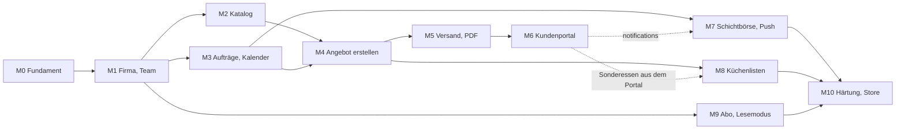
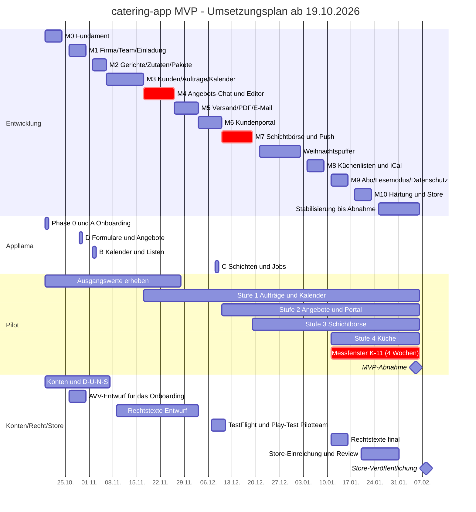
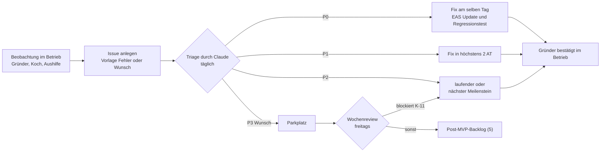

# 06 – Roadmap & Umsetzungsplan

Stand: 17.10.2026 · Arbeitstitel: catering-app · Grundlage: `docs/00-entscheidungen.md` (verbindlich), `docs/01-produkt.md`, `docs/02-ablaeufe.md`, `docs/03-datenmodell.md`, `docs/04-screens-ux.md`

**Lesehilfe**

- Inhalte ohne Markierung setzen 00–04 um. **[Vorschlag]** markiert eine begründete Empfehlung zu einem offenen Punkt; bis zur Freigabe durch den Gründer gilt sie als Arbeitsannahme.
- **AT** = Arbeitstag (Mo–Fr). Daten ohne Jahr: Oktober–Dezember = 2026, Januar–Februar = 2027.
- Verweise: „01 §4.1“ = Abschnitt 4.1 in `01-produkt.md`. `SC-xx` = Screen aus 04, `F-xx`/`US-xx`/`K-xx` aus 01, `D-x` aus 03 §10.2, `E-xx` = offene Entscheidung in Abschnitt 7 dieses Dokuments, `R-xx` = Risiko in Abschnitt 6.
- Rollen, Status, Tabellen, Edge Functions und Routen heißen exakt wie im Glossar (01 §0).
- Es gibt noch keinen Code. Außer den Dokumenten 00–04 und diesem Dokument entstehen alle genannten Dateien und Verzeichnisse (auch `docs/research/`) erst in den Meilensteinen.

**Inhalt**

0. Rahmen und Arbeitsweise
1. Meilensteine M0–M10
2. Gantt-Übersicht
3. Pilotbetrieb
4. Store-Einreichung und Rechtliches
5. Post-MVP-Backlog
6. Risiken und Gegenmaßnahmen
7. Offene Entscheidungen mit Deadline
8. Nächste Schritte (Woche 19.–23.10.2026)

Anhang: Annahmen und Vorschläge dieses Dokuments

---

## 0. Rahmen und Arbeitsweise

### 0.1 Eckdaten

| Punkt | Plan |
|---|---|
| Start | Mo 19.10.2026 mit M0 |
| Entwicklungszeit | 12 Wochen = 60 AT in 11 Meilensteinen (M0–M10), passend zu „ca. 2–3 Monate“ (00 §8) |
| Weihnachtspuffer **[Vorschlag]** | Mo 21.12.2026 – Fr 01.01.2027: keine neuen Features. Grund: Weihnachtsfeier-Hochsaison im Betrieb des Gründers, Feiertage, Puffer für Verzug |
| Must-Umfang vollständig | Fr 15.01.2027 (Ende M9) |
| Store-Einreichung | Mi 20.01.2027 (in M10) |
| MVP-Abnahme | frühestens Fr 05.02.2027. Die Abnahme verlangt 4 Wochen Prozessablösung in Folge (K-11, 01 §7). Messbar ist das erst, wenn auch die Küchenlisten laufen (ab M8) |
| Store-Veröffentlichung | nach der Abnahme, geplant Mo 08.02.2027 (manuelle Freigabe) |
| Kalenderzeit bis zur Abnahme | 16 Wochen = 12 Entwicklungswochen + 2 Wochen Puffer + 2 Wochen Stabilisierung im Messfenster |
| Kapazität Gründer (Annahme) | 8–12 h/Woche für Abnahmen, Entscheidungen und Pilot; im Dezember ca. 5 h |

### 0.2 Rollen und Rhythmus

| Wer | Aufgaben |
|---|---|
| Gründer | Product Owner: trifft die Entscheidungen aus Abschnitt 7, wählt die Muster nach jeder Appllama-Recherche, nimmt jeden Meilenstein am eigenen Gerät ab, führt den Pilotbetrieb, kümmert sich um Konten, Verträge und Rechtstexte, hält den Kontakt zu Steuerberater, Testkunden und Aushilfen |
| Claude | setzt App, Datenbank, Edge Functions, Tests und CI um; führt die Appllama-Recherche durch und schreibt die Entscheidungsvorlagen; schreibt je Meilenstein eine Testanleitung; sortiert die Pilot-Rückmeldungen; pflegt `docs/` |

| Termin | Dauer | Inhalt |
|---|---|---|
| Kickoff am ersten Tag des Meilensteins | 15 min | Ziel, Definition of Done, fällige Entscheidungen |
| täglich, asynchron | – | Claude meldet Stand, Testlink und offene Fragen; der Gründer antwortet bei Bedarf |
| Mitte des Meilensteins (optional) | 15 min | Zwischenstand am Gerät |
| Abnahme am letzten Tag | 45 min | Gründer führt die DoD-Schritte selbst aus; danach Freigabe für die Produktion |
| Wochenreview, freitags | 30–45 min | Ablauf in 3.4 |

### 0.3 Umgebungen

| Umgebung | Supabase | App | Web (Expo Web) | Daten | Zweck |
|---|---|---|---|---|---|
| lokal | `supabase start` (CLI) | Web im Container, Unit- und Datenbanktests | `localhost` | `supabase/seed.sql` (03 §9.4) | Entwicklung durch Claude, pgTAP |
| staging | eigenes Projekt, Region Frankfurt | Preview-Build (Android-APK bzw. TestFlight intern), EAS-Update-Kanal `preview` | staging-URL | Seed + Testfirmen | Abnahmen, Stripe-Testmodus, E-Mail-Tests |
| production **[Vorschlag: ab M2]** | eigenes Projekt, Region Frankfurt, kostenpflichtiger Plan mit täglichen Backups | Kanal `production`, TestFlight/Play-Testtrack, ab Freigabe Store | finale Domain (ab M5) | Pilotfirma (`plan = 'pilot'`, 01 US-55.7), Demo-Firma für das App-Review | Pilot, Launch |

- Claude kann im Container keine nativen Builds auf einem Gerät prüfen. Native Prüfungen laufen über Preview-Builds auf den Geräten des Gründers; Web, Logik und Datenbank prüft Claude selbst.
- Produktion ab M2, damit der Gründer seinen echten Katalog nur einmal erfasst. Bis M5 gibt es dort nur kurzlebige Links (Einladung, Passwort-Reset). Sie dürfen über eine Übergangsdomain laufen.
- Testfirmen auf staging bekommen `plan = 'pilot'`, sonst greift nach 14 Tagen der Lesemodus und blockiert die Tests.

### 0.4 Auslieferung

| Änderung | Weg | Beim Nutzer |
|---|---|---|
| TypeScript, Texte, Styles | EAS Update, erst Kanal `preview`, nach Abnahme `production` | beim nächsten App-Start |
| native Abhängigkeit, Berechtigung, App-Konfiguration | neuer Build → TestFlight bzw. Play-Testtrack (ab M10 Store-Version) | Stunden bis 2 Tage |
| Migrationen, Edge Functions | CI → staging automatisch; production per manueller Freigabe nach der Abnahme | sofort |
| Web-Admin, Kundenportal | Web-Build → Hosting staging bzw. production | sofort |

Regeln: Migrationen nur vorwärts und abwärtskompatibel (Expand/Contract, 03 §9.3), weil Geräte ältere App-Stände haben können. Updates sind über die `runtimeVersion` an den Build gebunden; inkompatible Updates erreichen alte Builds nicht.

### 0.5 Globale Definition of Done (gilt zusätzlich zur DoD jedes Meilensteins)

1. CI grün: Lint, Typecheck, Unit-Tests, `supabase db reset` → `supabase test db` → `supabase db lint` (03 §9.3).
2. Jede neue Tabelle erfüllt die Checkliste aus 03 §9.3, inklusive pgTAP-Tests für alle drei Rollen und den Zwei-Firmen-Test.
3. Neue Screens sind für `admin`, `kitchen` und `staff` geprüft (Sichtbarkeit, keine Preise für `kitchen`/`staff`), setzen die Zustände aus 04 §3 um (Laden, leer, Fehler, offline, Lesemodus) und nutzen die zentrale Schreibprüfung (04 §3.3). Texte sind deutsch; die Team-App duzt, Portal und Kunden-E-Mails siezen.
4. Läuft auf iOS, Android und Web (soweit der Screen dort vorgesehen ist) und ist auf staging ausgeliefert.
5. Testanleitung im Meilenstein-Issue; der Gründer hat jeden DoD-Schritt selbst ausgeführt und abgehakt; Abweichungen sind als Issues erfasst.
6. Abweichungen von 01–04 sind in `docs/` nachgetragen.
7. Ab M2: Nach der Abnahme sind Migrationen und Functions in der Produktion eingespielt.

### 0.6 Appllama im Ablauf

Ablauf je Bereich (Plan und Budget aus 04 §5):

1. `get_credits` (kostenlos) → Recherche nach dem Bereichsplan in 04 §5.4–5.7, inklusive der dortigen Abbruchregeln.
2. Steckbriefe und Entscheidungsvorlage in `docs/research/appllama-<bereich>.md` (Format 04 §5.8). Gespeichert werden nur `screen_ref` und eigene Beschreibungen; die Medien-URLs laufen nach ca. 1 h ab, Wasserzeichen werden nie übernommen.
3. Der Gründer wählt je Ziel-Screen ein Muster (höchstens 30 min).
4. Umsetzung mit den Design-Tokens und Basis-Komponenten (04 §4) und Abnahme am Gerät.

| Bereich | Termin | in | Credits (Plan / Obergrenze) | genutzt für |
|---|---|---|---|---|
| Phase 0 Orientierung | Mo 19.10. | M0 | 5 / 8 | Flow-Slugs, Element-IDs für alle Bereiche |
| A Onboarding & Firmen-Setup | Mo 19.10. | M0 | 30 / 40 | M1: SC-01 – SC-11, SC-54, SC-55, SC-59 · M9: neutraler Abo-Status |
| D Formulare & Angebote | Do 29.10. | M1 | 55 / 70 | M2: SC-39, SC-41 · M4: SC-16, SC-17, SC-32, SC-33, SC-64, SC-65 · M5: SC-34 · M6: SC-71 – SC-75 |
| B Kalender & Listen | Mo 02.11. | M2 | 40 / 50 | M2: SC-38 · M3: SC-12 – SC-15, SC-18, SC-19, SC-26, SC-35 · M6: SC-52 · M8: SC-13, SC-44 – SC-46 |
| C Schichten & Jobs | Di 08.12. | M6 | 45 / 55 | M7: SC-21 – SC-24, SC-47 – SC-51 |
| Reserve | bei Bedarf | – | 25 | Nachrecherche beim Screen-Design |

**[Vorschlag]** Reihenfolge und Budget bleiben wie in 04 §5.9. Statt zwei Sitzungen gibt es vier Termine, jeweils direkt vor dem zugehörigen Screen-Design. Verbrauch: Oktober ca. 90, November ca. 40, Dezember ca. 45 Credits (Kontingent 1.500/Monat, 04 §5.1).

---

## 1. Meilensteine

### 1.1 Überblick

| M | Zeitraum | AT | Ergebnis | Appllama | Pilot |
|---|---|---|---|---|---|
| M0 | Mo 19.10. – Fr 23.10. | 5 | App startet auf iOS, Android und Web; Login per E-Mail; CI; Supabase lokal und staging | Phase 0 + A | Ausgangswerte erheben |
| M1 | Mo 26.10. – Fr 30.10. | 5 | Firma anlegen, Team einladen, Tabs je Rolle, Einstellungen | D | – |
| M2 | Mo 02.11. – Do 05.11. | 4 | Gerichte mit Allergenen, Zutaten, Pakete; PDF-Spike; Produktion steht | B | echter Katalog |
| M3 | Fr 06.11. – Mo 16.11. | 7 | Kunden, Aufträge mit Status, Zeitplan, Kalender | (B anwenden) | Stufe 1 ab 17.11. |
| M4 | Di 17.11. – Mi 25.11. | 7 | Angebots-Chat, Angebots-Editor, Kalkulation | (D anwenden) | Angebote als Entwurf |
| M5 | Do 26.11. – Mi 02.12. | 5 | Versand mit PDF und E-Mail, Revisionen | (D anwenden) | Testversand an eigene Adressen |
| M6 | Do 03.12. – Mi 09.12. | 5 | Kundenportal, Online-Annahme, Benachrichtigungsliste | C | Stufe 2 ab 10.12. |
| M7 | Do 10.12. – Fr 18.12. | 7 | Schichtbörse, Einsätze offline, Push | (C anwenden) | Stufe 3 ab 19.12. |
| – | Mo 21.12. – Fr 01.01. | – | Weihnachtspuffer | – | Pilot läuft |
| M8 | Mo 04.01. – Fr 08.01. | 5 | Küchenlisten, Einkaufsliste, iCal | (B anwenden) | Stufe 4 ab 11.01. |
| M9 | Mo 11.01. – Fr 15.01. | 5 | Stripe-Abo, Lesemodus, Datenexport, Firma löschen | (A anwenden) | Messfenster K-11 ab 11.01. |
| M10 | Mo 18.01. – Fr 22.01. | 5 | Härtung, Store-Einreichung | – | Messfenster läuft |
| Abnahme | Fr 05.02.2027 | – | MVP fertig (3.6) | – | – |

M4 und M7 sind die umfangreichsten Meilensteine und deshalb im Gantt-Diagramm als kritisch markiert.

### 1.2 Abhängigkeiten

Tauschbar bei Bedarf: M8 kann vor M7 laufen (falls die Küche dringender ist). M9 hängt nur an M1 und kann vorgezogen werden. Die Reihenfolge M4 → M5 → M6 ist fest.

---

### 1.3 M0 · Fundament

**Zeitraum:** Mo 19.10. – Fr 23.10. · 5 AT · **Abhängigkeiten:** keine; Kontoanträge laufen parallel (4.1), E-1, E-2

**Ziel:** Ein leeres, aber vollständig verdrahtetes Projekt. Die App startet auf allen Plattformen, die Anmeldung per E-Mail funktioniert, und jede Änderung läuft über CI nach staging.

**Lieferumfang**

- **Projekt:** Expo-Projekt (aktuelles stabiles SDK, TypeScript strict) im bestehenden Repo. Struktur **[Vorschlag]**: `app/` (Expo Router), `src/` (Komponenten, Theme, Fachlogik, Datenzugriff), `supabase/` nach 03 §9.1, `docs/`. ESLint und Prettier; Pfad-Alias auf `supabase/functions/_shared/`, damit App und Edge Functions dasselbe Rechenmodul nutzen (03 §0).
- **Router:** Gruppen `app/(auth)`, `app/(app)` (leeres Tabs-Layout) und `app/portal/[token]` (Platzhalter). Das Root-Layout enthält das Auth-Gate nach 04 §1.1.
- **EAS:** Build-Profile `development`, `preview` (staging) und `production`; Update-Kanäle `preview` und `production`. Preview-Build für Android sofort, für iOS über TestFlight intern, sobald das Apple-Konto aktiv ist.
- **Supabase:** lokal per CLI und Projekt `staging` (Frankfurt). Migrationen: Extensions, Enums, `set_updated_at()`; `companies`, `company_members`, `subscriptions`; die Hilfsfunktionen `auth_company_id()`, `auth_role()`, `company_is_writable()` und `assert_writable()`; die Referenztabellen `allergens` und `plan_limits` (03 §3.7). RLS steht auf „default deny“. TypeScript-Typen per `supabase gen types`.
- **Tests:** pgTAP-Gerüst mit dem ersten Test „Firma A sieht Firma B nicht“; Gerüst für TypeScript-Unit-Tests.
- **CI (GitHub Actions):** Prüfungen aus 0.5 bei jedem Pull Request. Bei Merge auf `main`: Migrationen und Functions nach staging, EAS Update `preview`, Web-Build auf das staging-Hosting.
- **Design:** `tokens.ts` aus 04 §4.2–4.5, Schrift Inter. Erste Basis-Komponenten (04 §4.9): Button, FormField, Banner, ScreenHeader, Money, DateTimeText (Europe/Berlin), WriteGuard (Gerüst).
- **Auth:** SC-01 – SC-05 (E-Mail + Passwort, E-Mail bestätigen, Passwort vergessen/neu setzen). Apple und Google sind vorbereitet (Provider-Konfiguration, Buttons) und werden in M1 aktiv.
- **Web:** staging-Hosting mit SPA-Fallback für dynamische Routen (`portal/[token]`, `invite/[token]`), E-12.

**Appllama (Mo 19.10.):** `get_credits`, Phase 0 und Bereich A Onboarding & Firmen-Setup. Ergebnis: `docs/research/appllama-onboarding.md` mit Entscheidungsvorlage. Der Gründer wählt bis Di 20.10. die Muster für SC-01 – SC-11.

**Definition of Done – das probiert der Gründer aus**

1. Preview-Build auf dem Android-Gerät installieren (iOS über TestFlight, sobald das Konto aktiv ist) und die staging-URL im Browser öffnen.
2. Mit eigener E-Mail registrieren, Bestätigungsmail öffnen, an- und abmelden, Passwort zurücksetzen.
3. Nach dem Login erscheint der Platzhalter für „Willkommen“ (SC-07); Abmelden führt zu SC-01.
4. Eine kleine Textänderung von Claude erscheint ohne Neuinstallation nach dem App-Neustart (EAS Update).
5. Claude zeigt den grünen CI-Lauf mit bestandenem Mandantentest.

**Kürzbar bei Verzug:** iOS-Build (folgt mit dem Apple-Konto), Web-Hosting (bis M1 genügt lokal).

**Hinweis:** Der eingebaute Mailversand von Supabase ist stark begrenzt und nur für Tests gedacht. Ab M1 läuft der Auth-Mailversand per SMTP über den E-Mail-Dienst (E-3).

---

### 1.4 M1 · Firma, Team, Einladung

**Zeitraum:** Mo 26.10. – Fr 30.10. · 5 AT · **Abhängigkeiten:** M0; E-Mail-Dienst mit (Übergangs-)Domain (E-3); Apple-Konto für Sign in with Apple; E-9 (Ende der Testphase)

**Ziel:** Der Gründer legt seinen Betrieb an und holt Küche und Aushilfen in die App. Jede Rolle sieht ihre eigenen Tabs.

**Lieferumfang**

- **Datenbank:** `invitations`, `tax_rates`, `qualifications`, `member_qualifications`; Firmenfelder für Stammdaten, Branding und Fristen & Standardwerte (01 §4.2.6); Bucket `logos` (03 §8).
- **RPCs:** `create_company()` mit `seed_company_defaults()` (Steuersätze DE; AT/CH angelegt, aber nicht aktivierbar; Qualifikationsvorlagen; Standardwerte), `create_invitation()`, `resend_invitation()`, `revoke_invitation()`, `set_member_role()`, `set_member_qualifications()`, `remove_member()`, `leave_company()`, `delete_my_account()`. Planlimits für Einladungen und Admins (`plan_limits`; in der Testphase gilt `profi`).
- **Edge Functions:** `accept-invitation`; `send-email` mit den Vorlagen „Einladung“ und „Mitglied beigetreten“.
- **Screens:** SC-06 – SC-11 (Einladung annehmen, Willkommen, Onboarding Firma/Branding/Arbeitsweise, Fertig), SC-54 – SC-56 (Team, Einladen, Mitglied), SC-57 – SC-62 (Einstellungen, Firma, Branding, Steuersätze, Qualifikationen, Fristen & Standardwerte), SC-68 Profil mit „Konto löschen“, SC-53 Mehr. SC-12 Start zunächst mit der Setup-Checkliste.
- **Navigation:** Tabs je `member_role` nach 04 §1.3 (Inhalte noch als Platzhalter), Web-Sidebar ab 1024 px.
- **Login:** Sign in with Apple (iOS, Web) und Google aktiv. Universal Links für `/invite/*` und `/reset-password` auf der staging-Domain. Absenderdomain beim Apple-Relay-Dienst registrieren (4.1).
- **Querschnitt:**
  - AVV-Checkbox in SC-08 mit dem AVV-Entwurf als PDF (4.2).
  - Push-Spike: Expo-Push-Token auf dem Gerät des Gründers, eine Testnachricht über den Expo-Push-Dienst (noch ohne Tabellen).

**Appllama:** Muster aus Bereich A umsetzen. Am Do 29.10. folgt Bereich D Formulare & Angebote → `docs/research/appllama-formulare-angebote.md`. Der Gründer wählt bis Mo 02.11. die Muster für SC-39 und SC-41 (für M2) und vorab für SC-17, SC-32 – SC-34 und SC-71 – SC-75.

**Definition of Done – das probiert der Gründer aus**

1. Den eigenen Betrieb auf staging anlegen, Logo und Akzentfarbe setzen, Vorschau prüfen, DE-Steuersätze als „von mir geprüft“ markieren (vorläufig bis E-13).
2. Den Koch als `kitchen` per E-Mail einladen, eine Aushilfe als `staff` per geteiltem Link. Beide treten auf ihrem Handy bei (Android-Build oder Web) und sehen nur die Tabs ihrer Rolle.
3. Je einmal mit Apple- und mit Google-Konto anmelden.
4. Die Aushilfe zu `kitchen` hochstufen und danach entfernen. Der Zugriff endet sofort; nach dem Neuladen erscheint „Kein Zugriff“.
5. Versuch, den letzten Admin herabzustufen: gesperrt, mit Hinweis. Ein eigenes Testkonto in der App löschen.
6. Eine zweite Testfirma sieht nichts von der ersten (manuell mit einem zweiten Konto und per pgTAP).
7. Die Testnachricht (Push) kommt auf dem Gerät an.

**Kürzbar bei Verzug:** Einladung per geteiltem Link (E-Mail genügt), Web-Sidebar (Tabs auch im Web).

---

### 1.5 M2 · Gerichte, Zutaten, Pakete

**Zeitraum:** Mo 02.11. – Do 05.11. · 4 AT · **Abhängigkeiten:** M1 (Rollen, Steuersätze); Musterwahl aus Bereich D für SC-39 und SC-41

**Ziel:** Der echte Katalog des Betriebs ist erfasst. Er ist die Grundlage für Angebot, Allergenkennzeichnung und Küche.

**Lieferumfang**

- **Datenbank:** `dishes`, `dish_allergens`, `ingredients`, `dish_ingredients`, `menu_packages`, `menu_package_dishes`; RPCs `save_dish()` und `save_ingredient()`; Rollen-View für `kitchen` ohne Preis- und Kostenspalten, dazu Spaltenprivilegien (03 §4.3, §4.6). pgTAP: Keine View für `kitchen`/`staff` enthält Spalten mit `price`, `cost` oder `markup`.
- **Rechenmodul (Teil 1):** Wareneinsatz pro Portion (Gericht, Paket mit Portionsfaktor), abgeleitete Allergene und Diätformen. Unit-Test mit dem Rechenbeispiel aus 02 §3.3.
- **Screens:**
  - SC-38 Gerichte: Suche und Filter.
  - SC-39 Gericht: Allergen-Raster 14 × Ja/Nein mit Prüfstatus, Diätformen, Zutaten mit Menge p. P., Wareneinsatz live (nur `admin`).
  - SC-40/SC-41 Pakete, SC-42/SC-43 Zutaten.
  - Komponenten AllergenCodes und DietTags.
- **Einmal-Import [Vorschlag]:** Claude übernimmt die vorhandene Excel-Liste des Gründers per Skript (kein Produkt-Feature; der CSV-Import ist P-21). Allergene bestätigt der Gründer trotzdem je Gericht.
- **Produktion:** Supabase-Projekt `production` (Frankfurt, mit täglichen Backups), Pilotfirma mit `plan = 'pilot'`, Deploy-Workflow mit manueller Freigabe.
- **Spike PDF:** Prototyp von `render-quote-pdf` mit Beispieldaten (3 Seiten, Logo, Akzentfarbe, Umlaute, Allergen-Legende, Seitenumbruch in der Positionsliste). Gemessen werden Laufzeit, CPU-Zeit und Dateigröße. Das Ergebnis entscheidet E-11.

**Appllama (Mo 02.11.):** Bereich B Kalender & Listen → `docs/research/appllama-kalender-listen.md`. Die Muster gehen sofort in SC-38 ein, sonst in M3 und M8.

**Definition of Done – das probiert der Gründer aus**

1. In der Produktion stehen 15–20 echte Gerichte mit Allergenen und Diätformen (per Import und Nacharbeit). Bei mindestens 5 Gerichten sind Zutaten mit Menge pro Person gepflegt; dazu 2–3 echte Pakete.
2. Der Wareneinsatz pro Portion stimmt bei 3 Gerichten mit der bisherigen Excel-Kalkulation überein; Abweichungen sind erklärt.
3. Der Koch meldet sich an: Er sieht Gerichte, Pakete und Zutaten, aber nirgends Verkaufs- oder Einkaufspreise.
4. Die Filter „ohne Gluten“ und „vegan“ liefern die erwarteten Gerichte. Ein Gericht ohne Bestätigung „Allergene geprüft“ ist als ungeprüft markiert.
5. Das Beispiel-PDF aus dem Spike liegt vor; der Gründer gibt das Grundlayout frei.

**Kürzbar bei Verzug:** Filter in SC-38 (F-11, Should), Warengruppen bei Zutaten.

---

### 1.6 M3 · Kunden, Aufträge, Kalender

**Zeitraum:** Fr 06.11. – Mo 16.11. · 7 AT · **Abhängigkeiten:** M1; E-8 (D-2, D-3, D-4); Musterwahl aus Bereich B

**Ziel:** Alle Anfragen und Aufträge laufen über die App, und der Kalender zeigt den echten Betrieb.

**Lieferumfang**

- **Datenbank:** `customers`, `events`, `event_schedule_items`, `event_dietary_requirements`, `event_status_changes` (03 §3.7). RPCs `set_event_status()` mit zentraler Übergangstabelle (04 §0.3) und `copy_event()` (zunächst ohne Angebot). `kitchen` sieht Aufträge ab `optioned`, ohne Kundendaten.
- **Screens:**
  - Kunden: SC-35 – SC-37, mit Duplikatwarnung.
  - Aufträge: SC-15 Liste mit Suche und Filter, SC-16 Schnellerfassung.
  - Auftragsdetail: SC-18 mit SC-19 Übersicht, SC-26 Zeitplan inklusive Standardablauf, SC-29 Bearbeiten, SC-30 Kopieren, SC-31 Statuswechsel.
  - SC-14 Kalender: Monat, Woche, Liste; Statusdarstellung nach 04 §4.3.
  - SC-12 Start: Karten „Heute und morgen“ sowie „Zu erledigen“ mit Anfragen ohne Angebot und ablaufenden Optionen.
  - SC-25 Tab Küche in erster Fassung (Hinweise Küche, Sonderessen) mit SC-27 Sonderessen-Eintrag.
- **Querschnitt:**
  - Persistenter Abfrage-Cache und Offline-Banner „Offline – Stand: …“: die Grundlage für F-29.
  - Neue Komponenten StatusBadge, FilterChips, Timeline.
- **Zeitlogik:** Hilfsfunktionen für Europe/Berlin. Tests über beide Zeitumstellungen (25.10.2026, 28.03.2027) und für Aufträge über Mitternacht.

**Appllama:** Muster aus Bereich B umsetzen. Die Reserve wird nur bei offenen Fragen genutzt, z. B. für die Wochenansicht auf dem Handy.

**Definition of Done – das probiert der Gründer aus**

1. Alle offenen Anfragen und Aufträge der nächsten 8 Wochen samt Kunden aus Excel und Kalender übertragen. Damit beginnt Pilot-Stufe 1 (3.2).
2. Einen Auftrag durch alle Status führen: Anfrage → Optioniert (mit „optioniert bis“) → Bestätigt → Durchgeführt → Abgerechnet. Einen zweiten mit Grund stornieren. Die Statushistorie stimmt.
3. Einen Business-Lunch auf den gleichen Wochentag der Folgewoche kopieren; der Zeitplan ist mitverschoben.
4. Der Kalender (Monat, Woche, Liste) deckt sich mit dem bisherigen Kalender; vorläufige Termine sind erkennbar.
5. Der Koch sieht optionierte und bestätigte Aufträge mit Zeitplan, aber keine Anfragen und keine Kundenkontakte.
6. Im Flugmodus bleiben geladene Aufträge lesbar; Speichern ist deaktiviert („Nur online möglich“).

**Kürzbar bei Verzug:** Volltextsuche (F-09, Should), Mehrfachkopie (F-06, Should), Wochenansicht auf dem Handy.

---

### 1.7 M4 · Angebots-Chat, Angebots-Editor, Kalkulation

**Zeitraum:** Di 17.11. – Mi 25.11. · 7 AT · **Abhängigkeiten:** M2, M3; E-10 (D-1, wirkt auf `quotes`); Steuersätze vom Steuerberater bestätigt (E-13) oder vorläufig markiert

**Ziel:** Ein vollständiges Angebot entsteht in unter 20 Minuten: geführt über den Chat, fertiggestellt im Editor, mit korrekter Kalkulation (K-01).

**Lieferumfang**

- **Datenbank:**
  - `quotes`: Entwurf und Snapshot-Felder, Revisionsnummer, Angebotsnummer `A-JJJJ-NNNN`.
  - `quote_items` mit allen sieben `quote_item_type`: `package`, `dish`, `service`, `equipment`, `travel`, `beverage`, `custom`.
  - `intake_questions` (Vorschlag aus 03 §3.7); der Standard-Fragenkatalog kommt über `seed_company_defaults()`.
  - `copy_event()` kopiert jetzt auch das Angebot (Revision 0, neue Nummer).
- **Rechenmodul (vollständig, 02 §3):** Pauschal oder Wareneinsatz + Aufschlag, Rundung, USt je Satz, Rabatt, Wahlgruppen, Rohertrag. Regressionstest mit dem Rechenbeispiel aus 02 §3.6 (3.261,68 € brutto). Dieselbe Datei läuft in App und Edge Functions.
- **Screens:**
  - SC-17 Angebots-Chat: alle Antworttypen, Verzweigung über `show_if`, Antwort ändern, Abschlusskarte.
  - SC-64/SC-65 Fragenkatalog.
  - SC-32 Angebots-Editor für Handy und Web, speichert automatisch (nur online).
  - SC-33 Position, SC-20 Tab Angebot (Entwurfsstand), SC-63 Angebotstexte & Vorlagen.
- **Messung K-01:** Die Zeit, in der der Editor im Vordergrund ist, wird am Angebot gespeichert (01 §7).

**Appllama:** Muster aus Bereich D umsetzen. Bis zu 10 Credits aus der Reserve für den Chat (z. B. Fortschrittsanzeige bei Verzweigungen), falls die Vorlage aus M1 Fragen offenlässt.

**Definition of Done – das probiert der Gründer aus**

1. Rollenspiel „Kundentelefonat“ (Koch oder Partner spielt den Kunden): Eine Hochzeitsanfrage komplett im Chat erfassen. Die Folgefrage „Sektempfang?“ erscheint nur beim Anlass Hochzeit.
2. Drei echte Angebote bauen: eine Hochzeit mit der Wahlgruppe „Menü Klassik oder Mediterran“, eine Firmenfeier mit Rabatt und Personal, einen Business-Lunch mit Paket p. P.
3. Summen, USt je Satz und Rohertrag stimmen auf den Cent mit der eigenen Kalkulation überein. Der Wechsel Pauschal ↔ Wareneinsatz verhält sich wie in 01 §4.2.2 beschrieben.
4. Die Gästezahl von 80 auf 95 ändern: Alle Pro-Person-Positionen skalieren mit.
5. Die gemessene Editorzeit liegt vor (Ziel ≤ 20 min).
6. Eine Frage im Fragenkatalog ändern, die Reihenfolge umstellen und im Chat prüfen.
7. Der Koch sieht weiterhin keine Preise.

**Kürzbar bei Verzug:** Sortieren per Drag & Drop im Web (mobil reicht „Verschieben“), Testlauf im Fragenkatalog, Katalog-Seitenpanel im Web.

---

### 1.8 M5 · Versand, PDF, E-Mail

**Zeitraum:** Do 26.11. – Mi 02.12. · 5 AT · **Abhängigkeiten:** M4; finale Domain mit SPF, DKIM und DMARC (E-5); PDF-Technik (E-11)

**Ziel:** Ein Angebot verlässt die App gebrandet als E-Mail mit PDF; jede versendete Fassung ist als Revision eingefroren.

**Lieferumfang**

- **Datenbank und RPCs:**
  - Neue Tabelle `portal_tokens`; Fremdschlüssel `quotes.acceptance_portal_token_id`.
  - `send_quote()`: Prüfregeln, Snapshot, Revision + 1, Hash, Statuswechsel `inquiry` → `quoted`, Portal-Token (Klartext nur einmal).
  - `discard_quote_changes()`, `record_acceptance()`, `record_decline()`, `issue_portal_token()`, `revoke_portal_tokens()`.
- **Edge Functions:**
  - `render-quote-pdf` im Echtbetrieb: Bucket `quotes`, Datei `r{n}.pdf`, Fußzeile nach `branding_footer`.
  - `send-email` erweitert: Angebot bzw. neue Revision mit Portal-Link und PDF; Absendername = Firma, Reply-To = Firmen-E-Mail (00 §5); Zustellstatus in `quotes.email_status` inklusive Bounce-Meldung des Dienstes.
- **Screens:**
  - SC-34 Vorschau und Versand: Prüfliste, Vorschau Portal/PDF/E-Mail, Versandart bei `confirmed`.
  - SC-20 vollständig: Revisionen mit PDF, Link kopieren, Gültigkeit verlängern, Änderungen verwerfen.
  - Statusaktionen „Annahme erfassen“ und „Ablehnung erfassen“.
- **Portal-Platzhalter:** Der Portal-Link führt bis M6 auf eine Platzhalterseite. Echte Kunden erhalten erst ab M6 Angebote.

**Appllama:** Muster aus Bereich D für SC-34 umsetzen.

**Definition of Done – das probiert der Gründer aus**

1. Ein Angebot an eigene Adressen bei Gmail, Outlook und iCloud senden: Die Mail landet im Posteingang (nicht im Spam), der Absender heißt wie die Firma, „Antworten“ geht an die Firmen-E-Mail.
2. Ein Spam-Test (z. B. mail-tester.com) bewertet die Mail mit mindestens 9/10.
3. Das PDF zeigt Logo, Akzentfarbe, Umlaute, Allergen-Codes mit Legende und den Summenblock. Bei 30 Positionen bricht die Seite sauber um. Die Erzeugung dauert unter 5 s.
4. Nach einer Änderung entsteht Revision 2 mit eigenem PDF; Revision 1 bleibt abrufbar.
5. Eine telefonische Annahme erfassen: Status `confirmed`, Statushistorie mit Kanal „Telefon“.
6. Die Prüfliste blockiert den Versand an einen Kunden ohne E-Mail und warnt bei ungeprüften Allergenen.

**Kürzbar bei Verzug:** „Link kopieren“ (F-15, Should), „Gültigkeit verlängern“.

---

### 1.9 M6 · Kundenportal

**Zeitraum:** Do 03.12. – Mi 09.12. · 5 AT · **Abhängigkeiten:** M5; Web-Hosting auf der finalen Domain (E-12); Impressum und Datenschutzerklärung als Entwurf online (4.2); E-10

**Ziel:** Der Endkunde sieht sein Angebot im Browser, ändert Details und nimmt verbindlich an. Der Admin erfährt es sofort.

**Lieferumfang**

- **Edge Function `portal-api`** nach 03 §5: Token im `Authorization`-Header, Prüfung per `sha256`, Rate-Limit, Whitelist nach 03 §5.3. RPCs `portal_get()`, `portal_accept_quote()`, `portal_decline_quote()`, `portal_apply_change()`, `portal_save_dietary()`, `portal_mark_viewed()`.
- **Screens:**
  - `app/portal/[token]` mit SC-71 – SC-76: Branding des Caterers, Siezen, ab 360 px, `noindex`, `Referrer-Policy: no-referrer`, keine Ressourcen von Dritten.
  - SC-28 Tab Portal: Änderungswunsch übernehmen oder ablehnen, Link-Status, Sperre.
- **Benachrichtigungen:**
  - Tabelle `notifications` und SC-52 Benachrichtigungsliste mit Glocke.
  - Einträge bei Annahme, Ablehnung, Änderungswunsch und geänderten Sonderessen; bei Annahme und Ablehnung zusätzlich eine E-Mail an den Admin. Die Push-Zustellung folgt in M7.
  - E-Mails an Endkunden: Annahme mit `r{n}-angenommen.pdf`, Änderungswunsch übernommen bzw. abgelehnt.
- **Jobs (pg_cron, 03 §9.6):** `option_reminders`, `quote_expiry`, `events_completion` (Variante nach D-2), `notifications_retention`.
- **SC-12 Start:** neue Karten „offene Änderungswünsche“ und „abgelaufene Angebote“.
- **Sicherheitstests für `portal-api`:** unbekannter, abgelaufener und widerrufener Token; veraltete Revision (409); Änderungsschluss (423). Ein automatischer Whitelist-Test stellt sicher, dass die Antwort keine internen Felder enthält.

**Appllama:** Muster aus Bereich D für SC-71 – SC-75 umsetzen. Am Di 08.12. folgt Bereich C Schichten & Jobs → `docs/research/appllama-schichten-jobs.md`; der Gründer wählt bis Do 10.12.

**Definition of Done – das probiert der Gründer aus**

1. Je ein Angebot an einen Stammkunden (Business-Lunch) und an eine eingeweihte Testperson (fiktive Hochzeit) senden. Damit beginnt Pilot-Stufe 2.
2. Die Testperson öffnet den Link auf dem eigenen Handy im Mobilfunknetz, trägt „2 × vegan, 1 × Zöliakie“ ein, wählt in der Wahlgruppe ein Menü, ändert die Gästezahl und nimmt verbindlich an.
3. Annahme und Änderungswunsch erscheinen in der Benachrichtigungsliste und per E-Mail; der Status ist `confirmed`; das Annahme-PDF nennt Name und Zeitpunkt.
4. Ein absichtlich verfälschter Link zeigt „Link ungültig“, ohne Firmendaten.
5. Nach dem Änderungsschluss sind die Felder gesperrt und zeigen den Telefonhinweis.
6. Das Portal lädt im Mobilfunknetz (4G) in unter 2,5 s (Messung im Browser, K-16).

**Kürzbar bei Verzug:** Auswahlliste für Ablehnungsgründe, „Als Kunde ansehen“.

---

### 1.10 M7 · Schichtbörse & Push

**Zeitraum:** Do 10.12. – Fr 18.12. · 7 AT · **Abhängigkeiten:** M1 (Qualifikationen), M3 (Aufträge), M6 (`notifications`); APNs-Schlüssel und FCM-Zugang in EAS; TestFlight- und Play-Testgruppe für das Pilotteam (Beta-Review am Mo 07.12. einreichen); E-14, E-15

**Ziel:** Aushilfen finden passende Einsätze in der App statt in der WhatsApp-Gruppe, und alle Beteiligten werden per Push informiert.

**Lieferumfang**

- **Datenbank und RPCs:**
  - Neue Tabellen `shift_slots`, `shift_applications` (mit Überbuchungsschutz) und `push_tokens`.
  - RPCs `publish_slots()`, `cancel_slot()`, `shift_slot_times_changed()`, `apply_for_slot()`, `cancel_my_application()`, `decide_application()`, `assign_member()`, `record_late_cancellation()`, `register_push_token()`, `mark_notifications_read()`.
  - Planprüfung `shift_board`.
- **Edge Function `push-dispatch`:**
  - Auslösung per Database Webhook auf `notifications` und per Cron.
  - Bündelung und Ruhezeit; Push-Quittungen auswerten und ungültige Tokens löschen.
  - Texte ohne Gesundheitsdaten (02 §10.1).
  - Angebunden werden alle bis hierhin vorhandenen Auslöser aus 01 §4.2.5, auch die Portal-Ereignisse aus M6.
- **Screens:**
  - Admin: SC-21 – SC-24 (Personal je Auftrag, Slot-Detail, Einplanen, Slot anlegen), SC-47 Personal.
  - Mitarbeiter: SC-48 Schichtbörse, SC-49/SC-51 Slot- und Einsatzdetail (eine gemeinsame Route), SC-50 Meine Einsätze.
  - SC-69 Benachrichtigungseinstellungen; Push-Erklärung vor der Systemabfrage (SC-06, SC-11).
  - SC-12 Start: neue Karten „unbesetzte Slots“ und „offene Bewerbungen“.
- **Offline:** Die eigenen Einsätze der nächsten 14 Tage werden vorgeladen (US-54.6); Einsatzinfos samt Ablaufplan sind offline lesbar. Der Cache wird bei Abmeldung, Entfernen und Rollenwechsel gelöscht.
- **Jobs:** `shift_reminders`, `push_deferred`.
- **Nebenläufigkeitstest:** zwei Zusagen gleichzeitig auf den letzten Platz (03 §9.5).
- **Verteilung:** TestFlight-Gruppe „Pilot-Team“ (externe Tester) und Play-Testtrack.

**Appllama:** Muster aus Bereich C umsetzen.

**Definition of Done – das probiert der Gründer aus**

1. 2–3 vertraute Aushilfen installieren die App (TestFlight bzw. Play) und treten per Einladung bei. Damit beginnt Pilot-Stufe 3.
2. Für einen echten Auftrag Slots anlegen („Service 2 ד, „Bar 1 ד) und veröffentlichen. Nur Aushilfen mit passender Qualifikation sehen den Slot und bekommen einen Push.
3. Die Aushilfen bewerben sich. Der Gründer sagt zu und ab; die Betroffenen bekommen innerhalb einer Minute einen Push. Eine dritte Bewerbung landet auf der Warteliste.
4. Eine Aushilfe öffnet ihr Einsatzdetail im Flugmodus: Adresse, Treffpunkt, Dresscode, Ablaufplan und Ansprechpartner sind lesbar.
5. Eine Absage vor der Frist klappt (der Admin bekommt einen Push, der Slot ist wieder frei). Nach der Frist bietet die App nur noch „Absage nur noch telefonisch“ mit Anruf-Button.
6. Eine Person ohne Bewerbung direkt einplanen (`assigned`).
7. Claude führt den Nebenläufigkeitstest vor: Bei zwei gleichzeitigen Zusagen auf den letzten Platz bleibt genau eine.

**Kürzbar bei Verzug:** Erinnerung 24 h vorher, Warnung „unbesetzt 72 h vorher“, Ruhezeit, Monatssumme der Stunden (alle Should).

---

### 1.11 Weihnachtspuffer · Mo 21.12.2026 – Fr 01.01.2027

- Keine neuen Features. P0- und P1-Fehler werden per EAS Update behoben (3.4).
- Der Pilot läuft (Weihnachtsfeiern, Silvester); der Gründer sammelt Rückmeldungen.
- Liegt der Plan im Soll, kann M8 vorgezogen werden. Die frühestmögliche Abnahme rückt dann auf Fr 22.01.2027 (3.6).

---

### 1.12 M8 · Küchenlisten & iCal

**Zeitraum:** Mo 04.01. – Fr 08.01.2027 · 5 AT · **Abhängigkeiten:** M2, M4, M6; E-16 (Datenbasis der Küchenlisten, 04 §0.5); E-18 (iPad) · Der 06.01. ist in BW, BY und ST Feiertag; gegebenenfalls verlängert sich M8 um einen Tag.

**Ziel:** Die Küche plant Produktion und Einkauf aus der App, und Allergiker sind sicher markiert.

**Lieferumfang**

- **Datenbank:** Rollen-Views bzw. RPCs ohne Preise für:
  - die Produktionsliste über mehrere Aufträge und Tage, Optionen zuschaltbar;
  - die Einkaufsliste: Zutaten × Portionen + Puffer, in Basiseinheiten;
  - Sonderessen mit Konfliktprüfung und Ersatzgericht.
- **Screens:** SC-13 Heute (Heute/Morgen), SC-25 Tab Küche vollständig, SC-44 Produktion, SC-45 Sonderessen im Zeitraum, SC-46 Einkauf (lokales Abhaken, Teilen als Text, CSV im Web); Druckansicht A4 im Web (Should); Tablet-Layout mit 2 Spalten.
- **Push an `kitchen`:** neuer bestätigter Auftrag, Storno, verbindliche Gästezahländerung, geänderte Sonderessen (gebündelt; kurzfristige Änderungen nicht abschaltbar).
- **Offline:** Aufträge der nächsten 7 Tage werden für `kitchen` vorgeladen. Gesundheitsdaten liegen nur im geschützten App-Speicher (US-54.7).
- **Edge Function `ical-feed`** mit SC-70 Kalender-Abo und RPC `reset_ical_token()` (Should).
- **Job:** `dietary_purge` (Gastnamen 30 Tage nach Eventende entfernen).

**Appllama:** Muster aus Bereich B für SC-13 und SC-44 – SC-46 umsetzen.

**Definition of Done – das probiert der Gründer aus**

1. Der Koch plant die Produktion der Woche auf dem Tablet aus der App. Ab Mo 11.01. beginnt Pilot-Stufe 4.
2. Die Einkaufsliste für einen Tag mit 2 Aufträgen stimmt mit der Handrechnung des Kochs überein (Vorgehen wie im Rechenbeispiel 02 §8.5).
3. Ein Gast „vegan“ trifft im Auftrag auf ein Gericht mit Milch: Der Konflikt steht rot oben; ein eingetragenes Ersatzgericht erscheint in der Liste.
4. Vier-Augen-Abgleich: Bei den ersten 3 Events weicht die Allergiker- und Produktionsliste der App nicht von der bisherigen Papierliste ab.
5. Küchen-Tablet im Flugmodus: Produktion, Einkauf und Sonderessen der nächsten 7 Tage sind lesbar.
6. Eine Aushilfe und der Gründer abonnieren ihren iCal-Link in Apple bzw. Google Kalender. Die Einsätze erscheinen ohne Kundendaten.

**Kürzbar bei Verzug:** iCal-Abo (F-28, Should), Druckansicht (Should), geschätzte Kosten im Einkauf (Should).

---

### 1.13 M9 · Abo, Lesemodus, Datenschutz-Funktionen

**Zeitraum:** Mo 11.01. – Fr 15.01.2027 · 5 AT · **Abhängigkeiten:** M1; Abo-Stufen und Preise entschieden (E-6, spätestens 08.01.); Stripe-Konto des Betreibers verifiziert; AGB-Entwurf; E-17 (Datenexport)

**Ziel:** Neue Firmen können nach der Testphase zahlen, ohne Abo greift der Lesemodus, und die DSGVO-Pflichten lassen sich per Knopfdruck erfüllen.

**Lieferumfang**

- **Stripe (zuerst im Testmodus):** Produkte und Preise je Stufe (monatlich, jährlich), Steuerberechnung, USt-IdNr.
- **Edge Functions:**
  - `create-checkout-session`: Checkout und Stripe-Kundenportal, mit Limitprüfung.
  - `stripe-webhook`: Signaturprüfung, idempotente Verarbeitung, `apply_stripe_subscription()`; liest den Abo-Zustand per API nach (03 §6.1).
- **Durchsetzung:** Lebenszyklus von `subscriptions` nach 01 §6.3 und 03 §6.1; Planlimits an allen Prüfpunkten aus 03 §6.3; Fußzeilenhinweis in der Stufe Start.
- **Screens:**
  - SC-66 Abo: `subscription.web.tsx` mit Stufen, Checkout und Verwaltung; nativ nur der neutrale Status, ohne Preis, Button oder Link.
  - Banner für Testphase, „Zahlung offen“ und Lesemodus; WriteGuard überall aktiv (04 §3.3).
  - SC-67 Datenschutz & Export (`privacy.web.tsx`): Datenexport (`data_exports`), AVV als PDF mit Annahmedatum, Liste der Unterauftragsverarbeiter, „Firma löschen“.
  - In SC-36: Kunde anonymisieren mit `anonymize_customer()` (US-61).
- **Jobs:** `billing_lifecycle` (Testphase-Mails nach 7, 3 und 1 Tag(en) Restlaufzeit, Löschankündigungen, Löschung), `exports_cleanup`.
- **E-Mails:** Testphase endet, Zahlung fehlgeschlagen, Löschankündigung, Export bereit.

**Appllama:** Muster aus Bereich A (Frage 5: Testphase ohne Kauf-Link auf iOS) für den neutralen Abo-Status umsetzen.

**Definition of Done – das probiert der Gründer aus (staging, Stripe-Testmodus)**

1. Bei einer Testfirma das Ende der Testphase per SQL auf „morgen“ vorstellen: Mail und Banner erscheinen. Nach dem Ablauf gilt der Lesemodus: Lesen geht, jede Schreibaktion ist gesperrt, das Kundenportal bleibt 30 Tage nutzbar.
2. Im Web-Admin die Stufe „Team“ mit einer Testkarte abschließen: Spätestens eine Minute später ist die Firma wieder schreibbar; die Rechnung liegt im Stripe-Kundenportal.
3. Einen Zahlungsfehler mit einer Stripe-Testkarte simulieren: Das Banner „Zahlung fehlgeschlagen“ erscheint, nach der Kulanzzeit gilt der Lesemodus.
4. Auf iPhone und Android prüfen: nirgends Preise, Kauf-Buttons oder Links zum Kauf.
5. Mehr Mitglieder als in der Zielstufe erlaubt: Der Abschluss ist mit Hinweis gesperrt.
6. Der Datenexport liefert ein vollständiges ZIP. „Firma löschen“ entfernt bei einer Testfirma Daten und Dateien (Claude kontrolliert den Storage).
7. Die Pilotfirma in der Produktion bleibt unberührt (`plan = 'pilot'`).

**Kürzbar bei Verzug:** jährliche Zahlweise, Export der Daten eines einzelnen Kunden (US-61.1, Should).

---

### 1.14 M10 · Härtung, Store-Einreichung

**Zeitraum:** Mo 18.01. – Fr 22.01.2027 · 5 AT · **Abhängigkeiten:** M0–M9; Rechtstexte final (4.2); Store-Konten aktiv; Demo-Firma

**Ziel:** Das MVP ist sicher, messbar stabil und bei Apple und Google eingereicht.

**Lieferumfang**

- **Sicherheit:**
  - Die vollständige Policy-Matrix aus 03 §4.5 als pgTAP-Tests.
  - Security- und Performance-Advisor von Supabase ohne Befund; alle SECURITY-DEFINER-Funktionen durchgesehen.
  - Secrets-Inventur: CI prüft, dass kein `service_role`-Schlüssel im Client-Bundle steckt.
  - Zwei-Mandanten-Durchgang aller Screens mit Demo-Firma und Pilotfirma.
- **Qualität:** K-16 messen (absturzfreie Sitzungen, PDF p95, Push p95, Portal p95); Barrierefreiheit von Portal und Kern-Screens prüfen (04 §4.7); Leerzustände und Fehlertexte vollständig.
- **Betrieb:** Restore-Probe aus dem Backup in ein separates Projekt; Alarme für Fehler in Edge Functions und Webhooks; Erreichbarkeitsprüfung für das Portal; Support-Postfach.
- **Store:** Produktions-Builds, Store-Einträge (4.5), Demo-Firma „App-Review“ in der Produktion, Einreichung am Mi 20.01. bei Apple und Google mit manueller Veröffentlichung. Korrekturen nach der Einreichung kommen per EAS Update, solange keine native Änderung nötig ist.
- **Stripe-Livemodus:** Produkte und Webhook-Endpunkt angelegt; aktiv erst mit dem Launch.

**Definition of Done – das probiert der Gründer aus**

1. Beide Stores haben die App freigegeben, oder es liegt nur noch eine beantwortbare Rückfrage vor.
2. Keine offenen P0- und P1-Fehler.
3. Die Restore-Probe war erfolgreich; ihre Dauer ist dokumentiert.
4. Die K-16-Werte liegen im Zielbereich, oder für jede Abweichung gibt es einen Plan.
5. Der Gründer meldet sich mit dem Demo-Zugang für das Review an und kann alle Kernabläufe zeigen.

**Kürzbar bei Verzug:** nichts an der Sicherheit. Die Barrierefreiheitsprüfung der Team-App lässt sich auf die Kern-Screens begrenzen.

---

### 1.15 Abdeckung

| M | Features (01 §4.1) | Tabellen (Glossar, ergänzend 03 §3.7) | Edge Functions | Routen |
|---|---|---|---|---|
| M0 | F-01 (Login) | `companies`, `company_members`, `subscriptions` (+ `allergens`, `plan_limits`) | – | `app/(auth)` Login und Passwort, `app/(app)` leer, `app/portal/[token]` Platzhalter |
| M1 | F-01, F-02, F-03, F-21, F-30 (Start der Testphase), F-31 (AVV-Checkbox, Konto löschen) | `invitations`, `tax_rates`, `qualifications`, `member_qualifications` | `accept-invitation`, `send-email` | `app/(auth)` vollständig, `app/(app)` mit Tabs je Rolle |
| M2 | F-11, F-12, F-13 | `dishes`, `dish_allergens`, `ingredients`, `dish_ingredients`, `menu_packages`, `menu_package_dishes` | `render-quote-pdf` (Spike) | – |
| M3 | F-04, F-05, F-06, F-07, F-08, F-09, F-10 (Teil), F-20 (interne Erfassung), F-29 (Grundlage) | `customers`, `events`, `event_schedule_items`, `event_dietary_requirements` (+ `event_status_changes`) | – | – |
| M4 | F-14, F-06 (mit Angebot) | `quotes`, `quote_items` (+ `intake_questions`) | – | – |
| M5 | F-15 | `portal_tokens` | `render-quote-pdf`, `send-email` (Ausbau) | – |
| M6 | F-16, F-17, F-27 (Liste), F-10 (Teil) | `notifications` | `portal-api` | `app/portal/[token]` |
| M7 | F-22 – F-26, F-27 (Push), F-29 (Einsätze), F-10 (Teil) | `shift_slots`, `shift_applications`, `push_tokens` | `push-dispatch` | – |
| M8 | F-18, F-19, F-20, F-28, F-29 (Küche) | – (Views und RPCs) | `ical-feed` | – |
| M9 | F-30, F-31, F-04 (Anonymisierung) | (+ `data_exports`) | `create-checkout-session`, `stripe-webhook` | – |
| M10 | Querschnitt: Sicherheit, Qualität, Store | – | – | – |

Alle 24 Kerntabellen, alle 8 Edge Functions und alle Must-Features F-01 – F-31 sind einem Meilenstein zugeordnet. Die Migrationsdateien entstehen je Meilenstein. Inhaltlich folgen sie 03 §7; die Bündelung in 03 §9.2 wird dafür aufgeteilt.

---

## 2. Gantt-Übersicht

Enddaten sind exklusiv (Balken endet am Vortag). Die Pilotstufen laufen bis zur Abnahme weiter.

---

## 3. Pilotbetrieb

### 3.1 Grundsätze

1. **Doppelbetrieb:** Jeder Bereich läuft zuerst parallel zum bisherigen Weg. Der alte Weg endet erst, wenn das Umschaltkriterium aus 3.2 erfüllt ist.
2. **Echte Daten nur in der Pilotfirma:** Sie liegt in der Produktion mit `plan = 'pilot'` (01 US-55.7). Spieldaten gehören nach staging oder in die Demo-Firma.
3. **Allergene sind sicherheitskritisch:** Bis zur Abnahme gleicht die Küche die Allergiker- und Produktionslisten im Vier-Augen-Prinzip ab. Jeder Allergenfehler ist P0.
4. **Kunden sind keine Versuchsobjekte:** Die ersten Portal-Angebote gehen an Stammkunden und eingeweihte Personen. Bis 5 Angebote fehlerfrei waren, prüft der Gründer jede Summe vor dem Versand gegen die alte Kalkulation.
5. **Datenschutz im eigenen Betrieb:** Der Gründer ergänzt die Datenschutzhinweise seines Betriebs um E-Mail-Versand und Portal über die Plattform (Muster aus 4.2). Gastnamen werden nur erfasst, wenn nötig.

### 3.2 Pilot-Stufen

| Stufe | ab | In der App | Parallel (alter Weg) | Umschaltkriterium – der alte Weg endet, wenn … |
|---|---|---|---|---|
| 1 | Di 17.11. (nach M3) | Anfragen, Aufträge, Kunden, Kalender, Zeitplan; ab 26.11. Angebote als Entwurf (M4) | Excel-Auftragsliste, bisheriger Kalender | 2 Wochen lang keine Abweichung zwischen App und Excel → Excel nur noch lesend |
| 2 | Do 10.12. (nach M6) | Angebote mit PDF und Portal, Online-Annahme, Sonderessen vom Kunden | Word-/Excel-Vorlage als Notfall | 5 Angebote ohne Rechen- oder Darstellungsfehler versendet und mindestens 1 Online-Annahme → Vorlage archiviert |
| 3 | Sa 19.12. (nach M7) | Schichtbörse, Einsatzinfos, Push; zuerst 2–3 Aushilfen, ab Januar alle | WhatsApp-Gruppe nur für Notfälle, keine Schichtausschreibung mehr dort | 2 Aufträge vollständig über die App besetzt und K-07 ≥ 85 % → die Gruppe bleibt Info-Kanal ohne Planung |
| 4 | Mo 11.01. (nach M8) | Produktion, Einkauf, Sonderessen, Allergikerliste | Papier-Produktionsliste und Vier-Augen-Abgleich der Allergene | 3 Events ohne Abweichung → die Papierliste entfällt; der Abgleich bleibt bis zur Abnahme |
| Messfenster | Mo 11.01. – Fr 05.02. | K-11: wöchentliche Bestätigung des Gründers | – | 4 Wochen in Folge ohne Excel, Word und WhatsApp-Planung |

Das Pilotziel aus 01 §7 („nach 8 Wochen“) passt dazu: Von Stufe 2 (10.12.) bis zur Abnahme (05.02.) vergehen 8 Wochen.

### 3.3 Ausgangswerte vor dem Pilot

| Kennzahl | Messung im alten Prozess | Zeitraum |
|---|---|---|
| K-01 Zeit pro Angebot | 5 Angebote mit Stoppuhr, nur aktive Zeit vom Anlegen bis zum Versand | 19.10. – 28.11. |
| K-02 Reaktionszeit | Datum von Anfrage und Versand der letzten 10 Angebote aus dem Mailverlauf | M0 |
| K-07, K-08 Besetzung | WhatsApp-Verlauf der letzten 2 Events: wann ausgeschrieben, wann voll, wie viel 72 h vorher besetzt | M0 – M1 |
| K-09 Kurzfristige Absagen | Schätzung der letzten 3 Monate | M1 |
| K-05 Allergen-Vollständigkeit | Anteil der Gerichte mit vollständig geprüften Allergenen beim Import | M2 |

### 3.4 Feedback-Schleife

| Klasse | Beispiele | Reaktion |
|---|---|---|
| P0 | falsche oder fehlende Allergen- bzw. Sonderessenangabe; Daten einer anderen Firma oder Preise für `kitchen` sichtbar; Datenverlust; falscher Betrag in einem versendeten Angebot | sofort; Fix am selben Tag; Ursachenanalyse und neuer Test; betroffene Kunden informiert der Gründer |
| P1 | Kernablauf blockiert, kein Umweg | Fix in höchstens 2 AT |
| P2 | stört, Umweg vorhanden | im laufenden oder nächsten Meilenstein |
| P3 | Wunsch, Idee | Parkplatz; Entscheidung im Wochenreview |

**Erfassung [Vorschlag]:** GitHub Issues (auch per Mobile-App) mit zwei Vorlagen. Vorlage „Fehler“: Was wollte ich tun? Was ist passiert? Was hätte ich erwartet? Screenshot, Link zum Auftrag, Rolle, Gerät. Vorlage „Wunsch“: Problem im Betrieb, Häufigkeit, heutiger Umweg. Labels `P0`–`P3`, `pilot`, `allergen`.

**Wochenreview (freitags, 30–45 min):**

1. Demo des Erreichten (10 min).
2. DoD-Punkte des laufenden Meilensteins abhaken (10 min).
3. Kennzahlen K-01, K-05, K-07, K-11 (5 min).
4. Triage der neuen Issues (10 min).
5. Umfang: Wünsche auf Parkplatz bzw. Backlog setzen und die nächste Woche bestätigen (10 min). Ein Wunsch kommt nur ins MVP, wenn er K-11 blockiert, und dann im Tausch gegen ein Should-Feature.

**Kommunikation an das Team:** Kurzer Änderungshinweis („Was ist neu“) in der App-Beschreibung von TestFlight bzw. Play und einmal pro Woche als Nachricht an die Aushilfen.

### 3.5 Rückfallebenen

| Ausfall | Rückfall im Pilot |
|---|---|
| App oder Supabase am Eventtag nicht erreichbar | Einsatzinfos und Küchenlisten sind offline lesbar. Bis zur Abnahme druckt die Küche am Vorabend Produktions- und Allergikerliste aus (Web-Druckansicht bzw. Papierliste) |
| E-Mail-Versand gestört | „Link kopieren“ und aus dem eigenen Postfach senden; notfalls PDF manuell |
| Push kommt nicht an | Die Benachrichtigungsliste ist maßgeblich. Kurzfristige Änderungen (< 24 h) teilt der Admin zusätzlich telefonisch mit (organisatorisch) |
| Annahme im Portal klappt nicht | Annahme per Telefon oder Mail und `record_acceptance()` |
| Kalkulationsfehler entdeckt | Angebot nicht senden, alte Vorlage nutzen, P0 |

### 3.6 Kriterien „MVP fertig“

Das MVP ist fertig, wenn **alle** Punkte erfüllt sind:

**A – Funktion**

1. Alle Must-Features F-01 – F-31 (01 §4.1) sind umgesetzt. Die Must-Akzeptanzkriterien der User Stories sind als Checkliste getestet. Offene Should-Features sind bewusst verschoben und im Backlog.

**B – Pilot (MVP-Abnahme aus 01 §7)**

2. K-11 erreicht: 4 Wochen in Folge laufen Angebote, Küchenlisten und Schichtplanung ohne Excel, Word und WhatsApp-Gruppe.
3. K-01: Median der Editorzeit ≤ 20 min über mindestens 8 Angebote **[Vorschlag: Mindestanzahl]**.
4. K-05 = 100 %: Alle Gerichte in versendeten Angeboten haben geprüfte Allergene.
5. Im Pilot ist kein Fehler aufgetreten, bei dem Allergen- oder Sonderessenangaben falsch oder unvollständig in Küche, Portal oder PDF angekommen sind.

**C – Qualität [Vorschlag]**

6. Keine offenen P0- oder P1-Fehler; die RLS-Testsuite ist vollständig und grün; der Zwei-Mandanten-Durchgang ist bestanden.
7. K-16 im Zielbereich: ≥ 99,5 % absturzfreie Sitzungen, PDF p95 < 5 s, Push p95 < 1 min, Portal p95 < 2,5 s.
8. Die Restore-Probe war erfolgreich.

**D – Betrieb und Recht [Vorschlag]**

9. Impressum, Datenschutzerklärung, AGB und AVV sind final und online; die Verträge mit den Unterauftragsverarbeitern sind abgeschlossen.
10. Beide Stores haben die App freigegeben; Support-Postfach und Alarme laufen.

Zieltermin: Fr 05.02.2027. Wird der Weihnachtspuffer nicht gebraucht und M8 vorgezogen, ist der 22.01.2027 möglich. Bei Verzug verschiebt sich die Abnahme um die verlorene Zeit; das Messfenster startet neu, wenn K-11 in einer Woche verfehlt wird.

### 3.7 Nach der Abnahme **[Vorschlag]**

1. Store-Veröffentlichung manuell (geplant Mo 08.02.2027), Stripe im Livemodus.
2. Geschlossene Beta mit 3–5 befreundeten Catering-Betrieben (Februar–März 2027). Dabei wird beobachtet, ob das Onboarding ohne Hilfe gelingt (K-12); parallel laufen 5–10 Preisgespräche (01 §6.1).
3. Der öffentliche Launch folgt, wenn die Beta-Firmen ohne Unterstützung ein Angebot versenden und ein Mitglied einladen.

---

## 4. Store-Einreichung und Rechtliches

### 4.1 Konten und Verträge

| Konto | Wofür | Hinweise | Kosten (Richtwert, prüfen) | bis |
|---|---|---|---|---|
| Apple Developer Program (als Organisation) | TestFlight, Sign in with Apple, APNs, App Store | Braucht die D-U-N-S-Nummer des Rechtsträgers (E-1); die Prüfung kann Tage bis Wochen dauern. Ein Einzelunternehmen kann sich nur als Einzelperson registrieren; dann erscheint der Privatname als Verkäufer. Die Händlerangaben nach DSA (EU) werden im Store öffentlich angezeigt | 99 USD/Jahr | Antrag Mo 19.10., aktiv bis M1 |
| Google Play Console (als Organisation) | Testtracks, Store | D-U-N-S und Identitätsprüfung. Neue private Konten müssen vor dem Produktionszugang einen geschlossenen Test durchlaufen (derzeit 12 Tester über 14 Tage). Bei einem privaten Konto diesen Test ab M7 mit Pilotteam und Bekannten fahren | 25 USD einmalig | Antrag Mo 19.10., aktiv bis M1 |
| Expo/EAS (Organisation) | Builds, Updates, Submit, Push-Dienst | Der Gratis-Tarif reicht zum Start; bei langen Build-Warteschlangen Tarif prüfen | ab 0 | M0 |
| Supabase (Organisation) | Projekte staging und production | Region Frankfurt; production mit Backups; AVV mit Supabase abschließen | production ab ca. 25 USD/Monat | staging M0, production M2 |
| E-Mail-Dienst (E-3) | Auth-Mails (SMTP), Einladungen, Angebote | Domain-Verifizierung mit SPF, DKIM und DMARC; EU-Datenhaltung bevorzugt; AVV; Webhooks für Bounces | Gratis-Tarif meist ausreichend für den Pilot (prüfen) | staging M0/M1, Produktivdomain bis 25.11. |
| Domain und DNS (E-5) | Web-Admin, Portal `/portal/[token]`, Universal Links, Absenderdomain | erst nach der Namensentscheidung | gering | Kauf bis 06.11., live bis 25.11. |
| Stripe | Abo der Caterer | Verifizierung des Rechtsträgers, Geschäftskonto; Testmodus sofort nutzbar | Gebühren je Zahlung | Test M0, live nach der Abnahme |
| Google Cloud / Firebase | Google-Login, FCM für Android-Push | OAuth-Clients für iOS, Android und Web | 0 | Login M1, FCM M7 |
| Apple-Relay für E-Mails | Mails an Nutzer, die bei Apple „E-Mail verbergen“ gewählt haben | Absenderdomain im Apple-Konto unter „Sign in with Apple for Email Communication“ registrieren, sonst kommen diese Mails nicht an | 0 | M1, erneut mit der finalen Domain (M5) |
| Crash-Reporting (E-15) | K-16, Fehleranalyse | EU-Datenregion, AVV; in Datenschutzerklärung und App-Privacy-Angaben aufnehmen | Gratis-Tarif | M7 |
| Web-Hosting (E-12) | Expo Web (Web-Admin, Portal) | SPA-Fallback; Zugriffsprotokolle enthalten IP-Adressen → AVV | gering | staging M0, production M6 |

### 4.2 Rechtstexte und Datenschutz-Dokumente

| Dokument | Inhalt | sichtbar in | Entwurf bis | final bis |
|---|---|---|---|---|
| Impressum (§ 5 DDG) | Betreiber, Vertretung, Kontakt, Register, USt-IdNr. | Website, Web-Admin, App (Mehr → Rechtliches), Portal-Fußzeile, Store-Eintrag | M6 (03.12.) | M10 |
| Datenschutzerklärung der Plattform (Art. 13 DSGVO) | Konten, Login über Apple und Google, Push, E-Mail-Dienst, Hosting, Stripe, Crash-Reporting, Speicherdauer (02 §10.4), Betroffenenrechte; Hinweise für Portal-Besucher | Registrierung (Pflichtlink, US-62.2), App, Web, Portal, Store (Pflicht-URL bei Apple und Google) | M6 | M10 |
| Nutzungsbedingungen/AGB | Nur für Unternehmer (§ 14 BGB) **[Vorschlag]**; Testphase, Laufzeit, Kündigung, Preise netto, Lesemodus und Löschfristen, Verfügbarkeit, Haftung. Die Verantwortung für Allergen- und Preisangaben gegenüber Endkunden bleibt beim Caterer | Registrierung, Checkout | M8 | M9 (vor dem Checkout) |
| AVV (Art. 28 DSGVO) mit TOM-Anlage und Liste der Unterauftragsverarbeiter | Pflichtannahme bei der Firmenanlage (US-62), Version und Zeitpunkt werden gespeichert (02 §10.1) | SC-08, SC-67 | M1 (Entwurf v0 für den Pilot) | M10 |
| Verzeichnis von Verarbeitungstätigkeiten (Art. 30 Abs. 1 und 2) | eigene Verarbeitung und Auftragsverarbeitung | intern | M6 | M10 |
| Schwellwertprüfung zur Datenschutz-Folgenabschätzung | Gesundheitsdaten der Gäste (Art. 9), Löschfristen, TOM | intern | M6 | M10 |
| Löschkonzept | Fristen aus 02 §10.4 und 01 §6.2 | intern, Anlage zur AVV | M9 | M10 |
| Textbaustein für Caterer | Hinweis auf die Plattform in der Datenschutzerklärung des Caterers; Umgang mit Gästedaten | Hilfe-Bereich | M6 | M10 |

- Einwilligungsbanner sind nicht nötig, solange App und Portal nur technisch notwendige Speicherung nutzen und nichts tracken (§ 25 Abs. 2 TDDDG). Diese Bedingung gilt für jede neue Bibliothek.
- **[Vorschlag]** Die Texte entstehen mit einem seriösen Generator oder Muster und werden vor M10 von einer Kanzlei für IT- und Datenschutzrecht geprüft (Budget einplanen). Steuerfragen (Steuersätze, später Rechnungen) klärt der Steuerberater des Pilotbetriebs.

### 4.3 App-Privacy (Apple) und Datensicherheit (Google)

| Datenart | Beispiele | Zweck | mit Person verknüpft | Tracking |
|---|---|---|---|---|
| Kontaktdaten | Name, E-Mail und Telefon der Mitglieder; Kundendaten, die Nutzer eingeben | App-Funktionalität | ja | nein |
| Nutzerinhalte | Aufträge, Angebote, Notizen; Logo (Foto aus der Mediathek) | App-Funktionalität | ja | nein |
| Gesundheit **[Vorschlag: angeben]** | Allergien und Sonderessen von Gästen, vom Nutzer eingegeben | App-Funktionalität | ja (am Auftrag) | nein |
| Kennungen | Nutzer-ID; Push-Token (Einordnung nach der aktuellen Apple-Definition prüfen) | App-Funktionalität | ja | nein |
| Diagnose | Absturzdaten (falls E-15 umgesetzt) | App-Funktionalität | nein | nein |
| nicht erhoben | Standort (Adressen werden getippt), Zahlungsdaten (nur im Web bei Stripe), Kontakte, Browserverlauf, Werbe-IDs | – | – | – |

- **Google, zusätzlich:** Daten werden bei der Übertragung verschlüsselt. Nutzer können die Löschung in der App und über eine Web-Adresse beantragen (Pflichtangabe). Auftragsverarbeiter gelten nicht als Weitergabe an Dritte.
- **Apple, zusätzlich:** Privacy Manifest für die „Required Reason“-APIs über die Expo-Konfiguration; Bibliotheken von Drittanbietern vor der Einreichung prüfen.

### 4.4 Review-Risiken

| # | Risiko | Regel | Maßnahme | geprüft in |
|---|---|---|---|---|
| 1 | Login mit Apple fehlt oder ist schlechter gestellt | Apple 4.8 | Sign in with Apple auf iOS gleichrangig neben Google. Beim Löschen eines Kontos widerruft die App das Apple-Token (Apple-REST-Schnittstelle) | M1, M10 |
| 2 | Abo-Kauf außerhalb des Stores | Apple 3.1.1, 3.1.3(f) (kostenlose Begleit-App zu einem Web-Werkzeug), 3.1.3(c) (Verkauf an Organisationen); Zahlungsrichtlinie von Google Play | Die App enthält keinen Kauf, keine Preise, keine Links und keine Aufforderung zum Kauf außerhalb (00 §5, US-56.7). Texte zu Testphase und Lesemodus sind neutral; die Store-Beschreibung enthält keine Kaufhinweise. Review-Notiz: „B2B-Software; Unternehmen erwerben den Zugang im Web; die App enthält keine Kaufmöglichkeit.“ **Plan B [Vorschlag]:** neue Firmen nur noch im Web-Admin anlegen, die App dient bestehenden Firmen und Eingeladenen | M9, M10 |
| 3 | Demo-Zugang fehlt oder funktioniert nicht | Apple 2.1; App-Zugriff bei Google Play | Demo-Firma in der Produktion (`plan = 'pilot'`, von den Löschjobs ausgenommen) mit Zugängen für `admin`, `kitchen` und `staff`, realistischen Daten und bestätigten E-Mails. In den Review-Notizen: Einladungsablauf, Portal im Browser, Web-Admin-URL. Vor der Einreichung selbst durchspielen | M10 |
| 4 | Konto lässt sich nicht in der App löschen | Apple 5.1.1(v); Kontolöschung bei Google Play | SC-68 „Konto löschen“ ab M1. Für den letzten Admin führt ein Weg zur Firmenlöschung (in der App oder per Direktlink auf die Web-Seite). Eine öffentliche Web-Seite für Löschanfragen (Pflichtangabe bei Google) | M1, M9, M10 |
| 5 | Platzhalter-Inhalte | Apple 2.1 | „Bald verfügbar“-Elemente (AT/CH in SC-08) im Store-Build ausblenden; keine leeren Bereiche | M10 |
| 6 | Push als Pflicht oder für Werbung | Apple 4.5.4 | Die App funktioniert ohne Push; Erklärung vor der Systemabfrage; keine Werbung per Push | M7 |
| 7 | Datenschutzangaben unvollständig | Apple App-Privacy, Google Datensicherheit | 4.3 vollständig ausfüllen; Datenschutz-URL hinterlegen; Privacy Manifest | M10 |
| 8 | Händlerangaben fehlen (EU) | Digital Services Act | Händlerstatus mit Adresse, Telefon und E-Mail in App Store Connect und Play Console hinterlegen | M10 |
| 9 | Exportangaben zur Verschlüsselung fehlen | Exportkonformität | nur Standard-HTTPS → `ITSAppUsesNonExemptEncryption = false` | M10 |
| 10 | Abstürze oder leere Daten beim Review | Apple 2.1 | Der Gründer spielt den Review-Build vorher per TestFlight durch. Der Beta-App-Review am 07.12. dient als Generalprobe | M7, M10 |

### 4.5 Ablauf der Einreichung (M10)

- [ ] Bundle-ID bzw. Package-Name sind seit M0 festgelegt (E-2), neutral und nach der Veröffentlichung unveränderlich. Den App-Namen bei der Anlage des App-Eintrags reservieren (nach E-4).
- [ ] Store-Texte auf Deutsch: Name, Untertitel, Beschreibung, Schlüsselwörter; Kategorie „Business“ **[Vorschlag]**.
- [ ] Screenshots in den aktuell geforderten Größen (iPhone; iPad nach E-18; Android-Telefon) aus der Demo-Firma, ohne echte Kundendaten.
- [ ] Support-, Marketing- und Datenschutz-URL; Altersfreigabe-Fragebogen; App-Privacy- und Datensicherheitsangaben (4.3).
- [ ] Review-Notizen und Demo-Zugänge (4.4 Nr. 3); Exportkonformität; Händlerstatus.
- [ ] Veröffentlichung auf „manuell“ stellen (Apple) bzw. die Veröffentlichung selbst steuern (Google).
- [ ] Einreichung Mi 20.01.; für Rückfragen und die erste Prüfung bei Google bis zu einer Woche einplanen (bis 31.01.).

---

## 5. Post-MVP-Backlog

**Größen:** **S** ≤ 1 Woche · **M** 2–3 Wochen · **L** 4–6 Wochen (Gründer + Claude, inklusive Test).
**Priorisierung nach:** (1) Signal aus Pilot und Beta, (2) rechtliche Pflichten der Caterer, (3) Bereitschaft zu zahlen bzw. hochzustufen, (4) Aufwand, (5) Abhängigkeiten. Die Reihenfolge ist ein **[Vorschlag]** und wird nach der Beta neu bewertet.

| Prio | Paket (ID aus 01 §4.3) | Inhalt | Größe | Begründung | frühestens |
|---|---|---|---|---|---|
| 1 | CSV-Import Kunden und Gerichte (P-21) | Import mit Vorschau, Dublettenprüfung, Allergene als „ungeprüft“ | S | senkt den Aufwand beim Onboarding neuer Firmen; nötig für die Beta | Feb 2027 |
| 2 | Etiketten und Buffetschilder (P-17) | Druck mit Allergenkennzeichnung aus den Gerichten (lose Ware am Buffet, LMIV/LMIDV) | S | hoher Nutzen im Alltag; die Daten liegen vor | Feb–Mär 2027 |
| 3 | Rechnungen inkl. GoBD und E-Rechnung (P-01, P-03) | Rechnung und Anzahlungsrechnung aus dem angenommenen Angebot, fortlaufende Nummern, Unveränderbarkeit, XRechnung/ZUGFeRD, Zahlungsstatus, Aufbewahrung (02 §10.5) | L | schließt den Ablauf `completed` → `invoiced`. Pflicht zur E-Rechnung im B2B-Geschäft: ab 2027 bei mehr als 800.000 € Vorjahresumsatz, ab 2028 für alle (vor dem Start prüfen). **[Vorschlag]:** zuerst prüfen, ob die Rechnung im Buchhaltungs-Tool per Schnittstelle entstehen kann (Größe M); die GoBD-Pflichten lägen dann beim Tool | Q2 2027 |
| 4 | Buchhaltungs-Anbindung (P-02) | Anbindung eines Tools zuerst (E-7: lexoffice, sevDesk oder DATEV) | M | zusammen mit Prio 3; Auswahl nach Pilot und Befragung der Beta-Firmen | Q2 2027 |
| 5 | Verfügbarkeiten und Zeiterfassung (P-07) | Verfügbarkeiten vor dem Veröffentlichen von Slots; Erfassung von Beginn, Ende und Pause je Einsatz; Export für die Lohnabrechnung | M | baut auf der Schichtbörse auf. Aufzeichnungspflichten für Minijobber und das Gastgewerbe (§ 17 MiLoG) prüfen | Q2–Q3 2027 |
| 6 | Equipment und Mietartikel (P-04) | Bestand, Reservierung je Auftrag mit Kollisionsprüfung, Packlisten, Rücklauf und Bruch | L | wichtig für Event-Catering; Positionen vom Typ `equipment` gibt es schon | Q3 2027 |
| 7 | Österreich aktivieren (P-14, Teil AT) | Steuersätze AT, Rechtstexte AT; die Allergen-Codes A–R folgen schon dem österreichischen Schema | M | Markterweiterung mit wenig Aufwand; Datenmodell vorbereitet | Q3 2027 |
| 8 | Einkauf und Lieferanten (P-05) | Lieferanten, Preise je Lieferant, Bestellung aus der Einkaufsliste, Preispflege der Zutaten | M | baut auf der Einkaufsliste auf; macht den Wareneinsatz genauer | Q3–Q4 2027 |
| 9 | Volles Rezeptmodul (P-06, mit P-18) | Zubereitung, Ausbeute, Skalierung; Allergene je Zutat | L | Nutzen für die Küche, aber hoher Pflegeaufwand für die Betriebe | Q4 2027 |
| 10 | Schweiz aktivieren (P-14, Teil CH) | CHF, MWST-Sätze, revDSG, Rechtstexte CH | M | Währung und Recht weichen ab | 2028 |
| 11 | Lieferung und Touren (P-08) | Tourenplanung, Fahrer-Rolle | L | bewusst nicht ausgewählt (00 §3); nur bei klarer Nachfrage | offen |

Weitere Kandidaten aus 01 §4.3 werden nach Pilot und Beta einsortiert. Erste Einschätzung: P-10 Anfrageformular (M), P-13 Auswertungen (M), P-12 Serienaufträge (M), P-20 2FA/Passkeys (S), P-15 Offline-Bearbeitung (L).

---

## 6. Risiken und Gegenmaßnahmen

W = Wahrscheinlichkeit, A = Auswirkung (gering · mittel · hoch · kritisch).

| # | Risiko | W | A | Maßnahme |
|---|---|---|---|---|
| R-01 | Scope-Creep: Der Pilot erzeugt täglich Wünsche; der Gründer kennt jedes Detail seines Betriebs | hoch | hoch | MVP-Grenze = Must-Features aus 01 §4.1 plus Nicht-Ziele aus 01 §1.2. Neue Wünsche nur über Parkplatz und Wochenreview; ins MVP nur, wenn sie K-11 blockieren, und dann im Tausch gegen ein Should-Feature. Je Meilenstein steht fest, was bei Verzug gekürzt wird |
| R-02 | Falsche Allergen- oder Sonderessenangaben gelangen in Küche, Portal oder PDF | mittel | kritisch | Prüfstatus „Allergene geprüft“, Konfliktprüfung, Unit-Tests der Ableitung Paket → Gerichte, Snapshot-Tests des PDFs, Vier-Augen-Abgleich bis zur Abnahme, Fehlerklasse P0; in den AGB bleibt die Verantwortung für die Angaben beim Caterer |
| R-03 | PDF-Erzeugung in Edge Functions: CPU- und Speichergrenzen, Schriften, Seitenumbrüche, Logo-Formate | mittel | hoch | Spike in M2 mit realistischem 3-Seiten-Angebot und Messung (aktuelle Grenzwerte in der Supabase-Doku prüfen); nur PNG/JPG-Logos (03 §8); Schrift eingebettet; Fehlerpfad „PDF fehlgeschlagen – erneut versuchen“ (SC-34). Ausweichlösung: externer Render-Dienst mit EU-Hosting oder eigener kleiner Render-Server (E-11) |
| R-04 | Ablehnung im App-Review (Abo außerhalb, Login mit Apple, Demo-Zugang, Kontolöschung) | mittel | hoch | 4.4 vollständig umsetzen; Beta-App-Review am 07.12. als Generalprobe; Einreichung 2,5 Wochen vor der geplanten Veröffentlichung; Plan B für das Abo (4.4 Nr. 2) |
| R-05 | RLS-Fehler: Datenleck zwischen Firmen oder Preise für `kitchen` sichtbar | gering bis mittel | kritisch | Default deny und zusammengesetzte Fremdschlüssel (03 §0); Checkliste je Tabelle (03 §9.3); Rollenmatrix und Zwei-Firmen-Test in jedem CI-Lauf; Spaltenprüfung der Rollen-Views; Whitelist-Test für `portal-api`; kein `service_role` im Client; Security-Advisor vor jedem Produktions-Deploy; Zwei-Mandanten-Durchgang in M10 |
| R-06 | Offline-Erwartungen: Nutzer wollen ohne Netz bearbeiten (Kellerküche, Location) | hoch | mittel | Erwartung aktiv setzen: Banner „Offline – Stand …“, deaktivierte Aktionen mit „Nur online möglich“, Hinweis im Onboarding. Vorladen (`staff` 14 Tage, `kitchen` 7 Tage); Tests im Flugmodus in der DoD von M3, M7 und M8; Druckansicht als Rückfall. Offline-Bearbeitung bleibt Post-MVP (P-15) |
| R-07 | Push wird nicht zugestellt: Berechtigung verweigert, Fokus-Modi, Akku-Optimierung, abgelaufene Tokens, fehlende APNs/FCM-Zugänge | mittel | mittel | Push-Spike in M1; Erklärung vor der Systemabfrage; Benachrichtigungsliste als verlässliche Quelle; Banner bei verweigerter Berechtigung (SC-52); Quittungen auswerten und ungültige Tokens löschen; p95 messen (K-16); im Pilot kurzfristige Änderungen zusätzlich telefonisch |
| R-08 | E-Mails landen im Spam oder wirken gefälscht (Absendername = Firma) | mittel | hoch | Eigene Absenderdomain mit SPF, DKIM und DMARC; Absenderadresse der Plattform, der Firmenname nur als Anzeigename, Reply-To = Firma (00 §5); Test mit Gmail, Outlook und iCloud sowie Spam-Test in M5; Bounces → `quotes.email_status`; Rückfall „Link kopieren“ |
| R-09 | Zu wenig Zeit beim Gründer, besonders in der Dezember-Hochsaison | hoch | mittel | Feste, kurze Abnahmetermine; Testanleitungen zum asynchronen Abarbeiten; Weihnachtspuffer; DoD von M5–M7 auf Tests im echten Betrieb ausgerichtet; Entscheidungen mit Deadline (Abschnitt 7) |
| R-10 | Store-Konten verzögern sich (D-U-N-S, Identitätsprüfung) | mittel | mittel | Anträge am 19.10.; bis dahin Android-Builds und Web; iOS-Builds ab Kontofreigabe; Sign in with Apple notfalls in M2 nachziehen |
| R-11 | Rechen- oder Steuerfehler im Angebot (Rundung, Steuersatz, Rabatt bei gemischten Sätzen) | mittel | hoch | Ein Rechenmodul für App, Portal und PDF (03 §0); Regressionstests aus 02 §3.3 und §3.6; Konsistenzprüfung in `send_quote()`; Steuersätze vom Steuerberater bestätigt (E-13); in Stufe 2 die ersten 5 Angebote gegen die alte Kalkulation prüfen |
| R-12 | Echte Kunden- und Gesundheitsdaten im Pilot, bevor alles gehärtet ist | mittel | hoch | In der Produktion nur Pilot- und Demo-Firma; RLS-Tests ab M0; Gastnamen optional und mit Hinweis; `dietary_purge` ab M8; Backups ab M2; Zugang zur Produktion nur für den Gründer und den freigegebenen Deploy-Workflow |
| R-13 | Datenverlust oder fehlerhafte Migration in der Produktion | gering | hoch | Nur vorwärts, Expand/Contract (03 §9.3); immer erst staging; manuelle Freigabe; tägliche Backups; Restore-Probe in M10 |
| R-14 | Fehler bei Zeitzone und Sommerzeit (Fristen, Aufträge über Mitternacht, Cron) | mittel | mittel | `timestamptz` und Fachlogik in Europe/Berlin (03 §0); stündliche Jobs mit Prüfung der Ortszeit (03 §9.6); Tests für 25.10.2026, 28.03.2027 und Aufträge über Mitternacht (M3) |
| R-15 | Expo Web als Web-Admin und Portal: Ladezeit auf 4G, Editor und Tabellen im Browser | mittel | mittel | Portal-Ladezeit in M6 messen (p95 < 2,5 s); Portal-Route schlank halten (ohne App-Shell, Code-Splitting); den Editor schon in M4 im Web testen |
| R-16 | Der Appllama-Katalog deckt B2B-Muster (Schichtplaner, Angebots-Editor) schlecht ab | mittel | gering | Analog-Apps und semantische Suche nach 04 §5; Abbruchregeln; Reserve von 25 Credits |
| R-17 | Preise oder Zahlungsbereitschaft passen nicht | mittel | hoch | 5–10 Preisgespräche bis E-6; Beta mit 3–5 Firmen; Preise lassen sich in Stripe ohne App-Release ändern |

---

## 7. Offene Entscheidungen mit Deadline

Sortiert nach Deadline. Fett: die im Auftrag genannten Pflichtpunkte.

| # | Entscheidung | Optionen / Vorschlag | Deadline | Davon hängt ab |
|---|---|---|---|---|
| E-1 | Rechtsträger der Plattform | eigene Gesellschaft (UG/GmbH) oder der bestehende Betrieb des Gründers. **[Vorschlag]** eigene Gesellschaft: trennt die Haftung von Plattform und Catering, macht die AVV mit der Pilotfirma zu einem echten Vertrag, ermöglicht Store-Konten als Organisation | Mo 19.10. (vor den Kontoanträgen) | Apple-/Google-Konten, Stripe, Impressum, AVV, AGB |
| E-2 | Bundle-ID / Package-Name | neutral und unabhängig vom späteren Produktnamen, z. B. auf Basis der Domain des Rechtsträgers | Mi 21.10. (M0) | iOS-Build, Sign in with Apple, Push, Store-Eintrag |
| **E-3** | **E-Mail-Dienst-Account** | **[Vorschlag]** Resend (EU-Region vor Abschluss prüfen) oder Postmark. Kriterien: EU-Datenhaltung, AVV, Bounce-Webhooks, Anzeigename je Firma, SMTP für Supabase Auth | Fr 23.10. (Ende M0) für staging mit Übergangsdomain; Produktivdomain verifiziert bis Mi 25.11. | M1 (Einladungen, Auth-Mails), M5 (Angebotsversand) |
| E-12 | Web-Hosting für Expo Web | **[Vorschlag]** EAS Hosting (gleiche Werkzeugkette wie Builds und Updates; Datenstandort und AVV prüfen) oder ein Anbieter mit EU-Standort | Fr 23.10. (staging); final bis Mi 25.11. | M0, M6 (Portal produktiv) |
| E-9 | Ende der Testphase (D-5) | Tag 14 um 23:59 Europe/Berlin (01, Vorschlag) oder exakt 14 × 24 h | Mo 26.10. (vor M1) | `create_company()` |
| **E-4** | **App-Name und Marke** | Shortlist in M1 (5 Kandidaten); prüfen: Marke (DPMA/EUIPO), Domain, Store-Namen, Wirkung im DACH-Raum | Do 05.11. (Ende M2) | Domain, Absenderdomain, Store-Einträge, Rechtstexte, Akzentfarbe (04 §4.2) |
| E-8 | Statusübergänge und „Durchgeführt“ (D-2, D-3, D-4) | Varianten aus 03 §10.2; die Übergangstabelle ist zentral, beide Varianten sind gleich teuer | Do 05.11. (vor M3) | `set_event_status()`, Job `events_completion` |
| E-11 | PDF-Technik | Ergebnis des Spikes in M2: Erzeugung direkt in der Edge Function oder externer Render-Dienst (EU) | Do 05.11. (Ende M2) | M5 |
| **E-5** | **Domain** | eine Domain für Web-Admin, Portal (`/portal/[token]`) und Absender | Kauf bis Fr 06.11.; live mit DNS, Hosting, Universal Links und E-Mail bis Mi 25.11. | Portal-Links in versendeten Angeboten müssen dauerhaft gültig bleiben (echte Kunden ab M6) |
| E-10 | Kundenänderungen im Portal (D-1) | direkt übernehmen mit neuer Revision (02) oder Änderungswunsch an den Admin (01; Grundlage der Screens in 04) | Mo 16.11. (vor M4) | Spalten in `quotes`, SC-28, SC-74, SC-75 |
| E-13 | Steuersätze bestätigt | Vorbelegung aus 01 §4.2.6, Prüfung durch den Steuerberater des Pilotbetriebs | Mi 25.11. (vor dem ersten echten Versand) | M5, M6 |
| E-14 | Absagefrist der Schichtbörse | 48 h, pro Firma einstellbar (Vorschlag aus 00) | Do 10.12. (vor M7) | Standardwert in SC-62, `cancel_my_application()` |
| E-15 | Crash-Reporting | **[Vorschlag]** ein Dienst mit EU-Datenregion und AVV | Do 10.12. (vor M7, Geräte der Aushilfen) | K-16, Datenschutzerklärung, App-Privacy |
| E-16 | Datenbasis der Küchenlisten (04 §0.5) | verbindliche Revision (01) oder Live-Stand (02) | Mo 04.01. (vor M8) | Views der Produktionsliste, Banner in SC-25/44/46 |
| E-18 | iPad-Unterstützung | **[Vorschlag]** ja, wegen des Küchen-Tablets (04 §1.4) | Mo 04.01. (vor M8) | Layout, Store-Screenshots |
| **E-6** | **Abo-Stufen und Preise** | Vorschlag aus 01 §6.1: Start 29 €, Team 59 €, Profi 99 € netto/Monat; 5–10 Gespräche mit Caterern zwischen M3 und M8 | Fr 08.01.2027 (Ende M8) | Stripe-Produkte (M9), `plan_limits`, AGB |
| E-17 | Datenexport | serverseitig im Hintergrund mit E-Mail (01 US-59) oder clientseitig im Browser (02 §10.2) | Mo 11.01. (vor M9) | SC-67, `data_exports`, `exports_cleanup` |
| **E-7** | **Buchhaltung** | nicht im MVP (00 §5); lexoffice, sevDesk oder DATEV. **[Vorschlag]** Steuerberater des Pilotbetriebs und Beta-Firmen befragen; die Variante „Rechnung im Buchhaltungs-Tool“ prüfen (5, Prio 3) | Ende Februar 2027 (vor dem Start des Rechnungsmoduls) | Backlog Prio 3 und 4 |

---

## 8. Nächste Schritte (Woche 19.–23.10.2026)

**Sofort (Wochenende, spätestens Mo 19.10.) – Gründer**

- [ ] E-1 Rechtsträger festlegen; D-U-N-S-Nummer im Suchwerkzeug von Apple prüfen und bei Bedarf beantragen.
- [ ] Apple Developer Program und Google Play Console als Organisation beantragen (4.1).
- [ ] Expo-Organisation und Supabase-Organisation anlegen; Claude Zugänge per Einladung bzw. Token geben; Branch-Schutz für `main` im Repo.

**Mo 19.10. – Claude**

- [ ] `get_credits`, Appllama Phase 0 und Bereich A → `docs/research/appllama-onboarding.md` mit Entscheidungsvorlage.
- [ ] Expo-Projekt im Repo anlegen: Struktur, TypeScript strict, Lint, Router-Gruppen `app/(auth)`, `app/(app)`, `app/portal/[token]`.

**Di 20.10.**

- [ ] Gründer: Muster für das Onboarding wählen (30 min).
- [ ] Claude: Supabase lokal, Migrationen aus M0, erster pgTAP-Mandantentest; staging-Projekt verbinden.

**Mi 21.10.**

- [ ] Gemeinsam: E-2 Bundle-ID festlegen.
- [ ] Gründer: Stripe-Konto im Testmodus anlegen; Account beim E-Mail-Dienst (E-3) mit Übergangsdomain und DNS-Zugang einrichten.
- [ ] Claude: CI-Workflow, Design-Tokens, Basis-Komponenten.

**Do 22.10.**

- [ ] Claude: SC-01 – SC-05, EAS-Build-Profile, Preview-Build für Android, Web-Hosting staging (E-12).
- [ ] Gründer: Ausgangswerte K-02, K-07 und K-08 aus Mails und WhatsApp-Verlauf erheben; Stoppuhr für die nächsten 5 Angebote bereitlegen (K-01, 3.3).

**Fr 23.10.**

- [ ] Abnahme M0 nach DoD (45 min); Kickoff M1 vorbereiten.
- [ ] Gründer: 60-min-Termin zur Freigabe von E-8 und E-9 und für einen Blick auf E-10; die Vorschläge aus 01–04 (jeweils „Vorschläge zur Freigabe“) gesammelt durchgehen.
- [ ] Gründer: Excel-Liste von Gerichten, Paketen und Zutaten für den Import in M2 bereitstellen; Termin beim Steuerberater vereinbaren (E-13, vor dem 25.11.); Namens-Shortlist mit 5 Kandidaten (E-4); 5–10 Caterer für Preisgespräche notieren (E-6).
- [ ] Testgeräte klären: iPhone und Android-Gerät des Gründers; Tablet für die Küche ab M8.

---

## Anhang: Annahmen und Vorschläge dieses Dokuments

| # | Annahme / Vorschlag | Abschnitt |
|---|---|---|
| 1 | 60 AT Entwicklung, Weihnachtspuffer 21.12.–01.01., Abnahme frühestens 05.02.2027 wegen 4 Wochen K-11 | 0.1, 3.6 |
| 2 | Kapazität des Gründers 8–12 h/Woche, im Dezember ca. 5 h | 0.1 |
| 3 | Produktionsprojekt ab M2 mit Pilotfirma `plan = 'pilot'`; staging-Testfirmen ebenfalls `pilot` | 0.3 |
| 4 | Native Prüfung über Preview-Builds auf den Geräten des Gründers; Claude testet Web, Logik und Datenbank | 0.3 |
| 5 | Appllama in vier Terminen statt zwei Sitzungen; Reihenfolge und Budget wie in 04 §5.9 | 0.6 |
| 6 | Split „Angebote + PDF + E-Mail“ in M4 (Chat, Editor, Kalkulation) und M5 (Versand, PDF, E-Mail) | 1.1 |
| 7 | `notifications` und Benachrichtigungsliste schon in M6, Push-Zustellung in M7 | 1.9, 1.10 |
| 8 | `event_dietary_requirements` und SC-27 in M3, weil Chat (M4) und Portal (M6) sie brauchen | 1.6 |
| 9 | iCal-Feed in M8; Anonymisierung von Kunden, Export und Firmenlöschung in M9 | 1.12, 1.13 |
| 10 | Einmal-Import des Katalogs aus Excel per Skript (kein Produkt-Feature) | 1.5 |
| 11 | Migrationen je Meilenstein statt Bündelung nach 03 §9.2 (Inhalt nach 03 §7) | 1.15 |
| 12 | Pilot-Stufen mit Umschaltkriterien, Vier-Augen-Abgleich der Allergene bis zur Abnahme | 3.2 |
| 13 | Fehlerklassen P0–P3, GitHub Issues als Erfassung, Wochenreview freitags | 3.4 |
| 14 | MVP-Abnahme aus 01 §7 ergänzt um K-01 über mindestens 8 Angebote, Qualitäts-, Betriebs- und Rechtskriterien | 3.6 |
| 15 | Beta mit 3–5 Betrieben nach der Abnahme vor dem öffentlichen Launch | 3.7 |
| 16 | Eigene Gesellschaft als Rechtsträger; Store-Konten als Organisation | 4.1, E-1 |
| 17 | AGB nur für Unternehmer; Verantwortung für Allergen- und Preisangaben beim Caterer | 4.2 |
| 18 | Gesundheitsdaten in den App-Privacy-Angaben konservativ angeben | 4.3 |
| 19 | Plan B bei Ablehnung wegen des Abos: Firmenanlage nur im Web-Admin | 4.4 |
| 20 | Backlog-Reihenfolge mit CSV-Import und Etiketten vor dem Rechnungsmodul; Rechnung zuerst über das Buchhaltungs-Tool prüfen | 5 |
| 21 | Vorschläge zu E-Mail-Dienst (Resend/Postmark), Web-Hosting (EAS Hosting), Crash-Reporting mit EU-Region, iPad-Unterstützung | 7 |
